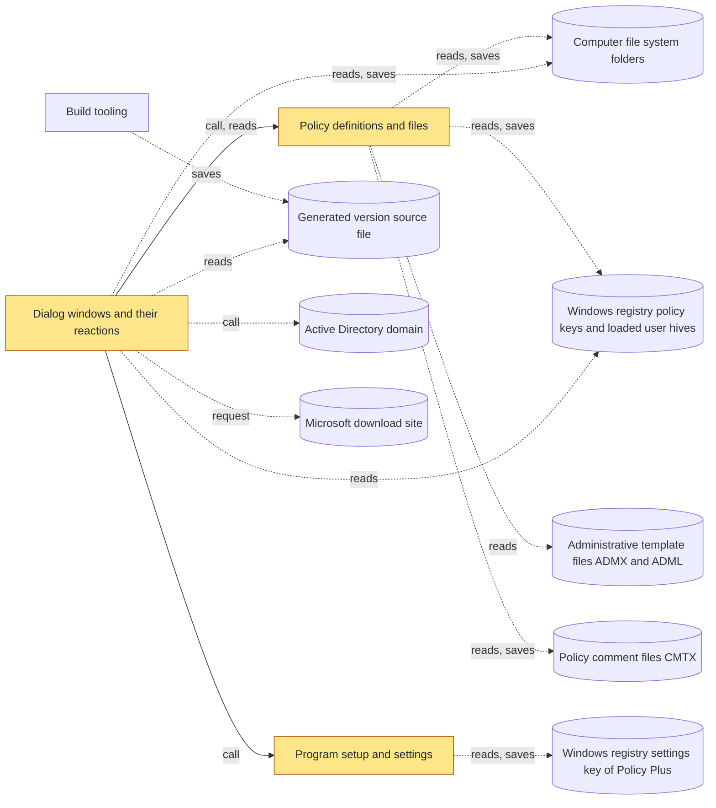
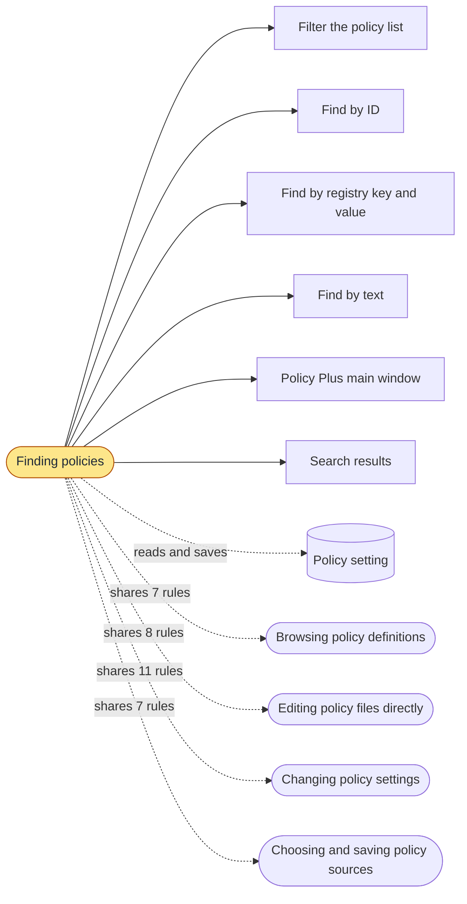
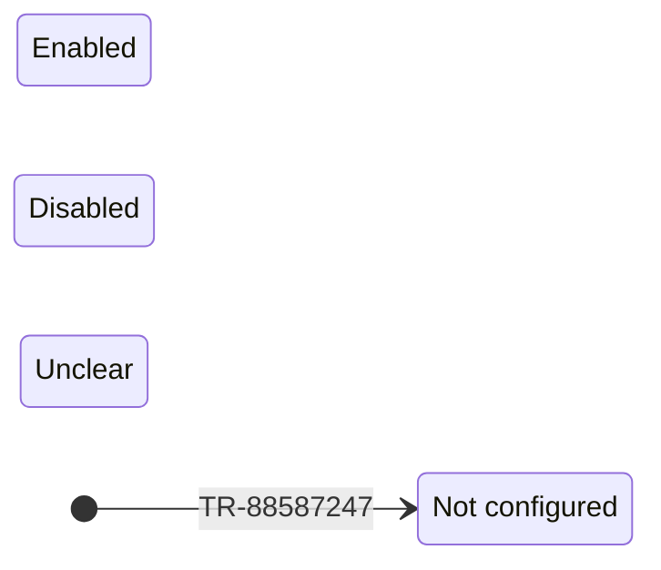

# Capability: Finding policies

At a glance: 54 owned rules, 74 relied on, 29 actions, 16 files (6 own, 7 relied on, 0 of neighbour screens, 3 generated), 10 disputed.

How to read it: paths are relative to the source root and `file:a-b` is an inclusive line range. `BR-` rules, `ACT-` actions, `TR-` changes of state and `RK-` risks have stable ids. A record marked disputed was challenged in review and kept; the reviewer's words are under Trust. All of it was read from the code; nothing was run.

## Product context
Policy Plus is a Windows desktop editor for Group Policy settings, used by administrators and power users. It reads Microsoft's policy definition files and edits policy files directly, so it works on any Windows edition, including Home, which lacks the built-in editor.
Built with: .NET Framework v4.5.2, Microsoft Windows, System.DirectoryServices, System.Xml, Visual Basic .NET, Windows Forms (Policy Plus desktop editor).
Runs: It runs on the user's own Windows computer as one desktop program on .NET Framework 4.5.2. It asks for elevated rights when available but starts without them; loading registry hives, refreshing policy and editing local Group Policy files need them. It can also reach the domain's shared policy folder.
Reaches outside itself: Computer file system folders; Windows registry policy keys and loaded user hives; Administrative template files (ADMX and ADML); Windows registry settings key of Policy Plus; Generated version source file; Policy comment files (CMTX); Active Directory domain; Microsoft download site.

## Where this sits
Narrow the policy list by filter and find policies by ID, text or registry key and value, then pick a result. Area: Reading policy definitions.

- **Filter the policy list**: Narrow the policy list by state, comment, support and other conditions. (bundle: screen filter-the-policy-list)
- **Find by ID**: Look up a category, product, support rule or policy by its ID. (bundle: screen find-by-id)
- **Find by registry key and value**: Search for policies that use a given registry key or value. (bundle: screen find-by-registry-key-and-value)
- **Find by text**: Search policy text for words, in the attributes you choose. (bundle: screen find-by-text)
- **Policy Plus main window**: Browse categories and policies, and reach every other action. (bundle: screen policy-plus-main-window)
- **Search results**: Watch a search run, stop it and pick a policy from the results. (bundle: screen search-results)

## Boundary
- Shares code with **Browsing policy definitions**: 7 rules (bundle: capability Browsing policy definitions)
- Shares code with **Changing policy settings**: 11 rules (bundle: capability Changing policy settings)
- Shares code with **Choosing and saving policy sources**: 7 rules (bundle: capability Choosing and saving policy sources)
- Shares code with **Editing policy files directly**: 8 rules (bundle: capability Editing policy files directly)
- Runs core code the other capabilities also run: 56 rules, listed under Relied on

## Contract: what it must do
### Filter the policy list
Narrow the policy list by state, comment, support and other conditions.
Controls (13): Button: OkButton, ResetButton; CheckBox: AlwaysMatchAnyCheckbox, MatchBlankSupportCheckbox, SupportedCheckbox; ComboBox: CommentedCombobox, PolicyStateCombobox, PolicyTypeCombobox; GroupBox: RequirementsBox; Label: CommentedLabel, PolicyStateLabel, PolicyTypeLabel; TreeView (DoubleClickIgnoringTreeView): AllowedProductsTreeview

Actions
- **ACT-07003543** Enables the product requirements box only while Supported on is ticked — `PolicyPlus/FilterOptions.vb:76-78`; started by person
- **ACT-39368079** Closes the dialog as cancelled when Escape is pressed — `PolicyPlus/FilterOptions.vb:79-81`; started by person
- **ACT-97597302** Sets the dialog back to a filter that matches everything — `PolicyPlus/FilterOptions.vb:82-84`; started by person
- **ACT-69656536** Builds the filter from the chosen options and closes the dialog accepted — `PolicyPlus/FilterOptions.vb:85-120`; started by person
- **ACT-97867529** Recolours the product tree so it looks right when disabled — `PolicyPlus/FilterOptions.vb:121-124`; started by person
- **ACT-39562170** Applies the new tick to all child products — `PolicyPlus/FilterOptions.vb:125-129`; started by person
- **ACT-86274598** Drops the double-click message so the tree check state stays in step — `PolicyPlus/FilterOptions.vb:155-158`; started by person

Rules
- **BR-77875588** When the filter dialog opens, the Policy type choice shows Any if the current filter has no policy-type condition, Policy if it keeps only managed policies, and Preference if it keeps only the others. — `PolicyPlus/FilterOptions.vb:23-27`
- **BR-87578271** When the filter dialog opens, the Current state choice shows Any if the current filter has no state condition, otherwise Not Configured, Configured, Enabled or Disabled as the filter holds. — `PolicyPlus/FilterOptions.vb:28-41`
- **BR-78300947** When the filter dialog opens, the Commented choice shows Any if the current filter has no comment condition, Yes if it keeps only commented policies and No if it keeps only uncommented ones. — `PolicyPlus/FilterOptions.vb:42-46`
- **BR-85169671** When the current filter has no supported-on condition, the dialog opens with Supported on unticked, both "Match a policy if at least one selected product is supported" and "Match policies with missing or blank support definitions" ticked, and no product ticked. — `PolicyPlus/FilterOptions.vb:47-53`; also rests on `PolicyPlus/FilterOptions.Designer.vb:152`, `PolicyPlus/FilterOptions.Designer.vb:164`
- **BR-84730570** When the current filter has a supported-on condition, the dialog opens with Supported on ticked, exactly the filter's products ticked and the two matching options set as the filter holds; product branches whose tick differs from their parent are opened. — `PolicyPlus/FilterOptions.vb:54-74`
- **BR-19489759** The product requirement box (the product tree and the two matching options) can be used only while Supported on is ticked; it starts unusable. — `PolicyPlus/FilterOptions.vb:76-78`; also rests on `PolicyPlus/FilterOptions.Designer.vb:131`
- **BR-14233724** Pressing Escape closes the filter dialog as cancelled and the current filter is unchanged. — `PolicyPlus/FilterOptions.vb:79-81`
- **BR-90971597** Reset returns every choice to its default: Any for type, state and comment, Supported on unticked, both matching options ticked and no product ticked. — `PolicyPlus/FilterOptions.vb:82-84`; also rests on `PolicyPlus/FilterOptions.vb:21-53`
- **BR-79074787** When OK is pressed, the new filter keeps only managed policies for Policy, only unmanaged ones for Preference, and no policy-type condition for Any. — `PolicyPlus/FilterOptions.vb:88-93`
- **BR-63556055** When OK is pressed, the new filter requires the chosen state: Not Configured, Configured, Enabled or Disabled; Any sets no state condition. — `PolicyPlus/FilterOptions.vb:94-103`
- **BR-11463954** When OK is pressed, the new filter keeps only commented policies for Yes, only uncommented ones for No, and no comment condition for Any. — `PolicyPlus/FilterOptions.vb:104-109`
- **BR-34851721** When OK is pressed with Supported on ticked, the filter records every ticked product and both matching options; with it unticked, any ticks and options are discarded and no support condition applies. A filter with Supported on ticked and no product ticked is accepted. — `PolicyPlus/FilterOptions.vb:110-119`
- **BR-15744538** Ticking or unticking a product by hand ticks or unticks every product beneath it to match; changes made by the dialog itself do not spread. — `PolicyPlus/FilterOptions.vb:125-129`; also rests on `PolicyPlus/FilterOptions.vb:130-135`
- **BR-98008638** Double-clicking a product checkbox does nothing, so a tick shown always agrees with the tick kept. — `PolicyPlus/FilterOptions.vb:155-158`; also rests on `PolicyPlus/FilterOptions.vb:151-152`

### Find by ID
Look up a category, product, support rule or policy by its ID.
Controls (3): Button: GoButton; PictureBox: StatusImage; TextBox: IdTextbox

Actions
- **ACT-65770759** Takes the status icons from the main window's icon list — `PolicyPlus/FindById.vb:14-21`; started by person
- **ACT-58939962** Looks the typed ID up among categories, products, support definitions and policies and shows what it found — `PolicyPlus/FindById.vb:22-53`; started by person
- **ACT-16381995** Clears the placeholder space and focuses the ID box — `PolicyPlus/FindById.vb:54-58`; started by person
- **ACT-04016976** Closes the dialog with the typed ID accepted — `PolicyPlus/FindById.vb:59-61`; started by person
- **ACT-14893425** Closes the dialog as cancelled when Escape is pressed — `PolicyPlus/FindById.vb:62-64`; started by person

Rules
- **BR-20325745** Text typed in Find by ID is trimmed and looked up in this order: category, product, support definition, then policy. The first kind that matches is selected, with its own icon shown; a policy is looked up only when no other kind matches. — `PolicyPlus/FindById.vb:22-40`
- **BR-60464161** When the text matches nothing, nothing is selected and a "not found" icon is shown; when the text is empty a blank icon is shown instead. The section from an earlier match is not cleared when the text changes to a non-policy. — `PolicyPlus/FindById.vb:24-27`; also rests on `PolicyPlus/FindById.vb:49-51`; **disputed**
- **BR-88409732** A policy ID may end with "@U" to mean the user section or "@C" to mean the computer section; without a suffix, or with any other suffix, the policy applies to both sections. The suffix is cut off before the policy lookup, so an unknown suffix still finds the policy. — `PolicyPlus/FindById.vb:39-48`
- **BR-51713079** Go closes Find by ID as accepted whether or not the text matched anything, so the caller may receive no selection. — `PolicyPlus/FindById.vb:59-61`
- **BR-56863443** Pressing Escape closes Find by ID as cancelled. — `PolicyPlus/FindById.vb:62-64`

### Find by registry key and value
Search for policies that use a given registry key or value.
Controls (5): Button: SearchButton; Label: KeyPathLabel, ValueLabel; TextBox: KeyTextbox, ValueTextbox

Actions
- **ACT-84114585** Closes the dialog as cancelled when Escape is pressed — `PolicyPlus/FindByRegistry.vb:3-5`; started by person
- **ACT-88540545** Checks the typed registry key and value terms and builds the policy search function — `PolicyPlus/FindByRegistry.vb:6-37`; started by person

Rules
- **BR-77319907** When Search is pressed with both the key and the value empty, the search is refused and the person is told "Please enter search terms." — `PolicyPlus/FindByRegistry.vb:9-12`
- **BR-56766440** When the key text starts with HKLM\, HKCU\, HKEY_LOCAL_MACHINE\ or HKEY_CURRENT_USER\, the search is refused with "Policies' root keys are determined only by their section. Remove the root key from the search terms and try again." — `PolicyPlus/FindByRegistry.vb:13-16`
- **BR-66663184** A policy matches a registry search when at least one registry value it reads or writes meets every term entered; matching ignores case. — `PolicyPlus/FindByRegistry.vb:17-35`; also rests on `PolicyPlus/FindByRegistry.vb:7-8`
- **BR-43025066** A value-name term must match the whole value name; "*" and "?" act as wildcards, so without them the name must be equal. — `PolicyPlus/FindByRegistry.vb:20-22`; **disputed**
- **BR-75510973** A key term containing "*" or "?" must match the whole key path as a wildcard pattern. — `PolicyPlus/FindByRegistry.vb:24-25`
- **BR-22334165** A key term containing a backslash but no wildcard matches policies whose key path starts with that text. — `PolicyPlus/FindByRegistry.vb:26-27`
- **BR-19629666** A key term with no backslash and no wildcard matches policies having a key path with a part equal to that text. — `PolicyPlus/FindByRegistry.vb:28-29`

### Find by text
Search policy text for words, in the attributes you choose.
Controls (5): Button: SearchButton; CheckBox: CommentCheckbox, DescriptionCheckbox, TitleCheckbox; TextBox: StringTextbox

Actions
- **ACT-71669922** Closes the dialog as cancelled when Escape is pressed — `PolicyPlus/FindByText.vb:8-10`; started by person
- **ACT-88592289** Checks the typed search text and chosen attributes and builds the policy search function — `PolicyPlus/FindByText.vb:11-73`; started by person

Rules
- **BR-07352856** When Search is pressed with the search text empty, the search is refused and the person is told "Please enter search terms." — `PolicyPlus/FindByText.vb:12-16`
- **BR-65764837** When none of In title, In description and In comment is ticked, the search is refused with "At least one attribute must be searched. Check one of the boxes and try again."; all three start ticked. — `PolicyPlus/FindByText.vb:17-23`; also rests on `PolicyPlus/FindByText.Designer.vb:42`, `PolicyPlus/FindByText.Designer.vb:54`, `PolicyPlus/FindByText.Designer.vb:66`
- **BR-79544771** Search text is split at spaces into plain words, wildcard words (containing "*" or "?") and quoted phrases. Words are lowercased and trimmed and lose the characters . , ' " ; / ! ( ) { } [ ]. — `PolicyPlus/FindByText.vb:25-49`
- **BR-88029346** A phrase opened with a double quote runs until a later word ending in a double quote; a phrase never closed is dropped without telling the person, which widens the search. A single quoted word such as "abc" does not close itself, so it also absorbs the following words. — `PolicyPlus/FindByText.vb:36-45`; **disputed**
- **BR-85082056** A text is a hit only when it contains every plain word as a whole word, every wildcard matching some word, and every quoted phrase as whole words together. — `PolicyPlus/FindByText.vb:51-58`
- **BR-56979448** A policy matches when the ticked attributes hit: its title, its description, or a comment on it from any supplied comment source (user or computer). Any one hit is enough. — `PolicyPlus/FindByText.vb:59-70`; also rests on `PolicyPlus/FindByText.vb:4-7`

### Policy Plus main window
Browse categories and policies, and reach every other action.
Controls (56): ": PolicyIsPrefLabel; Friend WithEvents AboutToolStripMenuItem As ToolStripMenuItem  [Text = "About"]: AboutToolStripMenuItem; Friend WithEvents AcquireADMXFilesToolStripMenuItem As ToolStripMenuItem  [Text = "Acquire ADMX Files"]: AcquireADMXFilesToolStripMenuItem; Friend WithEvents AllProductsToolStripMenuItem As ToolStripMenuItem  [Text = "All Products"]: AllProductsToolStripMenuItem; Friend WithEvents AllSupportDefinitionsToolStripMenuItem As ToolStripMenuItem  [Text = "All Support Definitions"]: AllSupportDefinitionsToolStripMenuItem; Friend WithEvents ByIDToolStripMenuItem As ToolStripMenuItem  [Text = "By ID": ByIDToolStripMenuItem; Friend WithEvents ByRegistryToolStripMenuItem As ToolStripMenuItem  [Text = "By Registry": ByRegistryToolStripMenuItem; Friend WithEvents ByTextToolStripMenuItem As ToolStripMenuItem  [Text = "By Text": ByTextToolStripMenuItem; Friend WithEvents CategoriesTree As TreeView  [TabIndex = 2]: CategoriesTree; Friend WithEvents ChSettingName As ColumnHeader  [Text = "Name": ChSettingName; Friend WithEvents CloseADMXWorkspaceToolStripMenuItem As ToolStripMenuItem  [Text = "Close ADMX Workspace"]: CloseADMXWorkspaceToolStripMenuItem; Friend WithEvents CmeAllDetails As ToolStripMenuItem  [Text = "Details"]: CmeAllDetails; Friend WithEvents CmeCatOpen As ToolStripMenuItem  [Text = "Open"]: CmeCatOpen; Friend WithEvents CmePolEdit As ToolStripMenuItem  [Text = "Edit"]: CmePolEdit; Friend WithEvents CmePolInspectElements As ToolStripMenuItem  [Text = "Element Inspector"]: CmePolInspectElements; Friend WithEvents CmePolSpolFragment As ToolStripMenuItem  [Text = "Semantic Policy Fragment"]: CmePolSpolFragment; Friend WithEvents ComboAppliesTo As ComboBox  [TabIndex = 1: ComboAppliesTo; Friend WithEvents ComputerSourceLabel As ToolStripStatusLabel  [Text = "Computer info"]: ComputerSourceLabel; Friend WithEvents DeduplicatePoliciesToolStripMenuItem As ToolStripMenuItem  [Text = "Deduplicate Policies": DeduplicatePoliciesToolStripMenuItem; Friend WithEvents EditRawPOLToolStripMenuItem As ToolStripMenuItem  [Text = "Edit Raw POL"]: EditRawPOLToolStripMenuItem; Friend WithEvents EmptyCategoriesToolStripMenuItem As ToolStripMenuItem  [Text = "Empty Categories"]: EmptyCategoriesToolStripMenuItem; Friend WithEvents ExitToolStripMenuItem As ToolStripMenuItem  [Text = "Exit"]: ExitToolStripMenuItem; Friend WithEvents ExportPOLToolStripMenuItem As ToolStripMenuItem  [Text = "Export POL"]: ExportPOLToolStripMenuItem; Friend WithEvents ExportREGToolStripMenuItem As ToolStripMenuItem  [Text = "Export REG"]: ExportREGToolStripMenuItem; Friend WithEvents FileToolStripMenuItem As ToolStripMenuItem  [Text = "File"]: FileToolStripMenuItem; Friend WithEvents FilterOptionsToolStripMenuItem As ToolStripMenuItem  [Text = "Filter Options"]: FilterOptionsToolStripMenuItem; Friend WithEvents FindNextToolStripMenuItem As ToolStripMenuItem  [Text = "Find Next": FindNextToolStripMenuItem; Friend WithEvents FindToolStripMenuItem As ToolStripMenuItem  [Text = "Find"]: FindToolStripMenuItem; Friend WithEvents HelpToolStripMenuItem As ToolStripMenuItem  [Text = "Help"]: HelpToolStripMenuItem; Friend WithEvents ImportPOLToolStripMenuItem As ToolStripMenuItem  [Text = "Import POL"]: ImportPOLToolStripMenuItem; Friend WithEvents ImportREGToolStripMenuItem As ToolStripMenuItem  [Text = "Import REG"]: ImportREGToolStripMenuItem; Friend WithEvents ImportSemanticPolicyToolStripMenuItem As ToolStripMenuItem  [Text = "Import Semantic Policy"]: ImportSemanticPolicyToolStripMenuItem; Friend WithEvents InfoStrip As StatusStrip  [Text = "StatusStrip1": InfoStrip; Friend WithEvents LoadedADMXFilesToolStripMenuItem As ToolStripMenuItem  [Text = "Loaded ADMX Files"]: LoadedADMXFilesToolStripMenuItem; Friend WithEvents MainMenu As MenuStrip  [Text = "MenuStrip1": MainMenu; Friend WithEvents OnlyFilteredObjectsToolStripMenuItem As ToolStripMenuItem  [Text = "Only Filtered Policies"]: OnlyFilteredObjectsToolStripMenuItem; Friend WithEvents OpenADMXFileToolStripMenuItem As ToolStripMenuItem  [Text = "Open ADMX File"]: OpenADMXFileToolStripMenuItem; Friend WithEvents OpenADMXFolderToolStripMenuItem As ToolStripMenuItem  [Text = "Open ADMX Folder"]: OpenADMXFolderToolStripMenuItem; Friend WithEvents OpenPolicyResourcesToolStripMenuItem As ToolStripMenuItem  [Text = "Open Policy Resources": OpenPolicyResourcesToolStripMenuItem; Friend WithEvents PictureBox1 As PictureBox  [TabIndex = 0: PictureBox1; Friend WithEvents PoliciesList As ListView  [TabIndex = 3: PoliciesList; Friend WithEvents PolicyDescLabel As Label  [Text = "Policy description": PolicyDescLabel; Friend WithEvents PolicyIcons As ImageList: PolicyIcons; Friend WithEvents PolicyInfoTable As TableLayoutPanel  [TabIndex = 0]: PolicyInfoTable; Friend WithEvents PolicyIsPrefTable As TableLayoutPanel  [TabIndex = 4]: PolicyIsPrefTable; Friend WithEvents PolicyObjectContext As ContextMenuStrip: PolicyObjectContext; Friend WithEvents PolicySupportedLabel As Label  [Text = "Requirements": PolicySupportedLabel; Friend WithEvents PolicyTitleLabel As Label  [Text = "Policy title": PolicyTitleLabel; Friend WithEvents SavePoliciesToolStripMenuItem As ToolStripMenuItem  [Text = "Save Policies": SavePoliciesToolStripMenuItem; Friend WithEvents SearchResultsToolStripMenuItem As ToolStripMenuItem  [Text = "Search Results": SearchResultsToolStripMenuItem; Friend WithEvents SetADMLLanguageToolStripMenuItem As ToolStripMenuItem  [Text = "Set ADML Language"]: SetADMLLanguageToolStripMenuItem; Friend WithEvents SettingInfoPanel As Panel  [TabIndex = 0]: SettingInfoPanel; Friend WithEvents ShareToolStripMenuItem As ToolStripMenuItem  [Text = "Share"]: ShareToolStripMenuItem; Friend WithEvents SplitContainer As SplitContainer  [TabIndex = 1: SplitContainer; Friend WithEvents UserSourceLabel As ToolStripStatusLabel  [Text = "User info"]: UserSourceLabel; Friend WithEvents ViewToolStripMenuItem As ToolStripMenuItem  [Text = "View"]: ViewToolStripMenuItem

Actions
- **ACT-46567218** Asks for an identifier and moves to, or opens, the matching category, policy, product or support definition. — `PolicyPlus/Main.vb:580-606`; started by person
- **ACT-77660767** Asks for search text and runs the search. — `PolicyPlus/Main.vb:645-650`; started by person
- **ACT-45682165** Shows the search results window without starting a search. — `PolicyPlus/Main.vb:651-654`; started by person
- **ACT-49303737** Moves to the next visible policy in the search results. — `PolicyPlus/Main.vb:655-667`; started by person
- **ACT-12347635** Asks for registry details and runs the search. — `PolicyPlus/Main.vb:668-671`; started by person
- **ACT-27046885** Asks for filter settings and turns the filtered view on. — `PolicyPlus/Main.vb:692-700`; started by person
- **ACT-47813355** Switches whether the filter is applied to the lists. — `PolicyPlus/Main.vb:701-706`; started by person

Rules
- **BR-36894297** The Deduplicate Policies menu entry is hidden, so the person cannot start it. — `PolicyPlus/Main.Designer.vb:266`
- **BR-42280110** The area choice offers only "User or Computer", "User" and "Computer", with no free text. — `PolicyPlus/Main.Designer.vb:409-410`
- **BR-92273709** Only one item in the policy list can be selected at a time. — `PolicyPlus/Main.Designer.vb:534`
- **BR-58031281** A search dialog opens either empty or running a new search. When the person picks a result, its editor opens in the current area and the list moves to that policy. — `PolicyPlus/Main.vb:378-387`
- **BR-75007862** Moving to a policy first shows its category, but only when that category is visible in the tree; otherwise nothing happens and the person is not told. The policy row is then selected only if the policy is listed there. A policy hidden by the area choice or the filter leaves the category shown with nothing selected and no message; find by text and by registry do not check this before opening the editor. — `PolicyPlus/Main.vb:396-407`
- **BR-71127226** After finding by identifier, a category opens if it is visible, otherwise the person is told "The category is not currently visible. Change the view settings and try again."; a policy opens in the editor and the list moves to it; a product or support definition opens its details; anything else gives "That object could not be found.". — `PolicyPlus/Main.vb:584-604`
- **BR-88125936** A policy found by identifier opens in the lower-numbered of the area shown and the area found (computer is lower than user, user lower than both), so Computer wins over User. — `PolicyPlus/Main.vb:596`; also rests on `PolicyPlus/AdmxStructures.vb:55-59`
- **BR-78630022** Find by text starts a search with what the person entered, and can search both areas' comments. — `PolicyPlus/Main.vb:647-649`
- **BR-55409296** "Search Results" only reopens the last results and starts no new search. — `PolicyPlus/Main.vb:653`
- **BR-59081557** Find Next moves to the next result that is currently visible, skipping hidden ones, and tells the person "There are no more results that match the filter." when none is left. — `PolicyPlus/Main.vb:657-666`
- **BR-69686546** Find by registry starts a search with what the person entered. — `PolicyPlus/Main.vb:670`
- **BR-95299547** Changing the filter options turns on "Only Filtered Policies" and moves to the nearest visible category. — `PolicyPlus/Main.vb:695-698`
- **BR-31327872** The "Only Filtered Policies" menu switches the filter on or off and moves to the nearest visible category. — `PolicyPlus/Main.vb:703-705`

### Search results
Watch a search run, stop it and pick a policy from the results.
Controls (8): Button, Text = "Go", TabIndex = 3: GoButton; Button, Text = "Stop", TabIndex = 0: StopButton; Cancel, TabIndex = 4: CloseButton; ColumnHeader, Text = "Category", Width = 99: ChCategory; ColumnHeader, Text = "Title", Width = 222: ChTitle; Label, Text = "Results: 0 (searching)", TabIndex = 2: ProgressLabel; ListView, TabIndex = 1: ResultsListview; ProgressBar, TabIndex = 0: SearchProgress

Actions
- **ACT-73341208** Starts the background search when one is waiting, otherwise restores the last selected result. — `PolicyPlus/FindResults.vb:95-105`; started by person
- **ACT-46850164** Asks the running search to stop. — `PolicyPlus/FindResults.vb:106-108`; started by person
- **ACT-26500839** Keeps the title column filling the width of the results list. — `PolicyPlus/FindResults.vb:109-111`; started by person
- **ACT-87346557** Stops the search when the results window is closed and settles the progress display. — `PolicyPlus/FindResults.vb:112-119`; started by person
- **ACT-28310343** Takes the selected search result as the chosen policy and closes the window with OK. — `PolicyPlus/FindResults.vb:120-125`; started by person
- **ACT-96190507** Turns on double-buffered drawing for the results list. — `PolicyPlus/FindResults.vb:126-130`; started by person

Rules
- **BR-10149934** Starting a search clears earlier results, sets the progress range to the number of policies, and begins on "Starting search". — `PolicyPlus/FindResults.vb:11-26`
- **BR-32480917** When search results are opened from the main window and no search has been run (or it was cleared), the person is told "No search has been run yet, so there are no results to display." and nothing opens. — `PolicyPlus/FindResults.vb:27-37`
- **BR-82291886** Taking the next policy returns nothing when no search has run or when the last result has been passed; otherwise it returns the result after the last chosen one. — `PolicyPlus/FindResults.vb:42-46`
- **BR-48770219** The search tests every policy in turn, and adds every hit to the list with its category name, in the order policies are held. — `PolicyPlus/FindResults.vb:63-73`; also rests on `PolicyPlus/FindResults.vb:53-62`
- **BR-00502591** The list and progress are refreshed after every 20 policies: "Searching: checked N policies so far, found M hits". — `PolicyPlus/FindResults.vb:74-80`
- **BR-40708163** When a search ends it reports "Finished searching: checked N policies, found M hits", or "Search canceled: ..." if stopped, and the Stop button is disabled. — `PolicyPlus/FindResults.vb:82-89`
- **BR-22947109** Stop, or closing the results window, cancels the search; closing also leaves the label at "Search canceled" with the bar full if the search had not finished. — `PolicyPlus/FindResults.vb:91-94`; also rests on `PolicyPlus/FindResults.vb:106-119`
- **BR-80798684** When the results window is reopened, the previously selected result is selected again if it is still in the list. — `PolicyPlus/FindResults.vb:95-105`; **disputed**
- **BR-92938759** Go, or a double-click on a result, accepts only when a result is selected; the selected policy is passed back and its position remembered. — `PolicyPlus/FindResults.vb:120-125`

## Relied on: decided elsewhere
**Core code, run by 4 or more other capabilities**
- `PolicyPlus/Main.vb`
  - **BR-22463982** A category appears in the tree only when it passes the visibility rule; each shown category gets an icon by its kind and carries its visible subcategories below it, and the tree is sorted. — `PolicyPlus/Main.vb:90-95`; also rests on `PolicyPlus/Main.vb:98-99`
  - **BR-11308115** After the category tree is rebuilt from the loaded definitions, no category, policy or highlighted item is selected and the information pane shows the empty state. — `PolicyPlus/Main.vb:100-103`
  - **BR-74199547** When the list is rebuilt, the policy already selected is selected again and revealed only if it is still listed, that is, it sits in the category shown and passes the visibility rule; otherwise nothing is selected. … — `PolicyPlus/Main.vb:109-112`; also rests on `PolicyPlus/Main.vb:130-138`
  - **BR-49856909** The right pane lists the chosen category in this order: an "Up: <parent name>" row marked "Parent" when the category has a parent, then visible subcategories by name, then visible policies by name. … — `PolicyPlus/Main.vb:113-129`; also rests on `PolicyPlus/Main.vb:116-117`
  - **BR-64147870** The category tree selection follows the category shown in the right pane. — `PolicyPlus/Main.vb:139-141`
  - **BR-99672368** When nothing is selected, the title and support lines are hidden and the pane reads "Select an item to see its description.". — `PolicyPlus/Main.vb:146-148`; also rests on `PolicyPlus/Main.vb:164-167`
  - **BR-21119593** For a selected policy the information pane shows its title, "(no requirements information)" when it has no support rule or "Requirements:" plus the support name, and its explanation. … — `PolicyPlus/Main.vb:149-157`; also rests on `PolicyPlus/Main.Designer.vb:669-670`
  - **BR-25403263** For a selected or highlighted category the pane shows its title, "This category contains N policies and M subcategories." ("The selected category" when highlighted but not opened) and its explanation. … — `PolicyPlus/Main.vb:158-163`
  - **BR-80796596** A category is orphaned when it has no parent among the loaded definitions although its definition names one. — `PolicyPlus/Main.vb:171`
  - **BR-01098949** A category is empty when it holds no subcategories and no policies at all, counting hidden ones. — `PolicyPlus/Main.vb:174`
  - **BR-68396159** A category's icon is chosen in this order: orphaned, then empty, then normal. — `PolicyPlus/Main.vb:177-183`
  - **BR-57678995** A policy's icon is chosen in this order: preference, then plain when it has no configurable elements, then "extra configuration" when it has some. — `PolicyPlus/Main.vb:186-192`
  - **BR-47152124** A category is visible when empty categories are switched on. … — `PolicyPlus/Main.vb:196-200`
  - **BR-86583005** A policy is visible only if it applies to a chosen area (user, computer or both). … — `PolicyPlus/Main.vb:204-215`; also rests on `PolicyPlus/Main.vb:436-439`
  - **BR-14109370** When a view setting changes, the program moves up to the nearest visible category, drops the selected policy if the move happened or the policy is now hidden, then rebuilds the tree and list. … — `PolicyPlus/Main.vb:221-230`; also rests on `PolicyPlus/Main.vb:139-141`, `PolicyPlus/Main.vb:480-486`
  - **BR-70802702** With both areas shown, a policy that applies to both areas shows its common state followed by "(2)" when both match, the computer state followed by "(C)" when only the user is Not Configured, the user state followed by "(U)" when only the computer is Not Configured, and "Mixed" otherwise. — `PolicyPlus/Main.vb:234-247`
  - **BR-75647919** With both areas shown, a policy that applies to one area shows that area's state followed by "(C)" for computer or "(U)" for user. … — `PolicyPlus/Main.vb:248-252`
  - **BR-27401870** A policy's state in one area reads "Enabled", "Disabled", "Not Configured" or "Unknown"; the computer source is read for the computer area and the user source for any other. — `PolicyPlus/Main.vb:257-266`
  - **BR-65013329** With both areas shown, the comment column is empty when neither area has a comment, shows "(multiple)" when both have one, and otherwise shows the single comment. — `PolicyPlus/Main.vb:270-281`; also rests on `PolicyPlus/Main.vb:283`
  - **BR-11436933** A policy's comment in one area is empty when that source has no comment file or holds no comment for the policy, and otherwise the saved text. — `PolicyPlus/Main.vb:288-293`
  - **BR-04807958** A policy is a preference, not a managed policy, when it names a registry key outside the three policy locations: software\policies, software\microsoft\windows\currentversion\policies and system\currentcontrolset\policies. — `PolicyPlus/Main.vb:296`
  - **BR-01595450** A filter on managed policies hides preferences when managed policies are wanted, and hides managed policies when preferences are wanted. — `PolicyPlus/Main.vb:411-413`
  - **BR-23822249** A policy passes the filter only when it passes every active part of it. — `PolicyPlus/Main.vb:411-434`
  - **BR-95943001** A filter on state keeps only policies whose state in the checked area is Configured (Enabled or Disabled), Not Configured, Disabled or Enabled, as chosen. — `PolicyPlus/Main.vb:414-426`
  - **BR-30112593** A filter on comments keeps only policies that have a non-empty comment in the checked area, or only those that have none, as chosen. — `PolicyPlus/Main.vb:427-430`
  - **BR-57225531** A filter on products keeps only policies supported by the chosen products, honouring the options to match any product and to include policies with blank support. — `PolicyPlus/Main.vb:431-433`
  - **BR-78263418** A policy applies to an area when its definition declares that area; a policy declared for both applies to each. — `PolicyPlus/Main.vb:438`
  - **BR-56579605** The text of a policy description is tidied for display: leading and trailing spaces are removed from every line and blank space at the end of the text is dropped. — `PolicyPlus/Main.vb:863-870`
- `PolicyPlus/PolicyProcessing.vb`
  - **BR-59240838** A policy's lists of on-values and off-values count as enabled or disabled evidence for each value in them that is present, using the list's own key when it names one. — `PolicyPlus/PolicyProcessing.vb:11-18`; also rests on `PolicyPlus/PolicyProcessing.vb:32-33`
  - **BR-16213931** A policy with a registry value of its own counts as enabled evidence when that value holds its 'on' value, which is the number 1 when the template gives none, and as disabled evidence when it holds its 'off' value or is marked for deletion when the template gives none. — `PolicyPlus/PolicyProcessing.vb:20-31`; also rests on `PolicyPlus/PolicyProcessing.vb:87-105`
  - **BR-43129633** For a policy's list elements, a marked-for-deletion list counts as one deleted element, and a list that holds any values counts as a present element and cancels that deletion. — `PolicyPlus/PolicyProcessing.vb:40-49`
  - **BR-29429916** For a checkbox element: a value marked for deletion counts as one deleted element. … — `PolicyPlus/PolicyProcessing.vb:50-61`; also rests on `PolicyPlus/PolicyProcessing.vb:11-18`, `PolicyPlus/PolicyProcessing.vb:87-105`
  - **BR-73157702** For any other element (number, text, choice, multi-line text), a value marked for deletion counts as a deleted element and a value that is present counts as a present element. — `PolicyPlus/PolicyProcessing.vb:62-68`
  - **BR-84295212** If any element is present, the elements add their count to the enabled evidence; only when none is present do deleted elements add to the disabled evidence. — `PolicyPlus/PolicyProcessing.vb:70-74`
  - **BR-02220135** A policy is Enabled when enabled evidence exceeds disabled evidence, Disabled when disabled exceeds enabled, Not configured when there is no evidence either way, and Unclear when both are equal and above zero. — `PolicyPlus/PolicyProcessing.vb:77-85`
  - **BR-26486738** A value counts as present when: for a deletion marker, it is marked for deletion; for a number, it exists as a whole number and equals the expected number; for text, it exists as text and equals the expected text. … — `PolicyPlus/PolicyProcessing.vb:87-105`
  - **BR-24272603** When a policy lists no supported-on information, it counts as supported only if the caller allows unlisted policies. … — `PolicyPlus/PolicyProcessing.vb:382-384`
  - **BR-60691407** A support entry for a product counts as met in two cases. … — `PolicyPlus/PolicyProcessing.vb:385`; also rests on `PolicyPlus/PolicyProcessing.vb:386-395`
  - **BR-00666232** A support entry for a product that has versions beneath it, whether a version range or a plain entry for a parent product that is not itself chosen, counts as met when any version in its range, or a sub-product directly beneath one, is chosen. … — `PolicyPlus/PolicyProcessing.vb:386-396`; also rests on `PolicyPlus/PolicyProcessing.vb:385`
  - **BR-83901255** A support definition met a second time anywhere in one evaluation counts as not met, because the list of definitions seen is never emptied. … — `PolicyPlus/PolicyProcessing.vb:401-402`; also rests on `PolicyPlus/PolicyProcessing.vb:413-420`
  - **BR-22807804** When the caller asks for 'any' matching, a support definition whose logic is all-of needs every entry met, and any other definition needs one entry met. … — `PolicyPlus/PolicyProcessing.vb:403-421`; **disputed**
- `PolicyPlus/PolicySource.vb`
  - **BR-19073718** A value in a policy file counts as present only if it is stored and not marked for deletion. — `PolicyPlus/PolicySource.vb:110-113`
  - **BR-16088403** Reading a value from a policy file gives nothing when the value is absent or marked for deletion. — `PolicyPlus/PolicySource.vb:114-117`
  - **BR-98884064** A value in a policy file counts as marked for deletion when a deletion marker names it, when the key has a clear-all marker, or when a delete-values list for the key names it, regardless of case. … — `PolicyPlus/PolicySource.vb:118-135`; also rests on `PolicyPlus/PolicySource.vb:18`, `PolicyPlus/PolicySource.vb:105-109`
  - **BR-37060853** Listing the values of a key in a policy file leaves out the marker entries unless the caller asks for them. — `PolicyPlus/PolicySource.vb:139-149`
  - **BR-77904356** Text read from a policy file stops at its first empty character, and a multiple-string value ends at its first empty string. — `PolicyPlus/PolicySource.vb:231-239`; also rests on `PolicyPlus/PolicySource.vb:281-295`
  - **BR-27765974** A stored policy file value is read back as text for text and expandable text, a 32-bit or 64-bit number for numbers, a list of strings for multiple strings, and raw bytes for every other type. — `PolicyPlus/PolicySource.vb:320-336`
  - **BR-24603885** When a value is deleted in the live registry and its key does not exist, nothing happens. … — `PolicyPlus/PolicySource.vb:365-370`
  - **BR-42565520** A value in the live registry counts as present when its key exists and, unless the value name is empty, the key lists a value of that name, regardless of case. … — `PolicyPlus/PolicySource.vb:384-390`
  - **BR-37627331** Reading a value from the live registry gives nothing when the key is missing. … — `PolicyPlus/PolicySource.vb:391-403`
  - **BR-74244047** The live registry never reports a value as marked for deletion. — `PolicyPlus/PolicySource.vb:409-411`
  - **BR-49391310** A registry key counts as a policy key when it is one of the three policy branches (software\policies, software\microsoft\windows\currentversion\policies, system\currentcontrolset\policies) or lies below one, regardless of case. — `PolicyPlus/PolicySource.vb:412-415`; also rests on `PolicyPlus/PolicySource.vb:429-434`
- `PolicyPlus/RegFile.vb`
  - **BR-97983665** A REG file cannot be used as a source for asking whether a value is present: the request fails with 'not implemented'. … — `PolicyPlus/RegFile.vb:214-216`; also rests on `PolicyPlus/PolicySource.vb:174-177`; **disputed**
  - **BR-00761850** A REG file cannot be used as a source for reading a value: the request fails with 'not implemented'. … — `PolicyPlus/RegFile.vb:217-219`; also rests on `PolicyPlus/PolicySource.vb:174-177`; **disputed**
  - **BR-48421601** A REG file cannot be used as a source for checking whether a value will be deleted: the request fails with 'not implemented'. … — `PolicyPlus/RegFile.vb:220-222`; also rests on `PolicyPlus/PolicySource.vb:174-177`; **disputed**
  - **BR-06093783** A REG file cannot be used as a source for listing a key's values: the request fails with 'not implemented'. … — `PolicyPlus/RegFile.vb:223-225`; also rests on `PolicyPlus/PolicySource.vb:174-177`; **disputed**

**Code shared with a few capabilities**
- `PolicyPlus/DetailProduct.vb`
  - **BR-81592648** The product details window labels a product "Major revision", "Minor revision" or "Top-level product" from its type. — `PolicyPlus/DetailProduct.vb:13-20` (also used by Browsing policy definitions)
  - **BR-01307158** The product details window shows a version number for major and minor revisions only; for a top-level product the version is blank. — `PolicyPlus/DetailProduct.vb:21` (also used by Browsing policy definitions)
  - **BR-49006236** A product with a parent shows the parent name and enables the parent button; a product with no parent shows a blank parent and the button is disabled. — `PolicyPlus/DetailProduct.vb:22-28` (also used by Browsing policy definitions)
  - **BR-29917481** The product details window lists every child revision of a product with its version and name; a product with no children shows an empty list. — `PolicyPlus/DetailProduct.vb:29-36` (also used by Browsing policy definitions)
- `PolicyPlus/DetailSupport.vb`
  - **BR-43476269** The support details window states how a support definition matches products: "Match all the referenced products", "Match any of the referenced products", or "Do not match products" when it has no matching logic. — `PolicyPlus/DetailSupport.vb:11-18` (also used by Browsing policy definitions)
  - **BR-50345044** Each entry of a support definition is listed by the name of the nested support definition when it is one, otherwise by the name of the product, otherwise as "<missing: " followed by the product code the entry names. … — `PolicyPlus/DetailSupport.vb:20-36` (also used by Browsing policy definitions)
- `PolicyPlus/Main.vb`
  - **BR-01910966** After the edit dialog is accepted, which changes the open policy source in memory only, the list is refreshed in place if the current category is still visible; otherwise the program moves up to the nearest visible category. … — `PolicyPlus/Main.vb:300-303`; **disputed** (also used by Browsing policy definitions)
- `PolicyPlus/PolicyProcessing.vb`
  - **BR-35971750** The registry values a policy touches are its own value, those in its value lists, those of its elements (the whole key for list elements) and those of checkbox and choice sub-lists, each counted once. — `PolicyPlus/PolicyProcessing.vb:213-257`; also rests on `PolicyPlus/PolicyProcessing.vb:207-209` (also used by Changing policy settings)
  - **BR-65010717** When a policy is forgotten, the whole key of each of its list elements is cleared and every registry value it touches is dropped from the source, so it reads as Not configured. — `PolicyPlus/PolicyProcessing.vb:249-262`; also rests on `PolicyPlus/PolicyProcessing.vb:210-212` (also used by Changing policy settings)
- `PolicyPlus/PolicySource.vb`
  - **BR-74592997** When a value is forgotten in a policy file, both the value and its deletion marker are removed, so the policy reverts to not saying anything about it. — `PolicyPlus/PolicySource.vb:99-104` (also used by Editing policy files directly, Changing policy settings, Choosing and saving policy sources)
  - **BR-55812303** When a policy file is clearing a key, all values and markers under the key are dropped and a single clear-all marker is stored. — `PolicyPlus/PolicySource.vb:183-189` (also used by Editing policy files directly, Changing policy settings, Choosing and saving policy sources)
  - **BR-77326247** When a key's clearance is forgotten in a policy file, every clear-all marker for that key is removed. — `PolicyPlus/PolicySource.vb:190-195` (also used by Editing policy files directly, Changing policy settings)
  - **BR-59953686** Text stored in a policy file is written in two-byte characters followed by a closing empty character. — `PolicyPlus/PolicySource.vb:240-251` (also used by Editing policy files directly, Changing policy settings, Choosing and saving policy sources)
  - **BR-20337062** In the live registry, 'forgetting' a value deletes it, because the registry cannot remember a pending deletion. — `PolicyPlus/PolicySource.vb:371-373` (also used by Editing policy files directly, Changing policy settings, Choosing and saving policy sources)
  - **BR-90913669** Clearing a key in the live registry deletes every value in it but leaves the key and its subkeys. … — `PolicyPlus/PolicySource.vb:416-420`; also rests on `PolicyPlus/PolicySource.vb:421-423` (also used by Editing policy files directly, Changing policy settings, Choosing and saving policy sources)
- `PolicyPlus/RegFile.vb`
  - **BR-44190896** A REG file cannot be used as a source for forgetting a value: the request fails with 'not implemented'. … — `PolicyPlus/RegFile.vb:237-239`; also rests on `PolicyPlus/PolicySource.vb:174-177` (also used by Editing policy files directly, Changing policy settings, Choosing and saving policy sources)
  - **BR-36203695** When a key is cleared in a REG file, the request is ignored if a source branch is set and the key lies outside it. … — `PolicyPlus/RegFile.vb:248-253` (also used by Editing policy files directly, Changing policy settings, Choosing and saving policy sources)
  - **BR-29977676** When a key's clearance is forgotten in a REG file, the key-removal entry is dropped if it exists. … — `PolicyPlus/RegFile.vb:254-259` (also used by Changing policy settings)

## Data and states
- Policy setting: reads and saves; kept in Computer file system folders, Windows registry policy keys and loaded user hives

Life of Policy setting

| Change | From | To | Written at | In this code | Reading |
| --- | --- | --- | --- | --- | --- |
| TR-88587247 | created | Not configured | `PolicyPlus/PolicyLoader.vb:94-100` | no | corrected |

## Trust: what to doubt
**Challenged in review and kept**
- **BR-43025066** `PolicyPlus/FindByRegistry.vb:20-22`: The value term is passed to Like, which also gives meaning to # (any digit) and [..] character lists, not only * and ?. Saying only * and ? are wildcards is short of the reach, and a value term with [ or # behaves differently from plain text even with no * or ?. State that the value term is always a Like pattern (so # and [ ] also act), as the fact on malformed patterns already relies on.
- **BR-60464161** `PolicyPlus/FindById.vb:24-27`: Two things are in one rule: the not-found/blank icon outcome (holds) and the stale section left over from an earlier match. The stale section is a weakness (lines 24-27 clear policy, category, product and support but not SelectedSection; it is reset only on a policy match, 44-48) and belongs in its own fact with a risk, not inside a rule. Keep the rule to the icon outcome and write the weakness as a fact.
- **BR-88029346** `PolicyPlus/FindByText.vb:36-45`: Two different weaknesses and a rule are merged in one record: an unclosed opening quote drops the phrase silently, and a one-word quoted term such as "abc" never closes itself (the branch at 42-43 does not test for an ending quote) so it absorbs the following words up to the next word ending in a quote, or is dropped with them. The previous review asked for the unclosed-quote weakness as its own finding; it is still only inside a rule. Keep the rule as how a phrase is read, and write each weakness as its own fact with its lines and a risk.
- **BR-80798684** `PolicyPlus/FindResults.vb:95-105`: The code restores the remembered position when it is still inside the list (index below the count), not 'if the result is still in the list': nothing checks that the same policy is there. Reword to position, which is what a rebuilder must keep.
- **BR-01910966** `PolicyPlus/Main.vb:300-303`: The new wording says the accepted edit dialog changes the open policy source 'in memory only' and that nothing is written until Save Policies. That holds for POL-file-backed sources only. A registry source writes the edit to the registry at once (its save reports 'already applied', PolicyLoader.vb:134-135), and a loaded user hive file is written into the mounted hive and applied when closed (137). Restrict the memory-only and nothing-on-disk clauses to POL-file-backed sources and name the registry case, as the rule on opening sources already does. Keep the two refresh branches.
- **BR-97983665** `PolicyPlus/RegFile.vb:214-216`: The second sentence is false for this stub. PolFile.ApplyDifference calls only DeleteValue, ClearKey, SetValue and ForgetValue on the target (157-170, 176); it never asks the target asking whether a value is present. So applying a policy file to a REG file does not fail through this routine; only ForgetValue (RegFile 237-239, reached at PolicySource 176) does. Either drop the claim from this rule, or drop the rule: a stub that throws and is never reached by the REG flows decides nothing a rebuilder needs. Keep the consequence on the ForgetValue rule and the existing fact.
- **BR-00761850** `PolicyPlus/RegFile.vb:217-219`: The second sentence is false for this stub. PolFile.ApplyDifference calls only DeleteValue, ClearKey, SetValue and ForgetValue on the target (157-170, 176); it never asks the target reading a value. So applying a policy file to a REG file does not fail through this routine; only ForgetValue (RegFile 237-239, reached at PolicySource 176) does. Either drop the claim from this rule, or drop the rule: a stub that throws and is never reached by the REG flows decides nothing a rebuilder needs. Keep the consequence on the ForgetValue rule and the existing fact.
- **BR-48421601** `PolicyPlus/RegFile.vb:220-222`: The second sentence is false for this stub. PolFile.ApplyDifference calls only DeleteValue, ClearKey, SetValue and ForgetValue on the target (157-170, 176); it never asks the target checking whether a value will be deleted. So applying a policy file to a REG file does not fail through this routine; only ForgetValue (RegFile 237-239, reached at PolicySource 176) does. Either drop the claim from this rule, or drop the rule: a stub that throws and is never reached by the REG flows decides nothing a rebuilder needs. Keep the consequence on the ForgetValue rule and the existing fact.
- **BR-06093783** `PolicyPlus/RegFile.vb:223-225`: The second sentence is false for this stub. PolFile.ApplyDifference calls only DeleteValue, ClearKey, SetValue and ForgetValue on the target (157-170, 176); it never asks the target listing a key's values. So applying a policy file to a REG file does not fail through this routine; only ForgetValue (RegFile 237-239, reached at PolicySource 176) does. Either drop the claim from this rule, or drop the rule: a stub that throws and is never reached by the REG flows decides nothing a rebuilder needs. Keep the consequence on the ForgetValue rule and the existing fact.
- **BR-22807804** `PolicyPlus/PolicyProcessing.vb:403-421`: 'A definition with no entries, or none met, is met only when all are required' is false for 'none met'. When all are required (requireAll) the first unmet entry returns False at 408 or 416, so a definition with entries and none met is never met; when not required, no entry met falls to line 421 and returns False. Only a definition with NO entries is met, and only when all are required (421 returns the flag). Correct the clause to the empty case alone.

**Risks**
- **RK-46585729** [medium] Comment loading and saving failures are hidden. An unreadable comment file silently disables comments for that source, a failed save is dropped so typed comments are lost, and turning on the comment filter then fails with an unhandled error. (Failures are hidden, lost or not retried) — at `PolicyPlus/Main.vb:426-430`
- **RK-96299336** [medium] Importing a REG file applies it key by key to the live policy source with no rollback, and a REG source cannot read or forget values. A failure leaves earlier changes in place and the person sees only a general failure message. (Data can end up wrong, lost or inconsistent) — at `PolicyPlus/RegFile.vb:214-239`
- **RK-78450586** [medium] Importing a REG file applies it to whichever source is open, live registry or policy file, with no check of the keys it names. The branch limit exists only when a REG file is the target, so an import can write, delete or clear keys outside the policy branches. (Someone can read or change what they should not) — at `PolicyPlus/RegFile.vb:210-213`
- **RK-55878738** [low] Several windows raise an unhandled error on ordinary input: double-clicking with no row selected, right-clicking with no category, an unnamed list entry, an unreadable import file, a malformed search wildcard, a removed product in a filter, or an inspector item with no match. No program-wide handler is set, so the framework's default error dialog appears. (Failures are hidden, lost or not retried) — at `PolicyPlus/FindByRegistry.vb:20-25`, `PolicyPlus/FindResults.vb:63-73`, `PolicyPlus/FindResults.vb:97`, `PolicyPlus/FilterOptions.vb:56-58`

**Assumed, not confirmed**
- The main window is a hub: it shows the policy template tree, but also the computer and user policy sources, the policy state filter, comments and saved preferences. We tie it to the template only because the tree is its main content. Why unsettled: The window holds several kinds of data at once, so no single kind of data fits it and no file says which one it is for. Confirm with: a decision If wrong: If the window belongs with policy settings instead, the template page loses one screen and the policy setting page gains it.

## Read order
| Tier | File | Lines | Why |
| --- | --- | --- | --- |
| own | `PolicyPlus/FilterOptions.vb` | whole file | starts 7 actions; decides 14 owned rules |
| own | `PolicyPlus/FindById.vb` | whole file | starts 5 actions; decides 5 owned rules |
| own | `PolicyPlus/FindByRegistry.vb` | whole file | starts 2 actions; decides 7 owned rules |
| own | `PolicyPlus/FindByText.vb` | whole file | starts 2 actions; decides 6 owned rules |
| own | `PolicyPlus/FindResults.vb` | 11-37, 42-130 | starts 6 actions; decides 9 owned rules |
| own | `PolicyPlus/Main.vb` | 84-308, 375-388, 394-439, 480-486, 580-606, 645-671, 692-706, 863-870 | starts 7 actions; decides 10 owned rules; decides 29 relied-on rules; used by 6 other capabilities |
| relied on | `PolicyPlus/AdmxStructures.vb` | 55-59 | called code |
| relied on | `PolicyPlus/DetailProduct.vb` | 3-37 | decides 4 relied-on rules; called code; used by 1 other capability |
| relied on | `PolicyPlus/DetailSupport.vb` | 2-37 | decides 2 relied-on rules; called code; used by 1 other capability |
| relied on | `PolicyPlus/EditSetting.vb` | 285-297 | called code; used by 1 other capability |
| relied on | `PolicyPlus/PolicyProcessing.vb` | 2-105, 207-264, 380-424 | decides 15 relied-on rules; called code; used by 6 other capabilities |
| relied on | `PolicyPlus/PolicySource.vb` | 4-12, 18-25, 99-149, 174-177, 183-195, 231-254, 265-271, 281-295, 312-314, 320-336, 365-373, 384-423, 429-434 | decides 17 relied-on rules; called code; used by 6 other capabilities |
| relied on | `PolicyPlus/RegFile.vb` | 190-198, 210-225, 237-239, 248-259 | decides 7 relied-on rules; called code; used by 6 other capabilities |
| generated | `PolicyPlus/FilterOptions.Designer.vb` | 131, 152, 164 | generated layout; rules cite these lines, the controls table replaces the rest |
| generated | `PolicyPlus/FindByText.Designer.vb` | 42, 54, 66 | generated layout; rules cite these lines, the controls table replaces the rest |
| generated | `PolicyPlus/Main.Designer.vb` | 266, 409-410, 534, 669-670 | decides 3 owned rules; generated layout; rules cite these lines, the controls table replaces the rest |
