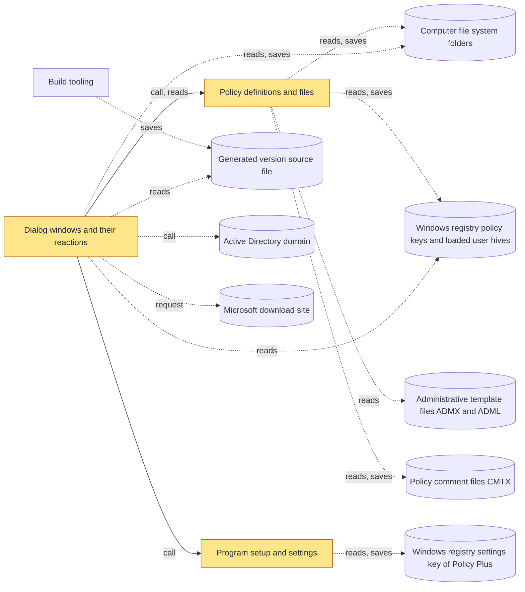
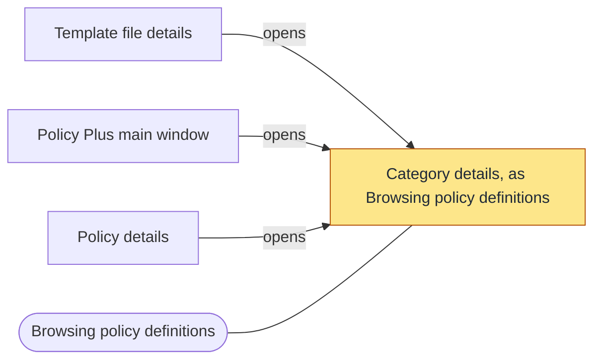

# Screen: Category details, as Browsing policy definitions

At a glance: 1 owned rule, 0 relied on, 1 action, 4 files (1 own, 0 relied on, 3 of neighbour screens, 0 generated), 0 disputed.

How to read it: paths are relative to the source root and `file:a-b` is an inclusive line range. `BR-` rules, `ACT-` actions, `TR-` changes of state and `RK-` risks have stable ids. A record marked disputed was challenged in review and kept; the reviewer's words are under Trust. All of it was read from the code; nothing was run.

## Product context
Policy Plus is a Windows desktop editor for Group Policy settings, used by administrators and power users. It reads Microsoft's policy definition files and edits policy files directly, so it works on any Windows edition, including Home, which lacks the built-in editor.
Built with: .NET Framework v4.5.2, Microsoft Windows, System.DirectoryServices, System.Xml, Visual Basic .NET, Windows Forms (Policy Plus desktop editor).
Runs: It runs on the user's own Windows computer as one desktop program on .NET Framework 4.5.2. It asks for elevated rights when available but starts without them; loading registry hives, refreshing policy and editing local Group Policy files need them. It can also reach the domain's shared policy folder.
Reaches outside itself: Computer file system folders; Windows registry policy keys and loaded user hives; Administrative template files (ADMX and ADML); Windows registry settings key of Policy Plus; Generated version source file; Policy comment files (CMTX); Active Directory domain; Microsoft download site.



## Where this sits
Part of: Browsing policy definitions (Reading policy definitions).



## Boundary
- Opened by **Template file details** (bundle: screen template-file-details), at `PolicyPlus/DetailAdmx.vb:24-26`
- Opened by **Policy Plus main window** (bundle: screen policy-plus-main-window), at `PolicyPlus/Main.vb:839-858`
- Opened by **Policy details** (bundle: screen policy-details), at `PolicyPlus/DetailPolicy.vb:40-42`

## Contract: what it must do
### Category details
See the details of a category and move to its parent.
Controls (15): Button, caption "Close", TabIndex = 13, DialogResult = OK: CloseButton; Button, caption "Details", TabIndex = 6: ParentButton; Form: DetailCategory; Label, caption "Defined in", TabIndex = 9: DefinedLabel; Label, caption "Display code", TabIndex = 10: DisplayCode; Label, caption "Info code", TabIndex = 11: InfoCodeLabel; Label, caption "Name", TabIndex = 7: NameLabel; Label, caption "Parent", TabIndex = 12: ParentLabel; Label, caption "Unique ID", TabIndex = 8: IdLabel; TextBox, ReadOnly = True, TabIndex = 0: NameTextbox; TextBox, ReadOnly = True, TabIndex = 1: IdTextbox; TextBox, ReadOnly = True, TabIndex = 2: DefinedTextbox; TextBox, ReadOnly = True, TabIndex = 3: DisplayCodeTextbox; TextBox, ReadOnly = True, TabIndex = 4: InfoCodeTextbox; TextBox, ReadOnly = True, TabIndex = 5: ParentTextbox

Actions
- **ACT-57045530** Shows the details of the parent category in the same window. — `PolicyPlus/DetailCategory.vb:23-25`; started by person

Rules
- **BR-31267612** The detail window of a category shows its parent's name and enables the parent button when the parent exists; when the parent is named but missing it shows "<orphaned from <parent>>" and the button is disabled; a top-level category shows nothing. — `PolicyPlus/DetailCategory.vb:14-21`


## Trust: what to doubt
**Assumed, not confirmed**
- When the person's language has no exact language folder, the folder picked among those of the same primary language is the first one the operating system lists; which that is, is not stated in code. Why unsettled: The folder listing order is left to the file system, and the template folders present are out of scope. If wrong: A person could see a different regional variant of the policy text than expected when several variants are installed.


## Read order
| Tier | File | Lines | Why |
| --- | --- | --- | --- |
| own | `PolicyPlus/DetailCategory.vb` | whole file | starts 1 action; decides 1 owned rule |
| neighbour screen | `PolicyPlus/DetailAdmx.vb` | 24-26 | opens this screen: Template file details |
| neighbour screen | `PolicyPlus/DetailPolicy.vb` | 40-42 | opens this screen: Policy details |
| neighbour screen | `PolicyPlus/Main.vb` | 839-858 | opens this screen: Policy Plus main window |

## Source

### PolicyPlus/DetailCategory.vb
```
1: Public Class DetailCategory
2:     Dim SelectedCategory As PolicyPlusCategory
3:     Public Sub PresentDialog(Category As PolicyPlusCategory)
4:         PrepareDialog(Category)
5:         ShowDialog()
6:     End Sub
7:     Private Sub PrepareDialog(Category As PolicyPlusCategory)
8:         SelectedCategory = Category
9:         NameTextbox.Text = Category.DisplayName
10:         IdTextbox.Text = Category.UniqueID
11:         DefinedTextbox.Text = Category.RawCategory.DefinedIn.SourceFile
12:         DisplayCodeTextbox.Text = Category.RawCategory.DisplayCode
13:         InfoCodeTextbox.Text = Category.RawCategory.ExplainCode
14:         ParentButton.Enabled = Category.Parent IsNot Nothing
15:         If Category.Parent IsNot Nothing Then
16:             ParentTextbox.Text = Category.Parent.DisplayName
17:         ElseIf Category.RawCategory.ParentID <> "" Then
18:             ParentTextbox.Text = "<orphaned from " & Category.RawCategory.ParentID & ">"
19:         Else
20:             ParentTextbox.Text = ""
21:         End If
22:     End Sub
23:     Private Sub ParentButton_Click(sender As Object, e As EventArgs) Handles ParentButton.Click
24:         PrepareDialog(SelectedCategory.Parent)
25:     End Sub
26: End Class
```

### PolicyPlus/DetailAdmx.vb
```
24:     Private Sub LsvCategories_DoubleClick(sender As Object, e As EventArgs) Handles LsvCategories.DoubleClick
25:         DetailCategory.PresentDialog(LsvCategories.SelectedItems(0).Tag)
26:     End Sub
```

### PolicyPlus/DetailPolicy.vb
```
40:     Private Sub CategoryButton_Click(sender As Object, e As EventArgs) Handles CategoryButton.Click
41:         DetailCategory.PresentDialog(SelectedPolicy.Category)
42:     End Sub
```

### PolicyPlus/Main.vb
```
839:     Private Sub PolicyObjectContext_ItemClicked(sender As Object, e As ToolStripItemClickedEventArgs) Handles PolicyObjectContext.ItemClicked
840:         ' When the user clicks an item in the right-click menu
841:         Dim polObject = PolicyObjectContext.Tag ' The current policy object is in the Tag field
842:         If e.ClickedItem Is CmeCatOpen Then
843:             CurrentCategory = polObject
844:             UpdateCategoryListing()
845:         ElseIf e.ClickedItem Is CmePolEdit Then
846:             ShowSettingEditor(polObject, ViewPolicyTypes)
847:         ElseIf e.ClickedItem Is CmeAllDetails Then
848:             If TypeOf polObject Is PolicyPlusCategory Then
849:                 DetailCategory.PresentDialog(polObject)
850:             Else
851:                 DetailPolicy.PresentDialog(polObject)
852:             End If
853:         ElseIf e.ClickedItem Is CmePolInspectElements Then
854:             InspectPolicyElements.PresentDialog(polObject, PolicyIcons, AdmxWorkspace)
855:         ElseIf e.ClickedItem Is CmePolSpolFragment Then
856:             InspectSpolFragment.PresentDialog(polObject, AdmxWorkspace, CompPolicySource, UserPolicySource, CompComments, UserComments)
857:         End If
858:     End Sub
```
