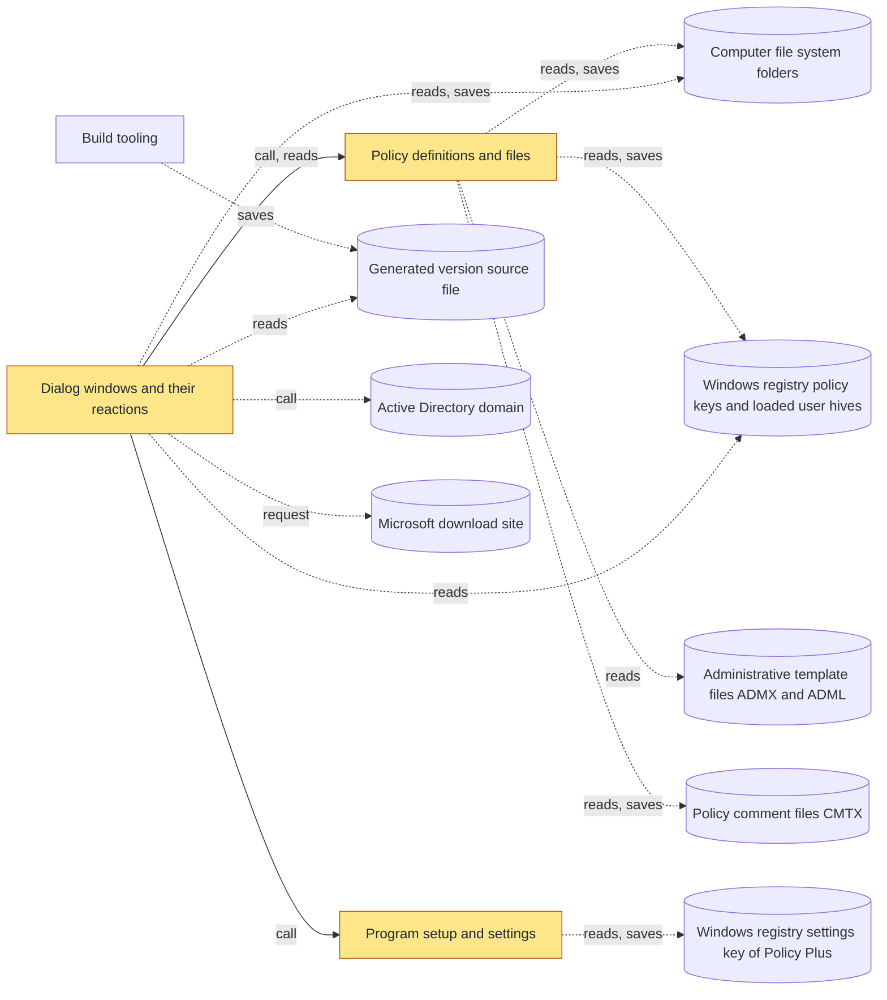
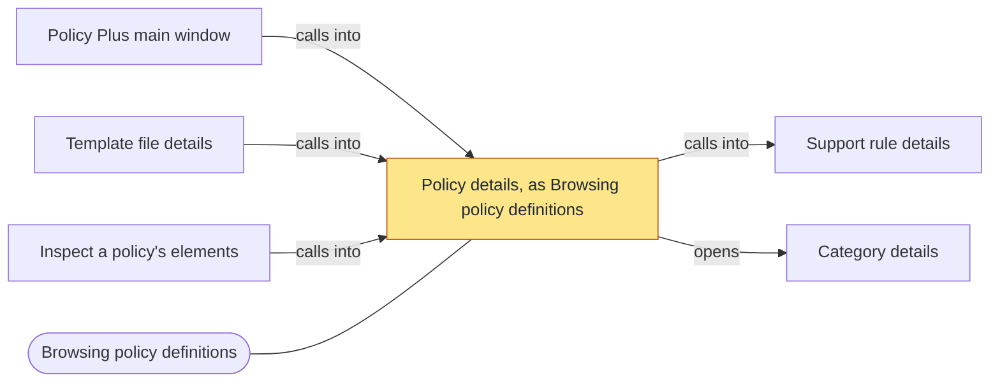

# Screen: Policy details, as Browsing policy definitions

At a glance: 0 owned rules, 0 relied on, 2 actions, 6 files (1 own, 0 relied on, 5 of neighbour screens, 0 generated), 0 disputed.

How to read it: paths are relative to the source root and `file:a-b` is an inclusive line range. `BR-` rules, `ACT-` actions, `TR-` changes of state and `RK-` risks have stable ids. A record marked disputed was challenged in review and kept; the reviewer's words are under Trust. All of it was read from the code; nothing was run.

## Product context
Policy Plus is a Windows desktop editor for Group Policy settings, used by administrators and power users. It reads Microsoft's policy definition files and edits policy files directly, so it works on any Windows edition, including Home, which lacks the built-in editor.
Built with: .NET Framework v4.5.2, Microsoft Windows, System.DirectoryServices, System.Xml, Visual Basic .NET, Windows Forms (Policy Plus desktop editor).
Runs: It runs on the user's own Windows computer as one desktop program on .NET Framework 4.5.2. It asks for elevated rights when available but starts without them; loading registry hives, refreshing policy and editing local Group Policy files need them. It can also reach the domain's shared policy folder.
Reaches outside itself: Computer file system folders; Windows registry policy keys and loaded user hives; Administrative template files (ADMX and ADML); Windows registry settings key of Policy Plus; Generated version source file; Policy comment files (CMTX); Active Directory domain; Microsoft download site.



## Where this sits
Part of: Browsing policy definitions (Reading policy definitions).



## Boundary
- Called from **Policy Plus main window** (bundle: screen policy-plus-main-window), at `PolicyPlus/Main.vb:839-858`
- Called from **Template file details** (bundle: screen template-file-details), at `PolicyPlus/DetailAdmx.vb:21-23`
- Called from **Inspect a policy's elements** (bundle: screen inspect-a-policy-s-elements), at `PolicyPlus/InspectPolicyElements.vb:192-194`
- Calls into **Support rule details** (bundle: screen support-rule-details), at `PolicyPlus/DetailPolicy.vb:37-39`
- Opens **Category details** (bundle: screen category-details), at `PolicyPlus/DetailPolicy.vb:40-42`

## Contract: what it must do
### Policy details
See what a policy is, where it sits and what it is supported on.
Controls (21): Friend WithEvents CategoryButton As Button: CategoryButton; Friend WithEvents CategoryTextbox As TextBox: CategoryTextbox; Friend WithEvents CloseButton As Button: CloseButton; Friend WithEvents DefinedTextbox As TextBox: DefinedTextbox; Friend WithEvents DisplayCodeTextbox As TextBox: DisplayCodeTextbox; Friend WithEvents IdTextbox As TextBox: IdTextbox; Friend WithEvents InfoCodeTextbox As TextBox: InfoCodeTextbox; Friend WithEvents NameTextbox As TextBox: NameTextbox; Friend WithEvents PresentCodeTextbox As TextBox: PresentCodeTextbox; Friend WithEvents SectionTextbox As TextBox: SectionTextbox; Friend WithEvents SupportButton As Button: SupportButton; Friend WithEvents SupportTextbox As TextBox: SupportTextbox; Label: CategoryLabel, DefinedLabel, DisplayLabel, IdLabel, InfoLabel, NameLabel, PresentLabel, SectionLabel, SupportLabel

Actions
- **ACT-10373837** Opens the details window for the support definition the policy is supported on. — `PolicyPlus/DetailPolicy.vb:37-39`; started by person
- **ACT-44669029** Opens the details window for the category the policy sits in. — `PolicyPlus/DetailPolicy.vb:40-42`; started by person


## Trust: what to doubt
**Assumed, not confirmed**
- When the person's language has no exact language folder, the folder picked among those of the same primary language is the first one the operating system lists; which that is, is not stated in code. Why unsettled: The folder listing order is left to the file system, and the template folders present are out of scope. If wrong: A person could see a different regional variant of the policy text than expected when several variants are installed.


## Read order
| Tier | File | Lines | Why |
| --- | --- | --- | --- |
| own | `PolicyPlus/DetailPolicy.vb` | whole file | starts 2 actions |
| neighbour screen | `PolicyPlus/DetailAdmx.vb` | 21-23 | calls into this screen: Template file details |
| neighbour screen | `PolicyPlus/DetailCategory.vb` | 3-6 | opened from this screen: Category details |
| neighbour screen | `PolicyPlus/DetailSupport.vb` | 2-5 | called from this screen: Support rule details |
| neighbour screen | `PolicyPlus/InspectPolicyElements.vb` | 192-194 | calls into this screen: Inspect a policy's elements |
| neighbour screen | `PolicyPlus/Main.vb` | 839-858 | calls into this screen: Policy Plus main window |

## Source

### PolicyPlus/DetailPolicy.vb
```
1: Public Class DetailPolicy
2:     Dim SelectedPolicy As PolicyPlusPolicy
3:     Public Sub PresentDialog(Policy As PolicyPlusPolicy)
4:         SelectedPolicy = Policy
5:         NameTextbox.Text = Policy.DisplayName
6:         IdTextbox.Text = Policy.UniqueID
7:         DefinedTextbox.Text = Policy.RawPolicy.DefinedIn.SourceFile
8:         DisplayCodeTextbox.Text = Policy.RawPolicy.DisplayCode
9:         InfoCodeTextbox.Text = Policy.RawPolicy.ExplainCode
10:         PresentCodeTextbox.Text = Policy.RawPolicy.PresentationID
11:         Select Case Policy.RawPolicy.Section
12:             Case AdmxPolicySection.Both
13:                 SectionTextbox.Text = "User or computer"
14:             Case AdmxPolicySection.Machine
15:                 SectionTextbox.Text = "Computer"
16:             Case AdmxPolicySection.User
17:                 SectionTextbox.Text = "User"
18:         End Select
19:         SupportButton.Enabled = Policy.SupportedOn IsNot Nothing
20:         If Policy.SupportedOn IsNot Nothing Then
21:             SupportTextbox.Text = Policy.SupportedOn.DisplayName
22:         ElseIf Policy.RawPolicy.SupportedCode <> "" Then
23:             SupportTextbox.Text = "<missing: " & Policy.RawPolicy.SupportedCode & ">"
24:         Else
25:             SupportTextbox.Text = ""
26:         End If
27:         CategoryButton.Enabled = Policy.Category IsNot Nothing
28:         If Policy.Category IsNot Nothing Then
29:             CategoryTextbox.Text = Policy.Category.DisplayName
30:         ElseIf Policy.RawPolicy.CategoryID <> "" Then
31:             CategoryTextbox.Text = "<orphaned from " & Policy.RawPolicy.CategoryID & ">"
32:         Else
33:             CategoryTextbox.Text = "<uncategorized>"
34:         End If
35:         ShowDialog()
36:     End Sub
37:     Private Sub SupportButton_Click(sender As Object, e As EventArgs) Handles SupportButton.Click
38:         DetailSupport.PresentDialog(SelectedPolicy.SupportedOn)
39:     End Sub
40:     Private Sub CategoryButton_Click(sender As Object, e As EventArgs) Handles CategoryButton.Click
41:         DetailCategory.PresentDialog(SelectedPolicy.Category)
42:     End Sub
43: End Class
```

### PolicyPlus/DetailAdmx.vb
```
21:     Private Sub LsvPolicies_DoubleClick(sender As Object, e As EventArgs) Handles LsvPolicies.DoubleClick
22:         DetailPolicy.PresentDialog(LsvPolicies.SelectedItems(0).Tag)
23:     End Sub
```

### PolicyPlus/DetailCategory.vb
```
3:     Public Sub PresentDialog(Category As PolicyPlusCategory)
4:         PrepareDialog(Category)
5:         ShowDialog()
6:     End Sub
```

### PolicyPlus/DetailSupport.vb
```
2:     Public Sub PresentDialog(Supported As PolicyPlusSupport)
3:         PrepareDialog(Supported)
4:         ShowDialog()
5:     End Sub
```

### PolicyPlus/InspectPolicyElements.vb
```
192:     Private Sub PolicyDetailsButton_Click(sender As Object, e As EventArgs) Handles PolicyDetailsButton.Click
193:         DetailPolicy.PresentDialog(SelectedPolicy)
194:     End Sub
```

### PolicyPlus/Main.vb
```
839:     Private Sub PolicyObjectContext_ItemClicked(sender As Object, e As ToolStripItemClickedEventArgs) Handles PolicyObjectContext.ItemClicked
840:         ' When the user clicks an item in the right-click menu
841:         Dim polObject = PolicyObjectContext.Tag ' The current policy object is in the Tag field
842:         If e.ClickedItem Is CmeCatOpen Then
843:             CurrentCategory = polObject
844:             UpdateCategoryListing()
845:         ElseIf e.ClickedItem Is CmePolEdit Then
846:             ShowSettingEditor(polObject, ViewPolicyTypes)
847:         ElseIf e.ClickedItem Is CmeAllDetails Then
848:             If TypeOf polObject Is PolicyPlusCategory Then
849:                 DetailCategory.PresentDialog(polObject)
850:             Else
851:                 DetailPolicy.PresentDialog(polObject)
852:             End If
853:         ElseIf e.ClickedItem Is CmePolInspectElements Then
854:             InspectPolicyElements.PresentDialog(polObject, PolicyIcons, AdmxWorkspace)
855:         ElseIf e.ClickedItem Is CmePolSpolFragment Then
856:             InspectSpolFragment.PresentDialog(polObject, AdmxWorkspace, CompPolicySource, UserPolicySource, CompComments, UserComments)
857:         End If
858:     End Sub
```
