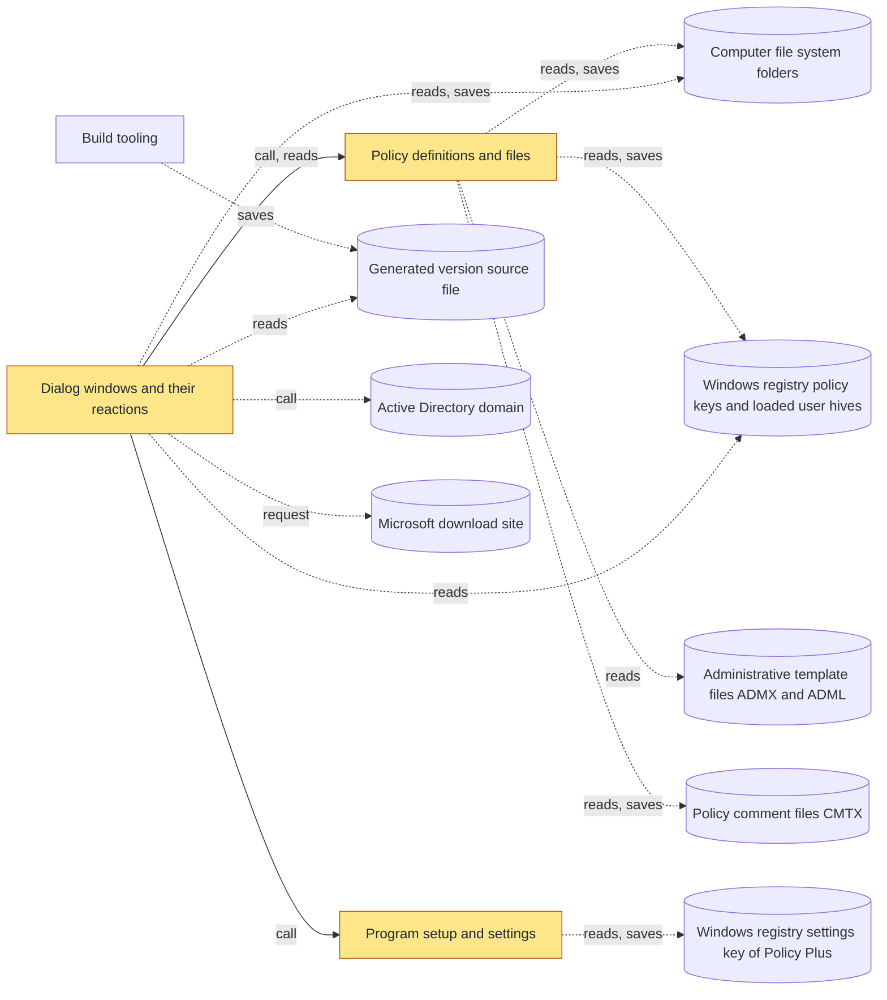
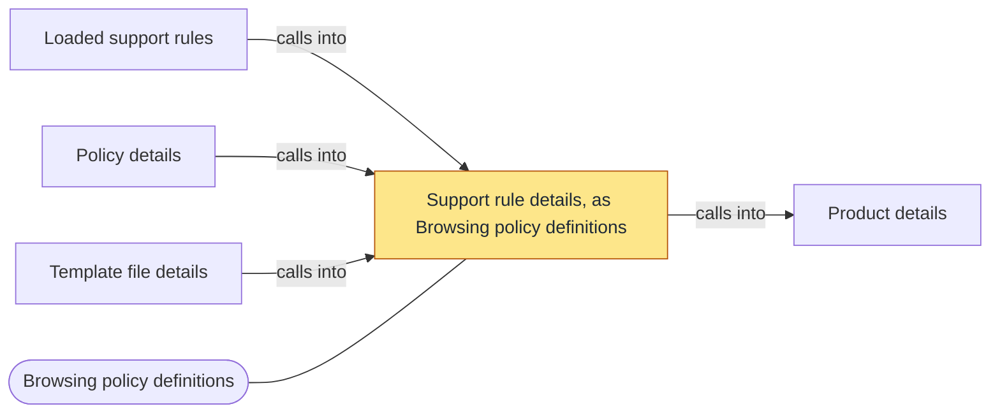

# Screen: Support rule details, as Browsing policy definitions

At a glance: 3 owned rules, 0 relied on, 2 actions, 5 files (1 own, 1 relied on, 3 of neighbour screens, 0 generated), 0 disputed.

How to read it: paths are relative to the source root and `file:a-b` is an inclusive line range. `BR-` rules, `ACT-` actions, `TR-` changes of state and `RK-` risks have stable ids. A record marked disputed was challenged in review and kept; the reviewer's words are under Trust. All of it was read from the code; nothing was run.

## Product context
Policy Plus is a Windows desktop editor for Group Policy settings, used by administrators and power users. It reads Microsoft's policy definition files and edits policy files directly, so it works on any Windows edition, including Home, which lacks the built-in editor.
Built with: .NET Framework v4.5.2, Microsoft Windows, System.DirectoryServices, System.Xml, Visual Basic .NET, Windows Forms (Policy Plus desktop editor).
Runs: It runs on the user's own Windows computer as one desktop program on .NET Framework 4.5.2. It asks for elevated rights when available but starts without them; loading registry hives, refreshing policy and editing local Group Policy files need them. It can also reach the domain's shared policy folder.
Reaches outside itself: Computer file system folders; Windows registry policy keys and loaded user hives; Administrative template files (ADMX and ADML); Windows registry settings key of Policy Plus; Generated version source file; Policy comment files (CMTX); Active Directory domain; Microsoft download site.



## Where this sits
Part of: Browsing policy definitions (Reading policy definitions).



## Boundary
- Called from **Loaded support rules** (bundle: screen loaded-support-rules), at `PolicyPlus/LoadedSupportDefinitions.vb:20-22`
- Called from **Policy details** (bundle: screen policy-details), at `PolicyPlus/DetailPolicy.vb:37-39`
- Called from **Template file details** (bundle: screen template-file-details), at `PolicyPlus/DetailAdmx.vb:30-32`
- Calls into **Product details** (bundle: screen product-details), at `PolicyPlus/DetailSupport.vb:41-49`

## Contract: what it must do
### Support rule details
See which products a support rule covers.
Controls (16): Friend WithEvents ChMaxVer As ColumnHeader: ChMaxVer; Friend WithEvents ChMinVer As ColumnHeader: ChMinVer; Friend WithEvents ChName As ColumnHeader: ChName; Friend WithEvents CloseButton As Button: CloseButton; Friend WithEvents DefinedTextbox As TextBox: DefinedTextbox; Friend WithEvents DisplayCodeTextbox As TextBox: DisplayCodeTextbox; Friend WithEvents EntriesListview As ListView: EntriesListview; Friend WithEvents IdTextbox As TextBox: IdTextbox; Friend WithEvents LogicTextbox As TextBox: LogicTextbox; Friend WithEvents NameTextbox As TextBox: NameTextbox; Label: DefinedLabel, DisplayCodeLabel, IdLabel, LogicLabel, NameLabel, ProductsLabel

Actions
- **ACT-70760078** Resizes the Name column so it fills the list beside the version columns. — `PolicyPlus/DetailSupport.vb:38-40`; started by person
- **ACT-86719743** Opens the product details, or shows the referenced support definition in this window. — `PolicyPlus/DetailSupport.vb:41-49`; started by person

Rules
- **BR-43476269** The support details window states how a support definition matches products: "Match all the referenced products", "Match any of the referenced products", or "Do not match products" when it has no matching logic. — `PolicyPlus/DetailSupport.vb:11-18`
- **BR-50345044** Each entry of a support definition is listed by the name of the nested support definition when it is one, otherwise by the name of the product, otherwise as "<missing: " followed by the product code the entry names. Minimum and maximum versions are listed only for product entries that name a version range; a missing bound is shown blank. — `PolicyPlus/DetailSupport.vb:20-36`
- **BR-31806208** Double-clicking an entry in the support details window opens the product details window for a product entry, and shows a nested support definition in the same window. An entry whose product is missing, or with nothing selected, does nothing. — `PolicyPlus/DetailSupport.vb:42-48`; also rests on `PolicyPlus/DetailProduct.vb:3-6`


## Trust: what to doubt
**Assumed, not confirmed**
- When the person's language has no exact language folder, the folder picked among those of the same primary language is the first one the operating system lists; which that is, is not stated in code. Why unsettled: The folder listing order is left to the file system, and the template folders present are out of scope. If wrong: A person could see a different regional variant of the policy text than expected when several variants are installed.


## Read order
| Tier | File | Lines | Why |
| --- | --- | --- | --- |
| own | `PolicyPlus/DetailSupport.vb` | whole file | starts 2 actions; decides 3 owned rules; used by 1 other capability |
| relied on | `PolicyPlus/DetailProduct.vb` | 3-6 | called code; called from this screen: Product details |
| neighbour screen | `PolicyPlus/DetailAdmx.vb` | 30-32 | calls into this screen: Template file details |
| neighbour screen | `PolicyPlus/DetailPolicy.vb` | 37-39 | calls into this screen: Policy details |
| neighbour screen | `PolicyPlus/LoadedSupportDefinitions.vb` | 20-22 | calls into this screen: Loaded support rules |

## Source

### PolicyPlus/DetailSupport.vb
```
1: Public Class DetailSupport
2:     Public Sub PresentDialog(Supported As PolicyPlusSupport)
3:         PrepareDialog(Supported)
4:         ShowDialog()
5:     End Sub
6:     Sub PrepareDialog(Supported As PolicyPlusSupport)
7:         NameTextbox.Text = Supported.DisplayName
8:         IdTextbox.Text = Supported.UniqueID
9:         DefinedTextbox.Text = Supported.RawSupport.DefinedIn.SourceFile
10:         DisplayCodeTextbox.Text = Supported.RawSupport.DisplayCode
11:         Select Case Supported.RawSupport.Logic
12:             Case AdmxSupportLogicType.AllOf
13:                 LogicTextbox.Text = "Match all the referenced products"
14:             Case AdmxSupportLogicType.AnyOf
15:                 LogicTextbox.Text = "Match any of the referenced products"
16:             Case AdmxSupportLogicType.Blank
17:                 LogicTextbox.Text = "Do not match products"
18:         End Select
19:         EntriesListview.Items.Clear()
20:         If Supported.Elements IsNot Nothing Then
21:             For Each element In Supported.Elements
22:                 Dim lsvi As ListViewItem
23:                 If element.SupportDefinition IsNot Nothing Then
24:                     lsvi = EntriesListview.Items.Add(element.SupportDefinition.DisplayName)
25:                 ElseIf element.Product IsNot Nothing Then
26:                     lsvi = EntriesListview.Items.Add(element.Product.DisplayName)
27:                     If element.RawSupportEntry.IsRange Then
28:                         If element.RawSupportEntry.MinVersion.HasValue Then lsvi.SubItems.Add(element.RawSupportEntry.MinVersion.Value) Else lsvi.SubItems.Add("")
29:                         If element.RawSupportEntry.MaxVersion.HasValue Then lsvi.SubItems.Add(element.RawSupportEntry.MaxVersion.Value) Else lsvi.SubItems.Add("")
30:                     End If
31:                 Else
32:                     lsvi = EntriesListview.Items.Add("<missing: " & element.RawSupportEntry.ProductID & ">")
33:                 End If
34:                 lsvi.Tag = element
35:             Next
36:         End If
37:     End Sub
38:     Private Sub EntriesListview_ClientSizeChanged(sender As Object, e As EventArgs) Handles EntriesListview.ClientSizeChanged, Me.Shown
39:         ChName.Width = EntriesListview.ClientSize.Width - ChMinVer.Width - ChMaxVer.Width
40:     End Sub
41:     Private Sub EntriesListview_DoubleClick(sender As Object, e As EventArgs) Handles EntriesListview.DoubleClick
42:         If EntriesListview.SelectedItems.Count = 0 Then Exit Sub
43:         Dim supEntry As PolicyPlusSupportEntry = EntriesListview.SelectedItems(0).Tag
44:         If supEntry.Product IsNot Nothing Then
45:             DetailProduct.PresentDialog(supEntry.Product)
46:         ElseIf supEntry.SupportDefinition IsNot Nothing Then
47:             PrepareDialog(supEntry.SupportDefinition)
48:         End If
49:     End Sub
50: End Class
```

### PolicyPlus/DetailProduct.vb
```
3:     Public Sub PresentDialog(Product As PolicyPlusProduct)
4:         PrepareDialog(Product)
5:         ShowDialog()
6:     End Sub
```

### PolicyPlus/DetailAdmx.vb
```
30:     Private Sub LsvSupportDefinitions_DoubleClick(sender As Object, e As EventArgs) Handles LsvSupportDefinitions.DoubleClick
31:         DetailSupport.PresentDialog(LsvSupportDefinitions.SelectedItems(0).Tag)
32:     End Sub
```

### PolicyPlus/DetailPolicy.vb
```
37:     Private Sub SupportButton_Click(sender As Object, e As EventArgs) Handles SupportButton.Click
38:         DetailSupport.PresentDialog(SelectedPolicy.SupportedOn)
39:     End Sub
```

### PolicyPlus/LoadedSupportDefinitions.vb
```
20:     Private Sub LsvSupport_DoubleClick(sender As Object, e As EventArgs) Handles LsvSupport.DoubleClick
21:         DetailSupport.PresentDialog(LsvSupport.SelectedItems(0).Tag)
22:     End Sub
```
