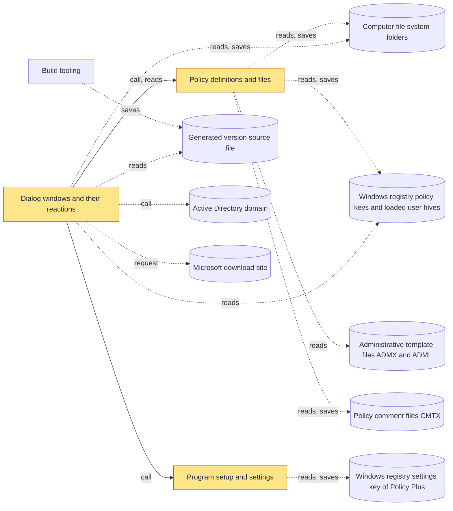
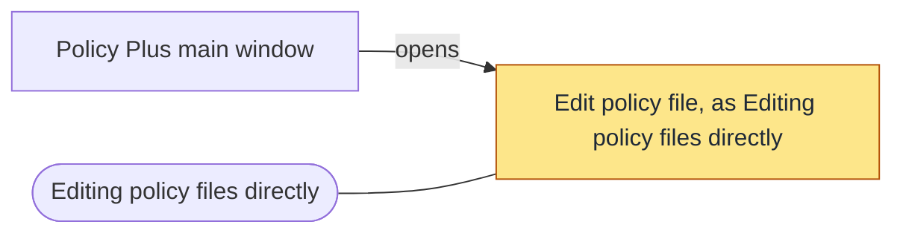

# Screen: Edit policy file, as Editing policy files directly

At a glance: 0 owned rules, 0 relied on, 1 action, 2 files (1 own, 0 relied on, 1 of neighbour screens, 0 generated), 0 disputed.

How to read it: paths are relative to the source root and `file:a-b` is an inclusive line range. `BR-` rules, `ACT-` actions, `TR-` changes of state and `RK-` risks have stable ids. A record marked disputed was challenged in review and kept; the reviewer's words are under Trust. All of it was read from the code; nothing was run.

## Product context
Policy Plus is a Windows desktop editor for Group Policy settings, used by administrators and power users. It reads Microsoft's policy definition files and edits policy files directly, so it works on any Windows edition, including Home, which lacks the built-in editor.
Built with: .NET Framework v4.5.2, Microsoft Windows, System.DirectoryServices, System.Xml, Visual Basic .NET, Windows Forms (Policy Plus desktop editor).
Runs: It runs on the user's own Windows computer as one desktop program on .NET Framework 4.5.2. It asks for elevated rights when available but starts without them; loading registry hives, refreshing policy and editing local Group Policy files need them. It can also reach the domain's shared policy folder.
Reaches outside itself: Computer file system folders; Windows registry policy keys and loaded user hives; Administrative template files (ADMX and ADML); Windows registry settings key of Policy Plus; Generated version source file; Policy comment files (CMTX); Active Directory domain; Microsoft download site.



## Where this sits
Part of: Editing policy files directly (Setting and storing policies).



## Boundary
- Opened by **Policy Plus main window** (bundle: screen policy-plus-main-window), at `PolicyPlus/Main.vb:776-794`

## Contract: what it must do
### Edit policy file
Browse a policy file and, in steps, add keys and values, edit text, number and list values, or choose what to delete.
Controls (42): Button: ButtonOK, ButtonOK, ButtonOK, ButtonOK, ButtonOK, ButtonOK; CheckBox: CheckHexadecimal; ComboBox: ComboKind; Friend WithEvents ButtonAddKey As Button: ButtonAddKey; Friend WithEvents ButtonAddValue As Button: ButtonAddValue; Friend WithEvents ButtonDeleteValue As Button: ButtonDeleteValue; Friend WithEvents ButtonEdit As Button: ButtonEdit; Friend WithEvents ButtonExport As Button: ButtonExport; Friend WithEvents ButtonForget As Button: ButtonForget; Friend WithEvents ButtonImport As Button: ButtonImport; Friend WithEvents ButtonSave As Button: ButtonSave; Friend WithEvents ChItem As ColumnHeader: ChItem; Friend WithEvents ChValue As ColumnHeader: ChValue; Friend WithEvents LsvPol As ListView: LsvPol; Label: Label1, Label1, Label1, Label2, Label1, Label2, Label1, Label2, Label1, Label2; RadioButton: OptClearFirst, OptDeleteOne, OptPurge; TextBox: TextKey, TextValueName, TextName, TextData, TextName, TextName, TextData, TextName, TextName; WideRangeNumericUpDown: NumData

Actions
- **ACT-21886903** Closes the new value dialog as cancelled when Escape is pressed. — `PolicyPlus/EditPolValue.vb:5-7`; started by person


## Read order
| Tier | File | Lines | Why |
| --- | --- | --- | --- |
| own | `PolicyPlus/EditPolValue.vb` | whole file | starts 1 action |
| neighbour screen | `PolicyPlus/Main.vb` | 776-794 | opens this screen: Policy Plus main window |

## Source

### PolicyPlus/EditPolValue.vb
```
1: Imports Microsoft.Win32
2: Public Class EditPolValue
3:     Public SelectedKind As RegistryValueKind
4:     Public ChosenName As String
5:     Private Sub EditPolValueType_KeyDown(sender As Object, e As KeyEventArgs) Handles Me.KeyDown
6:         If e.KeyCode = Keys.Escape Then DialogResult = DialogResult.Cancel
7:     End Sub
8:     Public Function PresentDialog() As DialogResult
9:         TextName.Text = ""
10:         ComboKind.SelectedIndex = 0
11:         Dim dlgRes = ShowDialog()
12:         If dlgRes = DialogResult.OK Then
13:             Select Case ComboKind.SelectedIndex
14:                 Case 0
15:                     SelectedKind = RegistryValueKind.String
16:                 Case 1
17:                     SelectedKind = RegistryValueKind.ExpandString
18:                 Case 2
19:                     SelectedKind = RegistryValueKind.MultiString
20:                 Case 3
21:                     SelectedKind = RegistryValueKind.DWord
22:                 Case 4
23:                     SelectedKind = RegistryValueKind.QWord
24:             End Select
25:             ChosenName = TextName.Text
26:         End If
27:         Return dlgRes
28:     End Function
29: End Class
```

### PolicyPlus/Main.vb
```
776:     Private Sub EditRawPOLToolStripMenuItem_Click(sender As Object, e As EventArgs) Handles EditRawPOLToolStripMenuItem.Click
777:         Dim userIsPol = TypeOf UserPolicySource Is PolFile
778:         Dim compIsPol = TypeOf CompPolicySource Is PolFile
779:         If Not (userIsPol Or compIsPol) Then
780:             MsgBox("Neither loaded source is backed by a POL file.", MsgBoxStyle.Exclamation)
781:             Exit Sub
782:         End If
783:         If CInt(Configuration.GetValue("EditPolDangerAcknowledged", 0)) = 0 Then
784:             If MsgBox("Caution! This tool is for very advanced users. Improper modifications may result in inconsistencies in policies' states." & vbCrLf & vbCrLf &
785:                       "Changes operate directly on the policy source, though they will not be committed to disk until you save. Are you sure you want to continue?",
786:                       MsgBoxStyle.Exclamation Or MsgBoxStyle.YesNo) = MsgBoxResult.No Then Exit Sub
787:             Configuration.SetValue("EditPolDangerAcknowledged", 1)
788:         End If
789:         If OpenSection.PresentDialog(userIsPol, compIsPol) = DialogResult.OK Then
790:             EditPol.PresentDialog(PolicyIcons, If(OpenSection.SelectedSection = AdmxPolicySection.Machine, CompPolicySource, UserPolicySource),
791:                                   OpenSection.SelectedSection = AdmxPolicySection.User)
792:         End If
793:         MoveToVisibleCategoryAndReload()
794:     End Sub
```
