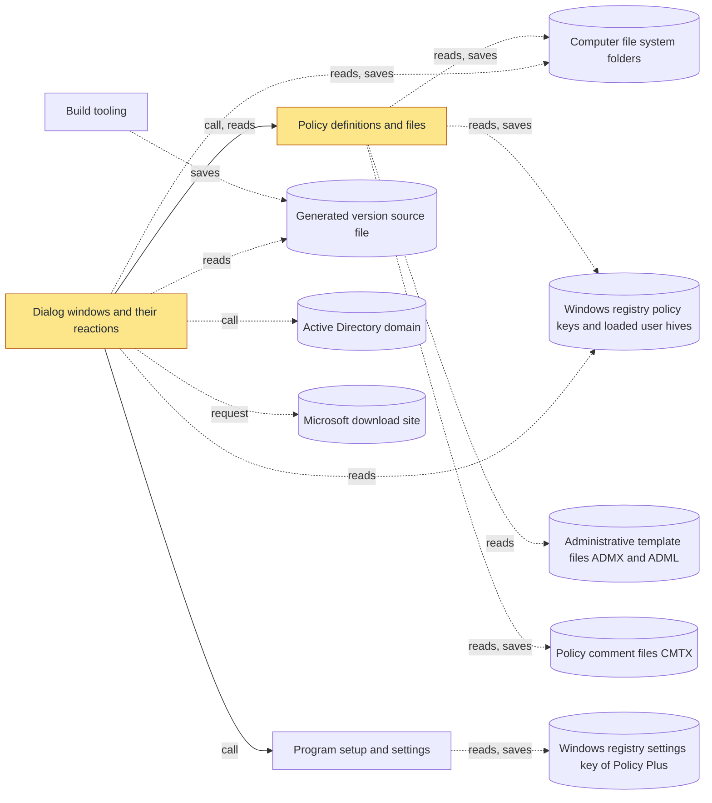
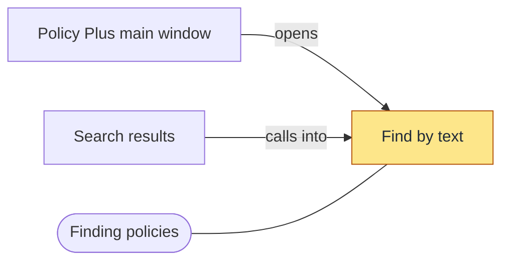

# Screen: Find by text

At a glance: 6 owned rules, 0 relied on, 2 actions, 4 files (1 own, 0 relied on, 2 of neighbour screens, 1 generated), 1 disputed.

How to read it: paths are relative to the source root and `file:a-b` is an inclusive line range. `BR-` rules, `ACT-` actions, `TR-` changes of state and `RK-` risks have stable ids. A record marked disputed was challenged in review and kept; the reviewer's words are under Trust. All of it was read from the code; nothing was run.

## Product context
Policy Plus is a Windows desktop editor for Group Policy settings, used by administrators and power users. It reads Microsoft's policy definition files and edits policy files directly, so it works on any Windows edition, including Home, which lacks the built-in editor.
Built with: .NET Framework v4.5.2, Microsoft Windows, System.DirectoryServices, System.Xml, Visual Basic .NET, Windows Forms (Policy Plus desktop editor).
Runs: It runs on the user's own Windows computer as one desktop program on .NET Framework 4.5.2. It asks for elevated rights when available but starts without them; loading registry hives, refreshing policy and editing local Group Policy files need them. It can also reach the domain's shared policy folder.
Reaches outside itself: Computer file system folders; Windows registry policy keys and loaded user hives; Administrative template files (ADMX and ADML); Windows registry settings key of Policy Plus; Generated version source file; Policy comment files (CMTX); Active Directory domain; Microsoft download site.

## Where this sits
Part of: Finding policies (Reading policy definitions).

## Boundary
- Opened by **Policy Plus main window** (bundle: screen policy-plus-main-window), at `PolicyPlus/Main.vb:645-650`
- Called from **Search results** (bundle: screen search-results), at `PolicyPlus/FindResults.vb:47-90`

## Contract: what it must do
### Find by text
Search policy text for words, in the attributes you choose.
Controls (5): Button: SearchButton; CheckBox: CommentCheckbox, DescriptionCheckbox, TitleCheckbox; TextBox: StringTextbox

Actions
- **ACT-71669922** Closes the dialog as cancelled when Escape is pressed — `PolicyPlus/FindByText.vb:8-10`; started by person
- **ACT-88592289** Checks the typed search text and chosen attributes and builds the policy search function — `PolicyPlus/FindByText.vb:11-73`; started by person

Rules
- **BR-07352856** When Search is pressed with the search text empty, the search is refused and the person is told "Please enter search terms." — `PolicyPlus/FindByText.vb:12-16`
- **BR-65764837** When none of In title, In description and In comment is ticked, the search is refused with "At least one attribute must be searched. Check one of the boxes and try again."; all three start ticked. — `PolicyPlus/FindByText.vb:17-23`; also rests on `PolicyPlus/FindByText.Designer.vb:42`, `PolicyPlus/FindByText.Designer.vb:54`, `PolicyPlus/FindByText.Designer.vb:66`
- **BR-79544771** Search text is split at spaces into plain words, wildcard words (containing "*" or "?") and quoted phrases. Words are lowercased and trimmed and lose the characters . , ' " ; / ! ( ) { } [ ]. — `PolicyPlus/FindByText.vb:25-49`
- **BR-88029346** A phrase opened with a double quote runs until a later word ending in a double quote; a phrase never closed is dropped without telling the person, which widens the search. A single quoted word such as "abc" does not close itself, so it also absorbs the following words. — `PolicyPlus/FindByText.vb:36-45`; **disputed**
- **BR-85082056** A text is a hit only when it contains every plain word as a whole word, every wildcard matching some word, and every quoted phrase as whole words together. — `PolicyPlus/FindByText.vb:51-58`
- **BR-56979448** A policy matches when the ticked attributes hit: its title, its description, or a comment on it from any supplied comment source (user or computer). Any one hit is enough. — `PolicyPlus/FindByText.vb:59-70`; also rests on `PolicyPlus/FindByText.vb:4-7`

## Trust: what to doubt
**Challenged in review and kept**
- **BR-88029346** `PolicyPlus/FindByText.vb:36-45`: Two different weaknesses and a rule are merged in one record: an unclosed opening quote drops the phrase silently, and a one-word quoted term such as "abc" never closes itself (the branch at 42-43 does not test for an ending quote) so it absorbs the following words up to the next word ending in a quote, or is dropped with them. The previous review asked for the unclosed-quote weakness as its own finding; it is still only inside a rule. Keep the rule as how a phrase is read, and write each weakness as its own fact with its lines and a risk.

## Read order
| Tier | File | Lines | Why |
| --- | --- | --- | --- |
| own | `PolicyPlus/FindByText.vb` | whole file | starts 2 actions; decides 6 owned rules |
| neighbour screen | `PolicyPlus/FindResults.vb` | 47-90 | calls into this screen: Search results |
| neighbour screen | `PolicyPlus/Main.vb` | 645-650 | opens this screen: Policy Plus main window |
| generated | `PolicyPlus/FindByText.Designer.vb` | 42, 54, 66 | generated layout; rules cite these lines, the controls table replaces the rest |
