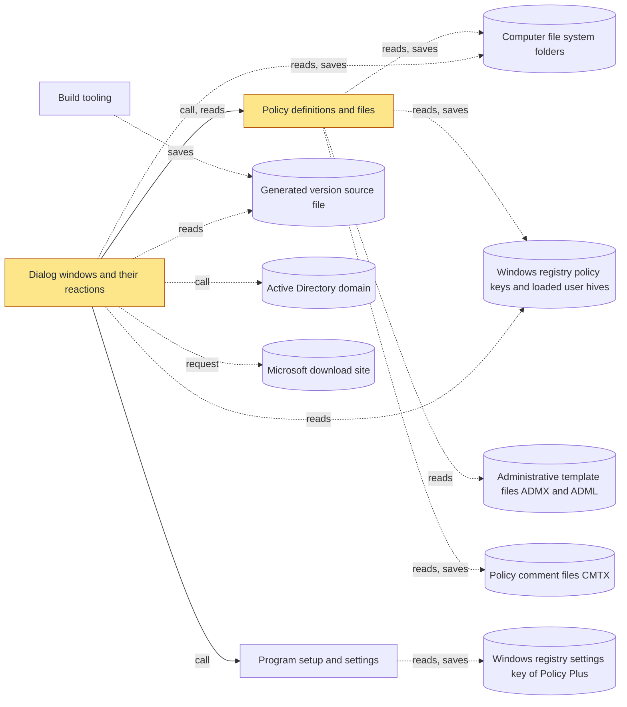
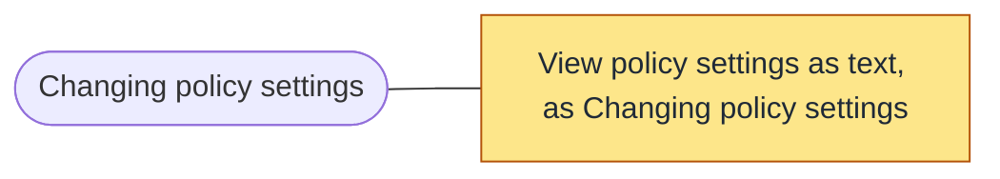

# Screen: View policy settings as text, as Changing policy settings

At a glance: 1 owned rule, 0 relied on, 4 actions, 1 files (1 own, 0 relied on, 0 of neighbour screens, 0 generated), 0 disputed.

How to read it: paths are relative to the source root and `file:a-b` is an inclusive line range. `BR-` rules, `ACT-` actions, `TR-` changes of state and `RK-` risks have stable ids. A record marked disputed was challenged in review and kept; the reviewer's words are under Trust. All of it was read from the code; nothing was run.

## Product context
Policy Plus is a Windows desktop editor for Group Policy settings, used by administrators and power users. It reads Microsoft's policy definition files and edits policy files directly, so it works on any Windows edition, including Home, which lacks the built-in editor.
Built with: .NET Framework v4.5.2, Microsoft Windows, System.DirectoryServices, System.Xml, Visual Basic .NET, Windows Forms (Policy Plus desktop editor).
Runs: It runs on the user's own Windows computer as one desktop program on .NET Framework 4.5.2. It asks for elevated rights when available but starts without them; loading registry hives, refreshing policy and editing local Group Policy files need them. It can also reach the domain's shared policy folder.
Reaches outside itself: Computer file system folders; Windows registry policy keys and loaded user hives; Administrative template files (ADMX and ADML); Windows registry settings key of Policy Plus; Generated version source file; Policy comment files (CMTX); Active Directory domain; Microsoft download site.



## Where this sits
Part of: Changing policy settings (Setting and storing policies).



## Contract: what it must do
### View policy settings as text
See a setting as SPOL text and copy it.
Controls (6): Both, TabIndex = 1: TextSpol; Button, Text = "Copy", TabIndex = 3: ButtonCopy; CheckBox, Text = "Include SPOL header", TabIndex = 2: CheckHeader; Label, Text = "Policy", TabIndex = 1: LabelPolicy; OK, TabIndex = 4: ButtonClose; TextBox, ReadOnly = True, TabIndex = 0: TextPolicyName

Actions
- **ACT-40036498** Selects and copies the whole SPOL text to the clipboard. — `PolicyPlus/InspectSpolFragment.vb:26-29`; started by person
- **ACT-55948032** Focuses the SPOL text and selects it. — `PolicyPlus/InspectSpolFragment.vb:30-33`; started by person
- **ACT-06207861** Shows or hides the SPOL header line in the text. — `PolicyPlus/InspectSpolFragment.vb:34-36`; started by person
- **ACT-73579452** Selects all text in the box on Ctrl+A. — `PolicyPlus/InspectSpolFragment.vb:44-46`; started by person

Rules
- **BR-25257305** The fragment text starts with the heading "Policy Plus Semantic Policy" and a blank line only when "Include SPOL header" is ticked; otherwise only the fragment is shown. — `PolicyPlus/InspectSpolFragment.vb:37-43`


## Read order
| Tier | File | Lines | Why |
| --- | --- | --- | --- |
| own | `PolicyPlus/InspectSpolFragment.vb` | whole file | starts 4 actions; decides 1 owned rule; used by 1 other capability |

## Source

### PolicyPlus/InspectSpolFragment.vb
```
1: Public Class InspectSpolFragment
2:     Dim SpolFragment As String
3:     Public Function PresentDialog(Policy As PolicyPlusPolicy, AdmxWorkspace As AdmxBundle, CompSource As IPolicySource, UserSource As IPolicySource, CompComments As Dictionary(Of String, String), UserComments As Dictionary(Of String, String)) As DialogResult
4:         ' Show the SPOL text for all the policy's sections
5:         TextPolicyName.Text = Policy.DisplayName
6:         Dim sb As New Text.StringBuilder
7:         Dim addSection = Function(Section As AdmxPolicySection) As Boolean
8:                              ' Create SPOL info for one section of the policy
9:                              If (Policy.RawPolicy.Section And Section) = 0 Then Return False
10:                              Dim polSource = If(Section = AdmxPolicySection.Machine, CompSource, UserSource)
11:                              Dim commentsMap = If(Section = AdmxPolicySection.Machine, CompComments, UserComments)
12:                              Dim spolState As New SpolPolicyState With {.UniqueID = Policy.UniqueID}
13:                              spolState.Section = Section
14:                              If commentsMap IsNot Nothing AndAlso commentsMap.ContainsKey(Policy.UniqueID) Then spolState.Comment = commentsMap(Policy.UniqueID)
15:                              spolState.BasicState = PolicyProcessing.GetPolicyState(polSource, Policy)
16:                              If spolState.BasicState = PolicyState.Enabled Then spolState.ExtraOptions = PolicyProcessing.GetPolicyOptionStates(polSource, Policy)
17:                              sb.AppendLine(SpolFile.GetFragment(spolState))
18:                              Return True
19:                          End Function
20:         addSection(AdmxPolicySection.Machine)
21:         addSection(AdmxPolicySection.User)
22:         SpolFragment = sb.ToString
23:         UpdateTextbox()
24:         Return ShowDialog()
25:     End Function
26:     Private Sub ButtonCopy_Click(sender As Object, e As EventArgs) Handles ButtonCopy.Click
27:         TextSpol.SelectAll()
28:         TextSpol.Copy()
29:     End Sub
30:     Private Sub InspectSpolFragment_Shown(sender As Object, e As EventArgs) Handles Me.Shown
31:         TextSpol.Focus()
32:         TextSpol.SelectAll()
33:     End Sub
34:     Private Sub CheckHeader_CheckedChanged(sender As Object, e As EventArgs) Handles CheckHeader.CheckedChanged
35:         UpdateTextbox()
36:     End Sub
37:     Private Sub UpdateTextbox()
38:         If CheckHeader.Checked Then
39:             TextSpol.Text = "Policy Plus Semantic Policy" & vbCrLf & vbCrLf & SpolFragment
40:         Else
41:             TextSpol.Text = SpolFragment
42:         End If
43:     End Sub
44:     Private Sub TextSpol_KeyDown(sender As Object, e As KeyEventArgs) Handles TextSpol.KeyDown
45:         If e.KeyCode = Keys.A And e.Control Then TextSpol.SelectAll()
46:     End Sub
47: End Class
```
