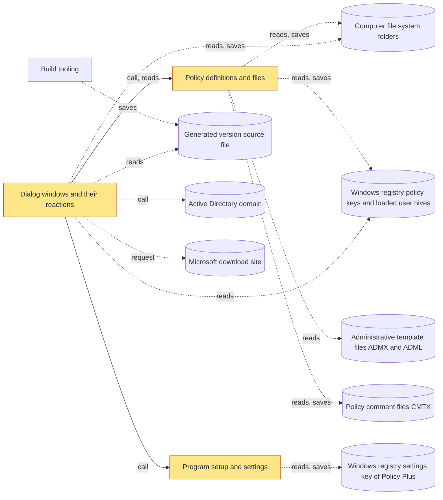
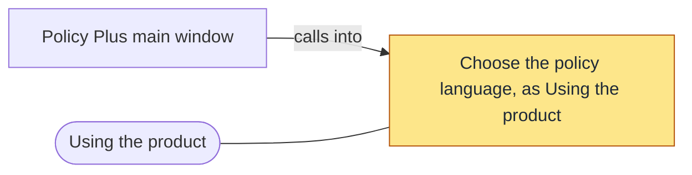

# Screen: Choose the policy language, as Using the product

At a glance: 2 owned rules, 0 relied on, 1 action, 3 files (1 own, 2 relied on, 0 of neighbour screens, 0 generated), 0 disputed.

How to read it: paths are relative to the source root and `file:a-b` is an inclusive line range. `BR-` rules, `ACT-` actions, `TR-` changes of state and `RK-` risks have stable ids. A record marked disputed was challenged in review and kept; the reviewer's words are under Trust. All of it was read from the code; nothing was run.

## Product context
Policy Plus is a Windows desktop editor for Group Policy settings, used by administrators and power users. It reads Microsoft's policy definition files and edits policy files directly, so it works on any Windows edition, including Home, which lacks the built-in editor.
Built with: .NET Framework v4.5.2, Microsoft Windows, System.DirectoryServices, System.Xml, Visual Basic .NET, Windows Forms (Policy Plus desktop editor).
Runs: It runs on the user's own Windows computer as one desktop program on .NET Framework 4.5.2. It asks for elevated rights when available but starts without them; loading registry hives, refreshing policy and editing local Group Policy files need them. It can also reach the domain's shared policy folder.
Reaches outside itself: Computer file system folders; Windows registry policy keys and loaded user hives; Administrative template files (ADMX and ADML); Windows registry settings key of Policy Plus; Generated version source file; Policy comment files (CMTX); Active Directory domain; Microsoft download site.



## Where this sits
Part of: Using the product (Starting the program and its settings).



## Boundary
- Called from **Policy Plus main window** (bundle: screen policy-plus-main-window), at `PolicyPlus/Main.vb:807-816`

## Contract: what it must do
### Choose the policy language
Enter the language code used for policy text.
Controls (4): Button, Text = "OK", TabIndex = 0: ButtonOK; Label, Text = "Preferred ADML language code", TabIndex = 3: Label2; Size(276, 0): Label1; TextBox, TabIndex = 2: TextAdmlLanguage

Actions
- **ACT-85527716** Validates the language code and returns it, or cancels when unchanged. — `PolicyPlus/LanguageOptions.vb:9-21`; started by person

Rules
- **BR-79452251** When the person confirms the language dialog with text that does not split into exactly two parts around a hyphen (for example "en" or "en-US-x"), it is refused with "Please enter a valid language code." and stays open. Any text with exactly one hyphen passes, including "-", "en-" or text with path characters: it is not checked as a real language code. The code is later used as a folder name when looking for ADML files. — `PolicyPlus/LanguageOptions.vb:10-14`; also rests on `PolicyPlus/AdmxBundle.vb:46-47`
- **BR-45555552** When the entered language code, spaces trimmed, is exactly equal (upper and lower case count as different, so en-us differs from en-US) to the stored code, taken without trimming, the dialog closes as cancelled. Otherwise the dialog returns the entered code as accepted; saving it is done elsewhere. — `PolicyPlus/LanguageOptions.vb:15-20`; also rests on `PolicyPlus/Main.vb:808-809`


## Trust: what to doubt
**Risks**
- **RK-17348566** [medium] Text typed by the person, a user identifier or a language code, is used unchecked as part of a folder path. Path characters redirect where policy and version files are created or which folder is searched for definition text, using the person's own rights. (Input from outside is used without checks, so it can change what the code does) — at `PolicyPlus/LanguageOptions.vb:10-14`


## Read order
| Tier | File | Lines | Why |
| --- | --- | --- | --- |
| own | `PolicyPlus/LanguageOptions.vb` | whole file | starts 1 action; decides 2 owned rules |
| relied on | `PolicyPlus/AdmxBundle.vb` | 46-47 | called code |
| relied on | `PolicyPlus/Main.vb` | 807-816 | called code; calls into this screen: Policy Plus main window |

## Source

### PolicyPlus/LanguageOptions.vb
```
1: Public Class LanguageOptions
2:     Private OriginalLanguage As String
3:     Public NewLanguage As String
4:     Public Function PresentDialog(CurrentLanguage As String) As DialogResult
5:         OriginalLanguage = CurrentLanguage
6:         TextAdmlLanguage.Text = CurrentLanguage
7:         Return ShowDialog()
8:     End Function
9:     Private Sub ButtonOK_Click(sender As Object, e As EventArgs) Handles ButtonOK.Click
10:         Dim selection = TextAdmlLanguage.Text.Trim()
11:         If selection.Split("-"c).Length <> 2 Then
12:             MsgBox("Please enter a valid language code.", MsgBoxStyle.Exclamation)
13:             Exit Sub
14:         End If
15:         If selection = OriginalLanguage Then
16:             DialogResult = DialogResult.Cancel
17:         Else
18:             NewLanguage = selection
19:             DialogResult = DialogResult.OK
20:         End If
21:     End Sub
22: End Class
```

### PolicyPlus/AdmxBundle.vb
```
46:         Dim fileTitle = Path.GetFileName(AdmxPath)
47:         Dim admlPath = Path.ChangeExtension(AdmxPath.Replace(fileTitle, LanguageCode & "\" & fileTitle), "adml")
```

### PolicyPlus/Main.vb
```
807:     Private Sub SetADMLLanguageToolStripMenuItem_Click(sender As Object, e As EventArgs) Handles SetADMLLanguageToolStripMenuItem.Click
808:         If LanguageOptions.PresentDialog(GetPreferredLanguageCode()) = DialogResult.OK Then
809:             Configuration.SetValue("LanguageCode", LanguageOptions.NewLanguage)
810:             If MsgBox("Language changes will take effect when ADML files are next loaded. Would you like to reload the workspace now?", MsgBoxStyle.YesNo Or MsgBoxStyle.Question) = MsgBoxResult.Yes Then
811:                 ClearAdmxWorkspace()
812:                 OpenLastAdmxSource()
813:                 PopulateAdmxUi()
814:             End If
815:         End If
816:     End Sub
```
