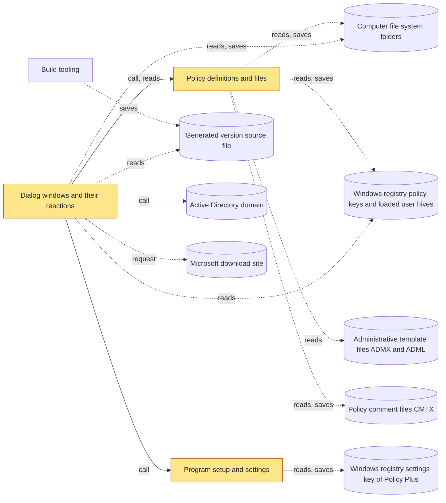
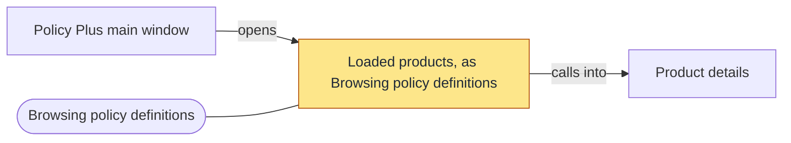

# Screen: Loaded products, as Browsing policy definitions

At a glance: 3 owned rules, 0 relied on, 4 actions, 3 files (1 own, 0 relied on, 2 of neighbour screens, 0 generated), 0 disputed.

How to read it: paths are relative to the source root and `file:a-b` is an inclusive line range. `BR-` rules, `ACT-` actions, `TR-` changes of state and `RK-` risks have stable ids. A record marked disputed was challenged in review and kept; the reviewer's words are under Trust. All of it was read from the code; nothing was run.

## Product context
Policy Plus is a Windows desktop editor for Group Policy settings, used by administrators and power users. It reads Microsoft's policy definition files and edits policy files directly, so it works on any Windows edition, including Home, which lacks the built-in editor.
Built with: .NET Framework v4.5.2, Microsoft Windows, System.DirectoryServices, System.Xml, Visual Basic .NET, Windows Forms (Policy Plus desktop editor).
Runs: It runs on the user's own Windows computer as one desktop program on .NET Framework 4.5.2. It asks for elevated rights when available but starts without them; loading registry hives, refreshing policy and editing local Group Policy files need them. It can also reach the domain's shared policy folder.
Reaches outside itself: Computer file system folders; Windows registry policy keys and loaded user hives; Administrative template files (ADMX and ADML); Windows registry settings key of Policy Plus; Generated version source file; Policy comment files (CMTX); Active Directory domain; Microsoft download site.



## Where this sits
Part of: Browsing policy definitions (Reading policy definitions).



## Boundary
- Opened by **Policy Plus main window** (bundle: screen policy-plus-main-window), at `PolicyPlus/Main.vb:773-775`
- Calls into **Product details** (bundle: screen product-details), at `PolicyPlus/LoadedProducts.vb:57-62`

## Contract: what it must do
### Loaded products
Step through products by major and minor version.
Controls (6): Friend WithEvents ButtonClose As Button  [Text = "Close": ButtonClose; Friend WithEvents LabelMajorVersion As Label  [Text = "Major versions": LabelMajorVersion; Friend WithEvents LabelMinorVersion As Label  [Text = "Minor versions": LabelMinorVersion; Friend WithEvents LsvMajorVersions As ListView  [TabIndex = 1: LsvMajorVersions; Friend WithEvents LsvMinorVersions As ListView  [TabIndex = 2: LsvMinorVersions; Friend WithEvents LsvTopLevelProducts As ListView  [TabIndex = 0: LsvTopLevelProducts

Actions
- **ACT-32396460** Lists the major versions of the selected top-level product. — `PolicyPlus/LoadedProducts.vb:23-40`; started by person
- **ACT-18135903** Lists the minor versions of the selected major version. — `PolicyPlus/LoadedProducts.vb:41-56`; started by person
- **ACT-42001799** Opens the details window of the product double-clicked. — `PolicyPlus/LoadedProducts.vb:57-62`; started by person
- **ACT-10610516** Opens the selected product's details when Enter is pressed. — `PolicyPlus/LoadedProducts.vb:63-68`; started by person

Rules
- **BR-38552418** The major versions list shows the children of the selected top-level product ordered by version, with the heading naming that product; with no product selected it is empty and prompts the person to select one. — `PolicyPlus/LoadedProducts.vb:23-40`
- **BR-35487446** The minor versions list shows the children of the selected major version ordered by version, with the heading naming it; with no major version selected it is empty and prompts the person to select one. — `PolicyPlus/LoadedProducts.vb:41-56`
- **BR-54297244** Opening product details by double-click or Enter does nothing when no product is selected in that list. — `PolicyPlus/LoadedProducts.vb:57-62`


## Trust: what to doubt
**Assumed, not confirmed**
- When the person's language has no exact language folder, the folder picked among those of the same primary language is the first one the operating system lists; which that is, is not stated in code. Why unsettled: The folder listing order is left to the file system, and the template folders present are out of scope. If wrong: A person could see a different regional variant of the policy text than expected when several variants are installed.


## Read order
| Tier | File | Lines | Why |
| --- | --- | --- | --- |
| own | `PolicyPlus/LoadedProducts.vb` | whole file | starts 4 actions; decides 3 owned rules |
| neighbour screen | `PolicyPlus/DetailProduct.vb` | 3-6 | called from this screen: Product details |
| neighbour screen | `PolicyPlus/Main.vb` | 773-775 | opens this screen: Policy Plus main window |

## Source

### PolicyPlus/LoadedProducts.vb
```
1: Public Class LoadedProducts
2:     Public Sub PresentDialog(Workspace As AdmxBundle)
3:         ' Fill the top-level products list
4:         LsvTopLevelProducts.SelectedIndices.Clear()
5:         LsvTopLevelProducts.Items.Clear()
6:         For Each product In Workspace.Products.Values.OrderBy(Function(p) p.DisplayName)
7:             Dim lsvi = LsvTopLevelProducts.Items.Add(product.DisplayName)
8:             lsvi.SubItems.Add(product.Children.Count)
9:             lsvi.Tag = product
10:         Next
11:         ' Clear the other lists
12:         UpdateMajorList()
13:         ' Finagle the column widths
14:         For Each lsv In {LsvTopLevelProducts, LsvMajorVersions, LsvMinorVersions}
15:             Dim lastColWidths As Integer = 0
16:             For n = 1 To lsv.Columns.Count - 1
17:                 lastColWidths += lsv.Columns(n).Width
18:             Next
19:             lsv.Columns(0).Width = lsv.ClientRectangle.Width - lastColWidths - SystemInformation.VerticalScrollBarWidth
20:         Next
21:         ShowDialog()
22:     End Sub
23:     Sub UpdateMajorList() Handles LsvTopLevelProducts.SelectedIndexChanged
24:         ' Show the major versions of the selected top-level product
25:         LsvMajorVersions.SelectedIndices.Clear()
26:         LsvMajorVersions.Items.Clear()
27:         If LsvTopLevelProducts.SelectedItems.Count > 0 Then
28:             Dim selProduct As PolicyPlusProduct = LsvTopLevelProducts.SelectedItems(0).Tag
29:             For Each product In selProduct.Children.OrderBy(Function(p) p.RawProduct.Version)
30:                 Dim lsvi = LsvMajorVersions.Items.Add(product.DisplayName)
31:                 lsvi.SubItems.Add(product.RawProduct.Version)
32:                 lsvi.SubItems.Add(product.Children.Count)
33:                 lsvi.Tag = product
34:             Next
35:             LabelMajorVersion.Text = "Major versions of """ & selProduct.DisplayName & """"
36:         Else
37:             LabelMajorVersion.Text = "Select a product to show its major versions"
38:         End If
39:         UpdateMinorList()
40:     End Sub
41:     Sub UpdateMinorList() Handles LsvMajorVersions.SelectedIndexChanged
42:         LsvMinorVersions.SelectedIndices.Clear()
43:         LsvMinorVersions.Items.Clear()
44:         ' Show the minor versions of the selected major version
45:         If LsvMajorVersions.SelectedItems.Count > 0 Then
46:             Dim selProduct As PolicyPlusProduct = LsvMajorVersions.SelectedItems(0).Tag
47:             For Each product In selProduct.Children.OrderBy(Function(p) p.RawProduct.Version)
48:                 Dim lsvi = LsvMinorVersions.Items.Add(product.DisplayName)
49:                 lsvi.SubItems.Add(product.RawProduct.Version)
50:                 lsvi.Tag = product
51:             Next
52:             LabelMinorVersion.Text = "Minor versions of """ & selProduct.DisplayName & """"
53:         Else
54:             LabelMinorVersion.Text = "Select a major version to show its minor versions"
55:         End If
56:     End Sub
57:     Sub OpenProductDetails(sender As Object, e As EventArgs) Handles LsvTopLevelProducts.DoubleClick, LsvMajorVersions.DoubleClick, LsvMinorVersions.DoubleClick
58:         Dim lsv As ListView = sender
59:         If lsv.SelectedItems.Count = 0 Then Exit Sub
60:         Dim product As PolicyPlusProduct = lsv.SelectedItems(0).Tag
61:         DetailProduct.PresentDialog(product)
62:     End Sub
63:     Sub ListKeyPressed(sender As Object, e As KeyEventArgs) Handles LsvTopLevelProducts.KeyDown, LsvMajorVersions.KeyDown, LsvMinorVersions.KeyDown
64:         If e.KeyCode = Keys.Enter Then
65:             OpenProductDetails(sender, e)
66:             e.Handled = True
67:         End If
68:     End Sub
69: End Class
```

### PolicyPlus/DetailProduct.vb
```
3:     Public Sub PresentDialog(Product As PolicyPlusProduct)
4:         PrepareDialog(Product)
5:         ShowDialog()
6:     End Sub
```

### PolicyPlus/Main.vb
```
773:     Private Sub AllProductsToolStripMenuItem_Click(sender As Object, e As EventArgs) Handles AllProductsToolStripMenuItem.Click
774:         LoadedProducts.PresentDialog(AdmxWorkspace)
775:     End Sub
```
