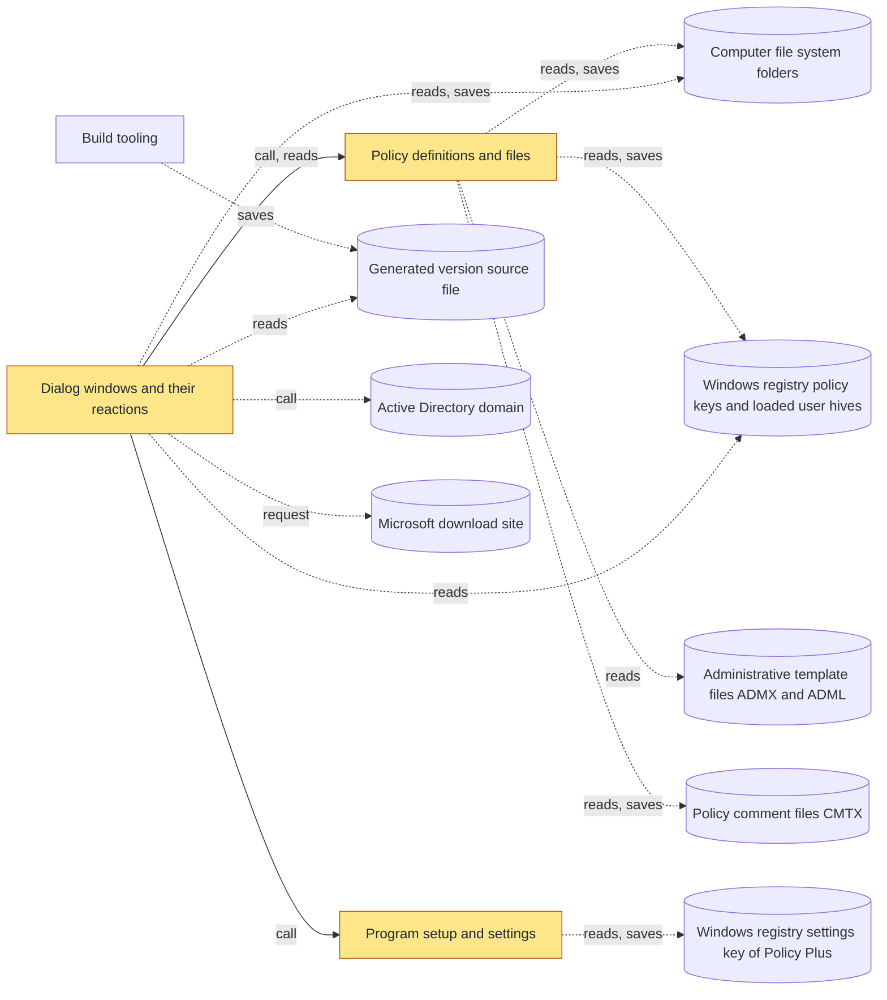
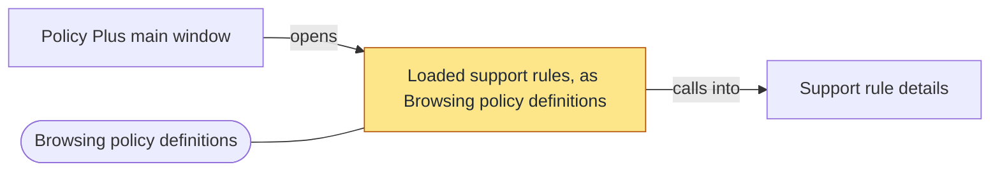

# Screen: Loaded support rules, as Browsing policy definitions

At a glance: 2 owned rules, 0 relied on, 3 actions, 3 files (1 own, 0 relied on, 2 of neighbour screens, 0 generated), 0 disputed.

How to read it: paths are relative to the source root and `file:a-b` is an inclusive line range. `BR-` rules, `ACT-` actions, `TR-` changes of state and `RK-` risks have stable ids. A record marked disputed was challenged in review and kept; the reviewer's words are under Trust. All of it was read from the code; nothing was run.

## Product context
Policy Plus is a Windows desktop editor for Group Policy settings, used by administrators and power users. It reads Microsoft's policy definition files and edits policy files directly, so it works on any Windows edition, including Home, which lacks the built-in editor.
Built with: .NET Framework v4.5.2, Microsoft Windows, System.DirectoryServices, System.Xml, Visual Basic .NET, Windows Forms (Policy Plus desktop editor).
Runs: It runs on the user's own Windows computer as one desktop program on .NET Framework 4.5.2. It asks for elevated rights when available but starts without them; loading registry hives, refreshing policy and editing local Group Policy files need them. It can also reach the domain's shared policy folder.
Reaches outside itself: Computer file system folders; Windows registry policy keys and loaded user hives; Administrative template files (ADMX and ADML); Windows registry settings key of Policy Plus; Generated version source file; Policy comment files (CMTX); Active Directory domain; Microsoft download site.



## Where this sits
Part of: Browsing policy definitions (Reading policy definitions).



## Boundary
- Opened by **Policy Plus main window** (bundle: screen policy-plus-main-window), at `PolicyPlus/Main.vb:770-772`
- Calls into **Support rule details** (bundle: screen support-rule-details), at `PolicyPlus/LoadedSupportDefinitions.vb:20-22`

## Contract: what it must do
### Loaded support rules
See and filter the support rules loaded.
Controls (5): Friend WithEvents ButtonClose As Button  [Text = "Close": ButtonClose; Friend WithEvents ChDefinedIn As ColumnHeader  [Text = "ADMX File": ChDefinedIn; Friend WithEvents ChName As ColumnHeader  [Text = "Name": ChName; Friend WithEvents LsvSupport As ListView  [TabIndex = 2: LsvSupport; Friend WithEvents TextFilter As TextBox  [TabIndex = 1]: TextFilter

Actions
- **ACT-79299743** Opens the details window of the support definition double-clicked. — `PolicyPlus/LoadedSupportDefinitions.vb:20-22`; started by person
- **ACT-74952821** Narrows the support definition list to names containing the typed text. — `PolicyPlus/LoadedSupportDefinitions.vb:23-26`; started by person
- **ACT-42436201** Opens the selected support definition's details when Enter is pressed. — `PolicyPlus/LoadedSupportDefinitions.vb:27-29`; started by person

Rules
- **BR-30556938** The support definitions list shows only definitions whose name contains the typed filter text, ignoring upper or lower case; an empty filter shows all. Entries are ordered by name with leading spaces ignored and shown without them. — `PolicyPlus/LoadedSupportDefinitions.vb:10-19`; also rests on `PolicyPlus/LoadedSupportDefinitions.vb:23-26`
- **BR-16998249** Double-clicking the support definitions list opens the definition details for the selected row without checking that a row is selected; pressing Enter does check. — `PolicyPlus/LoadedSupportDefinitions.vb:20-22`; also rests on `PolicyPlus/LoadedSupportDefinitions.vb:27-29`


## Trust: what to doubt
**Risks**
- **RK-55878738** [low] Several windows raise an unhandled error on ordinary input: double-clicking with no row selected, right-clicking with no category, an unnamed list entry, an unreadable import file, a malformed search wildcard, a removed product in a filter, or an inspector item with no match. No program-wide handler is set, so the framework's default error dialog appears. (Failures are hidden, lost or not retried) — at `PolicyPlus/LoadedSupportDefinitions.vb:20-22`

**Assumed, not confirmed**
- When the person's language has no exact language folder, the folder picked among those of the same primary language is the first one the operating system lists; which that is, is not stated in code. Why unsettled: The folder listing order is left to the file system, and the template folders present are out of scope. If wrong: A person could see a different regional variant of the policy text than expected when several variants are installed.


## Read order
| Tier | File | Lines | Why |
| --- | --- | --- | --- |
| own | `PolicyPlus/LoadedSupportDefinitions.vb` | whole file | starts 3 actions; decides 2 owned rules |
| neighbour screen | `PolicyPlus/DetailSupport.vb` | 2-5 | called from this screen: Support rule details |
| neighbour screen | `PolicyPlus/Main.vb` | 770-772 | opens this screen: Policy Plus main window |

## Source

### PolicyPlus/LoadedSupportDefinitions.vb
```
1: Public Class LoadedSupportDefinitions
2:     Dim Definitions As IEnumerable(Of PolicyPlusSupport)
3:     Public Sub PresentDialog(Workspace As AdmxBundle)
4:         TextFilter.Text = ""
5:         Definitions = Workspace.SupportDefinitions.Values
6:         UpdateListing()
7:         ChName.Width = LsvSupport.ClientRectangle.Width - ChDefinedIn.Width - SystemInformation.VerticalScrollBarWidth
8:         ShowDialog()
9:     End Sub
10:     Sub UpdateListing()
11:         ' Add all the (matching) support definitions to the list view
12:         LsvSupport.Items.Clear()
13:         For Each support In Definitions.OrderBy(Function(s) s.DisplayName.Trim()) ' Some default support definitions have leading spaces
14:             If Not support.DisplayName.ToLowerInvariant.Contains(TextFilter.Text.ToLowerInvariant) Then Continue For
15:             Dim lsvi = LsvSupport.Items.Add(support.DisplayName.Trim())
16:             lsvi.SubItems.Add(IO.Path.GetFileName(support.RawSupport.DefinedIn.SourceFile))
17:             lsvi.Tag = support
18:         Next
19:     End Sub
20:     Private Sub LsvSupport_DoubleClick(sender As Object, e As EventArgs) Handles LsvSupport.DoubleClick
21:         DetailSupport.PresentDialog(LsvSupport.SelectedItems(0).Tag)
22:     End Sub
23:     Private Sub TextFilter_TextChanged(sender As Object, e As EventArgs) Handles TextFilter.TextChanged
24:         ' Only repopulate if the form isn't still setting up
25:         If Visible Then UpdateListing()
26:     End Sub
27:     Private Sub LsvSupport_KeyDown(sender As Object, e As KeyEventArgs) Handles LsvSupport.KeyDown
28:         If e.KeyCode = Keys.Enter And LsvSupport.SelectedItems.Count > 0 Then LsvSupport_DoubleClick(sender, e)
29:     End Sub
30: End Class
```

### PolicyPlus/DetailSupport.vb
```
2:     Public Sub PresentDialog(Supported As PolicyPlusSupport)
3:         PrepareDialog(Supported)
4:         ShowDialog()
5:     End Sub
```

### PolicyPlus/Main.vb
```
770:     Private Sub AllSupportDefinitionsToolStripMenuItem_Click(sender As Object, e As EventArgs) Handles AllSupportDefinitionsToolStripMenuItem.Click
771:         LoadedSupportDefinitions.PresentDialog(AdmxWorkspace)
772:     End Sub
```
