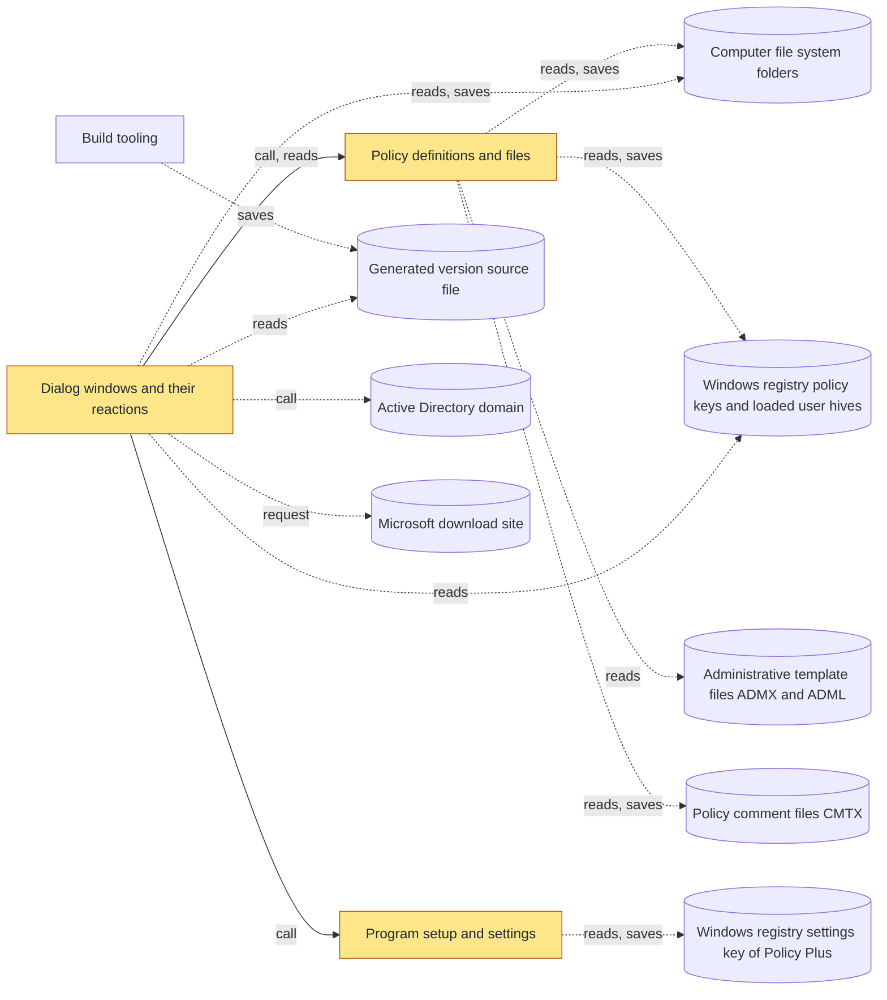
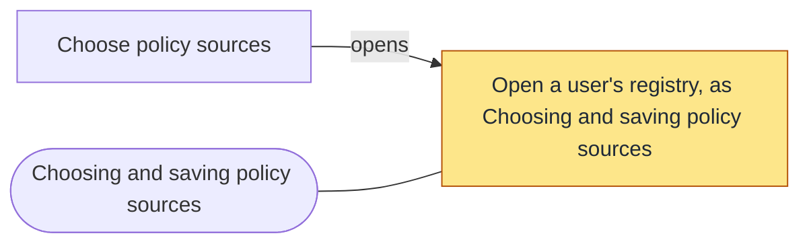

# Screen: Open a user's registry, as Choosing and saving policy sources

At a glance: 2 owned rules, 0 relied on, 2 actions, 2 files (1 own, 0 relied on, 1 of neighbour screens, 0 generated), 0 disputed.

How to read it: paths are relative to the source root and `file:a-b` is an inclusive line range. `BR-` rules, `ACT-` actions, `TR-` changes of state and `RK-` risks have stable ids. A record marked disputed was challenged in review and kept; the reviewer's words are under Trust. All of it was read from the code; nothing was run.

## Product context
Policy Plus is a Windows desktop editor for Group Policy settings, used by administrators and power users. It reads Microsoft's policy definition files and edits policy files directly, so it works on any Windows edition, including Home, which lacks the built-in editor.
Built with: .NET Framework v4.5.2, Microsoft Windows, System.DirectoryServices, System.Xml, Visual Basic .NET, Windows Forms (Policy Plus desktop editor).
Runs: It runs on the user's own Windows computer as one desktop program on .NET Framework 4.5.2. It asks for elevated rights when available but starts without them; loading registry hives, refreshing policy and editing local Group Policy files need them. It can also reach the domain's shared policy folder.
Reaches outside itself: Computer file system folders; Windows registry policy keys and loaded user hives; Administrative template files (ADMX and ADML); Windows registry settings key of Policy Plus; Generated version source file; Policy comment files (CMTX); Active Directory domain; Microsoft download site.



## Where this sits
Part of: Choosing and saving policy sources (Setting and storing policies).



## Boundary
- Opened by **Choose policy sources** (bundle: screen choose-policy-sources), at `PolicyPlus/OpenPol.vb:72-75`

## Contract: what it must do
### Open a user's registry
Pick a user profile's registry file.
Controls (4): Button: OkButton; ColumnHeader: ChAccess, ChUsername; ListView: SubfoldersListview

Actions
- **ACT-29816247** Reports the chosen profile ntuser.dat path and closes the dialog as accepted — `PolicyPlus/OpenUserRegistry.vb:31-35`; started by person
- **ACT-48805872** Closes the dialog as cancelled when Escape is pressed — `PolicyPlus/OpenUserRegistry.vb:36-38`; started by person

Rules
- **BR-50173128** In the user hive dialog, OK does nothing until a folder is selected; then it returns the path C:\Users\<folder>\ntuser.dat and closes. — `PolicyPlus/OpenUserRegistry.vb:31-35`
- **BR-93887157** Pressing Escape closes the user hive dialog as cancelled. — `PolicyPlus/OpenUserRegistry.vb:36-38`


## Trust: what to doubt
**Assumed, not confirmed**
- The Group Policy check relies on a fixed list of edition codes. We assume those codes are the professional, enterprise, education and server editions, and that Home editions are absent. The code names no editions. Why unsettled: The list holds numbers only; their meaning as editions comes from outside knowledge. If wrong: The program would hide or show its warning about missing Group Policy on the wrong computers.

**In these files but reached by nothing the analysis could follow**
- OpenUserRegistry.OpenUserRegistry_Shown (`PolicyPlus/OpenUserRegistry.vb:3-30`)


## Read order
| Tier | File | Lines | Why |
| --- | --- | --- | --- |
| own | `PolicyPlus/OpenUserRegistry.vb` | whole file | starts 2 actions; decides 2 owned rules |
| neighbour screen | `PolicyPlus/OpenPol.vb` | 72-75 | opens this screen: Choose policy sources |

## Source

### PolicyPlus/OpenUserRegistry.vb
```
1: Public Class OpenUserRegistry
2:     Public SelectedFilePath As String
3:     Private Sub OpenUserRegistry_Shown(sender As Object, e As EventArgs) Handles Me.Shown
4:         ' Set up the UI
5:         SubfoldersListview.Columns(1).Width = SubfoldersListview.ClientSize.Width - SubfoldersListview.Columns(0).Width - SystemInformation.VerticalScrollBarWidth
6:         SubfoldersListview.Items.Clear()
7:         ' Scan for user hives and whether they can be accessed now
8:         Dim canMountHives As Boolean = New Security.Principal.WindowsPrincipal(Security.Principal.WindowsIdentity.GetCurrent).IsInRole(Security.Principal.WindowsBuiltInRole.Administrator)
9:         For Each folder In IO.Directory.EnumerateDirectories("C:\Users")
10:             Dim dirInfo As New IO.DirectoryInfo(folder)
11:             If (dirInfo.Attributes And IO.FileAttributes.ReparsePoint) > 0 Then Continue For
12:             Dim ntuserPath = folder & "\ntuser.dat"
13:             Dim access As String = ""
14:             Try
15:                 Using fNtuser As New IO.FileStream(ntuserPath, IO.FileMode.Open, IO.FileAccess.ReadWrite)
16:                     access = If(canMountHives, "Yes", "No (unprivileged)")
17:                 End Using
18:             Catch ex As UnauthorizedAccessException
19:                 access = "No"
20:             Catch ex As IO.FileNotFoundException
21:                 access = ""
22:             Catch ex As Exception
23:                 access = "No (in use)"
24:             End Try
25:             If access <> "" Then
26:                 Dim lvi = SubfoldersListview.Items.Add(IO.Path.GetFileName(folder))
27:                 lvi.SubItems.Add(access)
28:             End If
29:         Next
30:     End Sub
31:     Private Sub OkButton_Click(sender As Object, e As EventArgs) Handles OkButton.Click
32:         If SubfoldersListview.SelectedItems.Count = 0 Then Exit Sub
33:         SelectedFilePath = IO.Path.Combine("C:\Users", SubfoldersListview.SelectedItems(0).Text, "ntuser.dat")
34:         DialogResult = DialogResult.OK
35:     End Sub
36:     Private Sub OpenUserRegistry_KeyUp(sender As Object, e As KeyEventArgs) Handles Me.KeyUp
37:         If e.KeyCode = Keys.Escape Then DialogResult = DialogResult.Cancel
38:     End Sub
39: End Class
```

### PolicyPlus/OpenPol.vb
```
72:     Private Sub UserBrowseRegistryButton_Click(sender As Object, e As EventArgs) Handles UserBrowseHiveButton.Click
73:         ' Browse for a user Registry hive
74:         If OpenUserRegistry.ShowDialog = DialogResult.OK Then UserHivePathTextbox.Text = OpenUserRegistry.SelectedFilePath
75:     End Sub
```
