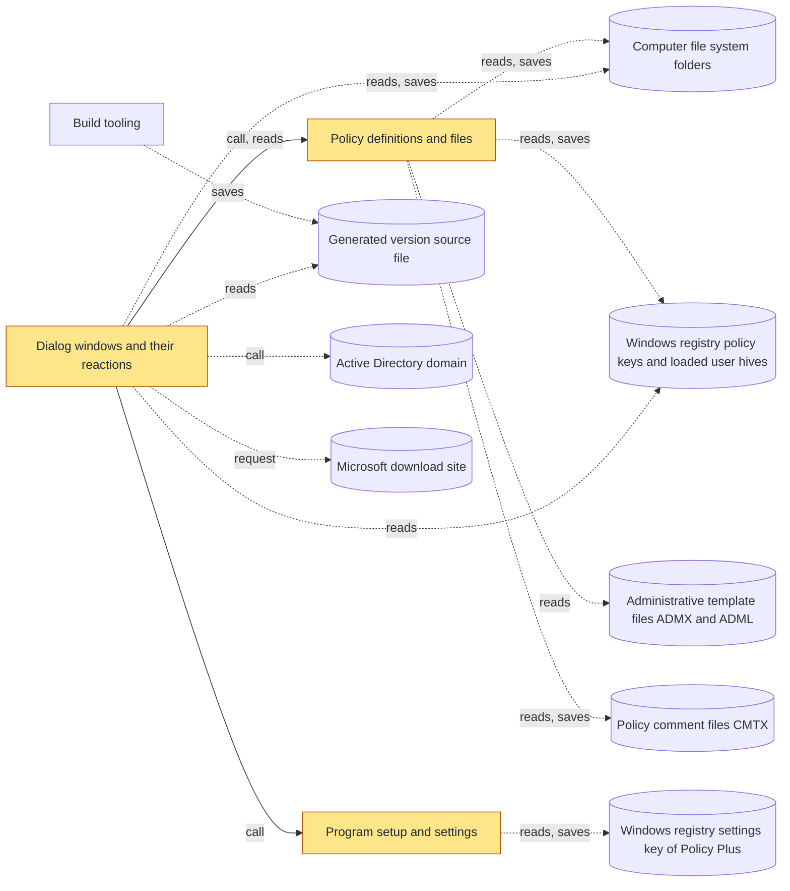
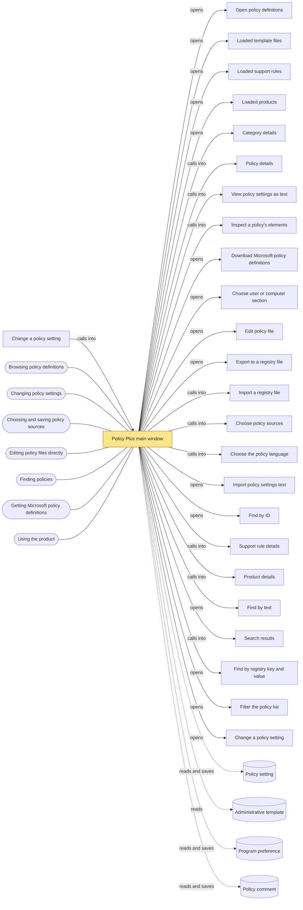
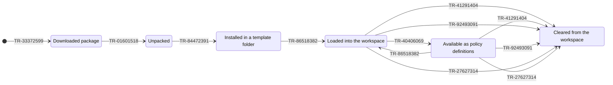
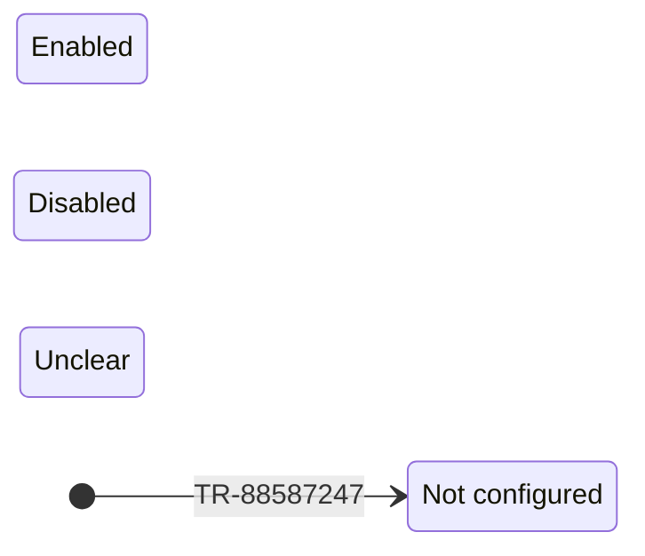
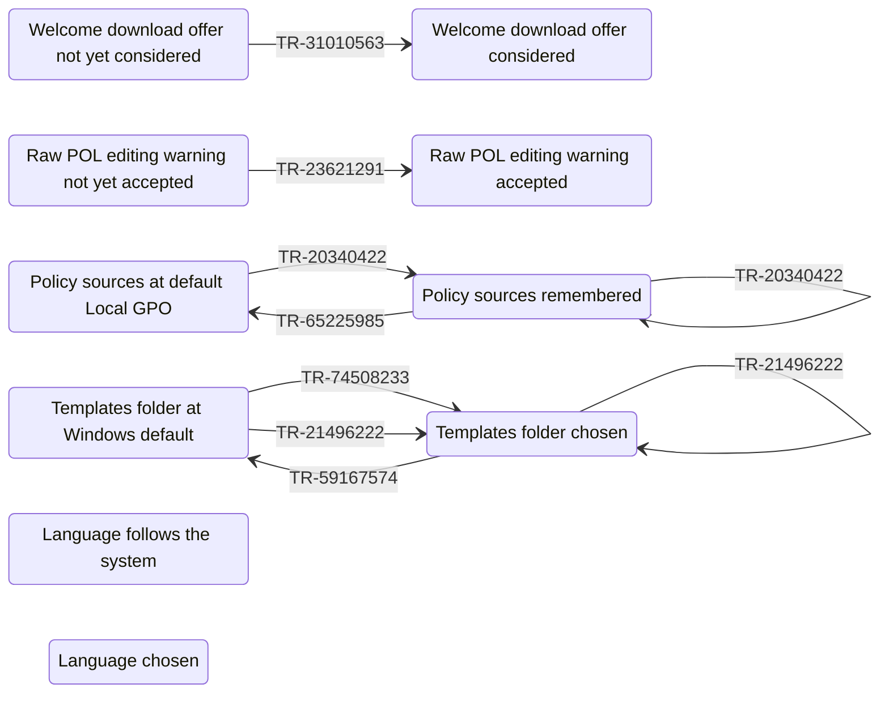

# Screen: Policy Plus main window

At a glance: 87 owned rules, 129 relied on, 40 actions, 40 files (1 own, 16 relied on, 22 of neighbour screens, 1 generated), 7 disputed.

How to read it: paths are relative to the source root and `file:a-b` is an inclusive line range. `BR-` rules, `ACT-` actions, `TR-` changes of state and `RK-` risks have stable ids. A record marked disputed was challenged in review and kept; the reviewer's words are under Trust. All of it was read from the code; nothing was run.

## Product context
Policy Plus is a Windows desktop editor for Group Policy settings, used by administrators and power users. It reads Microsoft's policy definition files and edits policy files directly, so it works on any Windows edition, including Home, which lacks the built-in editor.
Built with: .NET Framework v4.5.2, Microsoft Windows, System.DirectoryServices, System.Xml, Visual Basic .NET, Windows Forms (Policy Plus desktop editor).
Runs: It runs on the user's own Windows computer as one desktop program on .NET Framework 4.5.2. It asks for elevated rights when available but starts without them; loading registry hives, refreshing policy and editing local Group Policy files need them. It can also reach the domain's shared policy folder.
Reaches outside itself: Computer file system folders; Windows registry policy keys and loaded user hives; Administrative template files (ADMX and ADML); Windows registry settings key of Policy Plus; Generated version source file; Policy comment files (CMTX); Active Directory domain; Microsoft download site.

## Where this sits
Part of: Browsing policy definitions, Changing policy settings, Choosing and saving policy sources, Editing policy files directly, Finding policies, Getting Microsoft policy definitions, Using the product (Reading policy definitions, Setting and storing policies, Starting the program and its settings).

## Boundary
- Called from **Change a policy setting** (bundle: screen change-a-policy-setting), at `PolicyPlus/EditSetting.vb:18-37`
- Opens **Open policy definitions** (bundle: screen open-policy-definitions), at `PolicyPlus/Main.vb:510-523`
- Opens **Loaded template files** (bundle: screen loaded-template-files), at `PolicyPlus/Main.vb:767-769`
- Opens **Loaded support rules** (bundle: screen loaded-support-rules), at `PolicyPlus/Main.vb:770-772`
- Opens **Loaded products** (bundle: screen loaded-products), at `PolicyPlus/Main.vb:773-775`
- Opens **Category details** (bundle: screen category-details), at `PolicyPlus/Main.vb:839-858`
- Calls into **Policy details** (bundle: screen policy-details), at `PolicyPlus/Main.vb:839-858`
- Calls into **View policy settings as text** (bundle: screen view-policy-settings-as-text), at `PolicyPlus/Main.vb:839-858`
- Calls into **Inspect a policy's elements** (bundle: screen inspect-a-policy-s-elements), at `PolicyPlus/Main.vb:839-858`
- Opens **Download Microsoft policy definitions** (bundle: screen download-microsoft-policy-definitions), at `PolicyPlus/Main.vb:756-766`
- Opens **Choose user or computer section** (bundle: screen choose-user-or-computer-section), at `PolicyPlus/Main.vb:720-740`
- Opens **Edit policy file** (bundle: screen edit-policy-file), at `PolicyPlus/Main.vb:776-794`
- Opens **Export to a registry file** (bundle: screen export-to-a-registry-file), at `PolicyPlus/Main.vb:795-800`
- Calls into **Import a registry file** (bundle: screen import-a-registry-file), at `PolicyPlus/Main.vb:801-806`
- Calls into **Choose policy sources** (bundle: screen choose-policy-sources), at `PolicyPlus/Main.vb:18-45`
- Calls into **Choose the policy language** (bundle: screen choose-the-policy-language), at `PolicyPlus/Main.vb:807-816`
- Opens **Import policy settings text** (bundle: screen import-policy-settings-text), at `PolicyPlus/Main.vb:707-719`
- Opens **Find by ID** (bundle: screen find-by-id), at `PolicyPlus/Main.vb:580-606`
- Calls into **Support rule details** (bundle: screen support-rule-details), at `PolicyPlus/Main.vb:580-606`
- Calls into **Product details** (bundle: screen product-details), at `PolicyPlus/Main.vb:580-606`
- Opens **Find by text** (bundle: screen find-by-text), at `PolicyPlus/Main.vb:645-650`
- Calls into **Search results** (bundle: screen search-results), at `PolicyPlus/Main.vb:655-667`
- Opens **Find by registry key and value** (bundle: screen find-by-registry-key-and-value), at `PolicyPlus/Main.vb:668-671`
- Opens **Filter the policy list** (bundle: screen filter-the-policy-list), at `PolicyPlus/Main.vb:692-700`
- Opens **Change a policy setting** (bundle: screen change-a-policy-setting), at `PolicyPlus/Main.vb:298-304`

## Contract: what it must do
### Policy Plus main window
Browse categories and policies, and reach every other action.
Controls (56): ": PolicyIsPrefLabel; Friend WithEvents AboutToolStripMenuItem As ToolStripMenuItem  [Text = "About"]: AboutToolStripMenuItem; Friend WithEvents AcquireADMXFilesToolStripMenuItem As ToolStripMenuItem  [Text = "Acquire ADMX Files"]: AcquireADMXFilesToolStripMenuItem; Friend WithEvents AllProductsToolStripMenuItem As ToolStripMenuItem  [Text = "All Products"]: AllProductsToolStripMenuItem; Friend WithEvents AllSupportDefinitionsToolStripMenuItem As ToolStripMenuItem  [Text = "All Support Definitions"]: AllSupportDefinitionsToolStripMenuItem; Friend WithEvents ByIDToolStripMenuItem As ToolStripMenuItem  [Text = "By ID": ByIDToolStripMenuItem; Friend WithEvents ByRegistryToolStripMenuItem As ToolStripMenuItem  [Text = "By Registry": ByRegistryToolStripMenuItem; Friend WithEvents ByTextToolStripMenuItem As ToolStripMenuItem  [Text = "By Text": ByTextToolStripMenuItem; Friend WithEvents CategoriesTree As TreeView  [TabIndex = 2]: CategoriesTree; Friend WithEvents ChSettingName As ColumnHeader  [Text = "Name": ChSettingName; Friend WithEvents CloseADMXWorkspaceToolStripMenuItem As ToolStripMenuItem  [Text = "Close ADMX Workspace"]: CloseADMXWorkspaceToolStripMenuItem; Friend WithEvents CmeAllDetails As ToolStripMenuItem  [Text = "Details"]: CmeAllDetails; Friend WithEvents CmeCatOpen As ToolStripMenuItem  [Text = "Open"]: CmeCatOpen; Friend WithEvents CmePolEdit As ToolStripMenuItem  [Text = "Edit"]: CmePolEdit; Friend WithEvents CmePolInspectElements As ToolStripMenuItem  [Text = "Element Inspector"]: CmePolInspectElements; Friend WithEvents CmePolSpolFragment As ToolStripMenuItem  [Text = "Semantic Policy Fragment"]: CmePolSpolFragment; Friend WithEvents ComboAppliesTo As ComboBox  [TabIndex = 1: ComboAppliesTo; Friend WithEvents ComputerSourceLabel As ToolStripStatusLabel  [Text = "Computer info"]: ComputerSourceLabel; Friend WithEvents DeduplicatePoliciesToolStripMenuItem As ToolStripMenuItem  [Text = "Deduplicate Policies": DeduplicatePoliciesToolStripMenuItem; Friend WithEvents EditRawPOLToolStripMenuItem As ToolStripMenuItem  [Text = "Edit Raw POL"]: EditRawPOLToolStripMenuItem; Friend WithEvents EmptyCategoriesToolStripMenuItem As ToolStripMenuItem  [Text = "Empty Categories"]: EmptyCategoriesToolStripMenuItem; Friend WithEvents ExitToolStripMenuItem As ToolStripMenuItem  [Text = "Exit"]: ExitToolStripMenuItem; Friend WithEvents ExportPOLToolStripMenuItem As ToolStripMenuItem  [Text = "Export POL"]: ExportPOLToolStripMenuItem; Friend WithEvents ExportREGToolStripMenuItem As ToolStripMenuItem  [Text = "Export REG"]: ExportREGToolStripMenuItem; Friend WithEvents FileToolStripMenuItem As ToolStripMenuItem  [Text = "File"]: FileToolStripMenuItem; Friend WithEvents FilterOptionsToolStripMenuItem As ToolStripMenuItem  [Text = "Filter Options"]: FilterOptionsToolStripMenuItem; Friend WithEvents FindNextToolStripMenuItem As ToolStripMenuItem  [Text = "Find Next": FindNextToolStripMenuItem; Friend WithEvents FindToolStripMenuItem As ToolStripMenuItem  [Text = "Find"]: FindToolStripMenuItem; Friend WithEvents HelpToolStripMenuItem As ToolStripMenuItem  [Text = "Help"]: HelpToolStripMenuItem; Friend WithEvents ImportPOLToolStripMenuItem As ToolStripMenuItem  [Text = "Import POL"]: ImportPOLToolStripMenuItem; Friend WithEvents ImportREGToolStripMenuItem As ToolStripMenuItem  [Text = "Import REG"]: ImportREGToolStripMenuItem; Friend WithEvents ImportSemanticPolicyToolStripMenuItem As ToolStripMenuItem  [Text = "Import Semantic Policy"]: ImportSemanticPolicyToolStripMenuItem; Friend WithEvents InfoStrip As StatusStrip  [Text = "StatusStrip1": InfoStrip; Friend WithEvents LoadedADMXFilesToolStripMenuItem As ToolStripMenuItem  [Text = "Loaded ADMX Files"]: LoadedADMXFilesToolStripMenuItem; Friend WithEvents MainMenu As MenuStrip  [Text = "MenuStrip1": MainMenu; Friend WithEvents OnlyFilteredObjectsToolStripMenuItem As ToolStripMenuItem  [Text = "Only Filtered Policies"]: OnlyFilteredObjectsToolStripMenuItem; Friend WithEvents OpenADMXFileToolStripMenuItem As ToolStripMenuItem  [Text = "Open ADMX File"]: OpenADMXFileToolStripMenuItem; Friend WithEvents OpenADMXFolderToolStripMenuItem As ToolStripMenuItem  [Text = "Open ADMX Folder"]: OpenADMXFolderToolStripMenuItem; Friend WithEvents OpenPolicyResourcesToolStripMenuItem As ToolStripMenuItem  [Text = "Open Policy Resources": OpenPolicyResourcesToolStripMenuItem; Friend WithEvents PictureBox1 As PictureBox  [TabIndex = 0: PictureBox1; Friend WithEvents PoliciesList As ListView  [TabIndex = 3: PoliciesList; Friend WithEvents PolicyDescLabel As Label  [Text = "Policy description": PolicyDescLabel; Friend WithEvents PolicyIcons As ImageList: PolicyIcons; Friend WithEvents PolicyInfoTable As TableLayoutPanel  [TabIndex = 0]: PolicyInfoTable; Friend WithEvents PolicyIsPrefTable As TableLayoutPanel  [TabIndex = 4]: PolicyIsPrefTable; Friend WithEvents PolicyObjectContext As ContextMenuStrip: PolicyObjectContext; Friend WithEvents PolicySupportedLabel As Label  [Text = "Requirements": PolicySupportedLabel; Friend WithEvents PolicyTitleLabel As Label  [Text = "Policy title": PolicyTitleLabel; Friend WithEvents SavePoliciesToolStripMenuItem As ToolStripMenuItem  [Text = "Save Policies": SavePoliciesToolStripMenuItem; Friend WithEvents SearchResultsToolStripMenuItem As ToolStripMenuItem  [Text = "Search Results": SearchResultsToolStripMenuItem; Friend WithEvents SetADMLLanguageToolStripMenuItem As ToolStripMenuItem  [Text = "Set ADML Language"]: SetADMLLanguageToolStripMenuItem; Friend WithEvents SettingInfoPanel As Panel  [TabIndex = 0]: SettingInfoPanel; Friend WithEvents ShareToolStripMenuItem As ToolStripMenuItem  [Text = "Share"]: ShareToolStripMenuItem; Friend WithEvents SplitContainer As SplitContainer  [TabIndex = 1: SplitContainer; Friend WithEvents UserSourceLabel As ToolStripStatusLabel  [Text = "User info"]: UserSourceLabel; Friend WithEvents ViewToolStripMenuItem As ToolStripMenuItem  [Text = "View"]: ViewToolStripMenuItem

Actions
- **ACT-02633388** Lists the chosen category's subcategories and policies and shows its description. — `PolicyPlus/Main.vb:480-486`; started by person
- **ACT-75619459** Resizes the policy name column to fill the list. — `PolicyPlus/Main.vb:487-490`; started by person
- **ACT-01169217** Records the highlighted policy or category and shows its description. — `PolicyPlus/Main.vb:491-506`; started by person
- **ACT-92588767** Asks for a folder of policy definitions and loads it into the workspace. — `PolicyPlus/Main.vb:510-523`; started by person
- **ACT-43517431** Asks for one ADMX file and adds it to the workspace. — `PolicyPlus/Main.vb:524-537`; started by person
- **ACT-80277301** Clears all loaded policy definitions. — `PolicyPlus/Main.vb:538-542`; started by person
- **ACT-26861529** Switches whether categories with no visible policies are shown. — `PolicyPlus/Main.vb:543-548`; started by person
- **ACT-41546586** Switches the view between user, computer and both policy sections. — `PolicyPlus/Main.vb:549-560`; started by person
- **ACT-71632336** Opens the chosen category, or the edit window of the chosen policy. — `PolicyPlus/Main.vb:561-571`; started by person
- **ACT-82269436** Merges identical user and computer policy pairs into single dual-section policies. — `PolicyPlus/Main.vb:572-579`; started by person
- **ACT-86609003** Fits the description pane's labels to its width and hides its horizontal scroll bar. — `PolicyPlus/Main.vb:672-684`; started by person
- **ACT-14075914** Opens the highlighted item when Enter is pressed. — `PolicyPlus/Main.vb:688-691`; started by person
- **ACT-64253976** Lists the ADMX files loaded in the workspace. — `PolicyPlus/Main.vb:767-769`; started by person
- **ACT-50137750** Lists every support definition in the workspace. — `PolicyPlus/Main.vb:770-772`; started by person
- **ACT-43845831** Lists every product in the workspace. — `PolicyPlus/Main.vb:773-775`; started by person
- **ACT-09420884** Shows only the menu items that apply to a category or a policy. — `PolicyPlus/Main.vb:817-838`; started by person
- **ACT-61045751** Opens the category, edit window, details or inspection window for the chosen object. — `PolicyPlus/Main.vb:839-858`; started by person
- **ACT-53268719** Selects the node under a right click. — `PolicyPlus/Main.vb:859-862`; started by person
- **ACT-81723533** Asks for a semantic policy text and applies it to the policy sources. — `PolicyPlus/Main.vb:707-719`; started by person
- **ACT-05522333** Asks where user and computer policies live and opens those sources. — `PolicyPlus/Main.vb:607-613`; started by person
- **ACT-19483214** Saves comments and policy settings to their sources and remembers the chosen sources. — `PolicyPlus/Main.vb:614-638`; started by person
- **ACT-34604011** Reads a chosen POL file and applies it to the user or computer policy source. — `PolicyPlus/Main.vb:720-740`; started by person
- **ACT-86060440** Writes a policy source out as a POL file. — `PolicyPlus/Main.vb:741-755`; started by person
- **ACT-33276543** After a warning, opens the raw editor on a POL-backed policy source. — `PolicyPlus/Main.vb:776-794`; started by person
- **ACT-09103956** Exports a policy source as a registry export (REG) file. — `PolicyPlus/Main.vb:795-800`; started by person
- **ACT-36240425** Imports a registry export (REG) file into a policy source. — `PolicyPlus/Main.vb:801-806`; started by person
- **ACT-46567218** Asks for an identifier and moves to, or opens, the matching category, policy, product or support definition. — `PolicyPlus/Main.vb:580-606`; started by person
- **ACT-77660767** Asks for search text and runs the search. — `PolicyPlus/Main.vb:645-650`; started by person
- **ACT-45682165** Shows the search results window without starting a search. — `PolicyPlus/Main.vb:651-654`; started by person
- **ACT-49303737** Moves to the next visible policy in the search results. — `PolicyPlus/Main.vb:655-667`; started by person
- **ACT-12347635** Asks for registry details and runs the search. — `PolicyPlus/Main.vb:668-671`; started by person
- **ACT-27046885** Asks for filter settings and turns the filtered view on. — `PolicyPlus/Main.vb:692-700`; started by person
- **ACT-47813355** Switches whether the filter is applied to the lists. — `PolicyPlus/Main.vb:701-706`; started by person
- **ACT-84768465** On first run without a full set of definitions, offers to download them. — `PolicyPlus/Main.vb:46-57`; started by person
- **ACT-77955539** Opens the download window and loads the downloaded definitions. — `PolicyPlus/Main.vb:756-766`; started by person
- **ACT-08938260** Starts the program: restores the last definitions folder and policy sources, then fills the category tree. — `PolicyPlus/Main.vb:18-45`; started by person
- **ACT-12171282** Closes the program window. — `PolicyPlus/Main.vb:507-509`; started by person
- **ACT-46428672** Shows author and version information. — `PolicyPlus/Main.vb:639-644`; started by person
- **ACT-11313080** Cleans up the open policy sources before the program ends. — `PolicyPlus/Main.vb:685-687`; started by person
- **ACT-21115058** Chooses the language of the definition text and offers to reload the workspace. — `PolicyPlus/Main.vb:807-816`; started by person

Rules
- **BR-24462204** The program allows secure connections using TLS 1.0, 1.1 and 1.2 only, so downloads use no other protocol. — `PolicyPlus/Main.vb:20`
- **BR-42782673** On first start, when no policy sources were saved, both the user source and the computer source open as the local Group Policy files (Local GPO) with no extra location. — `PolicyPlus/Main.vb:25-30`; also rests on `PolicyPlus/Main.vb:630-633`
- **BR-19919134** When the previously saved policy sources cannot be opened, the person is told "The previous policy sources are not accessible. The defaults will be loaded." and both sources are saved as Local GPO, then opened quietly. Only the source type is reset; any saved location text stays. — `PolicyPlus/Main.vb:31-36`; gates TR-65225985
- **BR-79220846** The list of areas starts on "User or Computer", the first choice, so both user and computer policies are shown at start. — `PolicyPlus/Main.vb:39`; also rests on `PolicyPlus/Main.Designer.vb:410`
- **BR-19046657** The welcome offer to download policy definitions is considered only once: the first time the window is shown the program records that it has been considered, even when no offer is made, and never considers it again. — `PolicyPlus/Main.vb:48-49`; gates TR-31010563
- **BR-09300500** When the offer is considered, it is made only if this Windows edition has no Group Policy support and more than two non-empty categories name a parent that is not among the loaded definitions. The person sees "Welcome to Policy Plus! Home editions do not come with the full set of policy definitions. Would you like to download them now? This can also be done later with Help | Acquire ADMX Files."; Yes starts the download dialog. — `PolicyPlus/Main.vb:50-55`
- **BR-84894130** The definitions folder to load is the one saved last time; when none is saved it is the Windows PolicyDefinitions folder. — `PolicyPlus/Main.vb:59-62`
- **BR-50552574** When loading the saved definitions reports problems, the person is asked whether to keep using the workspace. Yes keeps the partly loaded workspace. No raises the failure "You decided to not use the problematic ADMX bundle.", which goes into the failed-load handling: the workspace is thrown away, and for a non-default folder the person is asked to load the default, while for the default folder the person is told the definitions could not be loaded. — `PolicyPlus/Main.vb:62-65`; also rests on `PolicyPlus/Main.vb:470-476`; gates TR-92493091
- **BR-36661517** When the saved folder is not the Windows default and fails to load, the person is told "Policy definitions could not be loaded from "<folder>": <reason> Load from the default location?". Yes saves the Windows default folder as the definitions folder; No leaves the workspace empty with no further message. — `PolicyPlus/Main.vb:67-71`; gates TR-59167574
- **BR-36981389** When the person chooses to load the default location, the workspace is replaced by an empty one and the Windows default folder is loaded into it. — `PolicyPlus/Main.vb:72-73`; gates TR-27627314
- **BR-98270380** When the Windows default folder itself fails to load, or fails to load after the person chose Yes, the person is told "Policy definitions could not be loaded: <reason>" and the workspace stays empty. — `PolicyPlus/Main.vb:72-81`; **disputed**
- **BR-22463982** A category appears in the tree only when it passes the visibility rule; each shown category gets an icon by its kind and carries its visible subcategories below it, and the tree is sorted. — `PolicyPlus/Main.vb:90-95`; also rests on `PolicyPlus/Main.vb:98-99`
- **BR-11308115** After the category tree is rebuilt from the loaded definitions, no category, policy or highlighted item is selected and the information pane shows the empty state. — `PolicyPlus/Main.vb:100-103`
- **BR-74199547** When the list is rebuilt, the policy already selected is selected again and revealed only if it is still listed, that is, it sits in the category shown and passes the visibility rule; otherwise nothing is selected. Then, if the policy is in the same category and the list still has that many rows, the earlier top row is put back, so the policy is not guaranteed to stay in view. — `PolicyPlus/Main.vb:109-112`; also rests on `PolicyPlus/Main.vb:130-138`
- **BR-49856909** The right pane lists the chosen category in this order: an "Up: <parent name>" row marked "Parent" when the category has a parent, then visible subcategories by name, then visible policies by name. Each policy row shows its state and its comment text. — `PolicyPlus/Main.vb:113-129`; also rests on `PolicyPlus/Main.vb:116-117`
- **BR-64147870** The category tree selection follows the category shown in the right pane. — `PolicyPlus/Main.vb:139-141`
- **BR-99672368** When nothing is selected, the title and support lines are hidden and the pane reads "Select an item to see its description.". — `PolicyPlus/Main.vb:146-148`; also rests on `PolicyPlus/Main.vb:164-167`
- **BR-21119593** For a selected policy the information pane shows its title, "(no requirements information)" when it has no support rule or "Requirements:" plus the support name, and its explanation. A notice that the policy is a preference appears only for preferences. — `PolicyPlus/Main.vb:149-157`; also rests on `PolicyPlus/Main.Designer.vb:669-670`
- **BR-25403263** For a selected or highlighted category the pane shows its title, "This category contains N policies and M subcategories." ("The selected category" when highlighted but not opened) and its explanation. The counts include every policy and subcategory, hidden or not. — `PolicyPlus/Main.vb:158-163`
- **BR-80796596** A category is orphaned when it has no parent among the loaded definitions although its definition names one. — `PolicyPlus/Main.vb:171`
- **BR-01098949** A category is empty when it holds no subcategories and no policies at all, counting hidden ones. — `PolicyPlus/Main.vb:174`
- **BR-68396159** A category's icon is chosen in this order: orphaned, then empty, then normal. — `PolicyPlus/Main.vb:177-183`
- **BR-57678995** A policy's icon is chosen in this order: preference, then plain when it has no configurable elements, then "extra configuration" when it has some. — `PolicyPlus/Main.vb:186-192`
- **BR-47152124** A category is visible when empty categories are switched on. Otherwise it is visible only if it has at least one visible policy or one visible subcategory. — `PolicyPlus/Main.vb:196-200`
- **BR-86583005** A policy is visible only if it applies to a chosen area (user, computer or both). With "Only Filtered Policies" on, it must also pass the filter for a chosen area it applies to; passing for either one is enough. — `PolicyPlus/Main.vb:204-215`; also rests on `PolicyPlus/Main.vb:436-439`
- **BR-14109370** When a view setting changes, the program moves up to the nearest visible category, drops the selected policy if the move happened or the policy is now hidden, then rebuilds the tree and list. A policy kept after the move appears in the information pane only: rebuilding the list reselects the category in the tree, which clears the selection, so its row is not highlighted. — `PolicyPlus/Main.vb:221-230`; also rests on `PolicyPlus/Main.vb:139-141`, `PolicyPlus/Main.vb:480-486`
- **BR-70802702** With both areas shown, a policy that applies to both areas shows its common state followed by "(2)" when both match, the computer state followed by "(C)" when only the user is Not Configured, the user state followed by "(U)" when only the computer is Not Configured, and "Mixed" otherwise. — `PolicyPlus/Main.vb:234-247`
- **BR-75647919** With both areas shown, a policy that applies to one area shows that area's state followed by "(C)" for computer or "(U)" for user. With a single area shown, only that area's state is shown, without a suffix. — `PolicyPlus/Main.vb:248-252`
- **BR-27401870** A policy's state in one area reads "Enabled", "Disabled", "Not Configured" or "Unknown"; the computer source is read for the computer area and the user source for any other. — `PolicyPlus/Main.vb:257-266`
- **BR-65013329** With both areas shown, the comment column is empty when neither area has a comment, shows "(multiple)" when both have one, and otherwise shows the single comment. — `PolicyPlus/Main.vb:270-281`; also rests on `PolicyPlus/Main.vb:283`
- **BR-11436933** A policy's comment in one area is empty when that source has no comment file or holds no comment for the policy, and otherwise the saved text. — `PolicyPlus/Main.vb:288-293`
- **BR-04807958** A policy is a preference, not a managed policy, when it names a registry key outside the three policy locations: software\policies, software\microsoft\windows\currentversion\policies and system\currentcontrolset\policies. — `PolicyPlus/Main.vb:296`
- **BR-01910966** After the edit dialog is accepted, which changes the open policy source in memory only, the list is refreshed in place if the current category is still visible; otherwise the program moves up to the nearest visible category. Nothing is written to disk until Save Policies. — `PolicyPlus/Main.vb:300-303`; **disputed**
- **BR-82203251** Opening new policy sources first closes the ones already open. Unsaved changes are discarded for sources backed by a POL file (local Group Policy files, a chosen POL file, a per-user Group Policy object) and for the empty source. A registry source applies changes at once, and a user hive file is applied when it is closed, so those lose nothing. — `PolicyPlus/Main.vb:311-315`; also rests on `PolicyPlus/PolicyLoader.vb:136-148`, `PolicyPlus/PolicyLoader.vb:88-91`
- **BR-42629987** A policy source's writability is described as "is fully writable", "cannot be saved" (changes work in memory only) or "cannot be modified"; anything but fully writable counts as a problem. — `PolicyPlus/Main.vb:318-327`
- **BR-79543464** A source's comments are used only when it has a comment file location. The folder is created if missing; an existing file is loaded and a missing file gives no comments yet. Any failure leaves that source without comments. — `PolicyPlus/Main.vb:330-344`
- **BR-22378254** After opening, if either source is not fully writable the person is told "Not all policy sources are fully writable." with the state of the user and the computer source; if both are fully writable, "Both the user and computer policy sources are loaded and writable." appears only when opening was not quiet (never at start). — `PolicyPlus/Main.vb:352-360`
- **BR-99082543** Closing the policy sources tells the person "Cleanup did not complete fully because the loaded resources are open in other programs." when any source could not release its resources. — `PolicyPlus/Main.vb:364-373`; also rests on `PolicyPlus/Main.vb:685-687`
- **BR-58031281** A search dialog opens either empty or running a new search. When the person picks a result, its editor opens in the current area and the list moves to that policy. — `PolicyPlus/Main.vb:378-387`
- **BR-52925601** Closing the workspace or replacing it with a new one discards all loaded definitions and the previous search results. — `PolicyPlus/Main.vb:391-392`; also rests on `PolicyPlus/Main.vb:540-541`, `PolicyPlus/Main.vb:760`, `PolicyPlus/Main.vb:811`; gates TR-41291404
- **BR-75007862** Moving to a policy first shows its category, but only when that category is visible in the tree; otherwise nothing happens and the person is not told. The policy row is then selected only if the policy is listed there. A policy hidden by the area choice or the filter leaves the category shown with nothing selected and no message; find by text and by registry do not check this before opening the editor. — `PolicyPlus/Main.vb:396-407`
- **BR-01595450** A filter on managed policies hides preferences when managed policies are wanted, and hides managed policies when preferences are wanted. — `PolicyPlus/Main.vb:411-413`
- **BR-23822249** A policy passes the filter only when it passes every active part of it. — `PolicyPlus/Main.vb:411-434`
- **BR-95943001** A filter on state keeps only policies whose state in the checked area is Configured (Enabled or Disabled), Not Configured, Disabled or Enabled, as chosen. — `PolicyPlus/Main.vb:414-426`
- **BR-30112593** A filter on comments keeps only policies that have a non-empty comment in the checked area, or only those that have none, as chosen. — `PolicyPlus/Main.vb:427-430`
- **BR-57225531** A filter on products keeps only policies supported by the chosen products, honouring the options to match any product and to include policies with blank support. — `PolicyPlus/Main.vb:431-433`
- **BR-78263418** A policy applies to an area when its definition declares that area; a policy declared for both applies to each. — `PolicyPlus/Main.vb:438`
- **BR-19197563** Exporting uses a source backed by a POL file as is. A registry-backed source (a chosen registry key or a loaded user hive file) is rebuilt as a new POL from the three policy locations: software\policies, software\microsoft\windows\currentversion\policies and system\currentcontrolset\policies. Any other source type is rejected, which no known source type reaches. — `PolicyPlus/Main.vb:441-468`; also rests on `PolicyPlus/PolicyLoader.vb:35-85`
- **BR-33369013** When a POL is built from a registry-backed source, every value and every sub-key under each of the three policy locations is copied with its own data type, with environment variables left unexpanded. A location missing from the registry stops the copy with an unhandled error. — `PolicyPlus/Main.vb:450-458`
- **BR-30179948** When loading definitions reports no problems nothing is shown; otherwise the person sees "Errors were encountered while adding administrative templates to the workspace." with each problem, and, only where a choice is wanted, is asked "Continue trying to use this workspace?". — `PolicyPlus/Main.vb:471-475`
- **BR-44319678** The language for definition text is the saved language code, or the computer's own language when none is saved. — `PolicyPlus/Main.vb:478`
- **BR-36444400** Selecting a category in the tree makes it the current category and clears any selected policy. — `PolicyPlus/Main.vb:482-485`
- **BR-60984241** Highlighting a policy makes it the selected policy and clears any highlighted category; highlighting a category does the reverse; highlighting nothing clears both. — `PolicyPlus/Main.vb:493-504`
- **BR-56456273** When a definitions folder is opened, the workspace is emptied first only if "clear workspace" is chosen. Otherwise the folder's definitions are added to the current workspace. Problems found are reported but do not stop the load. — `PolicyPlus/Main.vb:512-516`
- **BR-25729644** A definitions folder is remembered as the definitions folder for the next start only when "clear workspace" was chosen and the load did not fail; when the workspace is added to, the remembered folder is unchanged. — `PolicyPlus/Main.vb:517`; gates TR-74508233
- **BR-32138006** When opening a definitions folder fails, the person is told "The folder could not be fully added to the workspace." with the reason. The workspace may already be emptied or partly filled, the remembered folder is unchanged, and the view is rebuilt anyway. — `PolicyPlus/Main.vb:518-521`
- **BR-76201466** A single ADMX file picked from the file dialog (ADMX files only) is added to the current workspace without emptying it and is not remembered as the definitions folder; a failure shows "The ADMX file could not be added to the workspace." with the reason. — `PolicyPlus/Main.vb:526-535`
- **BR-06178732** Closing the workspace from the menu empties it at once with no confirmation and rebuilds the view. — `PolicyPlus/Main.vb:540-541`
- **BR-67959653** The "Empty Categories" menu switches empty categories on or off and the view moves to the nearest visible category. — `PolicyPlus/Main.vb:545-547`
- **BR-06051090** The area choice "User" shows user policies, "Computer" shows computer policies and any other choice shows both. — `PolicyPlus/Main.vb:551-558`
- **BR-57284154** Opening an item in the policy list does nothing with no selection, opens a category as the current one, or opens a policy's editor for the area currently shown; Enter does the same. — `PolicyPlus/Main.vb:563-570`; also rests on `PolicyPlus/Main.vb:690`
- **BR-08734086** Policy deduplication merges otherwise identical user and computer policy pairs into single policies that apply to both and tells the person "Deduplicated N policies.". — `PolicyPlus/Main.vb:574-578`
- **BR-71127226** After finding by identifier, a category opens if it is visible, otherwise the person is told "The category is not currently visible. Change the view settings and try again."; a policy opens in the editor and the list moves to it; a product or support definition opens its details; anything else gives "That object could not be found.". — `PolicyPlus/Main.vb:584-604`
- **BR-88125936** A policy found by identifier opens in the lower-numbered of the area shown and the area found (computer is lower than user, user lower than both), so Computer wins over User. — `PolicyPlus/Main.vb:596`; also rests on `PolicyPlus/AdmxStructures.vb:55-59`
- **BR-36997836** After the person chooses policy sources, they are opened with the opening result shown, and the view moves to the nearest visible category. — `PolicyPlus/Main.vb:609-611`
- **BR-61265824** A source's comment list is saved to its comment file location whenever the list exists, even when empty; a source without comment support has no list and is skipped. — `PolicyPlus/Main.vb:618-620`; also rests on `PolicyPlus/Main.vb:329-345`
- **BR-90760319** Saving writes each source's comments first, then writes a source only if it is fully writable (otherwise reported as "not writable"), then remembers the chosen source types and locations for the next start. The person sees "Success." with the user and computer outcomes, or "Saving failed!" with the reason. — `PolicyPlus/Main.vb:625-637`; gates TR-20340422
- **BR-48406586** The About box names the author and the GitHub address, and adds the version only when a version was built into the program. — `PolicyPlus/Main.vb:641-643`
- **BR-78630022** Find by text starts a search with what the person entered, and can search both areas' comments. — `PolicyPlus/Main.vb:647-649`
- **BR-55409296** "Search Results" only reopens the last results and starts no new search. — `PolicyPlus/Main.vb:653`
- **BR-59081557** Find Next moves to the next result that is currently visible, skipping hidden ones, and tells the person "There are no more results that match the filter." when none is left. — `PolicyPlus/Main.vb:657-666`
- **BR-69686546** Find by registry starts a search with what the person entered. — `PolicyPlus/Main.vb:670`
- **BR-95299547** Changing the filter options turns on "Only Filtered Policies" and moves to the nearest visible category. — `PolicyPlus/Main.vb:695-698`
- **BR-31327872** The "Only Filtered Policies" menu switches the filter on or off and moves to the nearest visible category. — `PolicyPlus/Main.vb:703-705`
- **BR-07690035** Importing semantic policy applies all its policies to both sources and comments; the person sees "Semantic Policy successfully applied." or "N out of M could not be applied." when some failed, and the view refreshes either way. — `PolicyPlus/Main.vb:711-717`
- **BR-41181167** Importing a POL file applies it to the source the person chooses (user or computer). A file that cannot be read gives "The POL file could not be loaded." and changes nothing; success gives "POL import successful.". Nothing reaches disk until the person saves. — `PolicyPlus/Main.vb:724-738`
- **BR-84189207** Exporting a POL file writes the chosen area's policy source as a POL file; the person sees "POL exported successfully." or "The POL file could not be saved.". — `PolicyPlus/Main.vb:745-753`
- **BR-98468562** After a successful download of definitions, the workspace is emptied, the downloaded folder loaded and saved as the definitions folder, and the view rebuilt; with no new folder nothing changes. — `PolicyPlus/Main.vb:759-764`; gates TR-21496222
- **BR-79008895** Raw POL editing is available only when the user or computer source is backed by a POL file, otherwise the person is told "Neither loaded source is backed by a POL file."; the area chosen is limited to POL-backed sources. — `PolicyPlus/Main.vb:777-782`; also rests on `PolicyPlus/Main.vb:789-792`
- **BR-16370626** The first time raw POL editing is used, the person must accept "Caution! This tool is for very advanced users. Improper modifications may result in inconsistencies in policies' states." (Yes continues and records the acceptance; No cancels and asks again next time). — `PolicyPlus/Main.vb:783-788`; gates TR-23621291
- **BR-06090110** Exporting to a registry file (REG) hands the policy source of the area the person chooses, as a POL, to the export dialog. An unsupported source raises an unhandled error, unlike Export POL, which tells the person. — `PolicyPlus/Main.vb:796-798`; also rests on `PolicyPlus/Main.vb:440-469`
- **BR-85241820** Importing a registry file (REG) applies it to the policy source of the area the person chooses and refreshes the view. — `PolicyPlus/Main.vb:802-804`
- **BR-13275464** Setting the language saves the new language code at once, then asks "Language changes will take effect when ADML files are next loaded. Would you like to reload the workspace now?". Yes empties the workspace and reloads the saved definitions folder. — `PolicyPlus/Main.vb:809-813`
- **BR-51740456** When the right-click menu is opened from the category tree, it is shown for the selected category, and a tree with no selected category is not handled (the program fails with an error). When opened from anywhere else with a row selected in the policy list, it is shown for that row. When opened from anywhere else with no row selected, it is not shown. — `PolicyPlus/Main.vb:820-830`
- **BR-78063856** The right-click menu shows only the actions that fit what was clicked: policy-only actions are hidden for a category, and category-only actions are hidden for a policy. — `PolicyPlus/Main.vb:831-837`
- **BR-71716582** When a category in the tree is right-clicked, it becomes the selected category, because a right-click alone does not select it; a left-click is left as is. — `PolicyPlus/Main.vb:861`
- **BR-56579605** The text of a policy description is tidied for display: leading and trailing spaces are removed from every line and blank space at the end of the text is dropped. — `PolicyPlus/Main.vb:863-870`

## Relied on: decided elsewhere
**Code shared with a few capabilities**
- `PolicyPlus/AdmlFile.vb`
  - **BR-87946479** When a language file has no policy resources section, or its revision is missing or not a number, the file is refused as invalid and its template file is not loaded. — `PolicyPlus/AdmlFile.vb:18-19`; also rests on `PolicyPlus/AdmxBundle.vb:64-70`; gates TR-86518382
  - **BR-74812053** A language file's text table is read only from its first text table, and each text is kept under its id; when the same text id appears twice, the file is refused as invalid and its template file is not loaded. — `PolicyPlus/AdmlFile.vb:29-37`; also rests on `PolicyPlus/AdmxBundle.vb:64-70`; gates TR-86518382
  - **BR-95606012** A language file's screen layouts are read only from its first presentation table; when the same layout id appears twice, the file is refused as invalid and its template file is not loaded. — `PolicyPlus/AdmlFile.vb:40-46`; also rests on `PolicyPlus/AdmlFile.vb:112`, `PolicyPlus/AdmxBundle.vb:64-70`; gates TR-86518382
  - **BR-69767562** A number box takes default value 1, shows its up-down spinner and steps by 1 unless the language file says otherwise; an unreadable attribute value falls back to the same defaults. — `PolicyPlus/AdmlFile.vb:54-58`
  - **BR-45723180** A check box starts unticked unless the language file marks it ticked. — `PolicyPlus/AdmlFile.vb:74`
  - **BR-64538717** Entries of a combo box or drop-down list are sorted unless the language file says not to sort them. — `PolicyPlus/AdmlFile.vb:79`; also rests on `PolicyPlus/AdmlFile.vb:93`
  - **BR-45585276** A drop-down list has a preselected item only when the language file names one; otherwise none is preselected. — `PolicyPlus/AdmlFile.vb:94`
  - **BR-76839356** Only labels, number boxes, text boxes, check boxes, combo boxes, drop-down lists, list boxes and multi-line text boxes are kept in a screen layout; any other control in the language file is dropped without notice. — `PolicyPlus/AdmlFile.vb:106-110`; also rests on `PolicyPlus/AdmlFile.vb:49-104`
  - **BR-96794889** A control keeps the reference id the language file gives it, which ties it to the matching setting option in the template file; a control without one has no id. — `PolicyPlus/AdmlFile.vb:107`
- `PolicyPlus/AdmxBundle.vb`
  - **BR-06148106** Only files directly in the chosen folder whose names end in .admx (in any letter case) are loaded as templates; subfolders and other files are ignored. — `PolicyPlus/AdmxBundle.vb:20-21`
  - **BR-89456229** When a template file is refused with a reported failure (unparsable, invalid, namespace already owned, or no usable language file), it is skipped and the failure is listed; the other files in the folder still load and the structures are built from those that loaded. — `PolicyPlus/AdmxBundle.vb:22-26`; also rests on `PolicyPlus/AdmxBundle.vb:27`
  - **BR-21935952** Loading a single template file adds that file alone to the policies already loaded, builds the structures, and reports one failure when the file is refused. — `PolicyPlus/AdmxBundle.vb:30-32`
  - **BR-93665036** When a template file cannot be parsed as XML, it is refused with the message "Couldn't load <path>: The ADMX XML couldn't be parsed: <detail>."; any other read problem is refused with "The ADMX is invalid: <detail>". — `PolicyPlus/AdmxBundle.vb:37-43`; also rests on `PolicyPlus/AdmxBundle.vb:259-261`, `PolicyPlus/AdmxBundle.vb:252-254`; gates TR-86518382
  - **BR-73876158** When a template declares no target namespace, loading the folder stops at once with an error: the files after it are not read, nothing is built, and the person sees the error text (a start-up load also discards the workspace). — `PolicyPlus/AdmxBundle.vb:44`; also rests on `PolicyPlus/AdmxFile.vb:27-28`, `PolicyPlus/AdmxBundle.vb:20-28`, `PolicyPlus/Main.vb:60-82`, `PolicyPlus/Main.vb:515-520`; **disputed**
  - **BR-37401208** When a template file's namespace is already held by a template file loaded earlier, it is refused with "The <namespace> namespace is already owned by a different ADMX file", so the same file cannot be added twice. — `PolicyPlus/AdmxBundle.vb:44`; also rests on `PolicyPlus/AdmxBundle.vb:268-269`, `PolicyPlus/AdmxBundle.vb:77`; gates TR-86518382
  - **BR-36627036** The language file for a template is taken from the subfolder named exactly by the language code if it holds this template's file; else from the first subfolder whose name starts with the same language part (before the dash, compared with capital letters mattering) that holds this template's file; else from the en-US subfolder if it holds it. … — `PolicyPlus/AdmxBundle.vb:46-61`; also rests on `PolicyPlus/AdmxBundle.vb:49-59`
  - **BR-77556361** When no language file is found in any of those places, the template file is refused with "The corresponding ADML is missing" and none of its content is loaded. — `PolicyPlus/AdmxBundle.vb:62`; also rests on `PolicyPlus/AdmxBundle.vb:262-263`; gates TR-86518382
  - **BR-14942665** When the chosen language file cannot be parsed as XML, the template is refused with "The ADML XML couldn't be parsed: <detail>"; any other read problem gives "The ADML is invalid: <detail>". — `PolicyPlus/AdmxBundle.vb:64-70`; also rests on `PolicyPlus/AdmxBundle.vb:264-267`; gates TR-86518382
  - **BR-82821065** When both a template file and its language file load, the template's categories, products, support rules and policies are staged for the next build and the pair is recorded as loaded under the template's namespace. — `PolicyPlus/AdmxBundle.vb:72-77`; gates TR-86518382
  - **BR-26854331** A policy gets a settings screen layout only when the template names one, the name is written as "$(presentation.<id>)", and the language file holds a layout with that id; in every other case the policy has none. — `PolicyPlus/AdmxBundle.vb:122`; also rests on `PolicyPlus/AdmxBundle.vb:201-207`; gates TR-40406069
  - **BR-50759553** A category whose parent is named is attached under that parent, found among items of this load or of files loaded earlier; when the parent is not found, the category has no parent but is still listed among the top-level categories. — `PolicyPlus/AdmxBundle.vb:128-136`; also rests on `PolicyPlus/AdmxBundle.vb:163-166`, `PolicyPlus/DetailCategory.vb:17-18`; gates TR-40406069
  - **BR-48575269** A child product (major or minor version) is attached under its parent product, which must be defined in the same template file; only products without a parent are listed as top-level products. — `PolicyPlus/AdmxBundle.vb:137-143`; also rests on `PolicyPlus/AdmxBundle.vb:167-170`; gates TR-40406069
  - **BR-92969564** A support rule entry is linked to the product its reference names; when no such product exists it is linked to the support rule of that name; when neither exists it stays unlinked. — `PolicyPlus/AdmxBundle.vb:145-151`; gates TR-40406069
  - **BR-47053337** A policy is listed under the category its reference names, found in this load or earlier ones; when that category is not found the policy is kept in the policy list but belongs to no category. — `PolicyPlus/AdmxBundle.vb:152-158`; gates TR-40406069
  - **BR-84833685** A policy shows the 'supported on' rule its reference names, found in this load or earlier ones; when none is found it has none. — `PolicyPlus/AdmxBundle.vb:159-160`; gates TR-40406069
  - **BR-76510565** When the structures are built, all new categories, products, support rules and policies join the final lists and the staged items are cleared, so loading further files adds to what is already available. — `PolicyPlus/AdmxBundle.vb:163-181`; gates TR-40406069
  - **BR-86135547** A name or description written as "$(string.<id>)" shows the language file's text for that id; an unknown id shows the code itself; any other text is shown as written; an empty value stays empty. — `PolicyPlus/AdmxBundle.vb:195-199`
  - **BR-46332356** An item's unique name is its template's namespace, a colon and its own name, so equal names in different templates stay apart. — `PolicyPlus/AdmxBundle.vb:209`
  - **BR-69896082** A reference containing a colon uses the namespace the template declared for its prefix; with an unknown prefix it is taken as already complete; a reference without a colon belongs to the template's own namespace. — `PolicyPlus/AdmxBundle.vb:213-223`
- `PolicyPlus/AdmxFile.vb`
  - **BR-41132501** A template file is refused as invalid when any of these is missing or unreadable: the policy definitions section; a namespace entry's prefix or namespace; a superseded-ADM file name; a minimum revision (missing or not a number); a support rule's name or display name; a support reference or range without its reference, or a version bound that is not a whole number; a product's name, display name or version index; a category's name or display name; a category's parent entry or its reference when the category has content; a policy's name, display name, key or class; a policy's category or supported-on reference; a number value's value; a list item's value name; a choice item's display name; or an option's id. — `PolicyPlus/AdmxFile.vb:20-33`; also rests on `PolicyPlus/AdmxFile.vb:40-41`, `PolicyPlus/AdmxFile.vb:56-64`, `PolicyPlus/AdmxFile.vb:80-82`, `PolicyPlus/AdmxFile.vb:104-109`, `PolicyPlus/AdmxFile.vb:123`, `PolicyPlus/AdmxFile.vb:140`, `PolicyPlus/AdmxFile.vb:170-174`, `PolicyPlus/AdmxFile.vb:191-193`, `PolicyPlus/AdmxFile.vb:232`, `PolicyPlus/AdmxFile.vb:251`, `PolicyPlus/AdmxBundle.vb:37-43`; gates TR-86518382; **disputed**
  - **BR-78345469** The namespace of a template is the one listed as its target; each prefix a template declares must be unique, and a repeated prefix refuses the file as invalid. — `PolicyPlus/AdmxFile.vb:24-29`; also rests on `PolicyPlus/AdmxBundle.vb:37-43`; gates TR-86518382
  - **BR-26589422** A template's superseded-ADM file name and minimum language revision are read when present; a superseded entry without a file name, or a minimum revision that is missing or not a number, refuses the template as invalid. — `PolicyPlus/AdmxFile.vb:30-33`; gates TR-86518382
  - **BR-18271508** A support rule is 'any of' when its first logic element is "or", 'all of' when it is "and", and blank otherwise; only that first logic element is read, each reference or range in it becomes an entry, and a range may carry a minimum and maximum version. — `PolicyPlus/AdmxFile.vb:42-69`
  - **BR-84897081** Products form three levels: a product, its major versions and their minor versions; deeper levels are not read, and each version must carry a version index or the file is refused as invalid. — `PolicyPlus/AdmxFile.vb:74-98`; gates TR-86518382
  - **BR-31960533** A category's explanation is optional. … — `PolicyPlus/AdmxFile.vb:105-110`; also rests on `PolicyPlus/AdmxBundle.vb:37-43`; gates TR-86518382
  - **BR-96272616** A registry value in a template is a delete marker, a number or a text, decided by the first of those it contains; a value with none of them is treated as a delete marker. — `PolicyPlus/AdmxFile.vb:115-132`; also rests on `PolicyPlus/AdmxFile.vb:22-26`
  - **BR-30326801** A policy's switched-on and switched-off effects are read from its enabled and disabled values and lists; a list entry names a value and optionally its own key, falling back to the list's default key. — `PolicyPlus/AdmxFile.vb:133-166`; also rests on `PolicyPlus/AdmxFile.vb:187`
  - **BR-01189825** A policy applies to computers when its class is "Machine", to users when "User", and to both for any other class value. — `PolicyPlus/AdmxFile.vb:174-182`
  - **BR-80370921** A policy takes its category and its 'supported on' rule from the references in its own content, and has options only when it contains an options section. — `PolicyPlus/AdmxFile.vb:188-195`
  - **BR-07337703** A number option accepts 0 to 4,294,967,295 unless the template sets other limits, overwrites existing values unless marked soft, and is stored as a number unless marked as text; unreadable attribute values fall back to these defaults. — `PolicyPlus/AdmxFile.vb:199-205`
  - **BR-30685557** A yes/no option takes its registry effect for true and false from true and false values and lists. — `PolicyPlus/AdmxFile.vb:206-209`
  - **BR-00526059** A text option allows 255 characters, is optional, is stored as plain text and overwrites existing values unless the template says otherwise; unreadable attribute values fall back to these defaults. — `PolicyPlus/AdmxFile.vb:210-216`
  - **BR-95390671** A list option replaces other entries of its key unless marked additive, stores plain text unless marked expandable, numbers entries automatically unless the template says the person names them, and counts as prefixed only when a value prefix is given. — `PolicyPlus/AdmxFile.vb:217-224`
  - **BR-61990816** A choice option is optional unless marked required. … — `PolicyPlus/AdmxFile.vb:225-243`
  - **BR-92899810** A policy option of any kind other than number, yes/no, text, list, choice or multi-line text is dropped without notice. — `PolicyPlus/AdmxFile.vb:244-254`; also rests on `PolicyPlus/AdmxFile.vb:198-246`
  - **BR-23867676** An option's registry value name is taken from its own value name, except for a list option that has a value prefix attribute: the prefix is used and the own value name only when that prefix is empty. … — `PolicyPlus/AdmxFile.vb:248-250`; also rests on `PolicyPlus/AdmxFile.vb:222-224`
- `PolicyPlus/CmtxFile.vb`
  - **BR-80198306** A comment file is refused as unreadable when it has no comment-definitions section, a namespace entry without a prefix, a comment without a policy reference, a text without an id, or a repeated prefix, policy reference or text id. … — `PolicyPlus/CmtxFile.vb:13-44`; also rests on `PolicyPlus/Main.vb:337-343`
  - **BR-05575084** When comments are saved, each comment gets its own text id built from the policy's namespace, policy name and a running number, and each distinct namespace gets a prefix made from its name (dots turned into underscores) and the running number. — `PolicyPlus/CmtxFile.vb:50-63`
  - **BR-95982343** No comment of a comment file can be read when any comment's policy reference has no colon or a prefix that is not declared, its text is not written as "$(resource.<id>)", its text id is missing, or two comments resolve to the same policy. — `PolicyPlus/CmtxFile.vb:69-76`; also rests on `PolicyPlus/Main.vb:337-343`
  - **BR-07799597** Saving comments writes every comment and text held in memory into the target file, in schema version 1.0, replacing what the file held before. — `PolicyPlus/CmtxFile.vb:83-122`; also rests on `PolicyPlus/CmtxFile.vb:78-80`, `PolicyPlus/Main.vb:616-620`
- `PolicyPlus/ConfigurationStorage.vb`
  - **BR-77612083** When the program's settings area in the registry cannot be opened or created, the program carries on without it: settings read as their defaults, changes are dropped, and the person is not told, so settings are not remembered between runs. — `PolicyPlus/ConfigurationStorage.vb:5-9`; also rests on `PolicyPlus/ConfigurationStorage.vb:12`, `PolicyPlus/ConfigurationStorage.vb:15`, `PolicyPlus/ConfigurationStorage.vb:18`
- `PolicyPlus/PolicyLoader.vb`
  - **BR-37182202** The path of a policy source is fixed by its kind: Local GPO uses the Registry.pol file of the system's local Group Policy (user or machine folder) and its gpt.ini; a per-user GPO uses the folder named by the person's SID under GroupPolicyUsers; a POL file and a user hive use the path given; Scratch space has none. — `PolicyPlus/PolicyLoader.vb:16-19`; also rests on `PolicyPlus/PolicyLoader.vb:40-47`
  - **BR-49645879** A registry source must start with HKCU, HKEY_CURRENT_USER, HKU, HKEY_USERS, HKLM or HKEY_LOCAL_MACHINE (any case); otherwise it is refused with "The root key is not valid." A path after the root is opened, and created if missing. — `PolicyPlus/PolicyLoader.vb:20-37`
  - **BR-90862562** A registry source counts as writable only when a test value can be written under Software\Policies and removed again; otherwise it is read-only. — `PolicyPlus/PolicyLoader.vb:52-61`
  - **BR-06011599** A user hive source is mounted by loading the hive file under a fresh temporary name in the machine registry, after the backup and restore privileges are switched on. … — `PolicyPlus/PolicyLoader.vb:62-79`
  - **BR-07794280** A Scratch space source is an empty policy store that can be changed but is never saved anywhere. — `PolicyPlus/PolicyLoader.vb:80-81`
  - **BR-91850050** A source read through the file branch covers a POL file, the local Group Policy and a per-user Group Policy, each with a Registry.pol path. … — `PolicyPlus/PolicyLoader.vb:83-92`; also rests on `PolicyPlus/PolicyLoader.vb:16-19`, `PolicyPlus/PolicyLoader.vb:40-47`; **disputed**
  - **BR-52738237** When the Registry.pol of a POL file source, the local Group Policy or a per-user Group Policy does not exist, it is created empty with its folder and treated as writable; a mistyped SID therefore creates a new folder and empty file under the per-user policy folder. … — `PolicyPlus/PolicyLoader.vb:93-105`; also rests on `PolicyPlus/PolicyLoader.vb:16-19`, `PolicyPlus/PolicyLoader.vb:40-47`; gates TR-88587247
  - **BR-61394212** When a source is closed, a mounted user hive is unloaded and the result tells whether unloading succeeded; every other kind of source closes successfully. — `PolicyPlus/PolicyLoader.vb:109-116`
  - **BR-34357732** Saving a local Group Policy source writes the Registry.pol file, raises the gpt.ini version, and then, on Windows editions that list as having Group Policy (decided by a fixed list of product edition codes), asks Windows to refresh policy ("saved to disk and invoked policy refresh"). … — `PolicyPlus/PolicyLoader.vb:119-133`; also rests on `PolicyPlus/SystemInfo.vb:3-11`, `PolicyPlus/PolicyLoader.vb:121-123`
  - **BR-45919468** Saving a POL file source writes the file only ("saved to disk"); a registry source reports "already applied" because it was changed live; a user hive reports "will apply when policy source is closed"; Scratch space reports "discarded". — `PolicyPlus/PolicyLoader.vb:134-142`
  - **BR-39129786** Saving a per-user GPO writes its Registry.pol file, raises its gpt.ini version and asks Windows to refresh user policy ("saved to disk and invoked policy refresh"). — `PolicyPlus/PolicyLoader.vb:143-147`
  - **BR-81932578** The comment file for a source sits beside its file: the POL file or hive path with the extension changed to .cmtx; for Local GPO or per-user GPO a file named comment.cmtx in the same folder; for the registry a file under the person's local application data folder (one for user, one for machine); Scratch space has none, so comments are unavailable. — `PolicyPlus/PolicyLoader.vb:151-162`
  - **BR-96952745** A source is writable by default for Scratch space; for a registry source it is 'no writing' when the write test failed; for others it is 'no commit' when the file or hive could not be opened for writing. — `PolicyPlus/PolicyLoader.vb:163-172`
  - **BR-56781958** When gpt.ini is updated and already exists, its Version number is raised by 1 for a machine source and by 65536 for a user source; if no Version line exists, it is set to 65537 (both parts at 1). — `PolicyPlus/PolicyLoader.vb:177-194`
  - **BR-72364672** When gpt.ini is updated, the Machine and User extension-name lines for the registry policy are added if missing and left untouched if present. — `PolicyPlus/PolicyLoader.vb:190-196`
  - **BR-79896073** When gpt.ini does not exist, a new one is written with the General section, both extension-name lines and Version 65537. — `PolicyPlus/PolicyLoader.vb:198-205`
  - **BR-28853779** The source name shown in the status bar is Local GPO, Registry, File, User GPO, User hive or Scratch space, followed by the path or SID in brackets when there is one. — `PolicyPlus/PolicyLoader.vb:218-236`
- `PolicyPlus/PolicyProcessing.vb`
  - **BR-59240838** A policy's lists of on-values and off-values count as enabled or disabled evidence for each value in them that is present, using the list's own key when it names one. — `PolicyPlus/PolicyProcessing.vb:11-18`; also rests on `PolicyPlus/PolicyProcessing.vb:32-33`
  - **BR-16213931** A policy with a registry value of its own counts as enabled evidence when that value holds its 'on' value, which is the number 1 when the template gives none, and as disabled evidence when it holds its 'off' value or is marked for deletion when the template gives none. — `PolicyPlus/PolicyProcessing.vb:20-31`; also rests on `PolicyPlus/PolicyProcessing.vb:87-105`
  - **BR-43129633** For a policy's list elements, a marked-for-deletion list counts as one deleted element, and a list that holds any values counts as a present element and cancels that deletion. — `PolicyPlus/PolicyProcessing.vb:40-49`
  - **BR-29429916** For a checkbox element: a value marked for deletion counts as one deleted element. … — `PolicyPlus/PolicyProcessing.vb:50-61`; also rests on `PolicyPlus/PolicyProcessing.vb:11-18`, `PolicyPlus/PolicyProcessing.vb:87-105`
  - **BR-73157702** For any other element (number, text, choice, multi-line text), a value marked for deletion counts as a deleted element and a value that is present counts as a present element. — `PolicyPlus/PolicyProcessing.vb:62-68`
  - **BR-84295212** If any element is present, the elements add their count to the enabled evidence; only when none is present do deleted elements add to the disabled evidence. — `PolicyPlus/PolicyProcessing.vb:70-74`
  - **BR-02220135** A policy is Enabled when enabled evidence exceeds disabled evidence, Disabled when disabled exceeds enabled, Not configured when there is no evidence either way, and Unclear when both are equal and above zero. — `PolicyPlus/PolicyProcessing.vb:77-85`
  - **BR-26486738** A value counts as present when: for a deletion marker, it is marked for deletion; for a number, it exists as a whole number and equals the expected number; for text, it exists as text and equals the expected text. … — `PolicyPlus/PolicyProcessing.vb:87-105`
  - **BR-00643848** Two policies are merged into one for both sections when they are alone in the same category under the same name, one is for users and the other for computers, and both have the same explanation text and the same registry key; the first is removed and the second becomes a both-sections policy. — `PolicyPlus/PolicyProcessing.vb:114-132`
  - **BR-35971750** The registry values a policy touches are its own value, those in its value lists, those of its elements (the whole key for list elements) and those of checkbox and choice sub-lists, each counted once. — `PolicyPlus/PolicyProcessing.vb:213-257`; also rests on `PolicyPlus/PolicyProcessing.vb:207-209`
  - **BR-65010717** When a policy is forgotten, the whole key of each of its list elements is cleared and every registry value it touches is dropped from the source, so it reads as Not configured. — `PolicyPlus/PolicyProcessing.vb:249-262`; also rests on `PolicyPlus/PolicyProcessing.vb:210-212`
  - **BR-89561154** When a registry value is written for a policy, a value defined as 'delete' is removed, a numeric value is saved as a 32-bit number and a text value as a text string. … — `PolicyPlus/PolicyProcessing.vb:267-277`
  - **BR-11429227** When a policy is set to Not configured or Unknown, SetPolicyState writes and removes nothing. … — `PolicyPlus/PolicyProcessing.vb:296-298`; also rests on `PolicyPlus/PolicyProcessing.vb:357-378`, `PolicyPlus/EditSetting.vb:242`, `PolicyPlus/SpolFile.vb:212-213`
  - **BR-64761169** When a policy is set to Enabled and the policy has a registry value name but defines no explicit on value, the value is saved as the number 1. — `PolicyPlus/PolicyProcessing.vb:299`
  - **BR-31213205** When a policy is set to Enabled, its own on value is saved and any extra values listed for the on state are saved with it. … — `PolicyPlus/PolicyProcessing.vb:300`; also rests on `PolicyPlus/PolicyProcessing.vb:267-295`
  - **BR-81101132** When a policy is set to Enabled, only the settings the person supplied are written. … — `PolicyPlus/PolicyProcessing.vb:301-305`
  - **BR-81485484** A setting that names its own registry key is saved under that key. … — `PolicyPlus/PolicyProcessing.vb:303`; also rests on `PolicyPlus/PolicyProcessing.vb:362`
  - **BR-42313215** When a number setting is saved, it is written as text if the definition says to store it as text, otherwise as a 32-bit number. — `PolicyPlus/PolicyProcessing.vb:307-313`
  - **BR-74642321** When a checkbox setting is saved, a ticked box with no defined on value first saves the number 1, and an unticked box with no defined off value first removes the value. … — `PolicyPlus/PolicyProcessing.vb:314-323`; also rests on `PolicyPlus/PolicyProcessing.vb:286-295`; **disputed**
  - **BR-68809207** When a text setting is saved, it is written as an expandable text string if the definition says so, otherwise as a plain text string. — `PolicyPlus/PolicyProcessing.vb:324-327`
  - **BR-39577548** When a list setting is saved and the definition does not say to keep other entries, every existing value under the list's key is removed first. … — `PolicyPlus/PolicyProcessing.vb:328-331`
  - **BR-92928718** When a list setting is saved, entries that carry their own names are saved under those names. … — `PolicyPlus/PolicyProcessing.vb:332-346`
  - **BR-58186072** When a choice setting is saved, the value of the chosen item is saved together with any extra values that item lists. … — `PolicyPlus/PolicyProcessing.vb:347-351`; also rests on `PolicyPlus/PolicyProcessing.vb:301-356`
  - **BR-95428877** When a multi-line text setting is saved, it is written as a multiple-string value. — `PolicyPlus/PolicyProcessing.vb:352-353`
  - **BR-62000583** When a policy is set to Disabled and the definition gives no off value, its registry value is removed. … — `PolicyPlus/PolicyProcessing.vb:358-359`
  - **BR-74334637** When a policy is set to Disabled, each setting gets only its own removal. … — `PolicyPlus/PolicyProcessing.vb:360-377`; also rests on `PolicyPlus/PolicyProcessing.vb:347-351`, `PolicyPlus/PolicyProcessing.vb:367-372`
  - **BR-24272603** When a policy lists no supported-on information, it counts as supported only if the caller allows unlisted policies. … — `PolicyPlus/PolicyProcessing.vb:382-384`
  - **BR-60691407** A support entry for a product counts as met in two cases. … — `PolicyPlus/PolicyProcessing.vb:385`; also rests on `PolicyPlus/PolicyProcessing.vb:386-395`
  - **BR-00666232** A support entry for a product that has versions beneath it, whether a version range or a plain entry for a parent product that is not itself chosen, counts as met when any version in its range, or a sub-product directly beneath one, is chosen. … — `PolicyPlus/PolicyProcessing.vb:386-396`; also rests on `PolicyPlus/PolicyProcessing.vb:385`
  - **BR-83901255** A support definition met a second time anywhere in one evaluation counts as not met, because the list of definitions seen is never emptied. … — `PolicyPlus/PolicyProcessing.vb:401-402`; also rests on `PolicyPlus/PolicyProcessing.vb:413-420`
  - **BR-22807804** When the caller asks for 'any' matching, a support definition whose logic is all-of needs every entry met, and any other definition needs one entry met. … — `PolicyPlus/PolicyProcessing.vb:403-421`; **disputed**
- `PolicyPlus/PolicySource.vb`
  - **BR-21980743** A policy file is refused when it does not start with the 'PReg' signature, with the message 'Missing PReg signature'. — `PolicyPlus/PolicySource.vb:33`
  - **BR-85451423** A policy file is refused when its format version is not 1, with the message 'Unknown (newer) version of POL format'. — `PolicyPlus/PolicySource.vb:34`
  - **BR-97783570** When a policy file is read, an extra empty character after the value name, as Microsoft's documentation allows, is skipped. — `PolicyPlus/PolicySource.vb:50`
  - **BR-57630746** When a policy file is read and the same key and value name occur twice, the later entry wins. … — `PolicyPlus/PolicySource.vb:59`; also rests on `PolicyPlus/PolicySource.vb:20-25`, `PolicyPlus/PolicySource.vb:79-82`
  - **BR-97144286** When a policy file is saved, entries are written in alphabetical order, so a key-clearing marker is always written before the values it clears. — `PolicyPlus/PolicySource.vb:77-90`; also rests on `PolicyPlus/PolicySource.vb:16-18`
  - **BR-53999219** When a value is set in a policy file, it replaces any value already held under that name. … — `PolicyPlus/PolicySource.vb:105-109`
  - **BR-19740495** When a policy file's changes are applied to another source, an entry named '**del.' plus a value name deletes that value, using the lower-case key and value names. — `PolicyPlus/PolicySource.vb:157-158`
  - **BR-33368557** When a policy file's changes are applied to another source, an entry starting '**delvals' clears the whole key, using the lower-case key name. … — `PolicyPlus/PolicySource.vb:159-160`; also rests on `PolicyPlus/PolicySource.vb:416-420`, `PolicyPlus/PolicySource.vb:183-189`
  - **BR-60869033** When a policy file's changes are applied to another source, an entry named '**deletevalues' deletes each value in its semicolon-separated list, using lower-case names. — `PolicyPlus/PolicySource.vb:161-164`
  - **BR-44159866** When a policy file's changes are applied to another source, an entry starting '**deletekeys' clears each key named in its semicolon-separated list under the entry's key, using lower-case names. … — `PolicyPlus/PolicySource.vb:165-168`; also rests on `PolicyPlus/PolicySource.vb:416-420`
  - **BR-11046306** When a policy file's changes are applied to another source, an entry is saved only if it has a non-empty value name that does not start with '**'. … — `PolicyPlus/PolicySource.vb:169-172`
  - **BR-47756519** When a newer policy file is applied over an older one, values the old file held and the new one dropped are forgotten in the target, but only if they sit under the three policy branches of the registry. — `PolicyPlus/PolicySource.vb:174-177`; also rests on `PolicyPlus/PolicySource.vb:152-153`, `PolicyPlus/PolicySource.vb:429-434`
  - **BR-70392601** Applying a whole policy file to a source applies it as the difference from an empty file, so nothing is forgotten. — `PolicyPlus/PolicySource.vb:179-182`
  - **BR-77904356** Text read from a policy file stops at its first empty character, and a multiple-string value ends at its first empty string. — `PolicyPlus/PolicySource.vb:231-239`; also rests on `PolicyPlus/PolicySource.vb:281-295`
  - **BR-59953686** Text stored in a policy file is written in two-byte characters followed by a closing empty character. — `PolicyPlus/PolicySource.vb:240-251`
  - **BR-40008855** A 32-bit number is stored in a policy file as 4 bytes, lowest byte first. — `PolicyPlus/PolicySource.vb:255-264`
  - **BR-02170720** A 64-bit number is stored in a policy file as 8 bytes, lowest byte first. — `PolicyPlus/PolicySource.vb:272-280`
  - **BR-09128566** A multiple-string value is stored as its strings each followed by an empty character, with one more empty character closing the list. — `PolicyPlus/PolicySource.vb:296-311`
  - **BR-27765974** A stored policy file value is read back as text for text and expandable text, a 32-bit or 64-bit number for numbers, a list of strings for multiple strings, and raw bytes for every other type. — `PolicyPlus/PolicySource.vb:320-336`
  - **BR-70994041** A value written to a policy file is stored as text, expandable text, a 32-bit or 64-bit number or a multiple string by its stated type. … — `PolicyPlus/PolicySource.vb:337-353`
  - **BR-24603885** When a value is deleted in the live registry and its key does not exist, nothing happens. … — `PolicyPlus/PolicySource.vb:365-370`
  - **BR-68722859** When a number is saved to the live registry, an unsigned 32-bit or 64-bit number is converted to the signed number the registry stores with the same bits, and the key is created if missing. — `PolicyPlus/PolicySource.vb:374-383`
  - **BR-49391310** A registry key counts as a policy key when it is one of the three policy branches (software\policies, software\microsoft\windows\currentversion\policies, system\currentcontrolset\policies) or lies below one, regardless of case. — `PolicyPlus/PolicySource.vb:412-415`; also rests on `PolicyPlus/PolicySource.vb:429-434`
- `PolicyPlus/SpolFile.vb`
  - **BR-46356884** When a semantic policy script is applied to many policies, a policy that fails is skipped and counted, and the rest are still applied. … — `PolicyPlus/SpolFile.vb:186-201`
  - **BR-25969953** A semantic policy script applies each policy to the machine source or the user source by its section. — `PolicyPlus/SpolFile.vb:191-195`
  - **BR-21753288** When a semantic policy is applied, a comment is stored for the policy first, only if one is given and a comment store exists, before the old settings are wiped and the new ones written. … — `PolicyPlus/SpolFile.vb:211`
  - **BR-06777327** When a semantic policy is applied, the policy's earlier settings are wiped first and then the stated state and settings are written. — `PolicyPlus/SpolFile.vb:212-213`
- `PolicyPlus/SystemInfo.vb`
  - **BR-39414183** The computer counts as having the Group Policy infrastructure only when the number Windows gives for its edition equals one of 59 fixed codes in a list. … — `PolicyPlus/SystemInfo.vb:3-11`
- `PolicyPlus/XmlExtensions.vb`
  - **BR-20753656** An XML attribute that is absent gives nothing. — `PolicyPlus/XmlExtensions.vb:6-8`
  - **BR-84213793** An XML attribute that is absent, or whose text is not valid for the type of the stated default, gives that default. — `PolicyPlus/XmlExtensions.vb:9-16`

## Data and states
- Policy setting: reads and saves; kept in Computer file system folders, Windows registry policy keys and loaded user hives
- Administrative template: reads; kept in Active Directory domain, Administrative template files (ADMX and ADML), Computer file system folders, Microsoft download site
- Program preference: reads and saves; kept in Windows registry settings key of Policy Plus
- Policy comment: reads and saves; kept in Computer file system folders, Policy comment files (CMTX)

Life of Administrative template

| Change | From | To | Written at | In this code | Reading |
| --- | --- | --- | --- | --- | --- |
| TR-01601518 | Downloaded package | Unpacked | `PolicyPlus/DownloadAdmx.vb:89-93` | no | reviewed |
| TR-84472391 | Unpacked | Installed in a template folder | `PolicyPlus/DownloadAdmx.vb:103-111` | no | reviewed |
| TR-40406069 | Loaded into the workspace | Available as policy definitions | `PolicyPlus/AdmxBundle.vb:163-181` | yes | reviewed |
| TR-41291404 | Loaded into the workspace or Available as policy definitions | Cleared from the workspace | `PolicyPlus/Main.vb:391` | yes | reviewed |
| TR-92493091 | Loaded into the workspace or Available as policy definitions | Cleared from the workspace | `PolicyPlus/Main.vb:65` | yes | reviewed |
| TR-27627314 | Loaded into the workspace or Available as policy definitions | Cleared from the workspace | `PolicyPlus/Main.vb:72` | yes | reviewed |
| TR-33372599 | created | Downloaded package | `PolicyPlus/DownloadAdmx.vb:83-86` | no | reviewed |
| TR-86518382 | Installed in a template folder or Available as policy definitions | Loaded into the workspace | `PolicyPlus/AdmxBundle.vb:72-77` | yes | corrected |

Life of Policy setting

| Change | From | To | Written at | In this code | Reading |
| --- | --- | --- | --- | --- | --- |
| TR-88587247 | created | Not configured | `PolicyPlus/PolicyLoader.vb:94-100` | yes | corrected |

Life of Program preference

| Change | From | To | Written at | In this code | Reading |
| --- | --- | --- | --- | --- | --- |
| TR-31010563 | Welcome download offer not yet considered | Welcome download offer considered | `PolicyPlus/Main.vb:49` | yes | reviewed |
| TR-23621291 | Raw POL editing warning not yet accepted | Raw POL editing warning accepted | `PolicyPlus/Main.vb:787` | yes | corrected |
| TR-65225985 | Policy sources remembered | Policy sources at default (Local GPO) | `PolicyPlus/Main.vb:33-34` | yes | corrected |
| TR-20340422 | Policy sources at default (Local GPO) or Policy sources remembered | Policy sources remembered | `PolicyPlus/Main.vb:630-633` | yes | corrected |
| TR-59167574 | Templates folder chosen | Templates folder at Windows default | `PolicyPlus/Main.vb:71` | yes | corrected |
| TR-74508233 | Templates folder at Windows default or Templates folder chosen | Templates folder chosen | `PolicyPlus/Main.vb:517` | yes | corrected |
| TR-21496222 | Templates folder at Windows default or Templates folder chosen | Templates folder chosen | `PolicyPlus/Main.vb:762` | yes | corrected |

## Trust: what to doubt
**Challenged in review and kept**
- **BR-73876158** `PolicyPlus/AdmxBundle.vb:44`: The rule refuses the template at line 44, before its items are staged (lines 72-77), so it governs the same staging transition (transition-86521319960986518382) as the other refusal rules of the job (unparsable template, namespace already owned, missing language file), which all gate it. It has no gates, which the checklist counts as a defect. Add the gates to that transition. Say too that templates read before the faulty one stay staged but unbuilt, so that a later load builds them.
- **BR-91850050** `PolicyPlus/PolicyLoader.vb:83-92`: The reach is now right, but 'each with a Registry.pol path' is false for a POL file source: its path is whatever file the person typed or browsed to (line 39, OpenPol.vb browse filter is *.pol), not a Registry.pol; only the local and per-user Group Policy have a Registry.pol path (lines 18, 41). Say: a POL file at the path given, the local Group Policy and a per-user Group Policy at their Registry.pol.
- **BR-22807804** `PolicyPlus/PolicyProcessing.vb:403-421`: 'A definition with no entries, or none met, is met only when all are required' is false for 'none met'. When all are required (requireAll) the first unmet entry returns False at 408 or 416, so a definition with entries and none met is never met; when not required, no entry met falls to line 421 and returns False. Only a definition with NO entries is met, and only when all are required (421 returns the flag). Correct the clause to the empty case alone.
- **BR-74642321** `PolicyPlus/PolicyProcessing.vb:314-323`: 'The defined on or off value is then saved ... and overwrites the first step' is not what the lines show. The first step (lines 317-322) runs only when the checkbox has NO defined on value (ticked) or NO defined off value (unticked), and in that case setList (323) has no main value to write, so nothing overwrites the 1 or the removal. The two are alternatives for the main value, not a sequence. Only an extra value listed for that state can touch the same value name. Rewrite: with no defined main value the default applies (1 when ticked, removal when unticked); with one, that value is saved; the extra values for the state are saved in both cases.
- **BR-98270380** `PolicyPlus/Main.vb:72-81`: The rule says the workspace 'stays empty' also when the load fails after the person chose Yes. The workspace is emptied at line 65 (and again at 72) but is not reset in the inner Catch (74-76); a load that fails after some definition files were added would leave a partly filled workspace. The lines do not show whether LoadFolder can fail after adding files, so say 'the workspace is not reset again after that failure' or confirm it from the loader before claiming it is empty.
- **BR-01910966** `PolicyPlus/Main.vb:300-303`: The new wording says the accepted edit dialog changes the open policy source 'in memory only' and that nothing is written until Save Policies. That holds for POL-file-backed sources only. A registry source writes the edit to the registry at once (its save reports 'already applied', PolicyLoader.vb:134-135), and a loaded user hive file is written into the mounted hive and applied when closed (137). Restrict the memory-only and nothing-on-disk clauses to POL-file-backed sources and name the registry case, as the rule on opening sources already does. Keep the two refresh branches.
- **BR-41132501** `PolicyPlus/AdmxFile.vb:20-33`: The clause 'a policy's category or supported-on reference' can be read as a policy that has no parent-category or supported-on entry. Such a policy is not refused by the file load: the file loads and the failure comes later, when the structures are built (AdmxBundle.vb:153 and 159 read the missing reference), which is the case the build-failure finding states. Only an entry that is present without its reference is refused here (AdmxFile.vb:191, 193). Write it as 'a policy's parent-category or supported-on entry without a reference' so a tester does not expect a refusal for a policy with no entry.

**Risks**
- **RK-74899486** [medium] A failed load of policy templates leaves the workspace inconsistent. Staged items survive and make later loads fail, partly filled lists make retries fail on duplicate names, and a download reloads after clearing the workspace, so a failure leaves it empty. Several actions reset it; others do not. (Data can end up wrong, lost or inconsistent) — at `PolicyPlus/AdmxBundle.vb:18-28`, `PolicyPlus/AdmxBundle.vb:44`, `PolicyPlus/AdmxBundle.vb:72-77`, `PolicyPlus/AdmxBundle.vb:89-126`, `PolicyPlus/AdmxBundle.vb:153-160`, and 6 more
- **RK-55763020** [medium] Applying a policy file's held changes to the live registry writes, deletes or clears whatever keys the file names. Only forgetting old values is limited to policy branches, so a crafted policy file, a different route from a REG import, can change other registry keys. (Input from outside is used without checks, so it can change what the code does) — at `PolicyPlus/PolicySource.vb:150-172`, `PolicyPlus/PolicySource.vb:174-177`, `PolicyPlus/PolicySource.vb:374-383`
- **RK-26063412** [medium] Applying a policy, from the settings window or a script, clears its stored values or comment before the new ones are read or written. A failure, such as a drop-down with no choice, leaves the policy empty or half set and reports little. (Data can end up wrong, lost or inconsistent) — at `PolicyPlus/PolicyProcessing.vb:347-351`, `PolicyPlus/SpolFile.vb:186-201`, `PolicyPlus/SpolFile.vb:209-214`
- **RK-46585729** [medium] Comment loading and saving failures are hidden. An unreadable comment file silently disables comments for that source, a failed save is dropped so typed comments are lost, and turning on the comment filter then fails with an unhandled error. (Failures are hidden, lost or not retried) — at `PolicyPlus/CmtxFile.vb:12-44`, `PolicyPlus/CmtxFile.vb:53-61`, `PolicyPlus/CmtxFile.vb:66-77`, `PolicyPlus/CmtxFile.vb:122`, `PolicyPlus/Main.vb:328-344`, and 2 more
- **RK-96299336** [medium] Importing a REG file applies it key by key to the live policy source with no rollback, and a REG source cannot read or forget values. A failure leaves earlier changes in place and the person sees only a general failure message. (Data can end up wrong, lost or inconsistent) — at `PolicyPlus/PolicySource.vb:174-177`
- **RK-90398632** [medium] Policy files and REG files are saved by overwriting in place. A failure partway leaves a truncated or damaged file, with no copy of the old one. (Data can end up wrong, lost or inconsistent) — at `PolicyPlus/PolicySource.vb:63-67`
- **RK-09803396** [medium] Policy template and comment XML files are read with default settings and no stated limit on external references. The folders or domain share they come from may be writable by others, and whether external entities resolve depends on the framework default. (Input from outside is used without checks, so it can change what the code does) — at `PolicyPlus/AdmlFile.vb:15-16`, `PolicyPlus/AdmxFile.vb:18-19`, `PolicyPlus/CmtxFile.vb:11-12`
- **RK-00344106** [medium] Results of requesting Windows privileges and loading a user registry file are discarded. The person learns a source cannot be saved, or silently gets an empty read-only source, never why. A refused privilege passes silently and fails later with an unrelated error. (Failures are hidden, lost or not retried) — at `PolicyPlus/ConfigurationStorage.vb:5-9`, `PolicyPlus/Main.vb:314-328`, `PolicyPlus/Main.vb:628-629`, `PolicyPlus/PolicyLoader.vb:63-78`, `PolicyPlus/PolicyLoader.vb:163-172`, and 1 more
- **RK-27440237** [medium] Saving a local or per-user policy writes the policy file first and the version file second. A failure on the second step, or a malformed version line that truncates the version file, leaves new settings with an old or damaged version, which Group Policy clients use to detect change. (Data can end up wrong, lost or inconsistent) — at `PolicyPlus/PolicyLoader.vb:119-147`, `PolicyPlus/PolicyLoader.vb:173-207`, `PolicyPlus/PolicySource.vb:63-67`
- **RK-94634528** [medium] Saving reports its result poorly. One handler covers both sources without saying which failed, success is shown even when nothing was writable, and the result of the Group Policy refresh request is ignored, so a person may be told a policy applied when it did not. (Failures are hidden, lost or not retried) — at `PolicyPlus/Main.vb:616-622`, `PolicyPlus/Main.vb:625-636`, `PolicyPlus/PolicyLoader.vb:127-128`, `PolicyPlus/PolicyLoader.vb:146-147`
- **RK-72975196** [medium] Saving writes the computer source first and the user source second, with no rollback. If the user save fails, the computer policies are already on disk, yet the person sees only a failure and the chosen sources are not remembered. (Data can end up wrong, lost or inconsistent) — at `PolicyPlus/Main.vb:625-637`
- **RK-17348566** [medium] Text typed by the person, a user identifier or a language code, is used unchecked as part of a folder path. Path characters redirect where policy and version files are created or which folder is searched for definition text, using the person's own rights. (Input from outside is used without checks, so it can change what the code does) — at `PolicyPlus/PolicyLoader.vb:40-42`, `PolicyPlus/PolicyLoader.vb:93-98`, `PolicyPlus/PolicyLoader.vb:143-147`, `PolicyPlus/AdmxBundle.vb:46-47`
- **RK-58667149** [medium] The program allows TLS 1.0 and 1.1 as well as 1.2 for every web request, which is only the template download, to keep Vista working. A server or on-path party forcing an old protocol would be accepted. The download address is fixed HTTPS. (Data is protected by weak or fixed encryption) — at `PolicyPlus/Main.vb:19-20`
- **RK-17712152** [medium] Unsaved policy changes are lost without warning for sources backed by a policy file. Opening other sources or exiting closes them with no prompt. Registry sources apply at once, so lose nothing. (Data can end up wrong, lost or inconsistent) — at `PolicyPlus/Main.vb:311-315`, `PolicyPlus/Main.vb:685-687`
- **RK-58521893** [medium] Values supplied for a policy's settings, by a person or a script, are written without checks. Numbers are forced to unsigned 32-bit and text is stored as given, ignoring any minimum, maximum or length in the definition. A failure leaves earlier settings written, with no undo. (Input from outside is used without checks, so it can change what the code does) — at `PolicyPlus/PolicyProcessing.vb:301-356`, `PolicyPlus/SpolFile.vb:209-214`
- **RK-05716765** [low] A failure to open or create the saved-settings registry area is silently swallowed. The program then runs without remembering anything and the person is never told. (Failures are hidden, lost or not retried) — at `PolicyPlus/ConfigurationStorage.vb:5-9`, `PolicyPlus/ConfigurationStorage.vb:14-16`, `PolicyPlus/Main.vb:48-49`, `PolicyPlus/Main.vb:630-633`, `PolicyPlus/Main.vb:635-636`
- **RK-46703143** [low] Changing or loading policy sources has no error handling. Sources are replaced one by one, so a failure leaves a mix or an empty workspace with an unhandled error. A start-up fallback still presets the failed sources, and a missing registry location stops a POL export. (Failures are hidden, lost or not retried) — at `PolicyPlus/Main.vb:25-28`, `PolicyPlus/Main.vb:29-37`, `PolicyPlus/Main.vb:311-315`, `PolicyPlus/Main.vb:460-464`, `PolicyPlus/Main.vb:607-613`, and 1 more
- **RK-18338823** [low] Each template states the minimum text-file revision it needs and each text file states its own, but nothing compares them. A template can be paired with text too old for it. (Data can end up wrong, lost or inconsistent) — at `PolicyPlus/AdmlFile.vb:19`, `PolicyPlus/AdmxBundle.vb:64-77`, `PolicyPlus/AdmxFile.vb:32-33`
- **RK-41787445** [low] Escape in the raw policy editor looks like a cancel, but every edit has already changed the loaded policy source and the caller ignores the answer. Changes cannot be discarded except by not saving afterwards. (Data can end up wrong, lost or inconsistent) — at `PolicyPlus/Main.vb:789-793`
- **RK-14502038** [low] Opening a live registry source tests writing by creating then deleting a probe value. A failure in between leaves the probe value behind, and the failure is swallowed. (Data can end up wrong, lost or inconsistent) — at `PolicyPlus/PolicyLoader.vb:52-61`
- **RK-32327045** [low] Reading a policy file trusts the length stored in each entry and the shape of the data. A damaged or hostile file can demand huge memory or fail unexplained, and REG files report no line number on error. (Input from outside is used without checks, so it can change what the code does) — at `PolicyPlus/PolicySource.vb:53-57`
- **RK-55878738** [low] Several windows raise an unhandled error on ordinary input: double-clicking with no row selected, right-clicking with no category, an unnamed list entry, an unreadable import file, a malformed search wildcard, a removed product in a filter, or an inspector item with no match. No program-wide handler is set, so the framework's default error dialog appears. (Failures are hidden, lost or not retried) — at `PolicyPlus/Main.vb:820-822`, `PolicyPlus/Main.vb:823`
- **RK-92566454** [low] The template download uses one fixed address naming a single dated Windows 11 package (26H2) and its folder layout, with no fallback. When Microsoft retires it, or a newer release appears, the feature fails until the program is rebuilt. (Releasing or running the system depends on manual or missing steps) — at `PolicyPlus/Main.vb:19-20`

**Assumed, not confirmed**
- When the person's language has no exact language folder, the folder picked among those of the same primary language is the first one the operating system lists; which that is, is not stated in code. Why unsettled: The folder listing order is left to the file system, and the template folders present are out of scope. Confirm with: the running system If wrong: A person could see a different regional variant of the policy text than expected when several variants are installed.
- The Group Policy check relies on a fixed list of edition codes. We assume those codes are the professional, enterprise, education and server editions, and that Home editions are absent. The code names no editions. Why unsettled: The list holds numbers only; their meaning as editions comes from outside knowledge. Confirm with: a document If wrong: The program would hide or show its warning about missing Group Policy on the wrong computers.
- The main window is a hub: it shows the policy template tree, but also the computer and user policy sources, the policy state filter, comments and saved preferences. We tie it to the template only because the tree is its main content. Why unsettled: The window holds several kinds of data at once, so no single kind of data fits it and no file says which one it is for. Confirm with: a decision If wrong: If the window belongs with policy settings instead, the template page loses one screen and the policy setting page gains it.
- When the person's language has no exact language folder, the folder picked among those of the same primary language is the first one the operating system lists; which that is, is not stated in code. Why unsettled: The folder listing order is left to the file system, and the template folders present are out of scope. If wrong: A person could see a different regional variant of the policy text than expected when several variants are installed.
- The Group Policy check relies on a fixed list of edition codes. We assume those codes are the professional, enterprise, education and server editions, and that Home editions are absent. The code names no editions. Why unsettled: The list holds numbers only; their meaning as editions comes from outside knowledge. If wrong: The program would hide or show its warning about missing Group Policy on the wrong computers.
- The package at the fixed Microsoft address is assumed to still hold the template folder at the expected path and an en-US language folder, and to unpack with a zero exit code. A different layout makes every download fail at the unpack or move step. Why unsettled: The package is hosted by Microsoft and its contents are not in the code. If wrong: Downloads fail with a step message, and the fixed path and link must be changed in a rebuild.

## Read order
| Tier | File | Lines | Why |
| --- | --- | --- | --- |
| own | `PolicyPlus/Main.vb` | whole file | starts 40 actions; decides 87 owned rules |
| relied on | `PolicyPlus/AdmlFile.vb` | 11-116 | decides 9 relied-on rules; called code |
| relied on | `PolicyPlus/AdmxBundle.vb` | 18-224, 243-272 | decides 20 relied-on rules; called code |
| relied on | `PolicyPlus/AdmxFile.vb` | 14-263 | decides 17 relied-on rules; called code |
| relied on | `PolicyPlus/AdmxStructures.vb` | 55-59 | called code |
| relied on | `PolicyPlus/CmtxFile.vb` | 7-123 | decides 4 relied-on rules; called code |
| relied on | `PolicyPlus/ConfigurationStorage.vb` | 4-18 | decides 1 relied-on rule; called code |
| relied on | `PolicyPlus/DetailCategory.vb` | 3-6, 17-18 | called code; opened from this screen: Category details |
| relied on | `PolicyPlus/EditSetting.vb` | 18-37, 242, 285-297 | called code; opened from this screen: Change a policy setting; calls into this screen: Change a policy setting |
| relied on | `PolicyPlus/PInvoke.vb` | 3-13 | called code |
| relied on | `PolicyPlus/PolicyLoader.vb` | 11-207, 218-236 | decides 17 relied-on rules; called code |
| relied on | `PolicyPlus/PolicyProcessing.vb` | 2-105, 114-132, 207-424 | decides 31 relied-on rules; called code |
| relied on | `PolicyPlus/PolicySource.vb` | 4-12, 16-91, 105-109, 150-189, 231-353, 359-370, 374-383, 412-420, 424-434 | decides 23 relied-on rules; called code |
| relied on | `PolicyPlus/Privilege.vb` | 3-15 | called code |
| relied on | `PolicyPlus/SpolFile.vb` | 186-201, 209-214 | decides 4 relied-on rules; called code |
| relied on | `PolicyPlus/SystemInfo.vb` | 3-11 | decides 1 relied-on rule; called code |
| relied on | `PolicyPlus/XmlExtensions.vb` | 6-16 | decides 2 relied-on rules; called code |
| neighbour screen | `PolicyPlus/DetailPolicy.vb` | 3-36 | called from this screen: Policy details |
| neighbour screen | `PolicyPlus/DetailProduct.vb` | 3-6 | called from this screen: Product details |
| neighbour screen | `PolicyPlus/DetailSupport.vb` | 2-5 | called from this screen: Support rule details |
| neighbour screen | `PolicyPlus/DownloadAdmx.Designer.vb` | 23-132 | opened from this screen: Download Microsoft policy definitions |
| neighbour screen | `PolicyPlus/EditPol.vb` | 75-83 | opened from this screen: Edit policy file |
| neighbour screen | `PolicyPlus/ExportReg.vb` | 3-9 | opened from this screen: Export to a registry file |
| neighbour screen | `PolicyPlus/FilterOptions.vb` | 4-20 | opened from this screen: Filter the policy list |
| neighbour screen | `PolicyPlus/FindById.Designer.vb` | 23-78 | opened from this screen: Find by ID |
| neighbour screen | `PolicyPlus/FindByRegistry.Designer.vb` | 23-98 | opened from this screen: Find by registry key and value |
| neighbour screen | `PolicyPlus/FindByText.vb` | 4-7 | opened from this screen: Find by text |
| neighbour screen | `PolicyPlus/FindResults.vb` | 42-46 | called from this screen: Search results |
| neighbour screen | `PolicyPlus/ImportReg.vb` | 3-8 | called from this screen: Import a registry file |
| neighbour screen | `PolicyPlus/ImportSpol.Designer.vb` | 23-119 | opened from this screen: Import policy settings text |
| neighbour screen | `PolicyPlus/InspectPolicyElements.vb` | 3-186 | called from this screen: Inspect a policy's elements |
| neighbour screen | `PolicyPlus/InspectSpolFragment.vb` | 3-25 | called from this screen: View policy settings as text |
| neighbour screen | `PolicyPlus/LanguageOptions.vb` | 4-8 | called from this screen: Choose the policy language |
| neighbour screen | `PolicyPlus/LoadedAdmx.vb` | 3-15 | opened from this screen: Loaded template files |
| neighbour screen | `PolicyPlus/LoadedProducts.vb` | 2-22 | opened from this screen: Loaded products |
| neighbour screen | `PolicyPlus/LoadedSupportDefinitions.vb` | 3-9 | opened from this screen: Loaded support rules |
| neighbour screen | `PolicyPlus/OpenAdmxFolder.Designer.vb` | 23-141 | opened from this screen: Open policy definitions |
| neighbour screen | `PolicyPlus/OpenPol.vb` | 3-35 | called from this screen: Choose policy sources |
| neighbour screen | `PolicyPlus/OpenSection.vb` | 17-21 | opened from this screen: Choose user or computer section |
| generated | `PolicyPlus/Main.Designer.vb` | 410, 669-670 | generated layout; rules cite these lines, the controls table replaces the rest |
