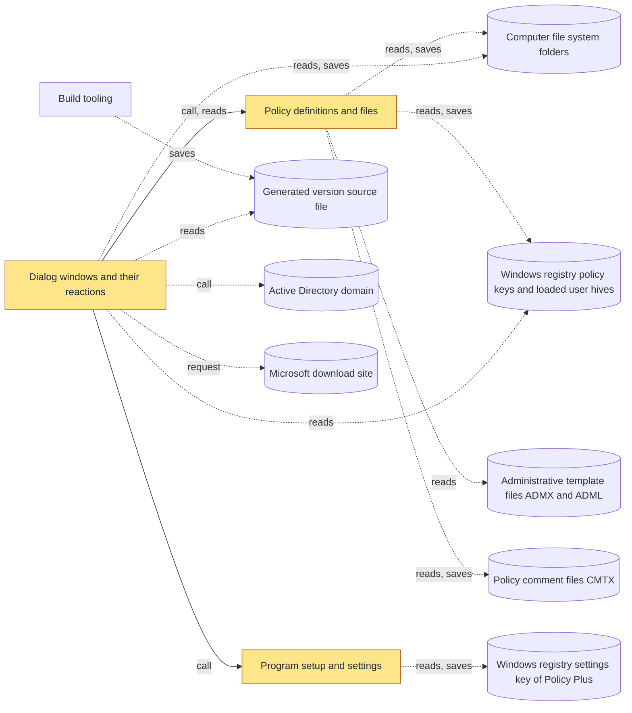
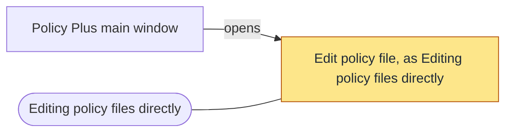

# Screen: Edit policy file, as Editing policy files directly

At a glance: 1 owned rule, 0 relied on, 2 actions, 2 files (1 own, 0 relied on, 1 of neighbour screens, 0 generated), 0 disputed.

How to read it: paths are relative to the source root and `file:a-b` is an inclusive line range. `BR-` rules, `ACT-` actions, `TR-` changes of state and `RK-` risks have stable ids. A record marked disputed was challenged in review and kept; the reviewer's words are under Trust. All of it was read from the code; nothing was run.

## Product context
Policy Plus is a Windows desktop editor for Group Policy settings, used by administrators and power users. It reads Microsoft's policy definition files and edits policy files directly, so it works on any Windows edition, including Home, which lacks the built-in editor.
Built with: .NET Framework v4.5.2, Microsoft Windows, System.DirectoryServices, System.Xml, Visual Basic .NET, Windows Forms (Policy Plus desktop editor).
Runs: It runs on the user's own Windows computer as one desktop program on .NET Framework 4.5.2. It asks for elevated rights when available but starts without them; loading registry hives, refreshing policy and editing local Group Policy files need them. It can also reach the domain's shared policy folder.
Reaches outside itself: Computer file system folders; Windows registry policy keys and loaded user hives; Administrative template files (ADMX and ADML); Windows registry settings key of Policy Plus; Generated version source file; Policy comment files (CMTX); Active Directory domain; Microsoft download site.



## Where this sits
Part of: Editing policy files directly (Setting and storing policies).



## Boundary
- Opened by **Policy Plus main window** (bundle: screen policy-plus-main-window), at `PolicyPlus/Main.vb:776-794`

## Contract: what it must do
### Edit policy file
Browse a policy file and, in steps, add keys and values, edit text, number and list values, or choose what to delete.
Controls (42): Button: ButtonOK, ButtonOK, ButtonOK, ButtonOK, ButtonOK, ButtonOK; CheckBox: CheckHexadecimal; ComboBox: ComboKind; Friend WithEvents ButtonAddKey As Button: ButtonAddKey; Friend WithEvents ButtonAddValue As Button: ButtonAddValue; Friend WithEvents ButtonDeleteValue As Button: ButtonDeleteValue; Friend WithEvents ButtonEdit As Button: ButtonEdit; Friend WithEvents ButtonExport As Button: ButtonExport; Friend WithEvents ButtonForget As Button: ButtonForget; Friend WithEvents ButtonImport As Button: ButtonImport; Friend WithEvents ButtonSave As Button: ButtonSave; Friend WithEvents ChItem As ColumnHeader: ChItem; Friend WithEvents ChValue As ColumnHeader: ChValue; Friend WithEvents LsvPol As ListView: LsvPol; Label: Label1, Label1, Label1, Label2, Label1, Label2, Label1, Label2, Label1, Label2; RadioButton: OptClearFirst, OptDeleteOne, OptPurge; TextBox: TextKey, TextValueName, TextName, TextData, TextName, TextName, TextData, TextName, TextName; WideRangeNumericUpDown: NumData

Actions
- **ACT-18812041** Shows the value as hexadecimal text when hexadecimal mode is on, otherwise leaves display to the standard control. — `PolicyPlus/EditPolNumericData.vb:21-31`; started by person
- **ACT-73028291** Reads typed hexadecimal text into the value in hexadecimal mode, otherwise leaves it to the standard control. — `PolicyPlus/EditPolNumericData.vb:32-39`; started by person

Rules
- **BR-82494727** When a typed hexadecimal number is too large to fit, the value is set to the largest allowed value; text that is not a hexadecimal number leaves the value unchanged. — `PolicyPlus/EditPolNumericData.vb:40-58`; also rests on `PolicyPlus/EditPolNumericData.vb:42`


## Read order
| Tier | File | Lines | Why |
| --- | --- | --- | --- |
| own | `PolicyPlus/EditPolNumericData.vb` | whole file | starts 2 actions; decides 1 owned rule |
| neighbour screen | `PolicyPlus/Main.vb` | 776-794 | opens this screen: Policy Plus main window |

## Source

### PolicyPlus/EditPolNumericData.vb
```
1: Public Class EditPolNumericData
2:     Public Function PresentDialog(ValueName As String, InitialData As ULong, IsQword As Boolean) As DialogResult
3:         TextName.Text = ValueName
4:         NumData.Maximum = If(IsQword, ULong.MaxValue, UInteger.MaxValue)
5:         NumData.Value = InitialData
6:         NumData.Select()
7:         Return ShowDialog()
8:     End Function
9:     Private Sub CheckHexadecimal_CheckedChanged(sender As Object, e As EventArgs) Handles CheckHexadecimal.CheckedChanged
10:         NumData.Hexadecimal = CheckHexadecimal.Checked
11:     End Sub
12:     Private Sub EditPolNumericData_KeyDown(sender As Object, e As KeyEventArgs) Handles Me.KeyDown
13:         If e.KeyCode = Keys.Escape Then DialogResult = DialogResult.Cancel
14:     End Sub
15: End Class
16: ' The normal NumericUpDown has a bug - it's unable to handle numbers greater than 0x7FFFFFF when in hex mode
17: ' This subclass fixes that bug
18: ' Adapted from https://social.msdn.microsoft.com/Forums/windows/en-US/6eea9c6c-a43c-4ef1-a7a3-de95e17e77a8/numericupdown-hexadecimal-bug?forum=winforms
19: Friend Class WideRangeNumericUpDown
20:     Inherits NumericUpDown
21:     Protected Overrides Sub UpdateEditText()
22:         If Hexadecimal Then
23:             If UserEdit Then HexParseEditText()
24:             If Not String.IsNullOrEmpty(Text) Then
25:                 ChangingText = True
26:                 Text = String.Format("{0:X}", CULng(Value))
27:             End If
28:         Else
29:             MyBase.UpdateEditText()
30:         End If
31:     End Sub
32:     Protected Overrides Sub ValidateEditText()
33:         If Hexadecimal Then
34:             HexParseEditText()
35:             UpdateEditText()
36:         Else
37:             MyBase.ValidateEditText()
38:         End If
39:     End Sub
40:     Private Sub HexParseEditText()
41:         Try
42:             If Not String.IsNullOrEmpty(Text) Then Value = ULong.Parse(Text, Globalization.NumberStyles.HexNumber)
43:         Catch ex As ArgumentOutOfRangeException
44:             Value = Maximum
45:         Catch ex As OverflowException
46:             If Not String.IsNullOrEmpty(Text) Then
47:                 If Text.StartsWith("-") Then
48:                     Value = Minimum
49:                 Else
50:                     Value = Maximum
51:                 End If
52:             End If
53:         Catch ex As Exception
54:             ' Do nothing
55:         Finally
56:             UserEdit = False
57:         End Try
58:     End Sub
59: End Class
```

### PolicyPlus/Main.vb
```
776:     Private Sub EditRawPOLToolStripMenuItem_Click(sender As Object, e As EventArgs) Handles EditRawPOLToolStripMenuItem.Click
777:         Dim userIsPol = TypeOf UserPolicySource Is PolFile
778:         Dim compIsPol = TypeOf CompPolicySource Is PolFile
779:         If Not (userIsPol Or compIsPol) Then
780:             MsgBox("Neither loaded source is backed by a POL file.", MsgBoxStyle.Exclamation)
781:             Exit Sub
782:         End If
783:         If CInt(Configuration.GetValue("EditPolDangerAcknowledged", 0)) = 0 Then
784:             If MsgBox("Caution! This tool is for very advanced users. Improper modifications may result in inconsistencies in policies' states." & vbCrLf & vbCrLf &
785:                       "Changes operate directly on the policy source, though they will not be committed to disk until you save. Are you sure you want to continue?",
786:                       MsgBoxStyle.Exclamation Or MsgBoxStyle.YesNo) = MsgBoxResult.No Then Exit Sub
787:             Configuration.SetValue("EditPolDangerAcknowledged", 1)
788:         End If
789:         If OpenSection.PresentDialog(userIsPol, compIsPol) = DialogResult.OK Then
790:             EditPol.PresentDialog(PolicyIcons, If(OpenSection.SelectedSection = AdmxPolicySection.Machine, CompPolicySource, UserPolicySource),
791:                                   OpenSection.SelectedSection = AdmxPolicySection.User)
792:         End If
793:         MoveToVisibleCategoryAndReload()
794:     End Sub
```
