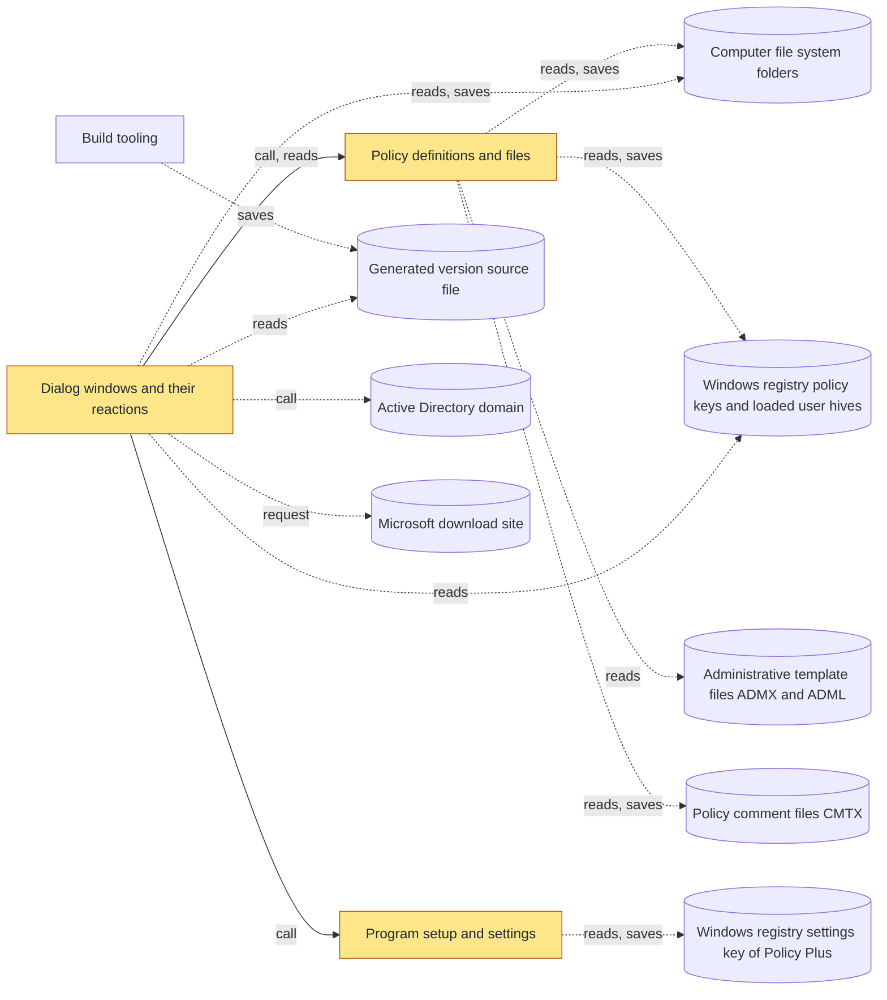
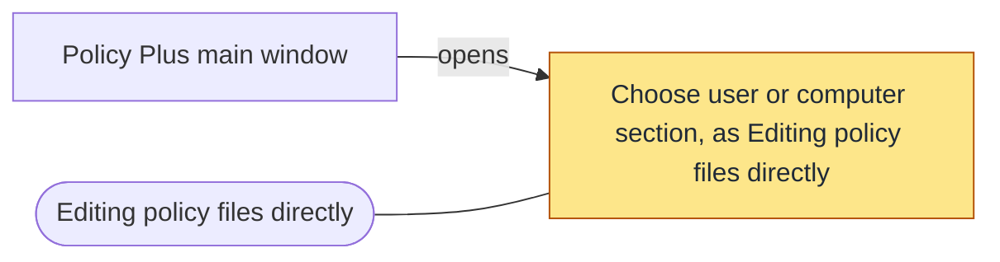

# Legacy reference: Choose whether to work on user or computer policies

The typed header below maps each criterion of the work item to the rules of the existing system it backs. The reading of the existing code follows it.

## Header

```json
{
  "story": "story-012c9bf5ea7e",
  "fingerprint": "280637421a2d33856d0f4655b9cf3df29c3a1ebf99ebbb84e7839ee4506bf978",
  "criteria": [
    {
      "ac": "AC-1",
      "rules": [
        {
          "says": "In the section dialog, OK does nothing until User or Computer is chosen; then it returns that section and closes.",
          "where": {
            "file": "PolicyPlus/OpenSection.vb",
            "firstLine": 3,
            "lastLine": 9
          },
          "doubt": ""
        }
      ]
    },
    {
      "ac": "AC-2",
      "rules": [
        {
          "says": "Pressing Escape closes the section dialog as cancelled.",
          "where": {
            "file": "PolicyPlus/OpenSection.vb",
            "firstLine": 10,
            "lastLine": 12
          },
          "doubt": ""
        }
      ]
    }
  ],
  "reliesOn": [],
  "data": [
    {
      "kind": "Program preference",
      "access": "reads and saves"
    },
    {
      "kind": "Policy setting",
      "access": "reads and saves"
    }
  ],
  "transitions": [],
  "outsideSystems": [
    "Windows registry settings key of Policy Plus",
    "Computer file system folders",
    "Windows registry policy keys and loaded user hives"
  ],
  "cited": [
    {
      "file": "PolicyPlus/OpenSection.vb",
      "firstLine": 3,
      "lastLine": 9
    },
    {
      "file": "PolicyPlus/OpenSection.vb",
      "firstLine": 10,
      "lastLine": 12
    },
    {
      "file": "PolicyPlus/OpenSection.vb",
      "firstLine": 3,
      "lastLine": 9
    },
    {
      "file": "PolicyPlus/OpenSection.vb",
      "firstLine": 10,
      "lastLine": 12
    }
  ]
}
```

## What each criterion must keep

### AC-1

- In the section dialog, OK does nothing until User or Computer is chosen; then it returns that section and closes. (PolicyPlus/OpenSection.vb:3-9)

### AC-2

- Pressing Escape closes the section dialog as cancelled. (PolicyPlus/OpenSection.vb:10-12)

## Reading of the existing code

# Screen: Choose user or computer section, as Editing policy files directly

At a glance: 2 owned rules, 0 relied on, 2 actions, 2 files (1 own, 0 relied on, 1 of neighbour screens, 0 generated), 0 disputed.

How to read it: paths are relative to the source root and `file:a-b` is an inclusive line range. `BR-` rules, `ACT-` actions, `TR-` changes of state and `RK-` risks have stable ids. A record marked disputed was challenged in review and kept; the reviewer's words are under Trust. All of it was read from the code; nothing was run.

## Product context
Policy Plus is a Windows desktop editor for Group Policy settings, used by administrators and power users. It reads Microsoft's policy definition files and edits policy files directly, so it works on any Windows edition, including Home, which lacks the built-in editor.
Built with: .NET Framework v4.5.2, Microsoft Windows, System.DirectoryServices, System.Xml, Visual Basic .NET, Windows Forms (Policy Plus desktop editor).
Runs: It runs on the user's own Windows computer as one desktop program on .NET Framework 4.5.2. It asks for elevated rights when available but starts without them; loading registry hives, refreshing policy and editing local Group Policy files need them. It can also reach the domain's shared policy folder.
Reaches outside itself: Computer file system folders; Windows registry policy keys and loaded user hives; Administrative template files (ADMX and ADML); Windows registry settings key of Policy Plus; Generated version source file; Policy comment files (CMTX); Active Directory domain; Microsoft download site.



## Where this sits
Part of: Editing policy files directly (Setting and storing policies).



## Boundary
- Opened by **Policy Plus main window** (bundle: screen policy-plus-main-window), at `PolicyPlus/Main.vb:795-800`

## Contract: what it must do
### Choose user or computer section
Pick which section of a policy file to work on.
Controls (4): Button: ButtonCancel, ButtonOK; RadioButton: OptComputer, OptUser

Actions
- **ACT-87310099** Reports the chosen section (user or computer) and closes the dialog as accepted — `PolicyPlus/OpenSection.vb:3-9`; started by person
- **ACT-92366925** Closes the dialog as cancelled when Escape is pressed — `PolicyPlus/OpenSection.vb:10-12`; started by person

Rules
- **BR-22472190** In the section dialog, OK does nothing until User or Computer is chosen; then it returns that section and closes. — `PolicyPlus/OpenSection.vb:3-9`
- **BR-75039594** Pressing Escape closes the section dialog as cancelled. — `PolicyPlus/OpenSection.vb:10-12`


## Trust: what to doubt
**In these files but reached by nothing the analysis could follow**
- OpenSection.OpenSection_Shown (`PolicyPlus/OpenSection.vb:13-16`)


## Read order
| Tier | File | Lines | Why |
| --- | --- | --- | --- |
| own | `PolicyPlus/OpenSection.vb` | whole file | starts 2 actions; decides 2 owned rules |
| neighbour screen | `PolicyPlus/Main.vb` | 795-800 | opens this screen: Policy Plus main window |

## Source

### PolicyPlus/OpenSection.vb
```
1: Public Class OpenSection
2:     Public SelectedSection As AdmxPolicySection
3:     Private Sub ButtonOK_Click(sender As Object, e As EventArgs) Handles ButtonOK.Click
4:         ' Report the selected section
5:         If OptUser.Checked Or OptComputer.Checked Then
6:             SelectedSection = If(OptUser.Checked, AdmxPolicySection.User, AdmxPolicySection.Machine)
7:             DialogResult = DialogResult.OK
8:         End If
9:     End Sub
10:     Private Sub OpenSection_KeyDown(sender As Object, e As KeyEventArgs) Handles Me.KeyDown
11:         If e.KeyCode = Keys.Escape Then DialogResult = DialogResult.Cancel
12:     End Sub
13:     Private Sub OpenSection_Shown(sender As Object, e As EventArgs) Handles Me.Shown
14:         OptUser.Checked = False
15:         OptComputer.Checked = False
16:     End Sub
17:     Public Function PresentDialog(UserEnabled As Boolean, CompEnabled As Boolean) As DialogResult
18:         OptUser.Enabled = UserEnabled
19:         OptComputer.Enabled = CompEnabled
20:         Return ShowDialog()
21:     End Function
22: End Class
```

### PolicyPlus/Main.vb
```
795:     Private Sub ExportREGToolStripMenuItem_Click(sender As Object, e As EventArgs) Handles ExportREGToolStripMenuItem.Click
796:         If OpenSection.PresentDialog(True, True) = DialogResult.OK Then
797:             Dim source = If(OpenSection.SelectedSection = AdmxPolicySection.Machine, CompPolicySource, UserPolicySource)
798:             ExportReg.PresentDialog("", GetOrCreatePolFromPolicySource(source), OpenSection.SelectedSection = AdmxPolicySection.User)
799:         End If
800:     End Sub
```

