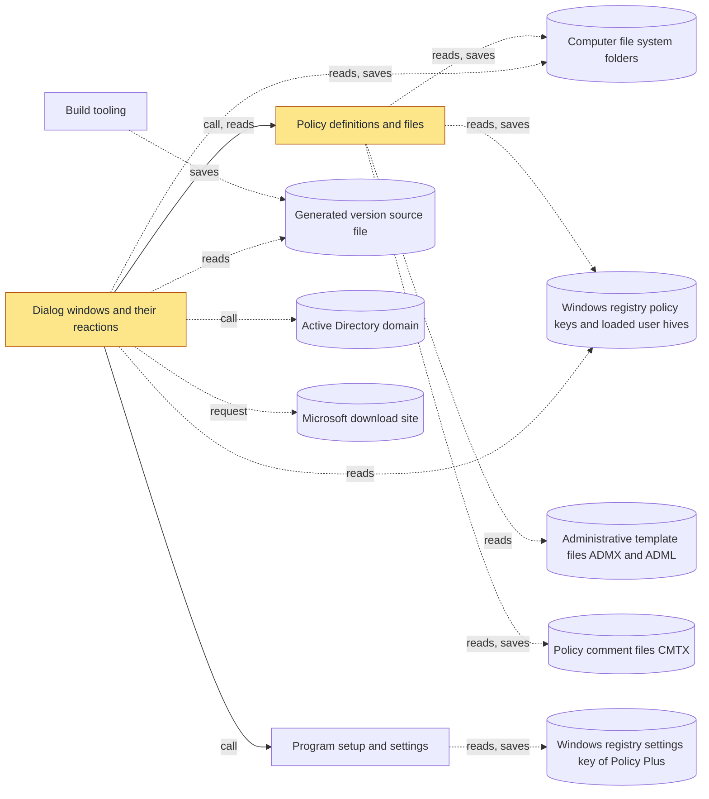
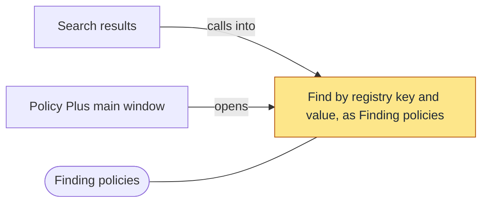

# Legacy reference: Find policies by registry key and value

The typed header below maps each criterion of the work item to the rules of the existing system it backs. The reading of the existing code follows it.

## Header

```json
{
  "story": "story-0fc938b61ebe",
  "fingerprint": "280637421a2d33856d0f4655b9cf3df29c3a1ebf99ebbb84e7839ee4506bf978",
  "criteria": [
    {
      "ac": "AC-1",
      "rules": [
        {
          "says": "A policy matches a registry search when at least one registry value it reads or writes meets every term entered; matching ignores case.",
          "where": {
            "file": "PolicyPlus/FindByRegistry.vb",
            "firstLine": 17,
            "lastLine": 35
          },
          "doubt": ""
        }
      ]
    },
    {
      "ac": "AC-2",
      "rules": [
        {
          "says": "A value-name term must match the whole value name; \"*\" and \"?\" act as wildcards, so without them the name must be equal.",
          "where": {
            "file": "PolicyPlus/FindByRegistry.vb",
            "firstLine": 20,
            "lastLine": 22
          },
          "doubt": "The value term is passed to Like, which also gives meaning to # (any digit) and [..] character lists, not only * and ?. Saying only * and ? are wildcards is short of the reach, and a value term with [ or # behaves differently from plain text even with no * or ?. State that the value term is always a Like pattern (so # and [ ] also act), as the fact on malformed patterns already relies on."
        }
      ]
    },
    {
      "ac": "AC-3",
      "rules": [
        {
          "says": "A key term with no backslash and no wildcard matches policies having a key path with a part equal to that text.",
          "where": {
            "file": "PolicyPlus/FindByRegistry.vb",
            "firstLine": 28,
            "lastLine": 29
          },
          "doubt": ""
        }
      ]
    },
    {
      "ac": "AC-4",
      "rules": [
        {
          "says": "A key term containing a backslash but no wildcard matches policies whose key path starts with that text.",
          "where": {
            "file": "PolicyPlus/FindByRegistry.vb",
            "firstLine": 26,
            "lastLine": 27
          },
          "doubt": ""
        }
      ]
    },
    {
      "ac": "AC-5",
      "rules": [
        {
          "says": "A key term containing \"*\" or \"?\" must match the whole key path as a wildcard pattern.",
          "where": {
            "file": "PolicyPlus/FindByRegistry.vb",
            "firstLine": 24,
            "lastLine": 25
          },
          "doubt": ""
        }
      ]
    }
  ],
  "reliesOn": [
    {
      "says": "When a policy file is clearing a key, all values and markers under the key are dropped and a single clear-all marker is stored.",
      "builtBy": "Set, delete and forget values and key clearances in a policy file"
    },
    {
      "says": "A REG file cannot be used as a source for forgetting a value: the request fails with 'not implemented'. Applying a newer policy file over an older one to a REG file fails this way for any dropped value under a policy branch.",
      "builtBy": "Edit entries of a REG file within its source branch"
    },
    {
      "says": "Listing the values of a key in a policy file leaves out the marker entries unless the caller asks for them.",
      "builtBy": "Read and list values in policy files and registry policy keys"
    },
    {
      "says": "When a policy is forgotten, the whole key of each of its list elements is cleared and every registry value it touches is dropped from the source, so it reads as Not configured.",
      "builtBy": "Forget a policy and list the registry values it touches"
    },
    {
      "says": "In the live registry, 'forgetting' a value deletes it, because the registry cannot remember a pending deletion.",
      "builtBy": "Replace live registry changes with the registry source model"
    },
    {
      "says": "When a value is forgotten in a policy file, both the value and its deletion marker are removed, so the policy reverts to not saying anything about it.",
      "builtBy": "Set, delete and forget values and key clearances in a policy file"
    },
    {
      "says": "Clearing a key in the live registry deletes every value in it but leaves the key and its subkeys. Forgetting a key's clearance does nothing.",
      "builtBy": "Replace live registry changes with the registry source model"
    },
    {
      "says": "When a key's clearance is forgotten in a REG file, the key-removal entry is dropped if it exists. The request is ignored if a source branch is set and the key lies outside it. When no branch is set, every key is accepted.",
      "builtBy": "Edit entries of a REG file within its source branch"
    },
    {
      "says": "The registry values a policy touches are its own value, those in its value lists, those of its elements (the whole key for list elements) and those of checkbox and choice sub-lists, each counted once.",
      "builtBy": "Forget a policy and list the registry values it touches"
    },
    {
      "says": "When a key's clearance is forgotten in a policy file, every clear-all marker for that key is removed.",
      "builtBy": "Set, delete and forget values and key clearances in a policy file"
    },
    {
      "says": "When a key is cleared in a REG file, the request is ignored if a source branch is set and the key lies outside it. When no branch is set, every key is accepted. Otherwise the key's earlier entries are replaced by a key-removal entry.",
      "builtBy": "Edit entries of a REG file within its source branch"
    },
    {
      "says": "When the key text starts with HKLM\\, HKCU\\, HKEY_LOCAL_MACHINE\\ or HKEY_CURRENT_USER\\, the search is refused with \"Policies' root keys are determined only by their section. Remove the root key from the search terms and try again.\"",
      "builtBy": "Refuse unusable registry searches and cancel with Escape"
    },
    {
      "says": "When Search is pressed with both the key and the value empty, the search is refused and the person is told \"Please enter search terms.\"",
      "builtBy": "Refuse unusable registry searches and cancel with Escape"
    },
    {
      "says": "Text stored in a policy file is written in two-byte characters followed by a closing empty character.",
      "builtBy": "Read and write the stored form of values in a policy file"
    },
    {
      "says": "When a value is deleted in the live registry and its key does not exist, nothing happens. A missing value is not an error.",
      "builtBy": "Replace live registry changes with the registry source model"
    }
  ],
  "data": [
    {
      "kind": "Policy setting",
      "access": "reads and saves"
    }
  ],
  "transitions": [],
  "outsideSystems": [
    "Computer file system folders",
    "Windows registry policy keys and loaded user hives"
  ],
  "cited": [
    {
      "file": "PolicyPlus/FindByRegistry.vb",
      "firstLine": 6,
      "lastLine": 37
    },
    {
      "file": "PolicyPlus/FindByRegistry.vb",
      "firstLine": 17,
      "lastLine": 35
    },
    {
      "file": "PolicyPlus/FindByRegistry.vb",
      "firstLine": 7,
      "lastLine": 8
    },
    {
      "file": "PolicyPlus/FindByRegistry.vb",
      "firstLine": 20,
      "lastLine": 22
    },
    {
      "file": "PolicyPlus/FindByRegistry.vb",
      "firstLine": 28,
      "lastLine": 29
    },
    {
      "file": "PolicyPlus/FindByRegistry.vb",
      "firstLine": 26,
      "lastLine": 27
    },
    {
      "file": "PolicyPlus/FindByRegistry.vb",
      "firstLine": 24,
      "lastLine": 25
    }
  ]
}
```

## What each criterion must keep

### AC-1

- A policy matches a registry search when at least one registry value it reads or writes meets every term entered; matching ignores case. (PolicyPlus/FindByRegistry.vb:17-35)

### AC-2

- A value-name term must match the whole value name; "*" and "?" act as wildcards, so without them the name must be equal. (PolicyPlus/FindByRegistry.vb:20-22) Doubt: The value term is passed to Like, which also gives meaning to # (any digit) and [..] character lists, not only * and ?. Saying only * and ? are wildcards is short of the reach, and a value term with [ or # behaves differently from plain text even with no * or ?. State that the value term is always a Like pattern (so # and [ ] also act), as the fact on malformed patterns already relies on.

### AC-3

- A key term with no backslash and no wildcard matches policies having a key path with a part equal to that text. (PolicyPlus/FindByRegistry.vb:28-29)

### AC-4

- A key term containing a backslash but no wildcard matches policies whose key path starts with that text. (PolicyPlus/FindByRegistry.vb:26-27)

### AC-5

- A key term containing "*" or "?" must match the whole key path as a wildcard pattern. (PolicyPlus/FindByRegistry.vb:24-25)

## Relies on, built elsewhere

- When a policy file is clearing a key, all values and markers under the key are dropped and a single clear-all marker is stored. Built by: Set, delete and forget values and key clearances in a policy file.
- A REG file cannot be used as a source for forgetting a value: the request fails with 'not implemented'. Applying a newer policy file over an older one to a REG file fails this way for any dropped value under a policy branch. Built by: Edit entries of a REG file within its source branch.
- Listing the values of a key in a policy file leaves out the marker entries unless the caller asks for them. Built by: Read and list values in policy files and registry policy keys.
- When a policy is forgotten, the whole key of each of its list elements is cleared and every registry value it touches is dropped from the source, so it reads as Not configured. Built by: Forget a policy and list the registry values it touches.
- In the live registry, 'forgetting' a value deletes it, because the registry cannot remember a pending deletion. Built by: Replace live registry changes with the registry source model.
- When a value is forgotten in a policy file, both the value and its deletion marker are removed, so the policy reverts to not saying anything about it. Built by: Set, delete and forget values and key clearances in a policy file.
- Clearing a key in the live registry deletes every value in it but leaves the key and its subkeys. Forgetting a key's clearance does nothing. Built by: Replace live registry changes with the registry source model.
- When a key's clearance is forgotten in a REG file, the key-removal entry is dropped if it exists. The request is ignored if a source branch is set and the key lies outside it. When no branch is set, every key is accepted. Built by: Edit entries of a REG file within its source branch.
- The registry values a policy touches are its own value, those in its value lists, those of its elements (the whole key for list elements) and those of checkbox and choice sub-lists, each counted once. Built by: Forget a policy and list the registry values it touches.
- When a key's clearance is forgotten in a policy file, every clear-all marker for that key is removed. Built by: Set, delete and forget values and key clearances in a policy file.
- When a key is cleared in a REG file, the request is ignored if a source branch is set and the key lies outside it. When no branch is set, every key is accepted. Otherwise the key's earlier entries are replaced by a key-removal entry. Built by: Edit entries of a REG file within its source branch.
- When the key text starts with HKLM\, HKCU\, HKEY_LOCAL_MACHINE\ or HKEY_CURRENT_USER\, the search is refused with "Policies' root keys are determined only by their section. Remove the root key from the search terms and try again." Built by: Refuse unusable registry searches and cancel with Escape.
- When Search is pressed with both the key and the value empty, the search is refused and the person is told "Please enter search terms." Built by: Refuse unusable registry searches and cancel with Escape.
- Text stored in a policy file is written in two-byte characters followed by a closing empty character. Built by: Read and write the stored form of values in a policy file.
- When a value is deleted in the live registry and its key does not exist, nothing happens. A missing value is not an error. Built by: Replace live registry changes with the registry source model.

## Reading of the existing code

# Screen: Find by registry key and value, as Finding policies

At a glance: 7 owned rules, 2 relied on, 2 actions, 5 files (1 own, 2 relied on, 2 of neighbour screens, 0 generated), 1 disputed.

How to read it: paths are relative to the source root and `file:a-b` is an inclusive line range. `BR-` rules, `ACT-` actions, `TR-` changes of state and `RK-` risks have stable ids. A record marked disputed was challenged in review and kept; the reviewer's words are under Trust. All of it was read from the code; nothing was run.

## Product context
Policy Plus is a Windows desktop editor for Group Policy settings, used by administrators and power users. It reads Microsoft's policy definition files and edits policy files directly, so it works on any Windows edition, including Home, which lacks the built-in editor.
Built with: .NET Framework v4.5.2, Microsoft Windows, System.DirectoryServices, System.Xml, Visual Basic .NET, Windows Forms (Policy Plus desktop editor).
Runs: It runs on the user's own Windows computer as one desktop program on .NET Framework 4.5.2. It asks for elevated rights when available but starts without them; loading registry hives, refreshing policy and editing local Group Policy files need them. It can also reach the domain's shared policy folder.
Reaches outside itself: Computer file system folders; Windows registry policy keys and loaded user hives; Administrative template files (ADMX and ADML); Windows registry settings key of Policy Plus; Generated version source file; Policy comment files (CMTX); Active Directory domain; Microsoft download site.



## Where this sits
Part of: Finding policies (Reading policy definitions).



## Boundary
- Called from **Search results** (bundle: screen search-results), at `PolicyPlus/FindResults.vb:47-90`
- Opened by **Policy Plus main window** (bundle: screen policy-plus-main-window), at `PolicyPlus/Main.vb:668-671`

## Contract: what it must do
### Find by registry key and value
Search for policies that use a given registry key or value.
Controls (5): Button: SearchButton; Label: KeyPathLabel, ValueLabel; TextBox: KeyTextbox, ValueTextbox

Actions
- **ACT-84114585** Closes the dialog as cancelled when Escape is pressed — `PolicyPlus/FindByRegistry.vb:3-5`; started by person
- **ACT-88540545** Checks the typed registry key and value terms and builds the policy search function — `PolicyPlus/FindByRegistry.vb:6-37`; started by person

Rules
- **BR-77319907** When Search is pressed with both the key and the value empty, the search is refused and the person is told "Please enter search terms." — `PolicyPlus/FindByRegistry.vb:9-12`
- **BR-56766440** When the key text starts with HKLM\, HKCU\, HKEY_LOCAL_MACHINE\ or HKEY_CURRENT_USER\, the search is refused with "Policies' root keys are determined only by their section. Remove the root key from the search terms and try again." — `PolicyPlus/FindByRegistry.vb:13-16`
- **BR-66663184** A policy matches a registry search when at least one registry value it reads or writes meets every term entered; matching ignores case. — `PolicyPlus/FindByRegistry.vb:17-35`; also rests on `PolicyPlus/FindByRegistry.vb:7-8`
- **BR-43025066** A value-name term must match the whole value name; "*" and "?" act as wildcards, so without them the name must be equal. — `PolicyPlus/FindByRegistry.vb:20-22`; **disputed**
- **BR-75510973** A key term containing "*" or "?" must match the whole key path as a wildcard pattern. — `PolicyPlus/FindByRegistry.vb:24-25`
- **BR-22334165** A key term containing a backslash but no wildcard matches policies whose key path starts with that text. — `PolicyPlus/FindByRegistry.vb:26-27`
- **BR-19629666** A key term with no backslash and no wildcard matches policies having a key path with a part equal to that text. — `PolicyPlus/FindByRegistry.vb:28-29`


## Relied on: decided elsewhere
**Code shared with a few capabilities**
- `PolicyPlus/PolicyProcessing.vb`
  - **BR-35971750** The registry values a policy touches are its own value, those in its value lists, those of its elements (the whole key for list elements) and those of checkbox and choice sub-lists, each counted once. — `PolicyPlus/PolicyProcessing.vb:213-257`; also rests on `PolicyPlus/PolicyProcessing.vb:207-209` (also used by Changing policy settings)
  - **BR-65010717** When a policy is forgotten, the whole key of each of its list elements is cleared and every registry value it touches is dropped from the source, so it reads as Not configured. — `PolicyPlus/PolicyProcessing.vb:249-262`; also rests on `PolicyPlus/PolicyProcessing.vb:210-212` (also used by Changing policy settings)


## Trust: what to doubt
**Challenged in review and kept**
- **BR-43025066** `PolicyPlus/FindByRegistry.vb:20-22`: The value term is passed to Like, which also gives meaning to # (any digit) and [..] character lists, not only * and ?. Saying only * and ? are wildcards is short of the reach, and a value term with [ or # behaves differently from plain text even with no * or ?. State that the value term is always a Like pattern (so # and [ ] also act), as the fact on malformed patterns already relies on.

**Risks**
- **RK-55878738** [low] Several windows raise an unhandled error on ordinary input: double-clicking with no row selected, right-clicking with no category, an unnamed list entry, an unreadable import file, a malformed search wildcard, a removed product in a filter, or an inspector item with no match. No program-wide handler is set, so the framework's default error dialog appears. (Failures are hidden, lost or not retried) — at `PolicyPlus/FindByRegistry.vb:20-25`


## Read order
| Tier | File | Lines | Why |
| --- | --- | --- | --- |
| own | `PolicyPlus/FindByRegistry.vb` | whole file | starts 2 actions; decides 7 owned rules |
| relied on | `PolicyPlus/PolicyProcessing.vb` | 207-264 | decides 2 relied-on rules; called code; used by 1 other capability |
| relied on | `PolicyPlus/PolicySource.vb` | 9-12 | called code; used by 3 other capabilities |
| neighbour screen | `PolicyPlus/FindResults.vb` | 47-90 | calls into this screen: Search results |
| neighbour screen | `PolicyPlus/Main.vb` | 668-671 | opens this screen: Policy Plus main window |

## Source

### PolicyPlus/FindByRegistry.vb
```
1: Public Class FindByRegistry
2:     Public Searcher As Func(Of PolicyPlusPolicy, Boolean)
3:     Private Sub FindByRegistry_KeyUp(sender As Object, e As KeyEventArgs) Handles Me.KeyUp
4:         If e.KeyCode = Keys.Escape Then DialogResult = DialogResult.Cancel
5:     End Sub
6:     Private Sub SearchButton_Click(sender As Object, e As EventArgs) Handles SearchButton.Click
7:         Dim keyName = KeyTextbox.Text.ToLowerInvariant
8:         Dim valName = ValueTextbox.Text.ToLowerInvariant
9:         If keyName = "" And valName = "" Then
10:             MsgBox("Please enter search terms.", MsgBoxStyle.Exclamation)
11:             Exit Sub
12:         End If
13:         If {"HKLM\", "HKCU\", "HKEY_LOCAL_MACHINE\", "HKEY_CURRENT_USER\"}.Any(Function(bad) keyName.StartsWith(bad, StringComparison.InvariantCultureIgnoreCase)) Then
14:             MsgBox("Policies' root keys are determined only by their section. Remove the root key from the search terms and try again.", MsgBoxStyle.Exclamation)
15:             Exit Sub
16:         End If
17:         Searcher = Function(Policy As PolicyPlusPolicy) As Boolean
18:                        Dim affected = PolicyProcessing.GetReferencedRegistryValues(Policy)
19:                        For Each rkvp In affected
20:                            If valName <> "" Then
21:                                If Not rkvp.Value.ToLowerInvariant Like valName Then Continue For
22:                            End If
23:                            If keyName <> "" Then
24:                                If keyName.Contains("*") Or keyName.Contains("?") Then ' Wildcard path
25:                                    If Not rkvp.Key.ToLowerInvariant Like keyName Then Continue For
26:                                ElseIf keyName.Contains("\") Then ' Path root
27:                                    If Not rkvp.Key.StartsWith(keyName, StringComparison.InvariantCultureIgnoreCase) Then Continue For
28:                                Else ' One path component
29:                                    If Not Split(rkvp.Key, "\").Any(Function(part) part.Equals(keyName, StringComparison.InvariantCultureIgnoreCase)) Then Continue For
30:                                End If
31:                            End If
32:                            Return True
33:                        Next
34:                        Return False
35:                    End Function
36:         DialogResult = DialogResult.OK
37:     End Sub
38: End Class
```

### PolicyPlus/PolicyProcessing.vb
```
207:     Public Shared Function GetReferencedRegistryValues(Policy As PolicyPlusPolicy) As List(Of RegistryKeyValuePair)
208:         Return WalkPolicyRegistry(Nothing, Policy, False)
209:     End Function
210:     Public Shared Sub ForgetPolicy(PolicySource As IPolicySource, Policy As PolicyPlusPolicy)
211:         WalkPolicyRegistry(PolicySource, Policy, True)
212:     End Sub
213:     Private Shared Function WalkPolicyRegistry(PolicySource As IPolicySource, Policy As PolicyPlusPolicy, Forget As Boolean) As List(Of RegistryKeyValuePair)
214:         ' This function handles both GetReferencedRegistryValues and ForgetPolicy because they require searching through the same things
215:         Dim entries As New List(Of RegistryKeyValuePair)
216:         Dim addReg = Sub(Key As String, Value As String)
217:                          Dim rkvp As New RegistryKeyValuePair With {.Key = Key, .Value = Value}
218:                          If Not entries.Contains(rkvp) Then entries.Add(rkvp)
219:                      End Sub
220:         ' Get all Registry values affected by this policy
221:         Dim rawpol = Policy.RawPolicy
222:         If rawpol.RegistryValue <> "" Then addReg(rawpol.RegistryKey, rawpol.RegistryValue)
223:         Dim addSingleList = Sub(SingleList As PolicyRegistrySingleList, OverrideKey As String)
224:                                 If SingleList Is Nothing Then Exit Sub
225:                                 Dim defaultKey = If(OverrideKey = "", rawpol.RegistryKey, OverrideKey)
226:                                 Dim listKey = If(SingleList.DefaultRegistryKey = "", defaultKey, SingleList.DefaultRegistryKey)
227:                                 For Each e In SingleList.AffectedValues
228:                                     Dim entryKey = If(e.RegistryKey = "", listKey, e.RegistryKey)
229:                                     addReg(entryKey, e.RegistryValue)
230:                                 Next
231:                             End Sub
232:         addSingleList(rawpol.AffectedValues.OnValueList, "")
233:         addSingleList(rawpol.AffectedValues.OffValueList, "")
234:         If rawpol.Elements IsNot Nothing Then
235:             For Each elem In rawpol.Elements
236:                 Dim elemKey As String = If(elem.RegistryKey = "", rawpol.RegistryKey, elem.RegistryKey)
237:                 If elem.ElementType <> "list" Then addReg(elemKey, elem.RegistryValue)
238:                 Select Case elem.ElementType
239:                     Case "boolean"
240:                         Dim booleanElem As BooleanPolicyElement = elem
241:                         addSingleList(booleanElem.AffectedRegistry.OnValueList, elemKey)
242:                         addSingleList(booleanElem.AffectedRegistry.OffValueList, elemKey)
243:                     Case "enum"
244:                         Dim enumElem As EnumPolicyElement = elem
245:                         For Each e In enumElem.Items
246:                             addSingleList(e.ValueList, elemKey)
247:                         Next
248:                     Case "list"
249:                         If Forget Then
250:                             PolicySource.ClearKey(elemKey) ' Delete all the values
251:                             PolicySource.ForgetKeyClearance(elemKey)
252:                         Else
253:                             addReg(elemKey, "")
254:                         End If
255:                 End Select
256:             Next
257:         End If
258:         If Forget Then ' Remove them if forgetting
259:             For Each e In entries
260:                 PolicySource.ForgetValue(e.Key, e.Value)
261:             Next
262:         End If
263:         Return entries
264:     End Function
```

### PolicyPlus/PolicySource.vb
```
9:     Sub ForgetValue(Key As String, Value As String) ' Stop keeping track of a value
10:     Sub DeleteValue(Key As String, Value As String) ' Mark a value as queued for deletion
11:     Sub ClearKey(Key As String) ' Destroy all values in a key
12:     Sub ForgetKeyClearance(Key As String) ' Unmark a key as cleared
```

### PolicyPlus/FindResults.vb
```
47:     Sub SearchJob(Workspace As AdmxBundle, Searcher As Func(Of PolicyPlusPolicy, Boolean))
48:         ' The long-running task that searches all the policies
49:         Dim searchedSoFar As Integer = 0
50:         Dim results As Integer = 0
51:         Dim stoppedByCancel As Boolean = False
52:         Dim pendingInsertions As New List(Of PolicyPlusPolicy)
53:         Dim addPendingInsertions = Sub()
54:                                        ResultsListview.BeginUpdate()
55:                                        For Each insert In pendingInsertions
56:                                            Dim lsvi = ResultsListview.Items.Add(insert.DisplayName)
57:                                            lsvi.Tag = insert
58:                                            lsvi.SubItems.Add(insert.Category.DisplayName)
59:                                        Next
60:                                        ResultsListview.EndUpdate()
61:                                        pendingInsertions.Clear()
62:                                    End Sub
63:         For Each policy In Workspace.Policies
64:             If Threading.Thread.VolatileRead(CancelingSearch) Then
65:                 stoppedByCancel = True
66:                 Exit For
67:             End If
68:             searchedSoFar += 1
69:             Dim isHit = Searcher(policy.Value) ' The potentially expensive check
70:             If isHit Then
71:                 results += 1
72:                 pendingInsertions.Add(policy.Value)
73:             End If
74:             If searchedSoFar Mod 20 = 0 Then ' UI updating is costly
75:                 Invoke(Sub()
76:                            addPendingInsertions()
77:                            SearchProgress.Value = searchedSoFar
78:                            ProgressLabel.Text = "Searching: checked " & searchedSoFar & " policies so far, found " & results & " hits"
79:                        End Sub)
80:             End If
81:         Next
82:         If stoppedByCancel AndAlso CBool(Threading.Thread.VolatileRead(CancelDueToFormClose)) Then Exit Sub ' Avoid accessing a disposed object
83:         Invoke(Sub()
84:                    addPendingInsertions()
85:                    Dim status As String = If(stoppedByCancel, "Search canceled", "Finished searching")
86:                    ProgressLabel.Text = status & ": checked " & searchedSoFar & " policies, found " & results & " hits"
87:                    SearchProgress.Value = SearchProgress.Maximum
88:                    StopButton.Enabled = False
89:                End Sub)
90:     End Sub
```

### PolicyPlus/Main.vb
```
668:     Private Sub ByRegistryToolStripMenuItem_Click(sender As Object, e As EventArgs) Handles ByRegistryToolStripMenuItem.Click
669:         ' Show the Find By Registry window and start the search
670:         If FindByRegistry.ShowDialog = DialogResult.OK Then ShowSearchDialog(FindByRegistry.Searcher)
671:     End Sub
```

