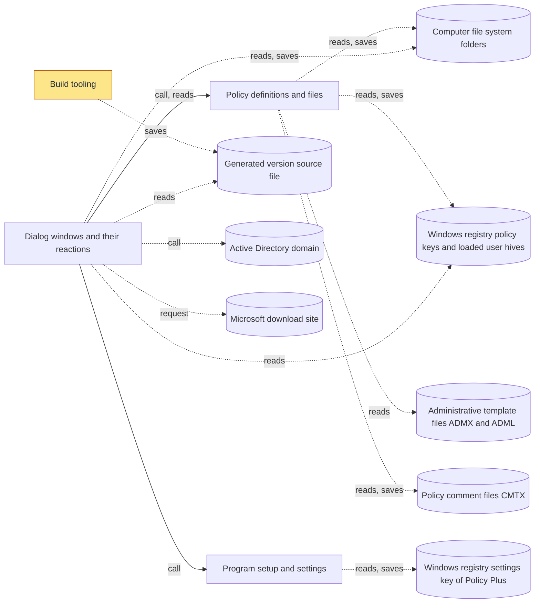
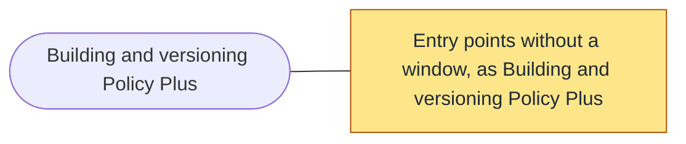

# Legacy reference: Stamp each build with its current Git version

The typed header below maps each criterion of the work item to the rules of the existing system it backs. The reading of the existing code follows it.

## Header

```json
{
  "story": "story-170cb2bdf690",
  "fingerprint": "280637421a2d33856d0f4655b9cf3df29c3a1ebf99ebbb84e7839ee4506bf978",
  "criteria": [
    {
      "ac": "AC-1",
      "rules": []
    },
    {
      "ac": "AC-2",
      "rules": [
        {
          "says": "When the build script runs, it replaces the program's version in a generated source file with the text git gives for the current commit. That text is a tag, commit count and short commit name when tags exist, and a short commit name otherwise. The script runs when someone runs it or the release workflow does. The committed file holds an empty version.",
          "where": {
            "file": "version.bat",
            "firstLine": 1,
            "lastLine": 8
          },
          "doubt": "The description of git's text ('a tag, commit count and short commit name when tags exist, and a short commit name otherwise') rests on how git describe behaves, which the script does not show; it also omits that on a commit that is exactly tagged the text is the tag alone. State what the lines show (the script writes the output of 'git describe --always' as the version text) and put the detail of that output in an assumed Fact, or drop it. The script also rewrites the whole generated file (line 3 overwrites, 4-8 append), not just the version."
        }
      ]
    },
    {
      "ac": "AC-3",
      "rules": []
    },
    {
      "ac": "AC-4",
      "rules": []
    }
  ],
  "reliesOn": [],
  "data": [],
  "transitions": [],
  "outsideSystems": [],
  "cited": [
    {
      "file": "version.bat",
      "firstLine": 1,
      "lastLine": 8
    },
    {
      "file": "version.bat",
      "firstLine": 1,
      "lastLine": 8
    }
  ]
}
```

## What each criterion must keep

### AC-1

No single legacy rule: it describes the behaviour as a whole.


### AC-2

- When the build script runs, it replaces the program's version in a generated source file with the text git gives for the current commit. That text is a tag, commit count and short commit name when tags exist, and a short commit name otherwise. The script runs when someone runs it or the release workflow does. The committed file holds an empty version. (version.bat:1-8) Doubt: The description of git's text ('a tag, commit count and short commit name when tags exist, and a short commit name otherwise') rests on how git describe behaves, which the script does not show; it also omits that on a commit that is exactly tagged the text is the tag alone. State what the lines show (the script writes the output of 'git describe --always' as the version text) and put the detail of that output in an assumed Fact, or drop it. The script also rewrites the whole generated file (line 3 overwrites, 4-8 append), not just the version.

### AC-3

No single legacy rule: it describes the behaviour as a whole.


### AC-4

No single legacy rule: it describes the behaviour as a whole.


## Reading of the existing code

# Screen: Entry points without a window, as Building and versioning Policy Plus

At a glance: 1 owned rule, 0 relied on, 1 action, 1 files (1 own, 0 relied on, 0 of neighbour screens, 0 generated), 1 disputed.

How to read it: paths are relative to the source root and `file:a-b` is an inclusive line range. `BR-` rules, `ACT-` actions, `TR-` changes of state and `RK-` risks have stable ids. A record marked disputed was challenged in review and kept; the reviewer's words are under Trust. All of it was read from the code; nothing was run.

## Product context
Policy Plus is a Windows desktop editor for Group Policy settings, used by administrators and power users. It reads Microsoft's policy definition files and edits policy files directly, so it works on any Windows edition, including Home, which lacks the built-in editor.
Built with: .NET Framework v4.5.2, Microsoft Windows, System.DirectoryServices, System.Xml, Visual Basic .NET, Windows Forms (Policy Plus desktop editor).
Runs: It runs on the user's own Windows computer as one desktop program on .NET Framework 4.5.2. It asks for elevated rights when available but starts without them; loading registry hives, refreshing policy and editing local Group Policy files need them. It can also reach the domain's shared policy folder.
Reaches outside itself: Computer file system folders; Windows registry policy keys and loaded user hives; Administrative template files (ADMX and ADML); Windows registry settings key of Policy Plus; Generated version source file; Policy comment files (CMTX); Active Directory domain; Microsoft download site.



## Where this sits
Part of: Building and versioning Policy Plus (Building Policy Plus).



## Contract: what it must do
### Entry points without a window

### Build tooling

Actions
- **ACT-24791745** Rewrites the generated version file so the program carries the current Git commit description. — `version.bat:1-8`; started by person

Rules
- **BR-63878773** When the build script runs, it replaces the program's version in a generated source file with the text git gives for the current commit. That text is a tag, commit count and short commit name when tags exist, and a short commit name otherwise. The script runs when someone runs it or the release workflow does. The committed file holds an empty version. — `version.bat:1-8`; **disputed**


## Trust: what to doubt
**Challenged in review and kept**
- **BR-63878773** `version.bat:1-8`: The description of git's text ('a tag, commit count and short commit name when tags exist, and a short commit name otherwise') rests on how git describe behaves, which the script does not show; it also omits that on a commit that is exactly tagged the text is the tag alone. State what the lines show (the script writes the output of 'git describe --always' as the version text) and put the detail of that output in an assumed Fact, or drop it. The script also rewrites the whole generated file (line 3 overwrites, 4-8 append), not just the version.

**Assumed, not confirmed**
- The build script puts git's text between two quote marks on separate lines of the generated file. We assume the file is still valid code and the version string works. Why unsettled: Lines 5 to 7 write the git text on its own line, so whether the result compiles is not settled by these lines. The committed generated file holds an empty version, so the result of a run is not shown in the code. Confirm with: the running system If wrong: The build would fail or embed a wrong version after the script runs.
- The build script puts git's text between two quote marks on separate lines of the generated file. We assume the file is still valid code and the version string works. Why unsettled: Lines 5 to 7 write the git text on its own line, so whether the result compiles is not settled by these lines. The committed generated file holds an empty version, so the result of a run is not shown in the code. If wrong: The build would fail or embed a wrong version after the script runs.


## Read order
| Tier | File | Lines | Why |
| --- | --- | --- | --- |
| own | `version.bat` | whole file | starts 1 action; decides 1 owned rule |

## Source

### version.bat
```
1: @echo off
2: set VF=PolicyPlus\Version.vb
3: echo ' DO NOT MODIFY THIS FILE. To update it, run version.bat again. > %VF%
4: echo Module VersionHolder >> %VF%
5: echo     Public Const Version As String = ^" >> %VF%
6: git describe --always >> %VF%
7: echo ^" >> %VF%
8: echo End Module >> %VF%
```

