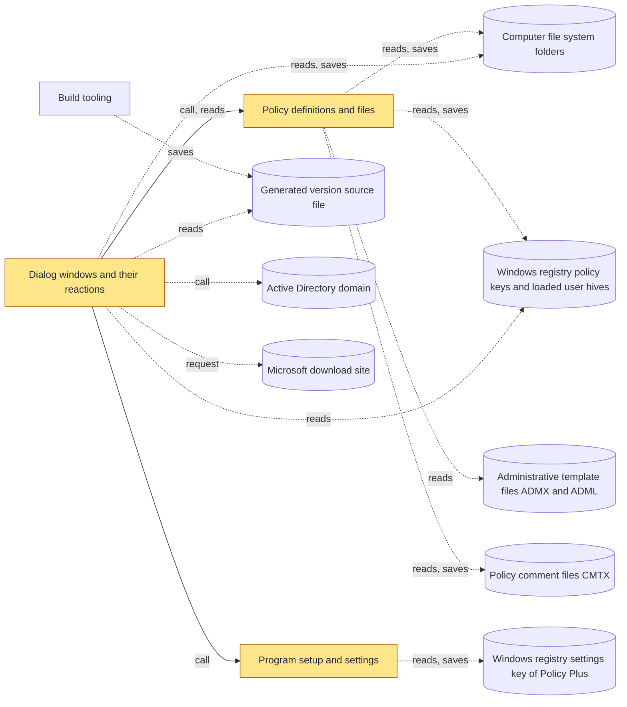
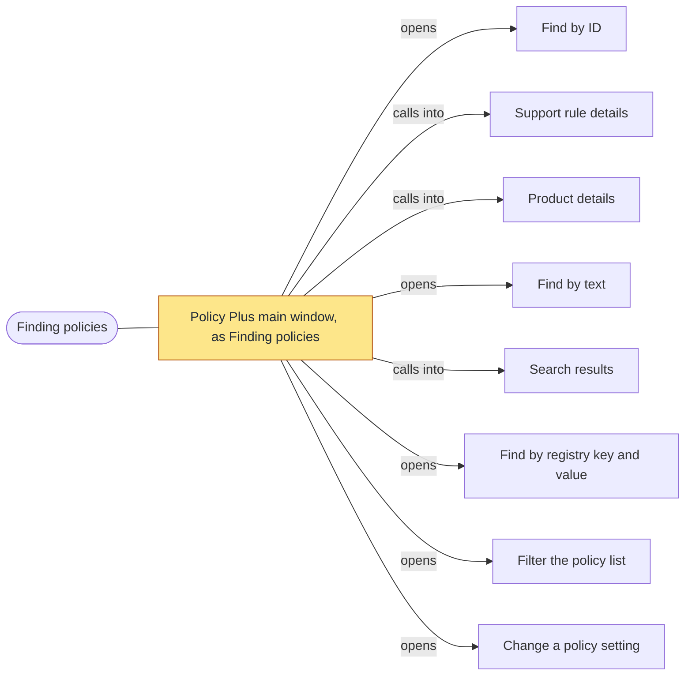

# Legacy reference: Judge whether a support definition is met by the chosen products

The typed header below maps each criterion of the work item to the rules of the existing system it backs. The reading of the existing code follows it.

## Header

```json
{
  "story": "story-19b33784f008",
  "fingerprint": "280637421a2d33856d0f4655b9cf3df29c3a1ebf99ebbb84e7839ee4506bf978",
  "criteria": [
    {
      "ac": "AC-1",
      "rules": [
        {
          "says": "A support entry for a product counts as met in two cases. The entry is not a version range and that exact product is among the chosen products. Or the product has versions beneath it, and any of those versions or their sub-products is chosen, even when the product itself is not.",
          "where": {
            "file": "PolicyPlus/PolicyProcessing.vb",
            "firstLine": 385,
            "lastLine": 385
          },
          "doubt": ""
        }
      ]
    },
    {
      "ac": "AC-2",
      "rules": [
        {
          "says": "A support entry for a product that has versions beneath it, whether a version range or a plain entry for a parent product that is not itself chosen, counts as met when any version in its range, or a sub-product directly beneath one, is chosen. The range runs from the entry's minimum (0 if none) to its maximum (the highest version if none). A range entry never matches on its own product, and a product with no versions beneath it never matches this way.",
          "where": {
            "file": "PolicyPlus/PolicyProcessing.vb",
            "firstLine": 386,
            "lastLine": 396
          },
          "doubt": ""
        }
      ]
    },
    {
      "ac": "AC-3",
      "rules": [
        {
          "says": "When the caller asks for 'any' matching, a support definition whose logic is all-of needs every entry met, and any other definition needs one entry met. When the caller does not ask for 'any', every definition, all-of included, is met by one entry. A definition with no entries, or none met, is met only when all are required. Plain product entries are checked before nested definitions.",
          "where": {
            "file": "PolicyPlus/PolicyProcessing.vb",
            "firstLine": 403,
            "lastLine": 421
          },
          "doubt": "'A definition with no entries, or none met, is met only when all are required' is false for 'none met'. When all are required (requireAll) the first unmet entry returns False at 408 or 416, so a definition with entries and none met is never met; when not required, no entry met falls to line 421 and returns False. Only a definition with NO entries is met, and only when all are required (421 returns the flag). Correct the clause to the empty case alone."
        }
      ]
    },
    {
      "ac": "AC-4",
      "rules": [
        {
          "says": "A support definition met a second time anywhere in one evaluation counts as not met, because the list of definitions seen is never emptied. Two entries that point at the same definition, with no cycle, make the second one not met.",
          "where": {
            "file": "PolicyPlus/PolicyProcessing.vb",
            "firstLine": 401,
            "lastLine": 402
          },
          "doubt": ""
        }
      ]
    },
    {
      "ac": "AC-5",
      "rules": [
        {
          "says": "When a policy lists no supported-on information, it counts as supported only if the caller allows unlisted policies. The same applies to a support entry that names no known product.",
          "where": {
            "file": "PolicyPlus/PolicyProcessing.vb",
            "firstLine": 382,
            "lastLine": 384
          },
          "doubt": ""
        }
      ]
    }
  ],
  "reliesOn": [],
  "data": [
    {
      "kind": "Policy setting",
      "access": "reads and saves"
    }
  ],
  "transitions": [],
  "outsideSystems": [
    "Computer file system folders",
    "Windows registry policy keys and loaded user hives"
  ],
  "steps": [
    {
      "intent": "Read the details of a product or support definition reached.",
      "change": "split",
      "reason": "Details are shown only for what has them, not as a dialog every time."
    }
  ],
  "components": [
    {
      "name": "Support evaluator",
      "module": "support-evaluator",
      "layer": "packages/ui"
    }
  ],
  "cited": [
    {
      "file": "PolicyPlus/Main.vb",
      "firstLine": 580,
      "lastLine": 606
    },
    {
      "file": "PolicyPlus/PolicyProcessing.vb",
      "firstLine": 385,
      "lastLine": 385
    },
    {
      "file": "PolicyPlus/PolicyProcessing.vb",
      "firstLine": 386,
      "lastLine": 395
    },
    {
      "file": "PolicyPlus/PolicyProcessing.vb",
      "firstLine": 386,
      "lastLine": 396
    },
    {
      "file": "PolicyPlus/PolicyProcessing.vb",
      "firstLine": 385,
      "lastLine": 385
    },
    {
      "file": "PolicyPlus/PolicyProcessing.vb",
      "firstLine": 403,
      "lastLine": 421
    },
    {
      "file": "PolicyPlus/PolicyProcessing.vb",
      "firstLine": 401,
      "lastLine": 402
    },
    {
      "file": "PolicyPlus/PolicyProcessing.vb",
      "firstLine": 413,
      "lastLine": 420
    },
    {
      "file": "PolicyPlus/PolicyProcessing.vb",
      "firstLine": 382,
      "lastLine": 384
    }
  ]
}
```

## What each criterion must keep

### AC-1

- A support entry for a product counts as met in two cases. The entry is not a version range and that exact product is among the chosen products. Or the product has versions beneath it, and any of those versions or their sub-products is chosen, even when the product itself is not. (PolicyPlus/PolicyProcessing.vb:385-385)

### AC-2

- A support entry for a product that has versions beneath it, whether a version range or a plain entry for a parent product that is not itself chosen, counts as met when any version in its range, or a sub-product directly beneath one, is chosen. The range runs from the entry's minimum (0 if none) to its maximum (the highest version if none). A range entry never matches on its own product, and a product with no versions beneath it never matches this way. (PolicyPlus/PolicyProcessing.vb:386-396)

### AC-3

- When the caller asks for 'any' matching, a support definition whose logic is all-of needs every entry met, and any other definition needs one entry met. When the caller does not ask for 'any', every definition, all-of included, is met by one entry. A definition with no entries, or none met, is met only when all are required. Plain product entries are checked before nested definitions. (PolicyPlus/PolicyProcessing.vb:403-421) Doubt: 'A definition with no entries, or none met, is met only when all are required' is false for 'none met'. When all are required (requireAll) the first unmet entry returns False at 408 or 416, so a definition with entries and none met is never met; when not required, no entry met falls to line 421 and returns False. Only a definition with NO entries is met, and only when all are required (421 returns the flag). Correct the clause to the empty case alone.

### AC-4

- A support definition met a second time anywhere in one evaluation counts as not met, because the list of definitions seen is never emptied. Two entries that point at the same definition, with no cycle, make the second one not met. (PolicyPlus/PolicyProcessing.vb:401-402)

### AC-5

- When a policy lists no supported-on information, it counts as supported only if the caller allows unlisted policies. The same applies to a support entry that names no known product. (PolicyPlus/PolicyProcessing.vb:382-384)

## Reading of the existing code

# Screen: Policy Plus main window, as Finding policies

At a glance: 41 owned rules, 14 relied on, 7 actions, 14 files (1 own, 4 relied on, 8 of neighbour screens, 1 generated), 2 disputed.

How to read it: paths are relative to the source root and `file:a-b` is an inclusive line range. `BR-` rules, `ACT-` actions, `TR-` changes of state and `RK-` risks have stable ids. A record marked disputed was challenged in review and kept; the reviewer's words are under Trust. All of it was read from the code; nothing was run.

## Product context
Policy Plus is a Windows desktop editor for Group Policy settings, used by administrators and power users. It reads Microsoft's policy definition files and edits policy files directly, so it works on any Windows edition, including Home, which lacks the built-in editor.
Built with: .NET Framework v4.5.2, Microsoft Windows, System.DirectoryServices, System.Xml, Visual Basic .NET, Windows Forms (Policy Plus desktop editor).
Runs: It runs on the user's own Windows computer as one desktop program on .NET Framework 4.5.2. It asks for elevated rights when available but starts without them; loading registry hives, refreshing policy and editing local Group Policy files need them. It can also reach the domain's shared policy folder.
Reaches outside itself: Computer file system folders; Windows registry policy keys and loaded user hives; Administrative template files (ADMX and ADML); Windows registry settings key of Policy Plus; Generated version source file; Policy comment files (CMTX); Active Directory domain; Microsoft download site.



## Where this sits
Part of: Finding policies (Reading policy definitions).



## Boundary
- Opens **Find by ID** (bundle: screen find-by-id), at `PolicyPlus/Main.vb:580-606`
- Calls into **Support rule details** (bundle: screen support-rule-details), at `PolicyPlus/Main.vb:580-606`
- Calls into **Product details** (bundle: screen product-details), at `PolicyPlus/Main.vb:580-606`
- Opens **Find by text** (bundle: screen find-by-text), at `PolicyPlus/Main.vb:645-650`
- Calls into **Search results** (bundle: screen search-results), at `PolicyPlus/Main.vb:655-667`
- Opens **Find by registry key and value** (bundle: screen find-by-registry-key-and-value), at `PolicyPlus/Main.vb:668-671`
- Opens **Filter the policy list** (bundle: screen filter-the-policy-list), at `PolicyPlus/Main.vb:692-700`
- Opens **Change a policy setting** (bundle: screen change-a-policy-setting), at `PolicyPlus/Main.vb:298-304`

## Contract: what it must do
### Policy Plus main window
Browse categories and policies, and reach every other action.
Controls (56): ": PolicyIsPrefLabel; Friend WithEvents AboutToolStripMenuItem As ToolStripMenuItem  [Text = "About"]: AboutToolStripMenuItem; Friend WithEvents AcquireADMXFilesToolStripMenuItem As ToolStripMenuItem  [Text = "Acquire ADMX Files"]: AcquireADMXFilesToolStripMenuItem; Friend WithEvents AllProductsToolStripMenuItem As ToolStripMenuItem  [Text = "All Products"]: AllProductsToolStripMenuItem; Friend WithEvents AllSupportDefinitionsToolStripMenuItem As ToolStripMenuItem  [Text = "All Support Definitions"]: AllSupportDefinitionsToolStripMenuItem; Friend WithEvents ByIDToolStripMenuItem As ToolStripMenuItem  [Text = "By ID": ByIDToolStripMenuItem; Friend WithEvents ByRegistryToolStripMenuItem As ToolStripMenuItem  [Text = "By Registry": ByRegistryToolStripMenuItem; Friend WithEvents ByTextToolStripMenuItem As ToolStripMenuItem  [Text = "By Text": ByTextToolStripMenuItem; Friend WithEvents CategoriesTree As TreeView  [TabIndex = 2]: CategoriesTree; Friend WithEvents ChSettingName As ColumnHeader  [Text = "Name": ChSettingName; Friend WithEvents CloseADMXWorkspaceToolStripMenuItem As ToolStripMenuItem  [Text = "Close ADMX Workspace"]: CloseADMXWorkspaceToolStripMenuItem; Friend WithEvents CmeAllDetails As ToolStripMenuItem  [Text = "Details"]: CmeAllDetails; Friend WithEvents CmeCatOpen As ToolStripMenuItem  [Text = "Open"]: CmeCatOpen; Friend WithEvents CmePolEdit As ToolStripMenuItem  [Text = "Edit"]: CmePolEdit; Friend WithEvents CmePolInspectElements As ToolStripMenuItem  [Text = "Element Inspector"]: CmePolInspectElements; Friend WithEvents CmePolSpolFragment As ToolStripMenuItem  [Text = "Semantic Policy Fragment"]: CmePolSpolFragment; Friend WithEvents ComboAppliesTo As ComboBox  [TabIndex = 1: ComboAppliesTo; Friend WithEvents ComputerSourceLabel As ToolStripStatusLabel  [Text = "Computer info"]: ComputerSourceLabel; Friend WithEvents DeduplicatePoliciesToolStripMenuItem As ToolStripMenuItem  [Text = "Deduplicate Policies": DeduplicatePoliciesToolStripMenuItem; Friend WithEvents EditRawPOLToolStripMenuItem As ToolStripMenuItem  [Text = "Edit Raw POL"]: EditRawPOLToolStripMenuItem; Friend WithEvents EmptyCategoriesToolStripMenuItem As ToolStripMenuItem  [Text = "Empty Categories"]: EmptyCategoriesToolStripMenuItem; Friend WithEvents ExitToolStripMenuItem As ToolStripMenuItem  [Text = "Exit"]: ExitToolStripMenuItem; Friend WithEvents ExportPOLToolStripMenuItem As ToolStripMenuItem  [Text = "Export POL"]: ExportPOLToolStripMenuItem; Friend WithEvents ExportREGToolStripMenuItem As ToolStripMenuItem  [Text = "Export REG"]: ExportREGToolStripMenuItem; Friend WithEvents FileToolStripMenuItem As ToolStripMenuItem  [Text = "File"]: FileToolStripMenuItem; Friend WithEvents FilterOptionsToolStripMenuItem As ToolStripMenuItem  [Text = "Filter Options"]: FilterOptionsToolStripMenuItem; Friend WithEvents FindNextToolStripMenuItem As ToolStripMenuItem  [Text = "Find Next": FindNextToolStripMenuItem; Friend WithEvents FindToolStripMenuItem As ToolStripMenuItem  [Text = "Find"]: FindToolStripMenuItem; Friend WithEvents HelpToolStripMenuItem As ToolStripMenuItem  [Text = "Help"]: HelpToolStripMenuItem; Friend WithEvents ImportPOLToolStripMenuItem As ToolStripMenuItem  [Text = "Import POL"]: ImportPOLToolStripMenuItem; Friend WithEvents ImportREGToolStripMenuItem As ToolStripMenuItem  [Text = "Import REG"]: ImportREGToolStripMenuItem; Friend WithEvents ImportSemanticPolicyToolStripMenuItem As ToolStripMenuItem  [Text = "Import Semantic Policy"]: ImportSemanticPolicyToolStripMenuItem; Friend WithEvents InfoStrip As StatusStrip  [Text = "StatusStrip1": InfoStrip; Friend WithEvents LoadedADMXFilesToolStripMenuItem As ToolStripMenuItem  [Text = "Loaded ADMX Files"]: LoadedADMXFilesToolStripMenuItem; Friend WithEvents MainMenu As MenuStrip  [Text = "MenuStrip1": MainMenu; Friend WithEvents OnlyFilteredObjectsToolStripMenuItem As ToolStripMenuItem  [Text = "Only Filtered Policies"]: OnlyFilteredObjectsToolStripMenuItem; Friend WithEvents OpenADMXFileToolStripMenuItem As ToolStripMenuItem  [Text = "Open ADMX File"]: OpenADMXFileToolStripMenuItem; Friend WithEvents OpenADMXFolderToolStripMenuItem As ToolStripMenuItem  [Text = "Open ADMX Folder"]: OpenADMXFolderToolStripMenuItem; Friend WithEvents OpenPolicyResourcesToolStripMenuItem As ToolStripMenuItem  [Text = "Open Policy Resources": OpenPolicyResourcesToolStripMenuItem; Friend WithEvents PictureBox1 As PictureBox  [TabIndex = 0: PictureBox1; Friend WithEvents PoliciesList As ListView  [TabIndex = 3: PoliciesList; Friend WithEvents PolicyDescLabel As Label  [Text = "Policy description": PolicyDescLabel; Friend WithEvents PolicyIcons As ImageList: PolicyIcons; Friend WithEvents PolicyInfoTable As TableLayoutPanel  [TabIndex = 0]: PolicyInfoTable; Friend WithEvents PolicyIsPrefTable As TableLayoutPanel  [TabIndex = 4]: PolicyIsPrefTable; Friend WithEvents PolicyObjectContext As ContextMenuStrip: PolicyObjectContext; Friend WithEvents PolicySupportedLabel As Label  [Text = "Requirements": PolicySupportedLabel; Friend WithEvents PolicyTitleLabel As Label  [Text = "Policy title": PolicyTitleLabel; Friend WithEvents SavePoliciesToolStripMenuItem As ToolStripMenuItem  [Text = "Save Policies": SavePoliciesToolStripMenuItem; Friend WithEvents SearchResultsToolStripMenuItem As ToolStripMenuItem  [Text = "Search Results": SearchResultsToolStripMenuItem; Friend WithEvents SetADMLLanguageToolStripMenuItem As ToolStripMenuItem  [Text = "Set ADML Language"]: SetADMLLanguageToolStripMenuItem; Friend WithEvents SettingInfoPanel As Panel  [TabIndex = 0]: SettingInfoPanel; Friend WithEvents ShareToolStripMenuItem As ToolStripMenuItem  [Text = "Share"]: ShareToolStripMenuItem; Friend WithEvents SplitContainer As SplitContainer  [TabIndex = 1: SplitContainer; Friend WithEvents UserSourceLabel As ToolStripStatusLabel  [Text = "User info"]: UserSourceLabel; Friend WithEvents ViewToolStripMenuItem As ToolStripMenuItem  [Text = "View"]: ViewToolStripMenuItem

Actions
- **ACT-46567218** Asks for an identifier and moves to, or opens, the matching category, policy, product or support definition. — `PolicyPlus/Main.vb:580-606`; started by person
- **ACT-77660767** Asks for search text and runs the search. — `PolicyPlus/Main.vb:645-650`; started by person
- **ACT-45682165** Shows the search results window without starting a search. — `PolicyPlus/Main.vb:651-654`; started by person
- **ACT-49303737** Moves to the next visible policy in the search results. — `PolicyPlus/Main.vb:655-667`; started by person
- **ACT-12347635** Asks for registry details and runs the search. — `PolicyPlus/Main.vb:668-671`; started by person
- **ACT-27046885** Asks for filter settings and turns the filtered view on. — `PolicyPlus/Main.vb:692-700`; started by person
- **ACT-47813355** Switches whether the filter is applied to the lists. — `PolicyPlus/Main.vb:701-706`; started by person

Rules
- **BR-22463982** A category appears in the tree only when it passes the visibility rule; each shown category gets an icon by its kind and carries its visible subcategories below it, and the tree is sorted. — `PolicyPlus/Main.vb:90-95`; also rests on `PolicyPlus/Main.vb:98-99`
- **BR-11308115** After the category tree is rebuilt from the loaded definitions, no category, policy or highlighted item is selected and the information pane shows the empty state. — `PolicyPlus/Main.vb:100-103`
- **BR-74199547** When the list is rebuilt, the policy already selected is selected again and revealed only if it is still listed, that is, it sits in the category shown and passes the visibility rule; otherwise nothing is selected. Then, if the policy is in the same category and the list still has that many rows, the earlier top row is put back, so the policy is not guaranteed to stay in view. — `PolicyPlus/Main.vb:109-112`; also rests on `PolicyPlus/Main.vb:130-138`
- **BR-49856909** The right pane lists the chosen category in this order: an "Up: <parent name>" row marked "Parent" when the category has a parent, then visible subcategories by name, then visible policies by name. Each policy row shows its state and its comment text. — `PolicyPlus/Main.vb:113-129`; also rests on `PolicyPlus/Main.vb:116-117`
- **BR-64147870** The category tree selection follows the category shown in the right pane. — `PolicyPlus/Main.vb:139-141`
- **BR-99672368** When nothing is selected, the title and support lines are hidden and the pane reads "Select an item to see its description.". — `PolicyPlus/Main.vb:146-148`; also rests on `PolicyPlus/Main.vb:164-167`
- **BR-21119593** For a selected policy the information pane shows its title, "(no requirements information)" when it has no support rule or "Requirements:" plus the support name, and its explanation. A notice that the policy is a preference appears only for preferences. — `PolicyPlus/Main.vb:149-157`; also rests on `PolicyPlus/Main.Designer.vb:669-670`
- **BR-25403263** For a selected or highlighted category the pane shows its title, "This category contains N policies and M subcategories." ("The selected category" when highlighted but not opened) and its explanation. The counts include every policy and subcategory, hidden or not. — `PolicyPlus/Main.vb:158-163`
- **BR-80796596** A category is orphaned when it has no parent among the loaded definitions although its definition names one. — `PolicyPlus/Main.vb:171`
- **BR-01098949** A category is empty when it holds no subcategories and no policies at all, counting hidden ones. — `PolicyPlus/Main.vb:174`
- **BR-68396159** A category's icon is chosen in this order: orphaned, then empty, then normal. — `PolicyPlus/Main.vb:177-183`
- **BR-57678995** A policy's icon is chosen in this order: preference, then plain when it has no configurable elements, then "extra configuration" when it has some. — `PolicyPlus/Main.vb:186-192`
- **BR-47152124** A category is visible when empty categories are switched on. Otherwise it is visible only if it has at least one visible policy or one visible subcategory. — `PolicyPlus/Main.vb:196-200`
- **BR-86583005** A policy is visible only if it applies to a chosen area (user, computer or both). With "Only Filtered Policies" on, it must also pass the filter for a chosen area it applies to; passing for either one is enough. — `PolicyPlus/Main.vb:204-215`; also rests on `PolicyPlus/Main.vb:436-439`
- **BR-14109370** When a view setting changes, the program moves up to the nearest visible category, drops the selected policy if the move happened or the policy is now hidden, then rebuilds the tree and list. A policy kept after the move appears in the information pane only: rebuilding the list reselects the category in the tree, which clears the selection, so its row is not highlighted. — `PolicyPlus/Main.vb:221-230`; also rests on `PolicyPlus/Main.vb:139-141`, `PolicyPlus/Main.vb:480-486`
- **BR-70802702** With both areas shown, a policy that applies to both areas shows its common state followed by "(2)" when both match, the computer state followed by "(C)" when only the user is Not Configured, the user state followed by "(U)" when only the computer is Not Configured, and "Mixed" otherwise. — `PolicyPlus/Main.vb:234-247`
- **BR-75647919** With both areas shown, a policy that applies to one area shows that area's state followed by "(C)" for computer or "(U)" for user. With a single area shown, only that area's state is shown, without a suffix. — `PolicyPlus/Main.vb:248-252`
- **BR-27401870** A policy's state in one area reads "Enabled", "Disabled", "Not Configured" or "Unknown"; the computer source is read for the computer area and the user source for any other. — `PolicyPlus/Main.vb:257-266`
- **BR-65013329** With both areas shown, the comment column is empty when neither area has a comment, shows "(multiple)" when both have one, and otherwise shows the single comment. — `PolicyPlus/Main.vb:270-281`; also rests on `PolicyPlus/Main.vb:283`
- **BR-11436933** A policy's comment in one area is empty when that source has no comment file or holds no comment for the policy, and otherwise the saved text. — `PolicyPlus/Main.vb:288-293`
- **BR-04807958** A policy is a preference, not a managed policy, when it names a registry key outside the three policy locations: software\policies, software\microsoft\windows\currentversion\policies and system\currentcontrolset\policies. — `PolicyPlus/Main.vb:296`
- **BR-01910966** After the edit dialog is accepted, which changes the open policy source in memory only, the list is refreshed in place if the current category is still visible; otherwise the program moves up to the nearest visible category. Nothing is written to disk until Save Policies. — `PolicyPlus/Main.vb:300-303`; **disputed**
- **BR-58031281** A search dialog opens either empty or running a new search. When the person picks a result, its editor opens in the current area and the list moves to that policy. — `PolicyPlus/Main.vb:378-387`
- **BR-75007862** Moving to a policy first shows its category, but only when that category is visible in the tree; otherwise nothing happens and the person is not told. The policy row is then selected only if the policy is listed there. A policy hidden by the area choice or the filter leaves the category shown with nothing selected and no message; find by text and by registry do not check this before opening the editor. — `PolicyPlus/Main.vb:396-407`
- **BR-01595450** A filter on managed policies hides preferences when managed policies are wanted, and hides managed policies when preferences are wanted. — `PolicyPlus/Main.vb:411-413`
- **BR-23822249** A policy passes the filter only when it passes every active part of it. — `PolicyPlus/Main.vb:411-434`
- **BR-95943001** A filter on state keeps only policies whose state in the checked area is Configured (Enabled or Disabled), Not Configured, Disabled or Enabled, as chosen. — `PolicyPlus/Main.vb:414-426`
- **BR-30112593** A filter on comments keeps only policies that have a non-empty comment in the checked area, or only those that have none, as chosen. — `PolicyPlus/Main.vb:427-430`
- **BR-57225531** A filter on products keeps only policies supported by the chosen products, honouring the options to match any product and to include policies with blank support. — `PolicyPlus/Main.vb:431-433`
- **BR-78263418** A policy applies to an area when its definition declares that area; a policy declared for both applies to each. — `PolicyPlus/Main.vb:438`
- **BR-36444400** Selecting a category in the tree makes it the current category and clears any selected policy. — `PolicyPlus/Main.vb:482-485`
- **BR-60984241** Highlighting a policy makes it the selected policy and clears any highlighted category; highlighting a category does the reverse; highlighting nothing clears both. — `PolicyPlus/Main.vb:493-504`
- **BR-71127226** After finding by identifier, a category opens if it is visible, otherwise the person is told "The category is not currently visible. Change the view settings and try again."; a policy opens in the editor and the list moves to it; a product or support definition opens its details; anything else gives "That object could not be found.". — `PolicyPlus/Main.vb:584-604`
- **BR-88125936** A policy found by identifier opens in the lower-numbered of the area shown and the area found (computer is lower than user, user lower than both), so Computer wins over User. — `PolicyPlus/Main.vb:596`; also rests on `PolicyPlus/AdmxStructures.vb:55-59`
- **BR-78630022** Find by text starts a search with what the person entered, and can search both areas' comments. — `PolicyPlus/Main.vb:647-649`
- **BR-55409296** "Search Results" only reopens the last results and starts no new search. — `PolicyPlus/Main.vb:653`
- **BR-59081557** Find Next moves to the next result that is currently visible, skipping hidden ones, and tells the person "There are no more results that match the filter." when none is left. — `PolicyPlus/Main.vb:657-666`
- **BR-69686546** Find by registry starts a search with what the person entered. — `PolicyPlus/Main.vb:670`
- **BR-95299547** Changing the filter options turns on "Only Filtered Policies" and moves to the nearest visible category. — `PolicyPlus/Main.vb:695-698`
- **BR-31327872** The "Only Filtered Policies" menu switches the filter on or off and moves to the nearest visible category. — `PolicyPlus/Main.vb:703-705`
- **BR-56579605** The text of a policy description is tidied for display: leading and trailing spaces are removed from every line and blank space at the end of the text is dropped. — `PolicyPlus/Main.vb:863-870`


## Relied on: decided elsewhere
**Core code, run by 4 or more other capabilities**
- `PolicyPlus/PolicyProcessing.vb`
  - **BR-59240838** A policy's lists of on-values and off-values count as enabled or disabled evidence for each value in them that is present, using the list's own key when it names one. — `PolicyPlus/PolicyProcessing.vb:11-18`; also rests on `PolicyPlus/PolicyProcessing.vb:32-33`
  - **BR-16213931** A policy with a registry value of its own counts as enabled evidence when that value holds its 'on' value, which is the number 1 when the template gives none, and as disabled evidence when it holds its 'off' value or is marked for deletion when the template gives none. — `PolicyPlus/PolicyProcessing.vb:20-31`; also rests on `PolicyPlus/PolicyProcessing.vb:87-105`
  - **BR-43129633** For a policy's list elements, a marked-for-deletion list counts as one deleted element, and a list that holds any values counts as a present element and cancels that deletion. — `PolicyPlus/PolicyProcessing.vb:40-49`
  - **BR-29429916** For a checkbox element: a value marked for deletion counts as one deleted element. … — `PolicyPlus/PolicyProcessing.vb:50-61`; also rests on `PolicyPlus/PolicyProcessing.vb:11-18`, `PolicyPlus/PolicyProcessing.vb:87-105`
  - **BR-73157702** For any other element (number, text, choice, multi-line text), a value marked for deletion counts as a deleted element and a value that is present counts as a present element. — `PolicyPlus/PolicyProcessing.vb:62-68`
  - **BR-84295212** If any element is present, the elements add their count to the enabled evidence; only when none is present do deleted elements add to the disabled evidence. — `PolicyPlus/PolicyProcessing.vb:70-74`
  - **BR-02220135** A policy is Enabled when enabled evidence exceeds disabled evidence, Disabled when disabled exceeds enabled, Not configured when there is no evidence either way, and Unclear when both are equal and above zero. — `PolicyPlus/PolicyProcessing.vb:77-85`
  - **BR-26486738** A value counts as present when: for a deletion marker, it is marked for deletion; for a number, it exists as a whole number and equals the expected number; for text, it exists as text and equals the expected text. … — `PolicyPlus/PolicyProcessing.vb:87-105`
  - **BR-24272603** When a policy lists no supported-on information, it counts as supported only if the caller allows unlisted policies. … — `PolicyPlus/PolicyProcessing.vb:382-384`
  - **BR-60691407** A support entry for a product counts as met in two cases. … — `PolicyPlus/PolicyProcessing.vb:385`; also rests on `PolicyPlus/PolicyProcessing.vb:386-395`
  - **BR-00666232** A support entry for a product that has versions beneath it, whether a version range or a plain entry for a parent product that is not itself chosen, counts as met when any version in its range, or a sub-product directly beneath one, is chosen. … — `PolicyPlus/PolicyProcessing.vb:386-396`; also rests on `PolicyPlus/PolicyProcessing.vb:385`
  - **BR-83901255** A support definition met a second time anywhere in one evaluation counts as not met, because the list of definitions seen is never emptied. … — `PolicyPlus/PolicyProcessing.vb:401-402`; also rests on `PolicyPlus/PolicyProcessing.vb:413-420`
  - **BR-22807804** When the caller asks for 'any' matching, a support definition whose logic is all-of needs every entry met, and any other definition needs one entry met. … — `PolicyPlus/PolicyProcessing.vb:403-421`; **disputed**
- `PolicyPlus/PolicySource.vb`
  - **BR-49391310** A registry key counts as a policy key when it is one of the three policy branches (software\policies, software\microsoft\windows\currentversion\policies, system\currentcontrolset\policies) or lies below one, regardless of case. — `PolicyPlus/PolicySource.vb:412-415`; also rests on `PolicyPlus/PolicySource.vb:429-434`


## Trust: what to doubt
**Challenged in review and kept**
- **BR-22807804** `PolicyPlus/PolicyProcessing.vb:403-421`: 'A definition with no entries, or none met, is met only when all are required' is false for 'none met'. When all are required (requireAll) the first unmet entry returns False at 408 or 416, so a definition with entries and none met is never met; when not required, no entry met falls to line 421 and returns False. Only a definition with NO entries is met, and only when all are required (421 returns the flag). Correct the clause to the empty case alone.
- **BR-01910966** `PolicyPlus/Main.vb:300-303`: The new wording says the accepted edit dialog changes the open policy source 'in memory only' and that nothing is written until Save Policies. That holds for POL-file-backed sources only. A registry source writes the edit to the registry at once (its save reports 'already applied', PolicyLoader.vb:134-135), and a loaded user hive file is written into the mounted hive and applied when closed (137). Restrict the memory-only and nothing-on-disk clauses to POL-file-backed sources and name the registry case, as the rule on opening sources already does. Keep the two refresh branches.

**Risks**
- **RK-46585729** [medium] Comment loading and saving failures are hidden. An unreadable comment file silently disables comments for that source, a failed save is dropped so typed comments are lost, and turning on the comment filter then fails with an unhandled error. (Failures are hidden, lost or not retried) — at `PolicyPlus/Main.vb:426-430`

**Assumed, not confirmed**
- The main window is a hub: it shows the policy template tree, but also the computer and user policy sources, the policy state filter, comments and saved preferences. We tie it to the template only because the tree is its main content. Why unsettled: The window holds several kinds of data at once, so no single kind of data fits it and no file says which one it is for. Confirm with: a decision If wrong: If the window belongs with policy settings instead, the template page loses one screen and the policy setting page gains it.


## Read order
| Tier | File | Lines | Why |
| --- | --- | --- | --- |
| own | `PolicyPlus/Main.vb` | whole file | starts 7 actions; decides 41 owned rules; used by 6 other capabilities |
| relied on | `PolicyPlus/AdmxStructures.vb` | 55-59 | called code |
| relied on | `PolicyPlus/PInvoke.vb` | 3 | called code; used by 1 other capability |
| relied on | `PolicyPlus/PolicyProcessing.vb` | 2-105, 380-424 | decides 13 relied-on rules; called code; used by 6 other capabilities |
| relied on | `PolicyPlus/PolicySource.vb` | 4-7, 412-415, 429-434 | decides 1 relied-on rule; called code; used by 6 other capabilities |
| neighbour screen | `PolicyPlus/DetailProduct.vb` | 3-6 | called from this screen: Product details |
| neighbour screen | `PolicyPlus/DetailSupport.vb` | 2-5 | called from this screen: Support rule details |
| neighbour screen | `PolicyPlus/EditSetting.vb` | 285-297 | opened from this screen: Change a policy setting |
| neighbour screen | `PolicyPlus/FilterOptions.vb` | 4-20 | opened from this screen: Filter the policy list |
| neighbour screen | `PolicyPlus/FindById.Designer.vb` | 23-78 | opened from this screen: Find by ID |
| neighbour screen | `PolicyPlus/FindByRegistry.Designer.vb` | 23-98 | opened from this screen: Find by registry key and value |
| neighbour screen | `PolicyPlus/FindByText.vb` | 4-7 | opened from this screen: Find by text |
| neighbour screen | `PolicyPlus/FindResults.vb` | 42-46 | called from this screen: Search results |
| generated | `PolicyPlus/Main.Designer.vb` | 669-670 | generated layout; rules cite these lines, the controls table replaces the rest |

## Source

### PolicyPlus/Main.vb
```
1: Imports System.ComponentModel
2: Imports System.Text
3: Imports Microsoft.Win32
4: Public Class Main
5:     Dim Configuration As ConfigurationStorage
6:     Dim AdmxWorkspace As New AdmxBundle
7:     Dim UserPolicySource, CompPolicySource As IPolicySource
8:     Dim UserPolicyLoader, CompPolicyLoader As PolicyLoader
9:     Dim UserComments, CompComments As Dictionary(Of String, String)
10:     Dim CurrentCategory As PolicyPlusCategory
11:     Dim CurrentSetting As PolicyPlusPolicy
12:     Dim CurrentFilter As New FilterConfiguration
13:     Dim HighlightCategory As PolicyPlusCategory
14:     Dim CategoryNodes As New Dictionary(Of PolicyPlusCategory, TreeNode)
15:     Dim ViewEmptyCategories As Boolean = False
16:     Dim ViewPolicyTypes As AdmxPolicySection = AdmxPolicySection.Both
17:     Dim ViewFilteredOnly As Boolean = False
18:     Private Sub Main_Load(sender As Object, e As EventArgs) Handles MyBase.Load
19:         ' Enable the newest TLS versions supported by this Framework version (keeping Tls for Vista compatibility)
20:         Net.ServicePointManager.SecurityProtocol = Net.SecurityProtocolType.Tls Or Net.SecurityProtocolType.Tls11 Or Net.SecurityProtocolType.Tls12
21:         ' Create the configuration manager (for the Registry)
22:         Configuration = New ConfigurationStorage(RegistryHive.CurrentUser, "Software\Policy Plus")
23:         ' Restore the last ADMX source and policy loaders
24:         OpenLastAdmxSource()
25:         Dim compLoaderType As PolicyLoaderSource = Configuration.GetValue("CompSourceType", 0)
26:         Dim compLoaderData = Configuration.GetValue("CompSourceData", "")
27:         Dim userLoaderType As PolicyLoaderSource = Configuration.GetValue("UserSourceType", 0)
28:         Dim userLoaderData = Configuration.GetValue("UserSourceData", "")
29:         Try
30:             OpenPolicyLoaders(New PolicyLoader(userLoaderType, userLoaderData, True), New PolicyLoader(compLoaderType, compLoaderData, False), True)
31:         Catch ex As Exception
32:             MsgBox("The previous policy sources are not accessible. The defaults will be loaded.", MsgBoxStyle.Exclamation)
33:             Configuration.SetValue("CompSourceType", CInt(PolicyLoaderSource.LocalGpo))
34:             Configuration.SetValue("UserSourceType", CInt(PolicyLoaderSource.LocalGpo))
35:             OpenPolicyLoaders(New PolicyLoader(PolicyLoaderSource.LocalGpo, "", True), New PolicyLoader(PolicyLoaderSource.LocalGpo, "", False), True)
36:         End Try
37:         OpenPol.SetLastSources(compLoaderType, compLoaderData, userLoaderType, userLoaderData)
38:         ' Set up the UI
39:         ComboAppliesTo.Text = ComboAppliesTo.Items(0)
40:         CategoriesTree.Height -= InfoStrip.ClientSize.Height
41:         SettingInfoPanel.Height -= InfoStrip.ClientSize.Height
42:         PoliciesList.Height -= InfoStrip.ClientSize.Height
43:         InfoStrip.Items.Insert(2, New ToolStripSeparator)
44:         PopulateAdmxUi()
45:     End Sub
46:     Private Sub Main_Shown(sender As Object, e As EventArgs) Handles Me.Shown
47:         ' Check whether ADMX files probably need to be downloaded
48:         If CInt(Configuration.GetValue("CheckedPolicyDefinitions", 0)) = 0 Then
49:             Configuration.SetValue("CheckedPolicyDefinitions", 1)
50:             If (Not HasGroupPolicyInfrastructure()) AndAlso AdmxWorkspace.Categories.Values.Where(Function(c) IsOrphanCategory(c) And Not IsEmptyCategory(c)).Count() > 2 Then
51:                 If MsgBox($"Welcome to Policy Plus!{vbCrLf}{vbCrLf}Home editions do not come with the full set of policy definitions. Would you like to download them now? " +
52:                        "This can also be done later with Help | Acquire ADMX Files.", MsgBoxStyle.Information Or MsgBoxStyle.YesNo) = MsgBoxResult.Yes Then
53:                     AcquireADMXFilesToolStripMenuItem_Click(Nothing, Nothing)
54:                 End If
55:             End If
56:         End If
57:     End Sub
58:     Sub OpenLastAdmxSource()
59:         Dim defaultAdmxSource = Environment.ExpandEnvironmentVariables("%windir%\PolicyDefinitions")
60:         Dim admxSource As String = Configuration.GetValue("AdmxSource", defaultAdmxSource)
61:         Try
62:             Dim fails = AdmxWorkspace.LoadFolder(admxSource, GetPreferredLanguageCode())
63:             If DisplayAdmxLoadErrorReport(fails, True) = MsgBoxResult.No Then Throw New Exception("You decided to not use the problematic ADMX bundle.")
64:         Catch ex As Exception
65:             AdmxWorkspace = New AdmxBundle
66:             Dim loadFailReason As String = ""
67:             If admxSource <> defaultAdmxSource Then
68:                 If MsgBox("Policy definitions could not be loaded from """ & admxSource & """: " & ex.Message & vbCrLf & vbCrLf &
69:                           "Load from the default location?", MsgBoxStyle.YesNo Or MsgBoxStyle.Question) = MsgBoxResult.Yes Then
70:                     Try
71:                         Configuration.SetValue("AdmxSource", defaultAdmxSource)
72:                         AdmxWorkspace = New AdmxBundle
73:                         DisplayAdmxLoadErrorReport(AdmxWorkspace.LoadFolder(defaultAdmxSource, GetPreferredLanguageCode()))
74:                     Catch ex2 As Exception
75:                         loadFailReason = ex2.Message
76:                     End Try
77:                 End If
78:             Else
79:                 loadFailReason = ex.Message
80:             End If
81:             If loadFailReason <> "" Then MsgBox("Policy definitions could not be loaded: " & loadFailReason, MsgBoxStyle.Exclamation)
82:         End Try
83:     End Sub
84:     Sub PopulateAdmxUi()
85:         ' Populate the left categories tree
86:         CategoriesTree.Nodes.Clear()
87:         CategoryNodes.Clear()
88:         Dim addCategory As Action(Of IEnumerable(Of PolicyPlusCategory), TreeNodeCollection)
89:         addCategory = Sub(CategoryList, ParentNode)
90:                           For Each category In CategoryList.Where(AddressOf ShouldShowCategory)
91:                               Dim newNode = ParentNode.Add(category.UniqueID, category.DisplayName, GetImageIndexForCategory(category))
92:                               newNode.SelectedImageIndex = 3 ' "Go" arrow
93:                               newNode.Tag = category
94:                               CategoryNodes.Add(category, newNode)
95:                               addCategory(category.Children, newNode.Nodes)
96:                           Next
97:                       End Sub
98:         addCategory(AdmxWorkspace.Categories.Values, CategoriesTree.Nodes)
99:         CategoriesTree.Sort()
100:         CurrentCategory = Nothing
101:         UpdateCategoryListing()
102:         ClearSelections()
103:         UpdatePolicyInfo()
104:     End Sub
105:     Sub UpdateCategoryListing()
106:         ' Update the right pane to include the current category's children
107:         Dim topItemIndex As Integer?
108:         If PoliciesList.TopItem IsNot Nothing Then topItemIndex = PoliciesList.TopItem.Index
109:         Dim inSameCategory As Boolean = False
110:         PoliciesList.Items.Clear()
111:         If CurrentCategory IsNot Nothing Then
112:             If CurrentSetting IsNot Nothing AndAlso CurrentSetting.Category Is CurrentCategory Then inSameCategory = True
113:             If CurrentCategory.Parent IsNot Nothing Then ' Add the parent
114:                 Dim listItem = PoliciesList.Items.Add("Up: " & CurrentCategory.Parent.DisplayName)
115:                 listItem.Tag = CurrentCategory.Parent
116:                 listItem.ImageIndex = 6 ' Up arrow
117:                 listItem.SubItems.Add("Parent")
118:             End If
119:             For Each category In CurrentCategory.Children.Where(AddressOf ShouldShowCategory).OrderBy(Function(c) c.DisplayName) ' Add subcategories
120:                 Dim listItem = PoliciesList.Items.Add(category.DisplayName)
121:                 listItem.Tag = category
122:                 listItem.ImageIndex = GetImageIndexForCategory(category)
123:             Next
124:             For Each policy In CurrentCategory.Policies.Where(AddressOf ShouldShowPolicy).OrderBy(Function(p) p.DisplayName) ' Add policies
125:                 Dim listItem = PoliciesList.Items.Add(policy.DisplayName)
126:                 listItem.Tag = policy
127:                 listItem.ImageIndex = GetImageIndexForSetting(policy)
128:                 listItem.SubItems.Add(GetPolicyState(policy))
129:                 listItem.SubItems.Add(GetPolicyCommentText(policy))
130:                 If policy Is CurrentSetting Then ' Keep the current policy selected
131:                     listItem.Selected = True
132:                     listItem.Focused = True
133:                     listItem.EnsureVisible()
134:                 End If
135:             Next
136:             If topItemIndex.HasValue And inSameCategory Then ' Minimize the list view's jumping around when refreshing
137:                 If PoliciesList.Items.Count > topItemIndex.Value Then PoliciesList.TopItem = PoliciesList.Items(topItemIndex.Value)
138:             End If
139:             If CategoriesTree.SelectedNode Is Nothing OrElse CategoriesTree.SelectedNode.Tag IsNot CurrentCategory Then ' Update the tree view
140:                 CategoriesTree.SelectedNode = CategoryNodes(CurrentCategory)
141:             End If
142:         End If
143:     End Sub
144:     Sub UpdatePolicyInfo()
145:         ' Update the middle pane with the selected object's information
146:         Dim hasCurrentSetting = (CurrentSetting IsNot Nothing) Or (HighlightCategory IsNot Nothing) Or (CurrentCategory IsNot Nothing)
147:         PolicyTitleLabel.Visible = hasCurrentSetting
148:         PolicySupportedLabel.Visible = hasCurrentSetting
149:         If CurrentSetting IsNot Nothing Then
150:             PolicyTitleLabel.Text = CurrentSetting.DisplayName
151:             If CurrentSetting.SupportedOn Is Nothing Then
152:                 PolicySupportedLabel.Text = "(no requirements information)"
153:             Else
154:                 PolicySupportedLabel.Text = "Requirements:" & vbCrLf & CurrentSetting.SupportedOn.DisplayName
155:             End If
156:             PolicyDescLabel.Text = PrettifyDescription(CurrentSetting.DisplayExplanation)
157:             PolicyIsPrefTable.Visible = IsPreference(CurrentSetting)
158:         ElseIf HighlightCategory IsNot Nothing Or CurrentCategory IsNot Nothing Then
159:             Dim shownCategory = If(HighlightCategory, CurrentCategory)
160:             PolicyTitleLabel.Text = shownCategory.DisplayName
161:             PolicySupportedLabel.Text = If(HighlightCategory Is Nothing, "This", "The selected") & " category contains " & shownCategory.Policies.Count & " policies and " & shownCategory.Children.Count & " subcategories."
162:             PolicyDescLabel.Text = PrettifyDescription(shownCategory.DisplayExplanation)
163:             PolicyIsPrefTable.Visible = False
164:         Else
165:             PolicyDescLabel.Text = "Select an item to see its description."
166:             PolicyIsPrefTable.Visible = False
167:         End If
168:         SettingInfoPanel_ClientSizeChanged(Nothing, Nothing)
169:     End Sub
170:     Function IsOrphanCategory(Category As PolicyPlusCategory) As Boolean
171:         Return Category.Parent Is Nothing And Category.RawCategory.ParentID <> ""
172:     End Function
173:     Function IsEmptyCategory(Category As PolicyPlusCategory) As Boolean
174:         Return Category.Children.Count = 0 And Category.Policies.Count = 0
175:     End Function
176:     Function GetImageIndexForCategory(Category As PolicyPlusCategory) As Integer
177:         If IsOrphanCategory(Category) Then
178:             Return 1 ' Orphaned
179:         ElseIf IsEmptyCategory(Category) Then
180:             Return 2 ' Empty
181:         Else
182:             Return 0 ' Normal
183:         End If
184:     End Function
185:     Function GetImageIndexForSetting(Setting As PolicyPlusPolicy) As Integer
186:         If IsPreference(Setting) Then
187:             Return 7 ' Preference, not policy (exclamation mark)
188:         ElseIf Setting.RawPolicy.Elements Is Nothing OrElse Setting.RawPolicy.Elements.Count = 0 Then
189:             Return 4 ' Normal
190:         Else
191:             Return 5 ' Extra configuration
192:         End If
193:     End Function
194:     Function ShouldShowCategory(Category As PolicyPlusCategory) As Boolean
195:         ' Should this category be shown considering the current filter?
196:         If ViewEmptyCategories Then
197:             Return True
198:         Else ' Only if it has visible children
199:             Return Category.Policies.Any(AddressOf ShouldShowPolicy) OrElse Category.Children.Any(AddressOf ShouldShowCategory)
200:         End If
201:     End Function
202:     Function ShouldShowPolicy(Policy As PolicyPlusPolicy) As Boolean
203:         ' Should this policy be shown considering the current filter and active sections?
204:         If Not PolicyVisibleInSection(Policy, ViewPolicyTypes) Then Return False
205:         If ViewFilteredOnly Then
206:             If (ViewPolicyTypes And AdmxPolicySection.Machine) > 0 And PolicyVisibleInSection(Policy, AdmxPolicySection.Machine) Then
207:                 If IsPolicyVisibleAfterFilter(Policy, False) Then Return True
208:             End If
209:             If (ViewPolicyTypes And AdmxPolicySection.User) > 0 And PolicyVisibleInSection(Policy, AdmxPolicySection.User) Then
210:                 If IsPolicyVisibleAfterFilter(Policy, True) Then Return True
211:             End If
212:             Return False
213:         Else
214:             Return True
215:         End If
216:     End Function
217:     Sub MoveToVisibleCategoryAndReload()
218:         ' Move up in the categories tree until a visible one is found
219:         Dim newFocusCategory = CurrentCategory
220:         Dim newFocusPolicy = CurrentSetting
221:         Do Until newFocusCategory Is Nothing OrElse ShouldShowCategory(newFocusCategory)
222:             newFocusCategory = newFocusCategory.Parent
223:             newFocusPolicy = Nothing
224:         Loop
225:         If newFocusPolicy IsNot Nothing AndAlso Not ShouldShowPolicy(newFocusPolicy) Then newFocusPolicy = Nothing
226:         PopulateAdmxUi()
227:         CurrentCategory = newFocusCategory
228:         UpdateCategoryListing()
229:         CurrentSetting = newFocusPolicy
230:         UpdatePolicyInfo()
231:     End Sub
232:     Function GetPolicyState(Policy As PolicyPlusPolicy) As String
233:         ' Get a human-readable string describing the status of a policy, considering all active sections
234:         If ViewPolicyTypes = AdmxPolicySection.Both Then
235:             Dim userState = GetPolicyState(Policy, AdmxPolicySection.User)
236:             Dim machState = GetPolicyState(Policy, AdmxPolicySection.Machine)
237:             Dim section = Policy.RawPolicy.Section
238:             If section = AdmxPolicySection.Both Then
239:                 If userState = machState Then
240:                     Return userState & " (2)"
241:                 ElseIf userState = "Not Configured" Then
242:                     Return machState & " (C)"
243:                 ElseIf machState = "Not Configured" Then
244:                     Return userState & " (U)"
245:                 Else
246:                     Return "Mixed"
247:                 End If
248:             Else
249:                 If section = AdmxPolicySection.Machine Then Return machState & " (C)" Else Return userState & " (U)"
250:             End If
251:         Else
252:             Return GetPolicyState(Policy, ViewPolicyTypes)
253:         End If
254:     End Function
255:     Function GetPolicyState(Policy As PolicyPlusPolicy, Section As AdmxPolicySection) As String
256:         ' Get the human-readable status of a policy considering only one section
257:         Select Case PolicyProcessing.GetPolicyState(If(Section = AdmxPolicySection.Machine, CompPolicySource, UserPolicySource), Policy)
258:             Case PolicyState.Disabled
259:                 Return "Disabled"
260:             Case PolicyState.Enabled
261:                 Return "Enabled"
262:             Case PolicyState.NotConfigured
263:                 Return "Not Configured"
264:             Case Else
265:                 Return "Unknown"
266:         End Select
267:     End Function
268:     Function GetPolicyCommentText(Policy As PolicyPlusPolicy) As String
269:         ' Get the comment text to show in the Comment column, considering all active sections
270:         If ViewPolicyTypes = AdmxPolicySection.Both Then
271:             Dim userComment = GetPolicyComment(Policy, AdmxPolicySection.User)
272:             Dim compComment = GetPolicyComment(Policy, AdmxPolicySection.Machine)
273:             If userComment = "" And compComment = "" Then
274:                 Return ""
275:             ElseIf userComment <> "" And compComment <> "" Then
276:                 Return "(multiple)"
277:             ElseIf userComment <> "" Then
278:                 Return userComment
279:             Else
280:                 Return compComment
281:             End If
282:         Else
283:             Return GetPolicyComment(Policy, ViewPolicyTypes)
284:         End If
285:     End Function
286:     Function GetPolicyComment(Policy As PolicyPlusPolicy, Section As AdmxPolicySection) As String
287:         ' Get a policy's comment in one section
288:         Dim commentSource As Dictionary(Of String, String) = If(Section = AdmxPolicySection.Machine, CompComments, UserComments)
289:         If commentSource Is Nothing Then
290:             Return ""
291:         Else
292:             If commentSource.ContainsKey(Policy.UniqueID) Then Return commentSource(Policy.UniqueID) Else Return ""
293:         End If
294:     End Function
295:     Function IsPreference(Policy As PolicyPlusPolicy) As Boolean
296:         Return Policy.RawPolicy.RegistryKey <> "" And Not RegistryPolicyProxy.IsPolicyKey(Policy.RawPolicy.RegistryKey)
297:     End Function
298:     Sub ShowSettingEditor(Policy As PolicyPlusPolicy, Section As AdmxPolicySection)
299:         ' Show the Edit Policy Setting dialog for a policy and reload if changes were made
300:         If EditSetting.PresentDialog(Policy, Section, AdmxWorkspace, CompPolicySource, UserPolicySource, CompPolicyLoader, UserPolicyLoader, CompComments, UserComments) = DialogResult.OK Then
301:             ' Keep the selection where it is if possible
302:             If CurrentCategory Is Nothing OrElse ShouldShowCategory(CurrentCategory) Then UpdateCategoryListing() Else MoveToVisibleCategoryAndReload()
303:         End If
304:     End Sub
305:     Sub ClearSelections()
306:         CurrentSetting = Nothing
307:         HighlightCategory = Nothing
308:     End Sub
309:     Sub OpenPolicyLoaders(User As PolicyLoader, Computer As PolicyLoader, Quiet As Boolean)
310:         ' Create policy sources from the given loaders
311:         If CompPolicyLoader IsNot Nothing Or UserPolicyLoader IsNot Nothing Then ClosePolicySources()
312:         UserPolicyLoader = User
313:         UserPolicySource = User.OpenSource
314:         CompPolicyLoader = Computer
315:         CompPolicySource = Computer.OpenSource
316:         Dim allOk As Boolean = True
317:         Dim policyStatus = Function(Loader As PolicyLoader) As String
318:                                Select Case Loader.GetWritability
319:                                    Case PolicySourceWritability.Writable
320:                                        Return "is fully writable"
321:                                    Case PolicySourceWritability.NoCommit
322:                                        allOk = False
323:                                        Return "cannot be saved"
324:                                    Case Else ' No writing
325:                                        allOk = False
326:                                        Return "cannot be modified"
327:                                End Select
328:                            End Function
329:         Dim loadComments = Function(Loader As PolicyLoader) As Dictionary(Of String, String)
330:                                Dim cmtxPath = Loader.GetCmtxPath
331:                                If cmtxPath = "" Then
332:                                    Return Nothing
333:                                Else
334:                                    Try
335:                                        IO.Directory.CreateDirectory(IO.Path.GetDirectoryName(cmtxPath))
336:                                        If IO.File.Exists(cmtxPath) Then
337:                                            Return CmtxFile.Load(cmtxPath).ToCommentTable
338:                                        Else
339:                                            Return New Dictionary(Of String, String)
340:                                        End If
341:                                    Catch ex As Exception
342:                                        Return Nothing
343:                                    End Try
344:                                End If
345:                            End Function
346:         Dim userStatus = policyStatus(User)
347:         Dim compStatus = policyStatus(Computer)
348:         UserComments = loadComments(User)
349:         CompComments = loadComments(Computer)
350:         UserSourceLabel.Text = UserPolicyLoader.GetDisplayInfo
351:         ComputerSourceLabel.Text = CompPolicyLoader.GetDisplayInfo
352:         If allOk Then
353:             If Not Quiet Then
354:                 MsgBox("Both the user and computer policy sources are loaded and writable.", MsgBoxStyle.Information)
355:             End If
356:         Else
357:             Dim msgText = "Not all policy sources are fully writable." & vbCrLf & vbCrLf &
358:                 "The user source " & userStatus & "." & vbCrLf & vbCrLf & "The computer source " & compStatus & "."
359:             MsgBox(msgText, MsgBoxStyle.Exclamation)
360:         End If
361:     End Sub
362:     Sub ClosePolicySources()
363:         ' Clean up the policy sources
364:         Dim allOk As Boolean = True
365:         If UserPolicyLoader IsNot Nothing Then
366:             If Not UserPolicyLoader.Close() Then allOk = False
367:         End If
368:         If CompPolicyLoader IsNot Nothing Then
369:             If Not CompPolicyLoader.Close() Then allOk = False
370:         End If
371:         If Not allOk Then
372:             MsgBox("Cleanup did not complete fully because the loaded resources are open in other programs.", MsgBoxStyle.Exclamation)
373:         End If
374:     End Sub
375:     Sub ShowSearchDialog(Searcher As Func(Of PolicyPlusPolicy, Boolean))
376:         ' Show the search dialog and make it start a search if appropriate
377:         Dim result As DialogResult
378:         If Searcher Is Nothing Then
379:             result = FindResults.PresentDialog()
380:         Else
381:             result = FindResults.PresentDialogStartSearch(AdmxWorkspace, Searcher)
382:         End If
383:         If result = DialogResult.OK Then
384:             Dim selPol = FindResults.SelectedPolicy
385:             ShowSettingEditor(selPol, ViewPolicyTypes)
386:             FocusPolicy(selPol)
387:         End If
388:     End Sub
389:     Sub ClearAdmxWorkspace()
390:         ' Clear out all the per-workspace bookkeeping
391:         AdmxWorkspace = New AdmxBundle
392:         FindResults.ClearSearch()
393:     End Sub
394:     Sub FocusPolicy(Policy As PolicyPlusPolicy)
395:         ' Try to automatically select a policy in the list view
396:         If CategoryNodes.ContainsKey(Policy.Category) Then
397:             CurrentCategory = Policy.Category
398:             UpdateCategoryListing()
399:             For Each entry As ListViewItem In PoliciesList.Items
400:                 If entry.Tag Is Policy Then
401:                     entry.Selected = True
402:                     entry.Focused = True
403:                     entry.EnsureVisible()
404:                     Exit For
405:                 End If
406:             Next
407:         End If
408:     End Sub
409:     Function IsPolicyVisibleAfterFilter(Policy As PolicyPlusPolicy, IsUser As Boolean) As Boolean
410:         ' Calculate whether a policy is visible with the current filter
411:         If CurrentFilter.ManagedPolicy.HasValue Then
412:             If IsPreference(Policy) = CurrentFilter.ManagedPolicy.Value Then Return False
413:         End If
414:         If CurrentFilter.PolicyState.HasValue Then
415:             Dim policyState = PolicyProcessing.GetPolicyState(If(IsUser, UserPolicySource, CompPolicySource), Policy)
416:             Select Case CurrentFilter.PolicyState.Value
417:                 Case FilterPolicyState.Configured
418:                     If policyState = PolicyState.NotConfigured Then Return False
419:                 Case FilterPolicyState.NotConfigured
420:                     If policyState <> PolicyState.NotConfigured Then Return False
421:                 Case FilterPolicyState.Disabled
422:                     If policyState <> PolicyState.Disabled Then Return False
423:                 Case FilterPolicyState.Enabled
424:                     If policyState <> PolicyState.Enabled Then Return False
425:             End Select
426:         End If
427:         If CurrentFilter.Commented.HasValue Then
428:             Dim commentDict = If(IsUser, UserComments, CompComments)
429:             If (commentDict.ContainsKey(Policy.UniqueID) AndAlso commentDict(Policy.UniqueID) <> "") <> CurrentFilter.Commented.Value Then Return False
430:         End If
431:         If CurrentFilter.AllowedProducts IsNot Nothing Then
432:             If Not PolicyProcessing.IsPolicySupported(Policy, CurrentFilter.AllowedProducts, CurrentFilter.AlwaysMatchAny, CurrentFilter.MatchBlankSupport) Then Return False
433:         End If
434:         Return True
435:     End Function
436:     Function PolicyVisibleInSection(Policy As PolicyPlusPolicy, Section As AdmxPolicySection) As Boolean
437:         ' Does this policy apply to the given section?
438:         Return (Policy.RawPolicy.Section And Section) > 0
439:     End Function
440:     Function GetOrCreatePolFromPolicySource(Source As IPolicySource) As PolFile
441:         If TypeOf Source Is PolFile Then
442:             ' If it's already a POL, just save it
443:             Return Source
444:         ElseIf TypeOf Source Is RegistryPolicyProxy Then
445:             ' Recurse through the Registry branch and create a POL
446:             Dim regRoot = CType(Source, RegistryPolicyProxy).EncapsulatedRegistry
447:             Dim pol As New PolFile
448:             Dim addSubtree As Action(Of String, RegistryKey)
449:             addSubtree = Sub(PathRoot As String, Key As RegistryKey)
450:                              For Each valName In Key.GetValueNames
451:                                  Dim valData = Key.GetValue(valName, Nothing, RegistryValueOptions.DoNotExpandEnvironmentNames)
452:                                  pol.SetValue(PathRoot, valName, valData, Key.GetValueKind(valName))
453:                              Next
454:                              For Each subkeyName In Key.GetSubKeyNames
455:                                  Using subkey = Key.OpenSubKey(subkeyName, False)
456:                                      addSubtree(PathRoot & "\" & subkeyName, subkey)
457:                                  End Using
458:                              Next
459:                          End Sub
460:             For Each policyPath In RegistryPolicyProxy.PolicyKeys
461:                 Using policyKey = regRoot.OpenSubKey(policyPath, False)
462:                     addSubtree(policyPath, policyKey)
463:                 End Using
464:             Next
465:             Return pol
466:         Else
467:             Throw New InvalidOperationException("Policy source type not supported")
468:         End If
469:     End Function
470:     Function DisplayAdmxLoadErrorReport(Failures As IEnumerable(Of AdmxLoadFailure), Optional AskContinue As Boolean = False) As MsgBoxResult
471:         If Failures.Count = 0 Then Return MsgBoxResult.Ok
472:         Dim boxStyle = If(AskContinue, MsgBoxStyle.Exclamation Or MsgBoxStyle.YesNo, MsgBoxStyle.Exclamation)
473:         Dim header = "Errors were encountered while adding administrative templates to the workspace."
474:         Return MsgBox(header & If(AskContinue, " Continue trying to use this workspace?", "") & vbCrLf & vbCrLf &
475:                String.Join(vbCrLf & vbCrLf, Failures.Select(Function(f) f.ToString)), boxStyle)
476:     End Function
477:     Function GetPreferredLanguageCode() As String
478:         Return Configuration.GetValue("LanguageCode", Globalization.CultureInfo.CurrentCulture.Name)
479:     End Function
480:     Private Sub CategoriesTree_AfterSelect(sender As Object, e As TreeViewEventArgs) Handles CategoriesTree.AfterSelect
481:         ' When the user selects a new category in the left pane
482:         CurrentCategory = e.Node.Tag
483:         UpdateCategoryListing()
484:         ClearSelections()
485:         UpdatePolicyInfo()
486:     End Sub
487:     Private Sub ResizePolicyNameColumn(sender As Object, e As EventArgs) Handles Me.SizeChanged, PoliciesList.SizeChanged
488:         ' Fit the policy name column to the window size
489:         If IsHandleCreated Then BeginInvoke(Sub() PoliciesList.Columns(0).Width = PoliciesList.ClientSize.Width - (PoliciesList.Columns(1).Width + PoliciesList.Columns(2).Width))
490:     End Sub
491:     Private Sub PoliciesList_SelectedIndexChanged(sender As Object, e As EventArgs) Handles PoliciesList.SelectedIndexChanged
492:         ' When the user highlights an item in the right pane
493:         If PoliciesList.SelectedItems.Count > 0 Then
494:             Dim selObject = PoliciesList.SelectedItems(0).Tag
495:             If TypeOf selObject Is PolicyPlusPolicy Then
496:                 CurrentSetting = selObject
497:                 HighlightCategory = Nothing
498:             ElseIf TypeOf selObject Is PolicyPlusCategory Then
499:                 HighlightCategory = selObject
500:                 CurrentSetting = Nothing
501:             End If
502:         Else
503:             ClearSelections()
504:         End If
505:         UpdatePolicyInfo()
506:     End Sub
507:     Private Sub ExitToolStripMenuItem_Click(sender As Object, e As EventArgs) Handles ExitToolStripMenuItem.Click
508:         Close()
509:     End Sub
510:     Private Sub OpenADMXFolderToolStripMenuItem_Click(sender As Object, e As EventArgs) Handles OpenADMXFolderToolStripMenuItem.Click
511:         ' Show the Open ADMX Folder dialog and load the policy definitions
512:         If OpenAdmxFolder.ShowDialog = DialogResult.OK Then
513:             Try
514:                 If OpenAdmxFolder.ClearWorkspace Then ClearAdmxWorkspace()
515:                 DisplayAdmxLoadErrorReport(AdmxWorkspace.LoadFolder(OpenAdmxFolder.SelectedFolder, GetPreferredLanguageCode()))
516:                 ' Only update the last source when successfully opening a complete source
517:                 If OpenAdmxFolder.ClearWorkspace Then Configuration.SetValue("AdmxSource", OpenAdmxFolder.SelectedFolder)
518:             Catch ex As Exception
519:                 MsgBox("The folder could not be fully added to the workspace. " & ex.Message, MsgBoxStyle.Exclamation)
520:             End Try
521:             PopulateAdmxUi()
522:         End If
523:     End Sub
524:     Private Sub OpenADMXFileToolStripMenuItem_Click(sender As Object, e As EventArgs) Handles OpenADMXFileToolStripMenuItem.Click
525:         ' Open a single ADMX file
526:         Using ofd As New OpenFileDialog
527:             ofd.Filter = "Policy definitions files|*.admx"
528:             ofd.Title = "Open ADMX file"
529:             If ofd.ShowDialog <> DialogResult.OK Then Exit Sub
530:             Try
531:                 DisplayAdmxLoadErrorReport(AdmxWorkspace.LoadFile(ofd.FileName, GetPreferredLanguageCode()))
532:             Catch ex As Exception
533:                 MsgBox("The ADMX file could not be added to the workspace. " & ex.Message, MsgBoxStyle.Exclamation)
534:             End Try
535:             PopulateAdmxUi()
536:         End Using
537:     End Sub
538:     Private Sub CloseADMXWorkspaceToolStripMenuItem_Click(sender As Object, e As EventArgs) Handles CloseADMXWorkspaceToolStripMenuItem.Click
539:         ' Close all policy definitions and clear the workspace
540:         ClearAdmxWorkspace()
541:         PopulateAdmxUi()
542:     End Sub
543:     Private Sub EmptyCategoriesToolStripMenuItem_Click(sender As Object, e As EventArgs) Handles EmptyCategoriesToolStripMenuItem.Click
544:         ' Toggle whether empty categories are visible
545:         ViewEmptyCategories = Not ViewEmptyCategories
546:         EmptyCategoriesToolStripMenuItem.Checked = ViewEmptyCategories
547:         MoveToVisibleCategoryAndReload()
548:     End Sub
549:     Private Sub ComboAppliesTo_SelectedIndexChanged(sender As Object, e As EventArgs) Handles ComboAppliesTo.SelectedIndexChanged
550:         ' When the user chooses a different section to work with
551:         Select Case ComboAppliesTo.Text
552:             Case "User"
553:                 ViewPolicyTypes = AdmxPolicySection.User
554:             Case "Computer"
555:                 ViewPolicyTypes = AdmxPolicySection.Machine
556:             Case Else
557:                 ViewPolicyTypes = AdmxPolicySection.Both
558:         End Select
559:         MoveToVisibleCategoryAndReload()
560:     End Sub
561:     Private Sub PoliciesList_DoubleClick(sender As Object, e As EventArgs) Handles PoliciesList.DoubleClick
562:         ' When the user opens a policy object in the right pane
563:         If PoliciesList.SelectedItems.Count = 0 Then Exit Sub
564:         Dim policyItem = PoliciesList.SelectedItems(0).Tag
565:         If TypeOf policyItem Is PolicyPlusCategory Then
566:             CurrentCategory = policyItem
567:             UpdateCategoryListing()
568:         ElseIf TypeOf policyItem Is PolicyPlusPolicy Then
569:             ShowSettingEditor(policyItem, ViewPolicyTypes)
570:         End If
571:     End Sub
572:     Private Sub DeduplicatePoliciesToolStripMenuItem_Click(sender As Object, e As EventArgs) Handles DeduplicatePoliciesToolStripMenuItem.Click
573:         ' Make otherwise-identical pairs of user and computer policies into single dual-section policies
574:         ClearSelections()
575:         Dim deduped = PolicyProcessing.DeduplicatePolicies(AdmxWorkspace)
576:         MsgBox("Deduplicated " & deduped & " policies.", MsgBoxStyle.Information)
577:         UpdateCategoryListing()
578:         UpdatePolicyInfo()
579:     End Sub
580:     Private Sub FindByIDToolStripMenuItem_Click(sender As Object, e As EventArgs) Handles ByIDToolStripMenuItem.Click
581:         ' Show the Find By ID window and try to move to the selected object
582:         FindById.AdmxWorkspace = AdmxWorkspace
583:         If FindById.ShowDialog() = DialogResult.OK Then
584:             Dim selCat = FindById.SelectedCategory
585:             Dim selPol = FindById.SelectedPolicy
586:             Dim selPro = FindById.SelectedProduct
587:             Dim selSup = FindById.SelectedSupport
588:             If selCat IsNot Nothing Then
589:                 If CategoryNodes.ContainsKey(selCat) Then
590:                     CurrentCategory = selCat
591:                     UpdateCategoryListing()
592:                 Else
593:                     MsgBox("The category is not currently visible. Change the view settings and try again.", MsgBoxStyle.Exclamation)
594:                 End If
595:             ElseIf selPol IsNot Nothing Then
596:                 ShowSettingEditor(selPol, Math.Min(ViewPolicyTypes, FindById.SelectedSection))
597:                 FocusPolicy(selPol)
598:             ElseIf selPro IsNot Nothing Then
599:                 DetailProduct.PresentDialog(selPro)
600:             ElseIf selSup IsNot Nothing Then
601:                 DetailSupport.PresentDialog(selSup)
602:             Else
603:                 MsgBox("That object could not be found.", MsgBoxStyle.Exclamation)
604:             End If
605:         End If
606:     End Sub
607:     Private Sub OpenPolicyResourcesToolStripMenuItem_Click(sender As Object, e As EventArgs) Handles OpenPolicyResourcesToolStripMenuItem.Click
608:         ' Show the Open Policy Resources dialog and open its loaders
609:         If OpenPol.ShowDialog = DialogResult.OK Then
610:             OpenPolicyLoaders(OpenPol.SelectedUser, OpenPol.SelectedComputer, False)
611:             MoveToVisibleCategoryAndReload()
612:         End If
613:     End Sub
614:     Private Sub SavePoliciesToolStripMenuItem_Click(sender As Object, e As EventArgs) Handles SavePoliciesToolStripMenuItem.Click
615:         ' Save policy state and comments to disk
616:         Dim saveComments = Sub(Comments As Dictionary(Of String, String), Loader As PolicyLoader)
617:                                Try
618:                                    If Comments IsNot Nothing Then CmtxFile.FromCommentTable(Comments).Save(Loader.GetCmtxPath)
619:                                Catch ex As Exception
620:                                    ' Doesn't matter, it's just comments
621:                                End Try
622:                            End Sub
623:         saveComments(UserComments, UserPolicyLoader)
624:         saveComments(CompComments, CompPolicyLoader)
625:         Try
626:             Dim compStatus = "not writable"
627:             Dim userStatus = "not writable"
628:             If CompPolicyLoader.GetWritability = PolicySourceWritability.Writable Then compStatus = CompPolicyLoader.Save
629:             If UserPolicyLoader.GetWritability = PolicySourceWritability.Writable Then userStatus = UserPolicyLoader.Save
630:             Configuration.SetValue("CompSourceType", CInt(CompPolicyLoader.Source))
631:             Configuration.SetValue("UserSourceType", CInt(UserPolicyLoader.Source))
632:             Configuration.SetValue("CompSourceData", If(CompPolicyLoader.LoaderData, ""))
633:             Configuration.SetValue("UserSourceData", If(UserPolicyLoader.LoaderData, ""))
634:             MsgBox("Success." & vbCrLf & vbCrLf & "User policies: " & userStatus & "." & vbCrLf & vbCrLf & "Computer policies: " & compStatus & ".", MsgBoxStyle.Information)
635:         Catch ex As Exception
636:             MsgBox("Saving failed!" & vbCrLf & vbCrLf & ex.Message, MsgBoxStyle.Exclamation)
637:         End Try
638:     End Sub
639:     Private Sub AboutToolStripMenuItem_Click(sender As Object, e As EventArgs) Handles AboutToolStripMenuItem.Click
640:         ' Show author and version information if it was compiled into the program
641:         Dim about = $"Policy Plus by Ben Nordick.{vbCrLf}{vbCrLf}Available on GitHub: Fleex255/PolicyPlus."
642:         If Version.Trim() <> "" Then about &= $" Version: {Version.Trim()}."
643:         MsgBox(about, MsgBoxStyle.Information)
644:     End Sub
645:     Private Sub ByTextToolStripMenuItem_Click(sender As Object, e As EventArgs) Handles ByTextToolStripMenuItem.Click
646:         ' Show the Find By Text window and start the search
647:         If FindByText.PresentDialog(UserComments, CompComments) = DialogResult.OK Then
648:             ShowSearchDialog(FindByText.Searcher)
649:         End If
650:     End Sub
651:     Private Sub SearchResultsToolStripMenuItem_Click(sender As Object, e As EventArgs) Handles SearchResultsToolStripMenuItem.Click
652:         ' Show the search results window but don't start a search
653:         ShowSearchDialog(Nothing)
654:     End Sub
655:     Private Sub FindNextToolStripMenuItem_Click(sender As Object, e As EventArgs) Handles FindNextToolStripMenuItem.Click
656:         ' Move to the next policy in the search results
657:         Do
658:             Dim nextPol = FindResults.NextPolicy
659:             If nextPol Is Nothing Then
660:                 MsgBox("There are no more results that match the filter.", MsgBoxStyle.Information)
661:                 Exit Do
662:             ElseIf ShouldShowPolicy(nextPol) Then
663:                 FocusPolicy(nextPol)
664:                 Exit Do
665:             End If
666:         Loop
667:     End Sub
668:     Private Sub ByRegistryToolStripMenuItem_Click(sender As Object, e As EventArgs) Handles ByRegistryToolStripMenuItem.Click
669:         ' Show the Find By Registry window and start the search
670:         If FindByRegistry.ShowDialog = DialogResult.OK Then ShowSearchDialog(FindByRegistry.Searcher)
671:     End Sub
672:     Private Sub SettingInfoPanel_ClientSizeChanged(sender As Object, e As EventArgs) Handles SettingInfoPanel.ClientSizeChanged, SettingInfoPanel.SizeChanged
673:         ' Finagle the middle pane's UI elements
674:         SettingInfoPanel.AutoScrollMinSize = SettingInfoPanel.Size
675:         PolicyTitleLabel.MaximumSize = New Size(PolicyInfoTable.Width, 0)
676:         PolicySupportedLabel.MaximumSize = New Size(PolicyInfoTable.Width, 0)
677:         PolicyDescLabel.MaximumSize = New Size(PolicyInfoTable.Width, 0)
678:         PolicyIsPrefLabel.MaximumSize = New Size(PolicyInfoTable.Width - 22, 0) ' Leave room for the exclamation icon
679:         PolicyInfoTable.MaximumSize = New Size(SettingInfoPanel.Width - If(SettingInfoPanel.VerticalScroll.Visible, SystemInformation.VerticalScrollBarWidth, 0), 0)
680:         PolicyInfoTable.Width = PolicyInfoTable.MaximumSize.Width
681:         If PolicyInfoTable.ColumnCount > 0 Then PolicyInfoTable.ColumnStyles(0).Width = PolicyInfoTable.ClientSize.Width ' Only once everything is initialized
682:         PolicyInfoTable.PerformLayout() ' Force the table to take up its full desired size
683:         PInvoke.ShowScrollBar(SettingInfoPanel.Handle, 0, False) ' 0 means horizontal
684:     End Sub
685:     Private Sub Main_Closed(sender As Object, e As EventArgs) Handles Me.Closed
686:         ClosePolicySources() ' Make sure everything is cleaned up before quitting
687:     End Sub
688:     Private Sub PoliciesList_KeyDown(sender As Object, e As KeyEventArgs) Handles PoliciesList.KeyDown
689:         ' Activate a right pane item if the user presses Enter on it
690:         If e.KeyCode = Keys.Enter And PoliciesList.SelectedItems.Count > 0 Then PoliciesList_DoubleClick(sender, e)
691:     End Sub
692:     Private Sub FilterOptionsToolStripMenuItem_Click(sender As Object, e As EventArgs) Handles FilterOptionsToolStripMenuItem.Click
693:         ' Show the Filter Options dialog and refresh if the filter changes
694:         If FilterOptions.PresentDialog(CurrentFilter, AdmxWorkspace) = DialogResult.OK Then
695:             CurrentFilter = FilterOptions.CurrentFilter
696:             ViewFilteredOnly = True
697:             OnlyFilteredObjectsToolStripMenuItem.Checked = True
698:             MoveToVisibleCategoryAndReload()
699:         End If
700:     End Sub
701:     Private Sub OnlyFilteredObjectsToolStripMenuItem_Click(sender As Object, e As EventArgs) Handles OnlyFilteredObjectsToolStripMenuItem.Click
702:         ' Toggle whether the filter is used
703:         ViewFilteredOnly = Not ViewFilteredOnly
704:         OnlyFilteredObjectsToolStripMenuItem.Checked = ViewFilteredOnly
705:         MoveToVisibleCategoryAndReload()
706:     End Sub
707:     Private Sub ImportSemanticPolicyToolStripMenuItem_Click(sender As Object, e As EventArgs) Handles ImportSemanticPolicyToolStripMenuItem.Click
708:         ' Open the SPOL import dialog and apply the data
709:         If ImportSpol.ShowDialog() = DialogResult.OK Then
710:             Dim spol = ImportSpol.Spol
711:             Dim fails = spol.ApplyAll(AdmxWorkspace, UserPolicySource, CompPolicySource, UserComments, CompComments)
712:             MoveToVisibleCategoryAndReload()
713:             If fails = 0 Then
714:                 MsgBox("Semantic Policy successfully applied.", MsgBoxStyle.Information)
715:             Else
716:                 MsgBox(fails & " out of " & spol.Policies.Count & " could not be applied.", MsgBoxStyle.Exclamation)
717:             End If
718:         End If
719:     End Sub
720:     Private Sub ImportPOLToolStripMenuItem_Click(sender As Object, e As EventArgs) Handles ImportPOLToolStripMenuItem.Click
721:         ' Open a POL file and write it to a policy source
722:         Using ofd As New OpenFileDialog
723:             ofd.Filter = "POL files|*.pol"
724:             If ofd.ShowDialog = DialogResult.OK Then
725:                 Dim pol As PolFile = Nothing
726:                 Try
727:                     pol = PolFile.Load(ofd.FileName)
728:                 Catch ex As Exception
729:                     MsgBox("The POL file could not be loaded.", MsgBoxStyle.Exclamation)
730:                     Exit Sub
731:                 End Try
732:                 If OpenSection.PresentDialog(True, True) = DialogResult.OK Then
733:                     Dim section = If(OpenSection.SelectedSection = AdmxPolicySection.User, UserPolicySource, CompPolicySource)
734:                     pol.Apply(section)
735:                     MoveToVisibleCategoryAndReload()
736:                     MsgBox("POL import successful.", MsgBoxStyle.Information)
737:                 End If
738:             End If
739:         End Using
740:     End Sub
741:     Private Sub ExportPOLToolStripMenuItem_Click(sender As Object, e As EventArgs) Handles ExportPOLToolStripMenuItem.Click
742:         ' Create a POL file from a current policy source
743:         Using sfd As New SaveFileDialog
744:             sfd.Filter = "POL files|*.pol"
745:             If sfd.ShowDialog = DialogResult.OK AndAlso OpenSection.PresentDialog(True, True) = DialogResult.OK Then
746:                 Dim section = If(OpenSection.SelectedSection = AdmxPolicySection.Machine, CompPolicySource, UserPolicySource)
747:                 Try
748:                     GetOrCreatePolFromPolicySource(section).Save(sfd.FileName)
749:                     MsgBox("POL exported successfully.", MsgBoxStyle.Information)
750:                 Catch ex As Exception
751:                     MsgBox("The POL file could not be saved.", MsgBoxStyle.Exclamation)
752:                 End Try
753:             End If
754:         End Using
755:     End Sub
756:     Private Sub AcquireADMXFilesToolStripMenuItem_Click(sender As Object, e As EventArgs) Handles AcquireADMXFilesToolStripMenuItem.Click
757:         ' Show the Acquire ADMX Files dialog and load the new ADMX files
758:         If DownloadAdmx.ShowDialog = DialogResult.OK Then
759:             If DownloadAdmx.NewPolicySourceFolder <> "" Then
760:                 ClearAdmxWorkspace()
761:                 DisplayAdmxLoadErrorReport(AdmxWorkspace.LoadFolder(DownloadAdmx.NewPolicySourceFolder, GetPreferredLanguageCode()))
762:                 Configuration.SetValue("AdmxSource", DownloadAdmx.NewPolicySourceFolder)
763:                 PopulateAdmxUi()
764:             End If
765:         End If
766:     End Sub
767:     Private Sub LoadedADMXFilesToolStripMenuItem_Click(sender As Object, e As EventArgs) Handles LoadedADMXFilesToolStripMenuItem.Click
768:         LoadedAdmx.PresentDialog(AdmxWorkspace)
769:     End Sub
770:     Private Sub AllSupportDefinitionsToolStripMenuItem_Click(sender As Object, e As EventArgs) Handles AllSupportDefinitionsToolStripMenuItem.Click
771:         LoadedSupportDefinitions.PresentDialog(AdmxWorkspace)
772:     End Sub
773:     Private Sub AllProductsToolStripMenuItem_Click(sender As Object, e As EventArgs) Handles AllProductsToolStripMenuItem.Click
774:         LoadedProducts.PresentDialog(AdmxWorkspace)
775:     End Sub
776:     Private Sub EditRawPOLToolStripMenuItem_Click(sender As Object, e As EventArgs) Handles EditRawPOLToolStripMenuItem.Click
777:         Dim userIsPol = TypeOf UserPolicySource Is PolFile
778:         Dim compIsPol = TypeOf CompPolicySource Is PolFile
779:         If Not (userIsPol Or compIsPol) Then
780:             MsgBox("Neither loaded source is backed by a POL file.", MsgBoxStyle.Exclamation)
781:             Exit Sub
782:         End If
783:         If CInt(Configuration.GetValue("EditPolDangerAcknowledged", 0)) = 0 Then
784:             If MsgBox("Caution! This tool is for very advanced users. Improper modifications may result in inconsistencies in policies' states." & vbCrLf & vbCrLf &
785:                       "Changes operate directly on the policy source, though they will not be committed to disk until you save. Are you sure you want to continue?",
786:                       MsgBoxStyle.Exclamation Or MsgBoxStyle.YesNo) = MsgBoxResult.No Then Exit Sub
787:             Configuration.SetValue("EditPolDangerAcknowledged", 1)
788:         End If
789:         If OpenSection.PresentDialog(userIsPol, compIsPol) = DialogResult.OK Then
790:             EditPol.PresentDialog(PolicyIcons, If(OpenSection.SelectedSection = AdmxPolicySection.Machine, CompPolicySource, UserPolicySource),
791:                                   OpenSection.SelectedSection = AdmxPolicySection.User)
792:         End If
793:         MoveToVisibleCategoryAndReload()
794:     End Sub
795:     Private Sub ExportREGToolStripMenuItem_Click(sender As Object, e As EventArgs) Handles ExportREGToolStripMenuItem.Click
796:         If OpenSection.PresentDialog(True, True) = DialogResult.OK Then
797:             Dim source = If(OpenSection.SelectedSection = AdmxPolicySection.Machine, CompPolicySource, UserPolicySource)
798:             ExportReg.PresentDialog("", GetOrCreatePolFromPolicySource(source), OpenSection.SelectedSection = AdmxPolicySection.User)
799:         End If
800:     End Sub
801:     Private Sub ImportREGToolStripMenuItem_Click(sender As Object, e As EventArgs) Handles ImportREGToolStripMenuItem.Click
802:         If OpenSection.PresentDialog(True, True) = DialogResult.OK Then
803:             Dim source = If(OpenSection.SelectedSection = AdmxPolicySection.Machine, CompPolicySource, UserPolicySource)
804:             If ImportReg.PresentDialog(source) = DialogResult.OK Then MoveToVisibleCategoryAndReload()
805:         End If
806:     End Sub
807:     Private Sub SetADMLLanguageToolStripMenuItem_Click(sender As Object, e As EventArgs) Handles SetADMLLanguageToolStripMenuItem.Click
808:         If LanguageOptions.PresentDialog(GetPreferredLanguageCode()) = DialogResult.OK Then
809:             Configuration.SetValue("LanguageCode", LanguageOptions.NewLanguage)
810:             If MsgBox("Language changes will take effect when ADML files are next loaded. Would you like to reload the workspace now?", MsgBoxStyle.YesNo Or MsgBoxStyle.Question) = MsgBoxResult.Yes Then
811:                 ClearAdmxWorkspace()
812:                 OpenLastAdmxSource()
813:                 PopulateAdmxUi()
814:             End If
815:         End If
816:     End Sub
817:     Private Sub PolicyObjectContext_Opening(sender As Object, e As CancelEventArgs) Handles PolicyObjectContext.Opening
818:         ' When the right-click menu is opened
819:         Dim showingForCategory As Boolean
820:         If PolicyObjectContext.SourceControl Is CategoriesTree Then
821:             showingForCategory = True
822:             PolicyObjectContext.Tag = CategoriesTree.SelectedNode.Tag
823:         ElseIf PoliciesList.SelectedItems.Count > 0 Then ' Shown from the main view
824:             Dim selEntryTag = PoliciesList.SelectedItems(0).Tag
825:             showingForCategory = (TypeOf selEntryTag Is PolicyPlusCategory)
826:             PolicyObjectContext.Tag = selEntryTag
827:         Else
828:             e.Cancel = True
829:             Exit Sub
830:         End If
831:         ' Items are tagged in the designer for the objects they apply to
832:         For Each item In PolicyObjectContext.Items.OfType(Of ToolStripMenuItem)
833:             Dim ok As Boolean = True
834:             If CStr(item.Tag) = "P" And showingForCategory Then ok = False
835:             If CStr(item.Tag) = "C" And Not showingForCategory Then ok = False
836:             item.Visible = ok
837:         Next
838:     End Sub
839:     Private Sub PolicyObjectContext_ItemClicked(sender As Object, e As ToolStripItemClickedEventArgs) Handles PolicyObjectContext.ItemClicked
840:         ' When the user clicks an item in the right-click menu
841:         Dim polObject = PolicyObjectContext.Tag ' The current policy object is in the Tag field
842:         If e.ClickedItem Is CmeCatOpen Then
843:             CurrentCategory = polObject
844:             UpdateCategoryListing()
845:         ElseIf e.ClickedItem Is CmePolEdit Then
846:             ShowSettingEditor(polObject, ViewPolicyTypes)
847:         ElseIf e.ClickedItem Is CmeAllDetails Then
848:             If TypeOf polObject Is PolicyPlusCategory Then
849:                 DetailCategory.PresentDialog(polObject)
850:             Else
851:                 DetailPolicy.PresentDialog(polObject)
852:             End If
853:         ElseIf e.ClickedItem Is CmePolInspectElements Then
854:             InspectPolicyElements.PresentDialog(polObject, PolicyIcons, AdmxWorkspace)
855:         ElseIf e.ClickedItem Is CmePolSpolFragment Then
856:             InspectSpolFragment.PresentDialog(polObject, AdmxWorkspace, CompPolicySource, UserPolicySource, CompComments, UserComments)
857:         End If
858:     End Sub
859:     Private Sub CategoriesTree_NodeMouseClick(sender As Object, e As TreeNodeMouseClickEventArgs) Handles CategoriesTree.NodeMouseClick
860:         ' Right-clicking doesn't actually select the node by default
861:         If e.Button = MouseButtons.Right Then CategoriesTree.SelectedNode = e.Node
862:     End Sub
863:     Shared Function PrettifyDescription(Description As String) As String
864:         ' Remove extra indentation from paragraphs
865:         Dim sb As New StringBuilder
866:         For Each line In Description.Split(vbCrLf)
867:             sb.AppendLine(line.Trim())
868:         Next
869:         Return sb.ToString().TrimEnd()
870:     End Function
871: End Class
```

### PolicyPlus/AdmxStructures.vb
```
55: Public Enum AdmxPolicySection
56:     Machine = 1
57:     User = 2
58:     Both = 3
59: End Enum
```

### PolicyPlus/PInvoke.vb
```
3:     Declare Function ShowScrollBar Lib "user32.dll" (Handle As IntPtr, Scrollbar As Integer, Show As Boolean) As Boolean
```

### PolicyPlus/PolicyProcessing.vb
```
2:     Public Shared Function GetPolicyState(PolicySource As IPolicySource, Policy As PolicyPlusPolicy) As PolicyState
3:         ' Determine the basic state of a policy
4:         Dim enabledEvidence As Decimal = 0
5:         Dim disabledEvidence As Decimal = 0
6:         Dim rawpol = Policy.RawPolicy
7:         Dim checkOneVal = Sub(Value As PolicyRegistryValue, Key As String, ValueName As String, ByRef EvidenceVar As Decimal)
8:                               If Value Is Nothing Then Exit Sub
9:                               If ValuePresent(Value, PolicySource, Key, ValueName) Then EvidenceVar += 1
10:                           End Sub
11:         Dim checkValList = Sub(ValList As PolicyRegistrySingleList, DefaultKey As String, ByRef EvidenceVar As Decimal)
12:                                If ValList Is Nothing Then Exit Sub
13:                                Dim listKey = If(ValList.DefaultRegistryKey = "", DefaultKey, ValList.DefaultRegistryKey)
14:                                For Each regVal In ValList.AffectedValues
15:                                    Dim entryKey = If(regVal.RegistryKey = "", listKey, regVal.RegistryKey)
16:                                    checkOneVal(regVal.Value, entryKey, regVal.RegistryValue, EvidenceVar)
17:                                Next
18:                            End Sub
19:         ' Check the policy's standard Registry values
20:         If rawpol.RegistryValue <> "" Then
21:             If rawpol.AffectedValues.OnValue Is Nothing Then
22:                 checkOneVal(New PolicyRegistryValue With {.NumberValue = 1UI, .RegistryType = PolicyRegistryValueType.Numeric}, rawpol.RegistryKey, rawpol.RegistryValue, enabledEvidence)
23:             Else
24:                 checkOneVal(rawpol.AffectedValues.OnValue, rawpol.RegistryKey, rawpol.RegistryValue, enabledEvidence)
25:             End If
26:             If rawpol.AffectedValues.OffValue Is Nothing Then
27:                 checkOneVal(New PolicyRegistryValue With {.RegistryType = PolicyRegistryValueType.Delete}, rawpol.RegistryKey, rawpol.RegistryValue, disabledEvidence)
28:             Else
29:                 checkOneVal(rawpol.AffectedValues.OffValue, rawpol.RegistryKey, rawpol.RegistryValue, disabledEvidence)
30:             End If
31:         End If
32:         checkValList(rawpol.AffectedValues.OnValueList, rawpol.RegistryKey, enabledEvidence)
33:         checkValList(rawpol.AffectedValues.OffValueList, rawpol.RegistryKey, disabledEvidence)
34:         ' Check the policy's elements
35:         If rawpol.Elements IsNot Nothing Then
36:             Dim deletedElements As Decimal = 0
37:             Dim presentElements As Decimal = 0
38:             For Each elem In rawpol.Elements
39:                 Dim elemKey = If(elem.RegistryKey = "", rawpol.RegistryKey, elem.RegistryKey)
40:                 If elem.ElementType = "list" Then
41:                     Dim neededValues = 0
42:                     If PolicySource.WillDeleteValue(elemKey, "") Then
43:                         deletedElements += 1
44:                         neededValues = 1
45:                     End If
46:                     If PolicySource.GetValueNames(elemKey).Count > 0 Then
47:                         deletedElements -= neededValues
48:                         presentElements += 1
49:                     End If
50:                 ElseIf elem.ElementType = "boolean" Then
51:                     Dim booleanElem As BooleanPolicyElement = elem
52:                     If PolicySource.WillDeleteValue(elemKey, elem.RegistryValue) Then
53:                         deletedElements += 1 ' Implicit checkboxes are deleted when the policy is disabled
54:                     Else
55:                         Dim checkboxDisabled As Decimal = 0
56:                         checkOneVal(booleanElem.AffectedRegistry.OffValue, elemKey, elem.RegistryValue, checkboxDisabled)
57:                         checkValList(booleanElem.AffectedRegistry.OffValueList, elemKey, checkboxDisabled)
58:                         deletedElements += checkboxDisabled * 0.1D ' Checkboxes in the off state are weak evidence for the policy being disabled
59:                         checkOneVal(booleanElem.AffectedRegistry.OnValue, elemKey, elem.RegistryValue, presentElements)
60:                         checkValList(booleanElem.AffectedRegistry.OnValueList, elemKey, presentElements)
61:                     End If
62:                 Else
63:                     If PolicySource.WillDeleteValue(elemKey, elem.RegistryValue) Then
64:                         deletedElements += 1
65:                     ElseIf PolicySource.ContainsValue(elemKey, elem.RegistryValue) Then
66:                         presentElements += 1
67:                     End If
68:                 End If
69:             Next
70:             If presentElements > 0 Then
71:                 enabledEvidence += presentElements
72:             ElseIf deletedElements > 0 Then
73:                 disabledEvidence += deletedElements
74:             End If
75:         End If
76:         ' Judge the evidence collected
77:         If enabledEvidence > disabledEvidence Then
78:             Return PolicyState.Enabled
79:         ElseIf disabledEvidence > enabledEvidence Then
80:             Return PolicyState.Disabled
81:         ElseIf enabledEvidence = 0 Then ' No evidence for either side
82:             Return PolicyState.NotConfigured
83:         Else
84:             Return PolicyState.Unknown
85:         End If
86:     End Function
87:     Private Shared Function ValuePresent(Value As PolicyRegistryValue, Source As IPolicySource, Key As String, ValueName As String) As Boolean
88:         ' Determine whether the given value is found in the Registry
89:         Select Case Value.RegistryType
90:             Case PolicyRegistryValueType.Delete
91:                 Return Source.WillDeleteValue(Key, ValueName)
92:             Case PolicyRegistryValueType.Numeric
93:                 If Not Source.ContainsValue(Key, ValueName) Then Return False
94:                 Dim sourceVal = Source.GetValue(Key, ValueName)
95:                 If TypeOf sourceVal IsNot UInteger And TypeOf sourceVal IsNot Integer Then Return False
96:                 Return CLng(sourceVal) = Value.NumberValue
97:             Case PolicyRegistryValueType.Text
98:                 If Not Source.ContainsValue(Key, ValueName) Then Return False
99:                 Dim sourceVal = Source.GetValue(Key, ValueName)
100:                 If TypeOf sourceVal IsNot String Then Return False
101:                 Return CStr(sourceVal) = Value.StringValue
102:             Case Else
103:                 Throw New InvalidOperationException("Illegal value type")
104:         End Select
105:     End Function
```
```
380:     Public Shared Function IsPolicySupported(Policy As PolicyPlusPolicy, Products As List(Of PolicyPlusProduct), AlwaysUseAny As Boolean, ApproveLiterals As Boolean) As Boolean
381:         ' Whether a policy is supported on a computer with the given products
382:         If Policy.SupportedOn Is Nothing OrElse Policy.SupportedOn.RawSupport.Logic = AdmxSupportLogicType.Blank Then Return ApproveLiterals
383:         Dim supEntryMet = Function(SupportEntry As PolicyPlusSupportEntry) As Boolean ' Only for products (not support definitions)
384:                               If SupportEntry.Product Is Nothing Then Return ApproveLiterals
385:                               If Products.Contains(SupportEntry.Product) And Not SupportEntry.RawSupportEntry.IsRange Then Return True
386:                               If SupportEntry.Product.Children Is Nothing OrElse SupportEntry.Product.Children.Count = 0 Then Return False ' Ranges only apply to parent products
387:                               Dim rangeMin = If(SupportEntry.RawSupportEntry.MinVersion, 0)
388:                               Dim rangeMax = If(SupportEntry.RawSupportEntry.MaxVersion, SupportEntry.Product.Children.Max(Function(p) p.RawProduct.Version))
389:                               For v = rangeMin To rangeMax
390:                                   Dim version = v ' To suppress compiler warnings about iteration variable in lambdas
391:                                   Dim subproduct = SupportEntry.Product.Children.FirstOrDefault(Function(p) p.RawProduct.Version = version)
392:                                   If subproduct Is Nothing Then Continue For
393:                                   If Products.Contains(subproduct) Then Return True
394:                                   If subproduct.Children IsNot Nothing AndAlso subproduct.Children.Any(Function(p) Products.Contains(p)) Then Return True
395:                               Next
396:                               Return False
397:                           End Function
398:         Dim entriesSeen As New List(Of PolicyPlusSupport)
399:         Dim supDefMet As Func(Of PolicyPlusSupport, Boolean)
400:         supDefMet = Function(Support As PolicyPlusSupport) As Boolean
401:                         If entriesSeen.Contains(Support) Then Return False ' Cyclic dependencies
402:                         entriesSeen.Add(Support)
403:                         Dim requireAll = If(AlwaysUseAny, Support.RawSupport.Logic = AdmxSupportLogicType.AllOf, False)
404:                         ' It's much faster to check for plain products, so do that first
405:                         For Each supElem In Support.Elements.Where(Function(e) e.SupportDefinition Is Nothing)
406:                             Dim isMet = supEntryMet(supElem)
407:                             If requireAll Then
408:                                 If Not isMet Then Return False
409:                             Else
410:                                 If isMet Then Return True
411:                             End If
412:                         Next
413:                         For Each subDef In Support.Elements.Where(Function(e) e.SupportDefinition IsNot Nothing)
414:                             Dim isMet = supDefMet(subDef.SupportDefinition)
415:                             If requireAll Then
416:                                 If Not isMet Then Return False
417:                             Else
418:                                 If isMet Then Return True
419:                             End If
420:                         Next
421:                         Return requireAll ' If all were required and this function hasn't exited yet, all are matched
422:                     End Function
423:         Return supDefMet(Policy.SupportedOn)
424:     End Function
```

### PolicyPlus/PolicySource.vb
```
4:     Function ContainsValue(Key As String, Value As String) As Boolean
5:     Function GetValue(Key As String, Value As String) As Object
6:     Function WillDeleteValue(Key As String, Value As String) As Boolean
7:     Function GetValueNames(Key As String) As List(Of String)
```
```
412:     Public Shared Function IsPolicyKey(KeyPath As String) As Boolean
413:         Return PolicyKeys.Any(Function(pk) KeyPath.StartsWith(pk & "\", StringComparison.InvariantCultureIgnoreCase) Or
414:                                   KeyPath.Equals(pk, StringComparison.InvariantCultureIgnoreCase))
415:     End Function
```
```
429:     Public Shared ReadOnly Property PolicyKeys As IEnumerable(Of String)
430:         Get
431:             ' Values outside these branches are not tracked by PolFile.ApplyDifference
432:             Return {"software\policies", "software\microsoft\windows\currentversion\policies", "system\currentcontrolset\policies"}
433:         End Get
434:     End Property
```

### PolicyPlus/DetailProduct.vb
```
3:     Public Sub PresentDialog(Product As PolicyPlusProduct)
4:         PrepareDialog(Product)
5:         ShowDialog()
6:     End Sub
```

### PolicyPlus/DetailSupport.vb
```
2:     Public Sub PresentDialog(Supported As PolicyPlusSupport)
3:         PrepareDialog(Supported)
4:         ShowDialog()
5:     End Sub
```

### PolicyPlus/EditSetting.vb
```
285:     Public Function PresentDialog(Policy As PolicyPlusPolicy, Section As AdmxPolicySection, Workspace As AdmxBundle, CompPolSource As IPolicySource, UserPolSource As IPolicySource, CompPolLoader As PolicyLoader, UserPolLoader As PolicyLoader, CompComments As Dictionary(Of String, String), UserComments As Dictionary(Of String, String)) As DialogResult
286:         CurrentSetting = Policy
287:         CurrentSection = Section
288:         AdmxWorkspace = Workspace
289:         Me.CompPolSource = CompPolSource
290:         Me.UserPolSource = UserPolSource
291:         Me.CompPolLoader = CompPolLoader
292:         Me.UserPolLoader = UserPolLoader
293:         Me.CompComments = CompComments
294:         Me.UserComments = UserComments
295:         ChangesMade = False
296:         Return ShowDialog()
297:     End Function
```

### PolicyPlus/FilterOptions.vb
```
4:     Public Function PresentDialog(Configuration As FilterConfiguration, Workspace As AdmxBundle) As DialogResult
5:         CurrentFilter = Nothing
6:         ProductNodes = New Dictionary(Of PolicyPlusProduct, TreeNode)
7:         AllowedProductsTreeview.Nodes.Clear()
8:         Dim addProductsToNodeCollection As Action(Of IEnumerable(Of PolicyPlusProduct), TreeNodeCollection)
9:         addProductsToNodeCollection = Sub(Products As IEnumerable(Of PolicyPlusProduct), Nodes As TreeNodeCollection)
10:                                           For Each product In Products
11:                                               Dim node = Nodes.Add(product.DisplayName)
12:                                               ProductNodes.Add(product, node)
13:                                               node.Tag = product
14:                                               If product.Children IsNot Nothing Then addProductsToNodeCollection(product.Children, node.Nodes)
15:                                           Next
16:                                       End Sub
17:         addProductsToNodeCollection(Workspace.Products.Values, AllowedProductsTreeview.Nodes) ' Recursively add products
18:         PrepareDialog(Configuration)
19:         Return ShowDialog()
20:     End Function
```

### PolicyPlus/FindById.Designer.vb
```
23:     <System.Diagnostics.DebuggerStepThrough()> _
24:     Private Sub InitializeComponent()
25:         Me.StatusImage = New System.Windows.Forms.PictureBox()
26:         Me.IdTextbox = New System.Windows.Forms.TextBox()
27:         Me.GoButton = New System.Windows.Forms.Button()
28:         CType(Me.StatusImage, System.ComponentModel.ISupportInitialize).BeginInit()
29:         Me.SuspendLayout()
30:         '
31:         'StatusImage
32:         '
33:         Me.StatusImage.Location = New System.Drawing.Point(12, 14)
34:         Me.StatusImage.Name = "StatusImage"
35:         Me.StatusImage.Size = New System.Drawing.Size(16, 16)
36:         Me.StatusImage.TabIndex = 0
37:         Me.StatusImage.TabStop = False
38:         '
39:         'IdTextbox
40:         '
41:         Me.IdTextbox.Location = New System.Drawing.Point(34, 12)
42:         Me.IdTextbox.Name = "IdTextbox"
43:         Me.IdTextbox.Size = New System.Drawing.Size(277, 20)
44:         Me.IdTextbox.TabIndex = 1
45:         Me.IdTextbox.Text = " "
46:         '
47:         'GoButton
48:         '
49:         Me.GoButton.Location = New System.Drawing.Point(236, 38)
50:         Me.GoButton.Name = "GoButton"
51:         Me.GoButton.Size = New System.Drawing.Size(75, 23)
52:         Me.GoButton.TabIndex = 2
53:         Me.GoButton.Text = "Go"
54:         Me.GoButton.UseVisualStyleBackColor = True
55:         '
56:         'FindById
57:         '
58:         Me.AcceptButton = Me.GoButton
59:         Me.AutoScaleDimensions = New System.Drawing.SizeF(6.0!, 13.0!)
60:         Me.AutoScaleMode = System.Windows.Forms.AutoScaleMode.Font
61:         Me.ClientSize = New System.Drawing.Size(323, 73)
62:         Me.Controls.Add(Me.GoButton)
63:         Me.Controls.Add(Me.IdTextbox)
64:         Me.Controls.Add(Me.StatusImage)
65:         Me.FormBorderStyle = System.Windows.Forms.FormBorderStyle.FixedDialog
66:         Me.KeyPreview = True
67:         Me.MaximizeBox = False
68:         Me.MinimizeBox = False
69:         Me.Name = "FindById"
70:         Me.ShowIcon = False
71:         Me.ShowInTaskbar = False
72:         Me.StartPosition = System.Windows.Forms.FormStartPosition.CenterParent
73:         Me.Text = "Find by ID"
74:         CType(Me.StatusImage, System.ComponentModel.ISupportInitialize).EndInit()
75:         Me.ResumeLayout(False)
76:         Me.PerformLayout()
77: 
78:     End Sub
```

### PolicyPlus/FindByRegistry.Designer.vb
```
23:     <System.Diagnostics.DebuggerStepThrough()> _
24:     Private Sub InitializeComponent()
25:         Dim KeyPathLabel As System.Windows.Forms.Label
26:         Dim ValueLabel As System.Windows.Forms.Label
27:         Me.KeyTextbox = New System.Windows.Forms.TextBox()
28:         Me.ValueTextbox = New System.Windows.Forms.TextBox()
29:         Me.SearchButton = New System.Windows.Forms.Button()
30:         KeyPathLabel = New System.Windows.Forms.Label()
31:         ValueLabel = New System.Windows.Forms.Label()
32:         Me.SuspendLayout()
33:         '
34:         'KeyPathLabel
35:         '
36:         KeyPathLabel.AutoSize = True
37:         KeyPathLabel.Location = New System.Drawing.Point(12, 15)
38:         KeyPathLabel.Name = "KeyPathLabel"
39:         KeyPathLabel.Size = New System.Drawing.Size(90, 13)
40:         KeyPathLabel.TabIndex = 0
41:         KeyPathLabel.Text = "Key path or name"
42:         '
43:         'ValueLabel
44:         '
45:         ValueLabel.AutoSize = True
46:         ValueLabel.Location = New System.Drawing.Point(12, 41)
47:         ValueLabel.Name = "ValueLabel"
48:         ValueLabel.Size = New System.Drawing.Size(63, 13)
49:         ValueLabel.TabIndex = 2
50:         ValueLabel.Text = "Value name"
51:         '
52:         'KeyTextbox
53:         '
54:         Me.KeyTextbox.Location = New System.Drawing.Point(108, 12)
55:         Me.KeyTextbox.Name = "KeyTextbox"
56:         Me.KeyTextbox.Size = New System.Drawing.Size(260, 20)
57:         Me.KeyTextbox.TabIndex = 1
58:         '
59:         'ValueTextbox
60:         '
61:         Me.ValueTextbox.Location = New System.Drawing.Point(108, 38)
62:         Me.ValueTextbox.Name = "ValueTextbox"
63:         Me.ValueTextbox.Size = New System.Drawing.Size(260, 20)
64:         Me.ValueTextbox.TabIndex = 2
65:         '
66:         'SearchButton
67:         '
68:         Me.SearchButton.Location = New System.Drawing.Point(293, 64)
69:         Me.SearchButton.Name = "SearchButton"
70:         Me.SearchButton.Size = New System.Drawing.Size(75, 23)
71:         Me.SearchButton.TabIndex = 3
72:         Me.SearchButton.Text = "Search"
73:         Me.SearchButton.UseVisualStyleBackColor = True
74:         '
75:         'FindByRegistry
76:         '
77:         Me.AcceptButton = Me.SearchButton
78:         Me.AutoScaleDimensions = New System.Drawing.SizeF(6.0!, 13.0!)
79:         Me.AutoScaleMode = System.Windows.Forms.AutoScaleMode.Font
80:         Me.ClientSize = New System.Drawing.Size(380, 99)
81:         Me.Controls.Add(Me.SearchButton)
82:         Me.Controls.Add(ValueLabel)
83:         Me.Controls.Add(Me.ValueTextbox)
84:         Me.Controls.Add(Me.KeyTextbox)
85:         Me.Controls.Add(KeyPathLabel)
86:         Me.FormBorderStyle = System.Windows.Forms.FormBorderStyle.FixedSingle
87:         Me.KeyPreview = True
88:         Me.MaximizeBox = False
89:         Me.MinimizeBox = False
90:         Me.Name = "FindByRegistry"
91:         Me.ShowIcon = False
92:         Me.ShowInTaskbar = False
93:         Me.StartPosition = System.Windows.Forms.FormStartPosition.CenterParent
94:         Me.Text = "Find by Registry"
95:         Me.ResumeLayout(False)
96:         Me.PerformLayout()
97: 
98:     End Sub
```

### PolicyPlus/FindByText.vb
```
4:     Public Function PresentDialog(ParamArray CommentDicts() As Dictionary(Of String, String)) As DialogResult
5:         CommentSources = CommentDicts.Where(Function(d) d IsNot Nothing).ToArray
6:         Return ShowDialog()
7:     End Function
```

### PolicyPlus/FindResults.vb
```
42:     Public Function NextPolicy() As PolicyPlusPolicy
43:         If LastSelectedIndex >= ResultsListview.Items.Count - 1 Or Not HasSearched Then Return Nothing
44:         LastSelectedIndex += 1
45:         Return ResultsListview.Items(LastSelectedIndex).Tag
46:     End Function
```

