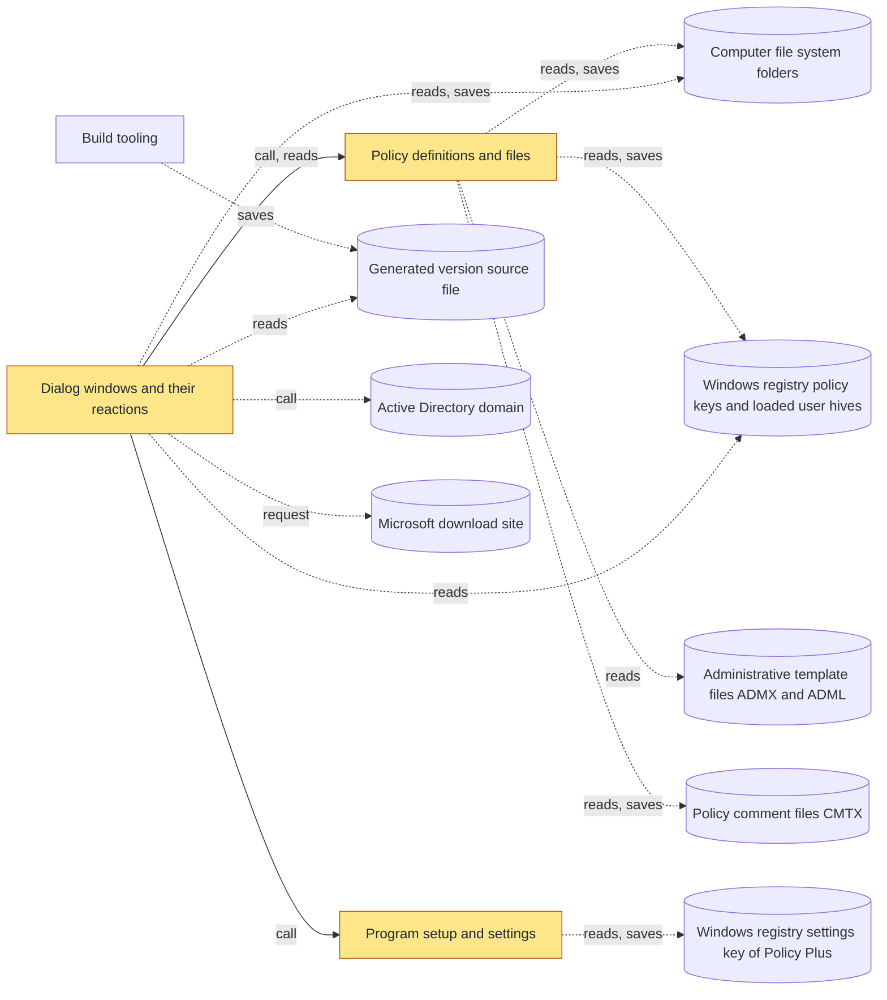
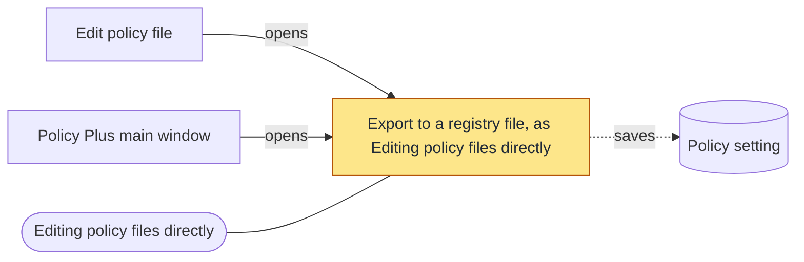
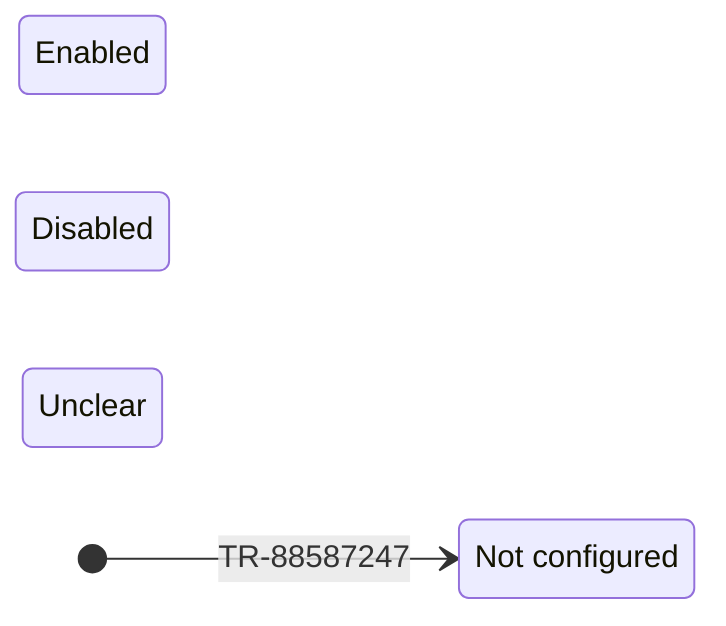

# Legacy reference: Export a branch of a policy file as a registry file

The typed header below maps each criterion of the work item to the rules of the existing system it backs. The reading of the existing code follows it.

## Header

```json
{
  "story": "story-1e8e6d9a3a7f",
  "fingerprint": "280637421a2d33856d0f4655b9cf3df29c3a1ebf99ebbb84e7839ee4506bf978",
  "criteria": [
    {
      "ac": "AC-1",
      "rules": [
        {
          "says": "Export to a registry script is refused until a file name is given; the person is told \"Please specify a filename and path for the exported REG.\"",
          "where": {
            "file": "PolicyPlus/ExportReg.vb",
            "firstLine": 20,
            "lastLine": 23
          },
          "doubt": ""
        }
      ]
    },
    {
      "ac": "AC-2",
      "rules": [
        {
          "says": "Applying a whole policy file to a source applies it as the difference from an empty file, so nothing is forgotten.",
          "where": {
            "file": "PolicyPlus/PolicySource.vb",
            "firstLine": 179,
            "lastLine": 182
          },
          "doubt": ""
        }
      ]
    },
    {
      "ac": "AC-3",
      "rules": [
        {
          "says": "A branch name given as the source of a REG export has any trailing backslash removed.",
          "where": {
            "file": "PolicyPlus/RegFile.vb",
            "firstLine": 280,
            "lastLine": 283
          },
          "doubt": ""
        }
      ]
    },
    {
      "ac": "AC-4",
      "rules": [
        {
          "says": "Keys marked for removal are written to a REG file with a leading minus sign and values marked for deletion as a bare minus sign.",
          "where": {
            "file": "PolicyPlus/RegFile.vb",
            "firstLine": 121,
            "lastLine": 138
          },
          "doubt": ""
        }
      ]
    },
    {
      "ac": "AC-5",
      "rules": [
        {
          "says": "When a REG file is written, a default value is shown as an at sign, and quotes and backslashes in names and text are escaped. Text is written as quoted text and a 32-bit number as 'dword:' with eight hexadecimal digits. Every other type, including 64-bit numbers, expandable text and multiple strings, is written as hex bytes. Each carries its type number as hex(n), except plain binary, which is written as hex. Lines wrap before column 78 with a trailing backslash.",
          "where": {
            "file": "PolicyPlus/RegFile.vb",
            "firstLine": 117,
            "lastLine": 181
          },
          "doubt": ""
        }
      ]
    },
    {
      "ac": "AC-6",
      "rules": [
        {
          "says": "When the registry script is written, the person is told \"REG exported successfully.\" and the dialog closes; on any failure they are told only \"Failed to export REG!\" and the dialog stays open.",
          "where": {
            "file": "PolicyPlus/ExportReg.vb",
            "firstLine": 27,
            "lastLine": 34
          },
          "doubt": ""
        }
      ]
    }
  ],
  "reliesOn": [
    {
      "says": "When a policy file's changes are applied to another source, an entry is saved only if it has a non-empty value name that does not start with '**'. Other marker-style entries and entries with an empty value name are skipped without notice. A saved value keeps its original letter case and type.",
      "builtBy": "Apply one policy file's changes to another source"
    },
    {
      "says": "When a policy file is clearing a key, all values and markers under the key are dropped and a single clear-all marker is stored.",
      "builtBy": "Set, delete and forget values and key clearances in a policy file"
    },
    {
      "says": "A REG file cannot be used as a source for forgetting a value: the request fails with 'not implemented'. Applying a newer policy file over an older one to a REG file fails this way for any dropped value under a policy branch.",
      "builtBy": "Edit entries of a REG file within its source branch"
    },
    {
      "says": "A value in a policy file counts as marked for deletion when a deletion marker names it, when the key has a clear-all marker, or when a delete-values list for the key names it, regardless of case. Entries are examined in sorted order, and a value whose name sorts after the marker is stored as present and cancels the deletion, whenever it was written and whichever marker kind came before.",
      "builtBy": "Read and list values in policy files and registry policy keys"
    },
    {
      "says": "Listing the values of a key in a policy file leaves out the marker entries unless the caller asks for them.",
      "builtBy": "Read and list values in policy files and registry policy keys"
    },
    {
      "says": "When a value is saved into a REG file, it is ignored if a source branch is set and its key lies outside that branch. When no branch is set, every key is accepted. Any value already stored under that name is replaced.",
      "builtBy": "Edit entries of a REG file within its source branch"
    },
    {
      "says": "When a value is deleted in a REG file, the request is ignored if a source branch is set and the key lies outside it, or if the key is already marked for removal. When no branch is set, every key is accepted. Otherwise the value is recorded as deleted.",
      "builtBy": "Edit entries of a REG file within its source branch"
    },
    {
      "says": "A registry key counts as a policy key when it is one of the three policy branches (software\\policies, software\\microsoft\\windows\\currentversion\\policies, system\\currentcontrolset\\policies) or lies below one, regardless of case.",
      "builtBy": "Read and list values in policy files and registry policy keys"
    },
    {
      "says": "When a policy file's changes are applied to another source, an entry starting '**deletekeys' clears each key named in its semicolon-separated list under the entry's key, using lower-case names. Clearing removes only that key's own values, not its subkeys.",
      "builtBy": "Apply one policy file's changes to another source"
    },
    {
      "says": "When a number is saved to the live registry, an unsigned 32-bit or 64-bit number is converted to the signed number the registry stores with the same bits, and the key is created if missing.",
      "builtBy": "Open policy sources from imported files and describe them"
    },
    {
      "says": "When a newer policy file is applied over an older one, values the old file held and the new one dropped are forgotten in the target, but only if they sit under the three policy branches of the registry.",
      "builtBy": "Apply one policy file's changes to another source"
    },
    {
      "says": "In the live registry, 'forgetting' a value deletes it, because the registry cannot remember a pending deletion.",
      "builtBy": "Replace live registry changes with the registry source model"
    },
    {
      "says": "When a value is forgotten in a policy file, both the value and its deletion marker are removed, so the policy reverts to not saying anything about it.",
      "builtBy": "Set, delete and forget values and key clearances in a policy file"
    },
    {
      "says": "Clearing a key in the live registry deletes every value in it but leaves the key and its subkeys. Forgetting a key's clearance does nothing.",
      "builtBy": "Replace live registry changes with the registry source model"
    },
    {
      "says": "A multiple-string value is stored as its strings each followed by an empty character, with one more empty character closing the list.",
      "builtBy": "Read and write the stored form of values in a policy file"
    },
    {
      "says": "A 64-bit number is stored in a policy file as 8 bytes, lowest byte first.",
      "builtBy": "Read and write the stored form of values in a policy file"
    },
    {
      "says": "When a key is cleared in a REG file, the request is ignored if a source branch is set and the key lies outside it. When no branch is set, every key is accepted. Otherwise the key's earlier entries are replaced by a key-removal entry.",
      "builtBy": "Edit entries of a REG file within its source branch"
    },
    {
      "says": "When a policy file's changes are applied to another source, an entry named '**deletevalues' deletes each value in its semicolon-separated list, using lower-case names.",
      "builtBy": "Apply one policy file's changes to another source"
    },
    {
      "says": "Text read from a policy file stops at its first empty character, and a multiple-string value ends at its first empty string.",
      "builtBy": "Read and write policy files with a byte-faithful round trip"
    },
    {
      "says": "A 32-bit number is stored in a policy file as 4 bytes, lowest byte first.",
      "builtBy": "Read and write the stored form of values in a policy file"
    },
    {
      "says": "When a value is marked for deletion in a policy file, any value or marker already held under that name is dropped first. A deletion marker holding the number 32, as Microsoft does, is added unless the value is already marked or its key is cleared.",
      "builtBy": "Set, delete and forget values and key clearances in a policy file"
    },
    {
      "says": "When a policy file's changes are applied to another source, an entry named '**del.' plus a value name deletes that value, using the lower-case key and value names.",
      "builtBy": "Apply one policy file's changes to another source"
    },
    {
      "says": "When a value is set in a policy file, it replaces any value already held under that name. A deletion marker for the name is not removed.",
      "builtBy": "Set, delete and forget values and key clearances in a policy file"
    },
    {
      "says": "A stored policy file value is read back as text for text and expandable text, a 32-bit or 64-bit number for numbers, a list of strings for multiple strings, and raw bytes for every other type.",
      "builtBy": "Read and write policy files with a byte-faithful round trip"
    },
    {
      "says": "Text stored in a policy file is written in two-byte characters followed by a closing empty character.",
      "builtBy": "Read and write the stored form of values in a policy file"
    },
    {
      "says": "When a policy file's changes are applied to another source, an entry starting '**delvals' clears the whole key, using the lower-case key name. Entries are applied in sorted order, so clear-all entries come before values. Clearing a live registry key removes only that key's own values.",
      "builtBy": "Apply one policy file's changes to another source"
    },
    {
      "says": "When a value is deleted in the live registry and its key does not exist, nothing happens. A missing value is not an error.",
      "builtBy": "Replace live registry changes with the registry source model"
    },
    {
      "says": "A value written to a policy file is stored as text, expandable text, a 32-bit or 64-bit number or a multiple string by its stated type. Every other type is stored as raw bytes with that type.",
      "builtBy": "Read and write the stored form of values in a policy file"
    }
  ],
  "data": [
    {
      "kind": "Program preference",
      "access": "reads and saves"
    },
    {
      "kind": "Policy setting",
      "access": "reads and saves"
    }
  ],
  "transitions": [],
  "outsideSystems": [
    "Windows registry settings key of Policy Plus",
    "Computer file system folders",
    "Windows registry policy keys and loaded user hives"
  ],
  "cited": [
    {
      "file": "PolicyPlus/ExportReg.vb",
      "firstLine": 19,
      "lastLine": 35
    },
    {
      "file": "PolicyPlus/ExportReg.vb",
      "firstLine": 20,
      "lastLine": 23
    },
    {
      "file": "PolicyPlus/PolicySource.vb",
      "firstLine": 179,
      "lastLine": 182
    },
    {
      "file": "PolicyPlus/RegFile.vb",
      "firstLine": 280,
      "lastLine": 283
    },
    {
      "file": "PolicyPlus/RegFile.vb",
      "firstLine": 121,
      "lastLine": 138
    },
    {
      "file": "PolicyPlus/RegFile.vb",
      "firstLine": 117,
      "lastLine": 181
    },
    {
      "file": "PolicyPlus/ExportReg.vb",
      "firstLine": 27,
      "lastLine": 34
    }
  ]
}
```

## What each criterion must keep

### AC-1

- Export to a registry script is refused until a file name is given; the person is told "Please specify a filename and path for the exported REG." (PolicyPlus/ExportReg.vb:20-23)

### AC-2

- Applying a whole policy file to a source applies it as the difference from an empty file, so nothing is forgotten. (PolicyPlus/PolicySource.vb:179-182)

### AC-3

- A branch name given as the source of a REG export has any trailing backslash removed. (PolicyPlus/RegFile.vb:280-283)

### AC-4

- Keys marked for removal are written to a REG file with a leading minus sign and values marked for deletion as a bare minus sign. (PolicyPlus/RegFile.vb:121-138)

### AC-5

- When a REG file is written, a default value is shown as an at sign, and quotes and backslashes in names and text are escaped. Text is written as quoted text and a 32-bit number as 'dword:' with eight hexadecimal digits. Every other type, including 64-bit numbers, expandable text and multiple strings, is written as hex bytes. Each carries its type number as hex(n), except plain binary, which is written as hex. Lines wrap before column 78 with a trailing backslash. (PolicyPlus/RegFile.vb:117-181)

### AC-6

- When the registry script is written, the person is told "REG exported successfully." and the dialog closes; on any failure they are told only "Failed to export REG!" and the dialog stays open. (PolicyPlus/ExportReg.vb:27-34)

## Relies on, built elsewhere

- When a policy file's changes are applied to another source, an entry is saved only if it has a non-empty value name that does not start with '**'. Other marker-style entries and entries with an empty value name are skipped without notice. A saved value keeps its original letter case and type. Built by: Apply one policy file's changes to another source.
- When a policy file is clearing a key, all values and markers under the key are dropped and a single clear-all marker is stored. Built by: Set, delete and forget values and key clearances in a policy file.
- A REG file cannot be used as a source for forgetting a value: the request fails with 'not implemented'. Applying a newer policy file over an older one to a REG file fails this way for any dropped value under a policy branch. Built by: Edit entries of a REG file within its source branch.
- A value in a policy file counts as marked for deletion when a deletion marker names it, when the key has a clear-all marker, or when a delete-values list for the key names it, regardless of case. Entries are examined in sorted order, and a value whose name sorts after the marker is stored as present and cancels the deletion, whenever it was written and whichever marker kind came before. Built by: Read and list values in policy files and registry policy keys.
- Listing the values of a key in a policy file leaves out the marker entries unless the caller asks for them. Built by: Read and list values in policy files and registry policy keys.
- When a value is saved into a REG file, it is ignored if a source branch is set and its key lies outside that branch. When no branch is set, every key is accepted. Any value already stored under that name is replaced. Built by: Edit entries of a REG file within its source branch.
- When a value is deleted in a REG file, the request is ignored if a source branch is set and the key lies outside it, or if the key is already marked for removal. When no branch is set, every key is accepted. Otherwise the value is recorded as deleted. Built by: Edit entries of a REG file within its source branch.
- A registry key counts as a policy key when it is one of the three policy branches (software\policies, software\microsoft\windows\currentversion\policies, system\currentcontrolset\policies) or lies below one, regardless of case. Built by: Read and list values in policy files and registry policy keys.
- When a policy file's changes are applied to another source, an entry starting '**deletekeys' clears each key named in its semicolon-separated list under the entry's key, using lower-case names. Clearing removes only that key's own values, not its subkeys. Built by: Apply one policy file's changes to another source.
- When a number is saved to the live registry, an unsigned 32-bit or 64-bit number is converted to the signed number the registry stores with the same bits, and the key is created if missing. Built by: Open policy sources from imported files and describe them.
- When a newer policy file is applied over an older one, values the old file held and the new one dropped are forgotten in the target, but only if they sit under the three policy branches of the registry. Built by: Apply one policy file's changes to another source.
- In the live registry, 'forgetting' a value deletes it, because the registry cannot remember a pending deletion. Built by: Replace live registry changes with the registry source model.
- When a value is forgotten in a policy file, both the value and its deletion marker are removed, so the policy reverts to not saying anything about it. Built by: Set, delete and forget values and key clearances in a policy file.
- Clearing a key in the live registry deletes every value in it but leaves the key and its subkeys. Forgetting a key's clearance does nothing. Built by: Replace live registry changes with the registry source model.
- A multiple-string value is stored as its strings each followed by an empty character, with one more empty character closing the list. Built by: Read and write the stored form of values in a policy file.
- A 64-bit number is stored in a policy file as 8 bytes, lowest byte first. Built by: Read and write the stored form of values in a policy file.
- When a key is cleared in a REG file, the request is ignored if a source branch is set and the key lies outside it. When no branch is set, every key is accepted. Otherwise the key's earlier entries are replaced by a key-removal entry. Built by: Edit entries of a REG file within its source branch.
- When a policy file's changes are applied to another source, an entry named '**deletevalues' deletes each value in its semicolon-separated list, using lower-case names. Built by: Apply one policy file's changes to another source.
- Text read from a policy file stops at its first empty character, and a multiple-string value ends at its first empty string. Built by: Read and write policy files with a byte-faithful round trip.
- A 32-bit number is stored in a policy file as 4 bytes, lowest byte first. Built by: Read and write the stored form of values in a policy file.
- When a value is marked for deletion in a policy file, any value or marker already held under that name is dropped first. A deletion marker holding the number 32, as Microsoft does, is added unless the value is already marked or its key is cleared. Built by: Set, delete and forget values and key clearances in a policy file.
- When a policy file's changes are applied to another source, an entry named '**del.' plus a value name deletes that value, using the lower-case key and value names. Built by: Apply one policy file's changes to another source.
- When a value is set in a policy file, it replaces any value already held under that name. A deletion marker for the name is not removed. Built by: Set, delete and forget values and key clearances in a policy file.
- A stored policy file value is read back as text for text and expandable text, a 32-bit or 64-bit number for numbers, a list of strings for multiple strings, and raw bytes for every other type. Built by: Read and write policy files with a byte-faithful round trip.
- Text stored in a policy file is written in two-byte characters followed by a closing empty character. Built by: Read and write the stored form of values in a policy file.
- When a policy file's changes are applied to another source, an entry starting '**delvals' clears the whole key, using the lower-case key name. Entries are applied in sorted order, so clear-all entries come before values. Clearing a live registry key removes only that key's own values. Built by: Apply one policy file's changes to another source.
- When a value is deleted in the live registry and its key does not exist, nothing happens. A missing value is not an error. Built by: Replace live registry changes with the registry source model.
- A value written to a policy file is stored as text, expandable text, a 32-bit or 64-bit number or a multiple string by its stated type. Every other type is stored as raw bytes with that type. Built by: Read and write the stored form of values in a policy file.

## Reading of the existing code

# Screen: Export to a registry file, as Editing policy files directly

At a glance: 2 owned rules, 18 relied on, 3 actions, 5 files (1 own, 2 relied on, 2 of neighbour screens, 0 generated), 0 disputed.

How to read it: paths are relative to the source root and `file:a-b` is an inclusive line range. `BR-` rules, `ACT-` actions, `TR-` changes of state and `RK-` risks have stable ids. A record marked disputed was challenged in review and kept; the reviewer's words are under Trust. All of it was read from the code; nothing was run.

## Product context
Policy Plus is a Windows desktop editor for Group Policy settings, used by administrators and power users. It reads Microsoft's policy definition files and edits policy files directly, so it works on any Windows edition, including Home, which lacks the built-in editor.
Built with: .NET Framework v4.5.2, Microsoft Windows, System.DirectoryServices, System.Xml, Visual Basic .NET, Windows Forms (Policy Plus desktop editor).
Runs: It runs on the user's own Windows computer as one desktop program on .NET Framework 4.5.2. It asks for elevated rights when available but starts without them; loading registry hives, refreshing policy and editing local Group Policy files need them. It can also reach the domain's shared policy folder.
Reaches outside itself: Computer file system folders; Windows registry policy keys and loaded user hives; Administrative template files (ADMX and ADML); Windows registry settings key of Policy Plus; Generated version source file; Policy comment files (CMTX); Active Directory domain; Microsoft download site.



## Where this sits
Part of: Editing policy files directly (Setting and storing policies).



## Boundary
- Opened by **Edit policy file** (bundle: screen edit-policy-file), at `PolicyPlus/EditPol.vb:279-283`
- Opened by **Policy Plus main window** (bundle: screen policy-plus-main-window), at `PolicyPlus/Main.vb:795-800`

## Contract: what it must do
### Export to a registry file
Write a chosen branch of the policy file to a .reg file.
Controls (9): Button: ButtonBrowse, ButtonExport; Label: Label1, Label2, Label3, Label4; TextBox: TextBranch, TextReg, TextRoot

Actions
- **ACT-04616545** Lets the person pick the .reg file to write — `PolicyPlus/ExportReg.vb:10-15`; started by person
- **ACT-27551547** Closes the dialog as cancelled when Escape is pressed — `PolicyPlus/ExportReg.vb:16-18`; started by person
- **ACT-66618877** Writes the chosen branch of the policy file to a .reg file — `PolicyPlus/ExportReg.vb:19-35`; started by person

Rules
- **BR-53225274** Export to a registry script is refused until a file name is given; the person is told "Please specify a filename and path for the exported REG." — `PolicyPlus/ExportReg.vb:20-23`
- **BR-38141941** When the registry script is written, the person is told "REG exported successfully." and the dialog closes; on any failure they are told only "Failed to export REG!" and the dialog stays open. — `PolicyPlus/ExportReg.vb:27-34`


## Relied on: decided elsewhere
**Core code, run by 4 or more other capabilities**
- `PolicyPlus/PolicySource.vb`
  - **BR-77904356** Text read from a policy file stops at its first empty character, and a multiple-string value ends at its first empty string. — `PolicyPlus/PolicySource.vb:231-239`; also rests on `PolicyPlus/PolicySource.vb:281-295`
  - **BR-27765974** A stored policy file value is read back as text for text and expandable text, a 32-bit or 64-bit number for numbers, a list of strings for multiple strings, and raw bytes for every other type. — `PolicyPlus/PolicySource.vb:320-336`
  - **BR-49391310** A registry key counts as a policy key when it is one of the three policy branches (software\policies, software\microsoft\windows\currentversion\policies, system\currentcontrolset\policies) or lies below one, regardless of case. — `PolicyPlus/PolicySource.vb:412-415`; also rests on `PolicyPlus/PolicySource.vb:429-434`

**Code shared with a few capabilities**
- `PolicyPlus/PolicySource.vb`
  - **BR-19740495** When a policy file's changes are applied to another source, an entry named '**del.' plus a value name deletes that value, using the lower-case key and value names. — `PolicyPlus/PolicySource.vb:157-158` (also used by Choosing and saving policy sources)
  - **BR-33368557** When a policy file's changes are applied to another source, an entry starting '**delvals' clears the whole key, using the lower-case key name. … — `PolicyPlus/PolicySource.vb:159-160`; also rests on `PolicyPlus/PolicySource.vb:416-420`, `PolicyPlus/PolicySource.vb:183-189` (also used by Choosing and saving policy sources)
  - **BR-60869033** When a policy file's changes are applied to another source, an entry named '**deletevalues' deletes each value in its semicolon-separated list, using lower-case names. — `PolicyPlus/PolicySource.vb:161-164` (also used by Choosing and saving policy sources)
  - **BR-44159866** When a policy file's changes are applied to another source, an entry starting '**deletekeys' clears each key named in its semicolon-separated list under the entry's key, using lower-case names. … — `PolicyPlus/PolicySource.vb:165-168`; also rests on `PolicyPlus/PolicySource.vb:416-420` (also used by Choosing and saving policy sources)
  - **BR-11046306** When a policy file's changes are applied to another source, an entry is saved only if it has a non-empty value name that does not start with '**'. … — `PolicyPlus/PolicySource.vb:169-172` (also used by Choosing and saving policy sources)
  - **BR-47756519** When a newer policy file is applied over an older one, values the old file held and the new one dropped are forgotten in the target, but only if they sit under the three policy branches of the registry. — `PolicyPlus/PolicySource.vb:174-177`; also rests on `PolicyPlus/PolicySource.vb:152-153`, `PolicyPlus/PolicySource.vb:429-434` (also used by Choosing and saving policy sources)
  - **BR-70392601** Applying a whole policy file to a source applies it as the difference from an empty file, so nothing is forgotten. — `PolicyPlus/PolicySource.vb:179-182`
  - **BR-59953686** Text stored in a policy file is written in two-byte characters followed by a closing empty character. — `PolicyPlus/PolicySource.vb:240-251` (also used by Changing policy settings, Choosing and saving policy sources, Finding policies)
  - **BR-40008855** A 32-bit number is stored in a policy file as 4 bytes, lowest byte first. — `PolicyPlus/PolicySource.vb:255-264` (also used by Changing policy settings, Choosing and saving policy sources)
  - **BR-02170720** A 64-bit number is stored in a policy file as 8 bytes, lowest byte first. — `PolicyPlus/PolicySource.vb:272-280` (also used by Changing policy settings, Choosing and saving policy sources)
  - **BR-09128566** A multiple-string value is stored as its strings each followed by an empty character, with one more empty character closing the list. — `PolicyPlus/PolicySource.vb:296-311` (also used by Changing policy settings, Choosing and saving policy sources)
  - **BR-70994041** A value written to a policy file is stored as text, expandable text, a 32-bit or 64-bit number or a multiple string by its stated type. … — `PolicyPlus/PolicySource.vb:337-353` (also used by Changing policy settings, Choosing and saving policy sources)
- `PolicyPlus/RegFile.vb`
  - **BR-23770129** When a REG file is written, a default value is shown as an at sign, and quotes and backslashes in names and text are escaped. … — `PolicyPlus/RegFile.vb:117-181`
  - **BR-53325546** Keys marked for removal are written to a REG file with a leading minus sign and values marked for deletion as a bare minus sign. — `PolicyPlus/RegFile.vb:121-138`
  - **BR-57911992** A branch name given as the source of a REG export has any trailing backslash removed. — `PolicyPlus/RegFile.vb:280-283`


## Data and states
- Policy setting: saves; kept in Computer file system folders, Windows registry policy keys and loaded user hives

Life of Policy setting


| Change | From | To | Written at | In this code | Reading |
| --- | --- | --- | --- | --- | --- |
| TR-88587247 | created | Not configured | `PolicyPlus/PolicyLoader.vb:94-100` | no | corrected |

## Trust: what to doubt
**Risks**
- **RK-55763020** [medium] Applying a policy file's held changes to the live registry writes, deletes or clears whatever keys the file names. Only forgetting old values is limited to policy branches, so a crafted policy file, a different route from a REG import, can change other registry keys. (Input from outside is used without checks, so it can change what the code does) — at `PolicyPlus/PolicySource.vb:150-172`, `PolicyPlus/PolicySource.vb:174-177`
- **RK-96299336** [medium] Importing a REG file applies it key by key to the live policy source with no rollback, and a REG source cannot read or forget values. A failure leaves earlier changes in place and the person sees only a general failure message. (Data can end up wrong, lost or inconsistent) — at `PolicyPlus/PolicySource.vb:174-177`
- **RK-90398632** [medium] Policy files and REG files are saved by overwriting in place. A failure partway leaves a truncated or damaged file, with no copy of the old one. (Data can end up wrong, lost or inconsistent) — at `PolicyPlus/RegFile.vb:182-186`
- **RK-16667737** [medium] When a download, install or export fails, the person sees only the step that failed, not the cause, with no retry. A finished install can be reported as a failure when cleanup fails, leaving the new folder unloaded and unpacked files behind. (Failures are hidden, lost or not retried) — at `PolicyPlus/ExportReg.vb:32-34`


## Read order
| Tier | File | Lines | Why |
| --- | --- | --- | --- |
| own | `PolicyPlus/ExportReg.vb` | whole file | starts 3 actions; decides 2 owned rules |
| relied on | `PolicyPlus/PolicySource.vb` | 8-11, 150-189, 222-224, 231-353, 412-420, 429-434 | decides 15 relied-on rules; called code; used by 6 other capabilities |
| relied on | `PolicyPlus/RegFile.vb` | 11-20, 117-186, 276-283 | decides 3 relied-on rules; called code |
| neighbour screen | `PolicyPlus/EditPol.vb` | 279-283 | opens this screen: Edit policy file |
| neighbour screen | `PolicyPlus/Main.vb` | 795-800 | opens this screen: Policy Plus main window |

## Source

### PolicyPlus/ExportReg.vb
```
1: Public Class ExportReg
2:     Dim Source As PolFile
3:     Public Function PresentDialog(Branch As String, Pol As PolFile, IsUser As Boolean) As DialogResult
4:         Source = Pol
5:         TextBranch.Text = Branch
6:         TextRoot.Text = If(IsUser, "HKEY_CURRENT_USER\", "HKEY_LOCAL_MACHINE\")
7:         TextReg.Text = ""
8:         Return ShowDialog()
9:     End Function
10:     Private Sub ButtonBrowse_Click(sender As Object, e As EventArgs) Handles ButtonBrowse.Click
11:         Using sfd As New SaveFileDialog
12:             sfd.Filter = "Registry scripts|*.reg"
13:             If sfd.ShowDialog = DialogResult.OK Then TextReg.Text = sfd.FileName
14:         End Using
15:     End Sub
16:     Private Sub ExportReg_KeyUp(sender As Object, e As KeyEventArgs) Handles Me.KeyUp
17:         If e.KeyCode = Keys.Escape Then DialogResult = DialogResult.Cancel
18:     End Sub
19:     Private Sub ButtonExport_Click(sender As Object, e As EventArgs) Handles ButtonExport.Click
20:         If TextReg.Text = "" Then
21:             MsgBox("Please specify a filename and path for the exported REG.", MsgBoxStyle.Exclamation)
22:             Exit Sub
23:         End If
24:         Dim reg As New RegFile
25:         reg.SetPrefix(TextRoot.Text)
26:         reg.SetSourceBranch(TextBranch.Text)
27:         Try
28:             Source.Apply(reg)
29:             reg.Save(TextReg.Text)
30:             MsgBox("REG exported successfully.", MsgBoxStyle.Information)
31:             DialogResult = DialogResult.OK
32:         Catch ex As Exception
33:             MsgBox("Failed to export REG!", MsgBoxStyle.Exclamation)
34:         End Try
35:     End Sub
36: End Class
```

### PolicyPlus/PolicySource.vb
```
8:     Sub SetValue(Key As String, Value As String, Data As Object, DataType As RegistryValueKind)
9:     Sub ForgetValue(Key As String, Value As String) ' Stop keeping track of a value
10:     Sub DeleteValue(Key As String, Value As String) ' Mark a value as queued for deletion
11:     Sub ClearKey(Key As String) ' Destroy all values in a key
```
```
150:     Public Sub ApplyDifference(OldVersion As PolFile, Target As IPolicySource)
151:         ' Figure out which values have changed and commit only the changes
152:         If OldVersion Is Nothing Then OldVersion = New PolFile
153:         Dim oldEntries = OldVersion.Entries.Keys.Where(Function(k) Not k.Contains("\\**")).ToList
154:         For Each kv In Entries
155:             Dim parts = Split(kv.Key, "\\", 2) ' Key, value
156:             Dim casedParts = Split(CasePreservation(kv.Key), "\\", 2)
157:             If parts(1).StartsWith("**del.") Then
158:                 Target.DeleteValue(parts(0), Split(parts(1), ".", 2)(1))
159:             ElseIf parts(1).StartsWith("**delvals") Then
160:                 Target.ClearKey(parts(0))
161:             ElseIf parts(1) = "**deletevalues" Then
162:                 For Each entry In Split(kv.Value.AsString, ";")
163:                     Target.DeleteValue(parts(0), entry)
164:                 Next
165:             ElseIf parts(1).StartsWith("**deletekeys") Then
166:                 For Each entry In Split(kv.Value.AsString, ";")
167:                     Target.ClearKey(parts(0) & "\" & entry)
168:                 Next
169:             ElseIf parts(1) <> "" And Not parts(1).StartsWith("**") Then
170:                 Target.SetValue(casedParts(0), casedParts(1), kv.Value.AsArbitrary(), kv.Value.Kind)
171:                 If oldEntries.Contains(kv.Key) Then oldEntries.Remove(kv.Key) ' It's not forgotten
172:             End If
173:         Next
174:         For Each e In oldEntries.Where(AddressOf RegistryPolicyProxy.IsPolicyKey) ' Remove the forgotten entries from the Registry
175:             Dim parts = Split(e, "\\", 2)
176:             Target.ForgetValue(parts(0), parts(1))
177:         Next
178:     End Sub
179:     Public Sub Apply(Target As IPolicySource)
180:         ' Apply all the values to the policy source
181:         ApplyDifference(Nothing, Target)
182:     End Sub
183:     Public Sub ClearKey(Key As String) Implements IPolicySource.ClearKey
184:         For Each value In GetValueNames(Key, False)
185:             ForgetValue(Key, value)
186:         Next
187:         Dim ped = PolEntryData.FromString(" ")
188:         Entries.Add(GetDictKey(Key, "**delvals."), ped)
189:     End Sub
```
```
222:     Public Shared Function ObjectToBytes(Data As Object, Kind As RegistryValueKind) As Byte()
223:         Return PolEntryData.FromArbitrary(Data, Kind).Data
224:     End Function
```
```
231:         Public Function AsString() As String ' Get a UTF-16LE string
232:             Dim sb As New Text.StringBuilder
233:             For x = 0 To (Data.Length \ 2) - 1
234:                 Dim charCode = CInt(Data(x * 2)) + (Data((x * 2) + 1) << 8)
235:                 If charCode = 0 Then Exit For
236:                 sb.Append(ChrW(charCode))
237:             Next
238:             Return sb.ToString
239:         End Function
240:         Public Shared Function FromString(Text As String, Optional Expand As Boolean = False) As PolEntryData ' Save a UTF-16LE string
241:             Dim ped As New PolEntryData With {.Kind = RegistryValueKind.String}
242:             If Expand Then ped.Kind = RegistryValueKind.ExpandString
243:             Dim data((Text.Length * 2) + 1) As Byte
244:             For x = 0 To Text.Length - 1
245:                 Dim charCode = AscW(Text(x))
246:                 data(x * 2) = charCode And &HFF
247:                 data((x * 2) + 1) = charCode >> 8
248:             Next
249:             ped.Data = data
250:             Return ped
251:         End Function
252:         Public Function AsDword() As UInteger
253:             Return Data(0) + (CUInt(Data(1)) << 8) + (CUInt(Data(2)) << 16) + (CUInt(Data(3)) << 24)
254:         End Function
255:         Public Shared Function FromDword(Dword As UInteger) As PolEntryData
256:             Dim ped As New PolEntryData With {.Kind = RegistryValueKind.DWord}
257:             Dim data(3) As Byte
258:             data(0) = Dword And &HFFUI
259:             data(1) = (Dword >> 8) And &HFFUI
260:             data(2) = (Dword >> 16) And &HFFUI
261:             data(3) = Dword >> 24
262:             ped.Data = data
263:             Return ped
264:         End Function
265:         Public Function AsQword() As ULong
266:             Dim value As ULong = 0
267:             For n = 0 To 7
268:                 value += (CULng(Data(n)) << (n * 8))
269:             Next
270:             Return value
271:         End Function
272:         Public Shared Function FromQword(Qword As ULong) As PolEntryData
273:             Dim ped As New PolEntryData With {.Kind = RegistryValueKind.QWord}
274:             Dim data(7) As Byte
275:             For n = 0 To 7
276:                 data(n) = (Qword >> (n * 8)) And &HFFUL
277:             Next
278:             ped.Data = data
279:             Return ped
280:         End Function
281:         Public Function AsMultiString() As String()
282:             Dim strings As New List(Of String)
283:             Dim sb As New Text.StringBuilder
284:             For n = 0 To (Data.Length / 2) - 1
285:                 Dim charCode = Data(n * 2) + (Data((n * 2) + 1) << 8)
286:                 If charCode = 0 Then
287:                     If sb.Length = 0 Then Exit For
288:                     strings.Add(sb.ToString)
289:                     sb.Clear()
290:                 Else
291:                     sb.Append(ChrW(charCode))
292:                 End If
293:             Next
294:             Return strings.ToArray
295:         End Function
296:         Public Shared Function FromMultiString(Strings As String()) As PolEntryData
297:             Dim ped As New PolEntryData With {.Kind = RegistryValueKind.MultiString}
298:             Dim data((Strings.Sum(Function(s) s.Length + 1) + 1) * 2 - 1) As Byte
299:             Dim n As Integer = 0
300:             For Each s In Strings
301:                 For Each c In s
302:                     Dim charCode = AscW(c)
303:                     data(n) = charCode And &HFF
304:                     data(n + 1) = charCode >> 8
305:                     n += 2
306:                 Next
307:                 n += 2 ' Leave two null bytes after each string
308:             Next
309:             ped.Data = data
310:             Return ped
311:         End Function
312:         Public Function AsBinary() As Byte()
313:             Return Data.Clone
314:         End Function
315:         Public Shared Function FromBinary(Binary As Byte(), Optional Kind As RegistryValueKind = RegistryValueKind.Binary) As PolEntryData
316:             Dim ped As New PolEntryData With {.Kind = Kind}
317:             ped.Data = Binary.Clone
318:             Return ped
319:         End Function
320:         Public Function AsArbitrary() As Object
321:             ' Get the data in the best .NET type for it
322:             Select Case Kind
323:                 Case RegistryValueKind.String
324:                     Return AsString()
325:                 Case RegistryValueKind.DWord
326:                     Return AsDword()
327:                 Case RegistryValueKind.ExpandString
328:                     Return AsString()
329:                 Case RegistryValueKind.QWord
330:                     Return AsQword()
331:                 Case RegistryValueKind.MultiString
332:                     Return AsMultiString()
333:                 Case Else
334:                     Return AsBinary()
335:             End Select
336:         End Function
337:         Public Shared Function FromArbitrary(Data As Object, Kind As RegistryValueKind) As PolEntryData
338:             ' Take an arbitrary .NET object and turn it into bytes
339:             Select Case Kind
340:                 Case RegistryValueKind.String
341:                     Return FromString(Data)
342:                 Case RegistryValueKind.DWord
343:                     Return FromDword(Data)
344:                 Case RegistryValueKind.ExpandString
345:                     Return FromString(Data, True)
346:                 Case RegistryValueKind.QWord
347:                     Return FromQword(Data)
348:                 Case RegistryValueKind.MultiString
349:                     Return FromMultiString(Data)
350:                 Case Else
351:                     Return FromBinary(Data, Kind)
352:             End Select
353:         End Function
```
```
412:     Public Shared Function IsPolicyKey(KeyPath As String) As Boolean
413:         Return PolicyKeys.Any(Function(pk) KeyPath.StartsWith(pk & "\", StringComparison.InvariantCultureIgnoreCase) Or
414:                                   KeyPath.Equals(pk, StringComparison.InvariantCultureIgnoreCase))
415:     End Function
416:     Public Sub ClearKey(Key As String) Implements IPolicySource.ClearKey
417:         For Each value In GetValueNames(Key)
418:             ForgetValue(Key, value)
419:         Next
420:     End Sub
```
```
429:     Public Shared ReadOnly Property PolicyKeys As IEnumerable(Of String)
430:         Get
431:             ' Values outside these branches are not tracked by PolFile.ApplyDifference
432:             Return {"software\policies", "software\microsoft\windows\currentversion\policies", "system\currentcontrolset\policies"}
433:         End Get
434:     End Property
```

### PolicyPlus/RegFile.vb
```
11:     Private Shared Function EscapeValue(Text As String) As String
12:         ' Escape quotes and slashes for a value name or string data
13:         Dim sb As New Text.StringBuilder
14:         For n = 0 To Text.Length - 1
15:             Dim character = Text(n)
16:             If character = """"c Or character = "\"c Then sb.Append("\"c)
17:             sb.Append(character)
18:         Next
19:         Return sb.ToString
20:     End Function
```
```
117:     Public Sub Save(Writer As StreamWriter)
118:         Writer.WriteLine(RegSignature)
119:         Writer.WriteLine()
120:         For Each key In Keys
121:             If key.IsDeleter Then
122:                 Writer.WriteLine("[-" & key.Name & "]")
123:             Else
124:                 Writer.WriteLine("[" & key.Name & "]")
125:                 For Each value In key.Values
126:                     Dim posInRow = 0 ' To split hex across lines
127:                     If value.Name = "" Then
128:                         Writer.Write("@")
129:                         posInRow = 1
130:                     Else
131:                         Dim quotedName = """" & EscapeValue(value.Name) & """"
132:                         Writer.Write(quotedName)
133:                         posInRow = quotedName.Length
134:                     End If
135:                     Writer.Write("=")
136:                     posInRow += 1
137:                     If value.IsDeleter Then
138:                         Writer.WriteLine("-")
139:                     Else
140:                         Select Case value.Kind
141:                             Case RegistryValueKind.String
142:                                 Writer.Write("""")
143:                                 Writer.Write(EscapeValue(value.Data))
144:                                 Writer.WriteLine("""")
145:                             Case RegistryValueKind.DWord
146:                                 Writer.Write("dword:")
147:                                 Writer.WriteLine(Convert.ToString(CUInt(value.Data), 16).PadLeft(8, "0"c))
148:                             Case Else
149:                                 Writer.Write("hex")
150:                                 posInRow += 3
151:                                 If value.Kind <> RegistryValueKind.Binary Then
152:                                     Writer.Write("(")
153:                                     Writer.Write(Convert.ToString(value.Kind, 16))
154:                                     Writer.Write(")")
155:                                     posInRow += 3
156:                                 End If
157:                                 Writer.Write(":")
158:                                 posInRow += 1
159:                                 Dim bytes = PolFile.ObjectToBytes(value.Data, value.Kind)
160:                                 For n = 0 To bytes.Length - 2
161:                                     Writer.Write(Convert.ToString(bytes(n), 16).PadLeft(2, "0"c))
162:                                     Writer.Write(",")
163:                                     posInRow += 3
164:                                     If posInRow >= 78 Then
165:                                         Writer.WriteLine("\")
166:                                         Writer.Write("  ")
167:                                         posInRow = 2
168:                                     End If
169:                                 Next
170:                                 If bytes.Length > 0 Then
171:                                     Writer.WriteLine(Convert.ToString(bytes(bytes.Length - 1), 16).PadLeft(2, "0"c))
172:                                 Else
173:                                     Writer.WriteLine()
174:                                 End If
175:                         End Select
176:                     End If
177:                 Next
178:             End If
179:             Writer.WriteLine()
180:         Next
181:     End Sub
182:     Public Sub Save(File As String)
183:         Using writer As New StreamWriter(File, False)
184:             Save(writer)
185:         End Using
186:     End Sub
```
```
276:     Public Sub SetPrefix(Prefix As String)
277:         If Not Prefix.EndsWith("\") Then Prefix &= "\"
278:         Me.Prefix = Prefix
279:     End Sub
280:     Public Sub SetSourceBranch(Branch As String)
281:         If Branch.EndsWith("\") Then Branch = Branch.TrimEnd("\"c)
282:         SourceSubtree = Branch
283:     End Sub
```

### PolicyPlus/EditPol.vb
```
279:     Private Sub ButtonExport_Click(sender As Object, e As EventArgs) Handles ButtonExport.Click
280:         Dim branch As String = ""
281:         If LsvPol.SelectedItems.Count > 0 Then branch = LsvPol.SelectedItems(0).Tag
282:         ExportReg.PresentDialog(branch, EditingPol, EditingUserSource)
283:     End Sub
```

### PolicyPlus/Main.vb
```
795:     Private Sub ExportREGToolStripMenuItem_Click(sender As Object, e As EventArgs) Handles ExportREGToolStripMenuItem.Click
796:         If OpenSection.PresentDialog(True, True) = DialogResult.OK Then
797:             Dim source = If(OpenSection.SelectedSection = AdmxPolicySection.Machine, CompPolicySource, UserPolicySource)
798:             ExportReg.PresentDialog("", GetOrCreatePolFromPolicySource(source), OpenSection.SelectedSection = AdmxPolicySection.User)
799:         End If
800:     End Sub
```

