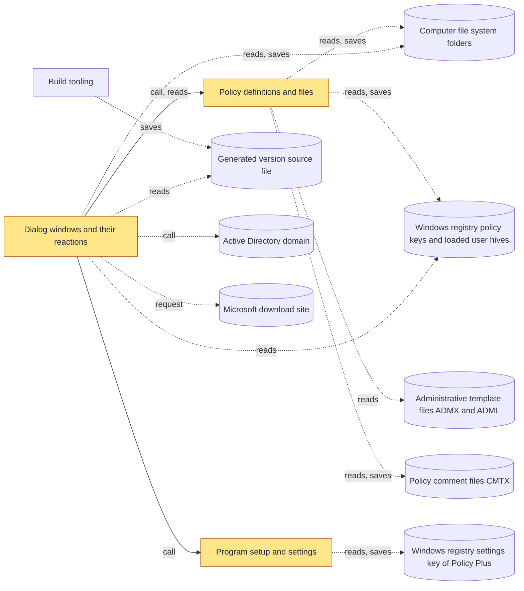
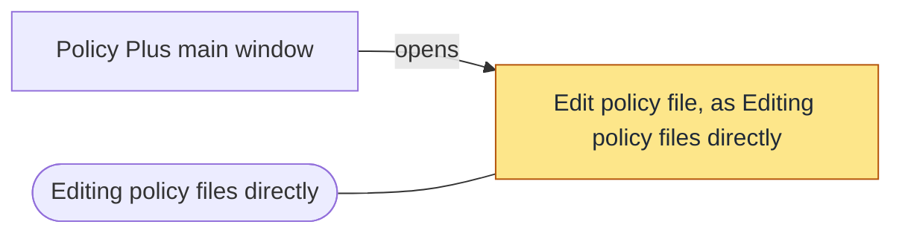

# Legacy reference: Offer the choices for deleting a selected key

The typed header below maps each criterion of the work item to the rules of the existing system it backs. The reading of the existing code follows it.

## Header

```json
{
  "story": "story-258d43fee8e6",
  "fingerprint": "280637421a2d33856d0f4655b9cf3df29c3a1ebf99ebbb84e7839ee4506bf978",
  "criteria": [
    {
      "ac": "AC-1",
      "rules": [
        {
          "says": "Deleting a key offers three choices, and OK does nothing until one is chosen; cancelling or Escape changes nothing. Clear everything removes all values and marks the key cleared. Clear first marks the key cleared and puts back only its existing direct values with ordinary content; deletion entries already in that key are lost and values of sub-keys are not put back. Delete one value is refused with \"You must enter a value name.\" when the name is empty; otherwise any value of that name, whether or not it exists, is removed and replaced by a deletion entry.",
          "where": {
            "file": "PolicyPlus/EditPol.vb",
            "firstLine": 176,
            "lastLine": 198
          },
          "doubt": "The rule now says deletion entries are lost and that \"values of sub-keys are not put back\", and that Clear everything \"removes all values\". Both mislead a rebuild. ClearKey (PolicySource.vb 183-186) forgets only the values listed directly under the key (GetValueNames matches the key plus the value separator, so entries of sub-keys do not match); values of sub-keys are never removed, so there is nothing to put back and they stay as they were. Say that the clearing removes (and marks cleared) only the key itself, its direct values including any deletion entries and its empty-key marker, and that sub-keys keep their values, rather than that sub-key values are lost or not restored. The rest of the rule (OK refused until a choice, empty name message, ordinary values only put back, deletion entry replacing any value of that name) holds."
        },
        {
          "says": "When Delete is confirmed with the option to clear the key or to delete all values under it, the choice is accepted without further input; no option is chosen when the dialog opens, and confirming with none chosen does nothing.",
          "where": {
            "file": "PolicyPlus/EditPolDelete.vb",
            "firstLine": 11,
            "lastLine": 11
          },
          "doubt": ""
        }
      ]
    },
    {
      "ac": "AC-2",
      "rules": []
    },
    {
      "ac": "AC-3",
      "rules": []
    },
    {
      "ac": "AC-4",
      "rules": []
    },
    {
      "ac": "AC-5",
      "rules": [
        {
          "says": "The value name box in the delete dialog can be typed in only while the option to delete one value is chosen.",
          "where": {
            "file": "PolicyPlus/EditPolDelete.vb",
            "firstLine": 24,
            "lastLine": 24
          },
          "doubt": ""
        }
      ]
    },
    {
      "ac": "AC-6",
      "rules": [
        {
          "says": "When Delete is confirmed with the option to delete one value and the value name is empty, it is refused and the person is told \"You must enter a value name.\"; with a name, the choice is accepted.",
          "where": {
            "file": "PolicyPlus/EditPolDelete.vb",
            "firstLine": 12,
            "lastLine": 18
          },
          "doubt": ""
        }
      ]
    },
    {
      "ac": "AC-7",
      "rules": []
    },
    {
      "ac": "AC-8",
      "rules": []
    }
  ],
  "reliesOn": [
    {
      "says": "A value in a policy file counts as marked for deletion when a deletion marker names it, when the key has a clear-all marker, or when a delete-values list for the key names it, regardless of case. Entries are examined in sorted order, and a value whose name sorts after the marker is stored as present and cancels the deletion, whenever it was written and whichever marker kind came before.",
      "builtBy": "Hold a policy file's settings in memory and answer questions about them"
    },
    {
      "says": "Listing the values of a key in a policy file leaves out the marker entries unless the caller asks for them.",
      "builtBy": "Hold a policy file's settings in memory and answer questions about them"
    },
    {
      "says": "Reading a value from a policy file gives nothing when the value is absent or marked for deletion.",
      "builtBy": "Hold a policy file's settings in memory and answer questions about them"
    },
    {
      "says": "A value in a policy file counts as present only if it is stored and not marked for deletion.",
      "builtBy": "Hold a policy file's settings in memory and answer questions about them"
    },
    {
      "says": "A value counts as present when: for a deletion marker, it is marked for deletion; for a number, it exists as a whole number and equals the expected number; for text, it exists as text and equals the expected text. A value of the wrong kind is not present.",
      "builtBy": "Hold a policy file's settings in memory and answer questions about them"
    },
    {
      "says": "When a value is marked for deletion in a policy file, any value or marker already held under that name is dropped first. A deletion marker holding the number 32, as Microsoft does, is added unless the value is already marked or its key is cleared.",
      "builtBy": "Hold a policy file's settings in memory and answer questions about them"
    },
    {
      "says": "When a value is set in a policy file, it replaces any value already held under that name. A deletion marker for the name is not removed.",
      "builtBy": "Hold a policy file's settings in memory and answer questions about them"
    },
    {
      "says": "When a value is forgotten in a policy file, both the value and its deletion marker are removed, so the policy reverts to not saying anything about it.",
      "builtBy": "Hold a policy file's settings in memory and answer questions about them"
    },
    {
      "says": "When a policy file is clearing a key, all values and markers under the key are dropped and a single clear-all marker is stored.",
      "builtBy": "Hold a policy file's settings in memory and answer questions about them"
    },
    {
      "says": "Deleting a single value from the list does not erase it from the file: it is replaced by a deletion entry named \"**del.\" followed by the value name, which removes the value on the machine when policies are applied.",
      "builtBy": "Mark a selected value for deletion in one step"
    }
  ],
  "data": [
    {
      "kind": "Program preference",
      "access": "reads and saves"
    },
    {
      "kind": "Policy setting",
      "access": "reads and saves"
    }
  ],
  "transitions": [],
  "outsideSystems": [
    "Windows registry settings key of Policy Plus",
    "Computer file system folders",
    "Windows registry policy keys and loaded user hives"
  ],
  "steps": [
    {
      "intent": "Choose what to do with a selected key",
      "change": "kept",
      "reason": "The three outcomes for a key are genuinely different."
    }
  ],
  "components": [
    {
      "name": "Key Clearing Chooser",
      "module": "key-clearing-chooser",
      "layer": "packages/ui"
    }
  ],
  "cited": [
    {
      "file": "PolicyPlus/EditPolDelete.vb",
      "firstLine": 10,
      "lastLine": 19
    },
    {
      "file": "PolicyPlus/EditPolDelete.vb",
      "firstLine": 20,
      "lastLine": 22
    },
    {
      "file": "PolicyPlus/EditPol.vb",
      "firstLine": 176,
      "lastLine": 198
    },
    {
      "file": "PolicyPlus/EditPolDelete.vb",
      "firstLine": 10,
      "lastLine": 19
    },
    {
      "file": "PolicyPlus/EditPol.vb",
      "firstLine": 184,
      "lastLine": 194
    },
    {
      "file": "PolicyPlus/PolicySource.vb",
      "firstLine": 183,
      "lastLine": 189
    },
    {
      "file": "PolicyPlus/EditPolDelete.vb",
      "firstLine": 11,
      "lastLine": 11
    },
    {
      "file": "PolicyPlus/EditPolDelete.vb",
      "firstLine": 3,
      "lastLine": 5
    },
    {
      "file": "PolicyPlus/EditPolDelete.vb",
      "firstLine": 24,
      "lastLine": 24
    },
    {
      "file": "PolicyPlus/EditPolDelete.vb",
      "firstLine": 12,
      "lastLine": 18
    }
  ]
}
```

## What each criterion must keep

### AC-1

- Deleting a key offers three choices, and OK does nothing until one is chosen; cancelling or Escape changes nothing. Clear everything removes all values and marks the key cleared. Clear first marks the key cleared and puts back only its existing direct values with ordinary content; deletion entries already in that key are lost and values of sub-keys are not put back. Delete one value is refused with "You must enter a value name." when the name is empty; otherwise any value of that name, whether or not it exists, is removed and replaced by a deletion entry. (PolicyPlus/EditPol.vb:176-198) Doubt: The rule now says deletion entries are lost and that "values of sub-keys are not put back", and that Clear everything "removes all values". Both mislead a rebuild. ClearKey (PolicySource.vb 183-186) forgets only the values listed directly under the key (GetValueNames matches the key plus the value separator, so entries of sub-keys do not match); values of sub-keys are never removed, so there is nothing to put back and they stay as they were. Say that the clearing removes (and marks cleared) only the key itself, its direct values including any deletion entries and its empty-key marker, and that sub-keys keep their values, rather than that sub-key values are lost or not restored. The rest of the rule (OK refused until a choice, empty name message, ordinary values only put back, deletion entry replacing any value of that name) holds.
- When Delete is confirmed with the option to clear the key or to delete all values under it, the choice is accepted without further input; no option is chosen when the dialog opens, and confirming with none chosen does nothing. (PolicyPlus/EditPolDelete.vb:11-11)

### AC-2

No single legacy rule: it describes the behaviour as a whole.


### AC-3

No single legacy rule: it describes the behaviour as a whole.


### AC-4

No single legacy rule: it describes the behaviour as a whole.


### AC-5

- The value name box in the delete dialog can be typed in only while the option to delete one value is chosen. (PolicyPlus/EditPolDelete.vb:24-24)

### AC-6

- When Delete is confirmed with the option to delete one value and the value name is empty, it is refused and the person is told "You must enter a value name."; with a name, the choice is accepted. (PolicyPlus/EditPolDelete.vb:12-18)

### AC-7

No single legacy rule: it describes the behaviour as a whole.


### AC-8

No single legacy rule: it describes the behaviour as a whole.


## Relies on, built elsewhere

- A value in a policy file counts as marked for deletion when a deletion marker names it, when the key has a clear-all marker, or when a delete-values list for the key names it, regardless of case. Entries are examined in sorted order, and a value whose name sorts after the marker is stored as present and cancels the deletion, whenever it was written and whichever marker kind came before. Built by: Hold a policy file's settings in memory and answer questions about them.
- Listing the values of a key in a policy file leaves out the marker entries unless the caller asks for them. Built by: Hold a policy file's settings in memory and answer questions about them.
- Reading a value from a policy file gives nothing when the value is absent or marked for deletion. Built by: Hold a policy file's settings in memory and answer questions about them.
- A value in a policy file counts as present only if it is stored and not marked for deletion. Built by: Hold a policy file's settings in memory and answer questions about them.
- A value counts as present when: for a deletion marker, it is marked for deletion; for a number, it exists as a whole number and equals the expected number; for text, it exists as text and equals the expected text. A value of the wrong kind is not present. Built by: Hold a policy file's settings in memory and answer questions about them.
- When a value is marked for deletion in a policy file, any value or marker already held under that name is dropped first. A deletion marker holding the number 32, as Microsoft does, is added unless the value is already marked or its key is cleared. Built by: Hold a policy file's settings in memory and answer questions about them.
- When a value is set in a policy file, it replaces any value already held under that name. A deletion marker for the name is not removed. Built by: Hold a policy file's settings in memory and answer questions about them.
- When a value is forgotten in a policy file, both the value and its deletion marker are removed, so the policy reverts to not saying anything about it. Built by: Hold a policy file's settings in memory and answer questions about them.
- When a policy file is clearing a key, all values and markers under the key are dropped and a single clear-all marker is stored. Built by: Hold a policy file's settings in memory and answer questions about them.
- Deleting a single value from the list does not erase it from the file: it is replaced by a deletion entry named "**del." followed by the value name, which removes the value on the machine when policies are applied. Built by: Mark a selected value for deletion in one step.

## Reading of the existing code

# Screen: Edit policy file, as Editing policy files directly

At a glance: 3 owned rules, 0 relied on, 3 actions, 2 files (1 own, 0 relied on, 1 of neighbour screens, 0 generated), 0 disputed.

How to read it: paths are relative to the source root and `file:a-b` is an inclusive line range. `BR-` rules, `ACT-` actions, `TR-` changes of state and `RK-` risks have stable ids. A record marked disputed was challenged in review and kept; the reviewer's words are under Trust. All of it was read from the code; nothing was run.

## Product context
Policy Plus is a Windows desktop editor for Group Policy settings, used by administrators and power users. It reads Microsoft's policy definition files and edits policy files directly, so it works on any Windows edition, including Home, which lacks the built-in editor.
Built with: .NET Framework v4.5.2, Microsoft Windows, System.DirectoryServices, System.Xml, Visual Basic .NET, Windows Forms (Policy Plus desktop editor).
Runs: It runs on the user's own Windows computer as one desktop program on .NET Framework 4.5.2. It asks for elevated rights when available but starts without them; loading registry hives, refreshing policy and editing local Group Policy files need them. It can also reach the domain's shared policy folder.
Reaches outside itself: Computer file system folders; Windows registry policy keys and loaded user hives; Administrative template files (ADMX and ADML); Windows registry settings key of Policy Plus; Generated version source file; Policy comment files (CMTX); Active Directory domain; Microsoft download site.



## Where this sits
Part of: Editing policy files directly (Setting and storing policies).



## Boundary
- Opened by **Policy Plus main window** (bundle: screen policy-plus-main-window), at `PolicyPlus/Main.vb:776-794`

## Contract: what it must do
### Edit policy file
Browse a policy file and, in steps, add keys and values, edit text, number and list values, or choose what to delete.
Controls (42): Button: ButtonOK, ButtonOK, ButtonOK, ButtonOK, ButtonOK, ButtonOK; CheckBox: CheckHexadecimal; ComboBox: ComboKind; Friend WithEvents ButtonAddKey As Button: ButtonAddKey; Friend WithEvents ButtonAddValue As Button: ButtonAddValue; Friend WithEvents ButtonDeleteValue As Button: ButtonDeleteValue; Friend WithEvents ButtonEdit As Button: ButtonEdit; Friend WithEvents ButtonExport As Button: ButtonExport; Friend WithEvents ButtonForget As Button: ButtonForget; Friend WithEvents ButtonImport As Button: ButtonImport; Friend WithEvents ButtonSave As Button: ButtonSave; Friend WithEvents ChItem As ColumnHeader: ChItem; Friend WithEvents ChValue As ColumnHeader: ChValue; Friend WithEvents LsvPol As ListView: LsvPol; Label: Label1, Label1, Label1, Label2, Label1, Label2, Label1, Label2, Label1, Label2; RadioButton: OptClearFirst, OptDeleteOne, OptPurge; TextBox: TextKey, TextValueName, TextName, TextData, TextName, TextName, TextData, TextName, TextName; WideRangeNumericUpDown: NumData

Actions
- **ACT-06724348** Accepts the delete dialog when a choice is made and asks for a value name when deleting one value. — `PolicyPlus/EditPolDelete.vb:10-19`; started by person
- **ACT-51807884** Closes the delete dialog as cancelled when Escape is pressed. — `PolicyPlus/EditPolDelete.vb:20-22`; started by person
- **ACT-32228976** Enables the value name box only while the delete-one-value option is chosen. — `PolicyPlus/EditPolDelete.vb:23-25`; started by person

Rules
- **BR-73744492** When Delete is confirmed with the option to clear the key or to delete all values under it, the choice is accepted without further input; no option is chosen when the dialog opens, and confirming with none chosen does nothing. — `PolicyPlus/EditPolDelete.vb:11`; also rests on `PolicyPlus/EditPolDelete.vb:3-5`
- **BR-49490179** When Delete is confirmed with the option to delete one value and the value name is empty, it is refused and the person is told "You must enter a value name."; with a name, the choice is accepted. — `PolicyPlus/EditPolDelete.vb:12-18`
- **BR-32916641** The value name box in the delete dialog can be typed in only while the option to delete one value is chosen. — `PolicyPlus/EditPolDelete.vb:24`


## Read order
| Tier | File | Lines | Why |
| --- | --- | --- | --- |
| own | `PolicyPlus/EditPolDelete.vb` | whole file | starts 3 actions; decides 3 owned rules |
| neighbour screen | `PolicyPlus/Main.vb` | 776-794 | opens this screen: Policy Plus main window |

## Source

### PolicyPlus/EditPolDelete.vb
```
1: Public Class EditPolDelete
2:     Public Function PresentDialog(ContainerKey As String) As DialogResult
3:         OptClearFirst.Checked = False
4:         OptDeleteOne.Checked = False
5:         OptPurge.Checked = False
6:         TextKey.Text = ContainerKey
7:         TextValueName.Text = ""
8:         Return ShowDialog()
9:     End Function
10:     Private Sub ButtonOK_Click(sender As Object, e As EventArgs) Handles ButtonOK.Click
11:         If OptClearFirst.Checked Or OptPurge.Checked Then DialogResult = DialogResult.OK
12:         If OptDeleteOne.Checked Then
13:             If TextValueName.Text = "" Then
14:                 MsgBox("You must enter a value name.", MsgBoxStyle.Exclamation)
15:                 Exit Sub
16:             End If
17:             DialogResult = DialogResult.OK
18:         End If
19:     End Sub
20:     Private Sub EditPolDelete_KeyDown(sender As Object, e As KeyEventArgs) Handles Me.KeyDown
21:         If e.KeyCode = Keys.Escape Then DialogResult = DialogResult.Cancel
22:     End Sub
23:     Sub ChoiceChanged(sender As Object, e As EventArgs) Handles OptClearFirst.CheckedChanged, OptDeleteOne.CheckedChanged, OptPurge.CheckedChanged
24:         TextValueName.Enabled = OptDeleteOne.Checked
25:     End Sub
26: End Class
```

### PolicyPlus/Main.vb
```
776:     Private Sub EditRawPOLToolStripMenuItem_Click(sender As Object, e As EventArgs) Handles EditRawPOLToolStripMenuItem.Click
777:         Dim userIsPol = TypeOf UserPolicySource Is PolFile
778:         Dim compIsPol = TypeOf CompPolicySource Is PolFile
779:         If Not (userIsPol Or compIsPol) Then
780:             MsgBox("Neither loaded source is backed by a POL file.", MsgBoxStyle.Exclamation)
781:             Exit Sub
782:         End If
783:         If CInt(Configuration.GetValue("EditPolDangerAcknowledged", 0)) = 0 Then
784:             If MsgBox("Caution! This tool is for very advanced users. Improper modifications may result in inconsistencies in policies' states." & vbCrLf & vbCrLf &
785:                       "Changes operate directly on the policy source, though they will not be committed to disk until you save. Are you sure you want to continue?",
786:                       MsgBoxStyle.Exclamation Or MsgBoxStyle.YesNo) = MsgBoxResult.No Then Exit Sub
787:             Configuration.SetValue("EditPolDangerAcknowledged", 1)
788:         End If
789:         If OpenSection.PresentDialog(userIsPol, compIsPol) = DialogResult.OK Then
790:             EditPol.PresentDialog(PolicyIcons, If(OpenSection.SelectedSection = AdmxPolicySection.Machine, CompPolicySource, UserPolicySource),
791:                                   OpenSection.SelectedSection = AdmxPolicySection.User)
792:         End If
793:         MoveToVisibleCategoryAndReload()
794:     End Sub
```

