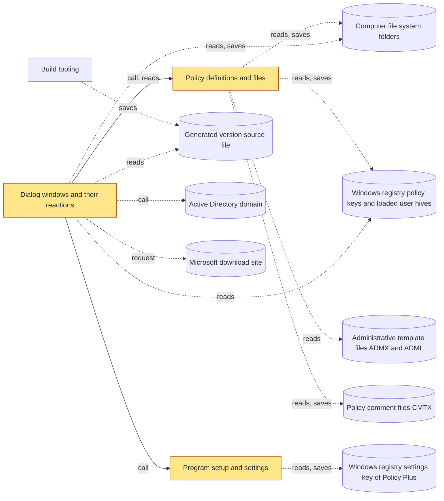
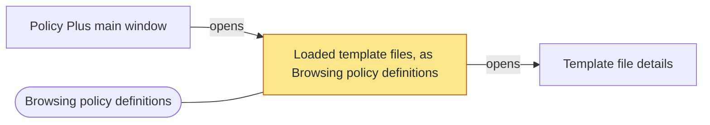

# Legacy reference: Open a loaded template file's details from the file list

The typed header below maps each criterion of the work item to the rules of the existing system it backs. The reading of the existing code follows it.

## Header

```json
{
  "story": "story-3f9bc93038c2",
  "fingerprint": "280637421a2d33856d0f4655b9cf3df29c3a1ebf99ebbb84e7839ee4506bf978",
  "criteria": [
    {
      "ac": "AC-1",
      "rules": [
        {
          "says": "Double-clicking the loaded ADMX files list opens the file details for the selected row without checking that a row is selected; pressing Enter does check.",
          "where": {
            "file": "PolicyPlus/LoadedAdmx.vb",
            "firstLine": 16,
            "lastLine": 18
          },
          "doubt": ""
        }
      ]
    },
    {
      "ac": "AC-2",
      "rules": [
        {
          "says": "The detail window of a template file lists only the policies, categories (including sub-categories), products (including versions) and support rules that were defined in that file.",
          "where": {
            "file": "PolicyPlus/DetailAdmx.vb",
            "firstLine": 15,
            "lastLine": 18
          },
          "doubt": ""
        }
      ]
    },
    {
      "ac": "AC-3",
      "rules": []
    }
  ],
  "reliesOn": [],
  "data": [
    {
      "kind": "Program preference",
      "access": "reads and saves"
    },
    {
      "kind": "Administrative template",
      "access": "reads"
    },
    {
      "kind": "Policy setting",
      "access": "reads"
    }
  ],
  "transitions": [],
  "outsideSystems": [
    "Windows registry settings key of Policy Plus",
    "Active Directory domain",
    "Administrative template files (ADMX and ADML)",
    "Computer file system folders",
    "Microsoft download site",
    "Windows registry policy keys and loaded user hives"
  ],
  "cited": [
    {
      "file": "PolicyPlus/LoadedAdmx.vb",
      "firstLine": 16,
      "lastLine": 18
    },
    {
      "file": "PolicyPlus/LoadedAdmx.vb",
      "firstLine": 19,
      "lastLine": 21
    },
    {
      "file": "PolicyPlus/LoadedAdmx.vb",
      "firstLine": 22,
      "lastLine": 24
    },
    {
      "file": "PolicyPlus/LoadedAdmx.vb",
      "firstLine": 16,
      "lastLine": 18
    },
    {
      "file": "PolicyPlus/LoadedAdmx.vb",
      "firstLine": 22,
      "lastLine": 24
    },
    {
      "file": "PolicyPlus/DetailAdmx.vb",
      "firstLine": 15,
      "lastLine": 18
    }
  ]
}
```

## What each criterion must keep

### AC-1

- Double-clicking the loaded ADMX files list opens the file details for the selected row without checking that a row is selected; pressing Enter does check. (PolicyPlus/LoadedAdmx.vb:16-18)

### AC-2

- The detail window of a template file lists only the policies, categories (including sub-categories), products (including versions) and support rules that were defined in that file. (PolicyPlus/DetailAdmx.vb:15-18)

### AC-3

No single legacy rule: it describes the behaviour as a whole.


## Reading of the existing code

# Screen: Loaded template files, as Browsing policy definitions

At a glance: 1 owned rule, 0 relied on, 3 actions, 3 files (1 own, 0 relied on, 2 of neighbour screens, 0 generated), 0 disputed.

How to read it: paths are relative to the source root and `file:a-b` is an inclusive line range. `BR-` rules, `ACT-` actions, `TR-` changes of state and `RK-` risks have stable ids. A record marked disputed was challenged in review and kept; the reviewer's words are under Trust. All of it was read from the code; nothing was run.

## Product context
Policy Plus is a Windows desktop editor for Group Policy settings, used by administrators and power users. It reads Microsoft's policy definition files and edits policy files directly, so it works on any Windows edition, including Home, which lacks the built-in editor.
Built with: .NET Framework v4.5.2, Microsoft Windows, System.DirectoryServices, System.Xml, Visual Basic .NET, Windows Forms (Policy Plus desktop editor).
Runs: It runs on the user's own Windows computer as one desktop program on .NET Framework 4.5.2. It asks for elevated rights when available but starts without them; loading registry hives, refreshing policy and editing local Group Policy files need them. It can also reach the domain's shared policy folder.
Reaches outside itself: Computer file system folders; Windows registry policy keys and loaded user hives; Administrative template files (ADMX and ADML); Windows registry settings key of Policy Plus; Generated version source file; Policy comment files (CMTX); Active Directory domain; Microsoft download site.



## Where this sits
Part of: Browsing policy definitions (Reading policy definitions).



## Boundary
- Opened by **Policy Plus main window** (bundle: screen policy-plus-main-window), at `PolicyPlus/Main.vb:767-769`
- Opens **Template file details** (bundle: screen template-file-details), at `PolicyPlus/LoadedAdmx.vb:16-18`

## Contract: what it must do
### Loaded template files
See the template files loaded and open their details.
Controls (5): ColumnHeader, Text = "File", Width = 88: ChFileTitle; ColumnHeader, Text = "Folder", Width = 203: ChFolder; ColumnHeader, Text = "Namespace", Width = 172: ChNamespace; ListView, TabIndex = 0: LsvAdmx; OK, TabIndex = 1: ButtonClose

Actions
- **ACT-60115513** Opens the details window of the ADMX file double-clicked in the list. — `PolicyPlus/LoadedAdmx.vb:16-18`; started by person
- **ACT-92218217** Keeps the namespace column filling the width left over when the window changes size. — `PolicyPlus/LoadedAdmx.vb:19-21`; started by person
- **ACT-88456545** Opens the selected ADMX file's details when Enter is pressed. — `PolicyPlus/LoadedAdmx.vb:22-24`; started by person

Rules
- **BR-61081361** Double-clicking the loaded ADMX files list opens the file details for the selected row without checking that a row is selected; pressing Enter does check. — `PolicyPlus/LoadedAdmx.vb:16-18`; also rests on `PolicyPlus/LoadedAdmx.vb:22-24`


## Trust: what to doubt
**Risks**
- **RK-55878738** [low] Several windows raise an unhandled error on ordinary input: double-clicking with no row selected, right-clicking with no category, an unnamed list entry, an unreadable import file, a malformed search wildcard, a removed product in a filter, or an inspector item with no match. No program-wide handler is set, so the framework's default error dialog appears. (Failures are hidden, lost or not retried) — at `PolicyPlus/LoadedAdmx.vb:16-18`

**Assumed, not confirmed**
- When the person's language has no exact language folder, the folder picked among those of the same primary language is the first one the operating system lists; which that is, is not stated in code. Why unsettled: The folder listing order is left to the file system, and the template folders present are out of scope. If wrong: A person could see a different regional variant of the policy text than expected when several variants are installed.


## Read order
| Tier | File | Lines | Why |
| --- | --- | --- | --- |
| own | `PolicyPlus/LoadedAdmx.vb` | whole file | starts 3 actions; decides 1 owned rule |
| neighbour screen | `PolicyPlus/DetailAdmx.vb` | 2-20 | opened from this screen: Template file details |
| neighbour screen | `PolicyPlus/Main.vb` | 767-769 | opens this screen: Policy Plus main window |

## Source

### PolicyPlus/LoadedAdmx.vb
```
1: Public Class LoadedAdmx
2:     Dim Bundle As AdmxBundle
3:     Public Sub PresentDialog(Workspace As AdmxBundle)
4:         LsvAdmx.Items.Clear()
5:         For Each admx In Workspace.Sources.Keys
6:             Dim lsvi = LsvAdmx.Items.Add(IO.Path.GetFileName(admx.SourceFile))
7:             lsvi.SubItems.Add(IO.Path.GetDirectoryName(admx.SourceFile))
8:             lsvi.SubItems.Add(admx.AdmxNamespace)
9:             lsvi.Tag = admx
10:         Next
11:         LoadedAdmx_SizeChanged(Nothing, Nothing)
12:         ChNamespace.Width -= SystemInformation.VerticalScrollBarWidth ' For some reason, this only needs to be taken into account on the first draw
13:         Bundle = Workspace
14:         ShowDialog()
15:     End Sub
16:     Private Sub LsvAdmx_DoubleClick(sender As Object, e As EventArgs) Handles LsvAdmx.DoubleClick
17:         DetailAdmx.PresentDialog(LsvAdmx.SelectedItems(0).Tag, Bundle)
18:     End Sub
19:     Private Sub LoadedAdmx_SizeChanged(sender As Object, e As EventArgs) Handles Me.SizeChanged
20:         ChNamespace.Width = Math.Max(30, LsvAdmx.ClientRectangle.Width - ChFolder.Width - ChFileTitle.Width)
21:     End Sub
22:     Private Sub LsvAdmx_KeyDown(sender As Object, e As KeyEventArgs) Handles LsvAdmx.KeyDown
23:         If e.KeyCode = Keys.Enter And LsvAdmx.SelectedItems.Count > 0 Then LsvAdmx_DoubleClick(sender, e)
24:     End Sub
25: End Class
```

### PolicyPlus/DetailAdmx.vb
```
2:     Public Sub PresentDialog(Admx As AdmxFile, Workspace As AdmxBundle)
3:         TextPath.Text = Admx.SourceFile
4:         TextNamespace.Text = Admx.AdmxNamespace
5:         TextSupersededAdm.Text = Admx.SupersededAdm
6:         Dim fillListview = Sub(Control As ListView, Collection As IEnumerable, IdSelector As Func(Of Object, String), NameSelector As Func(Of Object, String))
7:                                Control.Items.Clear()
8:                                For Each item In Collection
9:                                    Dim lsvi = Control.Items.Add(IdSelector(item))
10:                                    lsvi.Tag = item
11:                                    lsvi.SubItems.Add(NameSelector(item))
12:                                Next
13:                                Control.Columns(1).Width = Control.ClientRectangle.Width - Control.Columns(0).Width - SystemInformation.VerticalScrollBarWidth
14:                            End Sub
15:         fillListview(LsvPolicies, Workspace.Policies.Values.Where(Function(p) p.RawPolicy.DefinedIn Is Admx), Function(p As PolicyPlusPolicy) p.RawPolicy.ID, Function(p As PolicyPlusPolicy) p.DisplayName)
16:         fillListview(LsvCategories, Workspace.FlatCategories.Values.Where(Function(c) c.RawCategory.DefinedIn Is Admx), Function(c As PolicyPlusCategory) c.RawCategory.ID, Function(c As PolicyPlusCategory) c.DisplayName)
17:         fillListview(LsvProducts, Workspace.FlatProducts.Values.Where(Function(p) p.RawProduct.DefinedIn Is Admx), Function(p As PolicyPlusProduct) p.RawProduct.ID, Function(p As PolicyPlusProduct) p.DisplayName)
18:         fillListview(LsvSupportDefinitions, Workspace.SupportDefinitions.Values.Where(Function(s) s.RawSupport.DefinedIn Is Admx), Function(s As PolicyPlusSupport) s.RawSupport.ID, Function(s As PolicyPlusSupport) s.DisplayName)
19:         ShowDialog()
20:     End Sub
```

### PolicyPlus/Main.vb
```
767:     Private Sub LoadedADMXFilesToolStripMenuItem_Click(sender As Object, e As EventArgs) Handles LoadedADMXFilesToolStripMenuItem.Click
768:         LoadedAdmx.PresentDialog(AdmxWorkspace)
769:     End Sub
```

