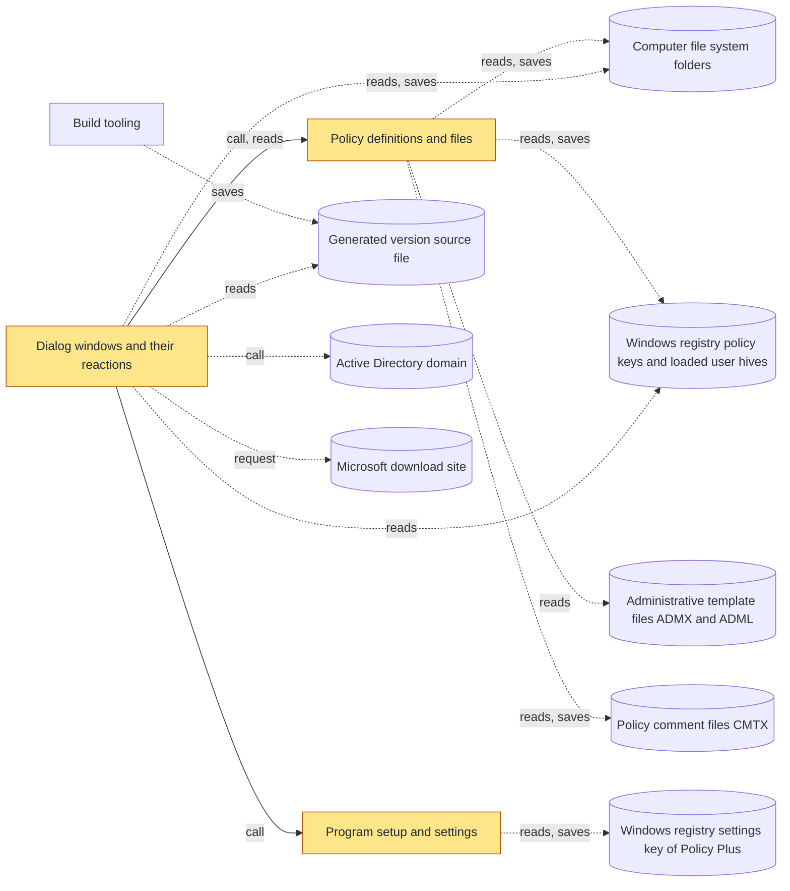
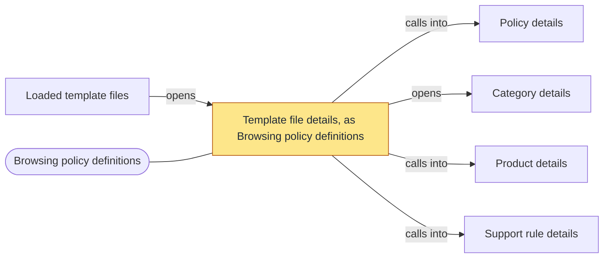

# Legacy reference: Open details of a policy, category, product or support rule

The typed header below maps each criterion of the work item to the rules of the existing system it backs. The reading of the existing code follows it.

## Header

```json
{
  "story": "story-52aa6159de57",
  "fingerprint": "280637421a2d33856d0f4655b9cf3df29c3a1ebf99ebbb84e7839ee4506bf978",
  "criteria": [
    {
      "ac": "AC-1",
      "rules": [
        {
          "says": "When a policy sits in a category that exists, the category name is shown and the category-details button is enabled. A policy whose named category is unknown shows \"<orphaned from \" followed by that category code, and one with no category code shows \"<uncategorized>\"; the button is then disabled.",
          "where": {
            "file": "PolicyPlus/DetailPolicy.vb",
            "firstLine": 27,
            "lastLine": 34
          },
          "doubt": ""
        }
      ]
    },
    {
      "ac": "AC-2",
      "rules": [
        {
          "says": "When a policy names a support definition that exists, its name is shown and the support-details button is enabled. When it does not exist, the button is disabled and the text reads \"<missing: \" followed by the code the policy names; with no code the text is blank.",
          "where": {
            "file": "PolicyPlus/DetailPolicy.vb",
            "firstLine": 19,
            "lastLine": 26
          },
          "doubt": ""
        }
      ]
    },
    {
      "ac": "AC-3",
      "rules": [
        {
          "says": "The policy details window names the section a policy applies to: \"User or computer\" when it applies to both, \"Computer\" when machine-only, \"User\" when user-only.",
          "where": {
            "file": "PolicyPlus/DetailPolicy.vb",
            "firstLine": 11,
            "lastLine": 18
          },
          "doubt": ""
        }
      ]
    },
    {
      "ac": "AC-4",
      "rules": [
        {
          "says": "The detail window of a category shows its parent's name and enables the parent button when the parent exists; when the parent is named but missing it shows \"<orphaned from <parent>>\" and the button is disabled; a top-level category shows nothing.",
          "where": {
            "file": "PolicyPlus/DetailCategory.vb",
            "firstLine": 14,
            "lastLine": 21
          },
          "doubt": ""
        }
      ]
    },
    {
      "ac": "AC-5",
      "rules": []
    }
  ],
  "reliesOn": [
    {
      "says": "The product details window lists every child revision of a product with its version and name; a product with no children shows an empty list.",
      "builtBy": "Describe products and support definitions in their detail views"
    },
    {
      "says": "A product with a parent shows the parent name and enables the parent button; a product with no parent shows a blank parent and the button is disabled.",
      "builtBy": "Describe products and support definitions in their detail views"
    },
    {
      "says": "The product details window shows a version number for major and minor revisions only; for a top-level product the version is blank.",
      "builtBy": "Describe products and support definitions in their detail views"
    },
    {
      "says": "The product details window labels a product \"Major revision\", \"Minor revision\" or \"Top-level product\" from its type.",
      "builtBy": "Describe products and support definitions in their detail views"
    },
    {
      "says": "Each entry of a support definition is listed by the name of the nested support definition when it is one, otherwise by the name of the product, otherwise as \"<missing: \" followed by the product code the entry names. Minimum and maximum versions are listed only for product entries that name a version range; a missing bound is shown blank.",
      "builtBy": "Describe products and support definitions in their detail views"
    },
    {
      "says": "The support details window states how a support definition matches products: \"Match all the referenced products\", \"Match any of the referenced products\", or \"Do not match products\" when it has no matching logic.",
      "builtBy": "Describe products and support definitions in their detail views"
    }
  ],
  "data": [
    {
      "kind": "Program preference",
      "access": "reads and saves"
    },
    {
      "kind": "Administrative template",
      "access": "reads"
    },
    {
      "kind": "Policy setting",
      "access": "reads"
    }
  ],
  "transitions": [],
  "outsideSystems": [
    "Windows registry settings key of Policy Plus",
    "Active Directory domain",
    "Administrative template files (ADMX and ADML)",
    "Computer file system folders",
    "Microsoft download site",
    "Windows registry policy keys and loaded user hives"
  ],
  "cited": [
    {
      "file": "PolicyPlus/DetailAdmx.vb",
      "firstLine": 21,
      "lastLine": 23
    },
    {
      "file": "PolicyPlus/DetailAdmx.vb",
      "firstLine": 24,
      "lastLine": 26
    },
    {
      "file": "PolicyPlus/DetailAdmx.vb",
      "firstLine": 27,
      "lastLine": 29
    },
    {
      "file": "PolicyPlus/DetailAdmx.vb",
      "firstLine": 30,
      "lastLine": 32
    },
    {
      "file": "PolicyPlus/DetailPolicy.vb",
      "firstLine": 27,
      "lastLine": 34
    },
    {
      "file": "PolicyPlus/DetailPolicy.vb",
      "firstLine": 19,
      "lastLine": 26
    },
    {
      "file": "PolicyPlus/DetailPolicy.vb",
      "firstLine": 11,
      "lastLine": 18
    },
    {
      "file": "PolicyPlus/DetailCategory.vb",
      "firstLine": 14,
      "lastLine": 21
    }
  ]
}
```

## What each criterion must keep

### AC-1

- When a policy sits in a category that exists, the category name is shown and the category-details button is enabled. A policy whose named category is unknown shows "<orphaned from " followed by that category code, and one with no category code shows "<uncategorized>"; the button is then disabled. (PolicyPlus/DetailPolicy.vb:27-34)

### AC-2

- When a policy names a support definition that exists, its name is shown and the support-details button is enabled. When it does not exist, the button is disabled and the text reads "<missing: " followed by the code the policy names; with no code the text is blank. (PolicyPlus/DetailPolicy.vb:19-26)

### AC-3

- The policy details window names the section a policy applies to: "User or computer" when it applies to both, "Computer" when machine-only, "User" when user-only. (PolicyPlus/DetailPolicy.vb:11-18)

### AC-4

- The detail window of a category shows its parent's name and enables the parent button when the parent exists; when the parent is named but missing it shows "<orphaned from <parent>>" and the button is disabled; a top-level category shows nothing. (PolicyPlus/DetailCategory.vb:14-21)

### AC-5

No single legacy rule: it describes the behaviour as a whole.


## Relies on, built elsewhere

- The product details window lists every child revision of a product with its version and name; a product with no children shows an empty list. Built by: Describe products and support definitions in their detail views.
- A product with a parent shows the parent name and enables the parent button; a product with no parent shows a blank parent and the button is disabled. Built by: Describe products and support definitions in their detail views.
- The product details window shows a version number for major and minor revisions only; for a top-level product the version is blank. Built by: Describe products and support definitions in their detail views.
- The product details window labels a product "Major revision", "Minor revision" or "Top-level product" from its type. Built by: Describe products and support definitions in their detail views.
- Each entry of a support definition is listed by the name of the nested support definition when it is one, otherwise by the name of the product, otherwise as "<missing: " followed by the product code the entry names. Minimum and maximum versions are listed only for product entries that name a version range; a missing bound is shown blank. Built by: Describe products and support definitions in their detail views.
- The support details window states how a support definition matches products: "Match all the referenced products", "Match any of the referenced products", or "Do not match products" when it has no matching logic. Built by: Describe products and support definitions in their detail views.

## Reading of the existing code

# Screen: Template file details, as Browsing policy definitions

At a glance: 0 owned rules, 0 relied on, 4 actions, 6 files (1 own, 0 relied on, 5 of neighbour screens, 0 generated), 0 disputed.

How to read it: paths are relative to the source root and `file:a-b` is an inclusive line range. `BR-` rules, `ACT-` actions, `TR-` changes of state and `RK-` risks have stable ids. A record marked disputed was challenged in review and kept; the reviewer's words are under Trust. All of it was read from the code; nothing was run.

## Product context
Policy Plus is a Windows desktop editor for Group Policy settings, used by administrators and power users. It reads Microsoft's policy definition files and edits policy files directly, so it works on any Windows edition, including Home, which lacks the built-in editor.
Built with: .NET Framework v4.5.2, Microsoft Windows, System.DirectoryServices, System.Xml, Visual Basic .NET, Windows Forms (Policy Plus desktop editor).
Runs: It runs on the user's own Windows computer as one desktop program on .NET Framework 4.5.2. It asks for elevated rights when available but starts without them; loading registry hives, refreshing policy and editing local Group Policy files need them. It can also reach the domain's shared policy folder.
Reaches outside itself: Computer file system folders; Windows registry policy keys and loaded user hives; Administrative template files (ADMX and ADML); Windows registry settings key of Policy Plus; Generated version source file; Policy comment files (CMTX); Active Directory domain; Microsoft download site.



## Where this sits
Part of: Browsing policy definitions (Reading policy definitions).



## Boundary
- Opened by **Loaded template files** (bundle: screen loaded-template-files), at `PolicyPlus/LoadedAdmx.vb:16-18`
- Calls into **Policy details** (bundle: screen policy-details), at `PolicyPlus/DetailAdmx.vb:21-23`
- Opens **Category details** (bundle: screen category-details), at `PolicyPlus/DetailAdmx.vb:24-26`
- Calls into **Product details** (bundle: screen product-details), at `PolicyPlus/DetailAdmx.vb:27-29`
- Calls into **Support rule details** (bundle: screen support-rule-details), at `PolicyPlus/DetailAdmx.vb:30-32`

## Contract: what it must do
### Template file details
See one template file: its path and namespace, and the policies, categories, products and support rules it defines.
Controls (24): Button, caption "Close", TabIndex = 14, DialogResult = OK: ButtonClose; ColumnHeader, caption "Local ID", Width = 73: ChCategoryId, ChPolicyId, ChProductId, ChSupportId; ColumnHeader, caption "Name", Width = 166: ChCategoryName, ChName, ChProductName, ChSupportName; Form: DetailAdmx; Label, caption "Categories", TabIndex = 9: Label5; Label, caption "Namespace", TabIndex = 3: Label2; Label, caption "Path", TabIndex = 1: Label1; Label, caption "Policies", TabIndex = 7: Label4; Label, caption "Products", TabIndex = 11: Label6; Label, caption "Superseded ADM", TabIndex = 5: Label3; Label, caption "Support rules", TabIndex = 13: Label7; ListView, TabIndex = 10: LsvProducts; ListView, TabIndex = 12: LsvSupportDefinitions; ListView, TabIndex = 6: LsvPolicies; ListView, TabIndex = 8: LsvCategories; TextBox, ReadOnly = True, TabIndex = 0: TextPath; TextBox, ReadOnly = True, TabIndex = 2: TextNamespace; TextBox, ReadOnly = True, TabIndex = 4: TextSupersededAdm

Actions
- **ACT-53225370** Opens the detail window of the policy double-clicked in the policy list. — `PolicyPlus/DetailAdmx.vb:21-23`; started by person
- **ACT-28383962** Opens the detail window of the category double-clicked in the category list. — `PolicyPlus/DetailAdmx.vb:24-26`; started by person
- **ACT-66951547** Opens the detail window of the product double-clicked in the product list. — `PolicyPlus/DetailAdmx.vb:27-29`; started by person
- **ACT-49541466** Opens the detail window of the support rule double-clicked in the support-rule list. — `PolicyPlus/DetailAdmx.vb:30-32`; started by person


## Trust: what to doubt
**Risks**
- **RK-55878738** [low] Several windows raise an unhandled error on ordinary input: double-clicking with no row selected, right-clicking with no category, an unnamed list entry, an unreadable import file, a malformed search wildcard, a removed product in a filter, or an inspector item with no match. No program-wide handler is set, so the framework's default error dialog appears. (Failures are hidden, lost or not retried) — at `PolicyPlus/DetailAdmx.vb:21-32`

**Assumed, not confirmed**
- When the person's language has no exact language folder, the folder picked among those of the same primary language is the first one the operating system lists; which that is, is not stated in code. Why unsettled: The folder listing order is left to the file system, and the template folders present are out of scope. If wrong: A person could see a different regional variant of the policy text than expected when several variants are installed.


## Read order
| Tier | File | Lines | Why |
| --- | --- | --- | --- |
| own | `PolicyPlus/DetailAdmx.vb` | whole file | starts 4 actions |
| neighbour screen | `PolicyPlus/DetailCategory.vb` | 3-6 | opened from this screen: Category details |
| neighbour screen | `PolicyPlus/DetailPolicy.vb` | 3-36 | called from this screen: Policy details |
| neighbour screen | `PolicyPlus/DetailProduct.vb` | 3-6 | called from this screen: Product details |
| neighbour screen | `PolicyPlus/DetailSupport.vb` | 2-5 | called from this screen: Support rule details |
| neighbour screen | `PolicyPlus/LoadedAdmx.vb` | 16-18 | opens this screen: Loaded template files |

## Source

### PolicyPlus/DetailAdmx.vb
```
1: Public Class DetailAdmx
2:     Public Sub PresentDialog(Admx As AdmxFile, Workspace As AdmxBundle)
3:         TextPath.Text = Admx.SourceFile
4:         TextNamespace.Text = Admx.AdmxNamespace
5:         TextSupersededAdm.Text = Admx.SupersededAdm
6:         Dim fillListview = Sub(Control As ListView, Collection As IEnumerable, IdSelector As Func(Of Object, String), NameSelector As Func(Of Object, String))
7:                                Control.Items.Clear()
8:                                For Each item In Collection
9:                                    Dim lsvi = Control.Items.Add(IdSelector(item))
10:                                    lsvi.Tag = item
11:                                    lsvi.SubItems.Add(NameSelector(item))
12:                                Next
13:                                Control.Columns(1).Width = Control.ClientRectangle.Width - Control.Columns(0).Width - SystemInformation.VerticalScrollBarWidth
14:                            End Sub
15:         fillListview(LsvPolicies, Workspace.Policies.Values.Where(Function(p) p.RawPolicy.DefinedIn Is Admx), Function(p As PolicyPlusPolicy) p.RawPolicy.ID, Function(p As PolicyPlusPolicy) p.DisplayName)
16:         fillListview(LsvCategories, Workspace.FlatCategories.Values.Where(Function(c) c.RawCategory.DefinedIn Is Admx), Function(c As PolicyPlusCategory) c.RawCategory.ID, Function(c As PolicyPlusCategory) c.DisplayName)
17:         fillListview(LsvProducts, Workspace.FlatProducts.Values.Where(Function(p) p.RawProduct.DefinedIn Is Admx), Function(p As PolicyPlusProduct) p.RawProduct.ID, Function(p As PolicyPlusProduct) p.DisplayName)
18:         fillListview(LsvSupportDefinitions, Workspace.SupportDefinitions.Values.Where(Function(s) s.RawSupport.DefinedIn Is Admx), Function(s As PolicyPlusSupport) s.RawSupport.ID, Function(s As PolicyPlusSupport) s.DisplayName)
19:         ShowDialog()
20:     End Sub
21:     Private Sub LsvPolicies_DoubleClick(sender As Object, e As EventArgs) Handles LsvPolicies.DoubleClick
22:         DetailPolicy.PresentDialog(LsvPolicies.SelectedItems(0).Tag)
23:     End Sub
24:     Private Sub LsvCategories_DoubleClick(sender As Object, e As EventArgs) Handles LsvCategories.DoubleClick
25:         DetailCategory.PresentDialog(LsvCategories.SelectedItems(0).Tag)
26:     End Sub
27:     Private Sub LsvProducts_DoubleClick(sender As Object, e As EventArgs) Handles LsvProducts.DoubleClick
28:         DetailProduct.PresentDialog(LsvProducts.SelectedItems(0).Tag)
29:     End Sub
30:     Private Sub LsvSupportDefinitions_DoubleClick(sender As Object, e As EventArgs) Handles LsvSupportDefinitions.DoubleClick
31:         DetailSupport.PresentDialog(LsvSupportDefinitions.SelectedItems(0).Tag)
32:     End Sub
33: End Class
```

### PolicyPlus/DetailCategory.vb
```
3:     Public Sub PresentDialog(Category As PolicyPlusCategory)
4:         PrepareDialog(Category)
5:         ShowDialog()
6:     End Sub
```

### PolicyPlus/DetailPolicy.vb
```
3:     Public Sub PresentDialog(Policy As PolicyPlusPolicy)
4:         SelectedPolicy = Policy
5:         NameTextbox.Text = Policy.DisplayName
6:         IdTextbox.Text = Policy.UniqueID
7:         DefinedTextbox.Text = Policy.RawPolicy.DefinedIn.SourceFile
8:         DisplayCodeTextbox.Text = Policy.RawPolicy.DisplayCode
9:         InfoCodeTextbox.Text = Policy.RawPolicy.ExplainCode
10:         PresentCodeTextbox.Text = Policy.RawPolicy.PresentationID
11:         Select Case Policy.RawPolicy.Section
12:             Case AdmxPolicySection.Both
13:                 SectionTextbox.Text = "User or computer"
14:             Case AdmxPolicySection.Machine
15:                 SectionTextbox.Text = "Computer"
16:             Case AdmxPolicySection.User
17:                 SectionTextbox.Text = "User"
18:         End Select
19:         SupportButton.Enabled = Policy.SupportedOn IsNot Nothing
20:         If Policy.SupportedOn IsNot Nothing Then
21:             SupportTextbox.Text = Policy.SupportedOn.DisplayName
22:         ElseIf Policy.RawPolicy.SupportedCode <> "" Then
23:             SupportTextbox.Text = "<missing: " & Policy.RawPolicy.SupportedCode & ">"
24:         Else
25:             SupportTextbox.Text = ""
26:         End If
27:         CategoryButton.Enabled = Policy.Category IsNot Nothing
28:         If Policy.Category IsNot Nothing Then
29:             CategoryTextbox.Text = Policy.Category.DisplayName
30:         ElseIf Policy.RawPolicy.CategoryID <> "" Then
31:             CategoryTextbox.Text = "<orphaned from " & Policy.RawPolicy.CategoryID & ">"
32:         Else
33:             CategoryTextbox.Text = "<uncategorized>"
34:         End If
35:         ShowDialog()
36:     End Sub
```

### PolicyPlus/DetailProduct.vb
```
3:     Public Sub PresentDialog(Product As PolicyPlusProduct)
4:         PrepareDialog(Product)
5:         ShowDialog()
6:     End Sub
```

### PolicyPlus/DetailSupport.vb
```
2:     Public Sub PresentDialog(Supported As PolicyPlusSupport)
3:         PrepareDialog(Supported)
4:         ShowDialog()
5:     End Sub
```

### PolicyPlus/LoadedAdmx.vb
```
16:     Private Sub LsvAdmx_DoubleClick(sender As Object, e As EventArgs) Handles LsvAdmx.DoubleClick
17:         DetailAdmx.PresentDialog(LsvAdmx.SelectedItems(0).Tag, Bundle)
18:     End Sub
```

