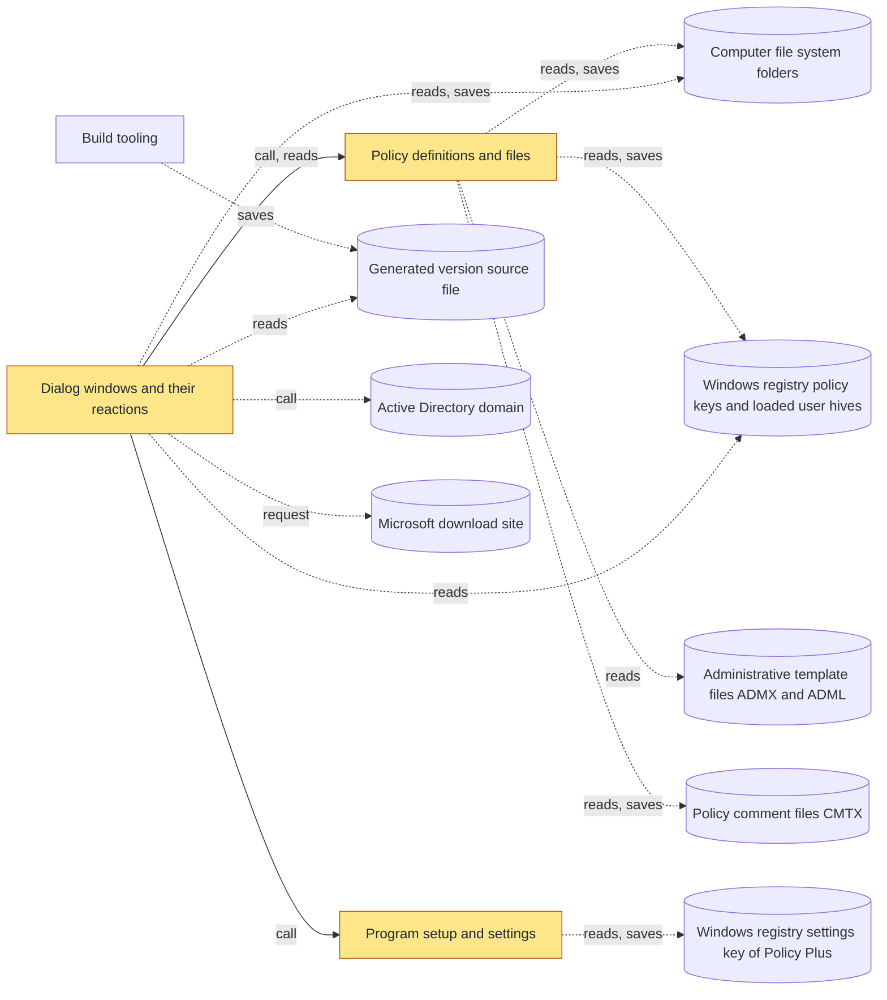
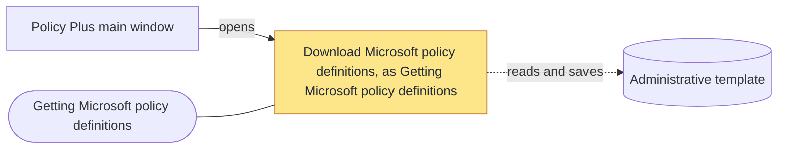
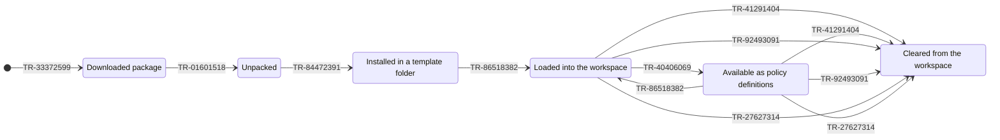

# Legacy reference: Propose the usual folder and allow another

The typed header below maps each criterion of the work item to the rules of the existing system it backs. The reading of the existing code follows it.

## Header

```json
{
  "story": "story-63856409801a",
  "fingerprint": "280637421a2d33856d0f4655b9cf3df29c3a1ebf99ebbb84e7839ee4506bf978",
  "criteria": [
    {
      "ac": "AC-1",
      "rules": [
        {
          "says": "Choosing a folder in the browse dialog replaces the destination; cancelling the dialog leaves the destination unchanged.",
          "where": {
            "file": "PolicyPlus/DownloadAdmx.vb",
            "firstLine": 7,
            "lastLine": 13
          },
          "doubt": ""
        }
      ]
    },
    {
      "ac": "AC-2",
      "rules": [
        {
          "says": "Each time the download window opens, the destination folder is set to the Windows policy definitions folder (the PolicyDefinitions folder under the Windows folder) and no new policy folder is reported to the caller.",
          "where": {
            "file": "PolicyPlus/DownloadAdmx.vb",
            "firstLine": 17,
            "lastLine": 21
          },
          "doubt": ""
        }
      ]
    },
    {
      "ac": "AC-3",
      "rules": [
        {
          "says": "Choosing a folder in the browse dialog replaces the destination; cancelling the dialog leaves the destination unchanged.",
          "where": {
            "file": "PolicyPlus/DownloadAdmx.vb",
            "firstLine": 7,
            "lastLine": 13
          },
          "doubt": ""
        }
      ]
    }
  ],
  "reliesOn": [],
  "data": [
    {
      "kind": "Program preference",
      "access": "reads and saves"
    },
    {
      "kind": "Administrative template",
      "access": "reads and saves"
    },
    {
      "kind": "Policy setting",
      "access": "reads"
    }
  ],
  "transitions": [],
  "outsideSystems": [
    "Windows registry settings key of Policy Plus",
    "Active Directory domain",
    "Administrative template files (ADMX and ADML)",
    "Computer file system folders",
    "Microsoft download site",
    "Windows registry policy keys and loaded user hives"
  ],
  "steps": [
    {
      "intent": "Install somewhere other than the usual folder, only when needed.",
      "change": "deferred",
      "reason": "Choosing a folder is rarely needed, so it is offered only when wanted."
    }
  ],
  "components": [
    {
      "name": "Destination chooser",
      "module": "destination-chooser",
      "layer": "packages/ui"
    }
  ],
  "cited": [
    {
      "file": "PolicyPlus/DownloadAdmx.vb",
      "firstLine": 7,
      "lastLine": 13
    },
    {
      "file": "PolicyPlus/DownloadAdmx.vb",
      "firstLine": 7,
      "lastLine": 13
    },
    {
      "file": "PolicyPlus/DownloadAdmx.vb",
      "firstLine": 17,
      "lastLine": 21
    }
  ]
}
```

## What each criterion must keep

### AC-1

- Choosing a folder in the browse dialog replaces the destination; cancelling the dialog leaves the destination unchanged. (PolicyPlus/DownloadAdmx.vb:7-13)

### AC-2

- Each time the download window opens, the destination folder is set to the Windows policy definitions folder (the PolicyDefinitions folder under the Windows folder) and no new policy folder is reported to the caller. (PolicyPlus/DownloadAdmx.vb:17-21)

### AC-3

- Choosing a folder in the browse dialog replaces the destination; cancelling the dialog leaves the destination unchanged. (PolicyPlus/DownloadAdmx.vb:7-13)

## Reading of the existing code

# Screen: Download Microsoft policy definitions, as Getting Microsoft policy definitions

At a glance: 12 owned rules, 0 relied on, 4 actions, 4 files (1 own, 2 relied on, 1 of neighbour screens, 0 generated), 0 disputed.

How to read it: paths are relative to the source root and `file:a-b` is an inclusive line range. `BR-` rules, `ACT-` actions, `TR-` changes of state and `RK-` risks have stable ids. A record marked disputed was challenged in review and kept; the reviewer's words are under Trust. All of it was read from the code; nothing was run.

## Product context
Policy Plus is a Windows desktop editor for Group Policy settings, used by administrators and power users. It reads Microsoft's policy definition files and edits policy files directly, so it works on any Windows edition, including Home, which lacks the built-in editor.
Built with: .NET Framework v4.5.2, Microsoft Windows, System.DirectoryServices, System.Xml, Visual Basic .NET, Windows Forms (Policy Plus desktop editor).
Runs: It runs on the user's own Windows computer as one desktop program on .NET Framework 4.5.2. It asks for elevated rights when available but starts without them; loading registry hives, refreshing policy and editing local Group Policy files need them. It can also reach the domain's shared policy folder.
Reaches outside itself: Computer file system folders; Windows registry policy keys and loaded user hives; Administrative template files (ADMX and ADML); Windows registry settings key of Policy Plus; Generated version source file; Policy comment files (CMTX); Active Directory domain; Microsoft download site.



## Where this sits
Part of: Getting Microsoft policy definitions (Reading policy definitions).



## Boundary
- Opened by **Policy Plus main window** (bundle: screen policy-plus-main-window), at `PolicyPlus/Main.vb:756-766`

## Contract: what it must do
### Download Microsoft policy definitions
Choose a folder and download Microsoft's current policy templates into it.
Controls (8): Friend WithEvents ButtonBrowse As Button: ButtonBrowse; Friend WithEvents ButtonClose As Button: ButtonClose; Friend WithEvents ButtonStart As Button: ButtonStart; Friend WithEvents LabelProgress As Label: LabelProgress; Friend WithEvents ProgressSpinner As ProgressBar: ProgressSpinner; Friend WithEvents TextDestFolder As TextBox: TextDestFolder; Label: LabelDestFolder, LabelWhatsThis

Actions
- **ACT-79816382** Lets the person pick the destination folder in a folder dialog. — `PolicyPlus/DownloadAdmx.vb:7-13`; started by person
- **ACT-32679729** Blocks closing the window while a download is running. — `PolicyPlus/DownloadAdmx.vb:14-16`; started by person
- **ACT-79953457** Fills the destination folder with the Windows policy definitions folder and clears the busy state. — `PolicyPlus/DownloadAdmx.vb:17-21`; started by person
- **ACT-42947336** Downloads Microsoft's policy definitions package, unpacks it and moves the files into the chosen folder. — `PolicyPlus/DownloadAdmx.vb:33-130`; started by person

Rules
- **BR-72370051** Choosing a folder in the browse dialog replaces the destination; cancelling the dialog leaves the destination unchanged. — `PolicyPlus/DownloadAdmx.vb:7-13`
- **BR-45906057** When the person closes the download window while a download is running, the close is refused; the window closes only when no download is running. — `PolicyPlus/DownloadAdmx.vb:14-16`
- **BR-83639458** Each time the download window opens, the destination folder is set to the Windows policy definitions folder (the PolicyDefinitions folder under the Windows folder) and no new policy folder is reported to the caller. — `PolicyPlus/DownloadAdmx.vb:17-21`
- **BR-29321329** While a download runs, the start button, close button, destination box and browse button are all disabled, so a second download cannot be started and the destination cannot change; they are enabled again when it ends. — `PolicyPlus/DownloadAdmx.vb:22-32`
- **BR-46021999** When files are moved into a folder, the folder is created if missing and every file already there with the same name is deleted first and then replaced by the new one, with no backup. Only files directly in the source folder are moved. A failure part-way leaves some files replaced and others not. — `PolicyPlus/DownloadAdmx.vb:52-75`; also rests on `PolicyPlus/DownloadAdmx.vb:101-111`; gates TR-84472391
- **BR-90339776** For an administrator, each folder handed to the file move that already exists, the destination itself and any existing language folder, has its ownership taken; a language folder created during the move instead inherits permissions from the folder above. Every moved file, including the template files in the destination, is reset to inherit permissions. A standard user changes no permissions. A failure here ends the download with "Failed to move the ADMX files.", not the take-control message. — `PolicyPlus/DownloadAdmx.vb:55-73`; also rests on `PolicyPlus/DownloadAdmx.vb:42-51`, `PolicyPlus/DownloadAdmx.vb:101-102`, `PolicyPlus/DownloadAdmx.vb:123-127`; gates TR-84472391
- **BR-16933732** Starting the download always fetches one fixed Microsoft package, the Windows 11 September 2026 Update (26H2) administrative templates, into a scratch folder under the person's local application data as "W11Admx.msi"; the person cannot choose another version. — `PolicyPlus/DownloadAdmx.vb:83-86`; also rests on `PolicyPlus/DownloadAdmx.vb:3-4`, `PolicyPlus/DownloadAdmx.vb:79-80`; gates TR-33372599
- **BR-75338920** The downloaded package is unpacked with the Windows installer tool; if the tool ends with a non-zero code the download stops with "Failed to extract the package." and the package is kept. When it succeeds, the downloaded package file is deleted. — `PolicyPlus/DownloadAdmx.vb:89-93`; also rests on `PolicyPlus/DownloadAdmx.vb:87-88`, `PolicyPlus/DownloadAdmx.vb:123-128`; gates TR-01601518
- **BR-00495277** Before any file is moved, when the folder written in the destination box already exists and the person is an administrator, ownership of it is taken and Administrators are given full control. This applies to whatever folder text is in the box, not only the Windows folder; a standard user skips it. A failure ends the download with "Failed to take control of the destination." and nothing is moved. — `PolicyPlus/DownloadAdmx.vb:94-100`; also rests on `PolicyPlus/DownloadAdmx.vb:37-51`, `PolicyPlus/DownloadAdmx.vb:123-127`; gates TR-84472391
- **BR-59319852** The template files are moved into the destination, then the language files for the person's regional format language (the culture of the regional settings, which can differ from the display language) are moved into a folder of that name if the package holds one. Unless that language is en-US, the English files are also moved into an en-US folder as a fallback; if the package has no en-US folder, the download stops with "Failed to move the ADMX files." after the destination files were already replaced. — `PolicyPlus/DownloadAdmx.vb:103-111`; also rests on `PolicyPlus/DownloadAdmx.vb:101-102`, `PolicyPlus/DownloadAdmx.vb:123-127`; gates TR-84472391
- **BR-39961851** After a successful download the scratch folder is deleted, the person is asked "ADMX files downloaded successfully. Open them now?", and the destination is reported as the new policy folder only if they answer Yes; either answer closes the window as done. — `PolicyPlus/DownloadAdmx.vb:117-122`; also rests on `PolicyPlus/DownloadAdmx.vb:112-115`
- **BR-23720423** When any step fails, the person is told "Failed to " followed by the step that failed (create a scratch space, download the package, extract the package, take control of the destination, move the ADMX files, remove temporary files); the window stays open, controls are re-enabled, and no policy folder is reported. If only the final cleanup of the scratch folder fails, all files are already installed yet the person is told "Failed to remove temporary files." and no new policy folder is offered. — `PolicyPlus/DownloadAdmx.vb:125-127`; also rests on `PolicyPlus/DownloadAdmx.vb:77`, `PolicyPlus/DownloadAdmx.vb:81`, `PolicyPlus/DownloadAdmx.vb:87`, `PolicyPlus/DownloadAdmx.vb:95`, `PolicyPlus/DownloadAdmx.vb:101`, `PolicyPlus/DownloadAdmx.vb:112-114`


## Data and states
- Administrative template: reads and saves; kept in Active Directory domain, Administrative template files (ADMX and ADML), Computer file system folders, Microsoft download site

Life of Administrative template


| Change | From | To | Written at | In this code | Reading |
| --- | --- | --- | --- | --- | --- |
| TR-01601518 | Downloaded package | Unpacked | `PolicyPlus/DownloadAdmx.vb:89-93` | yes | reviewed |
| TR-84472391 | Unpacked | Installed in a template folder | `PolicyPlus/DownloadAdmx.vb:103-111` | yes | reviewed |
| TR-40406069 | Loaded into the workspace | Available as policy definitions | `PolicyPlus/AdmxBundle.vb:163-181` | no | reviewed |
| TR-41291404 | Loaded into the workspace or Available as policy definitions | Cleared from the workspace | `PolicyPlus/Main.vb:391` | no | reviewed |
| TR-92493091 | Loaded into the workspace or Available as policy definitions | Cleared from the workspace | `PolicyPlus/Main.vb:65` | no | reviewed |
| TR-27627314 | Loaded into the workspace or Available as policy definitions | Cleared from the workspace | `PolicyPlus/Main.vb:72` | no | reviewed |
| TR-33372599 | created | Downloaded package | `PolicyPlus/DownloadAdmx.vb:83-86` | yes | reviewed |
| TR-86518382 | Installed in a template folder or Available as policy definitions | Loaded into the workspace | `PolicyPlus/AdmxBundle.vb:72-77` | no | corrected |

## Trust: what to doubt
**Risks**
- **RK-83302224** [medium] For an administrator, the program unpacks a package it never verified and then makes Administrators owner of the typed destination with full control, so a compromised source would be trusted with that folder. (Releasing or running the system depends on manual or missing steps) — at `PolicyPlus/DownloadAdmx.vb:18`, `PolicyPlus/DownloadAdmx.vb:42-51`, `PolicyPlus/DownloadAdmx.vb:85-92`, `PolicyPlus/DownloadAdmx.vb:94-100`
- **RK-00344106** [medium] Results of requesting Windows privileges and loading a user registry file are discarded. The person learns a source cannot be saved, or silently gets an empty read-only source, never why. A refused privilege passes silently and fails later with an unrelated error. (Failures are hidden, lost or not retried) — at `PolicyPlus/DownloadAdmx.vb:97-98`, `PolicyPlus/Privilege.vb:6-13`
- **RK-19349632** [medium] The download accepts what it is given without checks: the package is unpacked with no signature or hash check, and the destination is any folder typed. For an administrator the files written also get their access rules reset. The package address is fixed HTTPS, so the package gap matters only if that channel is compromised. (Input from outside is used without checks, so it can change what the code does) — at `PolicyPlus/DownloadAdmx.vb:37-75`, `PolicyPlus/DownloadAdmx.vb:83-93`, `PolicyPlus/DownloadAdmx.vb:94-100`, `PolicyPlus/DownloadAdmx.vb:103-111`
- **RK-26649308** [medium] The Microsoft template package is unpacked with no hash or signature check, so a tampered or substituted package would have its files moved into the policy template folder. The address is a fixed Microsoft link, which limits exposure to a compromised source or channel. (Data can end up wrong, lost or inconsistent) — at `PolicyPlus/DownloadAdmx.vb:84-91`
- **RK-58667149** [medium] The program allows TLS 1.0 and 1.1 as well as 1.2 for every web request, which is only the template download, to keep Vista working. A server or on-path party forcing an old protocol would be accepted. The download address is fixed HTTPS. (Data is protected by weak or fixed encryption) — at `PolicyPlus/DownloadAdmx.vb:84-86`
- **RK-88180695** [medium] The template download deletes each existing file before moving the new one in. A failure midway leaves the destination partly replaced, and the scratch folder with the downloaded package stays in the person's local data. Only the failed step is reported. (Data can end up wrong, lost or inconsistent) — at `PolicyPlus/DownloadAdmx.vb:64-74`, `PolicyPlus/DownloadAdmx.vb:101-114`, `PolicyPlus/DownloadAdmx.vb:123-128`
- **RK-57189725** [medium] The template download, run as administrator, takes ownership of the destination folder and its existing language subfolders, grants Administrators full control and replaces same-named files; a missing folder is created. This happens to the system definitions folder even on the default path, not only when another folder is typed. (Someone can read or change what they should not) — at `PolicyPlus/DownloadAdmx.vb:7-13`, `PolicyPlus/DownloadAdmx.vb:18`, `PolicyPlus/DownloadAdmx.vb:37-41`, `PolicyPlus/DownloadAdmx.vb:42-51`, `PolicyPlus/DownloadAdmx.vb:52-75`, and 1 more
- **RK-16667737** [medium] When a download, install or export fails, the person sees only the step that failed, not the cause, with no retry. A finished install can be reported as a failure when cleanup fails, leaving the new folder unloaded and unpacked files behind. (Failures are hidden, lost or not retried) — at `PolicyPlus/DownloadAdmx.vb:76-92`, `PolicyPlus/DownloadAdmx.vb:101-111`, `PolicyPlus/DownloadAdmx.vb:112-115`, `PolicyPlus/DownloadAdmx.vb:116-128`
- **RK-92566454** [low] The template download uses one fixed address naming a single dated Windows 11 package (26H2) and its folder layout, with no fallback. When Microsoft retires it, or a newer release appears, the feature fails until the program is rebuilt. (Releasing or running the system depends on manual or missing steps) — at `PolicyPlus/DownloadAdmx.vb:84-92`, `PolicyPlus/DownloadAdmx.vb:96-114`

**Assumed, not confirmed**
- The package at the fixed Microsoft address is assumed to still hold the template folder at the expected path and an en-US language folder, and to unpack with a zero exit code. A different layout makes every download fail at the unpack or move step. Why unsettled: The package is hosted by Microsoft and its contents are not in the code. Confirm with: the running system If wrong: Downloads fail with a step message, and the fixed path and link must be changed in a rebuild.
- The package at the fixed Microsoft address is assumed to still hold the template folder at the expected path and an en-US language folder, and to unpack with a zero exit code. A different layout makes every download fail at the unpack or move step. Why unsettled: The package is hosted by Microsoft and its contents are not in the code. If wrong: Downloads fail with a step message, and the fixed path and link must be changed in a rebuild.


## Read order
| Tier | File | Lines | Why |
| --- | --- | --- | --- |
| own | `PolicyPlus/DownloadAdmx.vb` | whole file | starts 4 actions; decides 12 owned rules |
| relied on | `PolicyPlus/PInvoke.vb` | 7-11 | called code; used by 2 other capabilities |
| relied on | `PolicyPlus/Privilege.vb` | 3-15 | called code; used by 2 other capabilities |
| neighbour screen | `PolicyPlus/Main.vb` | 756-766 | opens this screen: Policy Plus main window |

## Source

### PolicyPlus/DownloadAdmx.vb
```
1: Imports System.ComponentModel
2: Public Class DownloadAdmx
3:     Const MicrosoftMsiDownloadLink As String = "https://download.microsoft.com/download/9159cafd-e6a0-4053-bb43-289376d5f1a7/Administrative%20Templates%20(.admx)%20for%20Windows%2011%20Sep%202026%20Update.msi"
4:     Const PolicyDefinitionsMsiSubdirectory As String = "\Microsoft Group Policy\Windows 11 Sep 2026 Update (26H2)\PolicyDefinitions"
5:     Dim Downloading As Boolean = False
6:     Public NewPolicySourceFolder As String
7:     Private Sub ButtonBrowse_Click(sender As Object, e As EventArgs) Handles ButtonBrowse.Click
8:         Using fbd As New FolderBrowserDialog
9:             If fbd.ShowDialog = DialogResult.OK Then
10:                 TextDestFolder.Text = fbd.SelectedPath
11:             End If
12:         End Using
13:     End Sub
14:     Private Sub DownloadAdmx_Closing(sender As Object, e As CancelEventArgs) Handles Me.Closing
15:         If Downloading Then e.Cancel = True
16:     End Sub
17:     Private Sub DownloadAdmx_Shown(sender As Object, e As EventArgs) Handles Me.Shown
18:         TextDestFolder.Text = Environment.ExpandEnvironmentVariables("%windir%\PolicyDefinitions")
19:         NewPolicySourceFolder = ""
20:         SetIsBusy(False)
21:     End Sub
22:     Sub SetIsBusy(Busy As Boolean)
23:         Downloading = Busy
24:         LabelProgress.Visible = Busy
25:         ButtonClose.Enabled = Not Busy
26:         ButtonStart.Enabled = Not Busy
27:         TextDestFolder.Enabled = Not Busy
28:         ButtonBrowse.Enabled = Not Busy
29:         ProgressSpinner.MarqueeAnimationSpeed = If(Busy, 100, 0)
30:         ProgressSpinner.Style = If(Busy, ProgressBarStyle.Marquee, ProgressBarStyle.Continuous)
31:         ProgressSpinner.Value = 0
32:     End Sub
33:     Private Sub ButtonStart_Click(sender As Object, e As EventArgs) Handles ButtonStart.Click
34:         Dim setProgress = Sub(Progress As String) Invoke(Sub() LabelProgress.Text = Progress)
35:         LabelProgress.Text = ""
36:         SetIsBusy(True)
37:         Dim destination = TextDestFolder.Text
38:         Dim isAdmin = False
39:         Using identity = Security.Principal.WindowsIdentity.GetCurrent()
40:             isAdmin = New Security.Principal.WindowsPrincipal(identity).IsInRole(Security.Principal.WindowsBuiltInRole.Administrator)
41:         End Using
42:         Dim takeOwnership = Sub(Folder As String)
43:                                 Dim dacl = IO.Directory.GetAccessControl(Folder)
44:                                 Dim adminSid As New Security.Principal.SecurityIdentifier(Security.Principal.WellKnownSidType.BuiltinAdministratorsSid, Nothing)
45:                                 dacl.SetOwner(adminSid)
46:                                 IO.Directory.SetAccessControl(Folder, dacl)
47:                                 dacl = IO.Directory.GetAccessControl(Folder)
48:                                 Dim allowRule As New Security.AccessControl.FileSystemAccessRule(adminSid, Security.AccessControl.FileSystemRights.FullControl, Security.AccessControl.AccessControlType.Allow)
49:                                 dacl.AddAccessRule(allowRule)
50:                                 IO.Directory.SetAccessControl(Folder, dacl)
51:                             End Sub
52:         Dim moveFilesInDir = Sub(Source As String, Dest As String, InheritAcl As Boolean)
53:                                  Dim creatingNew = Not IO.Directory.Exists(Dest)
54:                                  IO.Directory.CreateDirectory(Dest)
55:                                  If isAdmin Then
56:                                      If creatingNew And InheritAcl Then
57:                                          Dim dirAcl = New Security.AccessControl.DirectorySecurity()
58:                                          dirAcl.SetAccessRuleProtection(False, True)
59:                                          IO.Directory.SetAccessControl(Dest, dirAcl)
60:                                      ElseIf Not creatingNew Then
61:                                          takeOwnership(Dest)
62:                                      End If
63:                                  End If
64:                                  For Each file In IO.Directory.EnumerateFiles(Source)
65:                                      Dim plainFilename = IO.Path.GetFileName(file)
66:                                      Dim newName = IO.Path.Combine(Dest, plainFilename)
67:                                      If IO.File.Exists(newName) Then IO.File.Delete(newName)
68:                                      IO.File.Move(file, newName)
69:                                      If isAdmin Then
70:                                          Dim fileAcl = New Security.AccessControl.FileSecurity()
71:                                          fileAcl.SetAccessRuleProtection(False, True)
72:                                          IO.File.SetAccessControl(newName, fileAcl)
73:                                      End If
74:                                  Next
75:                              End Sub
76:         Task.Factory.StartNew(Sub()
77:                                   Dim failPhase As String = "create a scratch space"
78:                                   Try
79:                                       Dim tempPath = Environment.ExpandEnvironmentVariables("%localappdata%\PolicyPlusAdmxDownload\")
80:                                       IO.Directory.CreateDirectory(tempPath)
81:                                       failPhase = "download the package"
82:                                       setProgress("Downloading MSI from Microsoft...")
83:                                       Dim downloadPath = tempPath & "W11Admx.msi"
84:                                       Using webcli As New Net.WebClient
85:                                           webcli.DownloadFile(MicrosoftMsiDownloadLink, downloadPath)
86:                                       End Using
87:                                       failPhase = "extract the package"
88:                                       setProgress("Unpacking MSI...")
89:                                       Dim unpackPath = tempPath & "MsiUnpack"
90:                                       Dim proc = Process.Start("msiexec", "/a """ & downloadPath & """ /quiet /qn TARGETDIR=""" & unpackPath & """")
91:                                       proc.WaitForExit()
92:                                       If proc.ExitCode <> 0 Then Throw New Exception ' msiexec failed
93:                                       IO.File.Delete(downloadPath)
94:                                       If IO.Directory.Exists(destination) And isAdmin Then
95:                                           failPhase = "take control of the destination"
96:                                           setProgress("Securing destination...")
97:                                           Privilege.EnablePrivilege("SeTakeOwnershipPrivilege")
98:                                           Privilege.EnablePrivilege("SeRestorePrivilege")
99:                                           takeOwnership(destination)
100:                                       End If
101:                                       failPhase = "move the ADMX files"
102:                                       setProgress("Moving files to destination...")
103:                                       Dim unpackedDefsPath = unpackPath & PolicyDefinitionsMsiSubdirectory
104:                                       Dim langSubfolder = Globalization.CultureInfo.CurrentCulture.Name
105:                                       moveFilesInDir(unpackedDefsPath, destination, False)
106:                                       Dim sourceAdmlPath = unpackedDefsPath & "\" & langSubfolder
107:                                       If IO.Directory.Exists(sourceAdmlPath) Then moveFilesInDir(sourceAdmlPath, destination & "\" & langSubfolder, True)
108:                                       If langSubfolder <> "en-US" Then
109:                                           ' Also copy the English language files as a fallback
110:                                           moveFilesInDir(unpackedDefsPath & "\en-US", destination & "\en-US", True)
111:                                       End If
112:                                       failPhase = "remove temporary files"
113:                                       setProgress("Cleaning up...")
114:                                       IO.Directory.Delete(tempPath, True)
115:                                       setProgress("Done.")
116:                                       Invoke(Sub()
117:                                                  SetIsBusy(False)
118:                                                  If MsgBox("ADMX files downloaded successfully. Open them now?", MsgBoxStyle.YesNo Or MsgBoxStyle.Question) = MsgBoxResult.Yes Then
119:                                                      NewPolicySourceFolder = destination
120:                                                  End If
121:                                                  DialogResult = DialogResult.OK
122:                                              End Sub)
123:                                   Catch ex As Exception
124:                                       Invoke(Sub()
125:                                                  SetIsBusy(False)
126:                                                  MsgBox("Failed to " & failPhase & ".", MsgBoxStyle.Exclamation)
127:                                              End Sub)
128:                                   End Try
129:                               End Sub)
130:     End Sub
131: End Class
```

### PolicyPlus/PInvoke.vb
```
7:     Declare Function GetCurrentProcess Lib "kernel32.dll" () As IntPtr
8:     Declare Function OpenProcessToken Lib "advapi32.dll" (Process As IntPtr, Access As UInteger, ByRef TokenHandle As IntPtr) As Boolean
9:     Declare Function AdjustTokenPrivileges Lib "advapi32.dll" (Token As IntPtr, DisableAll As Boolean, ByRef NewState As PInvokeTokenPrivileges, BufferLength As UInteger, Null As IntPtr, ByRef ReturnLength As UInteger) As Boolean
10:     Declare Unicode Function LookupPrivilegeValueW Lib "advapi32.dll" (SystemName As String, Name As String, ByRef LUID As PInvokeLuid) As Boolean
11:     Declare Function CloseHandle Lib "kernel32.dll" (Handle As IntPtr) As Boolean
```

### PolicyPlus/Privilege.vb
```
3:     Public Shared Sub EnablePrivilege(Name As String)
4:         ' Enable the given Win32 privilege
5:         Dim luid As PInvokeLuid
6:         Dim priv As PInvokeTokenPrivileges
7:         Dim thisProcToken As IntPtr
8:         PInvoke.OpenProcessToken(PInvoke.GetCurrentProcess, &H28, thisProcToken) ' 0x28 = TOKEN_ADJUST_PRIVILEGES | TOKEN_QUERY
9:         PInvoke.LookupPrivilegeValueW(Nothing, Name, luid)
10:         priv.Attributes = 2 ' SE_PRIVILEGE_ENABLED
11:         priv.PrivilegeCount = 1
12:         priv.LUID = luid
13:         PInvoke.AdjustTokenPrivileges(thisProcToken, False, priv, Marshal.SizeOf(priv), IntPtr.Zero, 0)
14:         PInvoke.CloseHandle(thisProcToken)
15:     End Sub
```

### PolicyPlus/Main.vb
```
756:     Private Sub AcquireADMXFilesToolStripMenuItem_Click(sender As Object, e As EventArgs) Handles AcquireADMXFilesToolStripMenuItem.Click
757:         ' Show the Acquire ADMX Files dialog and load the new ADMX files
758:         If DownloadAdmx.ShowDialog = DialogResult.OK Then
759:             If DownloadAdmx.NewPolicySourceFolder <> "" Then
760:                 ClearAdmxWorkspace()
761:                 DisplayAdmxLoadErrorReport(AdmxWorkspace.LoadFolder(DownloadAdmx.NewPolicySourceFolder, GetPreferredLanguageCode()))
762:                 Configuration.SetValue("AdmxSource", DownloadAdmx.NewPolicySourceFolder)
763:                 PopulateAdmxUi()
764:             End If
765:         End If
766:     End Sub
```

