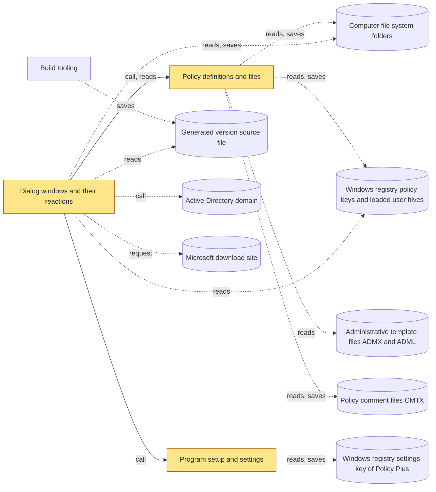
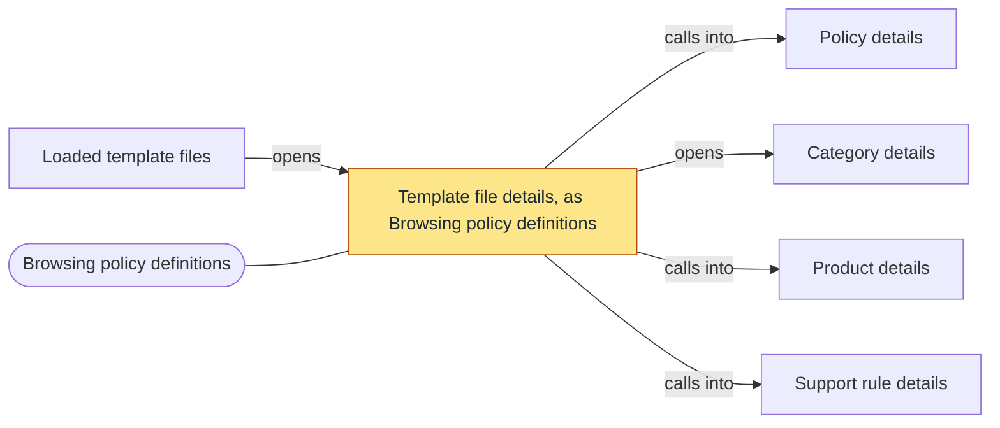
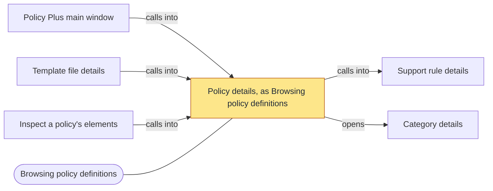
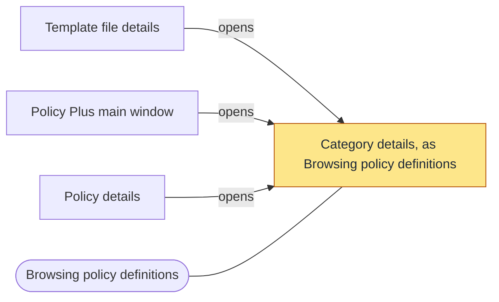

# Legacy reference: Show a category's parent and let people go up to it

The typed header below maps each criterion of the work item to the rules of the existing system it backs. The reading of the existing code follows it.

## Header

```json
{
  "story": "story-688c435b4f7f",
  "fingerprint": "280637421a2d33856d0f4655b9cf3df29c3a1ebf99ebbb84e7839ee4506bf978",
  "criteria": [
    {
      "ac": "AC-1",
      "rules": [
        {
          "says": "The detail window of a category shows its parent's name and enables the parent button when the parent exists; when the parent is named but missing it shows \"<orphaned from <parent>>\" and the button is disabled; a top-level category shows nothing.",
          "where": {
            "file": "PolicyPlus/DetailCategory.vb",
            "firstLine": 14,
            "lastLine": 21
          },
          "doubt": ""
        }
      ]
    },
    {
      "ac": "AC-2",
      "rules": [
        {
          "says": "The detail window of a category shows its parent's name and enables the parent button when the parent exists; when the parent is named but missing it shows \"<orphaned from <parent>>\" and the button is disabled; a top-level category shows nothing.",
          "where": {
            "file": "PolicyPlus/DetailCategory.vb",
            "firstLine": 14,
            "lastLine": 21
          },
          "doubt": ""
        }
      ]
    },
    {
      "ac": "AC-3",
      "rules": [
        {
          "says": "The detail window of a category shows its parent's name and enables the parent button when the parent exists; when the parent is named but missing it shows \"<orphaned from <parent>>\" and the button is disabled; a top-level category shows nothing.",
          "where": {
            "file": "PolicyPlus/DetailCategory.vb",
            "firstLine": 14,
            "lastLine": 21
          },
          "doubt": ""
        }
      ]
    },
    {
      "ac": "AC-4",
      "rules": [
        {
          "says": "The detail window of a category shows its parent's name and enables the parent button when the parent exists; when the parent is named but missing it shows \"<orphaned from <parent>>\" and the button is disabled; a top-level category shows nothing.",
          "where": {
            "file": "PolicyPlus/DetailCategory.vb",
            "firstLine": 14,
            "lastLine": 21
          },
          "doubt": ""
        }
      ]
    },
    {
      "ac": "AC-5",
      "rules": [
        {
          "says": "The detail window of a category shows its parent's name and enables the parent button when the parent exists; when the parent is named but missing it shows \"<orphaned from <parent>>\" and the button is disabled; a top-level category shows nothing.",
          "where": {
            "file": "PolicyPlus/DetailCategory.vb",
            "firstLine": 14,
            "lastLine": 21
          },
          "doubt": ""
        }
      ]
    },
    {
      "ac": "AC-6",
      "rules": [
        {
          "says": "The detail window of a category shows its parent's name and enables the parent button when the parent exists; when the parent is named but missing it shows \"<orphaned from <parent>>\" and the button is disabled; a top-level category shows nothing.",
          "where": {
            "file": "PolicyPlus/DetailCategory.vb",
            "firstLine": 14,
            "lastLine": 21
          },
          "doubt": ""
        }
      ]
    }
  ],
  "reliesOn": [],
  "data": [
    {
      "kind": "Program preference",
      "access": "reads and saves"
    },
    {
      "kind": "Administrative template",
      "access": "reads"
    },
    {
      "kind": "Policy setting",
      "access": "reads"
    }
  ],
  "transitions": [],
  "outsideSystems": [
    "Windows registry settings key of Policy Plus",
    "Active Directory domain",
    "Administrative template files (ADMX and ADML)",
    "Computer file system folders",
    "Microsoft download site",
    "Windows registry policy keys and loaded user hives"
  ],
  "steps": [
    {
      "intent": "Open a category and see where it sits in the whole tree.",
      "change": "inferred",
      "reason": "The chain is worked out for the person instead of climbing one level at a time."
    },
    {
      "intent": "Jump to any parent in the chain.",
      "change": "merged",
      "reason": "One step reaches any level."
    }
  ],
  "components": [
    {
      "name": "Category details presenter",
      "module": "category-details-presenter",
      "layer": "packages/ui"
    }
  ],
  "cited": [
    {
      "file": "PolicyPlus/DetailAdmx.vb",
      "firstLine": 24,
      "lastLine": 26
    },
    {
      "file": "PolicyPlus/DetailPolicy.vb",
      "firstLine": 40,
      "lastLine": 42
    },
    {
      "file": "PolicyPlus/DetailCategory.vb",
      "firstLine": 23,
      "lastLine": 25
    },
    {
      "file": "PolicyPlus/DetailCategory.vb",
      "firstLine": 14,
      "lastLine": 21
    }
  ]
}
```

## What each criterion must keep

### AC-1

- The detail window of a category shows its parent's name and enables the parent button when the parent exists; when the parent is named but missing it shows "<orphaned from <parent>>" and the button is disabled; a top-level category shows nothing. (PolicyPlus/DetailCategory.vb:14-21)

### AC-2

- The detail window of a category shows its parent's name and enables the parent button when the parent exists; when the parent is named but missing it shows "<orphaned from <parent>>" and the button is disabled; a top-level category shows nothing. (PolicyPlus/DetailCategory.vb:14-21)

### AC-3

- The detail window of a category shows its parent's name and enables the parent button when the parent exists; when the parent is named but missing it shows "<orphaned from <parent>>" and the button is disabled; a top-level category shows nothing. (PolicyPlus/DetailCategory.vb:14-21)

### AC-4

- The detail window of a category shows its parent's name and enables the parent button when the parent exists; when the parent is named but missing it shows "<orphaned from <parent>>" and the button is disabled; a top-level category shows nothing. (PolicyPlus/DetailCategory.vb:14-21)

### AC-5

- The detail window of a category shows its parent's name and enables the parent button when the parent exists; when the parent is named but missing it shows "<orphaned from <parent>>" and the button is disabled; a top-level category shows nothing. (PolicyPlus/DetailCategory.vb:14-21)

### AC-6

- The detail window of a category shows its parent's name and enables the parent button when the parent exists; when the parent is named but missing it shows "<orphaned from <parent>>" and the button is disabled; a top-level category shows nothing. (PolicyPlus/DetailCategory.vb:14-21)

## Reading of the existing code

# Screen: Template file details, as Browsing policy definitions

At a glance: 0 owned rules, 0 relied on, 4 actions, 6 files (1 own, 0 relied on, 5 of neighbour screens, 0 generated), 0 disputed.

How to read it: paths are relative to the source root and `file:a-b` is an inclusive line range. `BR-` rules, `ACT-` actions, `TR-` changes of state and `RK-` risks have stable ids. A record marked disputed was challenged in review and kept; the reviewer's words are under Trust. All of it was read from the code; nothing was run.

## Product context
Policy Plus is a Windows desktop editor for Group Policy settings, used by administrators and power users. It reads Microsoft's policy definition files and edits policy files directly, so it works on any Windows edition, including Home, which lacks the built-in editor.
Built with: .NET Framework v4.5.2, Microsoft Windows, System.DirectoryServices, System.Xml, Visual Basic .NET, Windows Forms (Policy Plus desktop editor).
Runs: It runs on the user's own Windows computer as one desktop program on .NET Framework 4.5.2. It asks for elevated rights when available but starts without them; loading registry hives, refreshing policy and editing local Group Policy files need them. It can also reach the domain's shared policy folder.
Reaches outside itself: Computer file system folders; Windows registry policy keys and loaded user hives; Administrative template files (ADMX and ADML); Windows registry settings key of Policy Plus; Generated version source file; Policy comment files (CMTX); Active Directory domain; Microsoft download site.



## Where this sits
Part of: Browsing policy definitions (Reading policy definitions).



## Boundary
- Opened by **Loaded template files** (bundle: screen loaded-template-files), at `PolicyPlus/LoadedAdmx.vb:16-18`
- Calls into **Policy details** (bundle: screen policy-details), at `PolicyPlus/DetailAdmx.vb:21-23`
- Opens **Category details** (bundle: screen category-details), at `PolicyPlus/DetailAdmx.vb:24-26`
- Calls into **Product details** (bundle: screen product-details), at `PolicyPlus/DetailAdmx.vb:27-29`
- Calls into **Support rule details** (bundle: screen support-rule-details), at `PolicyPlus/DetailAdmx.vb:30-32`

## Contract: what it must do
### Template file details
See one template file: its path and namespace, and the policies, categories, products and support rules it defines.
Controls (24): Button, caption "Close", TabIndex = 14, DialogResult = OK: ButtonClose; ColumnHeader, caption "Local ID", Width = 73: ChCategoryId, ChPolicyId, ChProductId, ChSupportId; ColumnHeader, caption "Name", Width = 166: ChCategoryName, ChName, ChProductName, ChSupportName; Form: DetailAdmx; Label, caption "Categories", TabIndex = 9: Label5; Label, caption "Namespace", TabIndex = 3: Label2; Label, caption "Path", TabIndex = 1: Label1; Label, caption "Policies", TabIndex = 7: Label4; Label, caption "Products", TabIndex = 11: Label6; Label, caption "Superseded ADM", TabIndex = 5: Label3; Label, caption "Support rules", TabIndex = 13: Label7; ListView, TabIndex = 10: LsvProducts; ListView, TabIndex = 12: LsvSupportDefinitions; ListView, TabIndex = 6: LsvPolicies; ListView, TabIndex = 8: LsvCategories; TextBox, ReadOnly = True, TabIndex = 0: TextPath; TextBox, ReadOnly = True, TabIndex = 2: TextNamespace; TextBox, ReadOnly = True, TabIndex = 4: TextSupersededAdm

Actions
- **ACT-53225370** Opens the detail window of the policy double-clicked in the policy list. — `PolicyPlus/DetailAdmx.vb:21-23`; started by person
- **ACT-28383962** Opens the detail window of the category double-clicked in the category list. — `PolicyPlus/DetailAdmx.vb:24-26`; started by person
- **ACT-66951547** Opens the detail window of the product double-clicked in the product list. — `PolicyPlus/DetailAdmx.vb:27-29`; started by person
- **ACT-49541466** Opens the detail window of the support rule double-clicked in the support-rule list. — `PolicyPlus/DetailAdmx.vb:30-32`; started by person


## Trust: what to doubt
**Risks**
- **RK-55878738** [low] Several windows raise an unhandled error on ordinary input: double-clicking with no row selected, right-clicking with no category, an unnamed list entry, an unreadable import file, a malformed search wildcard, a removed product in a filter, or an inspector item with no match. No program-wide handler is set, so the framework's default error dialog appears. (Failures are hidden, lost or not retried) — at `PolicyPlus/DetailAdmx.vb:21-32`

**Assumed, not confirmed**
- When the person's language has no exact language folder, the folder picked among those of the same primary language is the first one the operating system lists; which that is, is not stated in code. Why unsettled: The folder listing order is left to the file system, and the template folders present are out of scope. If wrong: A person could see a different regional variant of the policy text than expected when several variants are installed.


## Read order
| Tier | File | Lines | Why |
| --- | --- | --- | --- |
| own | `PolicyPlus/DetailAdmx.vb` | whole file | starts 4 actions |
| neighbour screen | `PolicyPlus/DetailCategory.vb` | 3-6 | opened from this screen: Category details |
| neighbour screen | `PolicyPlus/DetailPolicy.vb` | 3-36 | called from this screen: Policy details |
| neighbour screen | `PolicyPlus/DetailProduct.vb` | 3-6 | called from this screen: Product details |
| neighbour screen | `PolicyPlus/DetailSupport.vb` | 2-5 | called from this screen: Support rule details |
| neighbour screen | `PolicyPlus/LoadedAdmx.vb` | 16-18 | opens this screen: Loaded template files |

## Source

### PolicyPlus/DetailAdmx.vb
```
1: Public Class DetailAdmx
2:     Public Sub PresentDialog(Admx As AdmxFile, Workspace As AdmxBundle)
3:         TextPath.Text = Admx.SourceFile
4:         TextNamespace.Text = Admx.AdmxNamespace
5:         TextSupersededAdm.Text = Admx.SupersededAdm
6:         Dim fillListview = Sub(Control As ListView, Collection As IEnumerable, IdSelector As Func(Of Object, String), NameSelector As Func(Of Object, String))
7:                                Control.Items.Clear()
8:                                For Each item In Collection
9:                                    Dim lsvi = Control.Items.Add(IdSelector(item))
10:                                    lsvi.Tag = item
11:                                    lsvi.SubItems.Add(NameSelector(item))
12:                                Next
13:                                Control.Columns(1).Width = Control.ClientRectangle.Width - Control.Columns(0).Width - SystemInformation.VerticalScrollBarWidth
14:                            End Sub
15:         fillListview(LsvPolicies, Workspace.Policies.Values.Where(Function(p) p.RawPolicy.DefinedIn Is Admx), Function(p As PolicyPlusPolicy) p.RawPolicy.ID, Function(p As PolicyPlusPolicy) p.DisplayName)
16:         fillListview(LsvCategories, Workspace.FlatCategories.Values.Where(Function(c) c.RawCategory.DefinedIn Is Admx), Function(c As PolicyPlusCategory) c.RawCategory.ID, Function(c As PolicyPlusCategory) c.DisplayName)
17:         fillListview(LsvProducts, Workspace.FlatProducts.Values.Where(Function(p) p.RawProduct.DefinedIn Is Admx), Function(p As PolicyPlusProduct) p.RawProduct.ID, Function(p As PolicyPlusProduct) p.DisplayName)
18:         fillListview(LsvSupportDefinitions, Workspace.SupportDefinitions.Values.Where(Function(s) s.RawSupport.DefinedIn Is Admx), Function(s As PolicyPlusSupport) s.RawSupport.ID, Function(s As PolicyPlusSupport) s.DisplayName)
19:         ShowDialog()
20:     End Sub
21:     Private Sub LsvPolicies_DoubleClick(sender As Object, e As EventArgs) Handles LsvPolicies.DoubleClick
22:         DetailPolicy.PresentDialog(LsvPolicies.SelectedItems(0).Tag)
23:     End Sub
24:     Private Sub LsvCategories_DoubleClick(sender As Object, e As EventArgs) Handles LsvCategories.DoubleClick
25:         DetailCategory.PresentDialog(LsvCategories.SelectedItems(0).Tag)
26:     End Sub
27:     Private Sub LsvProducts_DoubleClick(sender As Object, e As EventArgs) Handles LsvProducts.DoubleClick
28:         DetailProduct.PresentDialog(LsvProducts.SelectedItems(0).Tag)
29:     End Sub
30:     Private Sub LsvSupportDefinitions_DoubleClick(sender As Object, e As EventArgs) Handles LsvSupportDefinitions.DoubleClick
31:         DetailSupport.PresentDialog(LsvSupportDefinitions.SelectedItems(0).Tag)
32:     End Sub
33: End Class
```

### PolicyPlus/DetailCategory.vb
```
3:     Public Sub PresentDialog(Category As PolicyPlusCategory)
4:         PrepareDialog(Category)
5:         ShowDialog()
6:     End Sub
```

### PolicyPlus/DetailPolicy.vb
```
3:     Public Sub PresentDialog(Policy As PolicyPlusPolicy)
4:         SelectedPolicy = Policy
5:         NameTextbox.Text = Policy.DisplayName
6:         IdTextbox.Text = Policy.UniqueID
7:         DefinedTextbox.Text = Policy.RawPolicy.DefinedIn.SourceFile
8:         DisplayCodeTextbox.Text = Policy.RawPolicy.DisplayCode
9:         InfoCodeTextbox.Text = Policy.RawPolicy.ExplainCode
10:         PresentCodeTextbox.Text = Policy.RawPolicy.PresentationID
11:         Select Case Policy.RawPolicy.Section
12:             Case AdmxPolicySection.Both
13:                 SectionTextbox.Text = "User or computer"
14:             Case AdmxPolicySection.Machine
15:                 SectionTextbox.Text = "Computer"
16:             Case AdmxPolicySection.User
17:                 SectionTextbox.Text = "User"
18:         End Select
19:         SupportButton.Enabled = Policy.SupportedOn IsNot Nothing
20:         If Policy.SupportedOn IsNot Nothing Then
21:             SupportTextbox.Text = Policy.SupportedOn.DisplayName
22:         ElseIf Policy.RawPolicy.SupportedCode <> "" Then
23:             SupportTextbox.Text = "<missing: " & Policy.RawPolicy.SupportedCode & ">"
24:         Else
25:             SupportTextbox.Text = ""
26:         End If
27:         CategoryButton.Enabled = Policy.Category IsNot Nothing
28:         If Policy.Category IsNot Nothing Then
29:             CategoryTextbox.Text = Policy.Category.DisplayName
30:         ElseIf Policy.RawPolicy.CategoryID <> "" Then
31:             CategoryTextbox.Text = "<orphaned from " & Policy.RawPolicy.CategoryID & ">"
32:         Else
33:             CategoryTextbox.Text = "<uncategorized>"
34:         End If
35:         ShowDialog()
36:     End Sub
```

### PolicyPlus/DetailProduct.vb
```
3:     Public Sub PresentDialog(Product As PolicyPlusProduct)
4:         PrepareDialog(Product)
5:         ShowDialog()
6:     End Sub
```

### PolicyPlus/DetailSupport.vb
```
2:     Public Sub PresentDialog(Supported As PolicyPlusSupport)
3:         PrepareDialog(Supported)
4:         ShowDialog()
5:     End Sub
```

### PolicyPlus/LoadedAdmx.vb
```
16:     Private Sub LsvAdmx_DoubleClick(sender As Object, e As EventArgs) Handles LsvAdmx.DoubleClick
17:         DetailAdmx.PresentDialog(LsvAdmx.SelectedItems(0).Tag, Bundle)
18:     End Sub
```


---

# Screen: Policy details, as Browsing policy definitions

At a glance: 0 owned rules, 0 relied on, 2 actions, 6 files (1 own, 0 relied on, 5 of neighbour screens, 0 generated), 0 disputed.

How to read it: paths are relative to the source root and `file:a-b` is an inclusive line range. `BR-` rules, `ACT-` actions, `TR-` changes of state and `RK-` risks have stable ids. A record marked disputed was challenged in review and kept; the reviewer's words are under Trust. All of it was read from the code; nothing was run.

## Product context
Policy Plus is a Windows desktop editor for Group Policy settings, used by administrators and power users. It reads Microsoft's policy definition files and edits policy files directly, so it works on any Windows edition, including Home, which lacks the built-in editor.
Built with: .NET Framework v4.5.2, Microsoft Windows, System.DirectoryServices, System.Xml, Visual Basic .NET, Windows Forms (Policy Plus desktop editor).
Runs: It runs on the user's own Windows computer as one desktop program on .NET Framework 4.5.2. It asks for elevated rights when available but starts without them; loading registry hives, refreshing policy and editing local Group Policy files need them. It can also reach the domain's shared policy folder.
Reaches outside itself: Computer file system folders; Windows registry policy keys and loaded user hives; Administrative template files (ADMX and ADML); Windows registry settings key of Policy Plus; Generated version source file; Policy comment files (CMTX); Active Directory domain; Microsoft download site.


## Where this sits
Part of: Browsing policy definitions (Reading policy definitions).



## Boundary
- Called from **Policy Plus main window** (bundle: screen policy-plus-main-window), at `PolicyPlus/Main.vb:839-858`
- Called from **Template file details** (bundle: screen template-file-details), at `PolicyPlus/DetailAdmx.vb:21-23`
- Called from **Inspect a policy's elements** (bundle: screen inspect-a-policy-s-elements), at `PolicyPlus/InspectPolicyElements.vb:192-194`
- Calls into **Support rule details** (bundle: screen support-rule-details), at `PolicyPlus/DetailPolicy.vb:37-39`
- Opens **Category details** (bundle: screen category-details), at `PolicyPlus/DetailPolicy.vb:40-42`

## Contract: what it must do
### Policy details
See what a policy is, where it sits and what it is supported on.
Controls (21): Friend WithEvents CategoryButton As Button: CategoryButton; Friend WithEvents CategoryTextbox As TextBox: CategoryTextbox; Friend WithEvents CloseButton As Button: CloseButton; Friend WithEvents DefinedTextbox As TextBox: DefinedTextbox; Friend WithEvents DisplayCodeTextbox As TextBox: DisplayCodeTextbox; Friend WithEvents IdTextbox As TextBox: IdTextbox; Friend WithEvents InfoCodeTextbox As TextBox: InfoCodeTextbox; Friend WithEvents NameTextbox As TextBox: NameTextbox; Friend WithEvents PresentCodeTextbox As TextBox: PresentCodeTextbox; Friend WithEvents SectionTextbox As TextBox: SectionTextbox; Friend WithEvents SupportButton As Button: SupportButton; Friend WithEvents SupportTextbox As TextBox: SupportTextbox; Label: CategoryLabel, DefinedLabel, DisplayLabel, IdLabel, InfoLabel, NameLabel, PresentLabel, SectionLabel, SupportLabel

Actions
- **ACT-10373837** Opens the details window for the support definition the policy is supported on. — `PolicyPlus/DetailPolicy.vb:37-39`; started by person
- **ACT-44669029** Opens the details window for the category the policy sits in. — `PolicyPlus/DetailPolicy.vb:40-42`; started by person


## Trust: what to doubt
**Assumed, not confirmed**
- When the person's language has no exact language folder, the folder picked among those of the same primary language is the first one the operating system lists; which that is, is not stated in code. Why unsettled: The folder listing order is left to the file system, and the template folders present are out of scope. If wrong: A person could see a different regional variant of the policy text than expected when several variants are installed.


## Read order
| Tier | File | Lines | Why |
| --- | --- | --- | --- |
| own | `PolicyPlus/DetailPolicy.vb` | whole file | starts 2 actions |
| neighbour screen | `PolicyPlus/DetailAdmx.vb` | 21-23 | calls into this screen: Template file details |
| neighbour screen | `PolicyPlus/DetailCategory.vb` | 3-6 | opened from this screen: Category details |
| neighbour screen | `PolicyPlus/DetailSupport.vb` | 2-5 | called from this screen: Support rule details |
| neighbour screen | `PolicyPlus/InspectPolicyElements.vb` | 192-194 | calls into this screen: Inspect a policy's elements |
| neighbour screen | `PolicyPlus/Main.vb` | 839-858 | calls into this screen: Policy Plus main window |

## Source

### PolicyPlus/DetailPolicy.vb
```
1: Public Class DetailPolicy
2:     Dim SelectedPolicy As PolicyPlusPolicy
3:     Public Sub PresentDialog(Policy As PolicyPlusPolicy)
4:         SelectedPolicy = Policy
5:         NameTextbox.Text = Policy.DisplayName
6:         IdTextbox.Text = Policy.UniqueID
7:         DefinedTextbox.Text = Policy.RawPolicy.DefinedIn.SourceFile
8:         DisplayCodeTextbox.Text = Policy.RawPolicy.DisplayCode
9:         InfoCodeTextbox.Text = Policy.RawPolicy.ExplainCode
10:         PresentCodeTextbox.Text = Policy.RawPolicy.PresentationID
11:         Select Case Policy.RawPolicy.Section
12:             Case AdmxPolicySection.Both
13:                 SectionTextbox.Text = "User or computer"
14:             Case AdmxPolicySection.Machine
15:                 SectionTextbox.Text = "Computer"
16:             Case AdmxPolicySection.User
17:                 SectionTextbox.Text = "User"
18:         End Select
19:         SupportButton.Enabled = Policy.SupportedOn IsNot Nothing
20:         If Policy.SupportedOn IsNot Nothing Then
21:             SupportTextbox.Text = Policy.SupportedOn.DisplayName
22:         ElseIf Policy.RawPolicy.SupportedCode <> "" Then
23:             SupportTextbox.Text = "<missing: " & Policy.RawPolicy.SupportedCode & ">"
24:         Else
25:             SupportTextbox.Text = ""
26:         End If
27:         CategoryButton.Enabled = Policy.Category IsNot Nothing
28:         If Policy.Category IsNot Nothing Then
29:             CategoryTextbox.Text = Policy.Category.DisplayName
30:         ElseIf Policy.RawPolicy.CategoryID <> "" Then
31:             CategoryTextbox.Text = "<orphaned from " & Policy.RawPolicy.CategoryID & ">"
32:         Else
33:             CategoryTextbox.Text = "<uncategorized>"
34:         End If
35:         ShowDialog()
36:     End Sub
37:     Private Sub SupportButton_Click(sender As Object, e As EventArgs) Handles SupportButton.Click
38:         DetailSupport.PresentDialog(SelectedPolicy.SupportedOn)
39:     End Sub
40:     Private Sub CategoryButton_Click(sender As Object, e As EventArgs) Handles CategoryButton.Click
41:         DetailCategory.PresentDialog(SelectedPolicy.Category)
42:     End Sub
43: End Class
```

### PolicyPlus/DetailAdmx.vb
```
21:     Private Sub LsvPolicies_DoubleClick(sender As Object, e As EventArgs) Handles LsvPolicies.DoubleClick
22:         DetailPolicy.PresentDialog(LsvPolicies.SelectedItems(0).Tag)
23:     End Sub
```

### PolicyPlus/DetailCategory.vb
```
3:     Public Sub PresentDialog(Category As PolicyPlusCategory)
4:         PrepareDialog(Category)
5:         ShowDialog()
6:     End Sub
```

### PolicyPlus/DetailSupport.vb
```
2:     Public Sub PresentDialog(Supported As PolicyPlusSupport)
3:         PrepareDialog(Supported)
4:         ShowDialog()
5:     End Sub
```

### PolicyPlus/InspectPolicyElements.vb
```
192:     Private Sub PolicyDetailsButton_Click(sender As Object, e As EventArgs) Handles PolicyDetailsButton.Click
193:         DetailPolicy.PresentDialog(SelectedPolicy)
194:     End Sub
```

### PolicyPlus/Main.vb
```
839:     Private Sub PolicyObjectContext_ItemClicked(sender As Object, e As ToolStripItemClickedEventArgs) Handles PolicyObjectContext.ItemClicked
840:         ' When the user clicks an item in the right-click menu
841:         Dim polObject = PolicyObjectContext.Tag ' The current policy object is in the Tag field
842:         If e.ClickedItem Is CmeCatOpen Then
843:             CurrentCategory = polObject
844:             UpdateCategoryListing()
845:         ElseIf e.ClickedItem Is CmePolEdit Then
846:             ShowSettingEditor(polObject, ViewPolicyTypes)
847:         ElseIf e.ClickedItem Is CmeAllDetails Then
848:             If TypeOf polObject Is PolicyPlusCategory Then
849:                 DetailCategory.PresentDialog(polObject)
850:             Else
851:                 DetailPolicy.PresentDialog(polObject)
852:             End If
853:         ElseIf e.ClickedItem Is CmePolInspectElements Then
854:             InspectPolicyElements.PresentDialog(polObject, PolicyIcons, AdmxWorkspace)
855:         ElseIf e.ClickedItem Is CmePolSpolFragment Then
856:             InspectSpolFragment.PresentDialog(polObject, AdmxWorkspace, CompPolicySource, UserPolicySource, CompComments, UserComments)
857:         End If
858:     End Sub
```


---

# Screen: Category details, as Browsing policy definitions

At a glance: 1 owned rule, 0 relied on, 1 action, 4 files (1 own, 0 relied on, 3 of neighbour screens, 0 generated), 0 disputed.

How to read it: paths are relative to the source root and `file:a-b` is an inclusive line range. `BR-` rules, `ACT-` actions, `TR-` changes of state and `RK-` risks have stable ids. A record marked disputed was challenged in review and kept; the reviewer's words are under Trust. All of it was read from the code; nothing was run.

## Product context
Policy Plus is a Windows desktop editor for Group Policy settings, used by administrators and power users. It reads Microsoft's policy definition files and edits policy files directly, so it works on any Windows edition, including Home, which lacks the built-in editor.
Built with: .NET Framework v4.5.2, Microsoft Windows, System.DirectoryServices, System.Xml, Visual Basic .NET, Windows Forms (Policy Plus desktop editor).
Runs: It runs on the user's own Windows computer as one desktop program on .NET Framework 4.5.2. It asks for elevated rights when available but starts without them; loading registry hives, refreshing policy and editing local Group Policy files need them. It can also reach the domain's shared policy folder.
Reaches outside itself: Computer file system folders; Windows registry policy keys and loaded user hives; Administrative template files (ADMX and ADML); Windows registry settings key of Policy Plus; Generated version source file; Policy comment files (CMTX); Active Directory domain; Microsoft download site.


## Where this sits
Part of: Browsing policy definitions (Reading policy definitions).



## Boundary
- Opened by **Template file details** (bundle: screen template-file-details), at `PolicyPlus/DetailAdmx.vb:24-26`
- Opened by **Policy Plus main window** (bundle: screen policy-plus-main-window), at `PolicyPlus/Main.vb:839-858`
- Opened by **Policy details** (bundle: screen policy-details), at `PolicyPlus/DetailPolicy.vb:40-42`

## Contract: what it must do
### Category details
See the details of a category and move to its parent.
Controls (15): Button, caption "Close", TabIndex = 13, DialogResult = OK: CloseButton; Button, caption "Details", TabIndex = 6: ParentButton; Form: DetailCategory; Label, caption "Defined in", TabIndex = 9: DefinedLabel; Label, caption "Display code", TabIndex = 10: DisplayCode; Label, caption "Info code", TabIndex = 11: InfoCodeLabel; Label, caption "Name", TabIndex = 7: NameLabel; Label, caption "Parent", TabIndex = 12: ParentLabel; Label, caption "Unique ID", TabIndex = 8: IdLabel; TextBox, ReadOnly = True, TabIndex = 0: NameTextbox; TextBox, ReadOnly = True, TabIndex = 1: IdTextbox; TextBox, ReadOnly = True, TabIndex = 2: DefinedTextbox; TextBox, ReadOnly = True, TabIndex = 3: DisplayCodeTextbox; TextBox, ReadOnly = True, TabIndex = 4: InfoCodeTextbox; TextBox, ReadOnly = True, TabIndex = 5: ParentTextbox

Actions
- **ACT-57045530** Shows the details of the parent category in the same window. — `PolicyPlus/DetailCategory.vb:23-25`; started by person

Rules
- **BR-31267612** The detail window of a category shows its parent's name and enables the parent button when the parent exists; when the parent is named but missing it shows "<orphaned from <parent>>" and the button is disabled; a top-level category shows nothing. — `PolicyPlus/DetailCategory.vb:14-21`


## Trust: what to doubt
**Assumed, not confirmed**
- When the person's language has no exact language folder, the folder picked among those of the same primary language is the first one the operating system lists; which that is, is not stated in code. Why unsettled: The folder listing order is left to the file system, and the template folders present are out of scope. If wrong: A person could see a different regional variant of the policy text than expected when several variants are installed.


## Read order
| Tier | File | Lines | Why |
| --- | --- | --- | --- |
| own | `PolicyPlus/DetailCategory.vb` | whole file | starts 1 action; decides 1 owned rule |
| neighbour screen | `PolicyPlus/DetailAdmx.vb` | 24-26 | opens this screen: Template file details |
| neighbour screen | `PolicyPlus/DetailPolicy.vb` | 40-42 | opens this screen: Policy details |
| neighbour screen | `PolicyPlus/Main.vb` | 839-858 | opens this screen: Policy Plus main window |

## Source

### PolicyPlus/DetailCategory.vb
```
1: Public Class DetailCategory
2:     Dim SelectedCategory As PolicyPlusCategory
3:     Public Sub PresentDialog(Category As PolicyPlusCategory)
4:         PrepareDialog(Category)
5:         ShowDialog()
6:     End Sub
7:     Private Sub PrepareDialog(Category As PolicyPlusCategory)
8:         SelectedCategory = Category
9:         NameTextbox.Text = Category.DisplayName
10:         IdTextbox.Text = Category.UniqueID
11:         DefinedTextbox.Text = Category.RawCategory.DefinedIn.SourceFile
12:         DisplayCodeTextbox.Text = Category.RawCategory.DisplayCode
13:         InfoCodeTextbox.Text = Category.RawCategory.ExplainCode
14:         ParentButton.Enabled = Category.Parent IsNot Nothing
15:         If Category.Parent IsNot Nothing Then
16:             ParentTextbox.Text = Category.Parent.DisplayName
17:         ElseIf Category.RawCategory.ParentID <> "" Then
18:             ParentTextbox.Text = "<orphaned from " & Category.RawCategory.ParentID & ">"
19:         Else
20:             ParentTextbox.Text = ""
21:         End If
22:     End Sub
23:     Private Sub ParentButton_Click(sender As Object, e As EventArgs) Handles ParentButton.Click
24:         PrepareDialog(SelectedCategory.Parent)
25:     End Sub
26: End Class
```

### PolicyPlus/DetailAdmx.vb
```
24:     Private Sub LsvCategories_DoubleClick(sender As Object, e As EventArgs) Handles LsvCategories.DoubleClick
25:         DetailCategory.PresentDialog(LsvCategories.SelectedItems(0).Tag)
26:     End Sub
```

### PolicyPlus/DetailPolicy.vb
```
40:     Private Sub CategoryButton_Click(sender As Object, e As EventArgs) Handles CategoryButton.Click
41:         DetailCategory.PresentDialog(SelectedPolicy.Category)
42:     End Sub
```

### PolicyPlus/Main.vb
```
839:     Private Sub PolicyObjectContext_ItemClicked(sender As Object, e As ToolStripItemClickedEventArgs) Handles PolicyObjectContext.ItemClicked
840:         ' When the user clicks an item in the right-click menu
841:         Dim polObject = PolicyObjectContext.Tag ' The current policy object is in the Tag field
842:         If e.ClickedItem Is CmeCatOpen Then
843:             CurrentCategory = polObject
844:             UpdateCategoryListing()
845:         ElseIf e.ClickedItem Is CmePolEdit Then
846:             ShowSettingEditor(polObject, ViewPolicyTypes)
847:         ElseIf e.ClickedItem Is CmeAllDetails Then
848:             If TypeOf polObject Is PolicyPlusCategory Then
849:                 DetailCategory.PresentDialog(polObject)
850:             Else
851:                 DetailPolicy.PresentDialog(polObject)
852:             End If
853:         ElseIf e.ClickedItem Is CmePolInspectElements Then
854:             InspectPolicyElements.PresentDialog(polObject, PolicyIcons, AdmxWorkspace)
855:         ElseIf e.ClickedItem Is CmePolSpolFragment Then
856:             InspectSpolFragment.PresentDialog(polObject, AdmxWorkspace, CompPolicySource, UserPolicySource, CompComments, UserComments)
857:         End If
858:     End Sub
```

