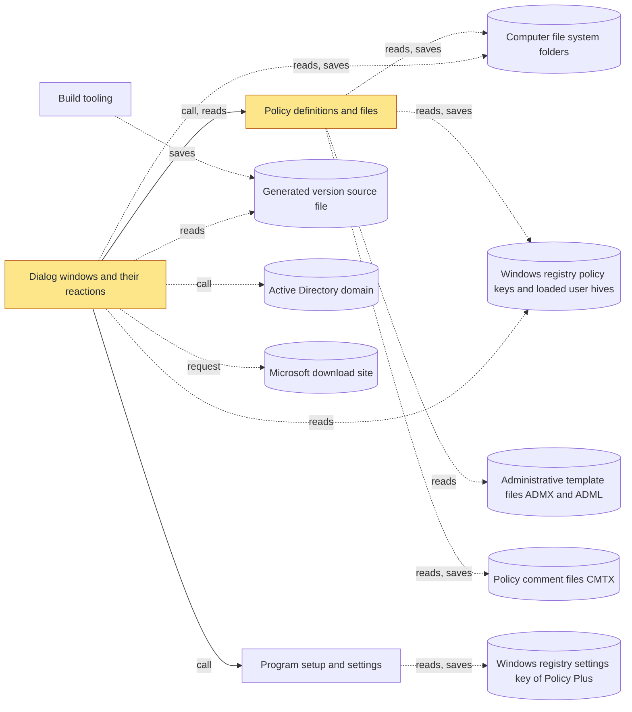
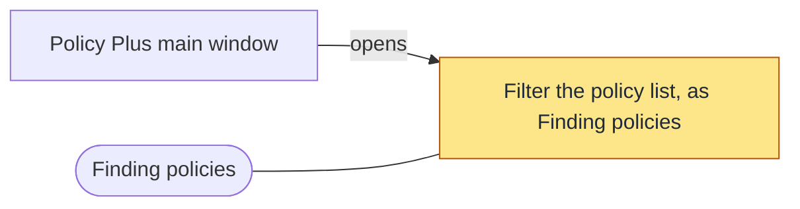

# Legacy reference: Open, reset or cancel the filter dialog

The typed header below maps each criterion of the work item to the rules of the existing system it backs. The reading of the existing code follows it.

## Header

```json
{
  "story": "story-694a7645d7c7",
  "fingerprint": "280637421a2d33856d0f4655b9cf3df29c3a1ebf99ebbb84e7839ee4506bf978",
  "criteria": [
    {
      "ac": "AC-1",
      "rules": [
        {
          "says": "When the filter dialog opens, the Policy type choice shows Any if the current filter has no policy-type condition, Policy if it keeps only managed policies, and Preference if it keeps only the others.",
          "where": {
            "file": "PolicyPlus/FilterOptions.vb",
            "firstLine": 23,
            "lastLine": 27
          },
          "doubt": ""
        }
      ]
    },
    {
      "ac": "AC-2",
      "rules": [
        {
          "says": "When the filter dialog opens, the Current state choice shows Any if the current filter has no state condition, otherwise Not Configured, Configured, Enabled or Disabled as the filter holds.",
          "where": {
            "file": "PolicyPlus/FilterOptions.vb",
            "firstLine": 28,
            "lastLine": 41
          },
          "doubt": ""
        }
      ]
    },
    {
      "ac": "AC-3",
      "rules": [
        {
          "says": "When the filter dialog opens, the Commented choice shows Any if the current filter has no comment condition, Yes if it keeps only commented policies and No if it keeps only uncommented ones.",
          "where": {
            "file": "PolicyPlus/FilterOptions.vb",
            "firstLine": 42,
            "lastLine": 46
          },
          "doubt": ""
        }
      ]
    },
    {
      "ac": "AC-4",
      "rules": [
        {
          "says": "When the current filter has a supported-on condition, the dialog opens with Supported on ticked, exactly the filter's products ticked and the two matching options set as the filter holds; product branches whose tick differs from their parent are opened.",
          "where": {
            "file": "PolicyPlus/FilterOptions.vb",
            "firstLine": 54,
            "lastLine": 74
          },
          "doubt": ""
        }
      ]
    },
    {
      "ac": "AC-5",
      "rules": [
        {
          "says": "When the current filter has no supported-on condition, the dialog opens with Supported on unticked, both \"Match a policy if at least one selected product is supported\" and \"Match policies with missing or blank support definitions\" ticked, and no product ticked.",
          "where": {
            "file": "PolicyPlus/FilterOptions.vb",
            "firstLine": 47,
            "lastLine": 53
          },
          "doubt": ""
        }
      ]
    },
    {
      "ac": "AC-6",
      "rules": [
        {
          "says": "Reset returns every choice to its default: Any for type, state and comment, Supported on unticked, both matching options ticked and no product ticked.",
          "where": {
            "file": "PolicyPlus/FilterOptions.vb",
            "firstLine": 82,
            "lastLine": 84
          },
          "doubt": ""
        }
      ]
    },
    {
      "ac": "AC-7",
      "rules": [
        {
          "says": "Pressing Escape closes the filter dialog as cancelled and the current filter is unchanged.",
          "where": {
            "file": "PolicyPlus/FilterOptions.vb",
            "firstLine": 79,
            "lastLine": 81
          },
          "doubt": ""
        }
      ]
    }
  ],
  "reliesOn": [],
  "data": [
    {
      "kind": "Policy setting",
      "access": "reads and saves"
    }
  ],
  "transitions": [],
  "outsideSystems": [
    "Computer file system folders",
    "Windows registry policy keys and loaded user hives"
  ],
  "cited": [
    {
      "file": "PolicyPlus/FilterOptions.vb",
      "firstLine": 82,
      "lastLine": 84
    },
    {
      "file": "PolicyPlus/FilterOptions.vb",
      "firstLine": 79,
      "lastLine": 81
    },
    {
      "file": "PolicyPlus/FilterOptions.vb",
      "firstLine": 23,
      "lastLine": 27
    },
    {
      "file": "PolicyPlus/FilterOptions.vb",
      "firstLine": 28,
      "lastLine": 41
    },
    {
      "file": "PolicyPlus/FilterOptions.vb",
      "firstLine": 42,
      "lastLine": 46
    },
    {
      "file": "PolicyPlus/FilterOptions.vb",
      "firstLine": 54,
      "lastLine": 74
    },
    {
      "file": "PolicyPlus/FilterOptions.vb",
      "firstLine": 47,
      "lastLine": 53
    },
    {
      "file": "PolicyPlus/FilterOptions.Designer.vb",
      "firstLine": 152,
      "lastLine": 152
    },
    {
      "file": "PolicyPlus/FilterOptions.Designer.vb",
      "firstLine": 164,
      "lastLine": 164
    },
    {
      "file": "PolicyPlus/FilterOptions.vb",
      "firstLine": 82,
      "lastLine": 84
    },
    {
      "file": "PolicyPlus/FilterOptions.vb",
      "firstLine": 21,
      "lastLine": 53
    },
    {
      "file": "PolicyPlus/FilterOptions.vb",
      "firstLine": 79,
      "lastLine": 81
    }
  ]
}
```

## What each criterion must keep

### AC-1

- When the filter dialog opens, the Policy type choice shows Any if the current filter has no policy-type condition, Policy if it keeps only managed policies, and Preference if it keeps only the others. (PolicyPlus/FilterOptions.vb:23-27)

### AC-2

- When the filter dialog opens, the Current state choice shows Any if the current filter has no state condition, otherwise Not Configured, Configured, Enabled or Disabled as the filter holds. (PolicyPlus/FilterOptions.vb:28-41)

### AC-3

- When the filter dialog opens, the Commented choice shows Any if the current filter has no comment condition, Yes if it keeps only commented policies and No if it keeps only uncommented ones. (PolicyPlus/FilterOptions.vb:42-46)

### AC-4

- When the current filter has a supported-on condition, the dialog opens with Supported on ticked, exactly the filter's products ticked and the two matching options set as the filter holds; product branches whose tick differs from their parent are opened. (PolicyPlus/FilterOptions.vb:54-74)

### AC-5

- When the current filter has no supported-on condition, the dialog opens with Supported on unticked, both "Match a policy if at least one selected product is supported" and "Match policies with missing or blank support definitions" ticked, and no product ticked. (PolicyPlus/FilterOptions.vb:47-53)

### AC-6

- Reset returns every choice to its default: Any for type, state and comment, Supported on unticked, both matching options ticked and no product ticked. (PolicyPlus/FilterOptions.vb:82-84)

### AC-7

- Pressing Escape closes the filter dialog as cancelled and the current filter is unchanged. (PolicyPlus/FilterOptions.vb:79-81)

## Reading of the existing code

# Screen: Filter the policy list, as Finding policies

At a glance: 13 owned rules, 0 relied on, 6 actions, 3 files (1 own, 0 relied on, 1 of neighbour screens, 1 generated), 0 disputed.

How to read it: paths are relative to the source root and `file:a-b` is an inclusive line range. `BR-` rules, `ACT-` actions, `TR-` changes of state and `RK-` risks have stable ids. A record marked disputed was challenged in review and kept; the reviewer's words are under Trust. All of it was read from the code; nothing was run.

## Product context
Policy Plus is a Windows desktop editor for Group Policy settings, used by administrators and power users. It reads Microsoft's policy definition files and edits policy files directly, so it works on any Windows edition, including Home, which lacks the built-in editor.
Built with: .NET Framework v4.5.2, Microsoft Windows, System.DirectoryServices, System.Xml, Visual Basic .NET, Windows Forms (Policy Plus desktop editor).
Runs: It runs on the user's own Windows computer as one desktop program on .NET Framework 4.5.2. It asks for elevated rights when available but starts without them; loading registry hives, refreshing policy and editing local Group Policy files need them. It can also reach the domain's shared policy folder.
Reaches outside itself: Computer file system folders; Windows registry policy keys and loaded user hives; Administrative template files (ADMX and ADML); Windows registry settings key of Policy Plus; Generated version source file; Policy comment files (CMTX); Active Directory domain; Microsoft download site.



## Where this sits
Part of: Finding policies (Reading policy definitions).



## Boundary
- Opened by **Policy Plus main window** (bundle: screen policy-plus-main-window), at `PolicyPlus/Main.vb:692-700`

## Contract: what it must do
### Filter the policy list
Narrow the policy list by state, comment, support and other conditions.
Controls (13): Button: OkButton, ResetButton; CheckBox: AlwaysMatchAnyCheckbox, MatchBlankSupportCheckbox, SupportedCheckbox; ComboBox: CommentedCombobox, PolicyStateCombobox, PolicyTypeCombobox; GroupBox: RequirementsBox; Label: CommentedLabel, PolicyStateLabel, PolicyTypeLabel; TreeView (DoubleClickIgnoringTreeView): AllowedProductsTreeview

Actions
- **ACT-07003543** Enables the product requirements box only while Supported on is ticked — `PolicyPlus/FilterOptions.vb:76-78`; started by person
- **ACT-39368079** Closes the dialog as cancelled when Escape is pressed — `PolicyPlus/FilterOptions.vb:79-81`; started by person
- **ACT-97597302** Sets the dialog back to a filter that matches everything — `PolicyPlus/FilterOptions.vb:82-84`; started by person
- **ACT-69656536** Builds the filter from the chosen options and closes the dialog accepted — `PolicyPlus/FilterOptions.vb:85-120`; started by person
- **ACT-97867529** Recolours the product tree so it looks right when disabled — `PolicyPlus/FilterOptions.vb:121-124`; started by person
- **ACT-39562170** Applies the new tick to all child products — `PolicyPlus/FilterOptions.vb:125-129`; started by person

Rules
- **BR-77875588** When the filter dialog opens, the Policy type choice shows Any if the current filter has no policy-type condition, Policy if it keeps only managed policies, and Preference if it keeps only the others. — `PolicyPlus/FilterOptions.vb:23-27`
- **BR-87578271** When the filter dialog opens, the Current state choice shows Any if the current filter has no state condition, otherwise Not Configured, Configured, Enabled or Disabled as the filter holds. — `PolicyPlus/FilterOptions.vb:28-41`
- **BR-78300947** When the filter dialog opens, the Commented choice shows Any if the current filter has no comment condition, Yes if it keeps only commented policies and No if it keeps only uncommented ones. — `PolicyPlus/FilterOptions.vb:42-46`
- **BR-85169671** When the current filter has no supported-on condition, the dialog opens with Supported on unticked, both "Match a policy if at least one selected product is supported" and "Match policies with missing or blank support definitions" ticked, and no product ticked. — `PolicyPlus/FilterOptions.vb:47-53`; also rests on `PolicyPlus/FilterOptions.Designer.vb:152`, `PolicyPlus/FilterOptions.Designer.vb:164`
- **BR-84730570** When the current filter has a supported-on condition, the dialog opens with Supported on ticked, exactly the filter's products ticked and the two matching options set as the filter holds; product branches whose tick differs from their parent are opened. — `PolicyPlus/FilterOptions.vb:54-74`
- **BR-19489759** The product requirement box (the product tree and the two matching options) can be used only while Supported on is ticked; it starts unusable. — `PolicyPlus/FilterOptions.vb:76-78`; also rests on `PolicyPlus/FilterOptions.Designer.vb:131`
- **BR-14233724** Pressing Escape closes the filter dialog as cancelled and the current filter is unchanged. — `PolicyPlus/FilterOptions.vb:79-81`
- **BR-90971597** Reset returns every choice to its default: Any for type, state and comment, Supported on unticked, both matching options ticked and no product ticked. — `PolicyPlus/FilterOptions.vb:82-84`; also rests on `PolicyPlus/FilterOptions.vb:21-53`
- **BR-79074787** When OK is pressed, the new filter keeps only managed policies for Policy, only unmanaged ones for Preference, and no policy-type condition for Any. — `PolicyPlus/FilterOptions.vb:88-93`
- **BR-63556055** When OK is pressed, the new filter requires the chosen state: Not Configured, Configured, Enabled or Disabled; Any sets no state condition. — `PolicyPlus/FilterOptions.vb:94-103`
- **BR-11463954** When OK is pressed, the new filter keeps only commented policies for Yes, only uncommented ones for No, and no comment condition for Any. — `PolicyPlus/FilterOptions.vb:104-109`
- **BR-34851721** When OK is pressed with Supported on ticked, the filter records every ticked product and both matching options; with it unticked, any ticks and options are discarded and no support condition applies. A filter with Supported on ticked and no product ticked is accepted. — `PolicyPlus/FilterOptions.vb:110-119`
- **BR-15744538** Ticking or unticking a product by hand ticks or unticks every product beneath it to match; changes made by the dialog itself do not spread. — `PolicyPlus/FilterOptions.vb:125-129`; also rests on `PolicyPlus/FilterOptions.vb:130-135`


## Trust: what to doubt
**Risks**
- **RK-55878738** [low] Several windows raise an unhandled error on ordinary input: double-clicking with no row selected, right-clicking with no category, an unnamed list entry, an unreadable import file, a malformed search wildcard, a removed product in a filter, or an inspector item with no match. No program-wide handler is set, so the framework's default error dialog appears. (Failures are hidden, lost or not retried) — at `PolicyPlus/FilterOptions.vb:56-58`


## Read order
| Tier | File | Lines | Why |
| --- | --- | --- | --- |
| own | `PolicyPlus/FilterOptions.vb` | whole file | starts 6 actions; decides 13 owned rules |
| neighbour screen | `PolicyPlus/Main.vb` | 692-700 | opens this screen: Policy Plus main window |
| generated | `PolicyPlus/FilterOptions.Designer.vb` | 131, 152, 164 | generated layout; rules cite these lines, the controls table replaces the rest |

## Source

### PolicyPlus/FilterOptions.vb
```
1: Public Class FilterOptions
2:     Public CurrentFilter As FilterConfiguration
3:     Dim ProductNodes As Dictionary(Of PolicyPlusProduct, TreeNode)
4:     Public Function PresentDialog(Configuration As FilterConfiguration, Workspace As AdmxBundle) As DialogResult
5:         CurrentFilter = Nothing
6:         ProductNodes = New Dictionary(Of PolicyPlusProduct, TreeNode)
7:         AllowedProductsTreeview.Nodes.Clear()
8:         Dim addProductsToNodeCollection As Action(Of IEnumerable(Of PolicyPlusProduct), TreeNodeCollection)
9:         addProductsToNodeCollection = Sub(Products As IEnumerable(Of PolicyPlusProduct), Nodes As TreeNodeCollection)
10:                                           For Each product In Products
11:                                               Dim node = Nodes.Add(product.DisplayName)
12:                                               ProductNodes.Add(product, node)
13:                                               node.Tag = product
14:                                               If product.Children IsNot Nothing Then addProductsToNodeCollection(product.Children, node.Nodes)
15:                                           Next
16:                                       End Sub
17:         addProductsToNodeCollection(Workspace.Products.Values, AllowedProductsTreeview.Nodes) ' Recursively add products
18:         PrepareDialog(Configuration)
19:         Return ShowDialog()
20:     End Function
21:     Sub PrepareDialog(Configuration As FilterConfiguration)
22:         ' Set the UI element state from the current filter
23:         If Configuration.ManagedPolicy.HasValue Then
24:             PolicyTypeCombobox.SelectedIndex = If(Configuration.ManagedPolicy.Value, 1, 2)
25:         Else
26:             PolicyTypeCombobox.SelectedIndex = 0
27:         End If
28:         If Configuration.PolicyState.HasValue Then
29:             Select Case Configuration.PolicyState.Value
30:                 Case FilterPolicyState.NotConfigured
31:                     PolicyStateCombobox.SelectedIndex = 1
32:                 Case FilterPolicyState.Configured
33:                     PolicyStateCombobox.SelectedIndex = 2
34:                 Case FilterPolicyState.Enabled
35:                     PolicyStateCombobox.SelectedIndex = 3
36:                 Case FilterPolicyState.Disabled
37:                     PolicyStateCombobox.SelectedIndex = 4
38:             End Select
39:         Else
40:             PolicyStateCombobox.SelectedIndex = 0
41:         End If
42:         If Configuration.Commented.HasValue Then
43:             CommentedCombobox.SelectedIndex = If(Configuration.Commented.Value, 1, 2)
44:         Else
45:             CommentedCombobox.SelectedIndex = 0
46:         End If
47:         For Each node In ProductNodes.Values
48:             node.Checked = False
49:         Next
50:         If Configuration.AllowedProducts Is Nothing Then
51:             SupportedCheckbox.Checked = False
52:             AlwaysMatchAnyCheckbox.Checked = True
53:             MatchBlankSupportCheckbox.Checked = True
54:         Else
55:             SupportedCheckbox.Checked = True
56:             For Each product In Configuration.AllowedProducts
57:                 ProductNodes(product).Checked = True
58:             Next
59:             AlwaysMatchAnyCheckbox.Checked = Configuration.AlwaysMatchAny
60:             MatchBlankSupportCheckbox.Checked = Configuration.MatchBlankSupport
61:             ' Expand to show all products with a different check state than their parent
62:             Dim expandIfNecessary As Action(Of TreeNode)
63:             expandIfNecessary = Sub(Node As TreeNode)
64:                                     For Each subnode As TreeNode In Node.Nodes
65:                                         expandIfNecessary(subnode)
66:                                         If subnode.IsExpanded Or subnode.Checked <> Node.Checked Then
67:                                             Node.Expand()
68:                                         End If
69:                                     Next
70:                                 End Sub
71:             For Each node As TreeNode In AllowedProductsTreeview.Nodes
72:                 expandIfNecessary(node)
73:             Next
74:         End If
75:     End Sub
76:     Private Sub SupportedCheckbox_CheckedChanged(sender As Object, e As EventArgs) Handles SupportedCheckbox.CheckedChanged
77:         RequirementsBox.Enabled = SupportedCheckbox.Checked
78:     End Sub
79:     Private Sub FilterOptions_KeyDown(sender As Object, e As KeyEventArgs) Handles Me.KeyDown
80:         If e.KeyCode = Keys.Escape Then DialogResult = DialogResult.Cancel
81:     End Sub
82:     Private Sub ResetButton_Click(sender As Object, e As EventArgs) Handles ResetButton.Click
83:         PrepareDialog(New FilterConfiguration)
84:     End Sub
85:     Private Sub OkButton_Click(sender As Object, e As EventArgs) Handles OkButton.Click
86:         ' Create a filter configuration object from the user's settings
87:         Dim newConf As New FilterConfiguration
88:         Select Case PolicyTypeCombobox.SelectedIndex
89:             Case 1
90:                 newConf.ManagedPolicy = True
91:             Case 2
92:                 newConf.ManagedPolicy = False
93:         End Select
94:         Select Case PolicyStateCombobox.SelectedIndex
95:             Case 1
96:                 newConf.PolicyState = FilterPolicyState.NotConfigured
97:             Case 2
98:                 newConf.PolicyState = FilterPolicyState.Configured
99:             Case 3
100:                 newConf.PolicyState = FilterPolicyState.Enabled
101:             Case 4
102:                 newConf.PolicyState = FilterPolicyState.Disabled
103:         End Select
104:         Select Case CommentedCombobox.SelectedIndex
105:             Case 1
106:                 newConf.Commented = True
107:             Case 2
108:                 newConf.Commented = False
109:         End Select
110:         If SupportedCheckbox.Checked Then
111:             newConf.AlwaysMatchAny = AlwaysMatchAnyCheckbox.Checked
112:             newConf.MatchBlankSupport = MatchBlankSupportCheckbox.Checked
113:             newConf.AllowedProducts = New List(Of PolicyPlusProduct)
114:             For Each kv In ProductNodes
115:                 If kv.Value.Checked Then newConf.AllowedProducts.Add(kv.Key)
116:             Next
117:         End If
118:         CurrentFilter = newConf
119:         DialogResult = DialogResult.OK
120:     End Sub
121:     Private Sub AllowedProductsTreeview_EnabledChanged(sender As Object, e As EventArgs) Handles AllowedProductsTreeview.EnabledChanged
122:         ' Without this, the tree view looks really bad when disabled
123:         AllowedProductsTreeview.BackColor = If(AllowedProductsTreeview.Enabled, SystemColors.Window, SystemColors.Control)
124:     End Sub
125:     Private Sub AllowedProductsTreeview_AfterCheck(sender As Object, e As TreeViewEventArgs) Handles AllowedProductsTreeview.AfterCheck
126:         ' Recursively set the check state on child products only in response to the user
127:         If e.Action = TreeViewAction.Unknown Then Return
128:         PropogateCheckStateDown(e.Node)
129:     End Sub
130:     Sub PropogateCheckStateDown(Node As TreeNode)
131:         For Each subnode As TreeNode In Node.Nodes
132:             subnode.Checked = Node.Checked
133:             PropogateCheckStateDown(subnode)
134:         Next
135:     End Sub
136: End Class
137: Public Enum FilterPolicyState
138:     Configured
139:     NotConfigured
140:     Enabled
141:     Disabled
142: End Enum
143: Public Class FilterConfiguration
144:     Public ManagedPolicy As Boolean?
145:     Public PolicyState As FilterPolicyState?
146:     Public Commented As Boolean?
147:     Public AllowedProducts As List(Of PolicyPlusProduct)
148:     Public AlwaysMatchAny As Boolean
149:     Public MatchBlankSupport As Boolean
150: End Class
151: ' The TreeView control has a bug: the displayed check state gets out of sync with the Checked property when the checkbox is double-clicked
152: ' Fix adapted from https://stackoverflow.com/a/3174824
153: Friend Class DoubleClickIgnoringTreeView
154:     Inherits TreeView
155:     Protected Overrides Sub WndProc(ByRef m As Message)
156:         ' Ignore WM_LBUTTONDBLCLK
157:         If m.Msg <> &H203 Then MyBase.WndProc(m)
158:     End Sub
159: End Class
```

### PolicyPlus/Main.vb
```
692:     Private Sub FilterOptionsToolStripMenuItem_Click(sender As Object, e As EventArgs) Handles FilterOptionsToolStripMenuItem.Click
693:         ' Show the Filter Options dialog and refresh if the filter changes
694:         If FilterOptions.PresentDialog(CurrentFilter, AdmxWorkspace) = DialogResult.OK Then
695:             CurrentFilter = FilterOptions.CurrentFilter
696:             ViewFilteredOnly = True
697:             OnlyFilteredObjectsToolStripMenuItem.Checked = True
698:             MoveToVisibleCategoryAndReload()
699:         End If
700:     End Sub
```

