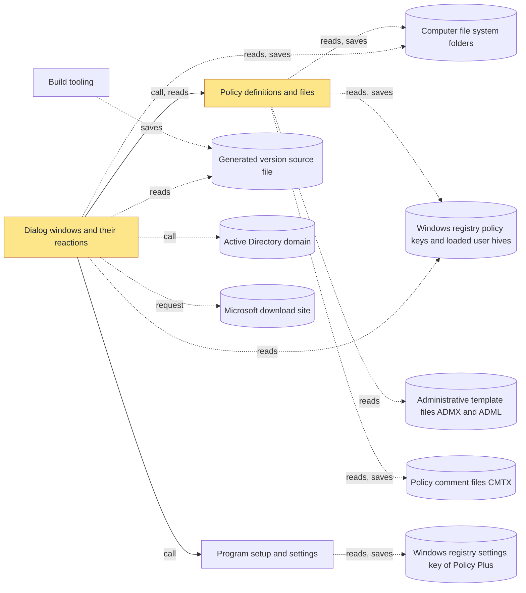
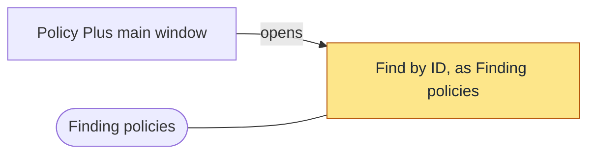

# Legacy reference: Confirm Find by ID and limit the area and selection choices

The typed header below maps each criterion of the work item to the rules of the existing system it backs. The reading of the existing code follows it.

## Header

```json
{
  "story": "story-7a0530f6054b",
  "fingerprint": "280637421a2d33856d0f4655b9cf3df29c3a1ebf99ebbb84e7839ee4506bf978",
  "criteria": [
    {
      "ac": "AC-1",
      "rules": [
        {
          "says": "Go closes Find by ID as accepted whether or not the text matched anything, so the caller may receive no selection.",
          "where": {
            "file": "PolicyPlus/FindById.vb",
            "firstLine": 59,
            "lastLine": 61
          },
          "doubt": ""
        }
      ]
    },
    {
      "ac": "AC-2",
      "rules": [
        {
          "says": "Pressing Escape closes Find by ID as cancelled.",
          "where": {
            "file": "PolicyPlus/FindById.vb",
            "firstLine": 62,
            "lastLine": 64
          },
          "doubt": ""
        }
      ]
    },
    {
      "ac": "AC-3",
      "rules": [
        {
          "says": "The area choice offers only \"User or Computer\", \"User\" and \"Computer\", with no free text.",
          "where": {
            "file": "PolicyPlus/Main.Designer.vb",
            "firstLine": 409,
            "lastLine": 410
          },
          "doubt": ""
        }
      ]
    },
    {
      "ac": "AC-4",
      "rules": [
        {
          "says": "Only one item in the policy list can be selected at a time.",
          "where": {
            "file": "PolicyPlus/Main.Designer.vb",
            "firstLine": 534,
            "lastLine": 534
          },
          "doubt": ""
        }
      ]
    },
    {
      "ac": "AC-5",
      "rules": [
        {
          "says": "The Deduplicate Policies menu entry is hidden, so the person cannot start it.",
          "where": {
            "file": "PolicyPlus/Main.Designer.vb",
            "firstLine": 266,
            "lastLine": 266
          },
          "doubt": ""
        }
      ]
    }
  ],
  "reliesOn": [],
  "data": [
    {
      "kind": "Policy setting",
      "access": "reads and saves"
    }
  ],
  "transitions": [],
  "outsideSystems": [
    "Computer file system folders",
    "Windows registry policy keys and loaded user hives"
  ],
  "cited": [
    {
      "file": "PolicyPlus/FindById.vb",
      "firstLine": 59,
      "lastLine": 61
    },
    {
      "file": "PolicyPlus/FindById.vb",
      "firstLine": 62,
      "lastLine": 64
    },
    {
      "file": "PolicyPlus/FindById.vb",
      "firstLine": 59,
      "lastLine": 61
    },
    {
      "file": "PolicyPlus/FindById.vb",
      "firstLine": 62,
      "lastLine": 64
    },
    {
      "file": "PolicyPlus/Main.Designer.vb",
      "firstLine": 409,
      "lastLine": 410
    },
    {
      "file": "PolicyPlus/Main.Designer.vb",
      "firstLine": 534,
      "lastLine": 534
    },
    {
      "file": "PolicyPlus/Main.Designer.vb",
      "firstLine": 266,
      "lastLine": 266
    }
  ]
}
```

## What each criterion must keep

### AC-1

- Go closes Find by ID as accepted whether or not the text matched anything, so the caller may receive no selection. (PolicyPlus/FindById.vb:59-61)

### AC-2

- Pressing Escape closes Find by ID as cancelled. (PolicyPlus/FindById.vb:62-64)

### AC-3

- The area choice offers only "User or Computer", "User" and "Computer", with no free text. (PolicyPlus/Main.Designer.vb:409-410)

### AC-4

- Only one item in the policy list can be selected at a time. (PolicyPlus/Main.Designer.vb:534-534)

### AC-5

- The Deduplicate Policies menu entry is hidden, so the person cannot start it. (PolicyPlus/Main.Designer.vb:266-266)

## Reading of the existing code

# Screen: Find by ID, as Finding policies

At a glance: 5 owned rules, 0 relied on, 5 actions, 2 files (1 own, 0 relied on, 1 of neighbour screens, 0 generated), 1 disputed.

How to read it: paths are relative to the source root and `file:a-b` is an inclusive line range. `BR-` rules, `ACT-` actions, `TR-` changes of state and `RK-` risks have stable ids. A record marked disputed was challenged in review and kept; the reviewer's words are under Trust. All of it was read from the code; nothing was run.

## Product context
Policy Plus is a Windows desktop editor for Group Policy settings, used by administrators and power users. It reads Microsoft's policy definition files and edits policy files directly, so it works on any Windows edition, including Home, which lacks the built-in editor.
Built with: .NET Framework v4.5.2, Microsoft Windows, System.DirectoryServices, System.Xml, Visual Basic .NET, Windows Forms (Policy Plus desktop editor).
Runs: It runs on the user's own Windows computer as one desktop program on .NET Framework 4.5.2. It asks for elevated rights when available but starts without them; loading registry hives, refreshing policy and editing local Group Policy files need them. It can also reach the domain's shared policy folder.
Reaches outside itself: Computer file system folders; Windows registry policy keys and loaded user hives; Administrative template files (ADMX and ADML); Windows registry settings key of Policy Plus; Generated version source file; Policy comment files (CMTX); Active Directory domain; Microsoft download site.



## Where this sits
Part of: Finding policies (Reading policy definitions).



## Boundary
- Opened by **Policy Plus main window** (bundle: screen policy-plus-main-window), at `PolicyPlus/Main.vb:580-606`

## Contract: what it must do
### Find by ID
Look up a category, product, support rule or policy by its ID.
Controls (3): Button: GoButton; PictureBox: StatusImage; TextBox: IdTextbox

Actions
- **ACT-65770759** Takes the status icons from the main window's icon list — `PolicyPlus/FindById.vb:14-21`; started by person
- **ACT-58939962** Looks the typed ID up among categories, products, support definitions and policies and shows what it found — `PolicyPlus/FindById.vb:22-53`; started by person
- **ACT-16381995** Clears the placeholder space and focuses the ID box — `PolicyPlus/FindById.vb:54-58`; started by person
- **ACT-04016976** Closes the dialog with the typed ID accepted — `PolicyPlus/FindById.vb:59-61`; started by person
- **ACT-14893425** Closes the dialog as cancelled when Escape is pressed — `PolicyPlus/FindById.vb:62-64`; started by person

Rules
- **BR-20325745** Text typed in Find by ID is trimmed and looked up in this order: category, product, support definition, then policy. The first kind that matches is selected, with its own icon shown; a policy is looked up only when no other kind matches. — `PolicyPlus/FindById.vb:22-40`
- **BR-60464161** When the text matches nothing, nothing is selected and a "not found" icon is shown; when the text is empty a blank icon is shown instead. The section from an earlier match is not cleared when the text changes to a non-policy. — `PolicyPlus/FindById.vb:24-27`; also rests on `PolicyPlus/FindById.vb:49-51`; **disputed**
- **BR-88409732** A policy ID may end with "@U" to mean the user section or "@C" to mean the computer section; without a suffix, or with any other suffix, the policy applies to both sections. The suffix is cut off before the policy lookup, so an unknown suffix still finds the policy. — `PolicyPlus/FindById.vb:39-48`
- **BR-51713079** Go closes Find by ID as accepted whether or not the text matched anything, so the caller may receive no selection. — `PolicyPlus/FindById.vb:59-61`
- **BR-56863443** Pressing Escape closes Find by ID as cancelled. — `PolicyPlus/FindById.vb:62-64`


## Trust: what to doubt
**Challenged in review and kept**
- **BR-60464161** `PolicyPlus/FindById.vb:24-27`: Two things are in one rule: the not-found/blank icon outcome (holds) and the stale section left over from an earlier match. The stale section is a weakness (lines 24-27 clear policy, category, product and support but not SelectedSection; it is reset only on a policy match, 44-48) and belongs in its own fact with a risk, not inside a rule. Keep the rule to the icon outcome and write the weakness as a fact.


## Read order
| Tier | File | Lines | Why |
| --- | --- | --- | --- |
| own | `PolicyPlus/FindById.vb` | whole file | starts 5 actions; decides 5 owned rules |
| neighbour screen | `PolicyPlus/Main.vb` | 580-606 | opens this screen: Policy Plus main window |

## Source

### PolicyPlus/FindById.vb
```
1: Public Class FindById
2:     Public AdmxWorkspace As AdmxBundle
3:     Public SelectedPolicy As PolicyPlusPolicy
4:     Public SelectedCategory As PolicyPlusCategory
5:     Public SelectedProduct As PolicyPlusProduct
6:     Public SelectedSupport As PolicyPlusSupport
7:     Public SelectedSection As AdmxPolicySection ' Specifies the section for policies
8:     Dim CategoryImage As Image
9:     Dim PolicyImage As Image
10:     Dim ProductImage As Image
11:     Dim SupportImage As Image
12:     Dim NotFoundImage As Image
13:     Dim BlankImage As Image
14:     Private Sub FindById_Load(sender As Object, e As EventArgs) Handles MyBase.Load
15:         CategoryImage = Main.PolicyIcons.Images(0)
16:         PolicyImage = Main.PolicyIcons.Images(4)
17:         ProductImage = Main.PolicyIcons.Images(10)
18:         SupportImage = Main.PolicyIcons.Images(11)
19:         NotFoundImage = Main.PolicyIcons.Images(8)
20:         BlankImage = Main.PolicyIcons.Images(9)
21:     End Sub
22:     Private Sub IdTextbox_TextChanged(sender As Object, e As EventArgs) Handles IdTextbox.TextChanged
23:         If AdmxWorkspace Is Nothing Then Exit Sub ' Wait until actually shown
24:         SelectedPolicy = Nothing
25:         SelectedCategory = Nothing
26:         SelectedProduct = Nothing
27:         SelectedSupport = Nothing
28:         Dim id = Trim(IdTextbox.Text)
29:         If AdmxWorkspace.FlatCategories.ContainsKey(id) Then
30:             StatusImage.Image = CategoryImage
31:             SelectedCategory = AdmxWorkspace.FlatCategories(id)
32:         ElseIf AdmxWorkspace.FlatProducts.ContainsKey(id) Then
33:             StatusImage.Image = ProductImage
34:             SelectedProduct = AdmxWorkspace.FlatProducts(id)
35:         ElseIf AdmxWorkspace.SupportDefinitions.ContainsKey(id) Then
36:             StatusImage.Image = SupportImage
37:             SelectedSupport = AdmxWorkspace.SupportDefinitions(id)
38:         Else ' Check for a policy
39:             Dim policyAndSection = Split(id, "@", 2)
40:             Dim policyId = policyAndSection(0) ' Cut off the section override
41:             If AdmxWorkspace.Policies.ContainsKey(policyId) Then
42:                 StatusImage.Image = PolicyImage
43:                 SelectedPolicy = AdmxWorkspace.Policies(policyId)
44:                 If policyAndSection.Length = 2 AndAlso policyAndSection(1).Length = 1 AndAlso "UC".Contains(policyAndSection(1)) Then
45:                     SelectedSection = If(policyAndSection(1) = "U", AdmxPolicySection.User, AdmxPolicySection.Machine)
46:                 Else
47:                     SelectedSection = AdmxPolicySection.Both
48:                 End If
49:             Else
50:                 StatusImage.Image = If(id = "", BlankImage, NotFoundImage)
51:             End If
52:         End If
53:     End Sub
54:     Private Sub FindById_Shown(sender As Object, e As EventArgs) Handles Me.Shown
55:         If IdTextbox.Text = " " Then IdTextbox.Text = "" ' It's set to a single space in the designer
56:         IdTextbox.Focus()
57:         IdTextbox.SelectAll()
58:     End Sub
59:     Private Sub GoButton_Click(sender As Object, e As EventArgs) Handles GoButton.Click
60:         DialogResult = DialogResult.OK ' Close
61:     End Sub
62:     Private Sub FindById_KeyUp(sender As Object, e As KeyEventArgs) Handles Me.KeyUp
63:         If e.KeyCode = Keys.Escape Then DialogResult = DialogResult.Cancel
64:     End Sub
65: End Class
```

### PolicyPlus/Main.vb
```
580:     Private Sub FindByIDToolStripMenuItem_Click(sender As Object, e As EventArgs) Handles ByIDToolStripMenuItem.Click
581:         ' Show the Find By ID window and try to move to the selected object
582:         FindById.AdmxWorkspace = AdmxWorkspace
583:         If FindById.ShowDialog() = DialogResult.OK Then
584:             Dim selCat = FindById.SelectedCategory
585:             Dim selPol = FindById.SelectedPolicy
586:             Dim selPro = FindById.SelectedProduct
587:             Dim selSup = FindById.SelectedSupport
588:             If selCat IsNot Nothing Then
589:                 If CategoryNodes.ContainsKey(selCat) Then
590:                     CurrentCategory = selCat
591:                     UpdateCategoryListing()
592:                 Else
593:                     MsgBox("The category is not currently visible. Change the view settings and try again.", MsgBoxStyle.Exclamation)
594:                 End If
595:             ElseIf selPol IsNot Nothing Then
596:                 ShowSettingEditor(selPol, Math.Min(ViewPolicyTypes, FindById.SelectedSection))
597:                 FocusPolicy(selPol)
598:             ElseIf selPro IsNot Nothing Then
599:                 DetailProduct.PresentDialog(selPro)
600:             ElseIf selSup IsNot Nothing Then
601:                 DetailSupport.PresentDialog(selSup)
602:             Else
603:                 MsgBox("That object could not be found.", MsgBoxStyle.Exclamation)
604:             End If
605:         End If
606:     End Sub
```

