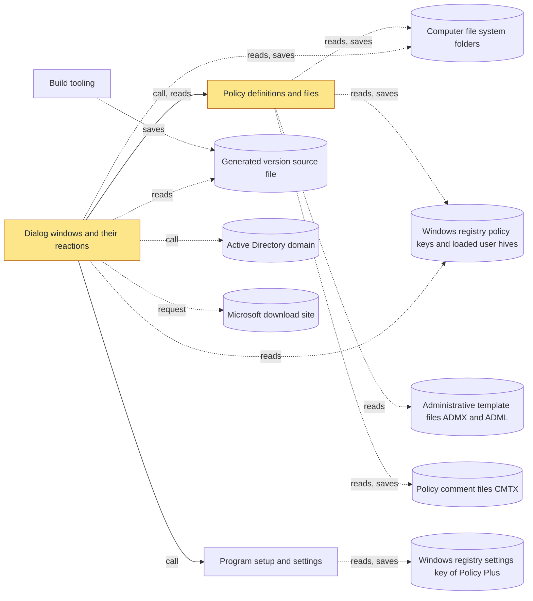
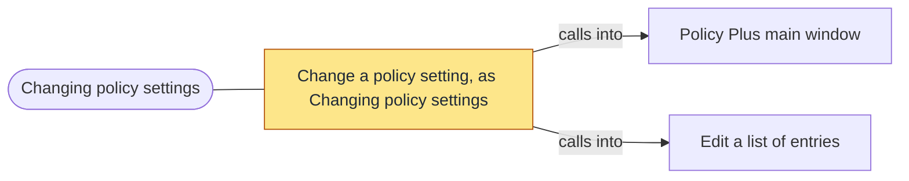

# Legacy reference: Fill in a policy's option values

The typed header below maps each criterion of the work item to the rules of the existing system it backs. The reading of the existing code follows it.

## Header

```json
{
  "story": "story-7aceafab7f4d",
  "fingerprint": "280637421a2d33856d0f4655b9cf3df29c3a1ebf99ebbb84e7839ee4506bf978",
  "criteria": [
    {
      "ac": "AC-1",
      "rules": [
        {
          "says": "A check box starts with the presentation's default state.",
          "where": {
            "file": "PolicyPlus/EditSetting.vb",
            "firstLine": 128,
            "lastLine": 128
          },
          "doubt": ""
        }
      ]
    },
    {
      "ac": "AC-2",
      "rules": [
        {
          "says": "A plain text entry is limited to the maximum length the policy defines and starts with the presentation's default text.",
          "where": {
            "file": "PolicyPlus/EditSetting.vb",
            "firstLine": 112,
            "lastLine": 117
          },
          "doubt": ""
        }
      ]
    },
    {
      "ac": "AC-3",
      "rules": [
        {
          "says": "A number entered with a spin box is limited to the minimum and maximum the policy defines, in steps the presentation sets, and starts at the presentation's default.",
          "where": {
            "file": "PolicyPlus/EditSetting.vb",
            "firstLine": 86,
            "lastLine": 94
          },
          "doubt": ""
        }
      ]
    },
    {
      "ac": "AC-4",
      "rules": [
        {
          "says": "A drop-down list shows the policy's choices by their translated names, sorted unless the presentation turns sorting off, and preselects the default choice when the presentation names one; otherwise nothing is selected.",
          "where": {
            "file": "PolicyPlus/EditSetting.vb",
            "firstLine": 145,
            "lastLine": 157
          },
          "doubt": ""
        }
      ]
    },
    {
      "ac": "AC-5",
      "rules": [
        {
          "says": "A text entry with suggestions is limited to the maximum length the policy defines, starts with the presentation's default text, and lists the presentation's suggestions, sorted unless the presentation turns sorting off.",
          "where": {
            "file": "PolicyPlus/EditSetting.vb",
            "firstLine": 132,
            "lastLine": 141
          },
          "doubt": ""
        }
      ]
    },
    {
      "ac": "AC-6",
      "rules": [
        {
          "says": "A plain number box keeps any text a whole-number reading accepts, including a leading sign or spaces; other text is replaced by the default. A number above the maximum or below the minimum is replaced by that limit. Numbers above 2,147,483,647 are replaced by the default even when the policy maximum is higher. Only typing is restricted to digits; pasted text is not. A negative number kept where the minimum is below zero is converted to an unsigned number when applied.",
          "where": {
            "file": "PolicyPlus/EditSetting.vb",
            "firstLine": 97,
            "lastLine": 102
          },
          "doubt": "The last sentence says a negative number kept where the minimum is below zero 'is converted to an unsigned number when applied'. Line 251 is CUInt of the box text; the code does not show a conversion, and converting a negative text to an unsigned integer may instead fail, which would stop the apply after line 242 has already cleared the policy (the same effect fact-21033848734857416942 names). Either state it as unsettled (an assumed Fact, rules-it-applies, confirmed by runningSystem: what a negative value does at line 251) or drop the word 'converted' and say only that the negative text is passed to an unsigned conversion whose result the code does not show."
        }
      ]
    },
    {
      "ac": "AC-7",
      "rules": [
        {
          "says": "Keys other than digits and control keys are ignored in a numeric text box.",
          "where": {
            "file": "PolicyPlus/EditSetting.vb",
            "firstLine": 103,
            "lastLine": 105
          },
          "doubt": ""
        }
      ]
    },
    {
      "ac": "AC-8",
      "rules": [
        {
          "says": "When the policy is Enabled, each option control is set to the value found in the source: numbers into number boxes, text into text and combo boxes, the matching item in drop-downs, true or false into check boxes, lines into multi-line boxes and the stored list into the list editor.",
          "where": {
            "file": "PolicyPlus/EditSetting.vb",
            "firstLine": 196,
            "lastLine": 222
          },
          "doubt": ""
        }
      ]
    },
    {
      "ac": "AC-9",
      "rules": []
    }
  ],
  "reliesOn": [],
  "data": [
    {
      "kind": "Policy setting",
      "access": "reads and saves"
    }
  ],
  "transitions": [],
  "outsideSystems": [
    "Computer file system folders",
    "Windows registry policy keys and loaded user hives"
  ],
  "cited": [
    {
      "file": "PolicyPlus/EditSetting.vb",
      "firstLine": 97,
      "lastLine": 102
    },
    {
      "file": "PolicyPlus/EditSetting.vb",
      "firstLine": 103,
      "lastLine": 105
    },
    {
      "file": "PolicyPlus/EditSetting.vb",
      "firstLine": 168,
      "lastLine": 170
    },
    {
      "file": "PolicyPlus/EditSetting.vb",
      "firstLine": 128,
      "lastLine": 128
    },
    {
      "file": "PolicyPlus/EditSetting.vb",
      "firstLine": 112,
      "lastLine": 117
    },
    {
      "file": "PolicyPlus/EditSetting.vb",
      "firstLine": 110,
      "lastLine": 118
    },
    {
      "file": "PolicyPlus/EditSetting.vb",
      "firstLine": 86,
      "lastLine": 94
    },
    {
      "file": "PolicyPlus/EditSetting.vb",
      "firstLine": 145,
      "lastLine": 157
    },
    {
      "file": "PolicyPlus/EditSetting.vb",
      "firstLine": 132,
      "lastLine": 141
    },
    {
      "file": "PolicyPlus/EditSetting.vb",
      "firstLine": 130,
      "lastLine": 131
    },
    {
      "file": "PolicyPlus/EditSetting.vb",
      "firstLine": 97,
      "lastLine": 102
    },
    {
      "file": "PolicyPlus/EditSetting.vb",
      "firstLine": 103,
      "lastLine": 106
    },
    {
      "file": "PolicyPlus/EditSetting.vb",
      "firstLine": 250,
      "lastLine": 251
    },
    {
      "file": "PolicyPlus/EditSetting.vb",
      "firstLine": 103,
      "lastLine": 105
    },
    {
      "file": "PolicyPlus/EditSetting.vb",
      "firstLine": 196,
      "lastLine": 222
    }
  ]
}
```

## What each criterion must keep

### AC-1

- A check box starts with the presentation's default state. (PolicyPlus/EditSetting.vb:128-128)

### AC-2

- A plain text entry is limited to the maximum length the policy defines and starts with the presentation's default text. (PolicyPlus/EditSetting.vb:112-117)

### AC-3

- A number entered with a spin box is limited to the minimum and maximum the policy defines, in steps the presentation sets, and starts at the presentation's default. (PolicyPlus/EditSetting.vb:86-94)

### AC-4

- A drop-down list shows the policy's choices by their translated names, sorted unless the presentation turns sorting off, and preselects the default choice when the presentation names one; otherwise nothing is selected. (PolicyPlus/EditSetting.vb:145-157)

### AC-5

- A text entry with suggestions is limited to the maximum length the policy defines, starts with the presentation's default text, and lists the presentation's suggestions, sorted unless the presentation turns sorting off. (PolicyPlus/EditSetting.vb:132-141)

### AC-6

- A plain number box keeps any text a whole-number reading accepts, including a leading sign or spaces; other text is replaced by the default. A number above the maximum or below the minimum is replaced by that limit. Numbers above 2,147,483,647 are replaced by the default even when the policy maximum is higher. Only typing is restricted to digits; pasted text is not. A negative number kept where the minimum is below zero is converted to an unsigned number when applied. (PolicyPlus/EditSetting.vb:97-102) Doubt: The last sentence says a negative number kept where the minimum is below zero 'is converted to an unsigned number when applied'. Line 251 is CUInt of the box text; the code does not show a conversion, and converting a negative text to an unsigned integer may instead fail, which would stop the apply after line 242 has already cleared the policy (the same effect fact-21033848734857416942 names). Either state it as unsettled (an assumed Fact, rules-it-applies, confirmed by runningSystem: what a negative value does at line 251) or drop the word 'converted' and say only that the negative text is passed to an unsigned conversion whose result the code does not show.

### AC-7

- Keys other than digits and control keys are ignored in a numeric text box. (PolicyPlus/EditSetting.vb:103-105)

### AC-8

- When the policy is Enabled, each option control is set to the value found in the source: numbers into number boxes, text into text and combo boxes, the matching item in drop-downs, true or false into check boxes, lines into multi-line boxes and the stored list into the list editor. (PolicyPlus/EditSetting.vb:196-222)

### AC-9

No single legacy rule: it describes the behaviour as a whole.


## Reading of the existing code

# Screen: Change a policy setting, as Changing policy settings

At a glance: 22 owned rules, 34 relied on, 11 actions, 8 files (1 own, 5 relied on, 2 of neighbour screens, 0 generated), 3 disputed.

How to read it: paths are relative to the source root and `file:a-b` is an inclusive line range. `BR-` rules, `ACT-` actions, `TR-` changes of state and `RK-` risks have stable ids. A record marked disputed was challenged in review and kept; the reviewer's words are under Trust. All of it was read from the code; nothing was run.

## Product context
Policy Plus is a Windows desktop editor for Group Policy settings, used by administrators and power users. It reads Microsoft's policy definition files and edits policy files directly, so it works on any Windows edition, including Home, which lacks the built-in editor.
Built with: .NET Framework v4.5.2, Microsoft Windows, System.DirectoryServices, System.Xml, Visual Basic .NET, Windows Forms (Policy Plus desktop editor).
Runs: It runs on the user's own Windows computer as one desktop program on .NET Framework 4.5.2. It asks for elevated rights when available but starts without them; loading registry hives, refreshing policy and editing local Group Policy files need them. It can also reach the domain's shared policy folder.
Reaches outside itself: Computer file system folders; Windows registry policy keys and loaded user hives; Administrative template files (ADMX and ADML); Windows registry settings key of Policy Plus; Generated version source file; Policy comment files (CMTX); Active Directory domain; Microsoft download site.



## Where this sits
Part of: Changing policy settings (Setting and storing policies).



## Boundary
- Calls into **Policy Plus main window** (bundle: screen policy-plus-main-window), at `PolicyPlus/EditSetting.vb:18-37`
- Calls into **Edit a list of entries** (bundle: screen edit-a-list-of-entries), at `PolicyPlus/EditSetting.vb:168-170`

## Contract: what it must do
### Change a policy setting
Set a policy to Enabled, Disabled or Not configured with its options and comment.
Controls (18): Button: ApplyButton, CloseButton, OkButton; ComboBox: SectionDropdown; Label: CommentLabel, SectionLabel, SettingNameLabel, SupportedLabel; Panel: ExtraOptionsPanel; Public Integer: ID; Public String: DisplayName; RadioButton: DisabledOption, EnabledOption, NotConfiguredOption; TableLayoutPanel: ExtraOptionsTable; TextBox: CommentTextbox, HelpTextbox, SupportedTextbox

Actions
- **ACT-48573203** Closes the dialog, accepted if an Apply already changed something — `PolicyPlus/EditSetting.vb:15-17`; started by person
- **ACT-13980059** Fills in the policy name, help and support text and prepares the options and current state — `PolicyPlus/EditSetting.vb:18-37`; started by person
- **ACT-60421228** Keeps a plain number box within its minimum and maximum — `PolicyPlus/EditSetting.vb:97-102`; started by person
- **ACT-57728491** Rejects any key that is not a digit or control key — `PolicyPlus/EditSetting.vb:103-105`; started by person
- **ACT-47308639** Opens the list editor and keeps what it returns — `PolicyPlus/EditSetting.vb:168-170`; started by person
- **ACT-90680579** Enables the option controls only while Enabled is picked — `PolicyPlus/EditSetting.vb:298-304`; started by person
- **ACT-61427410** Switches to the chosen policy source and reloads the state shown — `PolicyPlus/EditSetting.vb:305-311`; started by person
- **ACT-85644109** Writes the chosen state to the policy source and closes the dialog accepted — `PolicyPlus/EditSetting.vb:312-315`; started by person
- **ACT-51385293** Writes the chosen state to the policy source and keeps the dialog open — `PolicyPlus/EditSetting.vb:316-319`; started by person
- **ACT-46047596** Shares extra width between the options panel and the help and comment boxes — `PolicyPlus/EditSetting.vb:329-342`; started by person
- **ACT-31170585** Reports the dialog as accepted if changes were applied — `PolicyPlus/EditSetting.vb:343-345`; started by person

Rules
- **BR-91621197** Closing the policy setting dialog with Cancel is reported as a change when Apply was used earlier in that session, and as a cancel otherwise. — `PolicyPlus/EditSetting.vb:16`
- **BR-54236399** The Supported on box shows the supported-on name of the policy and is empty when the policy names none. — `PolicyPlus/EditSetting.vb:20`
- **BR-71743135** A policy that applies to both computer and user can be edited for either, starting on Computer when no section was given; a policy for one section is fixed to that section and the section choice is unavailable. — `PolicyPlus/EditSetting.vb:22-28`
- **BR-70655950** A number entered with a spin box is limited to the minimum and maximum the policy defines, in steps the presentation sets, and starts at the presentation's default. — `PolicyPlus/EditSetting.vb:86-94`
- **BR-19590309** A plain number box keeps any text a whole-number reading accepts, including a leading sign or spaces; other text is replaced by the default. A number above the maximum or below the minimum is replaced by that limit. Numbers above 2,147,483,647 are replaced by the default even when the policy maximum is higher. Only typing is restricted to digits; pasted text is not. A negative number kept where the minimum is below zero is converted to an unsigned number when applied. — `PolicyPlus/EditSetting.vb:97-102`; also rests on `PolicyPlus/EditSetting.vb:103-106`, `PolicyPlus/EditSetting.vb:250-251`; **disputed**
- **BR-23119273** Keys other than digits and control keys are ignored in a numeric text box. — `PolicyPlus/EditSetting.vb:103-105`
- **BR-75092611** A plain text entry is limited to the maximum length the policy defines and starts with the presentation's default text. — `PolicyPlus/EditSetting.vb:112-117`; also rests on `PolicyPlus/EditSetting.vb:110-118`
- **BR-01496073** A check box starts with the presentation's default state. — `PolicyPlus/EditSetting.vb:128`
- **BR-55528192** A text entry with suggestions is limited to the maximum length the policy defines, starts with the presentation's default text, and lists the presentation's suggestions, sorted unless the presentation turns sorting off. — `PolicyPlus/EditSetting.vb:132-141`; also rests on `PolicyPlus/EditSetting.vb:130-131`
- **BR-84587600** A drop-down list shows the policy's choices by their translated names, sorted unless the presentation turns sorting off, and preselects the default choice when the presentation names one; otherwise nothing is selected. — `PolicyPlus/EditSetting.vb:145-157`
- **BR-04561108** The state shown when the dialog opens follows the policy's present state in the source being edited: Enabled, Disabled, or Not Configured for anything else, including an unclear state. — `PolicyPlus/EditSetting.vb:191-194`; also rests on `PolicyPlus/EditSetting.vb:223-224`
- **BR-57154914** When the policy is Enabled, each option control is set to the value found in the source: numbers into number boxes, text into text and combo boxes, the matching item in drop-downs, true or false into check boxes, lines into multi-line boxes and the stored list into the list editor. — `PolicyPlus/EditSetting.vb:196-222`
- **BR-98029987** OK and Apply are available only when the chosen policy source can be written to. — `PolicyPlus/EditSetting.vb:226-228`
- **BR-83674273** The comment box is disabled and reads "Comments unavailable for this policy source" when the source has no comments; otherwise it shows the policy's stored comment, or is empty when there is none. — `PolicyPlus/EditSetting.vb:229-238`
- **BR-35282498** Applying a policy first forgets everything the source holds for it; Enabled then writes every option's current value, Disabled writes the disabled state, and Not Configured leaves the policy with no values. — `PolicyPlus/EditSetting.vb:242-275`; also rests on `PolicyPlus/EditSetting.vb:248-270`
- **BR-52037450** When Enabled is chosen, applying writes every option of the policy whatever its value, including options never filled in. — `PolicyPlus/EditSetting.vb:246-270`; also rests on `PolicyPlus/EditSetting.vb:243-245`; **disputed**
- **BR-58212379** When a policy is applied and the source supports comments, an empty comment box removes the policy's stored comment and any text replaces or adds it. — `PolicyPlus/EditSetting.vb:277-283`
- **BR-13284576** Option controls can be edited only while Enabled is chosen; with Disabled or Not Configured they are greyed out. — `PolicyPlus/EditSetting.vb:300-303`
- **BR-01828501** Choosing Computer or User in the dialog switches the source, its writability and its comments to that section, and reloads the chosen state (Enabled, Disabled or Not Configured) from it. Option values are replaced only for options the section stores when it is Enabled; other values typed earlier stay in the controls. — `PolicyPlus/EditSetting.vb:306-310`; also rests on `PolicyPlus/EditSetting.vb:191-225`
- **BR-69530089** OK writes the policy to the source and closes the dialog as a change. — `PolicyPlus/EditSetting.vb:313-314`
- **BR-46144363** Apply writes the policy to the source, keeps the dialog open and records that a change was made. — `PolicyPlus/EditSetting.vb:317-318`
- **BR-70518038** When the policy setting dialog is closed by any other means, it is still reported as a change if Apply was used earlier. — `PolicyPlus/EditSetting.vb:344`


## Relied on: decided elsewhere
**Core code, run by 4 or more other capabilities**
- `PolicyPlus/PolicyProcessing.vb`
  - **BR-59240838** A policy's lists of on-values and off-values count as enabled or disabled evidence for each value in them that is present, using the list's own key when it names one. — `PolicyPlus/PolicyProcessing.vb:11-18`; also rests on `PolicyPlus/PolicyProcessing.vb:32-33`
  - **BR-16213931** A policy with a registry value of its own counts as enabled evidence when that value holds its 'on' value, which is the number 1 when the template gives none, and as disabled evidence when it holds its 'off' value or is marked for deletion when the template gives none. — `PolicyPlus/PolicyProcessing.vb:20-31`; also rests on `PolicyPlus/PolicyProcessing.vb:87-105`
  - **BR-43129633** For a policy's list elements, a marked-for-deletion list counts as one deleted element, and a list that holds any values counts as a present element and cancels that deletion. — `PolicyPlus/PolicyProcessing.vb:40-49`
  - **BR-29429916** For a checkbox element: a value marked for deletion counts as one deleted element. … — `PolicyPlus/PolicyProcessing.vb:50-61`; also rests on `PolicyPlus/PolicyProcessing.vb:11-18`, `PolicyPlus/PolicyProcessing.vb:87-105`
  - **BR-73157702** For any other element (number, text, choice, multi-line text), a value marked for deletion counts as a deleted element and a value that is present counts as a present element. — `PolicyPlus/PolicyProcessing.vb:62-68`
  - **BR-84295212** If any element is present, the elements add their count to the enabled evidence; only when none is present do deleted elements add to the disabled evidence. — `PolicyPlus/PolicyProcessing.vb:70-74`
  - **BR-02220135** A policy is Enabled when enabled evidence exceeds disabled evidence, Disabled when disabled exceeds enabled, Not configured when there is no evidence either way, and Unclear when both are equal and above zero. — `PolicyPlus/PolicyProcessing.vb:77-85`
  - **BR-26486738** A value counts as present when: for a deletion marker, it is marked for deletion; for a number, it exists as a whole number and equals the expected number; for text, it exists as text and equals the expected text. … — `PolicyPlus/PolicyProcessing.vb:87-105`

**Code shared with a few capabilities**
- `PolicyPlus/AdmxBundle.vb`
  - **BR-86135547** A name or description written as "$(string.<id>)" shows the language file's text for that id; an unknown id shows the code itself; any other text is shown as written; an empty value stays empty. — `PolicyPlus/AdmxBundle.vb:195-199` (also used by Browsing policy definitions, Getting Microsoft policy definitions, Using the product)
- `PolicyPlus/PolicyLoader.vb`
  - **BR-96952745** A source is writable by default for Scratch space; for a registry source it is 'no writing' when the write test failed; for others it is 'no commit' when the file or hive could not be opened for writing. — `PolicyPlus/PolicyLoader.vb:163-172` (also used by Using the product, Choosing and saving policy sources)
- `PolicyPlus/PolicyProcessing.vb`
  - **BR-69995834** A list of values counts as present only when every value in it is present. — `PolicyPlus/PolicyProcessing.vb:106-113` (also used by Browsing policy definitions)
  - **BR-09912098** The saved value of a number or text element is read as stored; the reading assumes the value exists and is of the right kind, and is not checked first. … — `PolicyPlus/PolicyProcessing.vb:140-146` (also used by Browsing policy definitions)
  - **BR-04277453** A list element whose entries have names the person provides is read as every stored name with its value, under the element's key. — `PolicyPlus/PolicyProcessing.vb:149-154` (also used by Browsing policy definitions)
  - **BR-50695370** A list element whose entry names do not matter is read as a list of values: when the list has a prefix, the stored values named prefix1, prefix2, and so on, in order, until the first number that is missing; otherwise every stored value name under the key. — `PolicyPlus/PolicyProcessing.vb:155-169` (also used by Browsing policy definitions)
  - **BR-93971891** A choice element is read as the position of the first item whose own value is present and, when the item has a value list, whose list is wholly present; when no item matches, the position is -1. — `PolicyPlus/PolicyProcessing.vb:170-183` (also used by Browsing policy definitions)
  - **BR-53509048** The saved value of a multi-line text element is read as stored, without first checking that it exists. — `PolicyPlus/PolicyProcessing.vb:184-185` (also used by Browsing policy definitions)
  - **BR-53183223** A checkbox is on when its on value (or all values of its on list) is present, or, with neither defined, when its value is 1; it is off in every other case, including when its off value is present. — `PolicyPlus/PolicyProcessing.vb:190-206` (also used by Browsing policy definitions)
  - **BR-35971750** The registry values a policy touches are its own value, those in its value lists, those of its elements (the whole key for list elements) and those of checkbox and choice sub-lists, each counted once. — `PolicyPlus/PolicyProcessing.vb:213-257`; also rests on `PolicyPlus/PolicyProcessing.vb:207-209` (also used by Finding policies)
  - **BR-65010717** When a policy is forgotten, the whole key of each of its list elements is cleared and every registry value it touches is dropped from the source, so it reads as Not configured. — `PolicyPlus/PolicyProcessing.vb:249-262`; also rests on `PolicyPlus/PolicyProcessing.vb:210-212` (also used by Finding policies)
  - **BR-89561154** When a registry value is written for a policy, a value defined as 'delete' is removed, a numeric value is saved as a 32-bit number and a text value as a text string. … — `PolicyPlus/PolicyProcessing.vb:267-277`
  - **BR-11429227** When a policy is set to Not configured or Unknown, SetPolicyState writes and removes nothing. … — `PolicyPlus/PolicyProcessing.vb:296-298`; also rests on `PolicyPlus/PolicyProcessing.vb:357-378`, `PolicyPlus/EditSetting.vb:242`, `PolicyPlus/SpolFile.vb:212-213`
  - **BR-64761169** When a policy is set to Enabled and the policy has a registry value name but defines no explicit on value, the value is saved as the number 1. — `PolicyPlus/PolicyProcessing.vb:299`
  - **BR-31213205** When a policy is set to Enabled, its own on value is saved and any extra values listed for the on state are saved with it. … — `PolicyPlus/PolicyProcessing.vb:300`; also rests on `PolicyPlus/PolicyProcessing.vb:267-295`
  - **BR-81101132** When a policy is set to Enabled, only the settings the person supplied are written. … — `PolicyPlus/PolicyProcessing.vb:301-305`
  - **BR-81485484** A setting that names its own registry key is saved under that key. … — `PolicyPlus/PolicyProcessing.vb:303`; also rests on `PolicyPlus/PolicyProcessing.vb:362`
  - **BR-42313215** When a number setting is saved, it is written as text if the definition says to store it as text, otherwise as a 32-bit number. — `PolicyPlus/PolicyProcessing.vb:307-313`
  - **BR-74642321** When a checkbox setting is saved, a ticked box with no defined on value first saves the number 1, and an unticked box with no defined off value first removes the value. … — `PolicyPlus/PolicyProcessing.vb:314-323`; also rests on `PolicyPlus/PolicyProcessing.vb:286-295`; **disputed**
  - **BR-68809207** When a text setting is saved, it is written as an expandable text string if the definition says so, otherwise as a plain text string. — `PolicyPlus/PolicyProcessing.vb:324-327`
  - **BR-39577548** When a list setting is saved and the definition does not say to keep other entries, every existing value under the list's key is removed first. … — `PolicyPlus/PolicyProcessing.vb:328-331`
  - **BR-92928718** When a list setting is saved, entries that carry their own names are saved under those names. … — `PolicyPlus/PolicyProcessing.vb:332-346`
  - **BR-58186072** When a choice setting is saved, the value of the chosen item is saved together with any extra values that item lists. … — `PolicyPlus/PolicyProcessing.vb:347-351`; also rests on `PolicyPlus/PolicyProcessing.vb:301-356`
  - **BR-95428877** When a multi-line text setting is saved, it is written as a multiple-string value. — `PolicyPlus/PolicyProcessing.vb:352-353`
  - **BR-62000583** When a policy is set to Disabled and the definition gives no off value, its registry value is removed. … — `PolicyPlus/PolicyProcessing.vb:358-359`
  - **BR-74334637** When a policy is set to Disabled, each setting gets only its own removal. … — `PolicyPlus/PolicyProcessing.vb:360-377`; also rests on `PolicyPlus/PolicyProcessing.vb:347-351`, `PolicyPlus/PolicyProcessing.vb:367-372`


## Trust: what to doubt
**Challenged in review and kept**
- **BR-52037450** `PolicyPlus/EditSetting.vb:246-270`: 'Writes every option whatever its value, including options never filled in' overreaches: a drop-down option with no choice is not written, line 264 fails and the apply stops (fact-21033848734857416942), and an unopened list option is written with no list (fact-56821189303055742863). Say that every option is read and written whatever its value, except that an unchosen drop-down stops the apply.
- **BR-74642321** `PolicyPlus/PolicyProcessing.vb:314-323`: 'The defined on or off value is then saved ... and overwrites the first step' is not what the lines show. The first step (lines 317-322) runs only when the checkbox has NO defined on value (ticked) or NO defined off value (unticked), and in that case setList (323) has no main value to write, so nothing overwrites the 1 or the removal. The two are alternatives for the main value, not a sequence. Only an extra value listed for that state can touch the same value name. Rewrite: with no defined main value the default applies (1 when ticked, removal when unticked); with one, that value is saved; the extra values for the state are saved in both cases.
- **BR-19590309** `PolicyPlus/EditSetting.vb:97-102`: The last sentence says a negative number kept where the minimum is below zero 'is converted to an unsigned number when applied'. Line 251 is CUInt of the box text; the code does not show a conversion, and converting a negative text to an unsigned integer may instead fail, which would stop the apply after line 242 has already cleared the policy (the same effect fact-21033848734857416942 names). Either state it as unsettled (an assumed Fact, rules-it-applies, confirmed by runningSystem: what a negative value does at line 251) or drop the word 'converted' and say only that the negative text is passed to an unsigned conversion whose result the code does not show.

**Risks**
- **RK-26063412** [medium] Applying a policy, from the settings window or a script, clears its stored values or comment before the new ones are read or written. A failure, such as a drop-down with no choice, leaves the policy empty or half set and reports little. (Data can end up wrong, lost or inconsistent) — at `PolicyPlus/EditSetting.vb:242`, `PolicyPlus/EditSetting.vb:264`, `PolicyPlus/EditSetting.vb:312-319`, `PolicyPlus/PolicyProcessing.vb:347-351`
- **RK-55902150** [medium] Enabling a policy with a list option the person never opened writes that option with no list. The list stays empty until the list editor is used or the source holds one, and nothing checks it. (Data can end up wrong, lost or inconsistent) — at `PolicyPlus/EditSetting.vb:168-170`, `PolicyPlus/EditSetting.vb:219-221`, `PolicyPlus/EditSetting.vb:265-266`
- **RK-00344106** [medium] Results of requesting Windows privileges and loading a user registry file are discarded. The person learns a source cannot be saved, or silently gets an empty read-only source, never why. A refused privilege passes silently and fails later with an unrelated error. (Failures are hidden, lost or not retried) — at `PolicyPlus/PolicyLoader.vb:163-172`
- **RK-58521893** [medium] Values supplied for a policy's settings, by a person or a script, are written without checks. Numbers are forced to unsigned 32-bit and text is stored as given, ignoring any minimum, maximum or length in the definition. A failure leaves earlier settings written, with no undo. (Input from outside is used without checks, so it can change what the code does) — at `PolicyPlus/EditSetting.vb:242-274`, `PolicyPlus/PolicyProcessing.vb:301-356`

**In these files but reached by nothing the analysis could follow**
- DropdownPresentationMap.ToString (`PolicyPlus/EditSetting.vb:349-351`)


## Read order
| Tier | File | Lines | Why |
| --- | --- | --- | --- |
| own | `PolicyPlus/EditSetting.vb` | whole file | starts 11 actions; decides 22 owned rules |
| relied on | `PolicyPlus/AdmxBundle.vb` | 193-200 | decides 1 relied-on rule; called code; used by 3 other capabilities |
| relied on | `PolicyPlus/PolicyLoader.vb` | 163-172 | decides 1 relied-on rule; called code; used by 2 other capabilities |
| relied on | `PolicyPlus/PolicyProcessing.vb` | 2-113, 133-379 | decides 32 relied-on rules; called code; used by 6 other capabilities |
| relied on | `PolicyPlus/PolicySource.vb` | 4-12 | called code; used by 6 other capabilities |
| relied on | `PolicyPlus/SpolFile.vb` | 212-213 | called code |
| neighbour screen | `PolicyPlus/ListEditor.vb` | 4-24 | called from this screen: Edit a list of entries |
| neighbour screen | `PolicyPlus/Main.vb` | 863-870 | called from this screen: Policy Plus main window |

## Source

### PolicyPlus/EditSetting.vb
```
1: Public Class EditSetting
2:     Dim CurrentSetting As PolicyPlusPolicy
3:     Dim CurrentSection As AdmxPolicySection
4:     Dim AdmxWorkspace As AdmxBundle
5:     Dim CompPolSource, UserPolSource As IPolicySource
6:     Dim CompPolLoader, UserPolLoader As PolicyLoader
7:     Dim CompComments, UserComments As Dictionary(Of String, String)
8:     ' Above: passed in; below: internal state
9:     Dim ElementControls As Dictionary(Of String, Control)
10:     Dim ResizableControls As List(Of Control)
11:     Dim CurrentSource As IPolicySource
12:     Dim CurrentLoader As PolicyLoader
13:     Dim CurrentComments As Dictionary(Of String, String)
14:     Dim ChangesMade As Boolean ' To either side
15:     Private Sub CancelButton_Click(sender As Object, e As EventArgs) Handles CloseButton.Click
16:         If ChangesMade Then DialogResult = DialogResult.OK Else DialogResult = DialogResult.Cancel
17:     End Sub
18:     Private Sub EditSetting_Shown(sender As Object, e As EventArgs) Handles Me.Shown
19:         SettingNameLabel.Text = CurrentSetting.DisplayName
20:         If CurrentSetting.SupportedOn Is Nothing Then SupportedTextbox.Text = "" Else SupportedTextbox.Text = CurrentSetting.SupportedOn.DisplayName
21:         HelpTextbox.Text = Main.PrettifyDescription(CurrentSetting.DisplayExplanation)
22:         If CurrentSetting.RawPolicy.Section = AdmxPolicySection.Both Then
23:             SectionDropdown.Enabled = True
24:             CurrentSection = If(CurrentSection = AdmxPolicySection.Both, AdmxPolicySection.Machine, CurrentSection)
25:         Else
26:             SectionDropdown.Enabled = False
27:             CurrentSection = CurrentSetting.RawPolicy.Section
28:         End If
29:         ExtraOptionsPanel.HorizontalScroll.Maximum = 0
30:         ExtraOptionsPanel.VerticalScroll.Visible = True
31:         ExtraOptionsPanel.AutoScroll = True
32:         PreparePolicyElements()
33:         SectionDropdown.Text = If(CurrentSection = AdmxPolicySection.Machine, "Computer", "User")
34:         SectionDropdown_SelectedIndexChanged(Nothing, Nothing) ' Force an update of the current source
35:         PreparePolicyState()
36:         StateRadiosChanged(Nothing, Nothing)
37:     End Sub
38:     Sub PreparePolicyElements()
39:         For n = ExtraOptionsTable.RowCount - 1 To 0 Step -1 ' Go backwards because Dispose changes the indexes
40:             Dim ctl = ExtraOptionsTable.GetControlFromPosition(0, n)
41:             If ctl IsNot Nothing Then ctl.Dispose()
42:         Next
43:         ExtraOptionsTable.Controls.Clear()
44:         ExtraOptionsTable.RowCount = 0
45:         Dim curTabIndex = 10
46:         Dim addControl = Sub(ID As String, Control As Control, Label As String)
47:                              ExtraOptionsTable.RowStyles.Add(New RowStyle(SizeType.AutoSize))
48:                              If Label = "" Then ' Just a single control
49:                                  If Control.AutoSize Then ResizableControls.Add(Control)
50:                                  ExtraOptionsTable.Controls.Add(Control, 0, ExtraOptionsTable.RowStyles.Count - 1)
51:                              Else ' Has a label attached
52:                                  Dim flowPanel As New FlowLayoutPanel With {.WrapContents = True, .AutoSize = True, .AutoSizeMode = AutoSizeMode.GrowAndShrink}
53:                                  flowPanel.Margin = New Padding(0)
54:                                  ExtraOptionsTable.Controls.Add(flowPanel, 0, ExtraOptionsTable.RowStyles.Count - 1)
55:                                  Dim labelControl As New Label With {.AutoSize = True, .Text = Label}
56:                                  labelControl.Anchor = AnchorStyles.Left
57:                                  Control.Anchor = AnchorStyles.Left
58:                                  flowPanel.Controls.Add(labelControl)
59:                                  flowPanel.Controls.Add(Control)
60:                                  ResizableControls.Add(flowPanel)
61:                              End If
62:                              If ID <> "" Then
63:                                  ElementControls.Add(ID, Control)
64:                                  Control.TabStop = True
65:                                  Control.TabIndex = curTabIndex
66:                                  curTabIndex += 1
67:                              Else
68:                                  Control.TabStop = False
69:                              End If
70:                          End Sub
71:         ExtraOptionsTable.RowStyles.Clear()
72:         ElementControls = New Dictionary(Of String, Control)
73:         ResizableControls = New List(Of Control)
74:         ' Create the Windows Forms elements
75:         If CurrentSetting.RawPolicy.Elements IsNot Nothing And CurrentSetting.Presentation IsNot Nothing Then
76:             Dim elemDict = CurrentSetting.RawPolicy.Elements.ToDictionary(Function(e) e.ID)
77:             For Each pres In CurrentSetting.Presentation.Elements
78:                 Select Case pres.ElementType
79:                     Case "text" ' A plain label
80:                         Dim textPres As LabelPresentationElement = pres
81:                         Dim label As New Label With {.Text = textPres.Text, .AutoSize = True}
82:                         label.Margin = New Padding(3, 6, 3, 6)
83:                         addControl(textPres.ID, label, "")
84:                     Case "decimalTextBox" ' Numeric spin box or a plain text box restricted to numbers
85:                         Dim decimalTextPres As NumericBoxPresentationElement = pres
86:                         Dim numeric As DecimalPolicyElement = elemDict(pres.ID)
87:                         Dim newControl As Control
88:                         If decimalTextPres.HasSpinner Then
89:                             newControl = New NumericUpDown With {
90:                                 .Minimum = numeric.Minimum,
91:                                 .Maximum = numeric.Maximum,
92:                                 .Increment = decimalTextPres.SpinnerIncrement,
93:                                 .Value = decimalTextPres.DefaultValue
94:                             }
95:                         Else
96:                             Dim text As New TextBox
97:                             AddHandler text.TextChanged, Sub()
98:                                                              If Not Integer.TryParse(text.Text, 0) Then text.Text = decimalTextPres.DefaultValue
99:                                                              Dim curNum As Integer = text.Text
100:                                                              If curNum > numeric.Maximum Then text.Text = numeric.Maximum
101:                                                              If curNum < numeric.Minimum Then text.Text = numeric.Minimum
102:                                                          End Sub
103:                             AddHandler text.KeyPress, Sub(Sender As Object, EventArgs As KeyPressEventArgs)
104:                                                           If Not (Char.IsControl(EventArgs.KeyChar) Or Char.IsDigit(EventArgs.KeyChar)) Then EventArgs.Handled = True
105:                                                       End Sub
106:                             text.Text = decimalTextPres.DefaultValue
107:                             newControl = text
108:                         End If
109:                         addControl(pres.ID, newControl, decimalTextPres.Label)
110:                     Case "textBox" ' Simple text box
111:                         Dim textboxPres As TextBoxPresentationElement = pres
112:                         Dim text As TextPolicyElement = elemDict(pres.ID)
113:                         Dim textbox As New TextBox With {
114:                             .Width = ExtraOptionsTable.Width * 0.75,
115:                             .Text = textboxPres.DefaultValue,
116:                             .MaxLength = text.MaxLength
117:                         }
118:                         addControl(pres.ID, textbox, textboxPres.Label)
119:                     Case "checkBox" ' Check box
120:                         Dim checkPres As CheckBoxPresentationElement = pres
121:                         Dim checkbox As New CheckBox With {.TextAlign = ContentAlignment.MiddleLeft}
122:                         checkbox.Text = checkPres.Text
123:                         checkbox.Width = ExtraOptionsTable.ClientSize.Width
124:                         Using g = checkbox.CreateGraphics ' Figure out how tall it should be
125:                             Dim size = g.MeasureString(checkbox.Text, checkbox.Font, checkbox.Width)
126:                             checkbox.Height = (size.Height + checkbox.Padding.Vertical + checkbox.Margin.Vertical)
127:                         End Using
128:                         checkbox.Checked = checkPres.DefaultState
129:                         addControl(pres.ID, checkbox, "")
130:                     Case "comboBox" ' Text box with suggestions, not tested because it's not used in any default ADML
131:                         Dim comboPres As ComboBoxPresentationElement = pres
132:                         Dim text As TextPolicyElement = elemDict(pres.ID)
133:                         Dim combobox As New ComboBox With {.DropDownStyle = ComboBoxStyle.DropDown}
134:                         combobox.MaxLength = text.MaxLength
135:                         combobox.Width = ExtraOptionsTable.Width * 0.75
136:                         combobox.Text = comboPres.DefaultText
137:                         combobox.Sorted = Not comboPres.NoSort
138:                         For Each suggestion In comboPres.Suggestions
139:                             combobox.Items.Add(suggestion)
140:                         Next
141:                         addControl(pres.ID, combobox, comboPres.Label)
142:                     Case "dropdownList" ' Dropdown list of options
143:                         Dim dropdownPres As DropDownPresentationElement = pres
144:                         Dim combobox As New ComboBox With {.DropDownStyle = ComboBoxStyle.DropDownList}
145:                         combobox.Sorted = Not dropdownPres.NoSort
146:                         Dim enumElem As EnumPolicyElement = elemDict(pres.ID)
147:                         Dim itemId As Integer = 0
148:                         Using g = combobox.CreateGraphics ' Figure out how wide it should be, and add entries
149:                             Dim maxWidth = combobox.Width
150:                             For Each entry In enumElem.Items
151:                                 Dim map = New DropdownPresentationMap With {.ID = itemId, .DisplayName = AdmxWorkspace.ResolveString(entry.DisplayCode, CurrentSetting.RawPolicy.DefinedIn)}
152:                                 Dim width = g.MeasureString(map.DisplayName, combobox.Font).Width + 25 ' A little extra margin
153:                                 If width > maxWidth Then maxWidth = width
154:                                 combobox.Items.Add(map)
155:                                 If itemId = dropdownPres.DefaultItemID.GetValueOrDefault(-1) Then combobox.SelectedItem = map
156:                                 itemId += 1
157:                             Next
158:                             combobox.Width = maxWidth
159:                         End Using
160:                         addControl(pres.ID, combobox, dropdownPres.Label)
161:                     Case "listBox" ' Button to launch a grid view editor
162:                         Dim listPres As ListPresentationElement = pres
163:                         Dim list As ListPolicyElement = elemDict(pres.ID)
164:                         Dim button As New Button With {
165:                             .UseVisualStyleBackColor = True,
166:                             .Text = "Edit..."
167:                         }
168:                         AddHandler button.Click, Sub()
169:                                                      If ListEditor.PresentDialog(listPres.Label, button.Tag, list.UserProvidesNames) = DialogResult.OK Then button.Tag = ListEditor.FinalData
170:                                                  End Sub
171:                         addControl(pres.ID, button, listPres.Label)
172:                     Case "multiTextBox" ' Multiline text box
173:                         Dim multiTextPres As MultiTextPresentationElement = pres
174:                         Dim bigTextbox As New TextBox With {
175:                             .AutoSize = False,
176:                             .Width = ExtraOptionsPanel.Width * 0.8,
177:                             .Multiline = True,
178:                             .ScrollBars = ScrollBars.Both,
179:                             .WordWrap = False,
180:                             .AcceptsReturn = True
181:                         }
182:                         bigTextbox.Height *= 4
183:                         addControl(pres.ID, bigTextbox, multiTextPres.Label)
184:                 End Select
185:             Next
186:             OptionsTableResized()
187:         End If
188:     End Sub
189:     Sub PreparePolicyState()
190:         ' Set the value of the UI elements depending on the current policy state
191:         Select Case PolicyProcessing.GetPolicyState(CurrentSource, CurrentSetting)
192:             Case PolicyState.Disabled
193:                 DisabledOption.Checked = True
194:             Case PolicyState.Enabled
195:                 EnabledOption.Checked = True
196:                 Dim optionStates = PolicyProcessing.GetPolicyOptionStates(CurrentSource, CurrentSetting)
197:                 For Each kv In optionStates
198:                     Dim uiControl As Control = ElementControls(kv.Key)
199:                     If TypeOf kv.Value Is UInteger Then ' Numeric box
200:                         If TypeOf uiControl Is TextBox Then
201:                             CType(uiControl, TextBox).Text = kv.Value.ToString
202:                         Else
203:                             CType(uiControl, NumericUpDown).Value = kv.Value
204:                         End If
205:                     ElseIf TypeOf kv.Value Is String Then ' Text box or combo box
206:                         If TypeOf uiControl Is ComboBox Then
207:                             CType(uiControl, ComboBox).Text = kv.Value
208:                         Else
209:                             CType(uiControl, TextBox).Text = kv.Value
210:                         End If
211:                     ElseIf TypeOf kv.Value Is Integer Then ' Dropdown list
212:                         Dim combobox As ComboBox = uiControl
213:                         Dim matchingItem = combobox.Items.OfType(Of DropdownPresentationMap).FirstOrDefault(Function(i) i.ID = CInt(kv.Value))
214:                         If matchingItem IsNot Nothing Then combobox.SelectedItem = matchingItem
215:                     ElseIf TypeOf kv.Value Is Boolean Then ' Check box
216:                         CType(uiControl, CheckBox).Checked = kv.Value
217:                     ElseIf TypeOf kv.Value Is String() Then ' Multiline text box
218:                         CType(uiControl, TextBox).Lines = kv.Value
219:                     Else ' List box (pop-out button)
220:                         uiControl.Tag = kv.Value
221:                     End If
222:                 Next
223:             Case Else
224:                 NotConfiguredOption.Checked = True
225:         End Select
226:         Dim canWrite = (CurrentLoader.GetWritability <> PolicySourceWritability.NoWriting)
227:         ApplyButton.Enabled = canWrite
228:         OkButton.Enabled = canWrite
229:         If CurrentComments Is Nothing Then
230:             CommentTextbox.Enabled = False
231:             CommentTextbox.Text = "Comments unavailable for this policy source"
232:         ElseIf CurrentComments.ContainsKey(CurrentSetting.UniqueID) Then
233:             CommentTextbox.Enabled = True
234:             CommentTextbox.Text = CurrentComments(CurrentSetting.UniqueID)
235:         Else
236:             CommentTextbox.Enabled = True
237:             CommentTextbox.Text = ""
238:         End If
239:     End Sub
240:     Sub ApplyToPolicySource()
241:         ' Write the new state to the policy source object
242:         PolicyProcessing.ForgetPolicy(CurrentSource, CurrentSetting)
243:         If EnabledOption.Checked Then
244:             Dim options As New Dictionary(Of String, Object)
245:             If CurrentSetting.RawPolicy.Elements IsNot Nothing Then
246:                 For Each elem In CurrentSetting.RawPolicy.Elements
247:                     Dim uiControl As Control = ElementControls(elem.ID)
248:                     Select Case elem.ElementType
249:                         Case "decimal"
250:                             If TypeOf uiControl Is TextBox Then
251:                                 options.Add(elem.ID, CUInt(CType(uiControl, TextBox).Text))
252:                             Else
253:                                 options.Add(elem.ID, CUInt(CType(uiControl, NumericUpDown).Value))
254:                             End If
255:                         Case "text"
256:                             If TypeOf uiControl Is ComboBox Then
257:                                 options.Add(elem.ID, CType(uiControl, ComboBox).Text)
258:                             Else
259:                                 options.Add(elem.ID, CType(uiControl, TextBox).Text)
260:                             End If
261:                         Case "boolean"
262:                             options.Add(elem.ID, CType(uiControl, CheckBox).Checked)
263:                         Case "enum"
264:                             options.Add(elem.ID, CType(CType(uiControl, ComboBox).SelectedItem, DropdownPresentationMap).ID)
265:                         Case "list"
266:                             options.Add(elem.ID, uiControl.Tag)
267:                         Case "multiText"
268:                             options.Add(elem.ID, CType(uiControl, TextBox).Lines)
269:                     End Select
270:                 Next
271:             End If
272:             PolicyProcessing.SetPolicyState(CurrentSource, CurrentSetting, PolicyState.Enabled, options)
273:         ElseIf DisabledOption.Checked Then
274:             PolicyProcessing.SetPolicyState(CurrentSource, CurrentSetting, PolicyState.Disabled, Nothing)
275:         End If
276:         ' Update the comment for this policy
277:         If CurrentComments IsNot Nothing Then
278:             If CommentTextbox.Text = "" Then
279:                 If CurrentComments.ContainsKey(CurrentSetting.UniqueID) Then CurrentComments.Remove(CurrentSetting.UniqueID)
280:             Else
281:                 If CurrentComments.ContainsKey(CurrentSetting.UniqueID) Then CurrentComments(CurrentSetting.UniqueID) = CommentTextbox.Text Else CurrentComments.Add(CurrentSetting.UniqueID, CommentTextbox.Text)
282:             End If
283:         End If
284:     End Sub
285:     Public Function PresentDialog(Policy As PolicyPlusPolicy, Section As AdmxPolicySection, Workspace As AdmxBundle, CompPolSource As IPolicySource, UserPolSource As IPolicySource, CompPolLoader As PolicyLoader, UserPolLoader As PolicyLoader, CompComments As Dictionary(Of String, String), UserComments As Dictionary(Of String, String)) As DialogResult
286:         CurrentSetting = Policy
287:         CurrentSection = Section
288:         AdmxWorkspace = Workspace
289:         Me.CompPolSource = CompPolSource
290:         Me.UserPolSource = UserPolSource
291:         Me.CompPolLoader = CompPolLoader
292:         Me.UserPolLoader = UserPolLoader
293:         Me.CompComments = CompComments
294:         Me.UserComments = UserComments
295:         ChangesMade = False
296:         Return ShowDialog()
297:     End Function
298:     Private Sub StateRadiosChanged(sender As Object, e As EventArgs) Handles DisabledOption.CheckedChanged, EnabledOption.CheckedChanged, NotConfiguredOption.CheckedChanged
299:         If ElementControls Is Nothing Then Exit Sub ' A change to the tab order causes a spurious CheckedChanged
300:         Dim allowOptions = EnabledOption.Checked
301:         For Each kv In ElementControls
302:             kv.Value.Enabled = allowOptions
303:         Next
304:     End Sub
305:     Private Sub SectionDropdown_SelectedIndexChanged(sender As Object, e As EventArgs) Handles SectionDropdown.SelectedIndexChanged
306:         Dim isUser = (SectionDropdown.Text = "User")
307:         CurrentSource = If(isUser, UserPolSource, CompPolSource)
308:         CurrentLoader = If(isUser, UserPolLoader, CompPolLoader)
309:         CurrentComments = If(isUser, UserComments, CompComments)
310:         PreparePolicyState()
311:     End Sub
312:     Private Sub OkButton_Click(sender As Object, e As EventArgs) Handles OkButton.Click
313:         ApplyToPolicySource()
314:         DialogResult = DialogResult.OK
315:     End Sub
316:     Private Sub ApplyButton_Click(sender As Object, e As EventArgs) Handles ApplyButton.Click
317:         ApplyToPolicySource()
318:         ChangesMade = True
319:     End Sub
320:     Private Sub OptionsTableResized()
321:         ' Update the width limit on the extra options controls (in case the vertical scrollbar appeared or disappeared)
322:         If ResizableControls Is Nothing Then Exit Sub
323:         ExtraOptionsTable.MaximumSize = New Size(ExtraOptionsPanel.ClientSize.Width, 0)
324:         ExtraOptionsTable.MinimumSize = ExtraOptionsTable.MaximumSize
325:         For Each ctl In ResizableControls
326:             ctl.MaximumSize = New Size(ExtraOptionsPanel.ClientSize.Width, 0)
327:         Next
328:     End Sub
329:     Private Sub EditSetting_Resize(sender As Object, e As EventArgs) Handles Me.Resize
330:         ' Share the extra width between the two halves of the form
331:         Dim extraWidth = Width - 654
332:         ExtraOptionsPanel.Width = 299 + (extraWidth / 2)
333:         HelpTextbox.Width = 309 + (extraWidth / 2)
334:         HelpTextbox.Left = ExtraOptionsPanel.Left + ExtraOptionsPanel.Width + 6
335:         CommentTextbox.Left = HelpTextbox.Left
336:         CommentTextbox.Width = HelpTextbox.Width
337:         SupportedTextbox.Left = HelpTextbox.Left
338:         SupportedTextbox.Width = HelpTextbox.Width
339:         CommentLabel.Left = CommentTextbox.Left - 57
340:         SupportedLabel.Left = SupportedTextbox.Left - 77
341:         OptionsTableResized()
342:     End Sub
343:     Private Sub EditSetting_FormClosed(sender As Object, e As FormClosedEventArgs) Handles Me.FormClosed
344:         If ChangesMade Then DialogResult = DialogResult.OK
345:     End Sub
346:     Private Class DropdownPresentationMap ' Used for keeping the ID with an option in dropdown boxes
347:         Public ID As Integer
348:         Public DisplayName As String
349:         Public Overrides Function ToString() As String
350:             Return DisplayName
351:         End Function
352:     End Class
353: End Class
```

### PolicyPlus/AdmxBundle.vb
```
193:     Public Function ResolveString(DisplayCode As String, Admx As AdmxFile) As String
194:         ' Find a localized string from a display code
195:         If DisplayCode = "" Then Return ""
196:         If Not DisplayCode.StartsWith("$(string.") Then Return DisplayCode
197:         Dim stringId = DisplayCode.Substring(9, DisplayCode.Length - 10)
198:         Dim dict = SourceFiles(Admx).StringTable
199:         If dict.ContainsKey(stringId) Then Return dict(stringId) Else Return DisplayCode
200:     End Function
```

### PolicyPlus/PolicyLoader.vb
```
163:     Public Function GetWritability() As PolicySourceWritability
164:         ' Get whether the source can be updated
165:         If SourceType = PolicyLoaderSource.Null Then
166:             Return PolicySourceWritability.Writable
167:         ElseIf SourceType = PolicyLoaderSource.LocalRegistry Then
168:             Return If(Writable, PolicySourceWritability.Writable, PolicySourceWritability.NoWriting)
169:         Else
170:             Return If(Writable, PolicySourceWritability.Writable, PolicySourceWritability.NoCommit)
171:         End If
172:     End Function
```

### PolicyPlus/PolicyProcessing.vb
```
2:     Public Shared Function GetPolicyState(PolicySource As IPolicySource, Policy As PolicyPlusPolicy) As PolicyState
3:         ' Determine the basic state of a policy
4:         Dim enabledEvidence As Decimal = 0
5:         Dim disabledEvidence As Decimal = 0
6:         Dim rawpol = Policy.RawPolicy
7:         Dim checkOneVal = Sub(Value As PolicyRegistryValue, Key As String, ValueName As String, ByRef EvidenceVar As Decimal)
8:                               If Value Is Nothing Then Exit Sub
9:                               If ValuePresent(Value, PolicySource, Key, ValueName) Then EvidenceVar += 1
10:                           End Sub
11:         Dim checkValList = Sub(ValList As PolicyRegistrySingleList, DefaultKey As String, ByRef EvidenceVar As Decimal)
12:                                If ValList Is Nothing Then Exit Sub
13:                                Dim listKey = If(ValList.DefaultRegistryKey = "", DefaultKey, ValList.DefaultRegistryKey)
14:                                For Each regVal In ValList.AffectedValues
15:                                    Dim entryKey = If(regVal.RegistryKey = "", listKey, regVal.RegistryKey)
16:                                    checkOneVal(regVal.Value, entryKey, regVal.RegistryValue, EvidenceVar)
17:                                Next
18:                            End Sub
19:         ' Check the policy's standard Registry values
20:         If rawpol.RegistryValue <> "" Then
21:             If rawpol.AffectedValues.OnValue Is Nothing Then
22:                 checkOneVal(New PolicyRegistryValue With {.NumberValue = 1UI, .RegistryType = PolicyRegistryValueType.Numeric}, rawpol.RegistryKey, rawpol.RegistryValue, enabledEvidence)
23:             Else
24:                 checkOneVal(rawpol.AffectedValues.OnValue, rawpol.RegistryKey, rawpol.RegistryValue, enabledEvidence)
25:             End If
26:             If rawpol.AffectedValues.OffValue Is Nothing Then
27:                 checkOneVal(New PolicyRegistryValue With {.RegistryType = PolicyRegistryValueType.Delete}, rawpol.RegistryKey, rawpol.RegistryValue, disabledEvidence)
28:             Else
29:                 checkOneVal(rawpol.AffectedValues.OffValue, rawpol.RegistryKey, rawpol.RegistryValue, disabledEvidence)
30:             End If
31:         End If
32:         checkValList(rawpol.AffectedValues.OnValueList, rawpol.RegistryKey, enabledEvidence)
33:         checkValList(rawpol.AffectedValues.OffValueList, rawpol.RegistryKey, disabledEvidence)
34:         ' Check the policy's elements
35:         If rawpol.Elements IsNot Nothing Then
36:             Dim deletedElements As Decimal = 0
37:             Dim presentElements As Decimal = 0
38:             For Each elem In rawpol.Elements
39:                 Dim elemKey = If(elem.RegistryKey = "", rawpol.RegistryKey, elem.RegistryKey)
40:                 If elem.ElementType = "list" Then
41:                     Dim neededValues = 0
42:                     If PolicySource.WillDeleteValue(elemKey, "") Then
43:                         deletedElements += 1
44:                         neededValues = 1
45:                     End If
46:                     If PolicySource.GetValueNames(elemKey).Count > 0 Then
47:                         deletedElements -= neededValues
48:                         presentElements += 1
49:                     End If
50:                 ElseIf elem.ElementType = "boolean" Then
51:                     Dim booleanElem As BooleanPolicyElement = elem
52:                     If PolicySource.WillDeleteValue(elemKey, elem.RegistryValue) Then
53:                         deletedElements += 1 ' Implicit checkboxes are deleted when the policy is disabled
54:                     Else
55:                         Dim checkboxDisabled As Decimal = 0
56:                         checkOneVal(booleanElem.AffectedRegistry.OffValue, elemKey, elem.RegistryValue, checkboxDisabled)
57:                         checkValList(booleanElem.AffectedRegistry.OffValueList, elemKey, checkboxDisabled)
58:                         deletedElements += checkboxDisabled * 0.1D ' Checkboxes in the off state are weak evidence for the policy being disabled
59:                         checkOneVal(booleanElem.AffectedRegistry.OnValue, elemKey, elem.RegistryValue, presentElements)
60:                         checkValList(booleanElem.AffectedRegistry.OnValueList, elemKey, presentElements)
61:                     End If
62:                 Else
63:                     If PolicySource.WillDeleteValue(elemKey, elem.RegistryValue) Then
64:                         deletedElements += 1
65:                     ElseIf PolicySource.ContainsValue(elemKey, elem.RegistryValue) Then
66:                         presentElements += 1
67:                     End If
68:                 End If
69:             Next
70:             If presentElements > 0 Then
71:                 enabledEvidence += presentElements
72:             ElseIf deletedElements > 0 Then
73:                 disabledEvidence += deletedElements
74:             End If
75:         End If
76:         ' Judge the evidence collected
77:         If enabledEvidence > disabledEvidence Then
78:             Return PolicyState.Enabled
79:         ElseIf disabledEvidence > enabledEvidence Then
80:             Return PolicyState.Disabled
81:         ElseIf enabledEvidence = 0 Then ' No evidence for either side
82:             Return PolicyState.NotConfigured
83:         Else
84:             Return PolicyState.Unknown
85:         End If
86:     End Function
87:     Private Shared Function ValuePresent(Value As PolicyRegistryValue, Source As IPolicySource, Key As String, ValueName As String) As Boolean
88:         ' Determine whether the given value is found in the Registry
89:         Select Case Value.RegistryType
90:             Case PolicyRegistryValueType.Delete
91:                 Return Source.WillDeleteValue(Key, ValueName)
92:             Case PolicyRegistryValueType.Numeric
93:                 If Not Source.ContainsValue(Key, ValueName) Then Return False
94:                 Dim sourceVal = Source.GetValue(Key, ValueName)
95:                 If TypeOf sourceVal IsNot UInteger And TypeOf sourceVal IsNot Integer Then Return False
96:                 Return CLng(sourceVal) = Value.NumberValue
97:             Case PolicyRegistryValueType.Text
98:                 If Not Source.ContainsValue(Key, ValueName) Then Return False
99:                 Dim sourceVal = Source.GetValue(Key, ValueName)
100:                 If TypeOf sourceVal IsNot String Then Return False
101:                 Return CStr(sourceVal) = Value.StringValue
102:             Case Else
103:                 Throw New InvalidOperationException("Illegal value type")
104:         End Select
105:     End Function
106:     Private Shared Function ValueListPresent(ValueList As PolicyRegistrySingleList, Source As IPolicySource, Key As String, ValueName As String) As Boolean
107:         ' Determine whether all the values in a value list are in the Registry data
108:         Dim sublistKey = If(ValueList.DefaultRegistryKey = "", Key, ValueList.DefaultRegistryKey)
109:         Return ValueList.AffectedValues.All(Function(e)
110:                                                 Dim entryKey = If(e.RegistryKey = "", sublistKey, e.RegistryKey)
111:                                                 Return ValuePresent(e.Value, Source, entryKey, e.RegistryValue)
112:                                             End Function)
113:     End Function
```
```
133:     Public Shared Function GetPolicyOptionStates(PolicySource As IPolicySource, Policy As PolicyPlusPolicy) As Dictionary(Of String, Object)
134:         ' Get the element states of an enabled policy
135:         Dim state As New Dictionary(Of String, Object)
136:         If Policy.RawPolicy.Elements Is Nothing Then Return state
137:         For Each elem In Policy.RawPolicy.Elements
138:             Dim elemKey = If(elem.RegistryKey = "", Policy.RawPolicy.RegistryKey, elem.RegistryKey)
139:             Select Case elem.ElementType
140:                 Case "decimal"
141:                     state.Add(elem.ID, CUInt(PolicySource.GetValue(elemKey, elem.RegistryValue)))
142:                 Case "boolean"
143:                     Dim booleanElem As BooleanPolicyElement = elem
144:                     state.Add(elem.ID, GetRegistryListState(PolicySource, booleanElem.AffectedRegistry, elemKey, elem.RegistryValue))
145:                 Case "text"
146:                     state.Add(elem.ID, PolicySource.GetValue(elemKey, elem.RegistryValue))
147:                 Case "list"
148:                     Dim listElem As ListPolicyElement = elem
149:                     If listElem.UserProvidesNames Then ' Keys matter, use a dictionary
150:                         Dim entries As New Dictionary(Of String, String)
151:                         For Each value In PolicySource.GetValueNames(elemKey)
152:                             entries.Add(value, PolicySource.GetValue(elemKey, value))
153:                         Next
154:                         state.Add(elem.ID, entries)
155:                     Else ' Keys don't matter, use a list
156:                         Dim entries As New List(Of String)
157:                         If listElem.HasPrefix Then
158:                             Dim n As Integer = 1
159:                             Do While PolicySource.ContainsValue(elemKey, elem.RegistryValue & n)
160:                                 entries.Add(PolicySource.GetValue(elemKey, elem.RegistryValue & n))
161:                                 n += 1
162:                             Loop
163:                         Else
164:                             For Each value In PolicySource.GetValueNames(elemKey)
165:                                 entries.Add(value)
166:                             Next
167:                         End If
168:                         state.Add(elem.ID, entries)
169:                     End If
170:                 Case "enum"
171:                     ' Determine which option has results that match the Registry
172:                     Dim enumElem As EnumPolicyElement = elem
173:                     Dim selectedIndex As Integer = -1
174:                     For n = 0 To enumElem.Items.Count - 1
175:                         Dim enumItem = enumElem.Items(n)
176:                         If ValuePresent(enumItem.Value, PolicySource, elemKey, elem.RegistryValue) Then
177:                             If enumItem.ValueList Is Nothing OrElse ValueListPresent(enumItem.ValueList, PolicySource, elemKey, elem.RegistryValue) Then
178:                                 selectedIndex = n
179:                                 Exit For
180:                             End If
181:                         End If
182:                     Next
183:                     state.Add(elem.ID, selectedIndex)
184:                 Case "multiText"
185:                     state.Add(elem.ID, PolicySource.GetValue(elemKey, elem.RegistryValue))
186:             End Select
187:         Next
188:         Return state
189:     End Function
190:     Private Shared Function GetRegistryListState(PolicySource As IPolicySource, RegList As PolicyRegistryList, DefaultKey As String, DefaultValueName As String) As Boolean
191:         ' Whether a list of Registry values is present
192:         Dim isListAllPresent = Function(l As PolicyRegistrySingleList) ValueListPresent(l, PolicySource, DefaultKey, DefaultValueName)
193:         If RegList.OnValue IsNot Nothing Then
194:             If ValuePresent(RegList.OnValue, PolicySource, DefaultKey, DefaultValueName) Then Return True
195:         ElseIf RegList.OnValueList IsNot Nothing Then
196:             If isListAllPresent(RegList.OnValueList) Then Return True
197:         Else
198:             If CUInt(PolicySource.GetValue(DefaultKey, DefaultValueName)) = 1UI Then Return True
199:         End If
200:         If RegList.OffValue IsNot Nothing Then
201:             If ValuePresent(RegList.OffValue, PolicySource, DefaultKey, DefaultValueName) Then Return False
202:         ElseIf RegList.OffValueList IsNot Nothing Then
203:             If isListAllPresent(RegList.OffValueList) Then Return False
204:         End If
205:         Return False
206:     End Function
207:     Public Shared Function GetReferencedRegistryValues(Policy As PolicyPlusPolicy) As List(Of RegistryKeyValuePair)
208:         Return WalkPolicyRegistry(Nothing, Policy, False)
209:     End Function
210:     Public Shared Sub ForgetPolicy(PolicySource As IPolicySource, Policy As PolicyPlusPolicy)
211:         WalkPolicyRegistry(PolicySource, Policy, True)
212:     End Sub
213:     Private Shared Function WalkPolicyRegistry(PolicySource As IPolicySource, Policy As PolicyPlusPolicy, Forget As Boolean) As List(Of RegistryKeyValuePair)
214:         ' This function handles both GetReferencedRegistryValues and ForgetPolicy because they require searching through the same things
215:         Dim entries As New List(Of RegistryKeyValuePair)
216:         Dim addReg = Sub(Key As String, Value As String)
217:                          Dim rkvp As New RegistryKeyValuePair With {.Key = Key, .Value = Value}
218:                          If Not entries.Contains(rkvp) Then entries.Add(rkvp)
219:                      End Sub
220:         ' Get all Registry values affected by this policy
221:         Dim rawpol = Policy.RawPolicy
222:         If rawpol.RegistryValue <> "" Then addReg(rawpol.RegistryKey, rawpol.RegistryValue)
223:         Dim addSingleList = Sub(SingleList As PolicyRegistrySingleList, OverrideKey As String)
224:                                 If SingleList Is Nothing Then Exit Sub
225:                                 Dim defaultKey = If(OverrideKey = "", rawpol.RegistryKey, OverrideKey)
226:                                 Dim listKey = If(SingleList.DefaultRegistryKey = "", defaultKey, SingleList.DefaultRegistryKey)
227:                                 For Each e In SingleList.AffectedValues
228:                                     Dim entryKey = If(e.RegistryKey = "", listKey, e.RegistryKey)
229:                                     addReg(entryKey, e.RegistryValue)
230:                                 Next
231:                             End Sub
232:         addSingleList(rawpol.AffectedValues.OnValueList, "")
233:         addSingleList(rawpol.AffectedValues.OffValueList, "")
234:         If rawpol.Elements IsNot Nothing Then
235:             For Each elem In rawpol.Elements
236:                 Dim elemKey As String = If(elem.RegistryKey = "", rawpol.RegistryKey, elem.RegistryKey)
237:                 If elem.ElementType <> "list" Then addReg(elemKey, elem.RegistryValue)
238:                 Select Case elem.ElementType
239:                     Case "boolean"
240:                         Dim booleanElem As BooleanPolicyElement = elem
241:                         addSingleList(booleanElem.AffectedRegistry.OnValueList, elemKey)
242:                         addSingleList(booleanElem.AffectedRegistry.OffValueList, elemKey)
243:                     Case "enum"
244:                         Dim enumElem As EnumPolicyElement = elem
245:                         For Each e In enumElem.Items
246:                             addSingleList(e.ValueList, elemKey)
247:                         Next
248:                     Case "list"
249:                         If Forget Then
250:                             PolicySource.ClearKey(elemKey) ' Delete all the values
251:                             PolicySource.ForgetKeyClearance(elemKey)
252:                         Else
253:                             addReg(elemKey, "")
254:                         End If
255:                 End Select
256:             Next
257:         End If
258:         If Forget Then ' Remove them if forgetting
259:             For Each e In entries
260:                 PolicySource.ForgetValue(e.Key, e.Value)
261:             Next
262:         End If
263:         Return entries
264:     End Function
265:     Public Shared Sub SetPolicyState(PolicySource As IPolicySource, Policy As PolicyPlusPolicy, State As PolicyState, Options As Dictionary(Of String, Object))
266:         ' Write a full policy state to the policy source
267:         Dim setValue = Sub(Key As String, ValueName As String, Value As PolicyRegistryValue)
268:                            If Value Is Nothing Then Exit Sub
269:                            Select Case Value.RegistryType
270:                                Case PolicyRegistryValueType.Delete
271:                                    PolicySource.DeleteValue(Key, ValueName)
272:                                Case PolicyRegistryValueType.Numeric
273:                                    PolicySource.SetValue(Key, ValueName, Value.NumberValue, Microsoft.Win32.RegistryValueKind.DWord)
274:                                Case PolicyRegistryValueType.Text
275:                                    PolicySource.SetValue(Key, ValueName, Value.StringValue, Microsoft.Win32.RegistryValueKind.String)
276:                            End Select
277:                        End Sub
278:         Dim setSingleList = Sub(SingleList As PolicyRegistrySingleList, DefaultKey As String)
279:                                 If SingleList Is Nothing Then Exit Sub
280:                                 Dim listKey As String = If(SingleList.DefaultRegistryKey = "", DefaultKey, SingleList.DefaultRegistryKey)
281:                                 For Each e In SingleList.AffectedValues
282:                                     Dim itemKey As String = If(e.RegistryKey = "", listKey, e.RegistryKey)
283:                                     setValue(itemKey, e.RegistryValue, e.Value)
284:                                 Next
285:                             End Sub
286:         Dim setList = Sub(List As PolicyRegistryList, DefaultKey As String, DefaultValue As String, IsOn As Boolean)
287:                           If List Is Nothing Then Exit Sub
288:                           If IsOn Then
289:                               setValue(DefaultKey, DefaultValue, List.OnValue)
290:                               setSingleList(List.OnValueList, DefaultKey)
291:                           Else
292:                               setValue(DefaultKey, DefaultValue, List.OffValue)
293:                               setSingleList(List.OffValueList, DefaultKey)
294:                           End If
295:                       End Sub
296:         Dim rawpol = Policy.RawPolicy
297:         Select Case State
298:             Case PolicyState.Enabled
299:                 If rawpol.AffectedValues.OnValue Is Nothing And rawpol.RegistryValue <> "" Then PolicySource.SetValue(rawpol.RegistryKey, rawpol.RegistryValue, 1UI, Microsoft.Win32.RegistryValueKind.DWord)
300:                 setList(rawpol.AffectedValues, rawpol.RegistryKey, rawpol.RegistryValue, True)
301:                 If rawpol.Elements IsNot Nothing Then ' Write the elements' states
302:                     For Each elem In rawpol.Elements
303:                         Dim elemKey = If(elem.RegistryKey = "", rawpol.RegistryKey, elem.RegistryKey)
304:                         If Not Options.ContainsKey(elem.ID) Then Continue For
305:                         Dim optionData = Options(elem.ID)
306:                         Select Case elem.ElementType
307:                             Case "decimal"
308:                                 Dim decimalElem As DecimalPolicyElement = elem
309:                                 If decimalElem.StoreAsText Then
310:                                     PolicySource.SetValue(elemKey, elem.RegistryValue, CStr(optionData), Microsoft.Win32.RegistryValueKind.String)
311:                                 Else
312:                                     PolicySource.SetValue(elemKey, elem.RegistryValue, CUInt(optionData), Microsoft.Win32.RegistryValueKind.DWord)
313:                                 End If
314:                             Case "boolean"
315:                                 Dim booleanElem As BooleanPolicyElement = elem
316:                                 Dim checkState As Boolean = optionData
317:                                 If booleanElem.AffectedRegistry.OnValue Is Nothing And checkState Then
318:                                     PolicySource.SetValue(elemKey, elem.RegistryValue, 1UI, Microsoft.Win32.RegistryValueKind.DWord)
319:                                 End If
320:                                 If booleanElem.AffectedRegistry.OffValue Is Nothing And Not checkState Then
321:                                     PolicySource.DeleteValue(elemKey, elem.RegistryValue)
322:                                 End If
323:                                 setList(booleanElem.AffectedRegistry, elemKey, elem.RegistryValue, checkState)
324:                             Case "text"
325:                                 Dim textElem As TextPolicyElement = elem
326:                                 Dim regType = If(textElem.RegExpandSz, Microsoft.Win32.RegistryValueKind.ExpandString, Microsoft.Win32.RegistryValueKind.String)
327:                                 PolicySource.SetValue(elemKey, elem.RegistryValue, optionData, regType)
328:                             Case "list"
329:                                 Dim listElem As ListPolicyElement = elem
330:                                 If Not listElem.NoPurgeOthers Then PolicySource.ClearKey(elemKey)
331:                                 If optionData Is Nothing Then Continue For
332:                                 Dim regType = If(listElem.RegExpandSz, Microsoft.Win32.RegistryValueKind.ExpandString, Microsoft.Win32.RegistryValueKind.String)
333:                                 If listElem.UserProvidesNames Then
334:                                     Dim items As Dictionary(Of String, String) = optionData
335:                                     For Each i In items
336:                                         PolicySource.SetValue(elemKey, i.Key, i.Value, regType)
337:                                     Next
338:                                 Else
339:                                     Dim items As List(Of String) = optionData
340:                                     Dim n As Integer = 1
341:                                     Do While n <= items.Count
342:                                         Dim valueName As String = If(listElem.HasPrefix, listElem.RegistryValue & n, items(n - 1))
343:                                         PolicySource.SetValue(elemKey, valueName, items(n - 1), regType)
344:                                         n += 1
345:                                     Loop
346:                                 End If
347:                             Case "enum"
348:                                 Dim enumElem As EnumPolicyElement = elem
349:                                 Dim selItem = enumElem.Items(optionData)
350:                                 setValue(elemKey, elem.RegistryValue, selItem.Value)
351:                                 setSingleList(selItem.ValueList, elemKey)
352:                             Case "multiText"
353:                                 PolicySource.SetValue(elemKey, elem.RegistryValue, optionData, Microsoft.Win32.RegistryValueKind.MultiString)
354:                         End Select
355:                     Next
356:                 End If
357:             Case PolicyState.Disabled
358:                 If rawpol.AffectedValues.OffValue Is Nothing And rawpol.RegistryValue <> "" Then PolicySource.DeleteValue(rawpol.RegistryKey, rawpol.RegistryValue)
359:                 setList(rawpol.AffectedValues, rawpol.RegistryKey, rawpol.RegistryValue, False)
360:                 If rawpol.Elements IsNot Nothing Then ' Mark all the elements deleted
361:                     For Each elem In rawpol.Elements
362:                         Dim elemKey = If(elem.RegistryKey = "", rawpol.RegistryKey, elem.RegistryKey)
363:                         If elem.ElementType = "list" Then
364:                             PolicySource.ClearKey(elemKey)
365:                         ElseIf elem.ElementType = "boolean" Then
366:                             Dim booleanElem As BooleanPolicyElement = elem
367:                             If booleanElem.AffectedRegistry.OffValue IsNot Nothing Or booleanElem.AffectedRegistry.OffValueList IsNot Nothing Then
368:                                 ' Non-implicit checkboxes get their "off" value set when the policy is disabled
369:                                 setList(booleanElem.AffectedRegistry, elemKey, elem.RegistryValue, False)
370:                             Else
371:                                 PolicySource.DeleteValue(elemKey, elem.RegistryValue)
372:                             End If
373:                         Else
374:                             PolicySource.DeleteValue(elemKey, elem.RegistryValue)
375:                         End If
376:                     Next
377:                 End If
378:         End Select
379:     End Sub
```

### PolicyPlus/PolicySource.vb
```
4:     Function ContainsValue(Key As String, Value As String) As Boolean
5:     Function GetValue(Key As String, Value As String) As Object
6:     Function WillDeleteValue(Key As String, Value As String) As Boolean
7:     Function GetValueNames(Key As String) As List(Of String)
8:     Sub SetValue(Key As String, Value As String, Data As Object, DataType As RegistryValueKind)
9:     Sub ForgetValue(Key As String, Value As String) ' Stop keeping track of a value
10:     Sub DeleteValue(Key As String, Value As String) ' Mark a value as queued for deletion
11:     Sub ClearKey(Key As String) ' Destroy all values in a key
12:     Sub ForgetKeyClearance(Key As String) ' Unmark a key as cleared
```

### PolicyPlus/SpolFile.vb
```
212:         PolicyProcessing.ForgetPolicy(PolicySource, pol)
213:         PolicyProcessing.SetPolicyState(PolicySource, pol, BasicState, ExtraOptions)
```

### PolicyPlus/ListEditor.vb
```
4:     Public Function PresentDialog(Title As String, Data As Object, TwoColumn As Boolean) As DialogResult
5:         UserProvidesNames = TwoColumn
6:         NameColumn.Visible = TwoColumn
7:         ElementNameLabel.Text = Title
8:         EntriesDatagrid.Rows.Clear()
9:         If Data IsNot Nothing Then
10:             If TwoColumn Then
11:                 Dim dict As Dictionary(Of String, String) = Data
12:                 For Each kv In dict
13:                     EntriesDatagrid.Rows.Add(kv.Key, kv.Value)
14:                 Next
15:             Else
16:                 Dim list As List(Of String) = Data
17:                 For Each entry In list
18:                     EntriesDatagrid.Rows.Add("", entry)
19:                 Next
20:             End If
21:         End If
22:         FinalData = Nothing
23:         Return ShowDialog()
24:     End Function
```

### PolicyPlus/Main.vb
```
863:     Shared Function PrettifyDescription(Description As String) As String
864:         ' Remove extra indentation from paragraphs
865:         Dim sb As New StringBuilder
866:         For Each line In Description.Split(vbCrLf)
867:             sb.AppendLine(line.Trim())
868:         Next
869:         Return sb.ToString().TrimEnd()
870:     End Function
```

