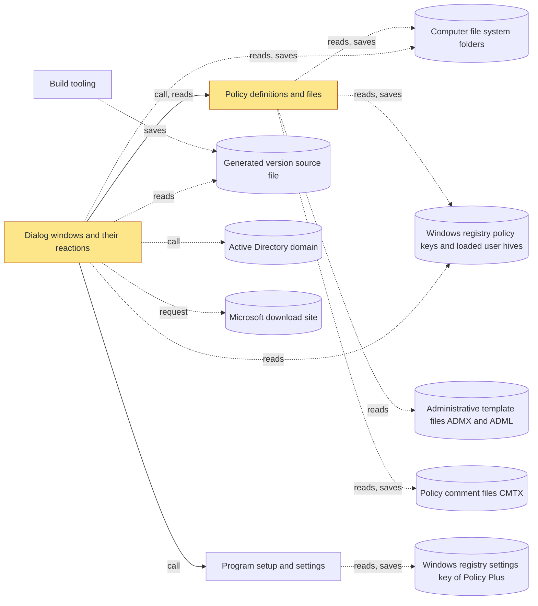
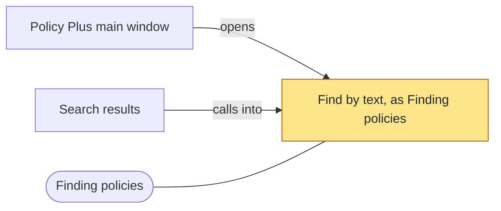

# Legacy reference: Find policies by title, description or comment text

The typed header below maps each criterion of the work item to the rules of the existing system it backs. The reading of the existing code follows it.

## Header

```json
{
  "story": "story-8265cde99e93",
  "fingerprint": "280637421a2d33856d0f4655b9cf3df29c3a1ebf99ebbb84e7839ee4506bf978",
  "criteria": [
    {
      "ac": "AC-1",
      "rules": [
        {
          "says": "Search text is split at spaces into plain words, wildcard words (containing \"*\" or \"?\") and quoted phrases. Words are lowercased and trimmed and lose the characters . , ' \" ; / ! ( ) { } [ ].",
          "where": {
            "file": "PolicyPlus/FindByText.vb",
            "firstLine": 25,
            "lastLine": 49
          },
          "doubt": ""
        }
      ]
    },
    {
      "ac": "AC-2",
      "rules": [
        {
          "says": "A phrase opened with a double quote runs until a later word ending in a double quote; a phrase never closed is dropped without telling the person, which widens the search. A single quoted word such as \"abc\" does not close itself, so it also absorbs the following words.",
          "where": {
            "file": "PolicyPlus/FindByText.vb",
            "firstLine": 36,
            "lastLine": 45
          },
          "doubt": "Two different weaknesses and a rule are merged in one record: an unclosed opening quote drops the phrase silently, and a one-word quoted term such as \"abc\" never closes itself (the branch at 42-43 does not test for an ending quote) so it absorbs the following words up to the next word ending in a quote, or is dropped with them. The previous review asked for the unclosed-quote weakness as its own finding; it is still only inside a rule. Keep the rule as how a phrase is read, and write each weakness as its own fact with its lines and a risk."
        }
      ]
    },
    {
      "ac": "AC-3",
      "rules": [
        {
          "says": "A text is a hit only when it contains every plain word as a whole word, every wildcard matching some word, and every quoted phrase as whole words together.",
          "where": {
            "file": "PolicyPlus/FindByText.vb",
            "firstLine": 51,
            "lastLine": 58
          },
          "doubt": ""
        }
      ]
    },
    {
      "ac": "AC-4",
      "rules": [
        {
          "says": "A policy matches when the ticked attributes hit: its title, its description, or a comment on it from any supplied comment source (user or computer). Any one hit is enough.",
          "where": {
            "file": "PolicyPlus/FindByText.vb",
            "firstLine": 59,
            "lastLine": 70
          },
          "doubt": ""
        }
      ]
    }
  ],
  "reliesOn": [
    {
      "says": "When none of In title, In description and In comment is ticked, the search is refused with \"At least one attribute must be searched. Check one of the boxes and try again.\"; all three start ticked.",
      "builtBy": "Refuse unusable text searches and cancel with Escape"
    },
    {
      "says": "When Search is pressed with the search text empty, the search is refused and the person is told \"Please enter search terms.\"",
      "builtBy": "Refuse unusable text searches and cancel with Escape"
    }
  ],
  "data": [
    {
      "kind": "Policy setting",
      "access": "reads and saves"
    }
  ],
  "transitions": [],
  "outsideSystems": [
    "Computer file system folders",
    "Windows registry policy keys and loaded user hives"
  ],
  "cited": [
    {
      "file": "PolicyPlus/FindByText.vb",
      "firstLine": 11,
      "lastLine": 73
    },
    {
      "file": "PolicyPlus/FindByText.vb",
      "firstLine": 25,
      "lastLine": 49
    },
    {
      "file": "PolicyPlus/FindByText.vb",
      "firstLine": 36,
      "lastLine": 45
    },
    {
      "file": "PolicyPlus/FindByText.vb",
      "firstLine": 51,
      "lastLine": 58
    },
    {
      "file": "PolicyPlus/FindByText.vb",
      "firstLine": 59,
      "lastLine": 70
    },
    {
      "file": "PolicyPlus/FindByText.vb",
      "firstLine": 4,
      "lastLine": 7
    }
  ]
}
```

## What each criterion must keep

### AC-1

- Search text is split at spaces into plain words, wildcard words (containing "*" or "?") and quoted phrases. Words are lowercased and trimmed and lose the characters . , ' " ; / ! ( ) { } [ ]. (PolicyPlus/FindByText.vb:25-49)

### AC-2

- A phrase opened with a double quote runs until a later word ending in a double quote; a phrase never closed is dropped without telling the person, which widens the search. A single quoted word such as "abc" does not close itself, so it also absorbs the following words. (PolicyPlus/FindByText.vb:36-45) Doubt: Two different weaknesses and a rule are merged in one record: an unclosed opening quote drops the phrase silently, and a one-word quoted term such as "abc" never closes itself (the branch at 42-43 does not test for an ending quote) so it absorbs the following words up to the next word ending in a quote, or is dropped with them. The previous review asked for the unclosed-quote weakness as its own finding; it is still only inside a rule. Keep the rule as how a phrase is read, and write each weakness as its own fact with its lines and a risk.

### AC-3

- A text is a hit only when it contains every plain word as a whole word, every wildcard matching some word, and every quoted phrase as whole words together. (PolicyPlus/FindByText.vb:51-58)

### AC-4

- A policy matches when the ticked attributes hit: its title, its description, or a comment on it from any supplied comment source (user or computer). Any one hit is enough. (PolicyPlus/FindByText.vb:59-70)

## Relies on, built elsewhere

- When none of In title, In description and In comment is ticked, the search is refused with "At least one attribute must be searched. Check one of the boxes and try again."; all three start ticked. Built by: Refuse unusable text searches and cancel with Escape.
- When Search is pressed with the search text empty, the search is refused and the person is told "Please enter search terms." Built by: Refuse unusable text searches and cancel with Escape.

## Reading of the existing code

# Screen: Find by text, as Finding policies

At a glance: 6 owned rules, 0 relied on, 2 actions, 4 files (1 own, 0 relied on, 2 of neighbour screens, 1 generated), 1 disputed.

How to read it: paths are relative to the source root and `file:a-b` is an inclusive line range. `BR-` rules, `ACT-` actions, `TR-` changes of state and `RK-` risks have stable ids. A record marked disputed was challenged in review and kept; the reviewer's words are under Trust. All of it was read from the code; nothing was run.

## Product context
Policy Plus is a Windows desktop editor for Group Policy settings, used by administrators and power users. It reads Microsoft's policy definition files and edits policy files directly, so it works on any Windows edition, including Home, which lacks the built-in editor.
Built with: .NET Framework v4.5.2, Microsoft Windows, System.DirectoryServices, System.Xml, Visual Basic .NET, Windows Forms (Policy Plus desktop editor).
Runs: It runs on the user's own Windows computer as one desktop program on .NET Framework 4.5.2. It asks for elevated rights when available but starts without them; loading registry hives, refreshing policy and editing local Group Policy files need them. It can also reach the domain's shared policy folder.
Reaches outside itself: Computer file system folders; Windows registry policy keys and loaded user hives; Administrative template files (ADMX and ADML); Windows registry settings key of Policy Plus; Generated version source file; Policy comment files (CMTX); Active Directory domain; Microsoft download site.



## Where this sits
Part of: Finding policies (Reading policy definitions).



## Boundary
- Opened by **Policy Plus main window** (bundle: screen policy-plus-main-window), at `PolicyPlus/Main.vb:645-650`
- Called from **Search results** (bundle: screen search-results), at `PolicyPlus/FindResults.vb:47-90`

## Contract: what it must do
### Find by text
Search policy text for words, in the attributes you choose.
Controls (5): Button: SearchButton; CheckBox: CommentCheckbox, DescriptionCheckbox, TitleCheckbox; TextBox: StringTextbox

Actions
- **ACT-71669922** Closes the dialog as cancelled when Escape is pressed — `PolicyPlus/FindByText.vb:8-10`; started by person
- **ACT-88592289** Checks the typed search text and chosen attributes and builds the policy search function — `PolicyPlus/FindByText.vb:11-73`; started by person

Rules
- **BR-07352856** When Search is pressed with the search text empty, the search is refused and the person is told "Please enter search terms." — `PolicyPlus/FindByText.vb:12-16`
- **BR-65764837** When none of In title, In description and In comment is ticked, the search is refused with "At least one attribute must be searched. Check one of the boxes and try again."; all three start ticked. — `PolicyPlus/FindByText.vb:17-23`; also rests on `PolicyPlus/FindByText.Designer.vb:42`, `PolicyPlus/FindByText.Designer.vb:54`, `PolicyPlus/FindByText.Designer.vb:66`
- **BR-79544771** Search text is split at spaces into plain words, wildcard words (containing "*" or "?") and quoted phrases. Words are lowercased and trimmed and lose the characters . , ' " ; / ! ( ) { } [ ]. — `PolicyPlus/FindByText.vb:25-49`
- **BR-88029346** A phrase opened with a double quote runs until a later word ending in a double quote; a phrase never closed is dropped without telling the person, which widens the search. A single quoted word such as "abc" does not close itself, so it also absorbs the following words. — `PolicyPlus/FindByText.vb:36-45`; **disputed**
- **BR-85082056** A text is a hit only when it contains every plain word as a whole word, every wildcard matching some word, and every quoted phrase as whole words together. — `PolicyPlus/FindByText.vb:51-58`
- **BR-56979448** A policy matches when the ticked attributes hit: its title, its description, or a comment on it from any supplied comment source (user or computer). Any one hit is enough. — `PolicyPlus/FindByText.vb:59-70`; also rests on `PolicyPlus/FindByText.vb:4-7`


## Trust: what to doubt
**Challenged in review and kept**
- **BR-88029346** `PolicyPlus/FindByText.vb:36-45`: Two different weaknesses and a rule are merged in one record: an unclosed opening quote drops the phrase silently, and a one-word quoted term such as "abc" never closes itself (the branch at 42-43 does not test for an ending quote) so it absorbs the following words up to the next word ending in a quote, or is dropped with them. The previous review asked for the unclosed-quote weakness as its own finding; it is still only inside a rule. Keep the rule as how a phrase is read, and write each weakness as its own fact with its lines and a risk.


## Read order
| Tier | File | Lines | Why |
| --- | --- | --- | --- |
| own | `PolicyPlus/FindByText.vb` | whole file | starts 2 actions; decides 6 owned rules |
| neighbour screen | `PolicyPlus/FindResults.vb` | 47-90 | calls into this screen: Search results |
| neighbour screen | `PolicyPlus/Main.vb` | 645-650 | opens this screen: Policy Plus main window |
| generated | `PolicyPlus/FindByText.Designer.vb` | 42, 54, 66 | generated layout; rules cite these lines, the controls table replaces the rest |

## Source

### PolicyPlus/FindByText.vb
```
1: Public Class FindByText
2:     Dim CommentSources() As Dictionary(Of String, String)
3:     Public Searcher As Func(Of PolicyPlusPolicy, Boolean)
4:     Public Function PresentDialog(ParamArray CommentDicts() As Dictionary(Of String, String)) As DialogResult
5:         CommentSources = CommentDicts.Where(Function(d) d IsNot Nothing).ToArray
6:         Return ShowDialog()
7:     End Function
8:     Private Sub FindByText_KeyUp(sender As Object, e As KeyEventArgs) Handles Me.KeyUp
9:         If e.KeyCode = Keys.Escape Then DialogResult = DialogResult.Cancel
10:     End Sub
11:     Private Sub SearchButton_Click(sender As Object, e As EventArgs) Handles SearchButton.Click
12:         Dim text = StringTextbox.Text
13:         If text = "" Then
14:             MsgBox("Please enter search terms.", MsgBoxStyle.Exclamation)
15:             Exit Sub
16:         End If
17:         Dim checkTitle = TitleCheckbox.Checked
18:         Dim checkDesc = DescriptionCheckbox.Checked
19:         Dim checkComment = CommentCheckbox.Checked
20:         If Not (checkTitle Or checkDesc Or checkComment) Then
21:             MsgBox("At least one attribute must be searched. Check one of the boxes and try again.", MsgBoxStyle.Exclamation)
22:             Exit Sub
23:         End If
24:         Searcher = Function(Policy As PolicyPlusPolicy) As Boolean
25:                        Dim cleanupStr = Function(RawText As String) As String
26:                                             Return New String(Trim(RawText.ToLowerInvariant).Where(Function(c) Not ".,'"";/!(){}[]".Contains(c)).ToArray)
27:                                         End Function
28:                        ' Parse the query string for wildcards or quoted strings
29:                        Dim rawSplitted = Split(text)
30:                        Dim simpleWords As New List(Of String)
31:                        Dim wildcards As New List(Of String)
32:                        Dim quotedStrings As New List(Of String)
33:                        Dim partialQuotedString As String = ""
34:                        For n = 0 To rawSplitted.Length - 1
35:                            Dim curString = rawSplitted(n)
36:                            If partialQuotedString <> "" Then
37:                                partialQuotedString &= curString & " "
38:                                If curString.EndsWith("""") Then
39:                                    quotedStrings.Add(cleanupStr(partialQuotedString))
40:                                    partialQuotedString = ""
41:                                End If
42:                            ElseIf curString.StartsWith("""") Then
43:                                partialQuotedString = curString & " "
44:                            ElseIf curString.Contains("*") Or curString.Contains("?") Then
45:                                wildcards.Add(cleanupStr(curString))
46:                            Else
47:                                simpleWords.Add(cleanupStr(curString))
48:                            End If
49:                        Next
50:                        ' Do the searching
51:                        Dim isStringAHit = Function(SearchedText As String) As Boolean
52:                                               Dim cleanText = cleanupStr(SearchedText)
53:                                               Dim wordsInText = cleanText.Split(" "c, vbCr, vbLf)
54:                                               Return simpleWords.All(Function(w) wordsInText.Contains(w)) And ' Plain search terms
55:                                                 wildcards.All(Function(w) wordsInText.Any(Function(wit) wit Like w)) And ' Wildcards
56:                                                 quotedStrings.All(Function(w) cleanText.Contains(" " & w & " ") Or cleanText.StartsWith(w & " ") Or ' Quoted strings
57:                                                     cleanText.EndsWith(" " & w) Or cleanText = w)
58:                                           End Function
59:                        If checkTitle Then
60:                            If isStringAHit(Policy.DisplayName) Then Return True
61:                        End If
62:                        If checkDesc Then
63:                            If isStringAHit(Policy.DisplayExplanation) Then Return True
64:                        End If
65:                        If checkComment Then
66:                            If CommentSources.Any(Function(Source As Dictionary(Of String, String))
67:                                                      Return Source.ContainsKey(Policy.UniqueID) AndAlso isStringAHit(Source(Policy.UniqueID))
68:                                                  End Function) Then Return True
69:                        End If
70:                        Return False
71:                    End Function
72:         DialogResult = DialogResult.OK
73:     End Sub
74: End Class
```

### PolicyPlus/FindResults.vb
```
47:     Sub SearchJob(Workspace As AdmxBundle, Searcher As Func(Of PolicyPlusPolicy, Boolean))
48:         ' The long-running task that searches all the policies
49:         Dim searchedSoFar As Integer = 0
50:         Dim results As Integer = 0
51:         Dim stoppedByCancel As Boolean = False
52:         Dim pendingInsertions As New List(Of PolicyPlusPolicy)
53:         Dim addPendingInsertions = Sub()
54:                                        ResultsListview.BeginUpdate()
55:                                        For Each insert In pendingInsertions
56:                                            Dim lsvi = ResultsListview.Items.Add(insert.DisplayName)
57:                                            lsvi.Tag = insert
58:                                            lsvi.SubItems.Add(insert.Category.DisplayName)
59:                                        Next
60:                                        ResultsListview.EndUpdate()
61:                                        pendingInsertions.Clear()
62:                                    End Sub
63:         For Each policy In Workspace.Policies
64:             If Threading.Thread.VolatileRead(CancelingSearch) Then
65:                 stoppedByCancel = True
66:                 Exit For
67:             End If
68:             searchedSoFar += 1
69:             Dim isHit = Searcher(policy.Value) ' The potentially expensive check
70:             If isHit Then
71:                 results += 1
72:                 pendingInsertions.Add(policy.Value)
73:             End If
74:             If searchedSoFar Mod 20 = 0 Then ' UI updating is costly
75:                 Invoke(Sub()
76:                            addPendingInsertions()
77:                            SearchProgress.Value = searchedSoFar
78:                            ProgressLabel.Text = "Searching: checked " & searchedSoFar & " policies so far, found " & results & " hits"
79:                        End Sub)
80:             End If
81:         Next
82:         If stoppedByCancel AndAlso CBool(Threading.Thread.VolatileRead(CancelDueToFormClose)) Then Exit Sub ' Avoid accessing a disposed object
83:         Invoke(Sub()
84:                    addPendingInsertions()
85:                    Dim status As String = If(stoppedByCancel, "Search canceled", "Finished searching")
86:                    ProgressLabel.Text = status & ": checked " & searchedSoFar & " policies, found " & results & " hits"
87:                    SearchProgress.Value = SearchProgress.Maximum
88:                    StopButton.Enabled = False
89:                End Sub)
90:     End Sub
```

### PolicyPlus/Main.vb
```
645:     Private Sub ByTextToolStripMenuItem_Click(sender As Object, e As EventArgs) Handles ByTextToolStripMenuItem.Click
646:         ' Show the Find By Text window and start the search
647:         If FindByText.PresentDialog(UserComments, CompComments) = DialogResult.OK Then
648:             ShowSearchDialog(FindByText.Searcher)
649:         End If
650:     End Sub
```

