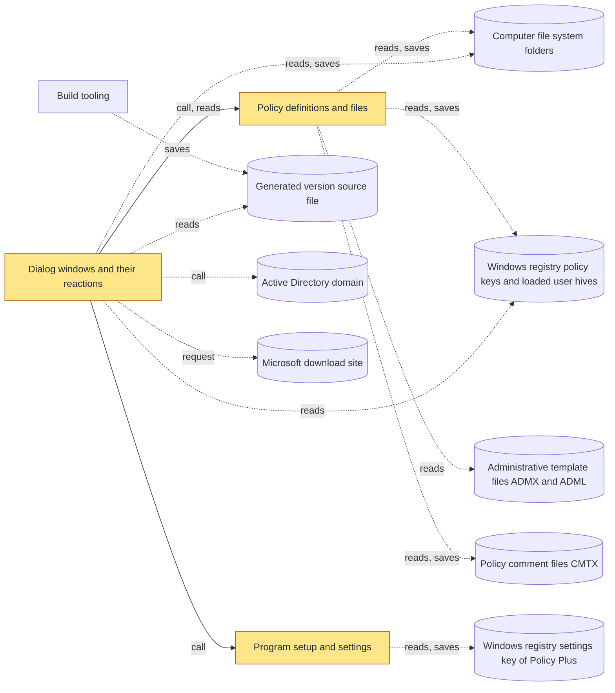
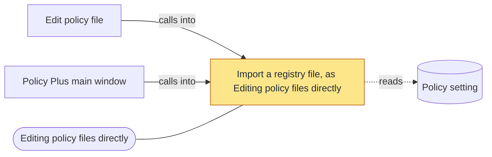
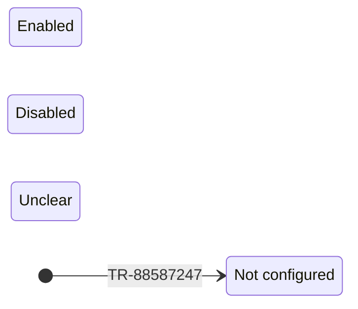
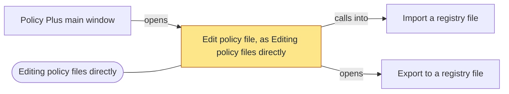

# Legacy reference: Choose an exported settings file and have its key prefix worked out

The typed header below maps each criterion of the work item to the rules of the existing system it backs. The reading of the existing code follows it.

## Header

```json
{
  "story": "story-846c871c0fec",
  "fingerprint": "280637421a2d33856d0f4655b9cf3df29c3a1ebf99ebbb84e7839ee4506bf978",
  "criteria": [
    {
      "ac": "AC-1",
      "rules": [
        {
          "says": "Only files of type *.reg are offered by the file chooser when browsing for the REG file.",
          "where": {
            "file": "PolicyPlus/ImportReg.vb",
            "firstLine": 10,
            "lastLine": 11
          },
          "doubt": ""
        }
      ]
    },
    {
      "ac": "AC-2",
      "rules": [
        {
          "says": "A REG file is refused when its first line is not 'Windows Registry Editor Version 5.00', with the message 'Incorrect REG signature'.",
          "where": {
            "file": "PolicyPlus/RegFile.vb",
            "firstLine": 47,
            "lastLine": 47
          },
          "doubt": ""
        }
      ]
    },
    {
      "ac": "AC-3",
      "rules": [
        {
          "says": "Blank lines and lines starting with a semicolon in a REG file are ignored.",
          "where": {
            "file": "PolicyPlus/RegFile.vb",
            "firstLine": 42,
            "lastLine": 42
          },
          "doubt": ""
        }
      ]
    },
    {
      "ac": "AC-4",
      "rules": [
        {
          "says": "A REG key header starting with a minus sign marks the whole key for removal. Otherwise it opens a key whose values follow.",
          "where": {
            "file": "PolicyPlus/RegFile.vb",
            "firstLine": 54,
            "lastLine": 59
          },
          "doubt": ""
        }
      ]
    },
    {
      "ac": "AC-5",
      "rules": [
        {
          "says": "A REG file value line starting with an at sign is the key's default value, with an empty name.",
          "where": {
            "file": "PolicyPlus/RegFile.vb",
            "firstLine": 65,
            "lastLine": 67
          },
          "doubt": ""
        },
        {
          "says": "A REG file is reported as holding default values when any value has an empty name.",
          "where": {
            "file": "PolicyPlus/RegFile.vb",
            "firstLine": 298,
            "lastLine": 300
          },
          "doubt": ""
        }
      ]
    },
    {
      "ac": "AC-6",
      "rules": [
        {
          "says": "In a REG file, a value written as a bare minus sign is a value to delete. A quoted value is text, 'dword:' is a 32-bit number in hexadecimal, and 'hex' is bytes, typed by the number in brackets or binary if none. Data in none of these forms is kept as a value with no data and no type, with no error, and applying it writes an empty value or fails.",
          "where": {
            "file": "PolicyPlus/RegFile.vb",
            "firstLine": 65,
            "lastLine": 104
          },
          "doubt": ""
        }
      ]
    },
    {
      "ac": "AC-7",
      "rules": [
        {
          "says": "The prefix of a REG file is guessed from its first key only. For a key starting with 'HKEY_USERS\\' it is that hive plus the user identifier. For any other key, including HKEY_CURRENT_USER, it is the hive name alone. A first key with no further backslash gives an empty prefix. A file with no keys gets 'HKEY_LOCAL_MACHINE\\'.",
          "where": {
            "file": "PolicyPlus/RegFile.vb",
            "firstLine": 284,
            "lastLine": 297
          },
          "doubt": ""
        }
      ]
    },
    {
      "ac": "AC-8",
      "rules": [
        {
          "says": "When a REG file is chosen and the prefix is empty, the prefix is guessed from the file; if the file holds default values, the person is warned \"This REG file contains data for default values, which cannot be applied to all policy sources.\"",
          "where": {
            "file": "PolicyPlus/ImportReg.vb",
            "firstLine": 9,
            "lastLine": 24
          },
          "doubt": ""
        }
      ]
    },
    {
      "ac": "AC-9",
      "rules": [
        {
          "says": "When the guess fails, the person is only warned \"An error occurred while trying to guess the prefix.\" and the prefix stays empty.",
          "where": {
            "file": "PolicyPlus/ImportReg.vb",
            "firstLine": 19,
            "lastLine": 21
          },
          "doubt": ""
        }
      ]
    },
    {
      "ac": "AC-10",
      "rules": [
        {
          "says": "Import is refused with \"Please specify a REG file to import.\" when no file is named, and with \"Please specify the prefix used to fully qualify paths in the REG file.\" when no prefix is given.",
          "where": {
            "file": "PolicyPlus/ImportReg.vb",
            "firstLine": 29,
            "lastLine": 36
          },
          "doubt": ""
        }
      ]
    },
    {
      "ac": "AC-11",
      "rules": [
        {
          "says": "Pressing Escape closes Import REG as cancelled.",
          "where": {
            "file": "PolicyPlus/ImportReg.vb",
            "firstLine": 25,
            "lastLine": 27
          },
          "doubt": ""
        }
      ]
    }
  ],
  "reliesOn": [
    {
      "says": "When the Registry.pol of a POL file source, the local Group Policy or a per-user Group Policy does not exist, it is created empty with its folder and treated as writable; a mistyped SID therefore creates a new folder and empty file under the per-user policy folder. If creation fails, an empty read-only source is used and no error is shown.",
      "builtBy": "Provide an empty scratch source and policy files on the machine"
    },
    {
      "says": "A source read through the file branch covers a POL file, the local Group Policy and a per-user Group Policy, each with a Registry.pol path. An existing file is loaded; it is writable only when it can be opened for reading and writing, otherwise it can be viewed but not committed.",
      "builtBy": "Provide an empty scratch source and policy files on the machine"
    },
    {
      "says": "When OK is pressed, the user source is created from the selected choice: Local GPO, Registry, POL file, per-user GPO (SID typed), user hive (file path typed), or Scratch space otherwise. If it cannot be created, the person is told \"The user policy loader could not be created.\" followed by the reason, and the dialog stays open; the dialog closes as accepted only when both sources were created.",
      "builtBy": "Open the chosen policy sources and keep the view on a visible category"
    },
    {
      "says": "When OK is pressed, the computer source is created from the selected choice: Local GPO, Registry (path typed), POL file (name typed), or Scratch space when none of the others is selected. If it cannot be created, the person is told \"The computer policy loader could not be created.\" followed by the reason, and the dialog stays open.",
      "builtBy": "Open the chosen policy sources and keep the view on a visible category"
    },
    {
      "says": "Pressing Escape closes the user dialog as cancelled.",
      "builtBy": "Let a person leave the user entry without choosing a user"
    }
  ],
  "data": [
    {
      "kind": "Program preference",
      "access": "reads and saves"
    },
    {
      "kind": "Policy setting",
      "access": "reads and saves"
    }
  ],
  "transitions": [],
  "outsideSystems": [
    "Windows registry settings key of Policy Plus",
    "Computer file system folders",
    "Windows registry policy keys and loaded user hives"
  ],
  "steps": [
    {
      "intent": "Choose the exported machine settings and the policy source (user or computer) they should be brought into.",
      "change": "merged",
      "reason": "File and destination are given together instead of in separate steps."
    },
    {
      "intent": "Be told what the file contains and how its keys will be named in the source.",
      "change": "inferred",
      "reason": "The system derives the prefix and the warnings instead of making the person type or discover them."
    },
    {
      "intent": "Give a prefix only if the system could not decide one.",
      "change": "deferred",
      "reason": "The prefix is asked only in the rare case it is unknown."
    },
    {
      "intent": "Leave without importing.",
      "change": "kept",
      "reason": "Backing out stays available at every point."
    }
  ],
  "components": [
    {
      "name": "Registry Script Intake",
      "module": "registry-script-intake",
      "layer": "packages/ui"
    },
    {
      "name": "Registry Script Reader",
      "module": "registry-script-reader",
      "layer": "packages/ui"
    },
    {
      "name": "Prefix Guesser",
      "module": "prefix-guesser",
      "layer": "packages/ui"
    }
  ],
  "cited": [
    {
      "file": "PolicyPlus/ImportReg.vb",
      "firstLine": 9,
      "lastLine": 24
    },
    {
      "file": "PolicyPlus/EditPol.vb",
      "firstLine": 276,
      "lastLine": 278
    },
    {
      "file": "PolicyPlus/ImportReg.vb",
      "firstLine": 28,
      "lastLine": 44
    },
    {
      "file": "PolicyPlus/ImportReg.vb",
      "firstLine": 25,
      "lastLine": 27
    },
    {
      "file": "PolicyPlus/ImportReg.vb",
      "firstLine": 10,
      "lastLine": 11
    },
    {
      "file": "PolicyPlus/RegFile.vb",
      "firstLine": 47,
      "lastLine": 47
    },
    {
      "file": "PolicyPlus/RegFile.vb",
      "firstLine": 42,
      "lastLine": 42
    },
    {
      "file": "PolicyPlus/RegFile.vb",
      "firstLine": 54,
      "lastLine": 59
    },
    {
      "file": "PolicyPlus/RegFile.vb",
      "firstLine": 65,
      "lastLine": 67
    },
    {
      "file": "PolicyPlus/RegFile.vb",
      "firstLine": 298,
      "lastLine": 300
    },
    {
      "file": "PolicyPlus/RegFile.vb",
      "firstLine": 65,
      "lastLine": 104
    },
    {
      "file": "PolicyPlus/RegFile.vb",
      "firstLine": 284,
      "lastLine": 297
    },
    {
      "file": "PolicyPlus/ImportReg.vb",
      "firstLine": 9,
      "lastLine": 24
    },
    {
      "file": "PolicyPlus/ImportReg.vb",
      "firstLine": 19,
      "lastLine": 21
    },
    {
      "file": "PolicyPlus/ImportReg.vb",
      "firstLine": 29,
      "lastLine": 36
    },
    {
      "file": "PolicyPlus/ImportReg.vb",
      "firstLine": 25,
      "lastLine": 27
    }
  ]
}
```

## What each criterion must keep

### AC-1

- Only files of type *.reg are offered by the file chooser when browsing for the REG file. (PolicyPlus/ImportReg.vb:10-11)

### AC-2

- A REG file is refused when its first line is not 'Windows Registry Editor Version 5.00', with the message 'Incorrect REG signature'. (PolicyPlus/RegFile.vb:47-47)

### AC-3

- Blank lines and lines starting with a semicolon in a REG file are ignored. (PolicyPlus/RegFile.vb:42-42)

### AC-4

- A REG key header starting with a minus sign marks the whole key for removal. Otherwise it opens a key whose values follow. (PolicyPlus/RegFile.vb:54-59)

### AC-5

- A REG file value line starting with an at sign is the key's default value, with an empty name. (PolicyPlus/RegFile.vb:65-67)
- A REG file is reported as holding default values when any value has an empty name. (PolicyPlus/RegFile.vb:298-300)

### AC-6

- In a REG file, a value written as a bare minus sign is a value to delete. A quoted value is text, 'dword:' is a 32-bit number in hexadecimal, and 'hex' is bytes, typed by the number in brackets or binary if none. Data in none of these forms is kept as a value with no data and no type, with no error, and applying it writes an empty value or fails. (PolicyPlus/RegFile.vb:65-104)

### AC-7

- The prefix of a REG file is guessed from its first key only. For a key starting with 'HKEY_USERS\' it is that hive plus the user identifier. For any other key, including HKEY_CURRENT_USER, it is the hive name alone. A first key with no further backslash gives an empty prefix. A file with no keys gets 'HKEY_LOCAL_MACHINE\'. (PolicyPlus/RegFile.vb:284-297)

### AC-8

- When a REG file is chosen and the prefix is empty, the prefix is guessed from the file; if the file holds default values, the person is warned "This REG file contains data for default values, which cannot be applied to all policy sources." (PolicyPlus/ImportReg.vb:9-24)

### AC-9

- When the guess fails, the person is only warned "An error occurred while trying to guess the prefix." and the prefix stays empty. (PolicyPlus/ImportReg.vb:19-21)

### AC-10

- Import is refused with "Please specify a REG file to import." when no file is named, and with "Please specify the prefix used to fully qualify paths in the REG file." when no prefix is given. (PolicyPlus/ImportReg.vb:29-36)

### AC-11

- Pressing Escape closes Import REG as cancelled. (PolicyPlus/ImportReg.vb:25-27)

## Relies on, built elsewhere

- When the Registry.pol of a POL file source, the local Group Policy or a per-user Group Policy does not exist, it is created empty with its folder and treated as writable; a mistyped SID therefore creates a new folder and empty file under the per-user policy folder. If creation fails, an empty read-only source is used and no error is shown. Built by: Provide an empty scratch source and policy files on the machine.
- A source read through the file branch covers a POL file, the local Group Policy and a per-user Group Policy, each with a Registry.pol path. An existing file is loaded; it is writable only when it can be opened for reading and writing, otherwise it can be viewed but not committed. Built by: Provide an empty scratch source and policy files on the machine.
- When OK is pressed, the user source is created from the selected choice: Local GPO, Registry, POL file, per-user GPO (SID typed), user hive (file path typed), or Scratch space otherwise. If it cannot be created, the person is told "The user policy loader could not be created." followed by the reason, and the dialog stays open; the dialog closes as accepted only when both sources were created. Built by: Open the chosen policy sources and keep the view on a visible category.
- When OK is pressed, the computer source is created from the selected choice: Local GPO, Registry (path typed), POL file (name typed), or Scratch space when none of the others is selected. If it cannot be created, the person is told "The computer policy loader could not be created." followed by the reason, and the dialog stays open. Built by: Open the chosen policy sources and keep the view on a visible category.
- Pressing Escape closes the user dialog as cancelled. Built by: Let a person leave the user entry without choosing a user.

## Reading of the existing code

# Screen: Import a registry file, as Editing policy files directly

At a glance: 6 owned rules, 11 relied on, 3 actions, 5 files (1 own, 2 relied on, 2 of neighbour screens, 0 generated), 0 disputed.

How to read it: paths are relative to the source root and `file:a-b` is an inclusive line range. `BR-` rules, `ACT-` actions, `TR-` changes of state and `RK-` risks have stable ids. A record marked disputed was challenged in review and kept; the reviewer's words are under Trust. All of it was read from the code; nothing was run.

## Product context
Policy Plus is a Windows desktop editor for Group Policy settings, used by administrators and power users. It reads Microsoft's policy definition files and edits policy files directly, so it works on any Windows edition, including Home, which lacks the built-in editor.
Built with: .NET Framework v4.5.2, Microsoft Windows, System.DirectoryServices, System.Xml, Visual Basic .NET, Windows Forms (Policy Plus desktop editor).
Runs: It runs on the user's own Windows computer as one desktop program on .NET Framework 4.5.2. It asks for elevated rights when available but starts without them; loading registry hives, refreshing policy and editing local Group Policy files need them. It can also reach the domain's shared policy folder.
Reaches outside itself: Computer file system folders; Windows registry policy keys and loaded user hives; Administrative template files (ADMX and ADML); Windows registry settings key of Policy Plus; Generated version source file; Policy comment files (CMTX); Active Directory domain; Microsoft download site.



## Where this sits
Part of: Editing policy files directly (Setting and storing policies).



## Boundary
- Called from **Edit policy file** (bundle: screen edit-policy-file), at `PolicyPlus/EditPol.vb:276-278`
- Called from **Policy Plus main window** (bundle: screen policy-plus-main-window), at `PolicyPlus/Main.vb:801-806`

## Contract: what it must do
### Import a registry file
Bring a .reg file into the policy source.
Controls (6): Button, Text = "Browse", TabIndex = 2: ButtonBrowse; Button, Text = "Import", TabIndex = 4: ButtonImport; Label, Text = "Prefix", TabIndex = 3: Label2; Label, Text = "REG file", TabIndex = 0: Label1; TextBox, TabIndex = 1: TextReg; TextBox, TabIndex = 3: TextRoot

Actions
- **ACT-98123777** Lets the person pick a REG file and guesses the key prefix from it. — `PolicyPlus/ImportReg.vb:9-24`; started by person
- **ACT-35897650** Closes the window as cancelled when Escape is pressed. — `PolicyPlus/ImportReg.vb:25-27`; started by person
- **ACT-97518185** Loads the chosen REG file with its prefix and applies it to the policy source. — `PolicyPlus/ImportReg.vb:28-44`; started by person

Rules
- **BR-75244455** When a REG file is chosen and the prefix is empty, the prefix is guessed from the file; if the file holds default values, the person is warned "This REG file contains data for default values, which cannot be applied to all policy sources." — `PolicyPlus/ImportReg.vb:9-24`
- **BR-85597112** Only files of type *.reg are offered by the file chooser when browsing for the REG file. — `PolicyPlus/ImportReg.vb:10-11`
- **BR-47776074** When the guess fails, the person is only warned "An error occurred while trying to guess the prefix." and the prefix stays empty. — `PolicyPlus/ImportReg.vb:19-21`
- **BR-14950967** Pressing Escape closes Import REG as cancelled. — `PolicyPlus/ImportReg.vb:25-27`
- **BR-10483497** Import is refused with "Please specify a REG file to import." when no file is named, and with "Please specify the prefix used to fully qualify paths in the REG file." when no prefix is given. — `PolicyPlus/ImportReg.vb:29-36`
- **BR-60194116** Import loads the REG file with the prefix and applies it straight to the chosen policy source; on any failure the person is told only "Failed to import the REG file." — `PolicyPlus/ImportReg.vb:37-43`


## Relied on: decided elsewhere
**Core code, run by 4 or more other capabilities**
- `PolicyPlus/PolicySource.vb`
  - **BR-77904356** Text read from a policy file stops at its first empty character, and a multiple-string value ends at its first empty string. — `PolicyPlus/PolicySource.vb:231-239`; also rests on `PolicyPlus/PolicySource.vb:281-295`
  - **BR-27765974** A stored policy file value is read back as text for text and expandable text, a 32-bit or 64-bit number for numbers, a list of strings for multiple strings, and raw bytes for every other type. — `PolicyPlus/PolicySource.vb:320-336`

**Code shared with a few capabilities**
- `PolicyPlus/RegFile.vb`
  - **BR-12010511** Blank lines and lines starting with a semicolon in a REG file are ignored. — `PolicyPlus/RegFile.vb:42`
  - **BR-88952070** A REG file is refused when its first line is not 'Windows Registry Editor Version 5.00', with the message 'Incorrect REG signature'. — `PolicyPlus/RegFile.vb:47`
  - **BR-61745927** A REG key header starting with a minus sign marks the whole key for removal. … — `PolicyPlus/RegFile.vb:54-59`
  - **BR-07693227** A REG file value line starting with an at sign is the key's default value, with an empty name. — `PolicyPlus/RegFile.vb:65-67`
  - **BR-28559733** In a REG file, a value written as a bare minus sign is a value to delete. … — `PolicyPlus/RegFile.vb:65-104`
  - **BR-57993299** A REG key name is shortened by the prefix only when it starts with it, regardless of case. … — `PolicyPlus/RegFile.vb:187-189`; also rests on `PolicyPlus/RegFile.vb:276-279`
  - **BR-24755037** When a REG file is applied to a source, a key marked for removal is cleared, a value marked for deletion is deleted and any other value is saved. … — `PolicyPlus/RegFile.vb:260-275`; also rests on `PolicyPlus/RegFile.vb:187-189`
  - **BR-30858390** The prefix of a REG file is guessed from its first key only. … — `PolicyPlus/RegFile.vb:284-297`
  - **BR-20510792** A REG file is reported as holding default values when any value has an empty name. — `PolicyPlus/RegFile.vb:298-300`


## Data and states
- Policy setting: reads; kept in Computer file system folders, Windows registry policy keys and loaded user hives

Life of Policy setting


| Change | From | To | Written at | In this code | Reading |
| --- | --- | --- | --- | --- | --- |
| TR-88587247 | created | Not configured | `PolicyPlus/PolicyLoader.vb:94-100` | no | corrected |

## Trust: what to doubt
**Risks**
- **RK-96299336** [medium] Importing a REG file applies it key by key to the live policy source with no rollback, and a REG source cannot read or forget values. A failure leaves earlier changes in place and the person sees only a general failure message. (Data can end up wrong, lost or inconsistent) — at `PolicyPlus/ImportReg.vb:37-43`, `PolicyPlus/RegFile.vb:260-275`
- **RK-78450586** [medium] Importing a REG file applies it to whichever source is open, live registry or policy file, with no check of the keys it names. The branch limit exists only when a REG file is the target, so an import can write, delete or clear keys outside the policy branches. (Someone can read or change what they should not) — at `PolicyPlus/RegFile.vb:260-275`
- **RK-32327045** [low] Reading a policy file trusts the length stored in each entry and the shape of the data. A damaged or hostile file can demand huge memory or fail unexplained, and REG files report no line number on error. (Input from outside is used without checks, so it can change what the code does) — at `PolicyPlus/RegFile.vb:53`, `PolicyPlus/RegFile.vb:80-95`


## Read order
| Tier | File | Lines | Why |
| --- | --- | --- | --- |
| own | `PolicyPlus/ImportReg.vb` | whole file | starts 3 actions; decides 6 owned rules |
| relied on | `PolicyPlus/PolicySource.vb` | 8-11, 225-227, 231-239, 252-254, 265-271, 281-295, 312-314, 320-336 | decides 2 relied-on rules; called code; used by 6 other capabilities |
| relied on | `PolicyPlus/RegFile.vb` | 21-116, 187-189, 260-279, 284-300 | decides 9 relied-on rules; called code |
| neighbour screen | `PolicyPlus/EditPol.vb` | 276-278 | calls into this screen: Edit policy file |
| neighbour screen | `PolicyPlus/Main.vb` | 801-806 | calls into this screen: Policy Plus main window |

## Source

### PolicyPlus/ImportReg.vb
```
1: Public Class ImportReg
2:     Dim PolicySource As IPolicySource
3:     Public Function PresentDialog(Target As IPolicySource) As DialogResult
4:         TextReg.Text = ""
5:         TextRoot.Text = ""
6:         PolicySource = Target
7:         Return ShowDialog()
8:     End Function
9:     Private Sub ButtonBrowse_Click(sender As Object, e As EventArgs) Handles ButtonBrowse.Click
10:         Using ofd As New OpenFileDialog
11:             ofd.Filter = "Registry scripts|*.reg"
12:             If ofd.ShowDialog() <> DialogResult.OK Then Exit Sub
13:             TextReg.Text = ofd.FileName
14:             If TextRoot.Text = "" Then
15:                 Try
16:                     Dim reg = RegFile.Load(ofd.FileName, "")
17:                     TextRoot.Text = reg.GuessPrefix()
18:                     If reg.HasDefaultValues Then MsgBox("This REG file contains data for default values, which cannot be applied to all policy sources.", MsgBoxStyle.Exclamation)
19:                 Catch ex As Exception
20:                     MsgBox("An error occurred while trying to guess the prefix.", MsgBoxStyle.Exclamation)
21:                 End Try
22:             End If
23:         End Using
24:     End Sub
25:     Private Sub ImportReg_KeyUp(sender As Object, e As KeyEventArgs) Handles Me.KeyUp
26:         If e.KeyCode = Keys.Escape Then DialogResult = DialogResult.Cancel
27:     End Sub
28:     Private Sub ButtonImport_Click(sender As Object, e As EventArgs) Handles ButtonImport.Click
29:         If TextReg.Text = "" Then
30:             MsgBox("Please specify a REG file to import.", MsgBoxStyle.Exclamation)
31:             Exit Sub
32:         End If
33:         If TextRoot.Text = "" Then
34:             MsgBox("Please specify the prefix used to fully qualify paths in the REG file.", MsgBoxStyle.Exclamation)
35:             Exit Sub
36:         End If
37:         Try
38:             Dim reg = RegFile.Load(TextReg.Text, TextRoot.Text)
39:             reg.Apply(PolicySource)
40:             DialogResult = DialogResult.OK
41:         Catch ex As Exception
42:             MsgBox("Failed to import the REG file.", MsgBoxStyle.Exclamation)
43:         End Try
44:     End Sub
45: End Class
```

### PolicyPlus/PolicySource.vb
```
8:     Sub SetValue(Key As String, Value As String, Data As Object, DataType As RegistryValueKind)
9:     Sub ForgetValue(Key As String, Value As String) ' Stop keeping track of a value
10:     Sub DeleteValue(Key As String, Value As String) ' Mark a value as queued for deletion
11:     Sub ClearKey(Key As String) ' Destroy all values in a key
```
```
225:     Public Shared Function BytesToObject(Data As Byte(), Kind As RegistryValueKind) As Object
226:         Return (New PolEntryData With {.Data = Data, .Kind = Kind}).AsArbitrary()
227:     End Function
```
```
231:         Public Function AsString() As String ' Get a UTF-16LE string
232:             Dim sb As New Text.StringBuilder
233:             For x = 0 To (Data.Length \ 2) - 1
234:                 Dim charCode = CInt(Data(x * 2)) + (Data((x * 2) + 1) << 8)
235:                 If charCode = 0 Then Exit For
236:                 sb.Append(ChrW(charCode))
237:             Next
238:             Return sb.ToString
239:         End Function
```
```
252:         Public Function AsDword() As UInteger
253:             Return Data(0) + (CUInt(Data(1)) << 8) + (CUInt(Data(2)) << 16) + (CUInt(Data(3)) << 24)
254:         End Function
```
```
265:         Public Function AsQword() As ULong
266:             Dim value As ULong = 0
267:             For n = 0 To 7
268:                 value += (CULng(Data(n)) << (n * 8))
269:             Next
270:             Return value
271:         End Function
```
```
281:         Public Function AsMultiString() As String()
282:             Dim strings As New List(Of String)
283:             Dim sb As New Text.StringBuilder
284:             For n = 0 To (Data.Length / 2) - 1
285:                 Dim charCode = Data(n * 2) + (Data((n * 2) + 1) << 8)
286:                 If charCode = 0 Then
287:                     If sb.Length = 0 Then Exit For
288:                     strings.Add(sb.ToString)
289:                     sb.Clear()
290:                 Else
291:                     sb.Append(ChrW(charCode))
292:                 End If
293:             Next
294:             Return strings.ToArray
295:         End Function
```
```
312:         Public Function AsBinary() As Byte()
313:             Return Data.Clone
314:         End Function
```
```
320:         Public Function AsArbitrary() As Object
321:             ' Get the data in the best .NET type for it
322:             Select Case Kind
323:                 Case RegistryValueKind.String
324:                     Return AsString()
325:                 Case RegistryValueKind.DWord
326:                     Return AsDword()
327:                 Case RegistryValueKind.ExpandString
328:                     Return AsString()
329:                 Case RegistryValueKind.QWord
330:                     Return AsQword()
331:                 Case RegistryValueKind.MultiString
332:                     Return AsMultiString()
333:                 Case Else
334:                     Return AsBinary()
335:             End Select
336:         End Function
```

### PolicyPlus/RegFile.vb
```
21:     Private Shared Function UnescapeValue(Text As String) As String
22:         ' The reverse of EscapeValue
23:         Dim sb As New Text.StringBuilder
24:         Dim escaping As Boolean = False
25:         For n = 0 To Text.Length - 1
26:             If escaping Then
27:                 sb.Append(Text(n))
28:                 escaping = False
29:             ElseIf Text(n) = "\"c Then
30:                 escaping = True
31:             Else
32:                 sb.Append(Text(n))
33:             End If
34:         Next
35:         Return sb.ToString
36:     End Function
37:     Private Shared Function ReadNonCommentingLine(Reader As StreamReader, Optional StopAt As Char? = Nothing) As String
38:         Do
39:             If Reader.EndOfStream Then Return Nothing
40:             If StopAt.HasValue AndAlso Reader.Peek = Asc(StopAt.Value) Then Return Nothing
41:             Dim line = Reader.ReadLine
42:             If String.IsNullOrWhiteSpace(line) OrElse Trim(line).StartsWith(";") Then Continue Do
43:             Return line
44:         Loop
45:     End Function
46:     Public Shared Function Load(Reader As StreamReader, Prefix As String) As RegFile
47:         If Reader.ReadLine() <> RegSignature Then Throw New InvalidDataException("Incorrect REG signature")
48:         Dim reg As New RegFile
49:         reg.SetPrefix(Prefix)
50:         Do ' Read all the keys
51:             Dim keyHeader = ReadNonCommentingLine(Reader)
52:             If keyHeader Is Nothing Then Exit Do
53:             Dim keyName = keyHeader.Substring(1, keyHeader.Length - 2) ' Remove the brackets
54:             If keyName.StartsWith("-") Then
55:                 ' It's a deleter
56:                 Dim deleterKey As New RegFileKey With {.Name = keyName.Substring(1), .IsDeleter = True}
57:                 reg.Keys.Add(deleterKey)
58:             Else
59:                 Dim key As New RegFileKey With {.Name = keyName}
60:                 Do ' Read all the values
61:                     Dim valueLine = ReadNonCommentingLine(Reader, "["c)
62:                     If valueLine Is Nothing Then Exit Do
63:                     Dim valueName As String = ""
64:                     Dim data As String
65:                     If valueLine.StartsWith("@") Then
66:                         data = valueLine.Substring(2)
67:                     Else
68:                         Dim parts = Split(valueLine, """=", 2)
69:                         valueName = UnescapeValue(parts(0).Substring(1))
70:                         data = parts(1)
71:                     End If
72:                     Dim value As New RegFileValue With {.Name = valueName}
73:                     If data = "-" Then
74:                         value.IsDeleter = True
75:                     ElseIf data.StartsWith("""") Then
76:                         value.Kind = RegistryValueKind.String
77:                         value.Data = UnescapeValue(data.Substring(1, data.Length - 2))
78:                     ElseIf data.StartsWith("dword:") Then
79:                         value.Kind = RegistryValueKind.DWord
80:                         value.Data = UInteger.Parse(data.Substring(6), Globalization.NumberStyles.HexNumber)
81:                     ElseIf data.StartsWith("hex") Then
82:                         Dim indexOfClosingParen = data.IndexOf(")"c)
83:                         Dim curHexLine As String
84:                         If indexOfClosingParen <> -1 Then
85:                             value.Kind = Integer.Parse(data.Substring(4, indexOfClosingParen - 4), Globalization.NumberStyles.HexNumber)
86:                             curHexLine = data.Substring(indexOfClosingParen + 2)
87:                         Else
88:                             value.Kind = RegistryValueKind.Binary
89:                             curHexLine = data.Substring(4)
90:                         End If
91:                         Dim allDehexedBytes As New List(Of Byte)
92:                         Do ' Read all the hex lines
93:                             Dim hexBytes = Split(Trim(curHexLine).TrimEnd("\"c, ","c), ",").Where(Function(s) s <> "")
94:                             For Each b In hexBytes
95:                                 allDehexedBytes.Add(Byte.Parse(b, Globalization.NumberStyles.HexNumber))
96:                             Next
97:                             If curHexLine.EndsWith("\") Then
98:                                 curHexLine = Reader.ReadLine
99:                             Else
100:                                 Exit Do
101:                             End If
102:                         Loop
103:                         value.Data = PolFile.BytesToObject(allDehexedBytes.ToArray, value.Kind)
104:                     End If
105:                     key.Values.Add(value)
106:                 Loop
107:                 reg.Keys.Add(key)
108:             End If
109:         Loop
110:         Return reg
111:     End Function
112:     Public Shared Function Load(File As String, Prefix As String) As RegFile
113:         Using reader As New StreamReader(File)
114:             Return Load(reader, Prefix)
115:         End Using
116:     End Function
```
```
187:     Private Function UnprefixKeyName(Name As String) As String
188:         If Name.StartsWith(Prefix, StringComparison.InvariantCultureIgnoreCase) Then Return Name.Substring(Prefix.Length) Else Return Name
189:     End Function
```
```
260:     Public Sub Apply(Target As IPolicySource)
261:         For Each key In Keys
262:             Dim unprefixedKeyName = UnprefixKeyName(key.Name)
263:             If key.IsDeleter Then
264:                 Target.ClearKey(unprefixedKeyName)
265:             Else
266:                 For Each value In key.Values
267:                     If value.IsDeleter Then
268:                         Target.DeleteValue(unprefixedKeyName, value.Name)
269:                     Else
270:                         Target.SetValue(unprefixedKeyName, value.Name, value.Data, value.Kind)
271:                     End If
272:                 Next
273:             End If
274:         Next
275:     End Sub
276:     Public Sub SetPrefix(Prefix As String)
277:         If Not Prefix.EndsWith("\") Then Prefix &= "\"
278:         Me.Prefix = Prefix
279:     End Sub
```
```
284:     Public Function GuessPrefix() As String
285:         ' Try to determine a reasonable prefix from the data present
286:         If Keys.Count = 0 Then Return "HKEY_LOCAL_MACHINE\" ' Can't do much without any data
287:         Dim firstKeyName = Keys(0).Name
288:         If firstKeyName.StartsWith("HKEY_USERS\") Then
289:             ' The user SID should be part of the prefix
290:             Dim secondSlashPos = firstKeyName.IndexOf("\", 11)
291:             Return firstKeyName.Substring(0, secondSlashPos + 1)
292:         Else
293:             ' Other hives should be just fine
294:             Dim firstSlashPos = firstKeyName.IndexOf("\")
295:             Return firstKeyName.Substring(0, firstSlashPos + 1)
296:         End If
297:     End Function
298:     Public Function HasDefaultValues() As Boolean
299:         Return Keys.Any(Function(k) k.Values.Any(Function(v) v.Name = ""))
300:     End Function
```

### PolicyPlus/EditPol.vb
```
276:     Private Sub ButtonImport_Click(sender As Object, e As EventArgs) Handles ButtonImport.Click
277:         If ImportReg.PresentDialog(EditingPol) = DialogResult.OK Then UpdateTree()
278:     End Sub
```

### PolicyPlus/Main.vb
```
801:     Private Sub ImportREGToolStripMenuItem_Click(sender As Object, e As EventArgs) Handles ImportREGToolStripMenuItem.Click
802:         If OpenSection.PresentDialog(True, True) = DialogResult.OK Then
803:             Dim source = If(OpenSection.SelectedSection = AdmxPolicySection.Machine, CompPolicySource, UserPolicySource)
804:             If ImportReg.PresentDialog(source) = DialogResult.OK Then MoveToVisibleCategoryAndReload()
805:         End If
806:     End Sub
```


---

# Screen: Edit policy file, as Editing policy files directly

At a glance: 20 owned rules, 17 relied on, 10 actions, 14 files (7 own, 3 relied on, 1 of neighbour screens, 3 generated), 1 disputed.

How to read it: paths are relative to the source root and `file:a-b` is an inclusive line range. `BR-` rules, `ACT-` actions, `TR-` changes of state and `RK-` risks have stable ids. A record marked disputed was challenged in review and kept; the reviewer's words are under Trust. All of it was read from the code; nothing was run.

## Product context
Policy Plus is a Windows desktop editor for Group Policy settings, used by administrators and power users. It reads Microsoft's policy definition files and edits policy files directly, so it works on any Windows edition, including Home, which lacks the built-in editor.
Built with: .NET Framework v4.5.2, Microsoft Windows, System.DirectoryServices, System.Xml, Visual Basic .NET, Windows Forms (Policy Plus desktop editor).
Runs: It runs on the user's own Windows computer as one desktop program on .NET Framework 4.5.2. It asks for elevated rights when available but starts without them; loading registry hives, refreshing policy and editing local Group Policy files need them. It can also reach the domain's shared policy folder.
Reaches outside itself: Computer file system folders; Windows registry policy keys and loaded user hives; Administrative template files (ADMX and ADML); Windows registry settings key of Policy Plus; Generated version source file; Policy comment files (CMTX); Active Directory domain; Microsoft download site.


## Where this sits
Part of: Editing policy files directly (Setting and storing policies).



## Boundary
- Opened by **Policy Plus main window** (bundle: screen policy-plus-main-window), at `PolicyPlus/Main.vb:776-794`
- Calls into **Import a registry file** (bundle: screen import-a-registry-file), at `PolicyPlus/EditPol.vb:276-278`
- Opens **Export to a registry file** (bundle: screen export-to-a-registry-file), at `PolicyPlus/EditPol.vb:279-283`

## Contract: what it must do
### Edit policy file
Browse a policy file and, in steps, add keys and values, edit text, number and list values, or choose what to delete.
Controls (42): Button: ButtonOK, ButtonOK, ButtonOK, ButtonOK, ButtonOK, ButtonOK; CheckBox: CheckHexadecimal; ComboBox: ComboKind; Friend WithEvents ButtonAddKey As Button: ButtonAddKey; Friend WithEvents ButtonAddValue As Button: ButtonAddValue; Friend WithEvents ButtonDeleteValue As Button: ButtonDeleteValue; Friend WithEvents ButtonEdit As Button: ButtonEdit; Friend WithEvents ButtonExport As Button: ButtonExport; Friend WithEvents ButtonForget As Button: ButtonForget; Friend WithEvents ButtonImport As Button: ButtonImport; Friend WithEvents ButtonSave As Button: ButtonSave; Friend WithEvents ChItem As ColumnHeader: ChItem; Friend WithEvents ChValue As ColumnHeader: ChValue; Friend WithEvents LsvPol As ListView: LsvPol; Label: Label1, Label1, Label1, Label2, Label1, Label2, Label1, Label2, Label1, Label2; RadioButton: OptClearFirst, OptDeleteOne, OptPurge; TextBox: TextKey, TextValueName, TextName, TextData, TextName, TextName, TextData, TextName, TextName; WideRangeNumericUpDown: NumData

Actions
- **ACT-07221398** Closes the editor window with an OK result; the changes were already applied to the policy source as each was made. — `PolicyPlus/EditPol.vb:84-86`; started by person
- **ACT-82575863** Closes the editor window with a Cancel result when Escape is pressed; edits already made stay applied to the policy source. — `PolicyPlus/EditPol.vb:87-89`; started by person
- **ACT-40976475** Asks for a new key name, checks it is valid and free, and adds the empty key to the policy file. — `PolicyPlus/EditPol.vb:113-129`; started by person
- **ACT-81241997** Asks for a value name and type, then its data, and adds the value under the selected key. — `PolicyPlus/EditPol.vb:154-173`; started by person
- **ACT-56009541** Marks a value for deletion, or clears or purges a selected key, as the person chooses. — `PolicyPlus/EditPol.vb:174-207`; started by person
- **ACT-48691736** Removes a key with its contents, or one value, from the policy file without leaving a deletion mark. — `PolicyPlus/EditPol.vb:208-238`; started by person
- **ACT-78247457** Asks for new data for the selected value and stores it in the policy file. — `PolicyPlus/EditPol.vb:239-247`; started by person
- **ACT-33371644** Turns the editor buttons on or off to match the kind of item selected in the list. — `PolicyPlus/EditPol.vb:248-275`; started by person
- **ACT-34566054** Opens the registry file import dialog and refreshes the list if values were imported. — `PolicyPlus/EditPol.vb:276-278`; started by person
- **ACT-60817029** Opens the registry file export dialog for the selected key. — `PolicyPlus/EditPol.vb:279-283`; started by person

Rules
- **BR-28227620** The raw policy file editor lists keys in alphabetical order ignoring case, each followed by its sub-keys indented, then its values in alphabetical order; a value with an empty name (the marker that keeps an empty key) is not listed. — `PolicyPlus/EditPol.vb:11-28`
- **BR-53716006** Special deletion entries in a policy file are listed as such: "**deletevalues" as "Delete values" with its data, "**del.<name>" as "Delete value" with the name, and entries starting "**delvals" as "Delete all values". They cannot be edited or deleted. — `PolicyPlus/EditPol.vb:29-47`; also rests on `PolicyPlus/EditPol.vb:266-273`
- **BR-53390545** Ordinary values are listed with their content: lists of text joined by spaces, text as it is, 32-bit and 64-bit numbers in decimal, binary data as hexadecimal bytes separated by spaces. Other kinds show no content. — `PolicyPlus/EditPol.vb:48-68`
- **BR-67742264** Pressing Done (or Enter) closes the raw policy editor as accepted, and pressing Escape closes it as cancelled; there is no Cancel button. The caller ignores the answer, so every change made in the editor stays on the loaded policy source either way, to reach disk only when policies are saved. — `PolicyPlus/EditPol.vb:84-86`; also rests on `PolicyPlus/EditPol.vb:87-89`, `PolicyPlus/EditPol.Designer.vb:23-165`, `PolicyPlus/Main.vb:789-793`
- **BR-28019814** A new key name is refused with "The key name is not valid." when it contains a backslash. — `PolicyPlus/EditPol.vb:107-109`; also rests on `PolicyPlus/EditPol.vb:116-119`
- **BR-00337722** A new key name is refused with "The key name is already taken." when a key of that name, ignoring case, already exists under the same parent. — `PolicyPlus/EditPol.vb:110-112`; also rests on `PolicyPlus/EditPol.vb:120-124`
- **BR-84124479** Adding a key does nothing when the name is left empty or the dialog is cancelled; otherwise the key is created under the selected key, or at the top level when nothing is selected, as an empty key, and is selected in the list. — `PolicyPlus/EditPol.vb:113-129`
- **BR-83946147** Editing a value offers a text, number or list-of-text dialog by kind: text kinds (plain and expandable) a text box, 32-bit and 64-bit numbers a number box, lists of text a multi-line box. Any other kind, such as binary, is refused with "This value kind is not supported." and nothing changes. Cancelling the dialog leaves the value as it was. — `PolicyPlus/EditPol.vb:130-153`
- **BR-19389302** Adding a value to the selected key lets the person choose a name and one of five kinds; the starting data is empty text, zero, or an empty list by kind, and the value is stored only if the person then confirms its data. A value of the same name in that key is replaced without warning. — `PolicyPlus/EditPol.vb:154-173`; also rests on `PolicyPlus/EditPolValue.vb:11-26`
- **BR-51133419** Deleting a key offers three choices, and OK does nothing until one is chosen; cancelling or Escape changes nothing. Clear everything removes all values and marks the key cleared. Clear first marks the key cleared and puts back only its existing direct values with ordinary content; deletion entries already in that key are lost and values of sub-keys are not put back. Delete one value is refused with "You must enter a value name." when the name is empty; otherwise any value of that name, whether or not it exists, is removed and replaced by a deletion entry. — `PolicyPlus/EditPol.vb:176-198`; also rests on `PolicyPlus/EditPolDelete.vb:10-19`, `PolicyPlus/EditPol.vb:184-194`, `PolicyPlus/PolicySource.vb:183-189`; **disputed**
- **BR-84860836** Deleting a single value from the list does not erase it from the file: it is replaced by a deletion entry named "**del." followed by the value name, which removes the value on the machine when policies are applied. — `PolicyPlus/EditPol.vb:201-206`
- **BR-52685329** Forgetting a key asks "Are you sure you want to remove this key and all its contents?" and, on Yes, removes the key, all its sub-keys, every value and every clearing mark from the file with no deletion left behind; No changes nothing. Forgetting a value removes the value and its deletion entry the same way. — `PolicyPlus/EditPol.vb:211-228`
- **BR-74889498** Editing a value replaces its data with the confirmed new data and keeps its name and kind; the value stays selected. — `PolicyPlus/EditPol.vb:240-246`
- **BR-70748705** When nothing is selected in the policy file's list, only Add key and Export are available; Add value, Delete value, Edit and Forget are unavailable. — `PolicyPlus/EditPol.vb:250-256`
- **BR-67793315** When a value is selected in the list, only Forget is always available; Add key, Add value and Export are unavailable, and Edit and Delete value are available only when the value is not already a delete marker. — `PolicyPlus/EditPol.vb:259-273`
- **BR-79429124** When a key is selected in the list, Add key, Add value, Delete value, Forget and Export are available, and Edit is unavailable. — `PolicyPlus/EditPol.vb:259-265`
- **BR-64259103** The export dialog starts with the selected key as its source branch, or empty when nothing is selected. The branch can be typed over, and the export uses the text in the box at the time: an empty box exports all of the policy file. — `PolicyPlus/EditPol.vb:280-282`; also rests on `PolicyPlus/ExportReg.vb:5`, `PolicyPlus/ExportReg.vb:26`, `PolicyPlus/ExportReg.Designer.vb:74-89`
- **BR-58208174** When the key name dialog is confirmed, the typed name is returned unchecked; when it is cancelled, an empty name is returned, so an empty typed name and a cancel look the same to the caller. — `PolicyPlus/EditPolKey.vb:11-15`
- **BR-31489804** A number entered for a registry value is limited to 0 to 4,294,967,295 for a 32-bit value and to 0 to 18,446,744,073,709,551,615 for a 64-bit value. — `PolicyPlus/EditPolNumericData.vb:4`
- **BR-40098546** The new registry value dialog offers the types String, Expandable string, List of strings, 32-bit DWord and 64-bit QWord, and starts on String. Confirming returns the typed name, unchecked and possibly empty, with the chosen type; cancelling returns neither. — `PolicyPlus/EditPolValue.vb:9-26`; also rests on `PolicyPlus/EditPolValue.Designer.vb:38`, `PolicyPlus/EditPolValue.Designer.vb:55`


## Relied on: decided elsewhere
**Core code, run by 4 or more other capabilities**
- `PolicyPlus/PolicySource.vb`
  - **BR-19073718** A value in a policy file counts as present only if it is stored and not marked for deletion. — `PolicyPlus/PolicySource.vb:110-113`
  - **BR-16088403** Reading a value from a policy file gives nothing when the value is absent or marked for deletion. — `PolicyPlus/PolicySource.vb:114-117`
  - **BR-98884064** A value in a policy file counts as marked for deletion when a deletion marker names it, when the key has a clear-all marker, or when a delete-values list for the key names it, regardless of case. … — `PolicyPlus/PolicySource.vb:118-135`; also rests on `PolicyPlus/PolicySource.vb:18`, `PolicyPlus/PolicySource.vb:105-109`
  - **BR-37060853** Listing the values of a key in a policy file leaves out the marker entries unless the caller asks for them. — `PolicyPlus/PolicySource.vb:139-149`
  - **BR-77904356** Text read from a policy file stops at its first empty character, and a multiple-string value ends at its first empty string. — `PolicyPlus/PolicySource.vb:231-239`; also rests on `PolicyPlus/PolicySource.vb:281-295`
  - **BR-27765974** A stored policy file value is read back as text for text and expandable text, a 32-bit or 64-bit number for numbers, a list of strings for multiple strings, and raw bytes for every other type. — `PolicyPlus/PolicySource.vb:320-336`

**Code shared with a few capabilities**
- `PolicyPlus/PolicySource.vb`
  - **BR-95359606** When a value is marked for deletion in a policy file, any value or marker already held under that name is dropped first. … — `PolicyPlus/PolicySource.vb:92-98` (also used by Changing policy settings, Choosing and saving policy sources)
  - **BR-74592997** When a value is forgotten in a policy file, both the value and its deletion marker are removed, so the policy reverts to not saying anything about it. — `PolicyPlus/PolicySource.vb:99-104` (also used by Changing policy settings, Choosing and saving policy sources, Finding policies)
  - **BR-53999219** When a value is set in a policy file, it replaces any value already held under that name. … — `PolicyPlus/PolicySource.vb:105-109` (also used by Changing policy settings, Choosing and saving policy sources)
  - **BR-55812303** When a policy file is clearing a key, all values and markers under the key are dropped and a single clear-all marker is stored. — `PolicyPlus/PolicySource.vb:183-189` (also used by Changing policy settings, Choosing and saving policy sources, Finding policies)
  - **BR-77326247** When a key's clearance is forgotten in a policy file, every clear-all marker for that key is removed. — `PolicyPlus/PolicySource.vb:190-195` (also used by Changing policy settings, Finding policies)
  - **BR-79257243** A key name in a policy file is listed as a subkey only once, regardless of case, and the requested key itself is never listed. — `PolicyPlus/PolicySource.vb:196-207`
  - **BR-59953686** Text stored in a policy file is written in two-byte characters followed by a closing empty character. — `PolicyPlus/PolicySource.vb:240-251` (also used by Changing policy settings, Choosing and saving policy sources, Finding policies)
  - **BR-40008855** A 32-bit number is stored in a policy file as 4 bytes, lowest byte first. — `PolicyPlus/PolicySource.vb:255-264` (also used by Changing policy settings, Choosing and saving policy sources)
  - **BR-02170720** A 64-bit number is stored in a policy file as 8 bytes, lowest byte first. — `PolicyPlus/PolicySource.vb:272-280` (also used by Changing policy settings, Choosing and saving policy sources)
  - **BR-09128566** A multiple-string value is stored as its strings each followed by an empty character, with one more empty character closing the list. — `PolicyPlus/PolicySource.vb:296-311` (also used by Changing policy settings, Choosing and saving policy sources)
  - **BR-70994041** A value written to a policy file is stored as text, expandable text, a 32-bit or 64-bit number or a multiple string by its stated type. … — `PolicyPlus/PolicySource.vb:337-353` (also used by Changing policy settings, Choosing and saving policy sources)


## Trust: what to doubt
**Challenged in review and kept**
- **BR-51133419** `PolicyPlus/EditPol.vb:176-198`: The rule now says deletion entries are lost and that "values of sub-keys are not put back", and that Clear everything "removes all values". Both mislead a rebuild. ClearKey (PolicySource.vb 183-186) forgets only the values listed directly under the key (GetValueNames matches the key plus the value separator, so entries of sub-keys do not match); values of sub-keys are never removed, so there is nothing to put back and they stay as they were. Say that the clearing removes (and marks cleared) only the key itself, its direct values including any deletion entries and its empty-key marker, and that sub-keys keep their values, rather than that sub-key values are lost or not restored. The rest of the rule (OK refused until a choice, empty name message, ordinary values only put back, deletion entry replacing any value of that name) holds.

**Risks**
- **RK-01359083** [medium] The name of a value added in the raw policy editor is not checked. An empty name hides the key's marker, and names that begin with deletion prefixes or equal the delete-values name are read back as deletion or clearing instructions. (Input from outside is used without checks, so it can change what the code does) — at `PolicyPlus/EditPol.vb:26`, `PolicyPlus/EditPol.vb:42-47`, `PolicyPlus/EditPol.vb:154-173`, `PolicyPlus/EditPolValue.vb:8-28`
- **RK-41787445** [low] Escape in the raw policy editor looks like a cancel, but every edit has already changed the loaded policy source and the caller ignores the answer. Changes cannot be discarded except by not saving afterwards. (Data can end up wrong, lost or inconsistent) — at `PolicyPlus/EditPol.vb:84-89`, `PolicyPlus/EditPol.vb:169`


## Read order
| Tier | File | Lines | Why |
| --- | --- | --- | --- |
| own | `PolicyPlus/EditPol.vb` | whole file | starts 10 actions; decides 17 owned rules |
| own | `PolicyPlus/EditPolDelete.vb` | whole file | called code |
| own | `PolicyPlus/EditPolKey.vb` | whole file | decides 1 owned rule |
| own | `PolicyPlus/EditPolMultiStringData.vb` | whole file | called code |
| own | `PolicyPlus/EditPolNumericData.vb` | whole file | decides 1 owned rule |
| own | `PolicyPlus/EditPolStringData.vb` | whole file | called code |
| own | `PolicyPlus/EditPolValue.vb` | whole file | decides 1 owned rule |
| relied on | `PolicyPlus/ExportReg.vb` | 3-9, 26 | called code; opened from this screen: Export to a registry file |
| relied on | `PolicyPlus/Main.vb` | 776-794 | called code; opens this screen: Policy Plus main window |
| relied on | `PolicyPlus/PolicySource.vb` | 4-12, 18-25, 92-135, 139-149, 183-210, 231-353 | decides 17 relied-on rules; called code; used by 6 other capabilities |
| neighbour screen | `PolicyPlus/ImportReg.vb` | 3-8 | called from this screen: Import a registry file |
| generated | `PolicyPlus/EditPol.Designer.vb` | 23-165 | generated layout; rules cite these lines, the controls table replaces the rest |
| generated | `PolicyPlus/EditPolValue.Designer.vb` | 38, 55 | generated layout; rules cite these lines, the controls table replaces the rest |
| generated | `PolicyPlus/ExportReg.Designer.vb` | 74-89 | generated layout; rules cite these lines, the controls table replaces the rest |

## Source

### PolicyPlus/EditPol.vb
```
1: Imports Microsoft.Win32
2: Public Class EditPol
3:     Public EditingPol As PolFile
4:     Dim EditingUserSource As Boolean
5:     Sub UpdateTree()
6:         ' Repopulate the main list view, keeping the scroll position in the same place
7:         Dim topItemIndex As Integer?
8:         If LsvPol.TopItem IsNot Nothing Then topItemIndex = LsvPol.TopItem.Index
9:         LsvPol.BeginUpdate()
10:         LsvPol.Items.Clear()
11:         Dim addKey As Action(Of String, Integer)
12:         addKey = Sub(Prefix As String, Depth As Integer)
13:                      Dim subkeys = EditingPol.GetKeyNames(Prefix)
14:                      subkeys.Sort(StringComparer.InvariantCultureIgnoreCase)
15:                      For Each subkey In subkeys
16:                          Dim keypath = If(Prefix = "", subkey, Prefix & "\" & subkey)
17:                          Dim lsvi = LsvPol.Items.Add(subkey)
18:                          lsvi.IndentCount = Depth
19:                          lsvi.ImageIndex = 0 ' Folder
20:                          lsvi.Tag = keypath
21:                          addKey(keypath, Depth + 1)
22:                      Next
23:                      Dim values = EditingPol.GetValueNames(Prefix, False)
24:                      values.Sort(StringComparer.InvariantCultureIgnoreCase)
25:                      For Each value In values
26:                          If value = "" Then Continue For
27:                          Dim data = EditingPol.GetValue(Prefix, value)
28:                          Dim kind = EditingPol.GetValueKind(Prefix, value)
29:                          Dim addToLsv = Function(ItemText As String, Icon As Integer, Deletion As Boolean)
30:                                             Dim lsvItem = LsvPol.Items.Add(ItemText, Icon)
31:                                             lsvItem.IndentCount = Depth
32:                                             Dim tag As New PolValueInfo With {.Name = value, .Key = Prefix}
33:                                             If Deletion Then
34:                                                 tag.IsDeleter = True
35:                                             Else
36:                                                 tag.Kind = kind
37:                                                 tag.Data = data
38:                                             End If
39:                                             lsvItem.Tag = tag
40:                                             Return lsvItem
41:                                         End Function
42:                          If value.Equals("**deletevalues", StringComparison.InvariantCultureIgnoreCase) Then
43:                              addToLsv("Delete values", 8, True).SubItems.Add(data.ToString())
44:                          ElseIf value.StartsWith("**del.", StringComparison.InvariantCultureIgnoreCase) Then
45:                              addToLsv("Delete value", 8, True).SubItems.Add(value.Substring(6))
46:                          ElseIf value.StartsWith("**delvals", StringComparison.InvariantCultureIgnoreCase) Then
47:                              addToLsv("Delete all values", 8, True)
48:                          Else
49:                              Dim text As String = ""
50:                              Dim iconIndex As Integer
51:                              If TypeOf data Is String() Then
52:                                  text = String.Join(" ", CType(data, String()))
53:                                  iconIndex = 39 ' Two pages
54:                              ElseIf TypeOf data Is String Then
55:                                  text = data
56:                                  iconIndex = If(kind = RegistryValueKind.ExpandString, 42, 40) ' One page with arrow, or without
57:                              ElseIf TypeOf data Is UInteger Then
58:                                  text = data.ToString
59:                                  iconIndex = 15 ' Calculator
60:                              ElseIf TypeOf data Is ULong Then
61:                                  text = data.ToString
62:                                  iconIndex = 41 ' Calculator+
63:                              ElseIf TypeOf data Is Byte() Then
64:                                  text = BitConverter.ToString(data).Replace("-", " ")
65:                                  iconIndex = 13 ' Gear
66:                              End If
67:                              addToLsv(value, iconIndex, False).SubItems.Add(text)
68:                          End If
69:                      Next
70:                  End Sub
71:         addKey("", 0)
72:         LsvPol.EndUpdate()
73:         If topItemIndex.HasValue AndAlso LsvPol.Items.Count > topItemIndex.Value Then LsvPol.TopItem = LsvPol.Items(topItemIndex.Value)
74:     End Sub
75:     Public Sub PresentDialog(Images As ImageList, Pol As PolFile, IsUser As Boolean)
76:         LsvPol.SmallImageList = Images
77:         EditingPol = Pol
78:         EditingUserSource = IsUser
79:         UpdateTree()
80:         ChItem.Width = LsvPol.ClientSize.Width - ChValue.Width - SystemInformation.VerticalScrollBarWidth
81:         LsvPol_SelectedIndexChanged(Nothing, Nothing)
82:         ShowDialog()
83:     End Sub
84:     Private Sub ButtonSave_Click(sender As Object, e As EventArgs) Handles ButtonSave.Click
85:         DialogResult = DialogResult.OK
86:     End Sub
87:     Private Sub EditPol_KeyDown(sender As Object, e As KeyEventArgs) Handles Me.KeyDown
88:         If e.KeyCode = Keys.Escape Then DialogResult = DialogResult.Cancel
89:     End Sub
90:     Sub SelectKey(KeyPath As String)
91:         Dim lsvi = LsvPol.Items.OfType(Of ListViewItem).FirstOrDefault(Function(i) TypeOf i.Tag Is String AndAlso KeyPath.Equals(CStr(i.Tag), StringComparison.InvariantCultureIgnoreCase))
92:         If lsvi Is Nothing Then Exit Sub
93:         lsvi.Selected = True
94:         lsvi.EnsureVisible()
95:     End Sub
96:     Sub SelectValue(KeyPath As String, ValueName As String)
97:         Dim lsvi = LsvPol.Items.OfType(Of ListViewItem).FirstOrDefault(
98:             Function(Item As ListViewItem)
99:                 If TypeOf Item.Tag IsNot PolValueInfo Then Return False
100:                 Dim pvi As PolValueInfo = Item.Tag
101:                 Return pvi.Key.Equals(KeyPath, StringComparison.InvariantCultureIgnoreCase) And pvi.Name.Equals(ValueName, StringComparison.InvariantCultureIgnoreCase)
102:             End Function)
103:         If lsvi Is Nothing Then Exit Sub
104:         lsvi.Selected = True
105:         lsvi.EnsureVisible()
106:     End Sub
107:     Function IsKeyNameValid(Name As String) As Boolean
108:         Return Not Name.Contains("\")
109:     End Function
110:     Function IsKeyNameAvailable(ContainerPath As String, Name As String) As Boolean
111:         Return Not EditingPol.GetKeyNames(ContainerPath).Any(Function(k) k.Equals(Name, StringComparison.InvariantCultureIgnoreCase))
112:     End Function
113:     Private Sub ButtonAddKey_Click(sender As Object, e As EventArgs) Handles ButtonAddKey.Click
114:         Dim keyName = EditPolKey.PresentDialog("")
115:         If keyName = "" Then Exit Sub
116:         If Not IsKeyNameValid(keyName) Then
117:             MsgBox("The key name is not valid.", MsgBoxStyle.Exclamation)
118:             Exit Sub
119:         End If
120:         Dim containerKey As String = If(LsvPol.SelectedItems.Count > 0, LsvPol.SelectedItems(0).Tag, "")
121:         If Not IsKeyNameAvailable(containerKey, keyName) Then
122:             MsgBox("The key name is already taken.", MsgBoxStyle.Exclamation)
123:             Exit Sub
124:         End If
125:         Dim newPath = If(containerKey = "", keyName, containerKey & "\" & keyName)
126:         EditingPol.SetValue(newPath, "", Array.CreateInstance(GetType(Byte), 0), RegistryValueKind.None)
127:         UpdateTree()
128:         SelectKey(newPath)
129:     End Sub
130:     Function PromptForNewValueData(ValueName As String, CurrentData As Object, Kind As RegistryValueKind) As Object
131:         If Kind = RegistryValueKind.String Or Kind = RegistryValueKind.ExpandString Then
132:             If EditPolStringData.PresentDialog(ValueName, CurrentData) = DialogResult.OK Then
133:                 Return EditPolStringData.TextData.Text
134:             Else
135:                 Return Nothing
136:             End If
137:         ElseIf Kind = RegistryValueKind.DWord Or Kind = RegistryValueKind.QWord Then
138:             If EditPolNumericData.PresentDialog(ValueName, CurrentData, Kind = RegistryValueKind.QWord) = DialogResult.OK Then
139:                 Return EditPolNumericData.NumData.Value
140:             Else
141:                 Return Nothing
142:             End If
143:         ElseIf Kind = RegistryValueKind.MultiString Then
144:             If EditPolMultiStringData.PresentDialog(ValueName, CurrentData) = DialogResult.OK Then
145:                 Return EditPolMultiStringData.TextData.Lines
146:             Else
147:                 Return Nothing
148:             End If
149:         Else
150:             MsgBox("This value kind is not supported.", MsgBoxStyle.Exclamation)
151:             Return Nothing
152:         End If
153:     End Function
154:     Private Sub ButtonAddValue_Click(sender As Object, e As EventArgs) Handles ButtonAddValue.Click
155:         Dim keyPath As String = LsvPol.SelectedItems(0).Tag
156:         If EditPolValue.PresentDialog() <> DialogResult.OK Then Exit Sub
157:         Dim value = EditPolValue.ChosenName
158:         Dim kind = EditPolValue.SelectedKind
159:         Dim defaultData As Object
160:         If kind = RegistryValueKind.String Or kind = RegistryValueKind.ExpandString Then
161:             defaultData = ""
162:         ElseIf kind = RegistryValueKind.DWord Or kind = RegistryValueKind.QWord Then
163:             defaultData = 0
164:         Else ' Multi-string
165:             defaultData = Array.CreateInstance(GetType(String), 0)
166:         End If
167:         Dim newData = PromptForNewValueData(value, defaultData, kind)
168:         If newData IsNot Nothing Then
169:             EditingPol.SetValue(keyPath, value, newData, kind)
170:             UpdateTree()
171:             SelectValue(keyPath, value)
172:         End If
173:     End Sub
174:     Private Sub ButtonDeleteValue_Click(sender As Object, e As EventArgs) Handles ButtonDeleteValue.Click
175:         Dim tag = LsvPol.SelectedItems(0).Tag
176:         If TypeOf tag Is String Then
177:             If EditPolDelete.PresentDialog(Split(tag, "\").Last) <> DialogResult.OK Then Exit Sub
178:             If EditPolDelete.OptPurge.Checked Then
179:                 EditingPol.ClearKey(tag) ' Delete everything
180:             ElseIf EditPolDelete.OptClearFirst.Checked Then
181:                 EditingPol.ForgetKeyClearance(tag) ' So the clearance is before the values in the POL
182:                 EditingPol.ClearKey(tag)
183:                 ' Add the existing values back
184:                 Dim index = LsvPol.SelectedIndices(0) + 1
185:                 Do
186:                     If index >= LsvPol.Items.Count Then Exit Do
187:                     Dim subItem = LsvPol.Items(index)
188:                     If subItem.IndentCount <= LsvPol.SelectedItems(0).IndentCount Then Exit Do
189:                     If subItem.IndentCount = LsvPol.SelectedItems(0).IndentCount + 1 And TypeOf subItem.Tag Is PolValueInfo Then
190:                         Dim valueInfo As PolValueInfo = subItem.Tag
191:                         If Not valueInfo.IsDeleter Then EditingPol.SetValue(valueInfo.Key, valueInfo.Name, valueInfo.Data, valueInfo.Kind)
192:                     End If
193:                     index += 1
194:                 Loop
195:             Else
196:                 ' Delete only the specified value
197:                 EditingPol.DeleteValue(tag, EditPolDelete.TextValueName.Text)
198:             End If
199:             UpdateTree()
200:             SelectKey(tag)
201:         Else
202:             Dim info As PolValueInfo = tag
203:             EditingPol.DeleteValue(info.Key, info.Name)
204:             UpdateTree()
205:             SelectValue(info.Key, "**del." & info.Name)
206:         End If
207:     End Sub
208:     Private Sub ButtonForget_Click(sender As Object, e As EventArgs) Handles ButtonForget.Click
209:         Dim containerKey As String = ""
210:         Dim tag = LsvPol.SelectedItems(0).Tag
211:         If TypeOf tag Is String Then
212:             If MsgBox("Are you sure you want to remove this key and all its contents?", MsgBoxStyle.Exclamation Or MsgBoxStyle.YesNo) = MsgBoxResult.No Then Exit Sub
213:             Dim keyPath As String = tag
214:             If keyPath.Contains("\") Then containerKey = keyPath.Remove(keyPath.LastIndexOf("\"c))
215:             Dim removeKey As Action(Of String)
216:             removeKey = Sub(Key As String)
217:                             For Each subkey In EditingPol.GetKeyNames(Key)
218:                                 removeKey(Key & "\" & subkey)
219:                             Next
220:                             EditingPol.ClearKey(Key)
221:                             EditingPol.ForgetKeyClearance(Key)
222:                         End Sub
223:             removeKey(keyPath)
224:         Else
225:             Dim info As PolValueInfo = tag
226:             containerKey = info.Key
227:             EditingPol.ForgetValue(info.Key, info.Name)
228:         End If
229:         UpdateTree()
230:         If containerKey <> "" Then
231:             Dim pathParts = Split(containerKey, "\")
232:             For n = 1 To pathParts.Length
233:                 SelectKey(String.Join("\", pathParts.Take(n)))
234:             Next
235:         Else
236:             LsvPol_SelectedIndexChanged(Nothing, Nothing) ' Make sure the buttons don't stay enabled
237:         End If
238:     End Sub
239:     Private Sub ButtonEdit_Click(sender As Object, e As EventArgs) Handles ButtonEdit.Click
240:         Dim info As PolValueInfo = LsvPol.SelectedItems(0).Tag
241:         Dim newData = PromptForNewValueData(info.Name, info.Data, info.Kind)
242:         If newData IsNot Nothing Then
243:             EditingPol.SetValue(info.Key, info.Name, newData, info.Kind)
244:             UpdateTree()
245:             SelectValue(info.Key, info.Name)
246:         End If
247:     End Sub
248:     Private Sub LsvPol_SelectedIndexChanged(sender As Object, e As EventArgs) Handles LsvPol.SelectedIndexChanged
249:         ' Update the enabled status of all the buttons
250:         If LsvPol.SelectedItems.Count = 0 Then
251:             ButtonAddKey.Enabled = True
252:             ButtonAddValue.Enabled = False
253:             ButtonDeleteValue.Enabled = False
254:             ButtonEdit.Enabled = False
255:             ButtonForget.Enabled = False
256:             ButtonExport.Enabled = True
257:         Else
258:             Dim tag = LsvPol.SelectedItems(0).Tag
259:             ButtonForget.Enabled = True
260:             If TypeOf tag Is String Then ' It's a key
261:                 ButtonAddKey.Enabled = True
262:                 ButtonAddValue.Enabled = True
263:                 ButtonEdit.Enabled = False
264:                 ButtonDeleteValue.Enabled = True
265:                 ButtonExport.Enabled = True
266:             Else ' It's a value
267:                 ButtonAddKey.Enabled = False
268:                 ButtonAddValue.Enabled = False
269:                 Dim delete = CType(tag, PolValueInfo).IsDeleter
270:                 ButtonEdit.Enabled = Not delete
271:                 ButtonDeleteValue.Enabled = Not delete
272:                 ButtonExport.Enabled = False
273:             End If
274:         End If
275:     End Sub
276:     Private Sub ButtonImport_Click(sender As Object, e As EventArgs) Handles ButtonImport.Click
277:         If ImportReg.PresentDialog(EditingPol) = DialogResult.OK Then UpdateTree()
278:     End Sub
279:     Private Sub ButtonExport_Click(sender As Object, e As EventArgs) Handles ButtonExport.Click
280:         Dim branch As String = ""
281:         If LsvPol.SelectedItems.Count > 0 Then branch = LsvPol.SelectedItems(0).Tag
282:         ExportReg.PresentDialog(branch, EditingPol, EditingUserSource)
283:     End Sub
284:     Private Class PolValueInfo
285:         Public Key As String
286:         Public Name As String
287:         Public Kind As RegistryValueKind
288:         Public Data As Object
289:         Public IsDeleter As Boolean
290:     End Class
291: End Class
```

### PolicyPlus/EditPolDelete.vb
```
1: Public Class EditPolDelete
2:     Public Function PresentDialog(ContainerKey As String) As DialogResult
3:         OptClearFirst.Checked = False
4:         OptDeleteOne.Checked = False
5:         OptPurge.Checked = False
6:         TextKey.Text = ContainerKey
7:         TextValueName.Text = ""
8:         Return ShowDialog()
9:     End Function
10:     Private Sub ButtonOK_Click(sender As Object, e As EventArgs) Handles ButtonOK.Click
11:         If OptClearFirst.Checked Or OptPurge.Checked Then DialogResult = DialogResult.OK
12:         If OptDeleteOne.Checked Then
13:             If TextValueName.Text = "" Then
14:                 MsgBox("You must enter a value name.", MsgBoxStyle.Exclamation)
15:                 Exit Sub
16:             End If
17:             DialogResult = DialogResult.OK
18:         End If
19:     End Sub
20:     Private Sub EditPolDelete_KeyDown(sender As Object, e As KeyEventArgs) Handles Me.KeyDown
21:         If e.KeyCode = Keys.Escape Then DialogResult = DialogResult.Cancel
22:     End Sub
23:     Sub ChoiceChanged(sender As Object, e As EventArgs) Handles OptClearFirst.CheckedChanged, OptDeleteOne.CheckedChanged, OptPurge.CheckedChanged
24:         TextValueName.Enabled = OptDeleteOne.Checked
25:     End Sub
26: End Class
```

### PolicyPlus/EditPolKey.vb
```
1: Public Class EditPolKey
2:     Private Sub EditPolKey_KeyDown(sender As Object, e As KeyEventArgs) Handles Me.KeyDown
3:         If e.KeyCode = Keys.Escape Then DialogResult = DialogResult.Cancel
4:     End Sub
5:     Private Sub EditPolKey_Shown(sender As Object, e As EventArgs) Handles Me.Shown
6:         TextName.Select()
7:         TextName.SelectAll()
8:     End Sub
9:     Public Function PresentDialog(InitialName As String) As String
10:         TextName.Text = InitialName
11:         If ShowDialog() = DialogResult.OK Then
12:             Return TextName.Text
13:         Else
14:             Return ""
15:         End If
16:     End Function
17: End Class
```

### PolicyPlus/EditPolMultiStringData.vb
```
1: Public Class EditPolMultiStringData
2:     Private Sub EditPolMultiStringData_KeyDown(sender As Object, e As KeyEventArgs) Handles Me.KeyDown
3:         If e.KeyCode = Keys.Escape Then DialogResult = DialogResult.Cancel
4:     End Sub
5:     Public Function PresentDialog(ValueName As String, InitialData As String()) As DialogResult
6:         TextName.Text = ValueName
7:         TextData.Lines = InitialData
8:         TextData.Select()
9:         Return ShowDialog()
10:     End Function
11: End Class
```

### PolicyPlus/EditPolNumericData.vb
```
1: Public Class EditPolNumericData
2:     Public Function PresentDialog(ValueName As String, InitialData As ULong, IsQword As Boolean) As DialogResult
3:         TextName.Text = ValueName
4:         NumData.Maximum = If(IsQword, ULong.MaxValue, UInteger.MaxValue)
5:         NumData.Value = InitialData
6:         NumData.Select()
7:         Return ShowDialog()
8:     End Function
9:     Private Sub CheckHexadecimal_CheckedChanged(sender As Object, e As EventArgs) Handles CheckHexadecimal.CheckedChanged
10:         NumData.Hexadecimal = CheckHexadecimal.Checked
11:     End Sub
12:     Private Sub EditPolNumericData_KeyDown(sender As Object, e As KeyEventArgs) Handles Me.KeyDown
13:         If e.KeyCode = Keys.Escape Then DialogResult = DialogResult.Cancel
14:     End Sub
15: End Class
16: ' The normal NumericUpDown has a bug - it's unable to handle numbers greater than 0x7FFFFFF when in hex mode
17: ' This subclass fixes that bug
18: ' Adapted from https://social.msdn.microsoft.com/Forums/windows/en-US/6eea9c6c-a43c-4ef1-a7a3-de95e17e77a8/numericupdown-hexadecimal-bug?forum=winforms
19: Friend Class WideRangeNumericUpDown
20:     Inherits NumericUpDown
21:     Protected Overrides Sub UpdateEditText()
22:         If Hexadecimal Then
23:             If UserEdit Then HexParseEditText()
24:             If Not String.IsNullOrEmpty(Text) Then
25:                 ChangingText = True
26:                 Text = String.Format("{0:X}", CULng(Value))
27:             End If
28:         Else
29:             MyBase.UpdateEditText()
30:         End If
31:     End Sub
32:     Protected Overrides Sub ValidateEditText()
33:         If Hexadecimal Then
34:             HexParseEditText()
35:             UpdateEditText()
36:         Else
37:             MyBase.ValidateEditText()
38:         End If
39:     End Sub
40:     Private Sub HexParseEditText()
41:         Try
42:             If Not String.IsNullOrEmpty(Text) Then Value = ULong.Parse(Text, Globalization.NumberStyles.HexNumber)
43:         Catch ex As ArgumentOutOfRangeException
44:             Value = Maximum
45:         Catch ex As OverflowException
46:             If Not String.IsNullOrEmpty(Text) Then
47:                 If Text.StartsWith("-") Then
48:                     Value = Minimum
49:                 Else
50:                     Value = Maximum
51:                 End If
52:             End If
53:         Catch ex As Exception
54:             ' Do nothing
55:         Finally
56:             UserEdit = False
57:         End Try
58:     End Sub
59: End Class
```

### PolicyPlus/EditPolStringData.vb
```
1: Public Class EditPolStringData
2:     Public Function PresentDialog(ValueName As String, InitialData As String) As DialogResult
3:         TextName.Text = ValueName
4:         TextData.Text = InitialData
5:         TextData.Select()
6:         TextData.SelectAll()
7:         Return ShowDialog()
8:     End Function
9:     Private Sub EditPolStringData_KeyDown(sender As Object, e As KeyEventArgs) Handles Me.KeyDown
10:         If e.KeyCode = Keys.Escape Then DialogResult = DialogResult.Cancel
11:     End Sub
12: End Class
```

### PolicyPlus/EditPolValue.vb
```
1: Imports Microsoft.Win32
2: Public Class EditPolValue
3:     Public SelectedKind As RegistryValueKind
4:     Public ChosenName As String
5:     Private Sub EditPolValueType_KeyDown(sender As Object, e As KeyEventArgs) Handles Me.KeyDown
6:         If e.KeyCode = Keys.Escape Then DialogResult = DialogResult.Cancel
7:     End Sub
8:     Public Function PresentDialog() As DialogResult
9:         TextName.Text = ""
10:         ComboKind.SelectedIndex = 0
11:         Dim dlgRes = ShowDialog()
12:         If dlgRes = DialogResult.OK Then
13:             Select Case ComboKind.SelectedIndex
14:                 Case 0
15:                     SelectedKind = RegistryValueKind.String
16:                 Case 1
17:                     SelectedKind = RegistryValueKind.ExpandString
18:                 Case 2
19:                     SelectedKind = RegistryValueKind.MultiString
20:                 Case 3
21:                     SelectedKind = RegistryValueKind.DWord
22:                 Case 4
23:                     SelectedKind = RegistryValueKind.QWord
24:             End Select
25:             ChosenName = TextName.Text
26:         End If
27:         Return dlgRes
28:     End Function
29: End Class
```

### PolicyPlus/ExportReg.vb
```
3:     Public Function PresentDialog(Branch As String, Pol As PolFile, IsUser As Boolean) As DialogResult
4:         Source = Pol
5:         TextBranch.Text = Branch
6:         TextRoot.Text = If(IsUser, "HKEY_CURRENT_USER\", "HKEY_LOCAL_MACHINE\")
7:         TextReg.Text = ""
8:         Return ShowDialog()
9:     End Function
```
```
26:         reg.SetSourceBranch(TextBranch.Text)
```

### PolicyPlus/Main.vb
```
776:     Private Sub EditRawPOLToolStripMenuItem_Click(sender As Object, e As EventArgs) Handles EditRawPOLToolStripMenuItem.Click
777:         Dim userIsPol = TypeOf UserPolicySource Is PolFile
778:         Dim compIsPol = TypeOf CompPolicySource Is PolFile
779:         If Not (userIsPol Or compIsPol) Then
780:             MsgBox("Neither loaded source is backed by a POL file.", MsgBoxStyle.Exclamation)
781:             Exit Sub
782:         End If
783:         If CInt(Configuration.GetValue("EditPolDangerAcknowledged", 0)) = 0 Then
784:             If MsgBox("Caution! This tool is for very advanced users. Improper modifications may result in inconsistencies in policies' states." & vbCrLf & vbCrLf &
785:                       "Changes operate directly on the policy source, though they will not be committed to disk until you save. Are you sure you want to continue?",
786:                       MsgBoxStyle.Exclamation Or MsgBoxStyle.YesNo) = MsgBoxResult.No Then Exit Sub
787:             Configuration.SetValue("EditPolDangerAcknowledged", 1)
788:         End If
789:         If OpenSection.PresentDialog(userIsPol, compIsPol) = DialogResult.OK Then
790:             EditPol.PresentDialog(PolicyIcons, If(OpenSection.SelectedSection = AdmxPolicySection.Machine, CompPolicySource, UserPolicySource),
791:                                   OpenSection.SelectedSection = AdmxPolicySection.User)
792:         End If
793:         MoveToVisibleCategoryAndReload()
794:     End Sub
```

### PolicyPlus/PolicySource.vb
```
4:     Function ContainsValue(Key As String, Value As String) As Boolean
5:     Function GetValue(Key As String, Value As String) As Object
6:     Function WillDeleteValue(Key As String, Value As String) As Boolean
7:     Function GetValueNames(Key As String) As List(Of String)
8:     Sub SetValue(Key As String, Value As String, Data As Object, DataType As RegistryValueKind)
9:     Sub ForgetValue(Key As String, Value As String) ' Stop keeping track of a value
10:     Sub DeleteValue(Key As String, Value As String) ' Mark a value as queued for deletion
11:     Sub ClearKey(Key As String) ' Destroy all values in a key
12:     Sub ForgetKeyClearance(Key As String) ' Unmark a key as cleared
```
```
18:     Private ReadOnly Entries As New SortedDictionary(Of String, PolEntryData) ' Keys are lowercase Registry keys and values, separated by "\\"
19:     Private ReadOnly CasePreservation As New Dictionary(Of String, String) ' Keep track of the original cases
20:     Private Function GetDictKey(Key As String, Value As String) As String
21:         Dim origCase = Key & "\\" & Value
22:         Dim lowerCase = origCase.ToLowerInvariant
23:         If Not CasePreservation.ContainsKey(lowerCase) Then CasePreservation.Add(lowerCase, origCase)
24:         Return lowerCase
25:     End Function
```
```
92:     Public Sub DeleteValue(Key As String, Value As String) Implements IPolicySource.DeleteValue
93:         ForgetValue(Key, Value)
94:         If Not WillDeleteValue(Key, Value) Then
95:             Dim ped = PolEntryData.FromDword(32) ' It's what Microsoft does
96:             Entries.Add(GetDictKey(Key, "**del." & Value), ped)
97:         End If
98:     End Sub
99:     Public Sub ForgetValue(Key As String, Value As String) Implements IPolicySource.ForgetValue
100:         Dim dictKey = GetDictKey(Key, Value)
101:         If Entries.ContainsKey(dictKey) Then Entries.Remove(dictKey)
102:         Dim deleterKey = GetDictKey(Key, "**del." & Value)
103:         If Entries.ContainsKey(deleterKey) Then Entries.Remove(deleterKey)
104:     End Sub
105:     Public Sub SetValue(Key As String, Value As String, Data As Object, DataType As RegistryValueKind) Implements IPolicySource.SetValue
106:         Dim dictKey = GetDictKey(Key, Value)
107:         If Entries.ContainsKey(dictKey) Then Entries.Remove(dictKey)
108:         Entries.Add(dictKey, PolEntryData.FromArbitrary(Data, DataType))
109:     End Sub
110:     Public Function ContainsValue(Key As String, Value As String) As Boolean Implements IPolicySource.ContainsValue
111:         If WillDeleteValue(Key, Value) Then Return False
112:         Return Entries.ContainsKey(GetDictKey(Key, Value))
113:     End Function
114:     Public Function GetValue(Key As String, Value As String) As Object Implements IPolicySource.GetValue
115:         If Not ContainsValue(Key, Value) Then Return Nothing
116:         Return Entries(GetDictKey(Key, Value)).AsArbitrary
117:     End Function
118:     Public Function WillDeleteValue(Key As String, Value As String) As Boolean Implements IPolicySource.WillDeleteValue
119:         Dim willDelete = False
120:         Dim keyRoot = GetDictKey(Key, "")
121:         For Each kv In Entries.Where(Function(e) e.Key.StartsWith(keyRoot))
122:             If kv.Key = GetDictKey(Key, "**del." & Value) Then
123:                 willDelete = True
124:             ElseIf kv.Key.StartsWith(GetDictKey(Key, "**delvals")) Then ' MS POL files also use "**delvals."
125:                 willDelete = True
126:             ElseIf kv.Key = GetDictKey(Key, "**deletevalues") Then
127:                 Dim lowerVal = Value.ToLowerInvariant
128:                 Dim deletedValues = Split(kv.Value.AsString, ";")
129:                 If deletedValues.Any(Function(s) s.ToLowerInvariant = lowerVal) Then willDelete = True
130:             ElseIf kv.Key = GetDictKey(Key, Value) Then
131:                 willDelete = False ' In case the key is cleared out before setting the values
132:             End If
133:         Next
134:         Return willDelete
135:     End Function
```
```
139:     Public Function GetValueNames(Key As String, OnlyValues As Boolean) As List(Of String)
140:         Dim prefix = GetDictKey(Key, "")
141:         Dim valNames As New List(Of String)
142:         For Each k In Entries.Keys
143:             If k.StartsWith(prefix) Then
144:                 Dim valName = Split(CasePreservation(k), "\\", 2)(1)
145:                 If Not (OnlyValues And valName.StartsWith("**")) Then valNames.Add(valName)
146:             End If
147:         Next
148:         Return valNames
149:     End Function
```
```
183:     Public Sub ClearKey(Key As String) Implements IPolicySource.ClearKey
184:         For Each value In GetValueNames(Key, False)
185:             ForgetValue(Key, value)
186:         Next
187:         Dim ped = PolEntryData.FromString(" ")
188:         Entries.Add(GetDictKey(Key, "**delvals."), ped)
189:     End Sub
190:     Public Sub ForgetKeyClearance(Key As String) Implements IPolicySource.ForgetKeyClearance
191:         Dim keyDeleter = GetDictKey(Key, "**delvals")
192:         For Each kv In Entries.Where(Function(e) e.Key.StartsWith(keyDeleter)).ToList ' "**delvals" and "**delvals." are both valid
193:             Entries.Remove(kv.Key)
194:         Next
195:     End Sub
196:     Public Function GetKeyNames(Key As String) As List(Of String)
197:         Dim subkeyNames As New List(Of String)
198:         Dim prefix = If(Key = "", "", Key & "\") ' Let an empty key name mean the root
199:         For Each entry In Entries.Keys.Where(Function(e) e.StartsWith(prefix, StringComparison.InvariantCultureIgnoreCase))
200:             If entry.StartsWith(prefix & "\", StringComparison.InvariantCultureIgnoreCase) Then Continue For ' Values are delimited by an extra slash
201:             Dim properCased = Split(CasePreservation(entry), "\\", 2)(0)
202:             If prefix.Length >= properCased.Length Then Continue For ' Do not return the requested key itself
203:             Dim localKeyName = Split(properCased.Substring(prefix.Length), "\", 2)(0)
204:             If Not subkeyNames.Contains(localKeyName, StringComparer.InvariantCultureIgnoreCase) Then subkeyNames.Add(localKeyName)
205:         Next
206:         Return subkeyNames
207:     End Function
208:     Public Function GetValueKind(Key As String, Value As String) As RegistryValueKind
209:         Return Entries(GetDictKey(Key, Value)).Kind
210:     End Function
```
```
231:         Public Function AsString() As String ' Get a UTF-16LE string
232:             Dim sb As New Text.StringBuilder
233:             For x = 0 To (Data.Length \ 2) - 1
234:                 Dim charCode = CInt(Data(x * 2)) + (Data((x * 2) + 1) << 8)
235:                 If charCode = 0 Then Exit For
236:                 sb.Append(ChrW(charCode))
237:             Next
238:             Return sb.ToString
239:         End Function
240:         Public Shared Function FromString(Text As String, Optional Expand As Boolean = False) As PolEntryData ' Save a UTF-16LE string
241:             Dim ped As New PolEntryData With {.Kind = RegistryValueKind.String}
242:             If Expand Then ped.Kind = RegistryValueKind.ExpandString
243:             Dim data((Text.Length * 2) + 1) As Byte
244:             For x = 0 To Text.Length - 1
245:                 Dim charCode = AscW(Text(x))
246:                 data(x * 2) = charCode And &HFF
247:                 data((x * 2) + 1) = charCode >> 8
248:             Next
249:             ped.Data = data
250:             Return ped
251:         End Function
252:         Public Function AsDword() As UInteger
253:             Return Data(0) + (CUInt(Data(1)) << 8) + (CUInt(Data(2)) << 16) + (CUInt(Data(3)) << 24)
254:         End Function
255:         Public Shared Function FromDword(Dword As UInteger) As PolEntryData
256:             Dim ped As New PolEntryData With {.Kind = RegistryValueKind.DWord}
257:             Dim data(3) As Byte
258:             data(0) = Dword And &HFFUI
259:             data(1) = (Dword >> 8) And &HFFUI
260:             data(2) = (Dword >> 16) And &HFFUI
261:             data(3) = Dword >> 24
262:             ped.Data = data
263:             Return ped
264:         End Function
265:         Public Function AsQword() As ULong
266:             Dim value As ULong = 0
267:             For n = 0 To 7
268:                 value += (CULng(Data(n)) << (n * 8))
269:             Next
270:             Return value
271:         End Function
272:         Public Shared Function FromQword(Qword As ULong) As PolEntryData
273:             Dim ped As New PolEntryData With {.Kind = RegistryValueKind.QWord}
274:             Dim data(7) As Byte
275:             For n = 0 To 7
276:                 data(n) = (Qword >> (n * 8)) And &HFFUL
277:             Next
278:             ped.Data = data
279:             Return ped
280:         End Function
281:         Public Function AsMultiString() As String()
282:             Dim strings As New List(Of String)
283:             Dim sb As New Text.StringBuilder
284:             For n = 0 To (Data.Length / 2) - 1
285:                 Dim charCode = Data(n * 2) + (Data((n * 2) + 1) << 8)
286:                 If charCode = 0 Then
287:                     If sb.Length = 0 Then Exit For
288:                     strings.Add(sb.ToString)
289:                     sb.Clear()
290:                 Else
291:                     sb.Append(ChrW(charCode))
292:                 End If
293:             Next
294:             Return strings.ToArray
295:         End Function
296:         Public Shared Function FromMultiString(Strings As String()) As PolEntryData
297:             Dim ped As New PolEntryData With {.Kind = RegistryValueKind.MultiString}
298:             Dim data((Strings.Sum(Function(s) s.Length + 1) + 1) * 2 - 1) As Byte
299:             Dim n As Integer = 0
300:             For Each s In Strings
301:                 For Each c In s
302:                     Dim charCode = AscW(c)
303:                     data(n) = charCode And &HFF
304:                     data(n + 1) = charCode >> 8
305:                     n += 2
306:                 Next
307:                 n += 2 ' Leave two null bytes after each string
308:             Next
309:             ped.Data = data
310:             Return ped
311:         End Function
312:         Public Function AsBinary() As Byte()
313:             Return Data.Clone
314:         End Function
315:         Public Shared Function FromBinary(Binary As Byte(), Optional Kind As RegistryValueKind = RegistryValueKind.Binary) As PolEntryData
316:             Dim ped As New PolEntryData With {.Kind = Kind}
317:             ped.Data = Binary.Clone
318:             Return ped
319:         End Function
320:         Public Function AsArbitrary() As Object
321:             ' Get the data in the best .NET type for it
322:             Select Case Kind
323:                 Case RegistryValueKind.String
324:                     Return AsString()
325:                 Case RegistryValueKind.DWord
326:                     Return AsDword()
327:                 Case RegistryValueKind.ExpandString
328:                     Return AsString()
329:                 Case RegistryValueKind.QWord
330:                     Return AsQword()
331:                 Case RegistryValueKind.MultiString
332:                     Return AsMultiString()
333:                 Case Else
334:                     Return AsBinary()
335:             End Select
336:         End Function
337:         Public Shared Function FromArbitrary(Data As Object, Kind As RegistryValueKind) As PolEntryData
338:             ' Take an arbitrary .NET object and turn it into bytes
339:             Select Case Kind
340:                 Case RegistryValueKind.String
341:                     Return FromString(Data)
342:                 Case RegistryValueKind.DWord
343:                     Return FromDword(Data)
344:                 Case RegistryValueKind.ExpandString
345:                     Return FromString(Data, True)
346:                 Case RegistryValueKind.QWord
347:                     Return FromQword(Data)
348:                 Case RegistryValueKind.MultiString
349:                     Return FromMultiString(Data)
350:                 Case Else
351:                     Return FromBinary(Data, Kind)
352:             End Select
353:         End Function
```

### PolicyPlus/ImportReg.vb
```
3:     Public Function PresentDialog(Target As IPolicySource) As DialogResult
4:         TextReg.Text = ""
5:         TextRoot.Text = ""
6:         PolicySource = Target
7:         Return ShowDialog()
8:     End Function
```

