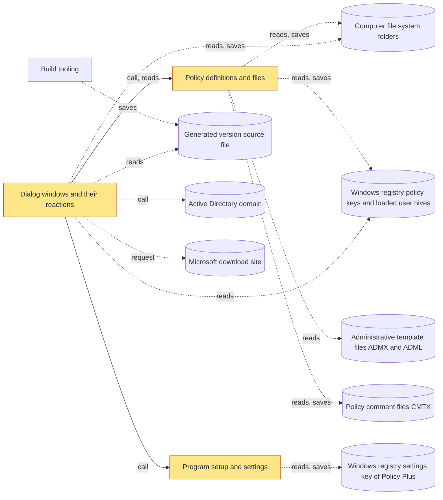
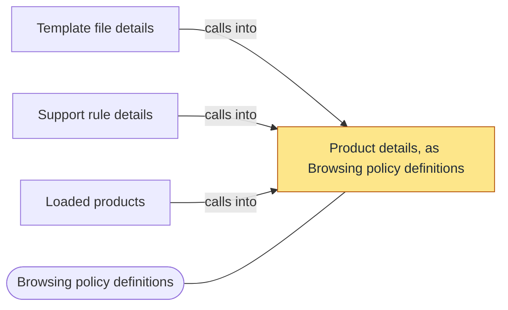

# Legacy reference: Walk a product's versions and parent in product details

The typed header below maps each criterion of the work item to the rules of the existing system it backs. The reading of the existing code follows it.

## Header

```json
{
  "story": "story-85fe4c7b5154",
  "fingerprint": "280637421a2d33856d0f4655b9cf3df29c3a1ebf99ebbb84e7839ee4506bf978",
  "criteria": [
    {
      "ac": "AC-1",
      "rules": [
        {
          "says": "Double-clicking a child revision in the product details window shows that child in the same window; with nothing selected, nothing happens.",
          "where": {
            "file": "PolicyPlus/DetailProduct.vb",
            "firstLine": 41,
            "lastLine": 44
          },
          "doubt": ""
        }
      ]
    },
    {
      "ac": "AC-2",
      "rules": []
    },
    {
      "ac": "AC-3",
      "rules": []
    }
  ],
  "reliesOn": [
    {
      "says": "The product details window lists every child revision of a product with its version and name; a product with no children shows an empty list.",
      "builtBy": "Describe products and support definitions in their detail views"
    },
    {
      "says": "A product with a parent shows the parent name and enables the parent button; a product with no parent shows a blank parent and the button is disabled.",
      "builtBy": "Describe products and support definitions in their detail views"
    },
    {
      "says": "The product details window shows a version number for major and minor revisions only; for a top-level product the version is blank.",
      "builtBy": "Describe products and support definitions in their detail views"
    },
    {
      "says": "The product details window labels a product \"Major revision\", \"Minor revision\" or \"Top-level product\" from its type.",
      "builtBy": "Describe products and support definitions in their detail views"
    }
  ],
  "data": [
    {
      "kind": "Program preference",
      "access": "reads and saves"
    },
    {
      "kind": "Administrative template",
      "access": "reads"
    },
    {
      "kind": "Policy setting",
      "access": "reads"
    }
  ],
  "transitions": [],
  "outsideSystems": [
    "Windows registry settings key of Policy Plus",
    "Active Directory domain",
    "Administrative template files (ADMX and ADML)",
    "Computer file system folders",
    "Microsoft download site",
    "Windows registry policy keys and loaded user hives"
  ],
  "cited": [
    {
      "file": "PolicyPlus/DetailProduct.vb",
      "firstLine": 38,
      "lastLine": 40
    },
    {
      "file": "PolicyPlus/DetailProduct.vb",
      "firstLine": 41,
      "lastLine": 44
    },
    {
      "file": "PolicyPlus/DetailProduct.vb",
      "firstLine": 45,
      "lastLine": 47
    },
    {
      "file": "PolicyPlus/DetailProduct.vb",
      "firstLine": 41,
      "lastLine": 44
    }
  ]
}
```

## What each criterion must keep

### AC-1

- Double-clicking a child revision in the product details window shows that child in the same window; with nothing selected, nothing happens. (PolicyPlus/DetailProduct.vb:41-44)

### AC-2

No single legacy rule: it describes the behaviour as a whole.


### AC-3

No single legacy rule: it describes the behaviour as a whole.


## Relies on, built elsewhere

- The product details window lists every child revision of a product with its version and name; a product with no children shows an empty list. Built by: Describe products and support definitions in their detail views.
- A product with a parent shows the parent name and enables the parent button; a product with no parent shows a blank parent and the button is disabled. Built by: Describe products and support definitions in their detail views.
- The product details window shows a version number for major and minor revisions only; for a top-level product the version is blank. Built by: Describe products and support definitions in their detail views.
- The product details window labels a product "Major revision", "Minor revision" or "Top-level product" from its type. Built by: Describe products and support definitions in their detail views.

## Reading of the existing code

# Screen: Product details, as Browsing policy definitions

At a glance: 5 owned rules, 0 relied on, 3 actions, 4 files (1 own, 0 relied on, 3 of neighbour screens, 0 generated), 0 disputed.

How to read it: paths are relative to the source root and `file:a-b` is an inclusive line range. `BR-` rules, `ACT-` actions, `TR-` changes of state and `RK-` risks have stable ids. A record marked disputed was challenged in review and kept; the reviewer's words are under Trust. All of it was read from the code; nothing was run.

## Product context
Policy Plus is a Windows desktop editor for Group Policy settings, used by administrators and power users. It reads Microsoft's policy definition files and edits policy files directly, so it works on any Windows edition, including Home, which lacks the built-in editor.
Built with: .NET Framework v4.5.2, Microsoft Windows, System.DirectoryServices, System.Xml, Visual Basic .NET, Windows Forms (Policy Plus desktop editor).
Runs: It runs on the user's own Windows computer as one desktop program on .NET Framework 4.5.2. It asks for elevated rights when available but starts without them; loading registry hives, refreshing policy and editing local Group Policy files need them. It can also reach the domain's shared policy folder.
Reaches outside itself: Computer file system folders; Windows registry policy keys and loaded user hives; Administrative template files (ADMX and ADML); Windows registry settings key of Policy Plus; Generated version source file; Policy comment files (CMTX); Active Directory domain; Microsoft download site.



## Where this sits
Part of: Browsing policy definitions (Reading policy definitions).



## Boundary
- Called from **Template file details** (bundle: screen template-file-details), at `PolicyPlus/DetailAdmx.vb:27-29`
- Called from **Support rule details** (bundle: screen support-rule-details), at `PolicyPlus/DetailSupport.vb:41-49`
- Called from **Loaded products** (bundle: screen loaded-products), at `PolicyPlus/LoadedProducts.vb:57-62`

## Contract: what it must do
### Product details
See a product's versions and move to its parent or child products.
Controls (20): Friend WithEvents ChName As ColumnHeader: ChName; Friend WithEvents ChVersion As ColumnHeader: ChVersion; Friend WithEvents ChildrenListview As ListView: ChildrenListview; Friend WithEvents CloseButton As Button: CloseButton; Friend WithEvents DefinedTextbox As TextBox: DefinedTextbox; Friend WithEvents DisplayCodeTextbox As TextBox: DisplayCodeTextbox; Friend WithEvents IdTextbox As TextBox: IdTextbox; Friend WithEvents KindTextbox As TextBox: KindTextbox; Friend WithEvents NameTextbox As TextBox: NameTextbox; Friend WithEvents ParentButton As Button: ParentButton; Friend WithEvents ParentTextbox As TextBox: ParentTextbox; Friend WithEvents VersionTextbox As TextBox: VersionTextbox; Label: ChildrenLabel, DefinedLabel, DisplayCodeLabel, IdLabel, KindLabel, NameLabel, ParentLabel, VersionLabel

Actions
- **ACT-64781740** Resizes the Name column so it fills the list beside the Version column. — `PolicyPlus/DetailProduct.vb:38-40`; started by person
- **ACT-78595698** Shows the details of the chosen child product in this same window. — `PolicyPlus/DetailProduct.vb:41-44`; started by person
- **ACT-69133577** Shows the details of the product's parent product in this same window. — `PolicyPlus/DetailProduct.vb:45-47`; started by person

Rules
- **BR-81592648** The product details window labels a product "Major revision", "Minor revision" or "Top-level product" from its type. — `PolicyPlus/DetailProduct.vb:13-20`
- **BR-01307158** The product details window shows a version number for major and minor revisions only; for a top-level product the version is blank. — `PolicyPlus/DetailProduct.vb:21`
- **BR-49006236** A product with a parent shows the parent name and enables the parent button; a product with no parent shows a blank parent and the button is disabled. — `PolicyPlus/DetailProduct.vb:22-28`
- **BR-29917481** The product details window lists every child revision of a product with its version and name; a product with no children shows an empty list. — `PolicyPlus/DetailProduct.vb:29-36`
- **BR-00189675** Double-clicking a child revision in the product details window shows that child in the same window; with nothing selected, nothing happens. — `PolicyPlus/DetailProduct.vb:41-44`


## Trust: what to doubt
**Assumed, not confirmed**
- When the person's language has no exact language folder, the folder picked among those of the same primary language is the first one the operating system lists; which that is, is not stated in code. Why unsettled: The folder listing order is left to the file system, and the template folders present are out of scope. If wrong: A person could see a different regional variant of the policy text than expected when several variants are installed.


## Read order
| Tier | File | Lines | Why |
| --- | --- | --- | --- |
| own | `PolicyPlus/DetailProduct.vb` | whole file | starts 3 actions; decides 5 owned rules; used by 1 other capability |
| neighbour screen | `PolicyPlus/DetailAdmx.vb` | 27-29 | calls into this screen: Template file details |
| neighbour screen | `PolicyPlus/DetailSupport.vb` | 41-49 | calls into this screen: Support rule details |
| neighbour screen | `PolicyPlus/LoadedProducts.vb` | 57-62 | calls into this screen: Loaded products |

## Source

### PolicyPlus/DetailProduct.vb
```
1: Public Class DetailProduct
2:     Dim SelectedProduct As PolicyPlusProduct
3:     Public Sub PresentDialog(Product As PolicyPlusProduct)
4:         PrepareDialog(Product)
5:         ShowDialog()
6:     End Sub
7:     Private Sub PrepareDialog(Product As PolicyPlusProduct)
8:         SelectedProduct = Product
9:         NameTextbox.Text = Product.DisplayName
10:         IdTextbox.Text = Product.UniqueID
11:         DefinedTextbox.Text = Product.RawProduct.DefinedIn.SourceFile
12:         DisplayCodeTextbox.Text = Product.RawProduct.DisplayCode
13:         Select Case Product.RawProduct.Type
14:             Case AdmxProductType.MajorRevision
15:                 KindTextbox.Text = "Major revision"
16:             Case AdmxProductType.MinorRevision
17:                 KindTextbox.Text = "Minor revision"
18:             Case AdmxProductType.Product
19:                 KindTextbox.Text = "Top-level product"
20:         End Select
21:         VersionTextbox.Text = If(Product.RawProduct.Type = AdmxProductType.Product, "", CStr(Product.RawProduct.Version))
22:         If Product.Parent Is Nothing Then
23:             ParentTextbox.Text = ""
24:             ParentButton.Enabled = False
25:         Else
26:             ParentTextbox.Text = Product.Parent.DisplayName
27:             ParentButton.Enabled = True
28:         End If
29:         ChildrenListview.Items.Clear()
30:         If Product.Children IsNot Nothing Then
31:             For Each child In Product.Children
32:                 Dim lsvi = ChildrenListview.Items.Add(child.RawProduct.Version)
33:                 lsvi.SubItems.Add(child.DisplayName)
34:                 lsvi.Tag = child
35:             Next
36:         End If
37:     End Sub
38:     Private Sub ChildrenListview_ClientSizeChanged(sender As Object, e As EventArgs) Handles ChildrenListview.ClientSizeChanged
39:         ChName.Width = ChildrenListview.ClientSize.Width - ChVersion.Width
40:     End Sub
41:     Private Sub ChildrenListview_DoubleClick(sender As Object, e As EventArgs) Handles ChildrenListview.DoubleClick
42:         If ChildrenListview.SelectedItems.Count = 0 Then Exit Sub
43:         PrepareDialog(ChildrenListview.SelectedItems(0).Tag)
44:     End Sub
45:     Private Sub ParentButton_Click(sender As Object, e As EventArgs) Handles ParentButton.Click
46:         PrepareDialog(SelectedProduct.Parent)
47:     End Sub
48: End Class
```

### PolicyPlus/DetailAdmx.vb
```
27:     Private Sub LsvProducts_DoubleClick(sender As Object, e As EventArgs) Handles LsvProducts.DoubleClick
28:         DetailProduct.PresentDialog(LsvProducts.SelectedItems(0).Tag)
29:     End Sub
```

### PolicyPlus/DetailSupport.vb
```
41:     Private Sub EntriesListview_DoubleClick(sender As Object, e As EventArgs) Handles EntriesListview.DoubleClick
42:         If EntriesListview.SelectedItems.Count = 0 Then Exit Sub
43:         Dim supEntry As PolicyPlusSupportEntry = EntriesListview.SelectedItems(0).Tag
44:         If supEntry.Product IsNot Nothing Then
45:             DetailProduct.PresentDialog(supEntry.Product)
46:         ElseIf supEntry.SupportDefinition IsNot Nothing Then
47:             PrepareDialog(supEntry.SupportDefinition)
48:         End If
49:     End Sub
```

### PolicyPlus/LoadedProducts.vb
```
57:     Sub OpenProductDetails(sender As Object, e As EventArgs) Handles LsvTopLevelProducts.DoubleClick, LsvMajorVersions.DoubleClick, LsvMinorVersions.DoubleClick
58:         Dim lsv As ListView = sender
59:         If lsv.SelectedItems.Count = 0 Then Exit Sub
60:         Dim product As PolicyPlusProduct = lsv.SelectedItems(0).Tag
61:         DetailProduct.PresentDialog(product)
62:     End Sub
```

