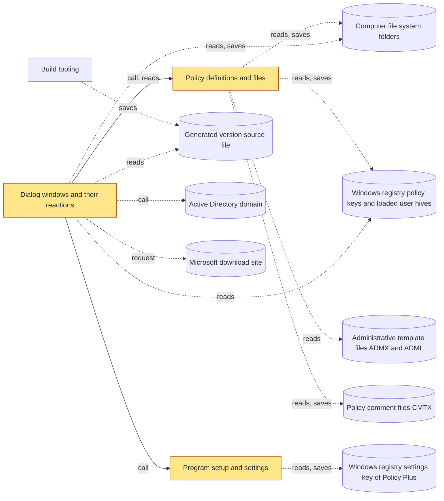
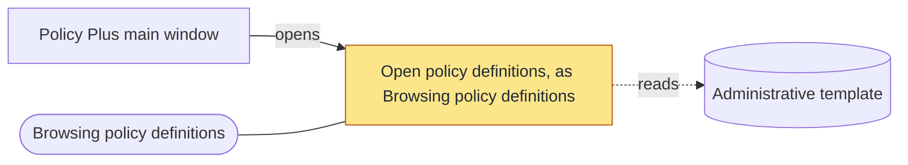
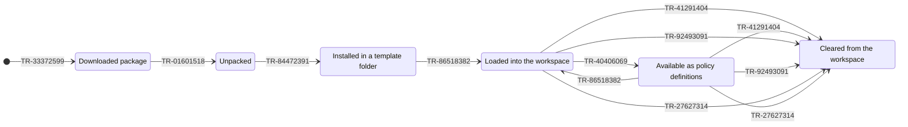

# Legacy reference: Choose the folder of policy definitions to load

The typed header below maps each criterion of the work item to the rules of the existing system it backs. The reading of the existing code follows it.

## Header

```json
{
  "story": "story-9650519137fe",
  "fingerprint": "280637421a2d33856d0f4655b9cf3df29c3a1ebf99ebbb84e7839ee4506bf978",
  "criteria": [
    {
      "ac": "AC-1",
      "rules": [
        {
          "says": "When the ADMX folder dialog opens, 'This folder' is chosen first, and the 'The domain's SYSVOL' choice is available only if the computer is joined to a domain and the folder \\\\domain\\SYSVOL\\domain\\Policies\\PolicyDefinitions exists.",
          "where": {
            "file": "PolicyPlus/OpenAdmxFolder.vb",
            "firstLine": 11,
            "lastLine": 26
          },
          "doubt": ""
        }
      ]
    },
    {
      "ac": "AC-2",
      "rules": [
        {
          "says": "When the ADMX folder dialog opens, 'This folder' is chosen first, and the 'The domain's SYSVOL' choice is available only if the computer is joined to a domain and the folder \\\\domain\\SYSVOL\\domain\\Policies\\PolicyDefinitions exists.",
          "where": {
            "file": "PolicyPlus/OpenAdmxFolder.vb",
            "firstLine": 11,
            "lastLine": 26
          },
          "doubt": ""
        }
      ]
    },
    {
      "ac": "AC-3",
      "rules": [
        {
          "says": "When the ADMX folder dialog opens, 'This folder' is chosen first, and the 'The domain's SYSVOL' choice is available only if the computer is joined to a domain and the folder \\\\domain\\SYSVOL\\domain\\Policies\\PolicyDefinitions exists.",
          "where": {
            "file": "PolicyPlus/OpenAdmxFolder.vb",
            "firstLine": 11,
            "lastLine": 26
          },
          "doubt": ""
        }
      ]
    },
    {
      "ac": "AC-4",
      "rules": [
        {
          "says": "The folder box and its Browse button are usable only when the 'This folder' choice is selected.",
          "where": {
            "file": "PolicyPlus/OpenAdmxFolder.vb",
            "firstLine": 6,
            "lastLine": 10
          },
          "doubt": ""
        }
      ]
    },
    {
      "ac": "AC-5",
      "rules": [
        {
          "says": "The folder box and its Browse button are usable only when the 'This folder' choice is selected.",
          "where": {
            "file": "PolicyPlus/OpenAdmxFolder.vb",
            "firstLine": 6,
            "lastLine": 10
          },
          "doubt": ""
        }
      ]
    },
    {
      "ac": "AC-6",
      "rules": [
        {
          "says": "When OK is pressed in the ADMX folder dialog, the folder is the system's Windows PolicyDefinitions folder, the domain SYSVOL folder, or the typed folder, as chosen. A folder that does not exist is refused with \"The folder you specified does not exist.\" and the dialog stays open.",
          "where": {
            "file": "PolicyPlus/OpenAdmxFolder.vb",
            "firstLine": 27,
            "lastLine": 41
          },
          "doubt": ""
        }
      ]
    },
    {
      "ac": "AC-7",
      "rules": [
        {
          "says": "When OK is pressed in the ADMX folder dialog, the folder is the system's Windows PolicyDefinitions folder, the domain SYSVOL folder, or the typed folder, as chosen. A folder that does not exist is refused with \"The folder you specified does not exist.\" and the dialog stays open.",
          "where": {
            "file": "PolicyPlus/OpenAdmxFolder.vb",
            "firstLine": 27,
            "lastLine": 41
          },
          "doubt": ""
        }
      ]
    },
    {
      "ac": "AC-8",
      "rules": [
        {
          "says": "Pressing Escape closes the ADMX folder dialog as cancelled, with no folder chosen.",
          "where": {
            "file": "PolicyPlus/OpenAdmxFolder.vb",
            "firstLine": 48,
            "lastLine": 50
          },
          "doubt": ""
        }
      ]
    }
  ],
  "reliesOn": [],
  "data": [
    {
      "kind": "Program preference",
      "access": "reads and saves"
    },
    {
      "kind": "Administrative template",
      "access": "reads"
    },
    {
      "kind": "Policy setting",
      "access": "reads"
    }
  ],
  "transitions": [],
  "outsideSystems": [
    "Windows registry settings key of Policy Plus",
    "Active Directory domain",
    "Administrative template files (ADMX and ADML)",
    "Computer file system folders",
    "Microsoft download site",
    "Windows registry policy keys and loaded user hives"
  ],
  "steps": [
    {
      "intent": "Choose the folder of definitions to load.",
      "change": "merged",
      "reason": "Discovering, picking and checking happen together."
    },
    {
      "intent": "Cancel at any time.",
      "change": "kept",
      "reason": "Backing out stays available."
    }
  ],
  "components": [
    {
      "name": "Definitions folder choice validator",
      "module": "definitions-folder-choice-validator",
      "layer": "packages/ui"
    }
  ],
  "cited": [
    {
      "file": "PolicyPlus/OpenAdmxFolder.vb",
      "firstLine": 11,
      "lastLine": 26
    },
    {
      "file": "PolicyPlus/OpenAdmxFolder.vb",
      "firstLine": 6,
      "lastLine": 10
    },
    {
      "file": "PolicyPlus/OpenAdmxFolder.vb",
      "firstLine": 42,
      "lastLine": 47
    },
    {
      "file": "PolicyPlus/OpenAdmxFolder.vb",
      "firstLine": 27,
      "lastLine": 41
    },
    {
      "file": "PolicyPlus/OpenAdmxFolder.vb",
      "firstLine": 48,
      "lastLine": 50
    },
    {
      "file": "PolicyPlus/OpenAdmxFolder.vb",
      "firstLine": 11,
      "lastLine": 26
    },
    {
      "file": "PolicyPlus/OpenAdmxFolder.vb",
      "firstLine": 6,
      "lastLine": 10
    },
    {
      "file": "PolicyPlus/OpenAdmxFolder.vb",
      "firstLine": 27,
      "lastLine": 41
    },
    {
      "file": "PolicyPlus/OpenAdmxFolder.vb",
      "firstLine": 3,
      "lastLine": 5
    },
    {
      "file": "PolicyPlus/OpenAdmxFolder.vb",
      "firstLine": 48,
      "lastLine": 50
    }
  ]
}
```

## What each criterion must keep

### AC-1

- When the ADMX folder dialog opens, 'This folder' is chosen first, and the 'The domain's SYSVOL' choice is available only if the computer is joined to a domain and the folder \\domain\SYSVOL\domain\Policies\PolicyDefinitions exists. (PolicyPlus/OpenAdmxFolder.vb:11-26)

### AC-2

- When the ADMX folder dialog opens, 'This folder' is chosen first, and the 'The domain's SYSVOL' choice is available only if the computer is joined to a domain and the folder \\domain\SYSVOL\domain\Policies\PolicyDefinitions exists. (PolicyPlus/OpenAdmxFolder.vb:11-26)

### AC-3

- When the ADMX folder dialog opens, 'This folder' is chosen first, and the 'The domain's SYSVOL' choice is available only if the computer is joined to a domain and the folder \\domain\SYSVOL\domain\Policies\PolicyDefinitions exists. (PolicyPlus/OpenAdmxFolder.vb:11-26)

### AC-4

- The folder box and its Browse button are usable only when the 'This folder' choice is selected. (PolicyPlus/OpenAdmxFolder.vb:6-10)

### AC-5

- The folder box and its Browse button are usable only when the 'This folder' choice is selected. (PolicyPlus/OpenAdmxFolder.vb:6-10)

### AC-6

- When OK is pressed in the ADMX folder dialog, the folder is the system's Windows PolicyDefinitions folder, the domain SYSVOL folder, or the typed folder, as chosen. A folder that does not exist is refused with "The folder you specified does not exist." and the dialog stays open. (PolicyPlus/OpenAdmxFolder.vb:27-41)

### AC-7

- When OK is pressed in the ADMX folder dialog, the folder is the system's Windows PolicyDefinitions folder, the domain SYSVOL folder, or the typed folder, as chosen. A folder that does not exist is refused with "The folder you specified does not exist." and the dialog stays open. (PolicyPlus/OpenAdmxFolder.vb:27-41)

### AC-8

- Pressing Escape closes the ADMX folder dialog as cancelled, with no folder chosen. (PolicyPlus/OpenAdmxFolder.vb:48-50)

## Reading of the existing code

# Screen: Open policy definitions, as Browsing policy definitions

At a glance: 5 owned rules, 0 relied on, 5 actions, 2 files (1 own, 0 relied on, 1 of neighbour screens, 0 generated), 0 disputed.

How to read it: paths are relative to the source root and `file:a-b` is an inclusive line range. `BR-` rules, `ACT-` actions, `TR-` changes of state and `RK-` risks have stable ids. A record marked disputed was challenged in review and kept; the reviewer's words are under Trust. All of it was read from the code; nothing was run.

## Product context
Policy Plus is a Windows desktop editor for Group Policy settings, used by administrators and power users. It reads Microsoft's policy definition files and edits policy files directly, so it works on any Windows edition, including Home, which lacks the built-in editor.
Built with: .NET Framework v4.5.2, Microsoft Windows, System.DirectoryServices, System.Xml, Visual Basic .NET, Windows Forms (Policy Plus desktop editor).
Runs: It runs on the user's own Windows computer as one desktop program on .NET Framework 4.5.2. It asks for elevated rights when available but starts without them; loading registry hives, refreshing policy and editing local Group Policy files need them. It can also reach the domain's shared policy folder.
Reaches outside itself: Computer file system folders; Windows registry policy keys and loaded user hives; Administrative template files (ADMX and ADML); Windows registry settings key of Policy Plus; Generated version source file; Policy comment files (CMTX); Active Directory domain; Microsoft download site.



## Where this sits
Part of: Browsing policy definitions (Reading policy definitions).



## Boundary
- Opened by **Policy Plus main window** (bundle: screen policy-plus-main-window), at `PolicyPlus/Main.vb:510-523`

## Contract: what it must do
### Open policy definitions
Choose the folder, Windows or domain location to load definitions from.
Controls (8): Friend WithEvents ButtonBrowse As Button: ButtonBrowse; Friend WithEvents ButtonOK As Button: ButtonOK; Friend WithEvents ClearWorkspaceCheckbox As CheckBox: ClearWorkspaceCheckbox; Friend WithEvents OptCustomFolder As RadioButton: OptCustomFolder; Friend WithEvents OptLocalFolder As RadioButton: OptLocalFolder; Friend WithEvents OptSysvol As RadioButton: OptSysvol; Friend WithEvents TextFolder As TextBox: TextFolder; Label: LabelFromWhere

Actions
- **ACT-82731450** Enables the folder box and Browse button only when the custom folder choice is selected. — `PolicyPlus/OpenAdmxFolder.vb:6-10`; started by person
- **ACT-06242607** Looks for the domain's SYSVOL policy definitions folder and enables that choice only if it exists. — `PolicyPlus/OpenAdmxFolder.vb:11-26`; started by person
- **ACT-92904451** Takes the chosen folder, checks it exists and closes the window with OK. — `PolicyPlus/OpenAdmxFolder.vb:27-41`; started by person
- **ACT-77540452** Lets the person pick a folder in a folder dialog and puts it in the folder box. — `PolicyPlus/OpenAdmxFolder.vb:42-47`; started by person
- **ACT-44317029** Closes the window as cancelled when Escape is pressed. — `PolicyPlus/OpenAdmxFolder.vb:48-50`; started by person

Rules
- **BR-54453608** The folder box and its Browse button are usable only when the 'This folder' choice is selected. — `PolicyPlus/OpenAdmxFolder.vb:6-10`
- **BR-64614800** When the ADMX folder dialog opens, 'This folder' is chosen first, and the 'The domain's SYSVOL' choice is available only if the computer is joined to a domain and the folder \\domain\SYSVOL\domain\Policies\PolicyDefinitions exists. — `PolicyPlus/OpenAdmxFolder.vb:11-26`
- **BR-45924012** When OK is pressed in the ADMX folder dialog, the folder is the system's Windows PolicyDefinitions folder, the domain SYSVOL folder, or the typed folder, as chosen. A folder that does not exist is refused with "The folder you specified does not exist." and the dialog stays open. — `PolicyPlus/OpenAdmxFolder.vb:27-41`; also rests on `PolicyPlus/OpenAdmxFolder.vb:3-5`
- **BR-37166867** The option to clear the workspace before adding the folder is ticked by default, and its choice is passed on only when a folder that exists was accepted. — `PolicyPlus/OpenAdmxFolder.vb:36`
- **BR-80700253** Pressing Escape closes the ADMX folder dialog as cancelled, with no folder chosen. — `PolicyPlus/OpenAdmxFolder.vb:48-50`


## Data and states
- Administrative template: reads; kept in Active Directory domain, Administrative template files (ADMX and ADML), Computer file system folders, Microsoft download site

Life of Administrative template


| Change | From | To | Written at | In this code | Reading |
| --- | --- | --- | --- | --- | --- |
| TR-01601518 | Downloaded package | Unpacked | `PolicyPlus/DownloadAdmx.vb:89-93` | no | reviewed |
| TR-84472391 | Unpacked | Installed in a template folder | `PolicyPlus/DownloadAdmx.vb:103-111` | no | reviewed |
| TR-40406069 | Loaded into the workspace | Available as policy definitions | `PolicyPlus/AdmxBundle.vb:163-181` | no | reviewed |
| TR-41291404 | Loaded into the workspace or Available as policy definitions | Cleared from the workspace | `PolicyPlus/Main.vb:391` | no | reviewed |
| TR-92493091 | Loaded into the workspace or Available as policy definitions | Cleared from the workspace | `PolicyPlus/Main.vb:65` | no | reviewed |
| TR-27627314 | Loaded into the workspace or Available as policy definitions | Cleared from the workspace | `PolicyPlus/Main.vb:72` | no | reviewed |
| TR-33372599 | created | Downloaded package | `PolicyPlus/DownloadAdmx.vb:83-86` | no | reviewed |
| TR-86518382 | Installed in a template folder or Available as policy definitions | Loaded into the workspace | `PolicyPlus/AdmxBundle.vb:72-77` | no | corrected |

## Trust: what to doubt
**Risks**
- **RK-09803396** [medium] Policy template and comment XML files are read with default settings and no stated limit on external references. The folders or domain share they come from may be writable by others, and whether external entities resolve depends on the framework default. (Input from outside is used without checks, so it can change what the code does) — at `PolicyPlus/OpenAdmxFolder.vb:22-33`

**Assumed, not confirmed**
- When the person's language has no exact language folder, the folder picked among those of the same primary language is the first one the operating system lists; which that is, is not stated in code. Why unsettled: The folder listing order is left to the file system, and the template folders present are out of scope. If wrong: A person could see a different regional variant of the policy text than expected when several variants are installed.


## Read order
| Tier | File | Lines | Why |
| --- | --- | --- | --- |
| own | `PolicyPlus/OpenAdmxFolder.vb` | whole file | starts 5 actions; decides 5 owned rules |
| neighbour screen | `PolicyPlus/Main.vb` | 510-523 | opens this screen: Policy Plus main window |

## Source

### PolicyPlus/OpenAdmxFolder.vb
```
1: Imports System.DirectoryServices.ActiveDirectory
2: Public Class OpenAdmxFolder
3:     Dim SysvolPolicyDefinitionsPath As String = ""
4:     Public SelectedFolder As String
5:     Public ClearWorkspace As Boolean
6:     Private Sub Options_CheckedChanged(sender As Object, e As EventArgs) Handles OptCustomFolder.CheckedChanged, OptSysvol.CheckedChanged, OptLocalFolder.CheckedChanged
7:         Dim customSelected = OptCustomFolder.Checked
8:         TextFolder.Enabled = customSelected
9:         ButtonBrowse.Enabled = customSelected
10:     End Sub
11:     Private Sub OpenAdmxFolder_Shown(sender As Object, e As EventArgs) Handles MyBase.Shown
12:         OptCustomFolder.Checked = True
13:         Dim compDomain As Domain = Nothing
14:         Try
15:             compDomain = Domain.GetComputerDomain
16:         Catch ex As Exception
17:             ' Not domain-joined, or no domain controller is available
18:         End Try
19:         If compDomain Is Nothing Then
20:             SysvolPolicyDefinitionsPath = ""
21:         Else
22:             Dim possiblePath = "\\" & compDomain.Name & "\SYSVOL\" & compDomain.Name & "\Policies\PolicyDefinitions"
23:             If IO.Directory.Exists(possiblePath) Then SysvolPolicyDefinitionsPath = possiblePath Else SysvolPolicyDefinitionsPath = ""
24:         End If
25:         OptSysvol.Enabled = (SysvolPolicyDefinitionsPath <> "")
26:     End Sub
27:     Private Sub ButtonOK_Click(sender As Object, e As EventArgs) Handles ButtonOK.Click
28:         If OptLocalFolder.Checked Then
29:             SelectedFolder = Environment.ExpandEnvironmentVariables("%windir%\PolicyDefinitions")
30:         ElseIf OptSysvol.Checked Then
31:             SelectedFolder = SysvolPolicyDefinitionsPath
32:         ElseIf OptCustomFolder.Checked Then
33:             SelectedFolder = TextFolder.Text
34:         End If
35:         If IO.Directory.Exists(SelectedFolder) Then
36:             ClearWorkspace = ClearWorkspaceCheckbox.Checked
37:             DialogResult = DialogResult.OK
38:         Else
39:             MsgBox("The folder you specified does not exist.", MsgBoxStyle.Exclamation)
40:         End If
41:     End Sub
42:     Private Sub ButtonBrowse_Click(sender As Object, e As EventArgs) Handles ButtonBrowse.Click
43:         Using fbd As New FolderBrowserDialog
44:             If fbd.ShowDialog <> DialogResult.OK Then Exit Sub
45:             TextFolder.Text = fbd.SelectedPath
46:         End Using
47:     End Sub
48:     Private Sub OpenAdmxFolder_KeyUp(sender As Object, e As KeyEventArgs) Handles Me.KeyUp
49:         If e.KeyCode = Keys.Escape Then DialogResult = DialogResult.Cancel
50:     End Sub
51: End Class
```

### PolicyPlus/Main.vb
```
510:     Private Sub OpenADMXFolderToolStripMenuItem_Click(sender As Object, e As EventArgs) Handles OpenADMXFolderToolStripMenuItem.Click
511:         ' Show the Open ADMX Folder dialog and load the policy definitions
512:         If OpenAdmxFolder.ShowDialog = DialogResult.OK Then
513:             Try
514:                 If OpenAdmxFolder.ClearWorkspace Then ClearAdmxWorkspace()
515:                 DisplayAdmxLoadErrorReport(AdmxWorkspace.LoadFolder(OpenAdmxFolder.SelectedFolder, GetPreferredLanguageCode()))
516:                 ' Only update the last source when successfully opening a complete source
517:                 If OpenAdmxFolder.ClearWorkspace Then Configuration.SetValue("AdmxSource", OpenAdmxFolder.SelectedFolder)
518:             Catch ex As Exception
519:                 MsgBox("The folder could not be fully added to the workspace. " & ex.Message, MsgBoxStyle.Exclamation)
520:             End Try
521:             PopulateAdmxUi()
522:         End If
523:     End Sub
```

