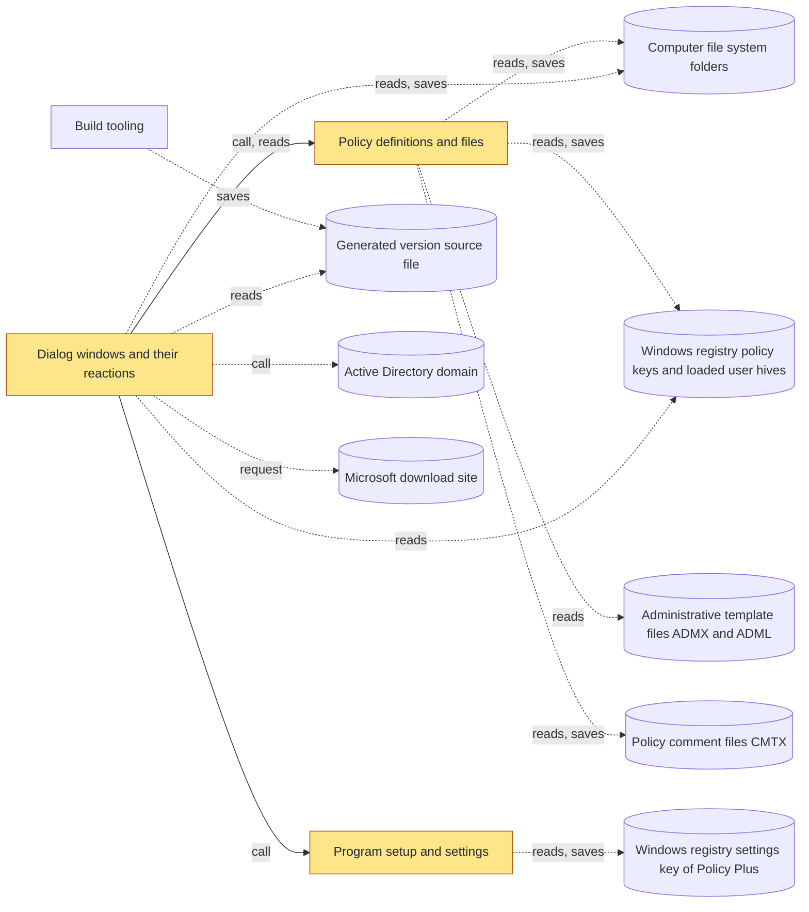
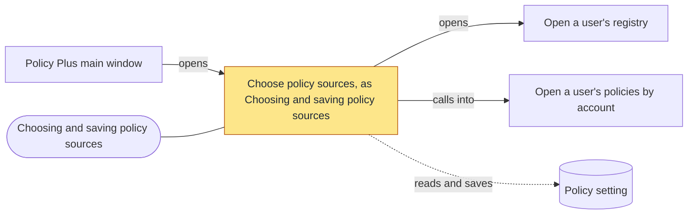
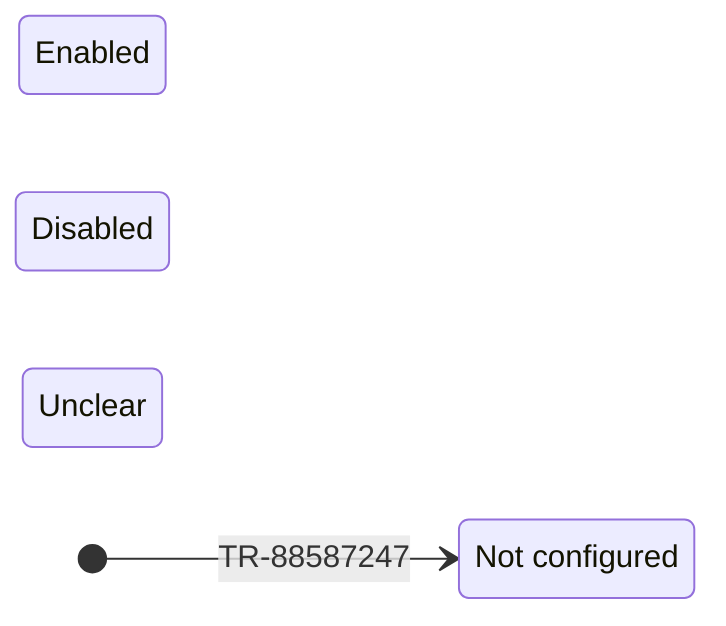

# Legacy reference: Choose the user policy source

The typed header below maps each criterion of the work item to the rules of the existing system it backs. The reading of the existing code follows it.

## Header

```json
{
  "story": "story-998f80fd2416",
  "fingerprint": "280637421a2d33856d0f4655b9cf3df29c3a1ebf99ebbb84e7839ee4506bf978",
  "criteria": [
    {
      "ac": "AC-1",
      "rules": [
        {
          "says": "The registry path, POL file name, SID and hive path boxes (and their Browse buttons) for the user side are usable only when their own choice is selected.",
          "where": {
            "file": "PolicyPlus/OpenPol.vb",
            "firstLine": 52,
            "lastLine": 65
          },
          "doubt": ""
        }
      ]
    },
    {
      "ac": "AC-2",
      "rules": []
    }
  ],
  "reliesOn": [
    {
      "says": "The file picker for a POL file accepts only '.pol' files, allows choosing a file that does not exist yet, and does not ask before an existing file is chosen.",
      "builtBy": "Choose the computer policy source"
    }
  ],
  "data": [
    {
      "kind": "Program preference",
      "access": "saves"
    },
    {
      "kind": "Policy comment",
      "access": "reads and saves"
    },
    {
      "kind": "Policy setting",
      "access": "reads and saves"
    }
  ],
  "transitions": [],
  "outsideSystems": [
    "Windows registry settings key of Policy Plus",
    "Computer file system folders",
    "Policy comment files (CMTX)",
    "Windows registry policy keys and loaded user hives"
  ],
  "cited": [
    {
      "file": "PolicyPlus/OpenPol.vb",
      "firstLine": 52,
      "lastLine": 65
    },
    {
      "file": "PolicyPlus/OpenPol.vb",
      "firstLine": 69,
      "lastLine": 71
    },
    {
      "file": "PolicyPlus/OpenPol.vb",
      "firstLine": 72,
      "lastLine": 75
    },
    {
      "file": "PolicyPlus/OpenPol.vb",
      "firstLine": 112,
      "lastLine": 115
    },
    {
      "file": "PolicyPlus/OpenPol.vb",
      "firstLine": 52,
      "lastLine": 65
    }
  ]
}
```

## What each criterion must keep

### AC-1

- The registry path, POL file name, SID and hive path boxes (and their Browse buttons) for the user side are usable only when their own choice is selected. (PolicyPlus/OpenPol.vb:52-65)

### AC-2

No single legacy rule: it describes the behaviour as a whole.


## Relies on, built elsewhere

- The file picker for a POL file accepts only '.pol' files, allows choosing a file that does not exist yet, and does not ask before an existing file is chosen. Built by: Choose the computer policy source.

## Reading of the existing code

# Screen: Choose policy sources, as Choosing and saving policy sources

At a glance: 6 owned rules, 2 relied on, 8 actions, 5 files (1 own, 1 relied on, 3 of neighbour screens, 0 generated), 0 disputed.

How to read it: paths are relative to the source root and `file:a-b` is an inclusive line range. `BR-` rules, `ACT-` actions, `TR-` changes of state and `RK-` risks have stable ids. A record marked disputed was challenged in review and kept; the reviewer's words are under Trust. All of it was read from the code; nothing was run.

## Product context
Policy Plus is a Windows desktop editor for Group Policy settings, used by administrators and power users. It reads Microsoft's policy definition files and edits policy files directly, so it works on any Windows edition, including Home, which lacks the built-in editor.
Built with: .NET Framework v4.5.2, Microsoft Windows, System.DirectoryServices, System.Xml, Visual Basic .NET, Windows Forms (Policy Plus desktop editor).
Runs: It runs on the user's own Windows computer as one desktop program on .NET Framework 4.5.2. It asks for elevated rights when available but starts without them; loading registry hives, refreshing policy and editing local Group Policy files need them. It can also reach the domain's shared policy folder.
Reaches outside itself: Computer file system folders; Windows registry policy keys and loaded user hives; Administrative template files (ADMX and ADML); Windows registry settings key of Policy Plus; Generated version source file; Policy comment files (CMTX); Active Directory domain; Microsoft download site.



## Where this sits
Part of: Choosing and saving policy sources (Setting and storing policies).



## Boundary
- Opened by **Policy Plus main window** (bundle: screen policy-plus-main-window), at `PolicyPlus/Main.vb:607-613`
- Opens **Open a user's registry** (bundle: screen open-a-user-s-registry), at `PolicyPlus/OpenPol.vb:72-75`
- Calls into **Open a user's policies by account** (bundle: screen open-a-user-s-policies-by-account), at `PolicyPlus/OpenPol.vb:112-115`

## Contract: what it must do
### Choose policy sources
Choose where user and computer policies are read from and saved.
Controls (23): Friend WithEvents CompFileBrowseButton As Button: CompFileBrowseButton; Friend WithEvents CompFileOption As RadioButton: CompFileOption; Friend WithEvents CompLocalOption As RadioButton: CompLocalOption; Friend WithEvents CompNullOption As RadioButton: CompNullOption; Friend WithEvents CompPolFilenameTextbox As TextBox: CompPolFilenameTextbox; Friend WithEvents CompRegTextbox As TextBox: CompRegTextbox; Friend WithEvents CompRegistryOption As RadioButton: CompRegistryOption; Friend WithEvents ComputerGroup As GroupBox: ComputerGroup; Friend WithEvents OkButton As Button: OkButton; Friend WithEvents UserBrowseGpoButton As Button: UserBrowseGpoButton; Friend WithEvents UserBrowseHiveButton As Button: UserBrowseHiveButton; Friend WithEvents UserFileBrowseButton As Button: UserFileBrowseButton; Friend WithEvents UserFileOption As RadioButton: UserFileOption; Friend WithEvents UserGpoSidTextbox As TextBox: UserGpoSidTextbox; Friend WithEvents UserGroup As GroupBox: UserGroup; Friend WithEvents UserHivePathTextbox As TextBox: UserHivePathTextbox; Friend WithEvents UserLocalOption As RadioButton: UserLocalOption; Friend WithEvents UserNullOption As RadioButton: UserNullOption; Friend WithEvents UserPerUserGpoOption As RadioButton: UserPerUserGpoOption; Friend WithEvents UserPerUserRegOption As RadioButton: UserPerUserRegOption; Friend WithEvents UserPolFilenameTextbox As TextBox: UserPolFilenameTextbox; Friend WithEvents UserRegTextbox As TextBox: UserRegTextbox; Friend WithEvents UserRegistryOption As RadioButton: UserRegistryOption

Actions
- **ACT-47728689** Enables the text box and browse button that belong to the chosen computer source — `PolicyPlus/OpenPol.vb:44-51`; started by person
- **ACT-70314086** Enables the text box and browse button that belong to the chosen user source — `PolicyPlus/OpenPol.vb:52-65`; started by person
- **ACT-83147509** Lets the person pick the computer POL file — `PolicyPlus/OpenPol.vb:66-68`; started by person
- **ACT-96093425** Lets the person pick the user POL file — `PolicyPlus/OpenPol.vb:69-71`; started by person
- **ACT-95169202** Lets the person pick a user profile whose ntuser.dat hive will be the user policy source — `PolicyPlus/OpenPol.vb:72-75`; started by person
- **ACT-30568086** Creates the computer and user policy loaders from the chosen sources and closes the dialog as accepted — `PolicyPlus/OpenPol.vb:76-111`; started by person
- **ACT-50395539** Lets the person pick the user whose per-user Group Policy object will be the user policy source — `PolicyPlus/OpenPol.vb:112-115`; started by person
- **ACT-58771500** Closes the dialog as cancelled when Escape is pressed — `PolicyPlus/OpenPol.vb:116-118`; started by person

Rules
- **BR-76341284** The file picker for a POL file accepts only '.pol' files, allows choosing a file that does not exist yet, and does not ask before an existing file is chosen. — `PolicyPlus/OpenPol.vb:36-43`
- **BR-46971024** The registry path, POL file name and Browse button for the computer side are usable only when their own choice is selected. — `PolicyPlus/OpenPol.vb:44-51`
- **BR-50300999** The registry path, POL file name, SID and hive path boxes (and their Browse buttons) for the user side are usable only when their own choice is selected. — `PolicyPlus/OpenPol.vb:52-65`
- **BR-90778594** When OK is pressed, the computer source is created from the selected choice: Local GPO, Registry (path typed), POL file (name typed), or Scratch space when none of the others is selected. If it cannot be created, the person is told "The computer policy loader could not be created." followed by the reason, and the dialog stays open. — `PolicyPlus/OpenPol.vb:78-91`
- **BR-76573326** When OK is pressed, the user source is created from the selected choice: Local GPO, Registry, POL file, per-user GPO (SID typed), user hive (file path typed), or Scratch space otherwise. If it cannot be created, the person is told "The user policy loader could not be created." followed by the reason, and the dialog stays open; the dialog closes as accepted only when both sources were created. — `PolicyPlus/OpenPol.vb:92-110`
- **BR-99676430** Pressing Escape closes the policy sources dialog as cancelled. — `PolicyPlus/OpenPol.vb:116-118`


## Relied on: decided elsewhere
**Code shared with a few capabilities**
- `PolicyPlus/PolicyLoader.vb`
  - **BR-37182202** The path of a policy source is fixed by its kind: Local GPO uses the Registry.pol file of the system's local Group Policy (user or machine folder) and its gpt.ini; a per-user GPO uses the folder named by the person's SID under GroupPolicyUsers; a POL file and a user hive use the path given; Scratch space has none. — `PolicyPlus/PolicyLoader.vb:16-19`; also rests on `PolicyPlus/PolicyLoader.vb:40-47` (also used by Using the product)
  - **BR-49645879** A registry source must start with HKCU, HKEY_CURRENT_USER, HKU, HKEY_USERS, HKLM or HKEY_LOCAL_MACHINE (any case); otherwise it is refused with "The root key is not valid." A path after the root is opened, and created if missing. — `PolicyPlus/PolicyLoader.vb:20-37` (also used by Using the product)


## Data and states
- Policy setting: reads and saves; kept in Computer file system folders, Windows registry policy keys and loaded user hives

Life of Policy setting


| Change | From | To | Written at | In this code | Reading |
| --- | --- | --- | --- | --- | --- |
| TR-88587247 | created | Not configured | `PolicyPlus/PolicyLoader.vb:94-100` | no | corrected |

## Trust: what to doubt
**Risks**
- **RK-17348566** [medium] Text typed by the person, a user identifier or a language code, is used unchecked as part of a folder path. Path characters redirect where policy and version files are created or which folder is searched for definition text, using the person's own rights. (Input from outside is used without checks, so it can change what the code does) — at `PolicyPlus/OpenPol.vb:98-100`, `PolicyPlus/PolicyLoader.vb:40-42`

**Assumed, not confirmed**
- The Group Policy check relies on a fixed list of edition codes. We assume those codes are the professional, enterprise, education and server editions, and that Home editions are absent. The code names no editions. Why unsettled: The list holds numbers only; their meaning as editions comes from outside knowledge. If wrong: The program would hide or show its warning about missing Group Policy on the wrong computers.


## Read order
| Tier | File | Lines | Why |
| --- | --- | --- | --- |
| own | `PolicyPlus/OpenPol.vb` | whole file | starts 8 actions; decides 6 owned rules |
| relied on | `PolicyPlus/PolicyLoader.vb` | 11-48 | decides 2 relied-on rules; called code; used by 1 other capability |
| neighbour screen | `PolicyPlus/Main.vb` | 607-613 | opens this screen: Policy Plus main window |
| neighbour screen | `PolicyPlus/OpenUserGpo.vb` | 30-33 | called from this screen: Open a user's policies by account |
| neighbour screen | `PolicyPlus/OpenUserRegistry.Designer.vb` | 23-81 | opened from this screen: Open a user's registry |

## Source

### PolicyPlus/OpenPol.vb
```
1: Public Class OpenPol
2:     Public SelectedUser, SelectedComputer As PolicyLoader
3:     Public Sub SetLastSources(ComputerType As PolicyLoaderSource, ComputerData As String, UserType As PolicyLoaderSource, UserData As String)
4:         ' Set up the UI to show the given configuration
5:         Select Case ComputerType
6:             Case PolicyLoaderSource.LocalGpo
7:                 CompLocalOption.Checked = True
8:             Case PolicyLoaderSource.LocalRegistry
9:                 CompRegistryOption.Checked = True
10:                 CompRegTextbox.Text = ComputerData
11:             Case PolicyLoaderSource.PolFile
12:                 CompFileOption.Checked = True
13:                 CompPolFilenameTextbox.Text = ComputerData
14:             Case PolicyLoaderSource.Null
15:                 CompNullOption.Checked = True
16:         End Select
17:         Select Case UserType
18:             Case PolicyLoaderSource.LocalGpo
19:                 UserLocalOption.Checked = True
20:             Case PolicyLoaderSource.LocalRegistry
21:                 UserRegistryOption.Checked = True
22:                 UserRegTextbox.Text = UserData
23:             Case PolicyLoaderSource.PolFile
24:                 UserFileOption.Checked = True
25:                 UserPolFilenameTextbox.Text = UserData
26:             Case PolicyLoaderSource.SidGpo
27:                 UserPerUserGpoOption.Checked = True
28:                 UserGpoSidTextbox.Text = UserData
29:             Case PolicyLoaderSource.NtUserDat
30:                 UserPerUserRegOption.Checked = True
31:                 UserHivePathTextbox.Text = UserData
32:             Case PolicyLoaderSource.Null
33:                 UserNullOption.Checked = True
34:         End Select
35:     End Sub
36:     Sub BrowseForPol(DestTextbox As TextBox)
37:         ' Browse for a POL file and put it in a text box
38:         Using sfd As New SaveFileDialog
39:             sfd.OverwritePrompt = False
40:             sfd.Filter = "Registry policy files|*.pol"
41:             If sfd.ShowDialog = DialogResult.OK Then DestTextbox.Text = sfd.FileName
42:         End Using
43:     End Sub
44:     Private Sub CompOptionsCheckedChanged(sender As Object, e As EventArgs) Handles CompLocalOption.CheckedChanged, CompRegistryOption.CheckedChanged, CompFileOption.CheckedChanged, CompNullOption.CheckedChanged
45:         ' When the user changes the computer selection
46:         Dim regMount = CompRegistryOption.Checked
47:         CompRegTextbox.Enabled = regMount
48:         Dim polActive = CompFileOption.Checked
49:         CompPolFilenameTextbox.Enabled = polActive
50:         CompFileBrowseButton.Enabled = polActive
51:     End Sub
52:     Private Sub UserOptionsCheckedChanged(sender As Object, e As EventArgs) Handles UserLocalOption.CheckedChanged, UserRegistryOption.CheckedChanged, UserFileOption.CheckedChanged, UserPerUserGpoOption.CheckedChanged, UserPerUserRegOption.CheckedChanged, UserNullOption.CheckedChanged
53:         ' When the user changes the user selection
54:         Dim regMount = UserRegistryOption.Checked
55:         UserRegTextbox.Enabled = regMount
56:         Dim file = UserFileOption.Checked
57:         UserPolFilenameTextbox.Enabled = file
58:         UserFileBrowseButton.Enabled = file
59:         Dim perUserGpo = UserPerUserGpoOption.Checked
60:         UserGpoSidTextbox.Enabled = perUserGpo
61:         UserBrowseGpoButton.Enabled = perUserGpo
62:         Dim perUserHive = UserPerUserRegOption.Checked
63:         UserHivePathTextbox.Enabled = perUserHive
64:         UserBrowseHiveButton.Enabled = perUserHive
65:     End Sub
66:     Private Sub CompFileBrowseButton_Click(sender As Object, e As EventArgs) Handles CompFileBrowseButton.Click
67:         BrowseForPol(CompPolFilenameTextbox)
68:     End Sub
69:     Private Sub UserFileBrowseButton_Click(sender As Object, e As EventArgs) Handles UserFileBrowseButton.Click
70:         BrowseForPol(UserPolFilenameTextbox)
71:     End Sub
72:     Private Sub UserBrowseRegistryButton_Click(sender As Object, e As EventArgs) Handles UserBrowseHiveButton.Click
73:         ' Browse for a user Registry hive
74:         If OpenUserRegistry.ShowDialog = DialogResult.OK Then UserHivePathTextbox.Text = OpenUserRegistry.SelectedFilePath
75:     End Sub
76:     Private Sub OkButton_Click(sender As Object, e As EventArgs) Handles OkButton.Click
77:         ' Create the policy loaders
78:         Try
79:             If CompLocalOption.Checked Then
80:                 SelectedComputer = New PolicyLoader(PolicyLoaderSource.LocalGpo, "", False)
81:             ElseIf CompRegistryOption.Checked Then
82:                 SelectedComputer = New PolicyLoader(PolicyLoaderSource.LocalRegistry, CompRegTextbox.Text, False)
83:             ElseIf CompFileOption.Checked Then
84:                 SelectedComputer = New PolicyLoader(PolicyLoaderSource.PolFile, CompPolFilenameTextbox.Text, False)
85:             Else
86:                 SelectedComputer = New PolicyLoader(PolicyLoaderSource.Null, "", False)
87:             End If
88:         Catch ex As Exception
89:             MsgBox("The computer policy loader could not be created. " & ex.Message, MsgBoxStyle.Exclamation)
90:             Exit Sub
91:         End Try
92:         Try
93:             If UserLocalOption.Checked Then
94:                 SelectedUser = New PolicyLoader(PolicyLoaderSource.LocalGpo, "", True)
95:             ElseIf UserRegistryOption.Checked Then
96:                 SelectedUser = New PolicyLoader(PolicyLoaderSource.LocalRegistry, UserRegTextbox.Text, True)
97:             ElseIf UserFileOption.Checked Then
98:                 SelectedUser = New PolicyLoader(PolicyLoaderSource.PolFile, UserPolFilenameTextbox.Text, True)
99:             ElseIf UserPerUserGpoOption.Checked Then
100:                 SelectedUser = New PolicyLoader(PolicyLoaderSource.SidGpo, UserGpoSidTextbox.Text, True)
101:             ElseIf UserPerUserRegOption.Checked Then
102:                 SelectedUser = New PolicyLoader(PolicyLoaderSource.NtUserDat, UserHivePathTextbox.Text, True)
103:             Else
104:                 SelectedUser = New PolicyLoader(PolicyLoaderSource.Null, "", True)
105:             End If
106:         Catch ex As Exception
107:             MsgBox("The user policy loader could not be created. " & ex.Message, MsgBoxStyle.Exclamation)
108:             Exit Sub
109:         End Try
110:         DialogResult = DialogResult.OK
111:     End Sub
112:     Private Sub UserBrowseGpoButton_Click(sender As Object, e As EventArgs) Handles UserBrowseGpoButton.Click
113:         ' Browse for a per-user GPO
114:         If OpenUserGpo.ShowDialog = DialogResult.OK Then UserGpoSidTextbox.Text = OpenUserGpo.SelectedSid
115:     End Sub
116:     Private Sub OpenPol_KeyDown(sender As Object, e As KeyEventArgs) Handles Me.KeyDown
117:         If e.KeyCode = Keys.Escape Then DialogResult = DialogResult.Cancel
118:     End Sub
119: End Class
```

### PolicyPlus/PolicyLoader.vb
```
11:     Public Sub New(Source As PolicyLoaderSource, Argument As String, IsUser As Boolean)
12:         SourceType = Source
13:         User = IsUser
14:         OriginalArgument = Argument
15:         ' Parse the argument and open the physical resource
16:         Select Case Source
17:             Case PolicyLoaderSource.LocalGpo
18:                 MainSourcePath = Environment.ExpandEnvironmentVariables("%SYSTEMROOT%\System32\GroupPolicy\" & If(IsUser, "User", "Machine") & "\Registry.pol")
19:                 GptIniPath = Environment.ExpandEnvironmentVariables("%SYSTEMROOT%\System32\GroupPolicy\gpt.ini")
20:             Case PolicyLoaderSource.LocalRegistry
21:                 Dim pathParts = Split(Argument, "\", 2)
22:                 Dim baseName = pathParts(0).ToLowerInvariant
23:                 Dim baseKey As RegistryKey
24:                 If baseName = "hkcu" Or baseName = "hkey_current_user" Then
25:                     baseKey = RegistryKey.OpenBaseKey(RegistryHive.CurrentUser, RegistryView.Default)
26:                 ElseIf baseName = "hku" Or baseName = "hkey_users" Then
27:                     baseKey = RegistryKey.OpenBaseKey(RegistryHive.Users, RegistryView.Default)
28:                 ElseIf baseName = "hklm" Or baseName = "hkey_local_machine" Then
29:                     baseKey = RegistryKey.OpenBaseKey(RegistryHive.LocalMachine, RegistryView.Default)
30:                 Else
31:                     Throw New Exception("The root key is not valid.")
32:                 End If
33:                 If pathParts.Length = 2 Then
34:                     MainSourceRegKey = baseKey.CreateSubKey(pathParts(1))
35:                 Else
36:                     MainSourceRegKey = baseKey
37:                 End If
38:             Case PolicyLoaderSource.PolFile
39:                 MainSourcePath = Argument
40:             Case PolicyLoaderSource.SidGpo
41:                 MainSourcePath = Environment.ExpandEnvironmentVariables("%SYSTEMROOT%\System32\GroupPolicyUsers\" & Argument & "\User\Registry.pol")
42:                 GptIniPath = Environment.ExpandEnvironmentVariables("%SYSTEMROOT%\System32\GroupPolicyUsers\" & Argument & "\gpt.ini")
43:             Case PolicyLoaderSource.NtUserDat
44:                 MainSourcePath = Argument
45:             Case PolicyLoaderSource.Null
46:                 MainSourcePath = ""
47:         End Select
48:     End Sub
```

### PolicyPlus/Main.vb
```
607:     Private Sub OpenPolicyResourcesToolStripMenuItem_Click(sender As Object, e As EventArgs) Handles OpenPolicyResourcesToolStripMenuItem.Click
608:         ' Show the Open Policy Resources dialog and open its loaders
609:         If OpenPol.ShowDialog = DialogResult.OK Then
610:             OpenPolicyLoaders(OpenPol.SelectedUser, OpenPol.SelectedComputer, False)
611:             MoveToVisibleCategoryAndReload()
612:         End If
613:     End Sub
```

### PolicyPlus/OpenUserGpo.vb
```
30:     Private Sub OpenUserGpo_Shown(sender As Object, e As EventArgs) Handles Me.Shown
31:         SidTextbox.Text = ""
32:         UsernameTextbox.Text = ""
33:     End Sub
```

### PolicyPlus/OpenUserRegistry.Designer.vb
```
23:     <System.Diagnostics.DebuggerStepThrough()> _
24:     Private Sub InitializeComponent()
25:         Me.SubfoldersListview = New System.Windows.Forms.ListView()
26:         Me.ChUsername = CType(New System.Windows.Forms.ColumnHeader(), System.Windows.Forms.ColumnHeader)
27:         Me.ChAccess = CType(New System.Windows.Forms.ColumnHeader(), System.Windows.Forms.ColumnHeader)
28:         Me.OkButton = New System.Windows.Forms.Button()
29:         Me.SuspendLayout()
30:         '
31:         'SubfoldersListview
32:         '
33:         Me.SubfoldersListview.Columns.AddRange(New System.Windows.Forms.ColumnHeader() {Me.ChUsername, Me.ChAccess})
34:         Me.SubfoldersListview.FullRowSelect = True
35:         Me.SubfoldersListview.Location = New System.Drawing.Point(12, 12)
36:         Me.SubfoldersListview.MultiSelect = False
37:         Me.SubfoldersListview.Name = "SubfoldersListview"
38:         Me.SubfoldersListview.Size = New System.Drawing.Size(314, 111)
39:         Me.SubfoldersListview.TabIndex = 0
40:         Me.SubfoldersListview.UseCompatibleStateImageBehavior = False
41:         Me.SubfoldersListview.View = System.Windows.Forms.View.Details
42:         '
43:         'ChUsername
44:         '
45:         Me.ChUsername.Text = "Folder Name"
46:         Me.ChUsername.Width = 196
47:         '
48:         'ChAccess
49:         '
50:         Me.ChAccess.Text = "Accessible"
51:         Me.ChAccess.Width = 95
52:         '
53:         'OkButton
54:         '
55:         Me.OkButton.Location = New System.Drawing.Point(251, 129)
56:         Me.OkButton.Name = "OkButton"
57:         Me.OkButton.Size = New System.Drawing.Size(75, 23)
58:         Me.OkButton.TabIndex = 1
59:         Me.OkButton.Text = "OK"
60:         Me.OkButton.UseVisualStyleBackColor = True
61:         '
62:         'OpenUserRegistry
63:         '
64:         Me.AcceptButton = Me.OkButton
65:         Me.AutoScaleDimensions = New System.Drawing.SizeF(6.0!, 13.0!)
66:         Me.AutoScaleMode = System.Windows.Forms.AutoScaleMode.Font
67:         Me.ClientSize = New System.Drawing.Size(338, 164)
68:         Me.Controls.Add(Me.OkButton)
69:         Me.Controls.Add(Me.SubfoldersListview)
70:         Me.FormBorderStyle = System.Windows.Forms.FormBorderStyle.FixedSingle
71:         Me.KeyPreview = True
72:         Me.MaximizeBox = False
73:         Me.MinimizeBox = False
74:         Me.Name = "OpenUserRegistry"
75:         Me.ShowIcon = False
76:         Me.ShowInTaskbar = False
77:         Me.StartPosition = System.Windows.Forms.FormStartPosition.CenterParent
78:         Me.Text = "Open User Hive"
79:         Me.ResumeLayout(False)
80: 
81:     End Sub
```

