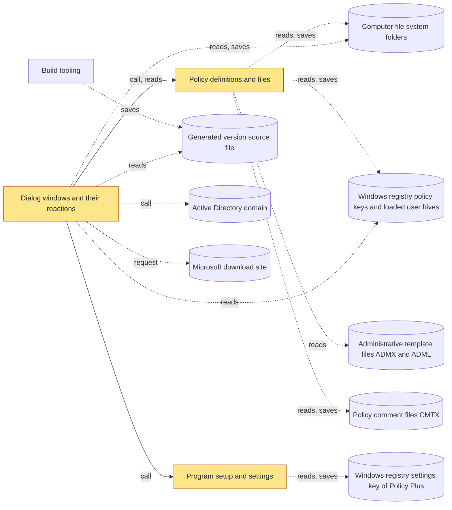
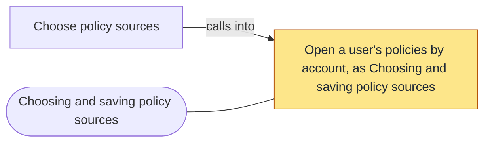

# Legacy reference: Let a person leave the user entry without choosing a user

The typed header below maps each criterion of the work item to the rules of the existing system it backs. The reading of the existing code follows it.

## Header

```json
{
  "story": "story-ba2b08c56e88",
  "fingerprint": "280637421a2d33856d0f4655b9cf3df29c3a1ebf99ebbb84e7839ee4506bf978",
  "criteria": [
    {
      "ac": "AC-1",
      "rules": [
        {
          "says": "Pressing Escape closes the user dialog as cancelled.",
          "where": {
            "file": "PolicyPlus/OpenUserGpo.vb",
            "firstLine": 34,
            "lastLine": 36
          },
          "doubt": ""
        }
      ]
    }
  ],
  "reliesOn": [
    {
      "says": "A name typed in the user dialog is turned into the account's security identifier (SID) on Search; if the name cannot be translated, the person is told \"The name could not be translated to a SID.\"",
      "builtBy": "Turn a typed user name into a valid account identifier"
    },
    {
      "says": "When OK is pressed with a name typed but no SID, the name is looked up first, and the dialog stays open if no SID results.",
      "builtBy": "Turn a typed user name into a valid account identifier"
    },
    {
      "says": "When OK is pressed, the SID text must be a valid SID or the person is told \"The SID is not valid. Enter a SID in the lower box, or enter a username in the top box and press Search to translate.\"; a valid SID is returned and the dialog closes.",
      "builtBy": "Turn a typed user name into a valid account identifier"
    }
  ],
  "data": [
    {
      "kind": "Program preference",
      "access": "saves"
    },
    {
      "kind": "Policy comment",
      "access": "reads and saves"
    },
    {
      "kind": "Policy setting",
      "access": "reads and saves"
    }
  ],
  "transitions": [],
  "outsideSystems": [
    "Windows registry settings key of Policy Plus",
    "Computer file system folders",
    "Policy comment files (CMTX)",
    "Windows registry policy keys and loaded user hives"
  ],
  "steps": [
    {
      "intent": "Say which user I mean",
      "change": "merged",
      "reason": "Search, check and cancel need no separate steps."
    }
  ],
  "components": [
    {
      "name": "User Identification Entry",
      "module": "user-identification-entry",
      "layer": "packages/ui"
    }
  ],
  "cited": [
    {
      "file": "PolicyPlus/OpenUserGpo.vb",
      "firstLine": 34,
      "lastLine": 36
    },
    {
      "file": "PolicyPlus/OpenUserGpo.vb",
      "firstLine": 14,
      "lastLine": 29
    },
    {
      "file": "PolicyPlus/OpenUserGpo.vb",
      "firstLine": 4,
      "lastLine": 13
    },
    {
      "file": "PolicyPlus/OpenUserGpo.vb",
      "firstLine": 34,
      "lastLine": 36
    }
  ]
}
```

## What each criterion must keep

### AC-1

- Pressing Escape closes the user dialog as cancelled. (PolicyPlus/OpenUserGpo.vb:34-36)

## Relies on, built elsewhere

- A name typed in the user dialog is turned into the account's security identifier (SID) on Search; if the name cannot be translated, the person is told "The name could not be translated to a SID." Built by: Turn a typed user name into a valid account identifier.
- When OK is pressed with a name typed but no SID, the name is looked up first, and the dialog stays open if no SID results. Built by: Turn a typed user name into a valid account identifier.
- When OK is pressed, the SID text must be a valid SID or the person is told "The SID is not valid. Enter a SID in the lower box, or enter a username in the top box and press Search to translate."; a valid SID is returned and the dialog closes. Built by: Turn a typed user name into a valid account identifier.

## Reading of the existing code

# Screen: Open a user's policies by account, as Choosing and saving policy sources

At a glance: 4 owned rules, 0 relied on, 3 actions, 2 files (1 own, 0 relied on, 1 of neighbour screens, 0 generated), 0 disputed.

How to read it: paths are relative to the source root and `file:a-b` is an inclusive line range. `BR-` rules, `ACT-` actions, `TR-` changes of state and `RK-` risks have stable ids. A record marked disputed was challenged in review and kept; the reviewer's words are under Trust. All of it was read from the code; nothing was run.

## Product context
Policy Plus is a Windows desktop editor for Group Policy settings, used by administrators and power users. It reads Microsoft's policy definition files and edits policy files directly, so it works on any Windows edition, including Home, which lacks the built-in editor.
Built with: .NET Framework v4.5.2, Microsoft Windows, System.DirectoryServices, System.Xml, Visual Basic .NET, Windows Forms (Policy Plus desktop editor).
Runs: It runs on the user's own Windows computer as one desktop program on .NET Framework 4.5.2. It asks for elevated rights when available but starts without them; loading registry hives, refreshing policy and editing local Group Policy files need them. It can also reach the domain's shared policy folder.
Reaches outside itself: Computer file system folders; Windows registry policy keys and loaded user hives; Administrative template files (ADMX and ADML); Windows registry settings key of Policy Plus; Generated version source file; Policy comment files (CMTX); Active Directory domain; Microsoft download site.



## Where this sits
Part of: Choosing and saving policy sources (Setting and storing policies).



## Boundary
- Called from **Choose policy sources** (bundle: screen choose-policy-sources), at `PolicyPlus/OpenPol.vb:112-115`

## Contract: what it must do
### Open a user's policies by account
Give an account name or SID; the program turns it into the SID of the user whose policies will be opened.
Controls (6): Button: OkButton, SearchButton; Label: Label1, Label2; TextBox: SidTextbox, UsernameTextbox

Actions
- **ACT-49589219** Looks up the typed account name and shows its SID — `PolicyPlus/OpenUserGpo.vb:4-13`; started by person
- **ACT-59714722** Checks the SID (looking it up from the name if needed) and closes the dialog as accepted — `PolicyPlus/OpenUserGpo.vb:14-29`; started by person
- **ACT-42266349** Closes the dialog as cancelled when Escape is pressed — `PolicyPlus/OpenUserGpo.vb:34-36`; started by person

Rules
- **BR-35455610** A name typed in the user dialog is turned into the account's security identifier (SID) on Search; if the name cannot be translated, the person is told "The name could not be translated to a SID." — `PolicyPlus/OpenUserGpo.vb:4-13`
- **BR-71903040** When OK is pressed with a name typed but no SID, the name is looked up first, and the dialog stays open if no SID results. — `PolicyPlus/OpenUserGpo.vb:14-19`
- **BR-72211108** When OK is pressed, the SID text must be a valid SID or the person is told "The SID is not valid. Enter a SID in the lower box, or enter a username in the top box and press Search to translate."; a valid SID is returned and the dialog closes. — `PolicyPlus/OpenUserGpo.vb:20-29`
- **BR-41688759** Pressing Escape closes the user dialog as cancelled. — `PolicyPlus/OpenUserGpo.vb:34-36`


## Trust: what to doubt
**Risks**
- **RK-17348566** [medium] Text typed by the person, a user identifier or a language code, is used unchecked as part of a folder path. Path characters redirect where policy and version files are created or which folder is searched for definition text, using the person's own rights. (Input from outside is used without checks, so it can change what the code does) — at `PolicyPlus/OpenUserGpo.vb:20-26`

**Assumed, not confirmed**
- The Group Policy check relies on a fixed list of edition codes. We assume those codes are the professional, enterprise, education and server editions, and that Home editions are absent. The code names no editions. Why unsettled: The list holds numbers only; their meaning as editions comes from outside knowledge. If wrong: The program would hide or show its warning about missing Group Policy on the wrong computers.

**In these files but reached by nothing the analysis could follow**
- OpenUserGpo.OpenUserGpo_Shown (`PolicyPlus/OpenUserGpo.vb:30-33`)


## Read order
| Tier | File | Lines | Why |
| --- | --- | --- | --- |
| own | `PolicyPlus/OpenUserGpo.vb` | whole file | starts 3 actions; decides 4 owned rules |
| neighbour screen | `PolicyPlus/OpenPol.vb` | 112-115 | calls into this screen: Choose policy sources |

## Source

### PolicyPlus/OpenUserGpo.vb
```
1: Imports System.Security.Principal
2: Public Class OpenUserGpo
3:     Public SelectedSid As String
4:     Private Sub SearchButton_Click(sender As Object, e As EventArgs) Handles SearchButton.Click
5:         ' Resolve the username to a security identifier (SID)
6:         Try
7:             Dim userAccount As New NTAccount(UsernameTextbox.Text)
8:             Dim sid As SecurityIdentifier = userAccount.Translate(GetType(SecurityIdentifier))
9:             SidTextbox.Text = sid.ToString
10:         Catch ex As Exception
11:             MsgBox("The name could not be translated to a SID.", MsgBoxStyle.Exclamation)
12:         End Try
13:     End Sub
14:     Private Sub OkButton_Click(sender As Object, e As EventArgs) Handles OkButton.Click
15:         If SidTextbox.Text = "" And UsernameTextbox.Text <> "" Then
16:             ' Automatically resolve if the user didn't click Search
17:             SearchButton_Click(Nothing, Nothing)
18:             If SidTextbox.Text = "" Then Exit Sub
19:         End If
20:         Try
21:             ' Make sure the SID is valid
22:             Dim sid As New SecurityIdentifier(SidTextbox.Text)
23:         Catch ex As Exception
24:             MsgBox("The SID is not valid. Enter a SID in the lower box, or enter a username in the top box and press Search to translate.", MsgBoxStyle.Exclamation)
25:             Exit Sub
26:         End Try
27:         SelectedSid = SidTextbox.Text
28:         DialogResult = DialogResult.OK
29:     End Sub
30:     Private Sub OpenUserGpo_Shown(sender As Object, e As EventArgs) Handles Me.Shown
31:         SidTextbox.Text = ""
32:         UsernameTextbox.Text = ""
33:     End Sub
34:     Private Sub OpenUserGpo_KeyUp(sender As Object, e As KeyEventArgs) Handles Me.KeyUp
35:         If e.KeyCode = Keys.Escape Then DialogResult = DialogResult.Cancel
36:     End Sub
37: End Class
```

### PolicyPlus/OpenPol.vb
```
112:     Private Sub UserBrowseGpoButton_Click(sender As Object, e As EventArgs) Handles UserBrowseGpoButton.Click
113:         ' Browse for a per-user GPO
114:         If OpenUserGpo.ShowDialog = DialogResult.OK Then UserGpoSidTextbox.Text = OpenUserGpo.SelectedSid
115:     End Sub
```

