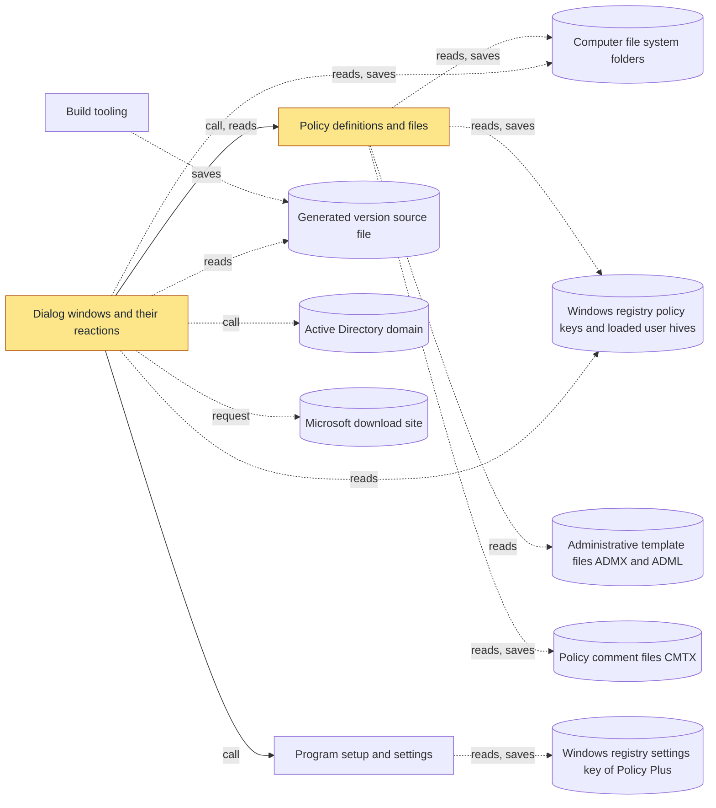
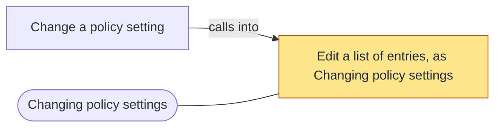

# Legacy reference: Enter list entries for a policy option

The typed header below maps each criterion of the work item to the rules of the existing system it backs. The reading of the existing code follows it.

## Header

```json
{
  "story": "story-bc5a07a01440",
  "fingerprint": "280637421a2d33856d0f4655b9cf3df29c3a1ebf99ebbb84e7839ee4506bf978",
  "criteria": [
    {
      "ac": "AC-1",
      "rules": [
        {
          "says": "When the list editor is confirmed for a list where the person names each entry, and two entries have exactly the same name, it is refused with \"Multiple entries are named \"<name>\"! Remove or rename all but one.\" and nothing is returned. Names are compared exactly, so Run and run are accepted as two entries. A name cell never filled in stops the dialog with an unhandled error.",
          "where": {
            "file": "PolicyPlus/ListEditor.vb",
            "firstLine": 28,
            "lastLine": 38
          },
          "doubt": ""
        }
      ]
    },
    {
      "ac": "AC-2",
      "rules": [
        {
          "says": "When the list editor is confirmed for a list without names, every row except the empty new row at the bottom is returned in the order shown, with no check that a cell has content; a row whose value cell was never filled is returned as an empty entry. For named lists the same new row is ignored.",
          "where": {
            "file": "PolicyPlus/ListEditor.vb",
            "firstLine": 41,
            "lastLine": 45
          },
          "doubt": ""
        }
      ]
    }
  ],
  "reliesOn": [],
  "data": [
    {
      "kind": "Policy setting",
      "access": "reads and saves"
    }
  ],
  "transitions": [],
  "outsideSystems": [
    "Computer file system folders",
    "Windows registry policy keys and loaded user hives"
  ],
  "cited": [
    {
      "file": "PolicyPlus/ListEditor.vb",
      "firstLine": 25,
      "lastLine": 48
    },
    {
      "file": "PolicyPlus/ListEditor.vb",
      "firstLine": 28,
      "lastLine": 38
    },
    {
      "file": "PolicyPlus/ListEditor.vb",
      "firstLine": 41,
      "lastLine": 45
    },
    {
      "file": "PolicyPlus/ListEditor.vb",
      "firstLine": 30,
      "lastLine": 30
    }
  ]
}
```

## What each criterion must keep

### AC-1

- When the list editor is confirmed for a list where the person names each entry, and two entries have exactly the same name, it is refused with "Multiple entries are named "<name>"! Remove or rename all but one." and nothing is returned. Names are compared exactly, so Run and run are accepted as two entries. A name cell never filled in stops the dialog with an unhandled error. (PolicyPlus/ListEditor.vb:28-38)

### AC-2

- When the list editor is confirmed for a list without names, every row except the empty new row at the bottom is returned in the order shown, with no check that a cell has content; a row whose value cell was never filled is returned as an empty entry. For named lists the same new row is ignored. (PolicyPlus/ListEditor.vb:41-45)

## Reading of the existing code

# Screen: Edit a list of entries, as Changing policy settings

At a glance: 2 owned rules, 0 relied on, 1 action, 2 files (1 own, 0 relied on, 1 of neighbour screens, 0 generated), 0 disputed.

How to read it: paths are relative to the source root and `file:a-b` is an inclusive line range. `BR-` rules, `ACT-` actions, `TR-` changes of state and `RK-` risks have stable ids. A record marked disputed was challenged in review and kept; the reviewer's words are under Trust. All of it was read from the code; nothing was run.

## Product context
Policy Plus is a Windows desktop editor for Group Policy settings, used by administrators and power users. It reads Microsoft's policy definition files and edits policy files directly, so it works on any Windows edition, including Home, which lacks the built-in editor.
Built with: .NET Framework v4.5.2, Microsoft Windows, System.DirectoryServices, System.Xml, Visual Basic .NET, Windows Forms (Policy Plus desktop editor).
Runs: It runs on the user's own Windows computer as one desktop program on .NET Framework 4.5.2. It asks for elevated rights when available but starts without them; loading registry hives, refreshing policy and editing local Group Policy files need them. It can also reach the domain's shared policy folder.
Reaches outside itself: Computer file system folders; Windows registry policy keys and loaded user hives; Administrative template files (ADMX and ADML); Windows registry settings key of Policy Plus; Generated version source file; Policy comment files (CMTX); Active Directory domain; Microsoft download site.



## Where this sits
Part of: Changing policy settings (Setting and storing policies).



## Boundary
- Called from **Change a policy setting** (bundle: screen change-a-policy-setting), at `PolicyPlus/EditSetting.vb:168-170`

## Contract: what it must do
### Edit a list of entries
Edit the rows of a list option, with or without names.
Controls (6): Button, Text = "OK", TabIndex = 1: OkButton; Cancel, TabIndex = 2: CloseButton; DataGridView, TabIndex = 0: EntriesDatagrid; DataGridViewTextBoxColumn, HeaderText = "Name": NameColumn; DataGridViewTextBoxColumn, HeaderText = "Value": ValueColumn; Label, Text = "List element name", TabIndex = 1: ElementNameLabel

Actions
- **ACT-70790613** Collects the grid rows into a list or name-value map, rejecting duplicate names. — `PolicyPlus/ListEditor.vb:25-48`; started by person

Rules
- **BR-36880139** When the list editor is confirmed for a list where the person names each entry, and two entries have exactly the same name, it is refused with "Multiple entries are named "<name>"! Remove or rename all but one." and nothing is returned. Names are compared exactly, so Run and run are accepted as two entries. A name cell never filled in stops the dialog with an unhandled error. — `PolicyPlus/ListEditor.vb:28-38`
- **BR-14552078** When the list editor is confirmed for a list without names, every row except the empty new row at the bottom is returned in the order shown, with no check that a cell has content; a row whose value cell was never filled is returned as an empty entry. For named lists the same new row is ignored. — `PolicyPlus/ListEditor.vb:41-45`; also rests on `PolicyPlus/ListEditor.vb:30`


## Trust: what to doubt
**Risks**
- **RK-55878738** [low] Several windows raise an unhandled error on ordinary input: double-clicking with no row selected, right-clicking with no category, an unnamed list entry, an unreadable import file, a malformed search wildcard, a removed product in a filter, or an inspector item with no match. No program-wide handler is set, so the framework's default error dialog appears. (Failures are hidden, lost or not retried) — at `PolicyPlus/ListEditor.vb:31-32`, `PolicyPlus/ListEditor.vb:36`, `PolicyPlus/ListEditor.vb:43`


## Read order
| Tier | File | Lines | Why |
| --- | --- | --- | --- |
| own | `PolicyPlus/ListEditor.vb` | whole file | starts 1 action; decides 2 owned rules |
| neighbour screen | `PolicyPlus/EditSetting.vb` | 168-170 | calls into this screen: Change a policy setting |

## Source

### PolicyPlus/ListEditor.vb
```
1: Public Class ListEditor
2:     Dim UserProvidesNames As Boolean
3:     Public FinalData As Object
4:     Public Function PresentDialog(Title As String, Data As Object, TwoColumn As Boolean) As DialogResult
5:         UserProvidesNames = TwoColumn
6:         NameColumn.Visible = TwoColumn
7:         ElementNameLabel.Text = Title
8:         EntriesDatagrid.Rows.Clear()
9:         If Data IsNot Nothing Then
10:             If TwoColumn Then
11:                 Dim dict As Dictionary(Of String, String) = Data
12:                 For Each kv In dict
13:                     EntriesDatagrid.Rows.Add(kv.Key, kv.Value)
14:                 Next
15:             Else
16:                 Dim list As List(Of String) = Data
17:                 For Each entry In list
18:                     EntriesDatagrid.Rows.Add("", entry)
19:                 Next
20:             End If
21:         End If
22:         FinalData = Nothing
23:         Return ShowDialog()
24:     End Function
25:     Private Sub OkButton_Click(sender As Object, e As EventArgs) Handles OkButton.Click
26:         If UserProvidesNames Then
27:             ' Check for duplicate keys
28:             Dim dict As New Dictionary(Of String, String)
29:             For Each row As DataGridViewRow In EntriesDatagrid.Rows
30:                 If row.IsNewRow Then Continue For
31:                 Dim key As String = row.Cells(0).Value
32:                 If dict.ContainsKey(key) Then
33:                     MsgBox("Multiple entries are named """ & key & """! Remove or rename all but one.", MsgBoxStyle.Exclamation)
34:                     Exit Sub
35:                 Else
36:                     dict.Add(key, row.Cells(1).Value)
37:                 End If
38:             Next
39:             FinalData = dict
40:         Else
41:             Dim list As New List(Of String)
42:             For Each row As DataGridViewRow In EntriesDatagrid.Rows
43:                 If Not row.IsNewRow Then list.Add(row.Cells(1).Value)
44:             Next
45:             FinalData = list
46:         End If
47:         DialogResult = DialogResult.OK
48:     End Sub
49: End Class
```

### PolicyPlus/EditSetting.vb
```
168:                         AddHandler button.Click, Sub()
169:                                                      If ListEditor.PresentDialog(listPres.Label, button.Tag, list.UserProvidesNames) = DialogResult.OK Then button.Tag = ListEditor.FinalData
170:                                                  End Sub
```

