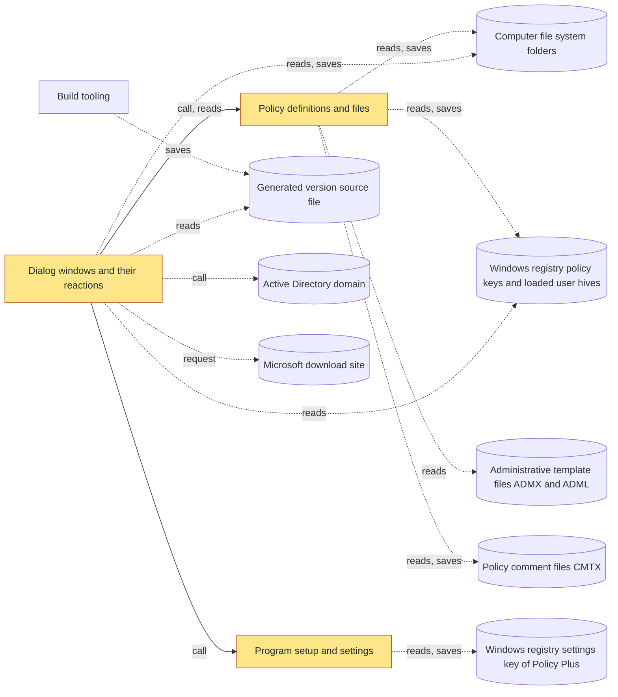
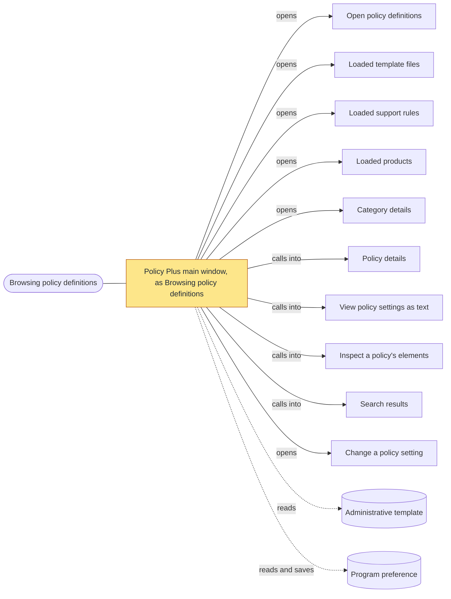
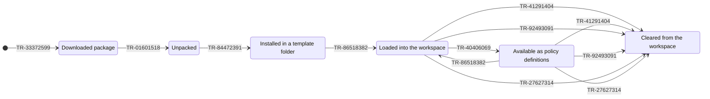
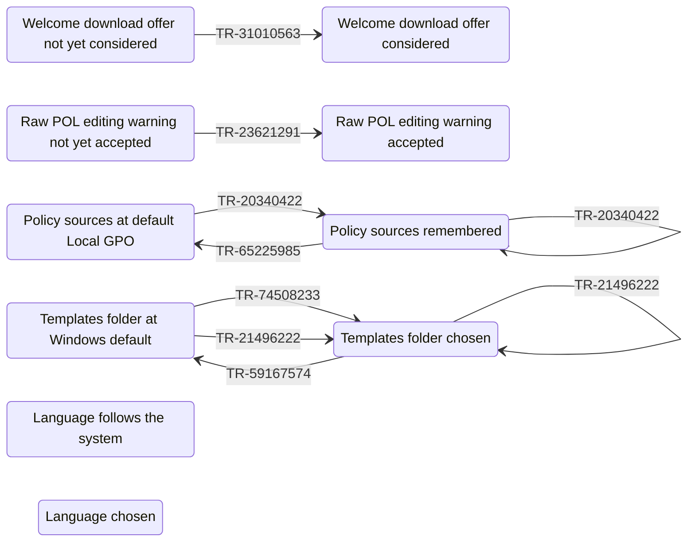

# Legacy reference: Browse categories and policies and read their descriptions

The typed header below maps each criterion of the work item to the rules of the existing system it backs. The reading of the existing code follows it.

## Header

```json
{
  "story": "story-c4b4d4c78ed0",
  "fingerprint": "280637421a2d33856d0f4655b9cf3df29c3a1ebf99ebbb84e7839ee4506bf978",
  "criteria": [
    {
      "ac": "AC-1",
      "rules": [
        {
          "says": "Selecting a category in the tree makes it the current category and clears any selected policy.",
          "where": {
            "file": "PolicyPlus/Main.vb",
            "firstLine": 482,
            "lastLine": 485
          },
          "doubt": ""
        }
      ]
    },
    {
      "ac": "AC-2",
      "rules": [
        {
          "says": "Highlighting a policy makes it the selected policy and clears any highlighted category; highlighting a category does the reverse; highlighting nothing clears both.",
          "where": {
            "file": "PolicyPlus/Main.vb",
            "firstLine": 493,
            "lastLine": 504
          },
          "doubt": ""
        }
      ]
    },
    {
      "ac": "AC-3",
      "rules": [
        {
          "says": "Opening an item in the policy list does nothing with no selection, opens a category as the current one, or opens a policy's editor for the area currently shown; Enter does the same.",
          "where": {
            "file": "PolicyPlus/Main.vb",
            "firstLine": 563,
            "lastLine": 570
          },
          "doubt": ""
        }
      ]
    },
    {
      "ac": "AC-4",
      "rules": []
    }
  ],
  "reliesOn": [
    {
      "says": "A category is orphaned when it has no parent among the loaded definitions although its definition names one.",
      "builtBy": "Show the category tree and the list of a chosen category"
    },
    {
      "says": "A category's icon is chosen in this order: orphaned, then empty, then normal.",
      "builtBy": "Show the category tree and the list of a chosen category"
    },
    {
      "says": "For a policy's list elements, a marked-for-deletion list counts as one deleted element, and a list that holds any values counts as a present element and cancels that deletion.",
      "builtBy": "Work out whether a policy is enabled or disabled from its values"
    },
    {
      "says": "A policy's lists of on-values and off-values count as enabled or disabled evidence for each value in them that is present, using the list's own key when it names one.",
      "builtBy": "Work out whether a policy is enabled or disabled from its values"
    },
    {
      "says": "A category is visible when empty categories are switched on. Otherwise it is visible only if it has at least one visible policy or one visible subcategory.",
      "builtBy": "Show the category tree and the list of a chosen category"
    },
    {
      "says": "A policy is visible only if it applies to a chosen area (user, computer or both). With \"Only Filtered Policies\" on, it must also pass the filter for a chosen area it applies to; passing for either one is enough.",
      "builtBy": "Show the category tree and the list of a chosen category"
    },
    {
      "says": "With both areas shown, a policy that applies to both areas shows its common state followed by \"(2)\" when both match, the computer state followed by \"(C)\" when only the user is Not Configured, the user state followed by \"(U)\" when only the computer is Not Configured, and \"Mixed\" otherwise.",
      "builtBy": "Show a policy's state and comment per area"
    },
    {
      "says": "A filter on state keeps only policies whose state in the checked area is Configured (Enabled or Disabled), Not Configured, Disabled or Enabled, as chosen.",
      "builtBy": "Show a policy's state and comment per area"
    },
    {
      "says": "When nothing is selected, the title and support lines are hidden and the pane reads \"Select an item to see its description.\".",
      "builtBy": "Show the category tree and the list of a chosen category"
    },
    {
      "says": "A value in a policy file counts as marked for deletion when a deletion marker names it, when the key has a clear-all marker, or when a delete-values list for the key names it, regardless of case. Entries are examined in sorted order, and a value whose name sorts after the marker is stored as present and cancels the deletion, whenever it was written and whichever marker kind came before.",
      "builtBy": "Read and list values in policy files and registry policy keys"
    },
    {
      "says": "Listing the values of a key in a policy file leaves out the marker entries unless the caller asks for them.",
      "builtBy": "Read and list values in policy files and registry policy keys"
    },
    {
      "says": "For any other element (number, text, choice, multi-line text), a value marked for deletion counts as a deleted element and a value that is present counts as a present element.",
      "builtBy": "Work out whether a policy is enabled or disabled from its values"
    },
    {
      "says": "A registry key counts as a policy key when it is one of the three policy branches (software\\policies, software\\microsoft\\windows\\currentversion\\policies, system\\currentcontrolset\\policies) or lies below one, regardless of case.",
      "builtBy": "Read and list values in policy files and registry policy keys"
    },
    {
      "says": "The live registry never reports a value as marked for deletion.",
      "builtBy": "Read and list values in policy files and registry policy keys"
    },
    {
      "says": "A policy with a registry value of its own counts as enabled evidence when that value holds its 'on' value, which is the number 1 when the template gives none, and as disabled evidence when it holds its 'off' value or is marked for deletion when the template gives none.",
      "builtBy": "Work out whether a policy is enabled or disabled from its values"
    },
    {
      "says": "Reading a value from a policy file gives nothing when the value is absent or marked for deletion.",
      "builtBy": "Read and list values in policy files and registry policy keys"
    },
    {
      "says": "A value in the live registry counts as present when its key exists and, unless the value name is empty, the key lists a value of that name, regardless of case. An empty name means the key itself.",
      "builtBy": "Read and list values in policy files and registry policy keys"
    },
    {
      "says": "If any element is present, the elements add their count to the enabled evidence; only when none is present do deleted elements add to the disabled evidence.",
      "builtBy": "Work out whether a policy is enabled or disabled from its values"
    },
    {
      "says": "A support definition met a second time anywhere in one evaluation counts as not met, because the list of definitions seen is never emptied. Two entries that point at the same definition, with no cycle, make the second one not met.",
      "builtBy": "Decide whether a policy's support rules are met"
    },
    {
      "says": "With both areas shown, the comment column is empty when neither area has a comment, shows \"(multiple)\" when both have one, and otherwise shows the single comment.",
      "builtBy": "Show a policy's state and comment per area"
    },
    {
      "says": "A policy's comment in one area is empty when that source has no comment file or holds no comment for the policy, and otherwise the saved text.",
      "builtBy": "Show a policy's state and comment per area"
    },
    {
      "says": "A value in a policy file counts as present only if it is stored and not marked for deletion.",
      "builtBy": "Read and list values in policy files and registry policy keys"
    },
    {
      "says": "A policy's state in one area reads \"Enabled\", \"Disabled\", \"Not Configured\" or \"Unknown\"; the computer source is read for the computer area and the user source for any other.",
      "builtBy": "Show a policy's state and comment per area"
    },
    {
      "says": "A support entry for a product that has versions beneath it, whether a version range or a plain entry for a parent product that is not itself chosen, counts as met when any version in its range, or a sub-product directly beneath one, is chosen. The range runs from the entry's minimum (0 if none) to its maximum (the highest version if none). A range entry never matches on its own product, and a product with no versions beneath it never matches this way.",
      "builtBy": "Decide whether a policy's support rules are met"
    },
    {
      "says": "When the caller asks for 'any' matching, a support definition whose logic is all-of needs every entry met, and any other definition needs one entry met. When the caller does not ask for 'any', every definition, all-of included, is met by one entry. A definition with no entries, or none met, is met only when all are required. Plain product entries are checked before nested definitions.",
      "builtBy": "Decide whether a policy's support rules are met"
    },
    {
      "says": "The category tree selection follows the category shown in the right pane.",
      "builtBy": "Show the category tree and the list of a chosen category"
    },
    {
      "says": "The right pane lists the chosen category in this order: an \"Up: <parent name>\" row marked \"Parent\" when the category has a parent, then visible subcategories by name, then visible policies by name. Each policy row shows its state and its comment text.",
      "builtBy": "Show the category tree and the list of a chosen category"
    },
    {
      "says": "For a selected or highlighted category the pane shows its title, \"This category contains N policies and M subcategories.\" (\"The selected category\" when highlighted but not opened) and its explanation. The counts include every policy and subcategory, hidden or not.",
      "builtBy": "Show category and policy details and keep the list tidy"
    },
    {
      "says": "A value counts as present when: for a deletion marker, it is marked for deletion; for a number, it exists as a whole number and equals the expected number; for text, it exists as text and equals the expected text. A value of the wrong kind is not present.",
      "builtBy": "Decide whether a policy is enabled, disabled or unsupported"
    },
    {
      "says": "The text of a policy description is tidied for display: leading and trailing spaces are removed from every line and blank space at the end of the text is dropped.",
      "builtBy": "Show category and policy details and keep the list tidy"
    },
    {
      "says": "A filter on managed policies hides preferences when managed policies are wanted, and hides managed policies when preferences are wanted.",
      "builtBy": "Filter policies and keep search results"
    },
    {
      "says": "A REG file cannot be used as a source for checking whether a value will be deleted: the request fails with 'not implemented'. Applying a newer policy file over an older one to a REG file fails this way for any dropped value under a policy branch.",
      "builtBy": "Refuse operations a REG file source cannot support"
    },
    {
      "says": "When the list is rebuilt, the policy already selected is selected again and revealed only if it is still listed, that is, it sits in the category shown and passes the visibility rule; otherwise nothing is selected. Then, if the policy is in the same category and the list still has that many rows, the earlier top row is put back, so the policy is not guaranteed to stay in view.",
      "builtBy": "Show category and policy details and keep the list tidy"
    },
    {
      "says": "A policy passes the filter only when it passes every active part of it.",
      "builtBy": "Filter policies and keep search results"
    },
    {
      "says": "Text read from a policy file stops at its first empty character, and a multiple-string value ends at its first empty string.",
      "builtBy": "Read and write policy files with a byte-faithful round trip"
    },
    {
      "says": "For a checkbox element: a value marked for deletion counts as one deleted element. Otherwise, each present off value (or off-list value) counts a tenth of a deleted element, and each present on value (or on-list value) counts one present element. A checkbox whose template declares no on value or on list adds no present evidence, even if it holds 1.",
      "builtBy": "Decide whether a policy is enabled, disabled or unsupported"
    },
    {
      "says": "For a selected policy the information pane shows its title, \"(no requirements information)\" when it has no support rule or \"Requirements:\" plus the support name, and its explanation. A notice that the policy is a preference appears only for preferences.",
      "builtBy": "Show category and policy details and keep the list tidy"
    },
    {
      "says": "A policy's icon is chosen in this order: preference, then plain when it has no configurable elements, then \"extra configuration\" when it has some.",
      "builtBy": "Show category and policy details and keep the list tidy"
    },
    {
      "says": "A policy applies to an area when its definition declares that area; a policy declared for both applies to each.",
      "builtBy": "Read support rules, products, classes and list options from templates"
    },
    {
      "says": "A filter on comments keeps only policies that have a non-empty comment in the checked area, or only those that have none, as chosen.",
      "builtBy": "Filter policies and keep search results"
    },
    {
      "says": "When a policy lists no supported-on information, it counts as supported only if the caller allows unlisted policies. The same applies to a support entry that names no known product.",
      "builtBy": "Decide whether a policy is enabled, disabled or unsupported"
    },
    {
      "says": "A REG file cannot be used as a source for reading a value: the request fails with 'not implemented'. Applying a newer policy file over an older one to a REG file fails this way for any dropped value under a policy branch.",
      "builtBy": "Refuse operations a REG file source cannot support"
    },
    {
      "says": "A category is empty when it holds no subcategories and no policies at all, counting hidden ones.",
      "builtBy": "Show the category tree and the list of a chosen category"
    },
    {
      "says": "With both areas shown, a policy that applies to one area shows that area's state followed by \"(C)\" for computer or \"(U)\" for user. With a single area shown, only that area's state is shown, without a suffix.",
      "builtBy": "Show category and policy details and keep the list tidy"
    },
    {
      "says": "A stored policy file value is read back as text for text and expandable text, a 32-bit or 64-bit number for numbers, a list of strings for multiple strings, and raw bytes for every other type.",
      "builtBy": "Read and write policy files with a byte-faithful round trip"
    },
    {
      "says": "A policy is Enabled when enabled evidence exceeds disabled evidence, Disabled when disabled exceeds enabled, Not configured when there is no evidence either way, and Unclear when both are equal and above zero.",
      "builtBy": "Decide whether a policy is enabled, disabled or unsupported"
    },
    {
      "says": "A policy is a preference, not a managed policy, when it names a registry key outside the three policy locations: software\\policies, software\\microsoft\\windows\\currentversion\\policies and system\\currentcontrolset\\policies.",
      "builtBy": "Decide whether a policy is enabled, disabled or unsupported"
    },
    {
      "says": "A REG file cannot be used as a source for listing a key's values: the request fails with 'not implemented'. Applying a newer policy file over an older one to a REG file fails this way for any dropped value under a policy branch.",
      "builtBy": "Refuse operations a REG file source cannot support"
    },
    {
      "says": "Reading a value from the live registry gives nothing when the key is missing. Signed numbers are returned as the unsigned numbers policies use, and environment variables in text are not expanded.",
      "builtBy": "Open policy sources from imported files and describe them"
    },
    {
      "says": "A filter on products keeps only policies supported by the chosen products, honouring the options to match any product and to include policies with blank support.",
      "builtBy": "Filter policies and keep search results"
    },
    {
      "says": "A REG file cannot be used as a source for asking whether a value is present: the request fails with 'not implemented'. Applying a newer policy file over an older one to a REG file fails this way for any dropped value under a policy branch.",
      "builtBy": "Refuse operations a REG file source cannot support"
    },
    {
      "says": "A support entry for a product counts as met in two cases. The entry is not a version range and that exact product is among the chosen products. Or the product has versions beneath it, and any of those versions or their sub-products is chosen, even when the product itself is not.",
      "builtBy": "Decide whether a policy is enabled, disabled or unsupported"
    },
    {
      "says": "A category appears in the tree only when it passes the visibility rule; each shown category gets an icon by its kind and carries its visible subcategories below it, and the tree is sorted.",
      "builtBy": "Show the category tree and the list of a chosen category"
    },
    {
      "says": "After the edit dialog is accepted, which changes the open policy source in memory only, the list is refreshed in place if the current category is still visible; otherwise the program moves up to the nearest visible category. Nothing is written to disk until Save Policies.",
      "builtBy": "Keep the browser view consistent after view or edit changes"
    },
    {
      "says": "When a view setting changes, the program moves up to the nearest visible category, drops the selected policy if the move happened or the policy is now hidden, then rebuilds the tree and list. A policy kept after the move appears in the information pane only: rebuilding the list reselects the category in the tree, which clears the selection, so its row is not highlighted.",
      "builtBy": "Keep the browser view consistent after view or edit changes"
    },
    {
      "says": "After the category tree is rebuilt from the loaded definitions, no category, policy or highlighted item is selected and the information pane shows the empty state.",
      "builtBy": "Show category and policy details and keep the list tidy"
    }
  ],
  "data": [
    {
      "kind": "Program preference",
      "access": "reads and saves"
    },
    {
      "kind": "Administrative template",
      "access": "reads"
    },
    {
      "kind": "Policy setting",
      "access": "reads"
    }
  ],
  "transitions": [],
  "outsideSystems": [
    "Windows registry settings key of Policy Plus",
    "Active Directory domain",
    "Administrative template files (ADMX and ADML)",
    "Computer file system folders",
    "Microsoft download site",
    "Windows registry policy keys and loaded user hives"
  ],
  "cited": [
    {
      "file": "PolicyPlus/Main.vb",
      "firstLine": 480,
      "lastLine": 486
    },
    {
      "file": "PolicyPlus/Main.vb",
      "firstLine": 487,
      "lastLine": 490
    },
    {
      "file": "PolicyPlus/Main.vb",
      "firstLine": 491,
      "lastLine": 506
    },
    {
      "file": "PolicyPlus/Main.vb",
      "firstLine": 672,
      "lastLine": 684
    },
    {
      "file": "PolicyPlus/Main.vb",
      "firstLine": 561,
      "lastLine": 571
    },
    {
      "file": "PolicyPlus/Main.vb",
      "firstLine": 688,
      "lastLine": 691
    },
    {
      "file": "PolicyPlus/Main.vb",
      "firstLine": 482,
      "lastLine": 485
    },
    {
      "file": "PolicyPlus/Main.vb",
      "firstLine": 493,
      "lastLine": 504
    },
    {
      "file": "PolicyPlus/Main.vb",
      "firstLine": 563,
      "lastLine": 570
    },
    {
      "file": "PolicyPlus/Main.vb",
      "firstLine": 690,
      "lastLine": 690
    }
  ]
}
```

## What each criterion must keep

### AC-1

- Selecting a category in the tree makes it the current category and clears any selected policy. (PolicyPlus/Main.vb:482-485)

### AC-2

- Highlighting a policy makes it the selected policy and clears any highlighted category; highlighting a category does the reverse; highlighting nothing clears both. (PolicyPlus/Main.vb:493-504)

### AC-3

- Opening an item in the policy list does nothing with no selection, opens a category as the current one, or opens a policy's editor for the area currently shown; Enter does the same. (PolicyPlus/Main.vb:563-570)

### AC-4

No single legacy rule: it describes the behaviour as a whole.


## Relies on, built elsewhere

- A category is orphaned when it has no parent among the loaded definitions although its definition names one. Built by: Show the category tree and the list of a chosen category.
- A category's icon is chosen in this order: orphaned, then empty, then normal. Built by: Show the category tree and the list of a chosen category.
- For a policy's list elements, a marked-for-deletion list counts as one deleted element, and a list that holds any values counts as a present element and cancels that deletion. Built by: Work out whether a policy is enabled or disabled from its values.
- A policy's lists of on-values and off-values count as enabled or disabled evidence for each value in them that is present, using the list's own key when it names one. Built by: Work out whether a policy is enabled or disabled from its values.
- A category is visible when empty categories are switched on. Otherwise it is visible only if it has at least one visible policy or one visible subcategory. Built by: Show the category tree and the list of a chosen category.
- A policy is visible only if it applies to a chosen area (user, computer or both). With "Only Filtered Policies" on, it must also pass the filter for a chosen area it applies to; passing for either one is enough. Built by: Show the category tree and the list of a chosen category.
- With both areas shown, a policy that applies to both areas shows its common state followed by "(2)" when both match, the computer state followed by "(C)" when only the user is Not Configured, the user state followed by "(U)" when only the computer is Not Configured, and "Mixed" otherwise. Built by: Show a policy's state and comment per area.
- A filter on state keeps only policies whose state in the checked area is Configured (Enabled or Disabled), Not Configured, Disabled or Enabled, as chosen. Built by: Show a policy's state and comment per area.
- When nothing is selected, the title and support lines are hidden and the pane reads "Select an item to see its description.". Built by: Show the category tree and the list of a chosen category.
- A value in a policy file counts as marked for deletion when a deletion marker names it, when the key has a clear-all marker, or when a delete-values list for the key names it, regardless of case. Entries are examined in sorted order, and a value whose name sorts after the marker is stored as present and cancels the deletion, whenever it was written and whichever marker kind came before. Built by: Read and list values in policy files and registry policy keys.
- Listing the values of a key in a policy file leaves out the marker entries unless the caller asks for them. Built by: Read and list values in policy files and registry policy keys.
- For any other element (number, text, choice, multi-line text), a value marked for deletion counts as a deleted element and a value that is present counts as a present element. Built by: Work out whether a policy is enabled or disabled from its values.
- A registry key counts as a policy key when it is one of the three policy branches (software\policies, software\microsoft\windows\currentversion\policies, system\currentcontrolset\policies) or lies below one, regardless of case. Built by: Read and list values in policy files and registry policy keys.
- The live registry never reports a value as marked for deletion. Built by: Read and list values in policy files and registry policy keys.
- A policy with a registry value of its own counts as enabled evidence when that value holds its 'on' value, which is the number 1 when the template gives none, and as disabled evidence when it holds its 'off' value or is marked for deletion when the template gives none. Built by: Work out whether a policy is enabled or disabled from its values.
- Reading a value from a policy file gives nothing when the value is absent or marked for deletion. Built by: Read and list values in policy files and registry policy keys.
- A value in the live registry counts as present when its key exists and, unless the value name is empty, the key lists a value of that name, regardless of case. An empty name means the key itself. Built by: Read and list values in policy files and registry policy keys.
- If any element is present, the elements add their count to the enabled evidence; only when none is present do deleted elements add to the disabled evidence. Built by: Work out whether a policy is enabled or disabled from its values.
- A support definition met a second time anywhere in one evaluation counts as not met, because the list of definitions seen is never emptied. Two entries that point at the same definition, with no cycle, make the second one not met. Built by: Decide whether a policy's support rules are met.
- With both areas shown, the comment column is empty when neither area has a comment, shows "(multiple)" when both have one, and otherwise shows the single comment. Built by: Show a policy's state and comment per area.
- A policy's comment in one area is empty when that source has no comment file or holds no comment for the policy, and otherwise the saved text. Built by: Show a policy's state and comment per area.
- A value in a policy file counts as present only if it is stored and not marked for deletion. Built by: Read and list values in policy files and registry policy keys.
- A policy's state in one area reads "Enabled", "Disabled", "Not Configured" or "Unknown"; the computer source is read for the computer area and the user source for any other. Built by: Show a policy's state and comment per area.
- A support entry for a product that has versions beneath it, whether a version range or a plain entry for a parent product that is not itself chosen, counts as met when any version in its range, or a sub-product directly beneath one, is chosen. The range runs from the entry's minimum (0 if none) to its maximum (the highest version if none). A range entry never matches on its own product, and a product with no versions beneath it never matches this way. Built by: Decide whether a policy's support rules are met.
- When the caller asks for 'any' matching, a support definition whose logic is all-of needs every entry met, and any other definition needs one entry met. When the caller does not ask for 'any', every definition, all-of included, is met by one entry. A definition with no entries, or none met, is met only when all are required. Plain product entries are checked before nested definitions. Built by: Decide whether a policy's support rules are met.
- The category tree selection follows the category shown in the right pane. Built by: Show the category tree and the list of a chosen category.
- The right pane lists the chosen category in this order: an "Up: <parent name>" row marked "Parent" when the category has a parent, then visible subcategories by name, then visible policies by name. Each policy row shows its state and its comment text. Built by: Show the category tree and the list of a chosen category.
- For a selected or highlighted category the pane shows its title, "This category contains N policies and M subcategories." ("The selected category" when highlighted but not opened) and its explanation. The counts include every policy and subcategory, hidden or not. Built by: Show category and policy details and keep the list tidy.
- A value counts as present when: for a deletion marker, it is marked for deletion; for a number, it exists as a whole number and equals the expected number; for text, it exists as text and equals the expected text. A value of the wrong kind is not present. Built by: Decide whether a policy is enabled, disabled or unsupported.
- The text of a policy description is tidied for display: leading and trailing spaces are removed from every line and blank space at the end of the text is dropped. Built by: Show category and policy details and keep the list tidy.
- A filter on managed policies hides preferences when managed policies are wanted, and hides managed policies when preferences are wanted. Built by: Filter policies and keep search results.
- A REG file cannot be used as a source for checking whether a value will be deleted: the request fails with 'not implemented'. Applying a newer policy file over an older one to a REG file fails this way for any dropped value under a policy branch. Built by: Refuse operations a REG file source cannot support.
- When the list is rebuilt, the policy already selected is selected again and revealed only if it is still listed, that is, it sits in the category shown and passes the visibility rule; otherwise nothing is selected. Then, if the policy is in the same category and the list still has that many rows, the earlier top row is put back, so the policy is not guaranteed to stay in view. Built by: Show category and policy details and keep the list tidy.
- A policy passes the filter only when it passes every active part of it. Built by: Filter policies and keep search results.
- Text read from a policy file stops at its first empty character, and a multiple-string value ends at its first empty string. Built by: Read and write policy files with a byte-faithful round trip.
- For a checkbox element: a value marked for deletion counts as one deleted element. Otherwise, each present off value (or off-list value) counts a tenth of a deleted element, and each present on value (or on-list value) counts one present element. A checkbox whose template declares no on value or on list adds no present evidence, even if it holds 1. Built by: Decide whether a policy is enabled, disabled or unsupported.
- For a selected policy the information pane shows its title, "(no requirements information)" when it has no support rule or "Requirements:" plus the support name, and its explanation. A notice that the policy is a preference appears only for preferences. Built by: Show category and policy details and keep the list tidy.
- A policy's icon is chosen in this order: preference, then plain when it has no configurable elements, then "extra configuration" when it has some. Built by: Show category and policy details and keep the list tidy.
- A policy applies to an area when its definition declares that area; a policy declared for both applies to each. Built by: Read support rules, products, classes and list options from templates.
- A filter on comments keeps only policies that have a non-empty comment in the checked area, or only those that have none, as chosen. Built by: Filter policies and keep search results.
- When a policy lists no supported-on information, it counts as supported only if the caller allows unlisted policies. The same applies to a support entry that names no known product. Built by: Decide whether a policy is enabled, disabled or unsupported.
- A REG file cannot be used as a source for reading a value: the request fails with 'not implemented'. Applying a newer policy file over an older one to a REG file fails this way for any dropped value under a policy branch. Built by: Refuse operations a REG file source cannot support.
- A category is empty when it holds no subcategories and no policies at all, counting hidden ones. Built by: Show the category tree and the list of a chosen category.
- With both areas shown, a policy that applies to one area shows that area's state followed by "(C)" for computer or "(U)" for user. With a single area shown, only that area's state is shown, without a suffix. Built by: Show category and policy details and keep the list tidy.
- A stored policy file value is read back as text for text and expandable text, a 32-bit or 64-bit number for numbers, a list of strings for multiple strings, and raw bytes for every other type. Built by: Read and write policy files with a byte-faithful round trip.
- A policy is Enabled when enabled evidence exceeds disabled evidence, Disabled when disabled exceeds enabled, Not configured when there is no evidence either way, and Unclear when both are equal and above zero. Built by: Decide whether a policy is enabled, disabled or unsupported.
- A policy is a preference, not a managed policy, when it names a registry key outside the three policy locations: software\policies, software\microsoft\windows\currentversion\policies and system\currentcontrolset\policies. Built by: Decide whether a policy is enabled, disabled or unsupported.
- A REG file cannot be used as a source for listing a key's values: the request fails with 'not implemented'. Applying a newer policy file over an older one to a REG file fails this way for any dropped value under a policy branch. Built by: Refuse operations a REG file source cannot support.
- Reading a value from the live registry gives nothing when the key is missing. Signed numbers are returned as the unsigned numbers policies use, and environment variables in text are not expanded. Built by: Open policy sources from imported files and describe them.
- A filter on products keeps only policies supported by the chosen products, honouring the options to match any product and to include policies with blank support. Built by: Filter policies and keep search results.
- A REG file cannot be used as a source for asking whether a value is present: the request fails with 'not implemented'. Applying a newer policy file over an older one to a REG file fails this way for any dropped value under a policy branch. Built by: Refuse operations a REG file source cannot support.
- A support entry for a product counts as met in two cases. The entry is not a version range and that exact product is among the chosen products. Or the product has versions beneath it, and any of those versions or their sub-products is chosen, even when the product itself is not. Built by: Decide whether a policy is enabled, disabled or unsupported.
- A category appears in the tree only when it passes the visibility rule; each shown category gets an icon by its kind and carries its visible subcategories below it, and the tree is sorted. Built by: Show the category tree and the list of a chosen category.
- After the edit dialog is accepted, which changes the open policy source in memory only, the list is refreshed in place if the current category is still visible; otherwise the program moves up to the nearest visible category. Nothing is written to disk until Save Policies. Built by: Keep the browser view consistent after view or edit changes.
- When a view setting changes, the program moves up to the nearest visible category, drops the selected policy if the move happened or the policy is now hidden, then rebuilds the tree and list. A policy kept after the move appears in the information pane only: rebuilding the list reselects the category in the tree, which clears the selection, so its row is not highlighted. Built by: Keep the browser view consistent after view or edit changes.
- After the category tree is rebuilt from the loaded definitions, no category, policy or highlighted item is selected and the information pane shows the empty state. Built by: Show category and policy details and keep the list tidy.

## Reading of the existing code

# Screen: Policy Plus main window, as Browsing policy definitions

At a glance: 46 owned rules, 63 relied on, 18 actions, 20 files (1 own, 9 relied on, 9 of neighbour screens, 1 generated), 4 disputed.

How to read it: paths are relative to the source root and `file:a-b` is an inclusive line range. `BR-` rules, `ACT-` actions, `TR-` changes of state and `RK-` risks have stable ids. A record marked disputed was challenged in review and kept; the reviewer's words are under Trust. All of it was read from the code; nothing was run.

## Product context
Policy Plus is a Windows desktop editor for Group Policy settings, used by administrators and power users. It reads Microsoft's policy definition files and edits policy files directly, so it works on any Windows edition, including Home, which lacks the built-in editor.
Built with: .NET Framework v4.5.2, Microsoft Windows, System.DirectoryServices, System.Xml, Visual Basic .NET, Windows Forms (Policy Plus desktop editor).
Runs: It runs on the user's own Windows computer as one desktop program on .NET Framework 4.5.2. It asks for elevated rights when available but starts without them; loading registry hives, refreshing policy and editing local Group Policy files need them. It can also reach the domain's shared policy folder.
Reaches outside itself: Computer file system folders; Windows registry policy keys and loaded user hives; Administrative template files (ADMX and ADML); Windows registry settings key of Policy Plus; Generated version source file; Policy comment files (CMTX); Active Directory domain; Microsoft download site.



## Where this sits
Part of: Browsing policy definitions (Reading policy definitions).



## Boundary
- Opens **Open policy definitions** (bundle: screen open-policy-definitions), at `PolicyPlus/Main.vb:510-523`
- Opens **Loaded template files** (bundle: screen loaded-template-files), at `PolicyPlus/Main.vb:767-769`
- Opens **Loaded support rules** (bundle: screen loaded-support-rules), at `PolicyPlus/Main.vb:770-772`
- Opens **Loaded products** (bundle: screen loaded-products), at `PolicyPlus/Main.vb:773-775`
- Opens **Category details** (bundle: screen category-details), at `PolicyPlus/Main.vb:839-858`
- Calls into **Policy details** (bundle: screen policy-details), at `PolicyPlus/Main.vb:839-858`
- Calls into **View policy settings as text** (bundle: screen view-policy-settings-as-text), at `PolicyPlus/Main.vb:839-858`
- Calls into **Inspect a policy's elements** (bundle: screen inspect-a-policy-s-elements), at `PolicyPlus/Main.vb:839-858`
- Calls into **Search results** (bundle: screen search-results), at `PolicyPlus/Main.vb:389-393`
- Opens **Change a policy setting** (bundle: screen change-a-policy-setting), at `PolicyPlus/Main.vb:298-304`

## Contract: what it must do
### Policy Plus main window
Browse categories and policies, and reach every other action.
Controls (56): ": PolicyIsPrefLabel; Friend WithEvents AboutToolStripMenuItem As ToolStripMenuItem  [Text = "About"]: AboutToolStripMenuItem; Friend WithEvents AcquireADMXFilesToolStripMenuItem As ToolStripMenuItem  [Text = "Acquire ADMX Files"]: AcquireADMXFilesToolStripMenuItem; Friend WithEvents AllProductsToolStripMenuItem As ToolStripMenuItem  [Text = "All Products"]: AllProductsToolStripMenuItem; Friend WithEvents AllSupportDefinitionsToolStripMenuItem As ToolStripMenuItem  [Text = "All Support Definitions"]: AllSupportDefinitionsToolStripMenuItem; Friend WithEvents ByIDToolStripMenuItem As ToolStripMenuItem  [Text = "By ID": ByIDToolStripMenuItem; Friend WithEvents ByRegistryToolStripMenuItem As ToolStripMenuItem  [Text = "By Registry": ByRegistryToolStripMenuItem; Friend WithEvents ByTextToolStripMenuItem As ToolStripMenuItem  [Text = "By Text": ByTextToolStripMenuItem; Friend WithEvents CategoriesTree As TreeView  [TabIndex = 2]: CategoriesTree; Friend WithEvents ChSettingName As ColumnHeader  [Text = "Name": ChSettingName; Friend WithEvents CloseADMXWorkspaceToolStripMenuItem As ToolStripMenuItem  [Text = "Close ADMX Workspace"]: CloseADMXWorkspaceToolStripMenuItem; Friend WithEvents CmeAllDetails As ToolStripMenuItem  [Text = "Details"]: CmeAllDetails; Friend WithEvents CmeCatOpen As ToolStripMenuItem  [Text = "Open"]: CmeCatOpen; Friend WithEvents CmePolEdit As ToolStripMenuItem  [Text = "Edit"]: CmePolEdit; Friend WithEvents CmePolInspectElements As ToolStripMenuItem  [Text = "Element Inspector"]: CmePolInspectElements; Friend WithEvents CmePolSpolFragment As ToolStripMenuItem  [Text = "Semantic Policy Fragment"]: CmePolSpolFragment; Friend WithEvents ComboAppliesTo As ComboBox  [TabIndex = 1: ComboAppliesTo; Friend WithEvents ComputerSourceLabel As ToolStripStatusLabel  [Text = "Computer info"]: ComputerSourceLabel; Friend WithEvents DeduplicatePoliciesToolStripMenuItem As ToolStripMenuItem  [Text = "Deduplicate Policies": DeduplicatePoliciesToolStripMenuItem; Friend WithEvents EditRawPOLToolStripMenuItem As ToolStripMenuItem  [Text = "Edit Raw POL"]: EditRawPOLToolStripMenuItem; Friend WithEvents EmptyCategoriesToolStripMenuItem As ToolStripMenuItem  [Text = "Empty Categories"]: EmptyCategoriesToolStripMenuItem; Friend WithEvents ExitToolStripMenuItem As ToolStripMenuItem  [Text = "Exit"]: ExitToolStripMenuItem; Friend WithEvents ExportPOLToolStripMenuItem As ToolStripMenuItem  [Text = "Export POL"]: ExportPOLToolStripMenuItem; Friend WithEvents ExportREGToolStripMenuItem As ToolStripMenuItem  [Text = "Export REG"]: ExportREGToolStripMenuItem; Friend WithEvents FileToolStripMenuItem As ToolStripMenuItem  [Text = "File"]: FileToolStripMenuItem; Friend WithEvents FilterOptionsToolStripMenuItem As ToolStripMenuItem  [Text = "Filter Options"]: FilterOptionsToolStripMenuItem; Friend WithEvents FindNextToolStripMenuItem As ToolStripMenuItem  [Text = "Find Next": FindNextToolStripMenuItem; Friend WithEvents FindToolStripMenuItem As ToolStripMenuItem  [Text = "Find"]: FindToolStripMenuItem; Friend WithEvents HelpToolStripMenuItem As ToolStripMenuItem  [Text = "Help"]: HelpToolStripMenuItem; Friend WithEvents ImportPOLToolStripMenuItem As ToolStripMenuItem  [Text = "Import POL"]: ImportPOLToolStripMenuItem; Friend WithEvents ImportREGToolStripMenuItem As ToolStripMenuItem  [Text = "Import REG"]: ImportREGToolStripMenuItem; Friend WithEvents ImportSemanticPolicyToolStripMenuItem As ToolStripMenuItem  [Text = "Import Semantic Policy"]: ImportSemanticPolicyToolStripMenuItem; Friend WithEvents InfoStrip As StatusStrip  [Text = "StatusStrip1": InfoStrip; Friend WithEvents LoadedADMXFilesToolStripMenuItem As ToolStripMenuItem  [Text = "Loaded ADMX Files"]: LoadedADMXFilesToolStripMenuItem; Friend WithEvents MainMenu As MenuStrip  [Text = "MenuStrip1": MainMenu; Friend WithEvents OnlyFilteredObjectsToolStripMenuItem As ToolStripMenuItem  [Text = "Only Filtered Policies"]: OnlyFilteredObjectsToolStripMenuItem; Friend WithEvents OpenADMXFileToolStripMenuItem As ToolStripMenuItem  [Text = "Open ADMX File"]: OpenADMXFileToolStripMenuItem; Friend WithEvents OpenADMXFolderToolStripMenuItem As ToolStripMenuItem  [Text = "Open ADMX Folder"]: OpenADMXFolderToolStripMenuItem; Friend WithEvents OpenPolicyResourcesToolStripMenuItem As ToolStripMenuItem  [Text = "Open Policy Resources": OpenPolicyResourcesToolStripMenuItem; Friend WithEvents PictureBox1 As PictureBox  [TabIndex = 0: PictureBox1; Friend WithEvents PoliciesList As ListView  [TabIndex = 3: PoliciesList; Friend WithEvents PolicyDescLabel As Label  [Text = "Policy description": PolicyDescLabel; Friend WithEvents PolicyIcons As ImageList: PolicyIcons; Friend WithEvents PolicyInfoTable As TableLayoutPanel  [TabIndex = 0]: PolicyInfoTable; Friend WithEvents PolicyIsPrefTable As TableLayoutPanel  [TabIndex = 4]: PolicyIsPrefTable; Friend WithEvents PolicyObjectContext As ContextMenuStrip: PolicyObjectContext; Friend WithEvents PolicySupportedLabel As Label  [Text = "Requirements": PolicySupportedLabel; Friend WithEvents PolicyTitleLabel As Label  [Text = "Policy title": PolicyTitleLabel; Friend WithEvents SavePoliciesToolStripMenuItem As ToolStripMenuItem  [Text = "Save Policies": SavePoliciesToolStripMenuItem; Friend WithEvents SearchResultsToolStripMenuItem As ToolStripMenuItem  [Text = "Search Results": SearchResultsToolStripMenuItem; Friend WithEvents SetADMLLanguageToolStripMenuItem As ToolStripMenuItem  [Text = "Set ADML Language"]: SetADMLLanguageToolStripMenuItem; Friend WithEvents SettingInfoPanel As Panel  [TabIndex = 0]: SettingInfoPanel; Friend WithEvents ShareToolStripMenuItem As ToolStripMenuItem  [Text = "Share"]: ShareToolStripMenuItem; Friend WithEvents SplitContainer As SplitContainer  [TabIndex = 1: SplitContainer; Friend WithEvents UserSourceLabel As ToolStripStatusLabel  [Text = "User info"]: UserSourceLabel; Friend WithEvents ViewToolStripMenuItem As ToolStripMenuItem  [Text = "View"]: ViewToolStripMenuItem

Actions
- **ACT-02633388** Lists the chosen category's subcategories and policies and shows its description. — `PolicyPlus/Main.vb:480-486`; started by person
- **ACT-75619459** Resizes the policy name column to fill the list. — `PolicyPlus/Main.vb:487-490`; started by person
- **ACT-01169217** Records the highlighted policy or category and shows its description. — `PolicyPlus/Main.vb:491-506`; started by person
- **ACT-92588767** Asks for a folder of policy definitions and loads it into the workspace. — `PolicyPlus/Main.vb:510-523`; started by person
- **ACT-43517431** Asks for one ADMX file and adds it to the workspace. — `PolicyPlus/Main.vb:524-537`; started by person
- **ACT-80277301** Clears all loaded policy definitions. — `PolicyPlus/Main.vb:538-542`; started by person
- **ACT-26861529** Switches whether categories with no visible policies are shown. — `PolicyPlus/Main.vb:543-548`; started by person
- **ACT-41546586** Switches the view between user, computer and both policy sections. — `PolicyPlus/Main.vb:549-560`; started by person
- **ACT-71632336** Opens the chosen category, or the edit window of the chosen policy. — `PolicyPlus/Main.vb:561-571`; started by person
- **ACT-82269436** Merges identical user and computer policy pairs into single dual-section policies. — `PolicyPlus/Main.vb:572-579`; started by person
- **ACT-86609003** Fits the description pane's labels to its width and hides its horizontal scroll bar. — `PolicyPlus/Main.vb:672-684`; started by person
- **ACT-14075914** Opens the highlighted item when Enter is pressed. — `PolicyPlus/Main.vb:688-691`; started by person
- **ACT-64253976** Lists the ADMX files loaded in the workspace. — `PolicyPlus/Main.vb:767-769`; started by person
- **ACT-50137750** Lists every support definition in the workspace. — `PolicyPlus/Main.vb:770-772`; started by person
- **ACT-43845831** Lists every product in the workspace. — `PolicyPlus/Main.vb:773-775`; started by person
- **ACT-09420884** Shows only the menu items that apply to a category or a policy. — `PolicyPlus/Main.vb:817-838`; started by person
- **ACT-61045751** Opens the category, edit window, details or inspection window for the chosen object. — `PolicyPlus/Main.vb:839-858`; started by person
- **ACT-53268719** Selects the node under a right click. — `PolicyPlus/Main.vb:859-862`; started by person

Rules
- **BR-22463982** A category appears in the tree only when it passes the visibility rule; each shown category gets an icon by its kind and carries its visible subcategories below it, and the tree is sorted. — `PolicyPlus/Main.vb:90-95`; also rests on `PolicyPlus/Main.vb:98-99`
- **BR-11308115** After the category tree is rebuilt from the loaded definitions, no category, policy or highlighted item is selected and the information pane shows the empty state. — `PolicyPlus/Main.vb:100-103`
- **BR-74199547** When the list is rebuilt, the policy already selected is selected again and revealed only if it is still listed, that is, it sits in the category shown and passes the visibility rule; otherwise nothing is selected. Then, if the policy is in the same category and the list still has that many rows, the earlier top row is put back, so the policy is not guaranteed to stay in view. — `PolicyPlus/Main.vb:109-112`; also rests on `PolicyPlus/Main.vb:130-138`
- **BR-49856909** The right pane lists the chosen category in this order: an "Up: <parent name>" row marked "Parent" when the category has a parent, then visible subcategories by name, then visible policies by name. Each policy row shows its state and its comment text. — `PolicyPlus/Main.vb:113-129`; also rests on `PolicyPlus/Main.vb:116-117`
- **BR-64147870** The category tree selection follows the category shown in the right pane. — `PolicyPlus/Main.vb:139-141`
- **BR-99672368** When nothing is selected, the title and support lines are hidden and the pane reads "Select an item to see its description.". — `PolicyPlus/Main.vb:146-148`; also rests on `PolicyPlus/Main.vb:164-167`
- **BR-21119593** For a selected policy the information pane shows its title, "(no requirements information)" when it has no support rule or "Requirements:" plus the support name, and its explanation. A notice that the policy is a preference appears only for preferences. — `PolicyPlus/Main.vb:149-157`; also rests on `PolicyPlus/Main.Designer.vb:669-670`
- **BR-25403263** For a selected or highlighted category the pane shows its title, "This category contains N policies and M subcategories." ("The selected category" when highlighted but not opened) and its explanation. The counts include every policy and subcategory, hidden or not. — `PolicyPlus/Main.vb:158-163`
- **BR-80796596** A category is orphaned when it has no parent among the loaded definitions although its definition names one. — `PolicyPlus/Main.vb:171`
- **BR-01098949** A category is empty when it holds no subcategories and no policies at all, counting hidden ones. — `PolicyPlus/Main.vb:174`
- **BR-68396159** A category's icon is chosen in this order: orphaned, then empty, then normal. — `PolicyPlus/Main.vb:177-183`
- **BR-57678995** A policy's icon is chosen in this order: preference, then plain when it has no configurable elements, then "extra configuration" when it has some. — `PolicyPlus/Main.vb:186-192`
- **BR-47152124** A category is visible when empty categories are switched on. Otherwise it is visible only if it has at least one visible policy or one visible subcategory. — `PolicyPlus/Main.vb:196-200`
- **BR-86583005** A policy is visible only if it applies to a chosen area (user, computer or both). With "Only Filtered Policies" on, it must also pass the filter for a chosen area it applies to; passing for either one is enough. — `PolicyPlus/Main.vb:204-215`; also rests on `PolicyPlus/Main.vb:436-439`
- **BR-14109370** When a view setting changes, the program moves up to the nearest visible category, drops the selected policy if the move happened or the policy is now hidden, then rebuilds the tree and list. A policy kept after the move appears in the information pane only: rebuilding the list reselects the category in the tree, which clears the selection, so its row is not highlighted. — `PolicyPlus/Main.vb:221-230`; also rests on `PolicyPlus/Main.vb:139-141`, `PolicyPlus/Main.vb:480-486`
- **BR-70802702** With both areas shown, a policy that applies to both areas shows its common state followed by "(2)" when both match, the computer state followed by "(C)" when only the user is Not Configured, the user state followed by "(U)" when only the computer is Not Configured, and "Mixed" otherwise. — `PolicyPlus/Main.vb:234-247`
- **BR-75647919** With both areas shown, a policy that applies to one area shows that area's state followed by "(C)" for computer or "(U)" for user. With a single area shown, only that area's state is shown, without a suffix. — `PolicyPlus/Main.vb:248-252`
- **BR-27401870** A policy's state in one area reads "Enabled", "Disabled", "Not Configured" or "Unknown"; the computer source is read for the computer area and the user source for any other. — `PolicyPlus/Main.vb:257-266`
- **BR-65013329** With both areas shown, the comment column is empty when neither area has a comment, shows "(multiple)" when both have one, and otherwise shows the single comment. — `PolicyPlus/Main.vb:270-281`; also rests on `PolicyPlus/Main.vb:283`
- **BR-11436933** A policy's comment in one area is empty when that source has no comment file or holds no comment for the policy, and otherwise the saved text. — `PolicyPlus/Main.vb:288-293`
- **BR-04807958** A policy is a preference, not a managed policy, when it names a registry key outside the three policy locations: software\policies, software\microsoft\windows\currentversion\policies and system\currentcontrolset\policies. — `PolicyPlus/Main.vb:296`
- **BR-01910966** After the edit dialog is accepted, which changes the open policy source in memory only, the list is refreshed in place if the current category is still visible; otherwise the program moves up to the nearest visible category. Nothing is written to disk until Save Policies. — `PolicyPlus/Main.vb:300-303`; **disputed**
- **BR-52925601** Closing the workspace or replacing it with a new one discards all loaded definitions and the previous search results. — `PolicyPlus/Main.vb:391-392`; also rests on `PolicyPlus/Main.vb:540-541`, `PolicyPlus/Main.vb:760`, `PolicyPlus/Main.vb:811`; gates TR-41291404
- **BR-01595450** A filter on managed policies hides preferences when managed policies are wanted, and hides managed policies when preferences are wanted. — `PolicyPlus/Main.vb:411-413`
- **BR-23822249** A policy passes the filter only when it passes every active part of it. — `PolicyPlus/Main.vb:411-434`
- **BR-95943001** A filter on state keeps only policies whose state in the checked area is Configured (Enabled or Disabled), Not Configured, Disabled or Enabled, as chosen. — `PolicyPlus/Main.vb:414-426`
- **BR-30112593** A filter on comments keeps only policies that have a non-empty comment in the checked area, or only those that have none, as chosen. — `PolicyPlus/Main.vb:427-430`
- **BR-57225531** A filter on products keeps only policies supported by the chosen products, honouring the options to match any product and to include policies with blank support. — `PolicyPlus/Main.vb:431-433`
- **BR-78263418** A policy applies to an area when its definition declares that area; a policy declared for both applies to each. — `PolicyPlus/Main.vb:438`
- **BR-30179948** When loading definitions reports no problems nothing is shown; otherwise the person sees "Errors were encountered while adding administrative templates to the workspace." with each problem, and, only where a choice is wanted, is asked "Continue trying to use this workspace?". — `PolicyPlus/Main.vb:471-475`
- **BR-44319678** The language for definition text is the saved language code, or the computer's own language when none is saved. — `PolicyPlus/Main.vb:478`
- **BR-36444400** Selecting a category in the tree makes it the current category and clears any selected policy. — `PolicyPlus/Main.vb:482-485`
- **BR-60984241** Highlighting a policy makes it the selected policy and clears any highlighted category; highlighting a category does the reverse; highlighting nothing clears both. — `PolicyPlus/Main.vb:493-504`
- **BR-56456273** When a definitions folder is opened, the workspace is emptied first only if "clear workspace" is chosen. Otherwise the folder's definitions are added to the current workspace. Problems found are reported but do not stop the load. — `PolicyPlus/Main.vb:512-516`
- **BR-25729644** A definitions folder is remembered as the definitions folder for the next start only when "clear workspace" was chosen and the load did not fail; when the workspace is added to, the remembered folder is unchanged. — `PolicyPlus/Main.vb:517`; gates TR-74508233
- **BR-32138006** When opening a definitions folder fails, the person is told "The folder could not be fully added to the workspace." with the reason. The workspace may already be emptied or partly filled, the remembered folder is unchanged, and the view is rebuilt anyway. — `PolicyPlus/Main.vb:518-521`
- **BR-76201466** A single ADMX file picked from the file dialog (ADMX files only) is added to the current workspace without emptying it and is not remembered as the definitions folder; a failure shows "The ADMX file could not be added to the workspace." with the reason. — `PolicyPlus/Main.vb:526-535`
- **BR-06178732** Closing the workspace from the menu empties it at once with no confirmation and rebuilds the view. — `PolicyPlus/Main.vb:540-541`
- **BR-67959653** The "Empty Categories" menu switches empty categories on or off and the view moves to the nearest visible category. — `PolicyPlus/Main.vb:545-547`
- **BR-06051090** The area choice "User" shows user policies, "Computer" shows computer policies and any other choice shows both. — `PolicyPlus/Main.vb:551-558`
- **BR-57284154** Opening an item in the policy list does nothing with no selection, opens a category as the current one, or opens a policy's editor for the area currently shown; Enter does the same. — `PolicyPlus/Main.vb:563-570`; also rests on `PolicyPlus/Main.vb:690`
- **BR-08734086** Policy deduplication merges otherwise identical user and computer policy pairs into single policies that apply to both and tells the person "Deduplicated N policies.". — `PolicyPlus/Main.vb:574-578`
- **BR-51740456** When the right-click menu is opened from the category tree, it is shown for the selected category, and a tree with no selected category is not handled (the program fails with an error). When opened from anywhere else with a row selected in the policy list, it is shown for that row. When opened from anywhere else with no row selected, it is not shown. — `PolicyPlus/Main.vb:820-830`
- **BR-78063856** The right-click menu shows only the actions that fit what was clicked: policy-only actions are hidden for a category, and category-only actions are hidden for a policy. — `PolicyPlus/Main.vb:831-837`
- **BR-71716582** When a category in the tree is right-clicked, it becomes the selected category, because a right-click alone does not select it; a left-click is left as is. — `PolicyPlus/Main.vb:861`
- **BR-56579605** The text of a policy description is tidied for display: leading and trailing spaces are removed from every line and blank space at the end of the text is dropped. — `PolicyPlus/Main.vb:863-870`


## Relied on: decided elsewhere
**Core code, run by 4 or more other capabilities**
- `PolicyPlus/PolicyProcessing.vb`
  - **BR-59240838** A policy's lists of on-values and off-values count as enabled or disabled evidence for each value in them that is present, using the list's own key when it names one. — `PolicyPlus/PolicyProcessing.vb:11-18`; also rests on `PolicyPlus/PolicyProcessing.vb:32-33`
  - **BR-16213931** A policy with a registry value of its own counts as enabled evidence when that value holds its 'on' value, which is the number 1 when the template gives none, and as disabled evidence when it holds its 'off' value or is marked for deletion when the template gives none. — `PolicyPlus/PolicyProcessing.vb:20-31`; also rests on `PolicyPlus/PolicyProcessing.vb:87-105`
  - **BR-43129633** For a policy's list elements, a marked-for-deletion list counts as one deleted element, and a list that holds any values counts as a present element and cancels that deletion. — `PolicyPlus/PolicyProcessing.vb:40-49`
  - **BR-29429916** For a checkbox element: a value marked for deletion counts as one deleted element. … — `PolicyPlus/PolicyProcessing.vb:50-61`; also rests on `PolicyPlus/PolicyProcessing.vb:11-18`, `PolicyPlus/PolicyProcessing.vb:87-105`
  - **BR-73157702** For any other element (number, text, choice, multi-line text), a value marked for deletion counts as a deleted element and a value that is present counts as a present element. — `PolicyPlus/PolicyProcessing.vb:62-68`
  - **BR-84295212** If any element is present, the elements add their count to the enabled evidence; only when none is present do deleted elements add to the disabled evidence. — `PolicyPlus/PolicyProcessing.vb:70-74`
  - **BR-02220135** A policy is Enabled when enabled evidence exceeds disabled evidence, Disabled when disabled exceeds enabled, Not configured when there is no evidence either way, and Unclear when both are equal and above zero. — `PolicyPlus/PolicyProcessing.vb:77-85`
  - **BR-26486738** A value counts as present when: for a deletion marker, it is marked for deletion; for a number, it exists as a whole number and equals the expected number; for text, it exists as text and equals the expected text. … — `PolicyPlus/PolicyProcessing.vb:87-105`
  - **BR-24272603** When a policy lists no supported-on information, it counts as supported only if the caller allows unlisted policies. … — `PolicyPlus/PolicyProcessing.vb:382-384`
  - **BR-60691407** A support entry for a product counts as met in two cases. … — `PolicyPlus/PolicyProcessing.vb:385`; also rests on `PolicyPlus/PolicyProcessing.vb:386-395`
  - **BR-00666232** A support entry for a product that has versions beneath it, whether a version range or a plain entry for a parent product that is not itself chosen, counts as met when any version in its range, or a sub-product directly beneath one, is chosen. … — `PolicyPlus/PolicyProcessing.vb:386-396`; also rests on `PolicyPlus/PolicyProcessing.vb:385`
  - **BR-83901255** A support definition met a second time anywhere in one evaluation counts as not met, because the list of definitions seen is never emptied. … — `PolicyPlus/PolicyProcessing.vb:401-402`; also rests on `PolicyPlus/PolicyProcessing.vb:413-420`
  - **BR-22807804** When the caller asks for 'any' matching, a support definition whose logic is all-of needs every entry met, and any other definition needs one entry met. … — `PolicyPlus/PolicyProcessing.vb:403-421`; **disputed**
- `PolicyPlus/PolicySource.vb`
  - **BR-49391310** A registry key counts as a policy key when it is one of the three policy branches (software\policies, software\microsoft\windows\currentversion\policies, system\currentcontrolset\policies) or lies below one, regardless of case. — `PolicyPlus/PolicySource.vb:412-415`; also rests on `PolicyPlus/PolicySource.vb:429-434`

**Code shared with a few capabilities**
- `PolicyPlus/AdmlFile.vb`
  - **BR-87946479** When a language file has no policy resources section, or its revision is missing or not a number, the file is refused as invalid and its template file is not loaded. — `PolicyPlus/AdmlFile.vb:18-19`; also rests on `PolicyPlus/AdmxBundle.vb:64-70`; gates TR-86518382 (also used by Getting Microsoft policy definitions, Using the product)
  - **BR-74812053** A language file's text table is read only from its first text table, and each text is kept under its id; when the same text id appears twice, the file is refused as invalid and its template file is not loaded. — `PolicyPlus/AdmlFile.vb:29-37`; also rests on `PolicyPlus/AdmxBundle.vb:64-70`; gates TR-86518382 (also used by Getting Microsoft policy definitions, Using the product)
  - **BR-95606012** A language file's screen layouts are read only from its first presentation table; when the same layout id appears twice, the file is refused as invalid and its template file is not loaded. — `PolicyPlus/AdmlFile.vb:40-46`; also rests on `PolicyPlus/AdmlFile.vb:112`, `PolicyPlus/AdmxBundle.vb:64-70`; gates TR-86518382 (also used by Getting Microsoft policy definitions, Using the product)
  - **BR-69767562** A number box takes default value 1, shows its up-down spinner and steps by 1 unless the language file says otherwise; an unreadable attribute value falls back to the same defaults. — `PolicyPlus/AdmlFile.vb:54-58` (also used by Getting Microsoft policy definitions, Using the product)
  - **BR-45723180** A check box starts unticked unless the language file marks it ticked. — `PolicyPlus/AdmlFile.vb:74` (also used by Getting Microsoft policy definitions, Using the product)
  - **BR-64538717** Entries of a combo box or drop-down list are sorted unless the language file says not to sort them. — `PolicyPlus/AdmlFile.vb:79`; also rests on `PolicyPlus/AdmlFile.vb:93` (also used by Getting Microsoft policy definitions, Using the product)
  - **BR-45585276** A drop-down list has a preselected item only when the language file names one; otherwise none is preselected. — `PolicyPlus/AdmlFile.vb:94` (also used by Getting Microsoft policy definitions, Using the product)
  - **BR-76839356** Only labels, number boxes, text boxes, check boxes, combo boxes, drop-down lists, list boxes and multi-line text boxes are kept in a screen layout; any other control in the language file is dropped without notice. — `PolicyPlus/AdmlFile.vb:106-110`; also rests on `PolicyPlus/AdmlFile.vb:49-104` (also used by Getting Microsoft policy definitions, Using the product)
  - **BR-96794889** A control keeps the reference id the language file gives it, which ties it to the matching setting option in the template file; a control without one has no id. — `PolicyPlus/AdmlFile.vb:107` (also used by Getting Microsoft policy definitions, Using the product)
- `PolicyPlus/AdmxBundle.vb`
  - **BR-06148106** Only files directly in the chosen folder whose names end in .admx (in any letter case) are loaded as templates; subfolders and other files are ignored. — `PolicyPlus/AdmxBundle.vb:20-21` (also used by Getting Microsoft policy definitions, Using the product)
  - **BR-89456229** When a template file is refused with a reported failure (unparsable, invalid, namespace already owned, or no usable language file), it is skipped and the failure is listed; the other files in the folder still load and the structures are built from those that loaded. — `PolicyPlus/AdmxBundle.vb:22-26`; also rests on `PolicyPlus/AdmxBundle.vb:27` (also used by Getting Microsoft policy definitions, Using the product)
  - **BR-21935952** Loading a single template file adds that file alone to the policies already loaded, builds the structures, and reports one failure when the file is refused. — `PolicyPlus/AdmxBundle.vb:30-32`
  - **BR-93665036** When a template file cannot be parsed as XML, it is refused with the message "Couldn't load <path>: The ADMX XML couldn't be parsed: <detail>."; any other read problem is refused with "The ADMX is invalid: <detail>". — `PolicyPlus/AdmxBundle.vb:37-43`; also rests on `PolicyPlus/AdmxBundle.vb:259-261`, `PolicyPlus/AdmxBundle.vb:252-254`; gates TR-86518382 (also used by Getting Microsoft policy definitions, Using the product)
  - **BR-73876158** When a template declares no target namespace, loading the folder stops at once with an error: the files after it are not read, nothing is built, and the person sees the error text (a start-up load also discards the workspace). — `PolicyPlus/AdmxBundle.vb:44`; also rests on `PolicyPlus/AdmxFile.vb:27-28`, `PolicyPlus/AdmxBundle.vb:20-28`, `PolicyPlus/Main.vb:60-82`, `PolicyPlus/Main.vb:515-520`; **disputed** (also used by Getting Microsoft policy definitions, Using the product)
  - **BR-37401208** When a template file's namespace is already held by a template file loaded earlier, it is refused with "The <namespace> namespace is already owned by a different ADMX file", so the same file cannot be added twice. — `PolicyPlus/AdmxBundle.vb:44`; also rests on `PolicyPlus/AdmxBundle.vb:268-269`, `PolicyPlus/AdmxBundle.vb:77`; gates TR-86518382 (also used by Getting Microsoft policy definitions, Using the product)
  - **BR-36627036** The language file for a template is taken from the subfolder named exactly by the language code if it holds this template's file; else from the first subfolder whose name starts with the same language part (before the dash, compared with capital letters mattering) that holds this template's file; else from the en-US subfolder if it holds it. … — `PolicyPlus/AdmxBundle.vb:46-61`; also rests on `PolicyPlus/AdmxBundle.vb:49-59` (also used by Getting Microsoft policy definitions, Using the product)
  - **BR-77556361** When no language file is found in any of those places, the template file is refused with "The corresponding ADML is missing" and none of its content is loaded. — `PolicyPlus/AdmxBundle.vb:62`; also rests on `PolicyPlus/AdmxBundle.vb:262-263`; gates TR-86518382 (also used by Getting Microsoft policy definitions, Using the product)
  - **BR-14942665** When the chosen language file cannot be parsed as XML, the template is refused with "The ADML XML couldn't be parsed: <detail>"; any other read problem gives "The ADML is invalid: <detail>". — `PolicyPlus/AdmxBundle.vb:64-70`; also rests on `PolicyPlus/AdmxBundle.vb:264-267`; gates TR-86518382 (also used by Getting Microsoft policy definitions, Using the product)
  - **BR-82821065** When both a template file and its language file load, the template's categories, products, support rules and policies are staged for the next build and the pair is recorded as loaded under the template's namespace. — `PolicyPlus/AdmxBundle.vb:72-77`; gates TR-86518382 (also used by Getting Microsoft policy definitions, Using the product)
  - **BR-26854331** A policy gets a settings screen layout only when the template names one, the name is written as "$(presentation.<id>)", and the language file holds a layout with that id; in every other case the policy has none. — `PolicyPlus/AdmxBundle.vb:122`; also rests on `PolicyPlus/AdmxBundle.vb:201-207`; gates TR-40406069 (also used by Getting Microsoft policy definitions, Using the product)
  - **BR-50759553** A category whose parent is named is attached under that parent, found among items of this load or of files loaded earlier; when the parent is not found, the category has no parent but is still listed among the top-level categories. — `PolicyPlus/AdmxBundle.vb:128-136`; also rests on `PolicyPlus/AdmxBundle.vb:163-166`, `PolicyPlus/DetailCategory.vb:17-18`; gates TR-40406069 (also used by Getting Microsoft policy definitions, Using the product)
  - **BR-48575269** A child product (major or minor version) is attached under its parent product, which must be defined in the same template file; only products without a parent are listed as top-level products. — `PolicyPlus/AdmxBundle.vb:137-143`; also rests on `PolicyPlus/AdmxBundle.vb:167-170`; gates TR-40406069 (also used by Getting Microsoft policy definitions, Using the product)
  - **BR-92969564** A support rule entry is linked to the product its reference names; when no such product exists it is linked to the support rule of that name; when neither exists it stays unlinked. — `PolicyPlus/AdmxBundle.vb:145-151`; gates TR-40406069 (also used by Getting Microsoft policy definitions, Using the product)
  - **BR-47053337** A policy is listed under the category its reference names, found in this load or earlier ones; when that category is not found the policy is kept in the policy list but belongs to no category. — `PolicyPlus/AdmxBundle.vb:152-158`; gates TR-40406069 (also used by Getting Microsoft policy definitions, Using the product)
  - **BR-84833685** A policy shows the 'supported on' rule its reference names, found in this load or earlier ones; when none is found it has none. — `PolicyPlus/AdmxBundle.vb:159-160`; gates TR-40406069 (also used by Getting Microsoft policy definitions, Using the product)
  - **BR-76510565** When the structures are built, all new categories, products, support rules and policies join the final lists and the staged items are cleared, so loading further files adds to what is already available. — `PolicyPlus/AdmxBundle.vb:163-181`; gates TR-40406069 (also used by Getting Microsoft policy definitions, Using the product)
  - **BR-86135547** A name or description written as "$(string.<id>)" shows the language file's text for that id; an unknown id shows the code itself; any other text is shown as written; an empty value stays empty. — `PolicyPlus/AdmxBundle.vb:195-199` (also used by Getting Microsoft policy definitions, Using the product, Changing policy settings)
  - **BR-46332356** An item's unique name is its template's namespace, a colon and its own name, so equal names in different templates stay apart. — `PolicyPlus/AdmxBundle.vb:209` (also used by Getting Microsoft policy definitions, Using the product)
  - **BR-69896082** A reference containing a colon uses the namespace the template declared for its prefix; with an unknown prefix it is taken as already complete; a reference without a colon belongs to the template's own namespace. — `PolicyPlus/AdmxBundle.vb:213-223` (also used by Getting Microsoft policy definitions, Using the product)
- `PolicyPlus/AdmxFile.vb`
  - **BR-41132501** A template file is refused as invalid when any of these is missing or unreadable: the policy definitions section; a namespace entry's prefix or namespace; a superseded-ADM file name; a minimum revision (missing or not a number); a support rule's name or display name; a support reference or range without its reference, or a version bound that is not a whole number; a product's name, display name or version index; a category's name or display name; a category's parent entry or its reference when the category has content; a policy's name, display name, key or class; a policy's category or supported-on reference; a number value's value; a list item's value name; a choice item's display name; or an option's id. — `PolicyPlus/AdmxFile.vb:20-33`; also rests on `PolicyPlus/AdmxFile.vb:40-41`, `PolicyPlus/AdmxFile.vb:56-64`, `PolicyPlus/AdmxFile.vb:80-82`, `PolicyPlus/AdmxFile.vb:104-109`, `PolicyPlus/AdmxFile.vb:123`, `PolicyPlus/AdmxFile.vb:140`, `PolicyPlus/AdmxFile.vb:170-174`, `PolicyPlus/AdmxFile.vb:191-193`, `PolicyPlus/AdmxFile.vb:232`, `PolicyPlus/AdmxFile.vb:251`, `PolicyPlus/AdmxBundle.vb:37-43`; gates TR-86518382; **disputed** (also used by Getting Microsoft policy definitions, Using the product)
  - **BR-78345469** The namespace of a template is the one listed as its target; each prefix a template declares must be unique, and a repeated prefix refuses the file as invalid. — `PolicyPlus/AdmxFile.vb:24-29`; also rests on `PolicyPlus/AdmxBundle.vb:37-43`; gates TR-86518382 (also used by Getting Microsoft policy definitions, Using the product)
  - **BR-26589422** A template's superseded-ADM file name and minimum language revision are read when present; a superseded entry without a file name, or a minimum revision that is missing or not a number, refuses the template as invalid. — `PolicyPlus/AdmxFile.vb:30-33`; gates TR-86518382 (also used by Getting Microsoft policy definitions, Using the product)
  - **BR-18271508** A support rule is 'any of' when its first logic element is "or", 'all of' when it is "and", and blank otherwise; only that first logic element is read, each reference or range in it becomes an entry, and a range may carry a minimum and maximum version. — `PolicyPlus/AdmxFile.vb:42-69` (also used by Getting Microsoft policy definitions, Using the product)
  - **BR-84897081** Products form three levels: a product, its major versions and their minor versions; deeper levels are not read, and each version must carry a version index or the file is refused as invalid. — `PolicyPlus/AdmxFile.vb:74-98`; gates TR-86518382 (also used by Getting Microsoft policy definitions, Using the product)
  - **BR-31960533** A category's explanation is optional. … — `PolicyPlus/AdmxFile.vb:105-110`; also rests on `PolicyPlus/AdmxBundle.vb:37-43`; gates TR-86518382 (also used by Getting Microsoft policy definitions, Using the product)
  - **BR-96272616** A registry value in a template is a delete marker, a number or a text, decided by the first of those it contains; a value with none of them is treated as a delete marker. — `PolicyPlus/AdmxFile.vb:115-132`; also rests on `PolicyPlus/AdmxFile.vb:22-26` (also used by Getting Microsoft policy definitions, Using the product)
  - **BR-30326801** A policy's switched-on and switched-off effects are read from its enabled and disabled values and lists; a list entry names a value and optionally its own key, falling back to the list's default key. — `PolicyPlus/AdmxFile.vb:133-166`; also rests on `PolicyPlus/AdmxFile.vb:187` (also used by Getting Microsoft policy definitions, Using the product)
  - **BR-01189825** A policy applies to computers when its class is "Machine", to users when "User", and to both for any other class value. — `PolicyPlus/AdmxFile.vb:174-182` (also used by Getting Microsoft policy definitions, Using the product)
  - **BR-80370921** A policy takes its category and its 'supported on' rule from the references in its own content, and has options only when it contains an options section. — `PolicyPlus/AdmxFile.vb:188-195` (also used by Getting Microsoft policy definitions, Using the product)
  - **BR-07337703** A number option accepts 0 to 4,294,967,295 unless the template sets other limits, overwrites existing values unless marked soft, and is stored as a number unless marked as text; unreadable attribute values fall back to these defaults. — `PolicyPlus/AdmxFile.vb:199-205` (also used by Getting Microsoft policy definitions, Using the product)
  - **BR-30685557** A yes/no option takes its registry effect for true and false from true and false values and lists. — `PolicyPlus/AdmxFile.vb:206-209` (also used by Getting Microsoft policy definitions, Using the product)
  - **BR-00526059** A text option allows 255 characters, is optional, is stored as plain text and overwrites existing values unless the template says otherwise; unreadable attribute values fall back to these defaults. — `PolicyPlus/AdmxFile.vb:210-216` (also used by Getting Microsoft policy definitions, Using the product)
  - **BR-95390671** A list option replaces other entries of its key unless marked additive, stores plain text unless marked expandable, numbers entries automatically unless the template says the person names them, and counts as prefixed only when a value prefix is given. — `PolicyPlus/AdmxFile.vb:217-224` (also used by Getting Microsoft policy definitions, Using the product)
  - **BR-61990816** A choice option is optional unless marked required. … — `PolicyPlus/AdmxFile.vb:225-243` (also used by Getting Microsoft policy definitions, Using the product)
  - **BR-92899810** A policy option of any kind other than number, yes/no, text, list, choice or multi-line text is dropped without notice. — `PolicyPlus/AdmxFile.vb:244-254`; also rests on `PolicyPlus/AdmxFile.vb:198-246` (also used by Getting Microsoft policy definitions, Using the product)
  - **BR-23867676** An option's registry value name is taken from its own value name, except for a list option that has a value prefix attribute: the prefix is used and the own value name only when that prefix is empty. … — `PolicyPlus/AdmxFile.vb:248-250`; also rests on `PolicyPlus/AdmxFile.vb:222-224` (also used by Getting Microsoft policy definitions, Using the product)
- `PolicyPlus/PolicyProcessing.vb`
  - **BR-00643848** Two policies are merged into one for both sections when they are alone in the same category under the same name, one is for users and the other for computers, and both have the same explanation text and the same registry key; the first is removed and the second becomes a both-sections policy. — `PolicyPlus/PolicyProcessing.vb:114-132`
- `PolicyPlus/XmlExtensions.vb`
  - **BR-20753656** An XML attribute that is absent gives nothing. — `PolicyPlus/XmlExtensions.vb:6-8` (also used by Getting Microsoft policy definitions, Using the product, Choosing and saving policy sources)
  - **BR-84213793** An XML attribute that is absent, or whose text is not valid for the type of the stated default, gives that default. — `PolicyPlus/XmlExtensions.vb:9-16` (also used by Getting Microsoft policy definitions, Using the product)


## Data and states
- Administrative template: reads; kept in Active Directory domain, Administrative template files (ADMX and ADML), Computer file system folders, Microsoft download site
- Program preference: reads and saves; kept in Windows registry settings key of Policy Plus

Life of Administrative template


| Change | From | To | Written at | In this code | Reading |
| --- | --- | --- | --- | --- | --- |
| TR-01601518 | Downloaded package | Unpacked | `PolicyPlus/DownloadAdmx.vb:89-93` | no | reviewed |
| TR-84472391 | Unpacked | Installed in a template folder | `PolicyPlus/DownloadAdmx.vb:103-111` | no | reviewed |
| TR-40406069 | Loaded into the workspace | Available as policy definitions | `PolicyPlus/AdmxBundle.vb:163-181` | yes | reviewed |
| TR-41291404 | Loaded into the workspace or Available as policy definitions | Cleared from the workspace | `PolicyPlus/Main.vb:391` | yes | reviewed |
| TR-92493091 | Loaded into the workspace or Available as policy definitions | Cleared from the workspace | `PolicyPlus/Main.vb:65` | no | reviewed |
| TR-27627314 | Loaded into the workspace or Available as policy definitions | Cleared from the workspace | `PolicyPlus/Main.vb:72` | no | reviewed |
| TR-33372599 | created | Downloaded package | `PolicyPlus/DownloadAdmx.vb:83-86` | no | reviewed |
| TR-86518382 | Installed in a template folder or Available as policy definitions | Loaded into the workspace | `PolicyPlus/AdmxBundle.vb:72-77` | yes | corrected |

Life of Program preference


| Change | From | To | Written at | In this code | Reading |
| --- | --- | --- | --- | --- | --- |
| TR-31010563 | Welcome download offer not yet considered | Welcome download offer considered | `PolicyPlus/Main.vb:49` | no | reviewed |
| TR-23621291 | Raw POL editing warning not yet accepted | Raw POL editing warning accepted | `PolicyPlus/Main.vb:787` | no | corrected |
| TR-65225985 | Policy sources remembered | Policy sources at default (Local GPO) | `PolicyPlus/Main.vb:33-34` | no | corrected |
| TR-20340422 | Policy sources at default (Local GPO) or Policy sources remembered | Policy sources remembered | `PolicyPlus/Main.vb:630-633` | no | corrected |
| TR-59167574 | Templates folder chosen | Templates folder at Windows default | `PolicyPlus/Main.vb:71` | no | corrected |
| TR-74508233 | Templates folder at Windows default or Templates folder chosen | Templates folder chosen | `PolicyPlus/Main.vb:517` | yes | corrected |
| TR-21496222 | Templates folder at Windows default or Templates folder chosen | Templates folder chosen | `PolicyPlus/Main.vb:762` | no | corrected |

## Trust: what to doubt
**Challenged in review and kept**
- **BR-73876158** `PolicyPlus/AdmxBundle.vb:44`: The rule refuses the template at line 44, before its items are staged (lines 72-77), so it governs the same staging transition (transition-86521319960986518382) as the other refusal rules of the job (unparsable template, namespace already owned, missing language file), which all gate it. It has no gates, which the checklist counts as a defect. Add the gates to that transition. Say too that templates read before the faulty one stay staged but unbuilt, so that a later load builds them.
- **BR-22807804** `PolicyPlus/PolicyProcessing.vb:403-421`: 'A definition with no entries, or none met, is met only when all are required' is false for 'none met'. When all are required (requireAll) the first unmet entry returns False at 408 or 416, so a definition with entries and none met is never met; when not required, no entry met falls to line 421 and returns False. Only a definition with NO entries is met, and only when all are required (421 returns the flag). Correct the clause to the empty case alone.
- **BR-01910966** `PolicyPlus/Main.vb:300-303`: The new wording says the accepted edit dialog changes the open policy source 'in memory only' and that nothing is written until Save Policies. That holds for POL-file-backed sources only. A registry source writes the edit to the registry at once (its save reports 'already applied', PolicyLoader.vb:134-135), and a loaded user hive file is written into the mounted hive and applied when closed (137). Restrict the memory-only and nothing-on-disk clauses to POL-file-backed sources and name the registry case, as the rule on opening sources already does. Keep the two refresh branches.
- **BR-41132501** `PolicyPlus/AdmxFile.vb:20-33`: The clause 'a policy's category or supported-on reference' can be read as a policy that has no parent-category or supported-on entry. Such a policy is not refused by the file load: the file loads and the failure comes later, when the structures are built (AdmxBundle.vb:153 and 159 read the missing reference), which is the case the build-failure finding states. Only an entry that is present without its reference is refused here (AdmxFile.vb:191, 193). Write it as 'a policy's parent-category or supported-on entry without a reference' so a tester does not expect a refusal for a policy with no entry.

**Risks**
- **RK-74899486** [medium] A failed load of policy templates leaves the workspace inconsistent. Staged items survive and make later loads fail, partly filled lists make retries fail on duplicate names, and a download reloads after clearing the workspace, so a failure leaves it empty. Several actions reset it; others do not. (Data can end up wrong, lost or inconsistent) — at `PolicyPlus/AdmxBundle.vb:18-28`, `PolicyPlus/AdmxBundle.vb:44`, `PolicyPlus/AdmxBundle.vb:72-77`, `PolicyPlus/AdmxBundle.vb:89-126`, `PolicyPlus/AdmxBundle.vb:153-160`, and 3 more
- **RK-46585729** [medium] Comment loading and saving failures are hidden. An unreadable comment file silently disables comments for that source, a failed save is dropped so typed comments are lost, and turning on the comment filter then fails with an unhandled error. (Failures are hidden, lost or not retried) — at `PolicyPlus/Main.vb:426-430`
- **RK-09803396** [medium] Policy template and comment XML files are read with default settings and no stated limit on external references. The folders or domain share they come from may be writable by others, and whether external entities resolve depends on the framework default. (Input from outside is used without checks, so it can change what the code does) — at `PolicyPlus/AdmlFile.vb:15-16`, `PolicyPlus/AdmxFile.vb:18-19`
- **RK-17348566** [medium] Text typed by the person, a user identifier or a language code, is used unchecked as part of a folder path. Path characters redirect where policy and version files are created or which folder is searched for definition text, using the person's own rights. (Input from outside is used without checks, so it can change what the code does) — at `PolicyPlus/AdmxBundle.vb:46-47`
- **RK-18338823** [low] Each template states the minimum text-file revision it needs and each text file states its own, but nothing compares them. A template can be paired with text too old for it. (Data can end up wrong, lost or inconsistent) — at `PolicyPlus/AdmlFile.vb:19`, `PolicyPlus/AdmxBundle.vb:64-77`, `PolicyPlus/AdmxFile.vb:32-33`
- **RK-44305136** [low] If the program cannot create its settings key it carries on silently, so sources, folder, language and prompts revert each run. Remembered-source values are also written one by one, so a failure can leave a mismatched pair. (Failures are hidden, lost or not retried) — at `PolicyPlus/ConfigurationStorage.vb:14-16`
- **RK-55878738** [low] Several windows raise an unhandled error on ordinary input: double-clicking with no row selected, right-clicking with no category, an unnamed list entry, an unreadable import file, a malformed search wildcard, a removed product in a filter, or an inspector item with no match. No program-wide handler is set, so the framework's default error dialog appears. (Failures are hidden, lost or not retried) — at `PolicyPlus/Main.vb:820-822`, `PolicyPlus/Main.vb:823`

**Assumed, not confirmed**
- When the person's language has no exact language folder, the folder picked among those of the same primary language is the first one the operating system lists; which that is, is not stated in code. Why unsettled: The folder listing order is left to the file system, and the template folders present are out of scope. Confirm with: the running system If wrong: A person could see a different regional variant of the policy text than expected when several variants are installed.
- The main window is a hub: it shows the policy template tree, but also the computer and user policy sources, the policy state filter, comments and saved preferences. We tie it to the template only because the tree is its main content. Why unsettled: The window holds several kinds of data at once, so no single kind of data fits it and no file says which one it is for. Confirm with: a decision If wrong: If the window belongs with policy settings instead, the template page loses one screen and the policy setting page gains it.
- When the person's language has no exact language folder, the folder picked among those of the same primary language is the first one the operating system lists; which that is, is not stated in code. Why unsettled: The folder listing order is left to the file system, and the template folders present are out of scope. If wrong: A person could see a different regional variant of the policy text than expected when several variants are installed.


## Read order
| Tier | File | Lines | Why |
| --- | --- | --- | --- |
| own | `PolicyPlus/Main.vb` | whole file | starts 18 actions; decides 46 owned rules; used by 6 other capabilities |
| relied on | `PolicyPlus/AdmlFile.vb` | 11-116 | decides 9 relied-on rules; called code; used by 2 other capabilities |
| relied on | `PolicyPlus/AdmxBundle.vb` | 18-224, 243-272 | decides 20 relied-on rules; called code; used by 3 other capabilities |
| relied on | `PolicyPlus/AdmxFile.vb` | 14-263 | decides 17 relied-on rules; called code; used by 2 other capabilities |
| relied on | `PolicyPlus/ConfigurationStorage.vb` | 11-16 | called code; used by 4 other capabilities |
| relied on | `PolicyPlus/DetailCategory.vb` | 3-6, 17-18 | called code; opened from this screen: Category details |
| relied on | `PolicyPlus/PInvoke.vb` | 3 | called code |
| relied on | `PolicyPlus/PolicyProcessing.vb` | 2-105, 114-132, 380-424 | decides 14 relied-on rules; called code; used by 6 other capabilities |
| relied on | `PolicyPlus/PolicySource.vb` | 4-7, 412-415, 429-434 | decides 1 relied-on rule; called code; used by 6 other capabilities |
| relied on | `PolicyPlus/XmlExtensions.vb` | 6-16 | decides 2 relied-on rules; called code; used by 3 other capabilities |
| neighbour screen | `PolicyPlus/DetailPolicy.vb` | 3-36 | called from this screen: Policy details |
| neighbour screen | `PolicyPlus/EditSetting.vb` | 285-297 | opened from this screen: Change a policy setting |
| neighbour screen | `PolicyPlus/FindResults.vb` | 38-41 | called from this screen: Search results |
| neighbour screen | `PolicyPlus/InspectPolicyElements.vb` | 3-186 | called from this screen: Inspect a policy's elements |
| neighbour screen | `PolicyPlus/InspectSpolFragment.vb` | 3-25 | called from this screen: View policy settings as text |
| neighbour screen | `PolicyPlus/LoadedAdmx.vb` | 3-15 | opened from this screen: Loaded template files |
| neighbour screen | `PolicyPlus/LoadedProducts.vb` | 2-22 | opened from this screen: Loaded products |
| neighbour screen | `PolicyPlus/LoadedSupportDefinitions.vb` | 3-9 | opened from this screen: Loaded support rules |
| neighbour screen | `PolicyPlus/OpenAdmxFolder.Designer.vb` | 23-141 | opened from this screen: Open policy definitions |
| generated | `PolicyPlus/Main.Designer.vb` | 669-670 | generated layout; rules cite these lines, the controls table replaces the rest |

## Source

### PolicyPlus/Main.vb
```
1: Imports System.ComponentModel
2: Imports System.Text
3: Imports Microsoft.Win32
4: Public Class Main
5:     Dim Configuration As ConfigurationStorage
6:     Dim AdmxWorkspace As New AdmxBundle
7:     Dim UserPolicySource, CompPolicySource As IPolicySource
8:     Dim UserPolicyLoader, CompPolicyLoader As PolicyLoader
9:     Dim UserComments, CompComments As Dictionary(Of String, String)
10:     Dim CurrentCategory As PolicyPlusCategory
11:     Dim CurrentSetting As PolicyPlusPolicy
12:     Dim CurrentFilter As New FilterConfiguration
13:     Dim HighlightCategory As PolicyPlusCategory
14:     Dim CategoryNodes As New Dictionary(Of PolicyPlusCategory, TreeNode)
15:     Dim ViewEmptyCategories As Boolean = False
16:     Dim ViewPolicyTypes As AdmxPolicySection = AdmxPolicySection.Both
17:     Dim ViewFilteredOnly As Boolean = False
18:     Private Sub Main_Load(sender As Object, e As EventArgs) Handles MyBase.Load
19:         ' Enable the newest TLS versions supported by this Framework version (keeping Tls for Vista compatibility)
20:         Net.ServicePointManager.SecurityProtocol = Net.SecurityProtocolType.Tls Or Net.SecurityProtocolType.Tls11 Or Net.SecurityProtocolType.Tls12
21:         ' Create the configuration manager (for the Registry)
22:         Configuration = New ConfigurationStorage(RegistryHive.CurrentUser, "Software\Policy Plus")
23:         ' Restore the last ADMX source and policy loaders
24:         OpenLastAdmxSource()
25:         Dim compLoaderType As PolicyLoaderSource = Configuration.GetValue("CompSourceType", 0)
26:         Dim compLoaderData = Configuration.GetValue("CompSourceData", "")
27:         Dim userLoaderType As PolicyLoaderSource = Configuration.GetValue("UserSourceType", 0)
28:         Dim userLoaderData = Configuration.GetValue("UserSourceData", "")
29:         Try
30:             OpenPolicyLoaders(New PolicyLoader(userLoaderType, userLoaderData, True), New PolicyLoader(compLoaderType, compLoaderData, False), True)
31:         Catch ex As Exception
32:             MsgBox("The previous policy sources are not accessible. The defaults will be loaded.", MsgBoxStyle.Exclamation)
33:             Configuration.SetValue("CompSourceType", CInt(PolicyLoaderSource.LocalGpo))
34:             Configuration.SetValue("UserSourceType", CInt(PolicyLoaderSource.LocalGpo))
35:             OpenPolicyLoaders(New PolicyLoader(PolicyLoaderSource.LocalGpo, "", True), New PolicyLoader(PolicyLoaderSource.LocalGpo, "", False), True)
36:         End Try
37:         OpenPol.SetLastSources(compLoaderType, compLoaderData, userLoaderType, userLoaderData)
38:         ' Set up the UI
39:         ComboAppliesTo.Text = ComboAppliesTo.Items(0)
40:         CategoriesTree.Height -= InfoStrip.ClientSize.Height
41:         SettingInfoPanel.Height -= InfoStrip.ClientSize.Height
42:         PoliciesList.Height -= InfoStrip.ClientSize.Height
43:         InfoStrip.Items.Insert(2, New ToolStripSeparator)
44:         PopulateAdmxUi()
45:     End Sub
46:     Private Sub Main_Shown(sender As Object, e As EventArgs) Handles Me.Shown
47:         ' Check whether ADMX files probably need to be downloaded
48:         If CInt(Configuration.GetValue("CheckedPolicyDefinitions", 0)) = 0 Then
49:             Configuration.SetValue("CheckedPolicyDefinitions", 1)
50:             If (Not HasGroupPolicyInfrastructure()) AndAlso AdmxWorkspace.Categories.Values.Where(Function(c) IsOrphanCategory(c) And Not IsEmptyCategory(c)).Count() > 2 Then
51:                 If MsgBox($"Welcome to Policy Plus!{vbCrLf}{vbCrLf}Home editions do not come with the full set of policy definitions. Would you like to download them now? " +
52:                        "This can also be done later with Help | Acquire ADMX Files.", MsgBoxStyle.Information Or MsgBoxStyle.YesNo) = MsgBoxResult.Yes Then
53:                     AcquireADMXFilesToolStripMenuItem_Click(Nothing, Nothing)
54:                 End If
55:             End If
56:         End If
57:     End Sub
58:     Sub OpenLastAdmxSource()
59:         Dim defaultAdmxSource = Environment.ExpandEnvironmentVariables("%windir%\PolicyDefinitions")
60:         Dim admxSource As String = Configuration.GetValue("AdmxSource", defaultAdmxSource)
61:         Try
62:             Dim fails = AdmxWorkspace.LoadFolder(admxSource, GetPreferredLanguageCode())
63:             If DisplayAdmxLoadErrorReport(fails, True) = MsgBoxResult.No Then Throw New Exception("You decided to not use the problematic ADMX bundle.")
64:         Catch ex As Exception
65:             AdmxWorkspace = New AdmxBundle
66:             Dim loadFailReason As String = ""
67:             If admxSource <> defaultAdmxSource Then
68:                 If MsgBox("Policy definitions could not be loaded from """ & admxSource & """: " & ex.Message & vbCrLf & vbCrLf &
69:                           "Load from the default location?", MsgBoxStyle.YesNo Or MsgBoxStyle.Question) = MsgBoxResult.Yes Then
70:                     Try
71:                         Configuration.SetValue("AdmxSource", defaultAdmxSource)
72:                         AdmxWorkspace = New AdmxBundle
73:                         DisplayAdmxLoadErrorReport(AdmxWorkspace.LoadFolder(defaultAdmxSource, GetPreferredLanguageCode()))
74:                     Catch ex2 As Exception
75:                         loadFailReason = ex2.Message
76:                     End Try
77:                 End If
78:             Else
79:                 loadFailReason = ex.Message
80:             End If
81:             If loadFailReason <> "" Then MsgBox("Policy definitions could not be loaded: " & loadFailReason, MsgBoxStyle.Exclamation)
82:         End Try
83:     End Sub
84:     Sub PopulateAdmxUi()
85:         ' Populate the left categories tree
86:         CategoriesTree.Nodes.Clear()
87:         CategoryNodes.Clear()
88:         Dim addCategory As Action(Of IEnumerable(Of PolicyPlusCategory), TreeNodeCollection)
89:         addCategory = Sub(CategoryList, ParentNode)
90:                           For Each category In CategoryList.Where(AddressOf ShouldShowCategory)
91:                               Dim newNode = ParentNode.Add(category.UniqueID, category.DisplayName, GetImageIndexForCategory(category))
92:                               newNode.SelectedImageIndex = 3 ' "Go" arrow
93:                               newNode.Tag = category
94:                               CategoryNodes.Add(category, newNode)
95:                               addCategory(category.Children, newNode.Nodes)
96:                           Next
97:                       End Sub
98:         addCategory(AdmxWorkspace.Categories.Values, CategoriesTree.Nodes)
99:         CategoriesTree.Sort()
100:         CurrentCategory = Nothing
101:         UpdateCategoryListing()
102:         ClearSelections()
103:         UpdatePolicyInfo()
104:     End Sub
105:     Sub UpdateCategoryListing()
106:         ' Update the right pane to include the current category's children
107:         Dim topItemIndex As Integer?
108:         If PoliciesList.TopItem IsNot Nothing Then topItemIndex = PoliciesList.TopItem.Index
109:         Dim inSameCategory As Boolean = False
110:         PoliciesList.Items.Clear()
111:         If CurrentCategory IsNot Nothing Then
112:             If CurrentSetting IsNot Nothing AndAlso CurrentSetting.Category Is CurrentCategory Then inSameCategory = True
113:             If CurrentCategory.Parent IsNot Nothing Then ' Add the parent
114:                 Dim listItem = PoliciesList.Items.Add("Up: " & CurrentCategory.Parent.DisplayName)
115:                 listItem.Tag = CurrentCategory.Parent
116:                 listItem.ImageIndex = 6 ' Up arrow
117:                 listItem.SubItems.Add("Parent")
118:             End If
119:             For Each category In CurrentCategory.Children.Where(AddressOf ShouldShowCategory).OrderBy(Function(c) c.DisplayName) ' Add subcategories
120:                 Dim listItem = PoliciesList.Items.Add(category.DisplayName)
121:                 listItem.Tag = category
122:                 listItem.ImageIndex = GetImageIndexForCategory(category)
123:             Next
124:             For Each policy In CurrentCategory.Policies.Where(AddressOf ShouldShowPolicy).OrderBy(Function(p) p.DisplayName) ' Add policies
125:                 Dim listItem = PoliciesList.Items.Add(policy.DisplayName)
126:                 listItem.Tag = policy
127:                 listItem.ImageIndex = GetImageIndexForSetting(policy)
128:                 listItem.SubItems.Add(GetPolicyState(policy))
129:                 listItem.SubItems.Add(GetPolicyCommentText(policy))
130:                 If policy Is CurrentSetting Then ' Keep the current policy selected
131:                     listItem.Selected = True
132:                     listItem.Focused = True
133:                     listItem.EnsureVisible()
134:                 End If
135:             Next
136:             If topItemIndex.HasValue And inSameCategory Then ' Minimize the list view's jumping around when refreshing
137:                 If PoliciesList.Items.Count > topItemIndex.Value Then PoliciesList.TopItem = PoliciesList.Items(topItemIndex.Value)
138:             End If
139:             If CategoriesTree.SelectedNode Is Nothing OrElse CategoriesTree.SelectedNode.Tag IsNot CurrentCategory Then ' Update the tree view
140:                 CategoriesTree.SelectedNode = CategoryNodes(CurrentCategory)
141:             End If
142:         End If
143:     End Sub
144:     Sub UpdatePolicyInfo()
145:         ' Update the middle pane with the selected object's information
146:         Dim hasCurrentSetting = (CurrentSetting IsNot Nothing) Or (HighlightCategory IsNot Nothing) Or (CurrentCategory IsNot Nothing)
147:         PolicyTitleLabel.Visible = hasCurrentSetting
148:         PolicySupportedLabel.Visible = hasCurrentSetting
149:         If CurrentSetting IsNot Nothing Then
150:             PolicyTitleLabel.Text = CurrentSetting.DisplayName
151:             If CurrentSetting.SupportedOn Is Nothing Then
152:                 PolicySupportedLabel.Text = "(no requirements information)"
153:             Else
154:                 PolicySupportedLabel.Text = "Requirements:" & vbCrLf & CurrentSetting.SupportedOn.DisplayName
155:             End If
156:             PolicyDescLabel.Text = PrettifyDescription(CurrentSetting.DisplayExplanation)
157:             PolicyIsPrefTable.Visible = IsPreference(CurrentSetting)
158:         ElseIf HighlightCategory IsNot Nothing Or CurrentCategory IsNot Nothing Then
159:             Dim shownCategory = If(HighlightCategory, CurrentCategory)
160:             PolicyTitleLabel.Text = shownCategory.DisplayName
161:             PolicySupportedLabel.Text = If(HighlightCategory Is Nothing, "This", "The selected") & " category contains " & shownCategory.Policies.Count & " policies and " & shownCategory.Children.Count & " subcategories."
162:             PolicyDescLabel.Text = PrettifyDescription(shownCategory.DisplayExplanation)
163:             PolicyIsPrefTable.Visible = False
164:         Else
165:             PolicyDescLabel.Text = "Select an item to see its description."
166:             PolicyIsPrefTable.Visible = False
167:         End If
168:         SettingInfoPanel_ClientSizeChanged(Nothing, Nothing)
169:     End Sub
170:     Function IsOrphanCategory(Category As PolicyPlusCategory) As Boolean
171:         Return Category.Parent Is Nothing And Category.RawCategory.ParentID <> ""
172:     End Function
173:     Function IsEmptyCategory(Category As PolicyPlusCategory) As Boolean
174:         Return Category.Children.Count = 0 And Category.Policies.Count = 0
175:     End Function
176:     Function GetImageIndexForCategory(Category As PolicyPlusCategory) As Integer
177:         If IsOrphanCategory(Category) Then
178:             Return 1 ' Orphaned
179:         ElseIf IsEmptyCategory(Category) Then
180:             Return 2 ' Empty
181:         Else
182:             Return 0 ' Normal
183:         End If
184:     End Function
185:     Function GetImageIndexForSetting(Setting As PolicyPlusPolicy) As Integer
186:         If IsPreference(Setting) Then
187:             Return 7 ' Preference, not policy (exclamation mark)
188:         ElseIf Setting.RawPolicy.Elements Is Nothing OrElse Setting.RawPolicy.Elements.Count = 0 Then
189:             Return 4 ' Normal
190:         Else
191:             Return 5 ' Extra configuration
192:         End If
193:     End Function
194:     Function ShouldShowCategory(Category As PolicyPlusCategory) As Boolean
195:         ' Should this category be shown considering the current filter?
196:         If ViewEmptyCategories Then
197:             Return True
198:         Else ' Only if it has visible children
199:             Return Category.Policies.Any(AddressOf ShouldShowPolicy) OrElse Category.Children.Any(AddressOf ShouldShowCategory)
200:         End If
201:     End Function
202:     Function ShouldShowPolicy(Policy As PolicyPlusPolicy) As Boolean
203:         ' Should this policy be shown considering the current filter and active sections?
204:         If Not PolicyVisibleInSection(Policy, ViewPolicyTypes) Then Return False
205:         If ViewFilteredOnly Then
206:             If (ViewPolicyTypes And AdmxPolicySection.Machine) > 0 And PolicyVisibleInSection(Policy, AdmxPolicySection.Machine) Then
207:                 If IsPolicyVisibleAfterFilter(Policy, False) Then Return True
208:             End If
209:             If (ViewPolicyTypes And AdmxPolicySection.User) > 0 And PolicyVisibleInSection(Policy, AdmxPolicySection.User) Then
210:                 If IsPolicyVisibleAfterFilter(Policy, True) Then Return True
211:             End If
212:             Return False
213:         Else
214:             Return True
215:         End If
216:     End Function
217:     Sub MoveToVisibleCategoryAndReload()
218:         ' Move up in the categories tree until a visible one is found
219:         Dim newFocusCategory = CurrentCategory
220:         Dim newFocusPolicy = CurrentSetting
221:         Do Until newFocusCategory Is Nothing OrElse ShouldShowCategory(newFocusCategory)
222:             newFocusCategory = newFocusCategory.Parent
223:             newFocusPolicy = Nothing
224:         Loop
225:         If newFocusPolicy IsNot Nothing AndAlso Not ShouldShowPolicy(newFocusPolicy) Then newFocusPolicy = Nothing
226:         PopulateAdmxUi()
227:         CurrentCategory = newFocusCategory
228:         UpdateCategoryListing()
229:         CurrentSetting = newFocusPolicy
230:         UpdatePolicyInfo()
231:     End Sub
232:     Function GetPolicyState(Policy As PolicyPlusPolicy) As String
233:         ' Get a human-readable string describing the status of a policy, considering all active sections
234:         If ViewPolicyTypes = AdmxPolicySection.Both Then
235:             Dim userState = GetPolicyState(Policy, AdmxPolicySection.User)
236:             Dim machState = GetPolicyState(Policy, AdmxPolicySection.Machine)
237:             Dim section = Policy.RawPolicy.Section
238:             If section = AdmxPolicySection.Both Then
239:                 If userState = machState Then
240:                     Return userState & " (2)"
241:                 ElseIf userState = "Not Configured" Then
242:                     Return machState & " (C)"
243:                 ElseIf machState = "Not Configured" Then
244:                     Return userState & " (U)"
245:                 Else
246:                     Return "Mixed"
247:                 End If
248:             Else
249:                 If section = AdmxPolicySection.Machine Then Return machState & " (C)" Else Return userState & " (U)"
250:             End If
251:         Else
252:             Return GetPolicyState(Policy, ViewPolicyTypes)
253:         End If
254:     End Function
255:     Function GetPolicyState(Policy As PolicyPlusPolicy, Section As AdmxPolicySection) As String
256:         ' Get the human-readable status of a policy considering only one section
257:         Select Case PolicyProcessing.GetPolicyState(If(Section = AdmxPolicySection.Machine, CompPolicySource, UserPolicySource), Policy)
258:             Case PolicyState.Disabled
259:                 Return "Disabled"
260:             Case PolicyState.Enabled
261:                 Return "Enabled"
262:             Case PolicyState.NotConfigured
263:                 Return "Not Configured"
264:             Case Else
265:                 Return "Unknown"
266:         End Select
267:     End Function
268:     Function GetPolicyCommentText(Policy As PolicyPlusPolicy) As String
269:         ' Get the comment text to show in the Comment column, considering all active sections
270:         If ViewPolicyTypes = AdmxPolicySection.Both Then
271:             Dim userComment = GetPolicyComment(Policy, AdmxPolicySection.User)
272:             Dim compComment = GetPolicyComment(Policy, AdmxPolicySection.Machine)
273:             If userComment = "" And compComment = "" Then
274:                 Return ""
275:             ElseIf userComment <> "" And compComment <> "" Then
276:                 Return "(multiple)"
277:             ElseIf userComment <> "" Then
278:                 Return userComment
279:             Else
280:                 Return compComment
281:             End If
282:         Else
283:             Return GetPolicyComment(Policy, ViewPolicyTypes)
284:         End If
285:     End Function
286:     Function GetPolicyComment(Policy As PolicyPlusPolicy, Section As AdmxPolicySection) As String
287:         ' Get a policy's comment in one section
288:         Dim commentSource As Dictionary(Of String, String) = If(Section = AdmxPolicySection.Machine, CompComments, UserComments)
289:         If commentSource Is Nothing Then
290:             Return ""
291:         Else
292:             If commentSource.ContainsKey(Policy.UniqueID) Then Return commentSource(Policy.UniqueID) Else Return ""
293:         End If
294:     End Function
295:     Function IsPreference(Policy As PolicyPlusPolicy) As Boolean
296:         Return Policy.RawPolicy.RegistryKey <> "" And Not RegistryPolicyProxy.IsPolicyKey(Policy.RawPolicy.RegistryKey)
297:     End Function
298:     Sub ShowSettingEditor(Policy As PolicyPlusPolicy, Section As AdmxPolicySection)
299:         ' Show the Edit Policy Setting dialog for a policy and reload if changes were made
300:         If EditSetting.PresentDialog(Policy, Section, AdmxWorkspace, CompPolicySource, UserPolicySource, CompPolicyLoader, UserPolicyLoader, CompComments, UserComments) = DialogResult.OK Then
301:             ' Keep the selection where it is if possible
302:             If CurrentCategory Is Nothing OrElse ShouldShowCategory(CurrentCategory) Then UpdateCategoryListing() Else MoveToVisibleCategoryAndReload()
303:         End If
304:     End Sub
305:     Sub ClearSelections()
306:         CurrentSetting = Nothing
307:         HighlightCategory = Nothing
308:     End Sub
309:     Sub OpenPolicyLoaders(User As PolicyLoader, Computer As PolicyLoader, Quiet As Boolean)
310:         ' Create policy sources from the given loaders
311:         If CompPolicyLoader IsNot Nothing Or UserPolicyLoader IsNot Nothing Then ClosePolicySources()
312:         UserPolicyLoader = User
313:         UserPolicySource = User.OpenSource
314:         CompPolicyLoader = Computer
315:         CompPolicySource = Computer.OpenSource
316:         Dim allOk As Boolean = True
317:         Dim policyStatus = Function(Loader As PolicyLoader) As String
318:                                Select Case Loader.GetWritability
319:                                    Case PolicySourceWritability.Writable
320:                                        Return "is fully writable"
321:                                    Case PolicySourceWritability.NoCommit
322:                                        allOk = False
323:                                        Return "cannot be saved"
324:                                    Case Else ' No writing
325:                                        allOk = False
326:                                        Return "cannot be modified"
327:                                End Select
328:                            End Function
329:         Dim loadComments = Function(Loader As PolicyLoader) As Dictionary(Of String, String)
330:                                Dim cmtxPath = Loader.GetCmtxPath
331:                                If cmtxPath = "" Then
332:                                    Return Nothing
333:                                Else
334:                                    Try
335:                                        IO.Directory.CreateDirectory(IO.Path.GetDirectoryName(cmtxPath))
336:                                        If IO.File.Exists(cmtxPath) Then
337:                                            Return CmtxFile.Load(cmtxPath).ToCommentTable
338:                                        Else
339:                                            Return New Dictionary(Of String, String)
340:                                        End If
341:                                    Catch ex As Exception
342:                                        Return Nothing
343:                                    End Try
344:                                End If
345:                            End Function
346:         Dim userStatus = policyStatus(User)
347:         Dim compStatus = policyStatus(Computer)
348:         UserComments = loadComments(User)
349:         CompComments = loadComments(Computer)
350:         UserSourceLabel.Text = UserPolicyLoader.GetDisplayInfo
351:         ComputerSourceLabel.Text = CompPolicyLoader.GetDisplayInfo
352:         If allOk Then
353:             If Not Quiet Then
354:                 MsgBox("Both the user and computer policy sources are loaded and writable.", MsgBoxStyle.Information)
355:             End If
356:         Else
357:             Dim msgText = "Not all policy sources are fully writable." & vbCrLf & vbCrLf &
358:                 "The user source " & userStatus & "." & vbCrLf & vbCrLf & "The computer source " & compStatus & "."
359:             MsgBox(msgText, MsgBoxStyle.Exclamation)
360:         End If
361:     End Sub
362:     Sub ClosePolicySources()
363:         ' Clean up the policy sources
364:         Dim allOk As Boolean = True
365:         If UserPolicyLoader IsNot Nothing Then
366:             If Not UserPolicyLoader.Close() Then allOk = False
367:         End If
368:         If CompPolicyLoader IsNot Nothing Then
369:             If Not CompPolicyLoader.Close() Then allOk = False
370:         End If
371:         If Not allOk Then
372:             MsgBox("Cleanup did not complete fully because the loaded resources are open in other programs.", MsgBoxStyle.Exclamation)
373:         End If
374:     End Sub
375:     Sub ShowSearchDialog(Searcher As Func(Of PolicyPlusPolicy, Boolean))
376:         ' Show the search dialog and make it start a search if appropriate
377:         Dim result As DialogResult
378:         If Searcher Is Nothing Then
379:             result = FindResults.PresentDialog()
380:         Else
381:             result = FindResults.PresentDialogStartSearch(AdmxWorkspace, Searcher)
382:         End If
383:         If result = DialogResult.OK Then
384:             Dim selPol = FindResults.SelectedPolicy
385:             ShowSettingEditor(selPol, ViewPolicyTypes)
386:             FocusPolicy(selPol)
387:         End If
388:     End Sub
389:     Sub ClearAdmxWorkspace()
390:         ' Clear out all the per-workspace bookkeeping
391:         AdmxWorkspace = New AdmxBundle
392:         FindResults.ClearSearch()
393:     End Sub
394:     Sub FocusPolicy(Policy As PolicyPlusPolicy)
395:         ' Try to automatically select a policy in the list view
396:         If CategoryNodes.ContainsKey(Policy.Category) Then
397:             CurrentCategory = Policy.Category
398:             UpdateCategoryListing()
399:             For Each entry As ListViewItem In PoliciesList.Items
400:                 If entry.Tag Is Policy Then
401:                     entry.Selected = True
402:                     entry.Focused = True
403:                     entry.EnsureVisible()
404:                     Exit For
405:                 End If
406:             Next
407:         End If
408:     End Sub
409:     Function IsPolicyVisibleAfterFilter(Policy As PolicyPlusPolicy, IsUser As Boolean) As Boolean
410:         ' Calculate whether a policy is visible with the current filter
411:         If CurrentFilter.ManagedPolicy.HasValue Then
412:             If IsPreference(Policy) = CurrentFilter.ManagedPolicy.Value Then Return False
413:         End If
414:         If CurrentFilter.PolicyState.HasValue Then
415:             Dim policyState = PolicyProcessing.GetPolicyState(If(IsUser, UserPolicySource, CompPolicySource), Policy)
416:             Select Case CurrentFilter.PolicyState.Value
417:                 Case FilterPolicyState.Configured
418:                     If policyState = PolicyState.NotConfigured Then Return False
419:                 Case FilterPolicyState.NotConfigured
420:                     If policyState <> PolicyState.NotConfigured Then Return False
421:                 Case FilterPolicyState.Disabled
422:                     If policyState <> PolicyState.Disabled Then Return False
423:                 Case FilterPolicyState.Enabled
424:                     If policyState <> PolicyState.Enabled Then Return False
425:             End Select
426:         End If
427:         If CurrentFilter.Commented.HasValue Then
428:             Dim commentDict = If(IsUser, UserComments, CompComments)
429:             If (commentDict.ContainsKey(Policy.UniqueID) AndAlso commentDict(Policy.UniqueID) <> "") <> CurrentFilter.Commented.Value Then Return False
430:         End If
431:         If CurrentFilter.AllowedProducts IsNot Nothing Then
432:             If Not PolicyProcessing.IsPolicySupported(Policy, CurrentFilter.AllowedProducts, CurrentFilter.AlwaysMatchAny, CurrentFilter.MatchBlankSupport) Then Return False
433:         End If
434:         Return True
435:     End Function
436:     Function PolicyVisibleInSection(Policy As PolicyPlusPolicy, Section As AdmxPolicySection) As Boolean
437:         ' Does this policy apply to the given section?
438:         Return (Policy.RawPolicy.Section And Section) > 0
439:     End Function
440:     Function GetOrCreatePolFromPolicySource(Source As IPolicySource) As PolFile
441:         If TypeOf Source Is PolFile Then
442:             ' If it's already a POL, just save it
443:             Return Source
444:         ElseIf TypeOf Source Is RegistryPolicyProxy Then
445:             ' Recurse through the Registry branch and create a POL
446:             Dim regRoot = CType(Source, RegistryPolicyProxy).EncapsulatedRegistry
447:             Dim pol As New PolFile
448:             Dim addSubtree As Action(Of String, RegistryKey)
449:             addSubtree = Sub(PathRoot As String, Key As RegistryKey)
450:                              For Each valName In Key.GetValueNames
451:                                  Dim valData = Key.GetValue(valName, Nothing, RegistryValueOptions.DoNotExpandEnvironmentNames)
452:                                  pol.SetValue(PathRoot, valName, valData, Key.GetValueKind(valName))
453:                              Next
454:                              For Each subkeyName In Key.GetSubKeyNames
455:                                  Using subkey = Key.OpenSubKey(subkeyName, False)
456:                                      addSubtree(PathRoot & "\" & subkeyName, subkey)
457:                                  End Using
458:                              Next
459:                          End Sub
460:             For Each policyPath In RegistryPolicyProxy.PolicyKeys
461:                 Using policyKey = regRoot.OpenSubKey(policyPath, False)
462:                     addSubtree(policyPath, policyKey)
463:                 End Using
464:             Next
465:             Return pol
466:         Else
467:             Throw New InvalidOperationException("Policy source type not supported")
468:         End If
469:     End Function
470:     Function DisplayAdmxLoadErrorReport(Failures As IEnumerable(Of AdmxLoadFailure), Optional AskContinue As Boolean = False) As MsgBoxResult
471:         If Failures.Count = 0 Then Return MsgBoxResult.Ok
472:         Dim boxStyle = If(AskContinue, MsgBoxStyle.Exclamation Or MsgBoxStyle.YesNo, MsgBoxStyle.Exclamation)
473:         Dim header = "Errors were encountered while adding administrative templates to the workspace."
474:         Return MsgBox(header & If(AskContinue, " Continue trying to use this workspace?", "") & vbCrLf & vbCrLf &
475:                String.Join(vbCrLf & vbCrLf, Failures.Select(Function(f) f.ToString)), boxStyle)
476:     End Function
477:     Function GetPreferredLanguageCode() As String
478:         Return Configuration.GetValue("LanguageCode", Globalization.CultureInfo.CurrentCulture.Name)
479:     End Function
480:     Private Sub CategoriesTree_AfterSelect(sender As Object, e As TreeViewEventArgs) Handles CategoriesTree.AfterSelect
481:         ' When the user selects a new category in the left pane
482:         CurrentCategory = e.Node.Tag
483:         UpdateCategoryListing()
484:         ClearSelections()
485:         UpdatePolicyInfo()
486:     End Sub
487:     Private Sub ResizePolicyNameColumn(sender As Object, e As EventArgs) Handles Me.SizeChanged, PoliciesList.SizeChanged
488:         ' Fit the policy name column to the window size
489:         If IsHandleCreated Then BeginInvoke(Sub() PoliciesList.Columns(0).Width = PoliciesList.ClientSize.Width - (PoliciesList.Columns(1).Width + PoliciesList.Columns(2).Width))
490:     End Sub
491:     Private Sub PoliciesList_SelectedIndexChanged(sender As Object, e As EventArgs) Handles PoliciesList.SelectedIndexChanged
492:         ' When the user highlights an item in the right pane
493:         If PoliciesList.SelectedItems.Count > 0 Then
494:             Dim selObject = PoliciesList.SelectedItems(0).Tag
495:             If TypeOf selObject Is PolicyPlusPolicy Then
496:                 CurrentSetting = selObject
497:                 HighlightCategory = Nothing
498:             ElseIf TypeOf selObject Is PolicyPlusCategory Then
499:                 HighlightCategory = selObject
500:                 CurrentSetting = Nothing
501:             End If
502:         Else
503:             ClearSelections()
504:         End If
505:         UpdatePolicyInfo()
506:     End Sub
507:     Private Sub ExitToolStripMenuItem_Click(sender As Object, e As EventArgs) Handles ExitToolStripMenuItem.Click
508:         Close()
509:     End Sub
510:     Private Sub OpenADMXFolderToolStripMenuItem_Click(sender As Object, e As EventArgs) Handles OpenADMXFolderToolStripMenuItem.Click
511:         ' Show the Open ADMX Folder dialog and load the policy definitions
512:         If OpenAdmxFolder.ShowDialog = DialogResult.OK Then
513:             Try
514:                 If OpenAdmxFolder.ClearWorkspace Then ClearAdmxWorkspace()
515:                 DisplayAdmxLoadErrorReport(AdmxWorkspace.LoadFolder(OpenAdmxFolder.SelectedFolder, GetPreferredLanguageCode()))
516:                 ' Only update the last source when successfully opening a complete source
517:                 If OpenAdmxFolder.ClearWorkspace Then Configuration.SetValue("AdmxSource", OpenAdmxFolder.SelectedFolder)
518:             Catch ex As Exception
519:                 MsgBox("The folder could not be fully added to the workspace. " & ex.Message, MsgBoxStyle.Exclamation)
520:             End Try
521:             PopulateAdmxUi()
522:         End If
523:     End Sub
524:     Private Sub OpenADMXFileToolStripMenuItem_Click(sender As Object, e As EventArgs) Handles OpenADMXFileToolStripMenuItem.Click
525:         ' Open a single ADMX file
526:         Using ofd As New OpenFileDialog
527:             ofd.Filter = "Policy definitions files|*.admx"
528:             ofd.Title = "Open ADMX file"
529:             If ofd.ShowDialog <> DialogResult.OK Then Exit Sub
530:             Try
531:                 DisplayAdmxLoadErrorReport(AdmxWorkspace.LoadFile(ofd.FileName, GetPreferredLanguageCode()))
532:             Catch ex As Exception
533:                 MsgBox("The ADMX file could not be added to the workspace. " & ex.Message, MsgBoxStyle.Exclamation)
534:             End Try
535:             PopulateAdmxUi()
536:         End Using
537:     End Sub
538:     Private Sub CloseADMXWorkspaceToolStripMenuItem_Click(sender As Object, e As EventArgs) Handles CloseADMXWorkspaceToolStripMenuItem.Click
539:         ' Close all policy definitions and clear the workspace
540:         ClearAdmxWorkspace()
541:         PopulateAdmxUi()
542:     End Sub
543:     Private Sub EmptyCategoriesToolStripMenuItem_Click(sender As Object, e As EventArgs) Handles EmptyCategoriesToolStripMenuItem.Click
544:         ' Toggle whether empty categories are visible
545:         ViewEmptyCategories = Not ViewEmptyCategories
546:         EmptyCategoriesToolStripMenuItem.Checked = ViewEmptyCategories
547:         MoveToVisibleCategoryAndReload()
548:     End Sub
549:     Private Sub ComboAppliesTo_SelectedIndexChanged(sender As Object, e As EventArgs) Handles ComboAppliesTo.SelectedIndexChanged
550:         ' When the user chooses a different section to work with
551:         Select Case ComboAppliesTo.Text
552:             Case "User"
553:                 ViewPolicyTypes = AdmxPolicySection.User
554:             Case "Computer"
555:                 ViewPolicyTypes = AdmxPolicySection.Machine
556:             Case Else
557:                 ViewPolicyTypes = AdmxPolicySection.Both
558:         End Select
559:         MoveToVisibleCategoryAndReload()
560:     End Sub
561:     Private Sub PoliciesList_DoubleClick(sender As Object, e As EventArgs) Handles PoliciesList.DoubleClick
562:         ' When the user opens a policy object in the right pane
563:         If PoliciesList.SelectedItems.Count = 0 Then Exit Sub
564:         Dim policyItem = PoliciesList.SelectedItems(0).Tag
565:         If TypeOf policyItem Is PolicyPlusCategory Then
566:             CurrentCategory = policyItem
567:             UpdateCategoryListing()
568:         ElseIf TypeOf policyItem Is PolicyPlusPolicy Then
569:             ShowSettingEditor(policyItem, ViewPolicyTypes)
570:         End If
571:     End Sub
572:     Private Sub DeduplicatePoliciesToolStripMenuItem_Click(sender As Object, e As EventArgs) Handles DeduplicatePoliciesToolStripMenuItem.Click
573:         ' Make otherwise-identical pairs of user and computer policies into single dual-section policies
574:         ClearSelections()
575:         Dim deduped = PolicyProcessing.DeduplicatePolicies(AdmxWorkspace)
576:         MsgBox("Deduplicated " & deduped & " policies.", MsgBoxStyle.Information)
577:         UpdateCategoryListing()
578:         UpdatePolicyInfo()
579:     End Sub
580:     Private Sub FindByIDToolStripMenuItem_Click(sender As Object, e As EventArgs) Handles ByIDToolStripMenuItem.Click
581:         ' Show the Find By ID window and try to move to the selected object
582:         FindById.AdmxWorkspace = AdmxWorkspace
583:         If FindById.ShowDialog() = DialogResult.OK Then
584:             Dim selCat = FindById.SelectedCategory
585:             Dim selPol = FindById.SelectedPolicy
586:             Dim selPro = FindById.SelectedProduct
587:             Dim selSup = FindById.SelectedSupport
588:             If selCat IsNot Nothing Then
589:                 If CategoryNodes.ContainsKey(selCat) Then
590:                     CurrentCategory = selCat
591:                     UpdateCategoryListing()
592:                 Else
593:                     MsgBox("The category is not currently visible. Change the view settings and try again.", MsgBoxStyle.Exclamation)
594:                 End If
595:             ElseIf selPol IsNot Nothing Then
596:                 ShowSettingEditor(selPol, Math.Min(ViewPolicyTypes, FindById.SelectedSection))
597:                 FocusPolicy(selPol)
598:             ElseIf selPro IsNot Nothing Then
599:                 DetailProduct.PresentDialog(selPro)
600:             ElseIf selSup IsNot Nothing Then
601:                 DetailSupport.PresentDialog(selSup)
602:             Else
603:                 MsgBox("That object could not be found.", MsgBoxStyle.Exclamation)
604:             End If
605:         End If
606:     End Sub
607:     Private Sub OpenPolicyResourcesToolStripMenuItem_Click(sender As Object, e As EventArgs) Handles OpenPolicyResourcesToolStripMenuItem.Click
608:         ' Show the Open Policy Resources dialog and open its loaders
609:         If OpenPol.ShowDialog = DialogResult.OK Then
610:             OpenPolicyLoaders(OpenPol.SelectedUser, OpenPol.SelectedComputer, False)
611:             MoveToVisibleCategoryAndReload()
612:         End If
613:     End Sub
614:     Private Sub SavePoliciesToolStripMenuItem_Click(sender As Object, e As EventArgs) Handles SavePoliciesToolStripMenuItem.Click
615:         ' Save policy state and comments to disk
616:         Dim saveComments = Sub(Comments As Dictionary(Of String, String), Loader As PolicyLoader)
617:                                Try
618:                                    If Comments IsNot Nothing Then CmtxFile.FromCommentTable(Comments).Save(Loader.GetCmtxPath)
619:                                Catch ex As Exception
620:                                    ' Doesn't matter, it's just comments
621:                                End Try
622:                            End Sub
623:         saveComments(UserComments, UserPolicyLoader)
624:         saveComments(CompComments, CompPolicyLoader)
625:         Try
626:             Dim compStatus = "not writable"
627:             Dim userStatus = "not writable"
628:             If CompPolicyLoader.GetWritability = PolicySourceWritability.Writable Then compStatus = CompPolicyLoader.Save
629:             If UserPolicyLoader.GetWritability = PolicySourceWritability.Writable Then userStatus = UserPolicyLoader.Save
630:             Configuration.SetValue("CompSourceType", CInt(CompPolicyLoader.Source))
631:             Configuration.SetValue("UserSourceType", CInt(UserPolicyLoader.Source))
632:             Configuration.SetValue("CompSourceData", If(CompPolicyLoader.LoaderData, ""))
633:             Configuration.SetValue("UserSourceData", If(UserPolicyLoader.LoaderData, ""))
634:             MsgBox("Success." & vbCrLf & vbCrLf & "User policies: " & userStatus & "." & vbCrLf & vbCrLf & "Computer policies: " & compStatus & ".", MsgBoxStyle.Information)
635:         Catch ex As Exception
636:             MsgBox("Saving failed!" & vbCrLf & vbCrLf & ex.Message, MsgBoxStyle.Exclamation)
637:         End Try
638:     End Sub
639:     Private Sub AboutToolStripMenuItem_Click(sender As Object, e As EventArgs) Handles AboutToolStripMenuItem.Click
640:         ' Show author and version information if it was compiled into the program
641:         Dim about = $"Policy Plus by Ben Nordick.{vbCrLf}{vbCrLf}Available on GitHub: Fleex255/PolicyPlus."
642:         If Version.Trim() <> "" Then about &= $" Version: {Version.Trim()}."
643:         MsgBox(about, MsgBoxStyle.Information)
644:     End Sub
645:     Private Sub ByTextToolStripMenuItem_Click(sender As Object, e As EventArgs) Handles ByTextToolStripMenuItem.Click
646:         ' Show the Find By Text window and start the search
647:         If FindByText.PresentDialog(UserComments, CompComments) = DialogResult.OK Then
648:             ShowSearchDialog(FindByText.Searcher)
649:         End If
650:     End Sub
651:     Private Sub SearchResultsToolStripMenuItem_Click(sender As Object, e As EventArgs) Handles SearchResultsToolStripMenuItem.Click
652:         ' Show the search results window but don't start a search
653:         ShowSearchDialog(Nothing)
654:     End Sub
655:     Private Sub FindNextToolStripMenuItem_Click(sender As Object, e As EventArgs) Handles FindNextToolStripMenuItem.Click
656:         ' Move to the next policy in the search results
657:         Do
658:             Dim nextPol = FindResults.NextPolicy
659:             If nextPol Is Nothing Then
660:                 MsgBox("There are no more results that match the filter.", MsgBoxStyle.Information)
661:                 Exit Do
662:             ElseIf ShouldShowPolicy(nextPol) Then
663:                 FocusPolicy(nextPol)
664:                 Exit Do
665:             End If
666:         Loop
667:     End Sub
668:     Private Sub ByRegistryToolStripMenuItem_Click(sender As Object, e As EventArgs) Handles ByRegistryToolStripMenuItem.Click
669:         ' Show the Find By Registry window and start the search
670:         If FindByRegistry.ShowDialog = DialogResult.OK Then ShowSearchDialog(FindByRegistry.Searcher)
671:     End Sub
672:     Private Sub SettingInfoPanel_ClientSizeChanged(sender As Object, e As EventArgs) Handles SettingInfoPanel.ClientSizeChanged, SettingInfoPanel.SizeChanged
673:         ' Finagle the middle pane's UI elements
674:         SettingInfoPanel.AutoScrollMinSize = SettingInfoPanel.Size
675:         PolicyTitleLabel.MaximumSize = New Size(PolicyInfoTable.Width, 0)
676:         PolicySupportedLabel.MaximumSize = New Size(PolicyInfoTable.Width, 0)
677:         PolicyDescLabel.MaximumSize = New Size(PolicyInfoTable.Width, 0)
678:         PolicyIsPrefLabel.MaximumSize = New Size(PolicyInfoTable.Width - 22, 0) ' Leave room for the exclamation icon
679:         PolicyInfoTable.MaximumSize = New Size(SettingInfoPanel.Width - If(SettingInfoPanel.VerticalScroll.Visible, SystemInformation.VerticalScrollBarWidth, 0), 0)
680:         PolicyInfoTable.Width = PolicyInfoTable.MaximumSize.Width
681:         If PolicyInfoTable.ColumnCount > 0 Then PolicyInfoTable.ColumnStyles(0).Width = PolicyInfoTable.ClientSize.Width ' Only once everything is initialized
682:         PolicyInfoTable.PerformLayout() ' Force the table to take up its full desired size
683:         PInvoke.ShowScrollBar(SettingInfoPanel.Handle, 0, False) ' 0 means horizontal
684:     End Sub
685:     Private Sub Main_Closed(sender As Object, e As EventArgs) Handles Me.Closed
686:         ClosePolicySources() ' Make sure everything is cleaned up before quitting
687:     End Sub
688:     Private Sub PoliciesList_KeyDown(sender As Object, e As KeyEventArgs) Handles PoliciesList.KeyDown
689:         ' Activate a right pane item if the user presses Enter on it
690:         If e.KeyCode = Keys.Enter And PoliciesList.SelectedItems.Count > 0 Then PoliciesList_DoubleClick(sender, e)
691:     End Sub
692:     Private Sub FilterOptionsToolStripMenuItem_Click(sender As Object, e As EventArgs) Handles FilterOptionsToolStripMenuItem.Click
693:         ' Show the Filter Options dialog and refresh if the filter changes
694:         If FilterOptions.PresentDialog(CurrentFilter, AdmxWorkspace) = DialogResult.OK Then
695:             CurrentFilter = FilterOptions.CurrentFilter
696:             ViewFilteredOnly = True
697:             OnlyFilteredObjectsToolStripMenuItem.Checked = True
698:             MoveToVisibleCategoryAndReload()
699:         End If
700:     End Sub
701:     Private Sub OnlyFilteredObjectsToolStripMenuItem_Click(sender As Object, e As EventArgs) Handles OnlyFilteredObjectsToolStripMenuItem.Click
702:         ' Toggle whether the filter is used
703:         ViewFilteredOnly = Not ViewFilteredOnly
704:         OnlyFilteredObjectsToolStripMenuItem.Checked = ViewFilteredOnly
705:         MoveToVisibleCategoryAndReload()
706:     End Sub
707:     Private Sub ImportSemanticPolicyToolStripMenuItem_Click(sender As Object, e As EventArgs) Handles ImportSemanticPolicyToolStripMenuItem.Click
708:         ' Open the SPOL import dialog and apply the data
709:         If ImportSpol.ShowDialog() = DialogResult.OK Then
710:             Dim spol = ImportSpol.Spol
711:             Dim fails = spol.ApplyAll(AdmxWorkspace, UserPolicySource, CompPolicySource, UserComments, CompComments)
712:             MoveToVisibleCategoryAndReload()
713:             If fails = 0 Then
714:                 MsgBox("Semantic Policy successfully applied.", MsgBoxStyle.Information)
715:             Else
716:                 MsgBox(fails & " out of " & spol.Policies.Count & " could not be applied.", MsgBoxStyle.Exclamation)
717:             End If
718:         End If
719:     End Sub
720:     Private Sub ImportPOLToolStripMenuItem_Click(sender As Object, e As EventArgs) Handles ImportPOLToolStripMenuItem.Click
721:         ' Open a POL file and write it to a policy source
722:         Using ofd As New OpenFileDialog
723:             ofd.Filter = "POL files|*.pol"
724:             If ofd.ShowDialog = DialogResult.OK Then
725:                 Dim pol As PolFile = Nothing
726:                 Try
727:                     pol = PolFile.Load(ofd.FileName)
728:                 Catch ex As Exception
729:                     MsgBox("The POL file could not be loaded.", MsgBoxStyle.Exclamation)
730:                     Exit Sub
731:                 End Try
732:                 If OpenSection.PresentDialog(True, True) = DialogResult.OK Then
733:                     Dim section = If(OpenSection.SelectedSection = AdmxPolicySection.User, UserPolicySource, CompPolicySource)
734:                     pol.Apply(section)
735:                     MoveToVisibleCategoryAndReload()
736:                     MsgBox("POL import successful.", MsgBoxStyle.Information)
737:                 End If
738:             End If
739:         End Using
740:     End Sub
741:     Private Sub ExportPOLToolStripMenuItem_Click(sender As Object, e As EventArgs) Handles ExportPOLToolStripMenuItem.Click
742:         ' Create a POL file from a current policy source
743:         Using sfd As New SaveFileDialog
744:             sfd.Filter = "POL files|*.pol"
745:             If sfd.ShowDialog = DialogResult.OK AndAlso OpenSection.PresentDialog(True, True) = DialogResult.OK Then
746:                 Dim section = If(OpenSection.SelectedSection = AdmxPolicySection.Machine, CompPolicySource, UserPolicySource)
747:                 Try
748:                     GetOrCreatePolFromPolicySource(section).Save(sfd.FileName)
749:                     MsgBox("POL exported successfully.", MsgBoxStyle.Information)
750:                 Catch ex As Exception
751:                     MsgBox("The POL file could not be saved.", MsgBoxStyle.Exclamation)
752:                 End Try
753:             End If
754:         End Using
755:     End Sub
756:     Private Sub AcquireADMXFilesToolStripMenuItem_Click(sender As Object, e As EventArgs) Handles AcquireADMXFilesToolStripMenuItem.Click
757:         ' Show the Acquire ADMX Files dialog and load the new ADMX files
758:         If DownloadAdmx.ShowDialog = DialogResult.OK Then
759:             If DownloadAdmx.NewPolicySourceFolder <> "" Then
760:                 ClearAdmxWorkspace()
761:                 DisplayAdmxLoadErrorReport(AdmxWorkspace.LoadFolder(DownloadAdmx.NewPolicySourceFolder, GetPreferredLanguageCode()))
762:                 Configuration.SetValue("AdmxSource", DownloadAdmx.NewPolicySourceFolder)
763:                 PopulateAdmxUi()
764:             End If
765:         End If
766:     End Sub
767:     Private Sub LoadedADMXFilesToolStripMenuItem_Click(sender As Object, e As EventArgs) Handles LoadedADMXFilesToolStripMenuItem.Click
768:         LoadedAdmx.PresentDialog(AdmxWorkspace)
769:     End Sub
770:     Private Sub AllSupportDefinitionsToolStripMenuItem_Click(sender As Object, e As EventArgs) Handles AllSupportDefinitionsToolStripMenuItem.Click
771:         LoadedSupportDefinitions.PresentDialog(AdmxWorkspace)
772:     End Sub
773:     Private Sub AllProductsToolStripMenuItem_Click(sender As Object, e As EventArgs) Handles AllProductsToolStripMenuItem.Click
774:         LoadedProducts.PresentDialog(AdmxWorkspace)
775:     End Sub
776:     Private Sub EditRawPOLToolStripMenuItem_Click(sender As Object, e As EventArgs) Handles EditRawPOLToolStripMenuItem.Click
777:         Dim userIsPol = TypeOf UserPolicySource Is PolFile
778:         Dim compIsPol = TypeOf CompPolicySource Is PolFile
779:         If Not (userIsPol Or compIsPol) Then
780:             MsgBox("Neither loaded source is backed by a POL file.", MsgBoxStyle.Exclamation)
781:             Exit Sub
782:         End If
783:         If CInt(Configuration.GetValue("EditPolDangerAcknowledged", 0)) = 0 Then
784:             If MsgBox("Caution! This tool is for very advanced users. Improper modifications may result in inconsistencies in policies' states." & vbCrLf & vbCrLf &
785:                       "Changes operate directly on the policy source, though they will not be committed to disk until you save. Are you sure you want to continue?",
786:                       MsgBoxStyle.Exclamation Or MsgBoxStyle.YesNo) = MsgBoxResult.No Then Exit Sub
787:             Configuration.SetValue("EditPolDangerAcknowledged", 1)
788:         End If
789:         If OpenSection.PresentDialog(userIsPol, compIsPol) = DialogResult.OK Then
790:             EditPol.PresentDialog(PolicyIcons, If(OpenSection.SelectedSection = AdmxPolicySection.Machine, CompPolicySource, UserPolicySource),
791:                                   OpenSection.SelectedSection = AdmxPolicySection.User)
792:         End If
793:         MoveToVisibleCategoryAndReload()
794:     End Sub
795:     Private Sub ExportREGToolStripMenuItem_Click(sender As Object, e As EventArgs) Handles ExportREGToolStripMenuItem.Click
796:         If OpenSection.PresentDialog(True, True) = DialogResult.OK Then
797:             Dim source = If(OpenSection.SelectedSection = AdmxPolicySection.Machine, CompPolicySource, UserPolicySource)
798:             ExportReg.PresentDialog("", GetOrCreatePolFromPolicySource(source), OpenSection.SelectedSection = AdmxPolicySection.User)
799:         End If
800:     End Sub
801:     Private Sub ImportREGToolStripMenuItem_Click(sender As Object, e As EventArgs) Handles ImportREGToolStripMenuItem.Click
802:         If OpenSection.PresentDialog(True, True) = DialogResult.OK Then
803:             Dim source = If(OpenSection.SelectedSection = AdmxPolicySection.Machine, CompPolicySource, UserPolicySource)
804:             If ImportReg.PresentDialog(source) = DialogResult.OK Then MoveToVisibleCategoryAndReload()
805:         End If
806:     End Sub
807:     Private Sub SetADMLLanguageToolStripMenuItem_Click(sender As Object, e As EventArgs) Handles SetADMLLanguageToolStripMenuItem.Click
808:         If LanguageOptions.PresentDialog(GetPreferredLanguageCode()) = DialogResult.OK Then
809:             Configuration.SetValue("LanguageCode", LanguageOptions.NewLanguage)
810:             If MsgBox("Language changes will take effect when ADML files are next loaded. Would you like to reload the workspace now?", MsgBoxStyle.YesNo Or MsgBoxStyle.Question) = MsgBoxResult.Yes Then
811:                 ClearAdmxWorkspace()
812:                 OpenLastAdmxSource()
813:                 PopulateAdmxUi()
814:             End If
815:         End If
816:     End Sub
817:     Private Sub PolicyObjectContext_Opening(sender As Object, e As CancelEventArgs) Handles PolicyObjectContext.Opening
818:         ' When the right-click menu is opened
819:         Dim showingForCategory As Boolean
820:         If PolicyObjectContext.SourceControl Is CategoriesTree Then
821:             showingForCategory = True
822:             PolicyObjectContext.Tag = CategoriesTree.SelectedNode.Tag
823:         ElseIf PoliciesList.SelectedItems.Count > 0 Then ' Shown from the main view
824:             Dim selEntryTag = PoliciesList.SelectedItems(0).Tag
825:             showingForCategory = (TypeOf selEntryTag Is PolicyPlusCategory)
826:             PolicyObjectContext.Tag = selEntryTag
827:         Else
828:             e.Cancel = True
829:             Exit Sub
830:         End If
831:         ' Items are tagged in the designer for the objects they apply to
832:         For Each item In PolicyObjectContext.Items.OfType(Of ToolStripMenuItem)
833:             Dim ok As Boolean = True
834:             If CStr(item.Tag) = "P" And showingForCategory Then ok = False
835:             If CStr(item.Tag) = "C" And Not showingForCategory Then ok = False
836:             item.Visible = ok
837:         Next
838:     End Sub
839:     Private Sub PolicyObjectContext_ItemClicked(sender As Object, e As ToolStripItemClickedEventArgs) Handles PolicyObjectContext.ItemClicked
840:         ' When the user clicks an item in the right-click menu
841:         Dim polObject = PolicyObjectContext.Tag ' The current policy object is in the Tag field
842:         If e.ClickedItem Is CmeCatOpen Then
843:             CurrentCategory = polObject
844:             UpdateCategoryListing()
845:         ElseIf e.ClickedItem Is CmePolEdit Then
846:             ShowSettingEditor(polObject, ViewPolicyTypes)
847:         ElseIf e.ClickedItem Is CmeAllDetails Then
848:             If TypeOf polObject Is PolicyPlusCategory Then
849:                 DetailCategory.PresentDialog(polObject)
850:             Else
851:                 DetailPolicy.PresentDialog(polObject)
852:             End If
853:         ElseIf e.ClickedItem Is CmePolInspectElements Then
854:             InspectPolicyElements.PresentDialog(polObject, PolicyIcons, AdmxWorkspace)
855:         ElseIf e.ClickedItem Is CmePolSpolFragment Then
856:             InspectSpolFragment.PresentDialog(polObject, AdmxWorkspace, CompPolicySource, UserPolicySource, CompComments, UserComments)
857:         End If
858:     End Sub
859:     Private Sub CategoriesTree_NodeMouseClick(sender As Object, e As TreeNodeMouseClickEventArgs) Handles CategoriesTree.NodeMouseClick
860:         ' Right-clicking doesn't actually select the node by default
861:         If e.Button = MouseButtons.Right Then CategoriesTree.SelectedNode = e.Node
862:     End Sub
863:     Shared Function PrettifyDescription(Description As String) As String
864:         ' Remove extra indentation from paragraphs
865:         Dim sb As New StringBuilder
866:         For Each line In Description.Split(vbCrLf)
867:             sb.AppendLine(line.Trim())
868:         Next
869:         Return sb.ToString().TrimEnd()
870:     End Function
871: End Class
```

### PolicyPlus/AdmlFile.vb
```
11:     Public Shared Function Load(File As String) As AdmlFile
12:         ' ADML documentation: https://technet.microsoft.com/en-us/library/cc772050(v=ws.10).aspx
13:         Dim adml As New AdmlFile
14:         adml.SourceFile = File
15:         Dim xmlDoc As New XmlDocument
16:         xmlDoc.Load(File)
17:         ' Load ADML metadata
18:         Dim policyDefinitionResources As XmlNode = xmlDoc.GetElementsByTagName("policyDefinitionResources")(0)
19:         adml.Revision = Decimal.Parse(policyDefinitionResources.Attributes("revision").Value, Globalization.CultureInfo.InvariantCulture)
20:         For Each child As XmlNode In policyDefinitionResources.ChildNodes
21:             Select Case child.LocalName
22:                 Case "displayName"
23:                     adml.DisplayName = child.InnerText
24:                 Case "description"
25:                     adml.Description = child.InnerText
26:             End Select
27:         Next
28:         ' Load localized strings
29:         Dim stringTableList = xmlDoc.GetElementsByTagName("stringTable")
30:         If stringTableList.Count > 0 Then
31:             Dim stringTable = stringTableList(0)
32:             For Each stringElement As XmlNode In stringTable.ChildNodes
33:                 If stringElement.LocalName <> "string" Then Continue For
34:                 Dim key = stringElement.Attributes("id").Value
35:                 Dim value = stringElement.InnerText
36:                 adml.StringTable.Add(key, value)
37:             Next
38:         End If
39:         ' Load presentations (UI arrangements)
40:         Dim presTableList = xmlDoc.GetElementsByTagName("presentationTable")
41:         If presTableList.Count > 0 Then
42:             Dim presTable = presTableList(0)
43:             For Each presElement As XmlNode In presTable.ChildNodes
44:                 If presElement.LocalName <> "presentation" Then Continue For
45:                 Dim presentation As New Presentation
46:                 presentation.Name = presElement.Attributes("id").Value
47:                 For Each uiElement As XmlNode In presElement.ChildNodes
48:                     Dim presPart As PresentationElement = Nothing
49:                     Select Case uiElement.LocalName
50:                         Case "text"
51:                             Dim textPart As New LabelPresentationElement
52:                             textPart.Text = uiElement.InnerText
53:                             presPart = textPart
54:                         Case "decimalTextBox"
55:                             Dim decTextPart As New NumericBoxPresentationElement
56:                             decTextPart.DefaultValue = AttributeOrDefault(uiElement, "defaultValue", 1)
57:                             decTextPart.HasSpinner = AttributeOrDefault(uiElement, "spin", True)
58:                             decTextPart.SpinnerIncrement = AttributeOrDefault(uiElement, "spinStep", 1)
59:                             decTextPart.Label = uiElement.InnerText
60:                             presPart = decTextPart
61:                         Case "textBox"
62:                             Dim textPart As New TextBoxPresentationElement
63:                             For Each textboxInfo As XmlNode In uiElement.ChildNodes
64:                                 Select Case textboxInfo.LocalName
65:                                     Case "label"
66:                                         textPart.Label = textboxInfo.InnerText
67:                                     Case "defaultValue"
68:                                         textPart.DefaultValue = textboxInfo.InnerText
69:                                 End Select
70:                             Next
71:                             presPart = textPart
72:                         Case "checkBox"
73:                             Dim checkPart As New CheckBoxPresentationElement
74:                             checkPart.DefaultState = AttributeOrDefault(uiElement, "defaultChecked", False)
75:                             checkPart.Text = uiElement.InnerText
76:                             presPart = checkPart
77:                         Case "comboBox"
78:                             Dim comboPart As New ComboBoxPresentationElement
79:                             comboPart.NoSort = AttributeOrDefault(uiElement, "noSort", False)
80:                             For Each comboInfo As XmlNode In uiElement.ChildNodes
81:                                 Select Case comboInfo.LocalName
82:                                     Case "label"
83:                                         comboPart.Label = comboInfo.InnerText
84:                                     Case "default"
85:                                         comboPart.DefaultText = comboInfo.InnerText
86:                                     Case "suggestion"
87:                                         comboPart.Suggestions.Add(comboInfo.InnerText)
88:                                 End Select
89:                             Next
90:                             presPart = comboPart
91:                         Case "dropdownList"
92:                             Dim dropPart As New DropDownPresentationElement
93:                             dropPart.NoSort = AttributeOrDefault(uiElement, "noSort", False)
94:                             dropPart.DefaultItemID = AttributeOrNull(uiElement, "defaultItem")
95:                             dropPart.Label = uiElement.InnerText
96:                             presPart = dropPart
97:                         Case "listBox"
98:                             Dim listPart As New ListPresentationElement
99:                             listPart.Label = uiElement.InnerText
100:                             presPart = listPart
101:                         Case "multiTextBox"
102:                             Dim multiTextPart As New MultiTextPresentationElement
103:                             multiTextPart.Label = uiElement.InnerText
104:                             presPart = multiTextPart
105:                     End Select
106:                     If presPart IsNot Nothing Then
107:                         If uiElement.Attributes("refId") IsNot Nothing Then presPart.ID = uiElement.Attributes("refId").Value
108:                         presPart.ElementType = uiElement.LocalName
109:                         presentation.Elements.Add(presPart)
110:                     End If
111:                 Next
112:                 adml.PresentationTable.Add(presentation.Name, presentation)
113:             Next
114:         End If
115:         Return adml
116:     End Function
```

### PolicyPlus/AdmxBundle.vb
```
18:     Public Function LoadFolder(Path As String, LanguageCode As String) As IEnumerable(Of AdmxLoadFailure)
19:         Dim fails As New List(Of AdmxLoadFailure)
20:         For Each file In Directory.EnumerateFiles(Path)
21:             If file.ToLowerInvariant.EndsWith(".admx") Then
22:                 Dim fail = AddSingleAdmx(file, LanguageCode)
23:                 If fail IsNot Nothing Then fails.Add(fail)
24:             End If
25:         Next
26:         BuildStructures()
27:         Return fails
28:     End Function
29:     Public Function LoadFile(Path As String, LanguageCode As String) As IEnumerable(Of AdmxLoadFailure)
30:         Dim fail = AddSingleAdmx(Path, LanguageCode)
31:         BuildStructures()
32:         Return If(fail Is Nothing, {}, {fail})
33:     End Function
34:     Private Function AddSingleAdmx(AdmxPath As String, LanguageCode As String) As AdmxLoadFailure
35:         ' Load ADMX file
36:         Dim admx As AdmxFile, adml As AdmlFile
37:         Try
38:             admx = AdmxFile.Load(AdmxPath)
39:         Catch ex As Xml.XmlException
40:             Return New AdmxLoadFailure(AdmxLoadFailType.BadAdmxParse, AdmxPath, ex.Message)
41:         Catch ex As Exception
42:             Return New AdmxLoadFailure(AdmxLoadFailType.BadAdmx, AdmxPath, ex.Message)
43:         End Try
44:         If Namespaces.ContainsKey(admx.AdmxNamespace) Then Return New AdmxLoadFailure(AdmxLoadFailType.DuplicateNamespace, AdmxPath, admx.AdmxNamespace)
45:         ' Find the ADML file
46:         Dim fileTitle = Path.GetFileName(AdmxPath)
47:         Dim admlPath = Path.ChangeExtension(AdmxPath.Replace(fileTitle, LanguageCode & "\" & fileTitle), "adml")
48:         If Not File.Exists(admlPath) Then
49:             Dim language = LanguageCode.Split("-"c)(0)
50:             For Each langSubdir In Directory.EnumerateDirectories(Path.GetDirectoryName(AdmxPath))
51:                 Dim langSubdirTitle = Path.GetFileName(langSubdir)
52:                 If langSubdirTitle.Split("-"c)(0) = language Then
53:                     Dim similarLanguagePath = Path.ChangeExtension(AdmxPath.Replace(fileTitle, langSubdirTitle & "\" & fileTitle), "adml")
54:                     If File.Exists(similarLanguagePath) Then
55:                         admlPath = similarLanguagePath
56:                         Exit For
57:                     End If
58:                 End If
59:             Next
60:         End If
61:         If Not File.Exists(admlPath) Then admlPath = Path.ChangeExtension(AdmxPath.Replace(fileTitle, "en-US\" & fileTitle), "adml")
62:         If Not File.Exists(admlPath) Then Return New AdmxLoadFailure(AdmxLoadFailType.NoAdml, AdmxPath)
63:         ' Load the ADML
64:         Try
65:             adml = AdmlFile.Load(admlPath)
66:         Catch ex As Xml.XmlException
67:             Return New AdmxLoadFailure(AdmxLoadFailType.BadAdmlParse, AdmxPath, ex.Message)
68:         Catch ex As Exception
69:             Return New AdmxLoadFailure(AdmxLoadFailType.BadAdml, AdmxPath, ex.Message)
70:         End Try
71:         ' Stage the raw ADMX info for BuildStructures
72:         RawCategories.AddRange(admx.Categories)
73:         RawProducts.AddRange(admx.Products)
74:         RawPolicies.AddRange(admx.Policies)
75:         RawSupport.AddRange(admx.SupportedOnDefinitions)
76:         SourceFiles.Add(admx, adml)
77:         Namespaces.Add(admx.AdmxNamespace, admx)
78:         Return Nothing
79:     End Function
80:     Private Sub BuildStructures()
81:         Dim catIds As New Dictionary(Of String, PolicyPlusCategory)
82:         Dim productIds As New Dictionary(Of String, PolicyPlusProduct)
83:         Dim supIds As New Dictionary(Of String, PolicyPlusSupport)
84:         Dim polIds As New Dictionary(Of String, PolicyPlusPolicy)
85:         Dim findCatById = Function(UID As String) FindInTempOrFlat(UID, catIds, FlatCategories)
86:         Dim findSupById = Function(UID As String) FindInTempOrFlat(UID, supIds, SupportDefinitions)
87:         Dim findProductById = Function(UID As String) FindInTempOrFlat(UID, productIds, FlatProducts)
88:         ' First pass: Build the structures without resolving references
89:         For Each rawCat In RawCategories
90:             Dim cat As New PolicyPlusCategory
91:             cat.DisplayName = ResolveString(rawCat.DisplayCode, rawCat.DefinedIn)
92:             cat.DisplayExplanation = ResolveString(rawCat.ExplainCode, rawCat.DefinedIn)
93:             cat.UniqueID = QualifyName(rawCat.ID, rawCat.DefinedIn)
94:             cat.RawCategory = rawCat
95:             catIds.Add(cat.UniqueID, cat)
96:         Next
97:         For Each rawProduct In RawProducts
98:             Dim product As New PolicyPlusProduct
99:             product.DisplayName = ResolveString(rawProduct.DisplayCode, rawProduct.DefinedIn)
100:             product.UniqueID = QualifyName(rawProduct.ID, rawProduct.DefinedIn)
101:             product.RawProduct = rawProduct
102:             productIds.Add(product.UniqueID, product)
103:         Next
104:         For Each rawSup In RawSupport
105:             Dim sup As New PolicyPlusSupport
106:             sup.DisplayName = ResolveString(rawSup.DisplayCode, rawSup.DefinedIn)
107:             sup.UniqueID = QualifyName(rawSup.ID, rawSup.DefinedIn)
108:             If rawSup.Entries IsNot Nothing Then
109:                 For Each rawSupEntry In rawSup.Entries
110:                     Dim supEntry As New PolicyPlusSupportEntry
111:                     supEntry.RawSupportEntry = rawSupEntry
112:                     sup.Elements.Add(supEntry)
113:                 Next
114:             End If
115:             sup.RawSupport = rawSup
116:             supIds.Add(sup.UniqueID, sup)
117:         Next
118:         For Each rawPol In RawPolicies
119:             Dim pol As New PolicyPlusPolicy
120:             pol.DisplayExplanation = ResolveString(rawPol.ExplainCode, rawPol.DefinedIn)
121:             pol.DisplayName = ResolveString(rawPol.DisplayCode, rawPol.DefinedIn)
122:             If rawPol.PresentationID <> "" Then pol.Presentation = ResolvePresentation(rawPol.PresentationID, rawPol.DefinedIn)
123:             pol.UniqueID = QualifyName(rawPol.ID, rawPol.DefinedIn)
124:             pol.RawPolicy = rawPol
125:             polIds.Add(pol.UniqueID, pol)
126:         Next
127:         ' Second pass: Resolve references and link structures
128:         For Each cat In catIds.Values
129:             If cat.RawCategory.ParentID <> "" Then
130:                 Dim parentCatName = ResolveRef(cat.RawCategory.ParentID, cat.RawCategory.DefinedIn)
131:                 Dim parentCat = findCatById(parentCatName)
132:                 If parentCat Is Nothing Then Continue For ' In case the parent category doesn't exist
133:                 parentCat.Children.Add(cat)
134:                 cat.Parent = parentCat
135:             End If
136:         Next
137:         For Each product In productIds.Values
138:             If product.RawProduct.Parent IsNot Nothing Then
139:                 Dim parentProductId = QualifyName(product.RawProduct.Parent.ID, product.RawProduct.DefinedIn) ' Child products can't be defined in other files
140:                 Dim parentProduct = findProductById(parentProductId)
141:                 parentProduct.Children.Add(product)
142:                 product.Parent = parentProduct
143:             End If
144:         Next
145:         For Each sup In supIds.Values
146:             For Each supEntry In sup.Elements
147:                 Dim targetId = ResolveRef(supEntry.RawSupportEntry.ProductID, sup.RawSupport.DefinedIn) ' Support or product
148:                 supEntry.Product = findProductById(targetId)
149:                 If supEntry.Product Is Nothing Then supEntry.SupportDefinition = findSupById(targetId)
150:             Next
151:         Next
152:         For Each pol In polIds.Values
153:             Dim catId = ResolveRef(pol.RawPolicy.CategoryID, pol.RawPolicy.DefinedIn)
154:             Dim ownerCat = findCatById(catId)
155:             If ownerCat IsNot Nothing Then
156:                 ownerCat.Policies.Add(pol)
157:                 pol.Category = ownerCat
158:             End If
159:             Dim supportId = ResolveRef(pol.RawPolicy.SupportedCode, pol.RawPolicy.DefinedIn)
160:             pol.SupportedOn = findSupById(supportId)
161:         Next
162:         ' Third pass: Add items to the final lists
163:         For Each cat In catIds
164:             FlatCategories.Add(cat.Key, cat.Value)
165:             If cat.Value.Parent Is Nothing Then Categories.Add(cat.Key, cat.Value)
166:         Next
167:         For Each product In productIds
168:             FlatProducts.Add(product.Key, product.Value)
169:             If product.Value.Parent Is Nothing Then Products.Add(product.Key, product.Value)
170:         Next
171:         For Each pol In polIds
172:             Policies.Add(pol.Key, pol.Value)
173:         Next
174:         For Each sup In supIds
175:             SupportDefinitions.Add(sup.Key, sup.Value)
176:         Next
177:         ' Purge the temporary partially-constructed items
178:         RawCategories.Clear()
179:         RawProducts.Clear()
180:         RawSupport.Clear()
181:         RawPolicies.Clear()
182:     End Sub
183:     Private Function FindInTempOrFlat(Of T)(UniqueID As String, TempDict As Dictionary(Of String, T), FlatDict As Dictionary(Of String, T)) As T
184:         ' Get the best available structure for an ID
185:         If TempDict.ContainsKey(UniqueID) Then
186:             Return TempDict(UniqueID)
187:         ElseIf FlatDict IsNot Nothing AndAlso FlatDict.ContainsKey(UniqueID) Then
188:             Return FlatDict(UniqueID)
189:         Else
190:             Return Nothing
191:         End If
192:     End Function
193:     Public Function ResolveString(DisplayCode As String, Admx As AdmxFile) As String
194:         ' Find a localized string from a display code
195:         If DisplayCode = "" Then Return ""
196:         If Not DisplayCode.StartsWith("$(string.") Then Return DisplayCode
197:         Dim stringId = DisplayCode.Substring(9, DisplayCode.Length - 10)
198:         Dim dict = SourceFiles(Admx).StringTable
199:         If dict.ContainsKey(stringId) Then Return dict(stringId) Else Return DisplayCode
200:     End Function
201:     Public Function ResolvePresentation(DisplayCode As String, Admx As AdmxFile) As Presentation
202:         ' Find a presentation from a code
203:         If Not DisplayCode.StartsWith("$(presentation.") Then Return Nothing
204:         Dim presId = DisplayCode.Substring(15, DisplayCode.Length - 16)
205:         Dim dict = SourceFiles(Admx).PresentationTable
206:         If dict.ContainsKey(presId) Then Return dict(presId) Else Return Nothing
207:     End Function
208:     Private Function QualifyName(ID As String, Admx As AdmxFile) As String
209:         Return Admx.AdmxNamespace & ":" & ID
210:     End Function
211:     Private Function ResolveRef(Ref As String, Admx As AdmxFile) As String
212:         ' Get a fully qualified name from a code and the current scope
213:         If Ref.Contains(":") Then
214:             Dim parts = Split(Ref, ":", 2)
215:             If Admx.Prefixes.ContainsKey(parts(0)) Then
216:                 Dim srcNamespace = Admx.Prefixes(parts(0))
217:                 Return srcNamespace & ":" & parts(1)
218:             Else
219:                 Return Ref ' Assume a literal
220:             End If
221:         Else
222:             Return QualifyName(Ref, Admx)
223:         End If
224:     End Function
```
```
243:     Public Sub New(FailType As AdmxLoadFailType, AdmxPath As String, Info As String)
244:         Me.FailType = FailType
245:         Me.AdmxPath = AdmxPath
246:         Me.Info = Info
247:     End Sub
248:     Public Sub New(FailType As AdmxLoadFailType, AdmxPath As String)
249:         MyClass.New(FailType, AdmxPath, "")
250:     End Sub
251:     Public Overrides Function ToString() As String
252:         Dim failMsg = "Couldn't load " & AdmxPath & ": " & GetFailMessage(FailType, Info)
253:         If Not failMsg.EndsWith(".") Then failMsg &= "."
254:         Return failMsg
255:     End Function
256:     Private Shared Function GetFailMessage(FailType As AdmxLoadFailType, Info As String) As String
257:         Select Case FailType
258:             Case AdmxLoadFailType.BadAdmxParse
259:                 Return "The ADMX XML couldn't be parsed: " & Info
260:             Case AdmxLoadFailType.BadAdmx
261:                 Return "The ADMX is invalid: " & Info
262:             Case AdmxLoadFailType.NoAdml
263:                 Return "The corresponding ADML is missing"
264:             Case AdmxLoadFailType.BadAdmlParse
265:                 Return "The ADML XML couldn't be parsed: " & Info
266:             Case AdmxLoadFailType.BadAdml
267:                 Return "The ADML is invalid: " & Info
268:             Case AdmxLoadFailType.DuplicateNamespace
269:                 Return "The " & Info & " namespace is already owned by a different ADMX file"
270:         End Select
271:         Return If(Info = "", "An unknown error occurred", Info)
272:     End Function
```

### PolicyPlus/AdmxFile.vb
```
14:     Public Shared Function Load(File As String) As AdmxFile
15:         ' ADMX documentation: https://technet.microsoft.com/en-us/library/cc772138(v=ws.10).aspx
16:         Dim admx As New AdmxFile
17:         admx.SourceFile = File
18:         Dim xmlDoc As New XmlDocument
19:         xmlDoc.Load(File)
20:         Dim policyDefinitions = xmlDoc.GetElementsByTagName("policyDefinitions")(0)
21:         For Each child As XmlNode In policyDefinitions.ChildNodes
22:             Select Case child.LocalName
23:                 Case "policyNamespaces" ' Referenced namespaces and current namespace
24:                     For Each policyNamespace As XmlNode In child.ChildNodes
25:                         Dim prefix = policyNamespace.Attributes("prefix").Value
26:                         Dim fqNamespace = policyNamespace.Attributes("namespace").Value
27:                         If policyNamespace.LocalName = "target" Then admx.AdmxNamespace = fqNamespace
28:                         admx.Prefixes.Add(prefix, fqNamespace)
29:                     Next
30:                 Case "supersededAdm" ' The ADM file that this ADMX supersedes
31:                     admx.SupersededAdm = child.Attributes("fileName").Value
32:                 Case "resources" ' Minimum required version
33:                     admx.MinAdmlVersion = Decimal.Parse(child.Attributes("minRequiredRevision").Value, Globalization.CultureInfo.InvariantCulture)
34:                 Case "supportedOn" ' Support definitions
35:                     For Each supportInfo As XmlNode In child.ChildNodes
36:                         If supportInfo.LocalName = "definitions" Then
37:                             For Each supportDef As XmlNode In supportInfo.ChildNodes
38:                                 If supportDef.LocalName <> "definition" Then Continue For
39:                                 Dim definition As New AdmxSupportDefinition
40:                                 definition.ID = supportDef.Attributes("name").Value
41:                                 definition.DisplayCode = supportDef.Attributes("displayName").Value
42:                                 definition.Logic = AdmxSupportLogicType.Blank
43:                                 For Each logicElement As XmlNode In supportDef.ChildNodes
44:                                     Dim canLoad As Boolean = True
45:                                     If logicElement.LocalName = "or" Then
46:                                         definition.Logic = AdmxSupportLogicType.AnyOf
47:                                     ElseIf logicElement.LocalName = "and" Then
48:                                         definition.Logic = AdmxSupportLogicType.AllOf
49:                                     Else
50:                                         canLoad = False
51:                                     End If
52:                                     If canLoad Then
53:                                         definition.Entries = New List(Of AdmxSupportEntry)
54:                                         For Each conditionElement As XmlNode In logicElement.ChildNodes
55:                                             If conditionElement.LocalName = "reference" Then
56:                                                 Dim product = conditionElement.Attributes("ref").Value
57:                                                 definition.Entries.Add(New AdmxSupportEntry With {.ProductID = product, .IsRange = False})
58:                                             ElseIf conditionElement.LocalName = "range" Then
59:                                                 Dim entry As New AdmxSupportEntry With {.IsRange = True}
60:                                                 entry.ProductID = conditionElement.Attributes("ref").Value
61:                                                 Dim maxVerAttr = conditionElement.Attributes("maxVersionIndex")
62:                                                 If maxVerAttr IsNot Nothing Then entry.MaxVersion = Integer.Parse(maxVerAttr.Value)
63:                                                 Dim minVerAttr = conditionElement.Attributes("minVersionIndex")
64:                                                 If minVerAttr IsNot Nothing Then entry.MinVersion = Integer.Parse(minVerAttr.Value)
65:                                                 definition.Entries.Add(entry)
66:                                             End If
67:                                         Next
68:                                         Exit For
69:                                     End If
70:                                 Next
71:                                 definition.DefinedIn = admx
72:                                 admx.SupportedOnDefinitions.Add(definition)
73:                             Next
74:                         ElseIf supportInfo.LocalName = "products" Then ' Product definitions
75:                             Dim loadProducts As Action(Of XmlNode, String, AdmxProduct)
76:                             loadProducts = Sub(Node As XmlNode, ChildTagName As String, Parent As AdmxProduct)
77:                                                For Each subproductElement As XmlNode In Node.ChildNodes
78:                                                    If subproductElement.LocalName <> ChildTagName Then Continue For
79:                                                    Dim product As New AdmxProduct
80:                                                    product.ID = subproductElement.Attributes("name").Value
81:                                                    product.DisplayCode = subproductElement.Attributes("displayName").Value
82:                                                    If Parent IsNot Nothing Then product.Version = subproductElement.Attributes("versionIndex").Value
83:                                                    product.Parent = Parent
84:                                                    product.DefinedIn = admx
85:                                                    admx.Products.Add(product)
86:                                                    If Parent Is Nothing Then
87:                                                        product.Type = AdmxProductType.Product
88:                                                        loadProducts(subproductElement, "majorVersion", product)
89:                                                    ElseIf Parent.Parent Is Nothing Then
90:                                                        product.Type = AdmxProductType.MajorRevision
91:                                                        loadProducts(subproductElement, "minorVersion", product)
92:                                                    Else
93:                                                        product.Type = AdmxProductType.MinorRevision
94:                                                    End If
95:                                                Next
96:                                            End Sub
97:                             loadProducts(supportInfo, "product", Nothing) ' Start the recursive load
98:                         End If
99:                     Next
100:                 Case "categories" ' Categories
101:                     For Each categoryElement As XmlNode In child.ChildNodes
102:                         If categoryElement.LocalName <> "category" Then Continue For
103:                         Dim category As New AdmxCategory
104:                         category.ID = categoryElement.Attributes("name").Value
105:                         category.DisplayCode = categoryElement.Attributes("displayName").Value
106:                         category.ExplainCode = categoryElement.AttributeOrNull("explainText")
107:                         If categoryElement.HasChildNodes Then
108:                             Dim parentCatElement = categoryElement("parentCategory")
109:                             category.ParentID = parentCatElement.Attributes("ref").Value
110:                         End If
111:                         category.DefinedIn = admx
112:                         admx.Categories.Add(category)
113:                     Next
114:                 Case "policies" ' Policy settings
115:                     Dim loadRegItem = Function(Node As XmlNode) As PolicyRegistryValue
116:                                           Dim regItem As New PolicyRegistryValue
117:                                           For Each subElement As XmlNode In Node.ChildNodes
118:                                               If subElement.LocalName = "delete" Then
119:                                                   regItem.RegistryType = PolicyRegistryValueType.Delete
120:                                                   Exit For
121:                                               ElseIf subElement.LocalName = "decimal" Then
122:                                                   regItem.RegistryType = PolicyRegistryValueType.Numeric
123:                                                   regItem.NumberValue = subElement.Attributes("value").Value
124:                                                   Exit For
125:                                               ElseIf subElement.LocalName = "string" Then
126:                                                   regItem.RegistryType = PolicyRegistryValueType.Text
127:                                                   regItem.StringValue = subElement.InnerText
128:                                                   Exit For
129:                                               End If
130:                                           Next
131:                                           Return regItem
132:                                       End Function
133:                     Dim loadOneRegList = Function(Node As XmlNode) As PolicyRegistrySingleList
134:                                              Dim singleList As New PolicyRegistrySingleList
135:                                              singleList.DefaultRegistryKey = AttributeOrNull(Node, "defaultKey")
136:                                              singleList.AffectedValues = New List(Of PolicyRegistryListEntry)
137:                                              For Each itemElement As XmlNode In Node.ChildNodes
138:                                                  If itemElement.LocalName <> "item" Then Continue For
139:                                                  Dim listEntry As New PolicyRegistryListEntry
140:                                                  listEntry.RegistryValue = itemElement.Attributes("valueName").Value
141:                                                  listEntry.RegistryKey = AttributeOrNull(itemElement, "key")
142:                                                  For Each valElement As XmlNode In itemElement.ChildNodes
143:                                                      If valElement.LocalName = "value" Then
144:                                                          listEntry.Value = loadRegItem(valElement)
145:                                                          Exit For
146:                                                      End If
147:                                                  Next
148:                                                  singleList.AffectedValues.Add(listEntry)
149:                                              Next
150:                                              Return singleList
151:                                          End Function
152:                     Dim loadOnOffValList = Function(OnValueName As String, OffValueName As String, OnListName As String, OffListName As String, Node As XmlNode) As PolicyRegistryList
153:                                                Dim regList As New PolicyRegistryList
154:                                                For Each subElement As XmlNode In Node.ChildNodes
155:                                                    If subElement.Name = OnValueName Then
156:                                                        regList.OnValue = loadRegItem(subElement)
157:                                                    ElseIf subElement.Name = OffValueName Then
158:                                                        regList.OffValue = loadRegItem(subElement)
159:                                                    ElseIf subElement.Name = OnListName Then
160:                                                        regList.OnValueList = loadOneRegList(subElement)
161:                                                    ElseIf subElement.Name = OffListName Then
162:                                                        regList.OffValueList = loadOneRegList(subElement)
163:                                                    End If
164:                                                Next
165:                                                Return regList
166:                                            End Function
167:                     For Each polElement As XmlNode In child.ChildNodes
168:                         If polElement.LocalName <> "policy" Then Continue For
169:                         Dim policy As New AdmxPolicy
170:                         policy.ID = polElement.Attributes("name").Value
171:                         policy.DefinedIn = admx
172:                         policy.DisplayCode = polElement.Attributes("displayName").Value
173:                         policy.RegistryKey = polElement.Attributes("key").Value
174:                         Dim polClass = polElement.Attributes("class").Value
175:                         Select Case polClass
176:                             Case "Machine"
177:                                 policy.Section = AdmxPolicySection.Machine
178:                             Case "User"
179:                                 policy.Section = AdmxPolicySection.User
180:                             Case Else
181:                                 policy.Section = AdmxPolicySection.Both
182:                         End Select
183:                         policy.ExplainCode = AttributeOrNull(polElement, "explainText")
184:                         policy.PresentationID = AttributeOrNull(polElement, "presentation")
185:                         policy.ClientExtension = AttributeOrNull(polElement, "clientExtension")
186:                         policy.RegistryValue = AttributeOrNull(polElement, "valueName")
187:                         policy.AffectedValues = loadOnOffValList("enabledValue", "disabledValue", "enabledList", "disabledList", polElement)
188:                         For Each polInfo As XmlNode In polElement.ChildNodes
189:                             Select Case polInfo.LocalName
190:                                 Case "parentCategory"
191:                                     policy.CategoryID = polInfo.Attributes("ref").Value
192:                                 Case "supportedOn"
193:                                     policy.SupportedCode = polInfo.Attributes("ref").Value
194:                                 Case "elements"
195:                                     policy.Elements = New List(Of PolicyElement)
196:                                     For Each uiElement As XmlNode In polInfo.ChildNodes
197:                                         Dim entry As PolicyElement = Nothing
198:                                         Select Case uiElement.LocalName
199:                                             Case "decimal"
200:                                                 Dim decimalEntry As New DecimalPolicyElement
201:                                                 decimalEntry.Minimum = AttributeOrDefault(uiElement, "minValue", 0)
202:                                                 decimalEntry.Maximum = AttributeOrDefault(uiElement, "maxValue", UInteger.MaxValue)
203:                                                 decimalEntry.NoOverwrite = AttributeOrDefault(uiElement, "soft", False)
204:                                                 decimalEntry.StoreAsText = AttributeOrDefault(uiElement, "storeAsText", False)
205:                                                 entry = decimalEntry
206:                                             Case "boolean"
207:                                                 Dim boolEntry As New BooleanPolicyElement
208:                                                 boolEntry.AffectedRegistry = loadOnOffValList("trueValue", "falseValue", "trueList", "falseList", uiElement)
209:                                                 entry = boolEntry
210:                                             Case "text"
211:                                                 Dim textEntry As New TextPolicyElement
212:                                                 textEntry.MaxLength = AttributeOrDefault(uiElement, "maxLength", 255)
213:                                                 textEntry.Required = AttributeOrDefault(uiElement, "required", False)
214:                                                 textEntry.RegExpandSz = AttributeOrDefault(uiElement, "expandable", False)
215:                                                 textEntry.NoOverwrite = AttributeOrDefault(uiElement, "soft", False)
216:                                                 entry = textEntry
217:                                             Case "list"
218:                                                 Dim listEntry As New ListPolicyElement
219:                                                 listEntry.NoPurgeOthers = AttributeOrDefault(uiElement, "additive", False)
220:                                                 listEntry.RegExpandSz = AttributeOrDefault(uiElement, "expandable", False)
221:                                                 listEntry.UserProvidesNames = AttributeOrDefault(uiElement, "explicitValue", False)
222:                                                 listEntry.HasPrefix = (uiElement.Attributes("valuePrefix") IsNot Nothing)
223:                                                 listEntry.RegistryValue = AttributeOrNull(uiElement, "valuePrefix")
224:                                                 entry = listEntry
225:                                             Case "enum"
226:                                                 Dim enumEntry As New EnumPolicyElement
227:                                                 enumEntry.Required = AttributeOrDefault(uiElement, "required", False)
228:                                                 enumEntry.Items = New List(Of EnumPolicyElementItem)
229:                                                 For Each itemElement As XmlNode In uiElement.ChildNodes
230:                                                     If itemElement.LocalName = "item" Then
231:                                                         Dim enumItem As New EnumPolicyElementItem
232:                                                         enumItem.DisplayCode = itemElement.Attributes("displayName").Value
233:                                                         For Each valElement As XmlNode In itemElement.ChildNodes
234:                                                             If valElement.LocalName = "value" Then
235:                                                                 enumItem.Value = loadRegItem(valElement)
236:                                                             ElseIf valElement.LocalName = "valueList" Then
237:                                                                 enumItem.ValueList = loadOneRegList(valElement)
238:                                                             End If
239:                                                         Next
240:                                                         enumEntry.Items.Add(enumItem)
241:                                                     End If
242:                                                 Next
243:                                                 entry = enumEntry
244:                                             Case "multiText"
245:                                                 entry = New MultiTextPolicyElement
246:                                         End Select
247:                                         If entry IsNot Nothing Then
248:                                             entry.ClientExtension = AttributeOrNull(uiElement, "clientExtension")
249:                                             entry.RegistryKey = AttributeOrNull(uiElement, "key")
250:                                             If entry.RegistryValue = "" Then entry.RegistryValue = AttributeOrNull(uiElement, "valueName")
251:                                             entry.ID = uiElement.Attributes("id").Value
252:                                             entry.ElementType = uiElement.LocalName
253:                                             policy.Elements.Add(entry)
254:                                         End If
255:                                     Next
256:                             End Select
257:                         Next
258:                         admx.Policies.Add(policy)
259:                     Next
260:             End Select
261:         Next
262:         Return admx
263:     End Function
```

### PolicyPlus/ConfigurationStorage.vb
```
11:     Public Function GetValue(ValueName As String, DefaultValue As Object) As Object
12:         If ConfigKey IsNot Nothing Then Return ConfigKey.GetValue(ValueName, DefaultValue) Else Return DefaultValue
13:     End Function
14:     Public Sub SetValue(ValueName As String, Data As Object)
15:         If ConfigKey IsNot Nothing Then ConfigKey.SetValue(ValueName, Data)
16:     End Sub
```

### PolicyPlus/DetailCategory.vb
```
3:     Public Sub PresentDialog(Category As PolicyPlusCategory)
4:         PrepareDialog(Category)
5:         ShowDialog()
6:     End Sub
```
```
17:         ElseIf Category.RawCategory.ParentID <> "" Then
18:             ParentTextbox.Text = "<orphaned from " & Category.RawCategory.ParentID & ">"
```

### PolicyPlus/PInvoke.vb
```
3:     Declare Function ShowScrollBar Lib "user32.dll" (Handle As IntPtr, Scrollbar As Integer, Show As Boolean) As Boolean
```

### PolicyPlus/PolicyProcessing.vb
```
2:     Public Shared Function GetPolicyState(PolicySource As IPolicySource, Policy As PolicyPlusPolicy) As PolicyState
3:         ' Determine the basic state of a policy
4:         Dim enabledEvidence As Decimal = 0
5:         Dim disabledEvidence As Decimal = 0
6:         Dim rawpol = Policy.RawPolicy
7:         Dim checkOneVal = Sub(Value As PolicyRegistryValue, Key As String, ValueName As String, ByRef EvidenceVar As Decimal)
8:                               If Value Is Nothing Then Exit Sub
9:                               If ValuePresent(Value, PolicySource, Key, ValueName) Then EvidenceVar += 1
10:                           End Sub
11:         Dim checkValList = Sub(ValList As PolicyRegistrySingleList, DefaultKey As String, ByRef EvidenceVar As Decimal)
12:                                If ValList Is Nothing Then Exit Sub
13:                                Dim listKey = If(ValList.DefaultRegistryKey = "", DefaultKey, ValList.DefaultRegistryKey)
14:                                For Each regVal In ValList.AffectedValues
15:                                    Dim entryKey = If(regVal.RegistryKey = "", listKey, regVal.RegistryKey)
16:                                    checkOneVal(regVal.Value, entryKey, regVal.RegistryValue, EvidenceVar)
17:                                Next
18:                            End Sub
19:         ' Check the policy's standard Registry values
20:         If rawpol.RegistryValue <> "" Then
21:             If rawpol.AffectedValues.OnValue Is Nothing Then
22:                 checkOneVal(New PolicyRegistryValue With {.NumberValue = 1UI, .RegistryType = PolicyRegistryValueType.Numeric}, rawpol.RegistryKey, rawpol.RegistryValue, enabledEvidence)
23:             Else
24:                 checkOneVal(rawpol.AffectedValues.OnValue, rawpol.RegistryKey, rawpol.RegistryValue, enabledEvidence)
25:             End If
26:             If rawpol.AffectedValues.OffValue Is Nothing Then
27:                 checkOneVal(New PolicyRegistryValue With {.RegistryType = PolicyRegistryValueType.Delete}, rawpol.RegistryKey, rawpol.RegistryValue, disabledEvidence)
28:             Else
29:                 checkOneVal(rawpol.AffectedValues.OffValue, rawpol.RegistryKey, rawpol.RegistryValue, disabledEvidence)
30:             End If
31:         End If
32:         checkValList(rawpol.AffectedValues.OnValueList, rawpol.RegistryKey, enabledEvidence)
33:         checkValList(rawpol.AffectedValues.OffValueList, rawpol.RegistryKey, disabledEvidence)
34:         ' Check the policy's elements
35:         If rawpol.Elements IsNot Nothing Then
36:             Dim deletedElements As Decimal = 0
37:             Dim presentElements As Decimal = 0
38:             For Each elem In rawpol.Elements
39:                 Dim elemKey = If(elem.RegistryKey = "", rawpol.RegistryKey, elem.RegistryKey)
40:                 If elem.ElementType = "list" Then
41:                     Dim neededValues = 0
42:                     If PolicySource.WillDeleteValue(elemKey, "") Then
43:                         deletedElements += 1
44:                         neededValues = 1
45:                     End If
46:                     If PolicySource.GetValueNames(elemKey).Count > 0 Then
47:                         deletedElements -= neededValues
48:                         presentElements += 1
49:                     End If
50:                 ElseIf elem.ElementType = "boolean" Then
51:                     Dim booleanElem As BooleanPolicyElement = elem
52:                     If PolicySource.WillDeleteValue(elemKey, elem.RegistryValue) Then
53:                         deletedElements += 1 ' Implicit checkboxes are deleted when the policy is disabled
54:                     Else
55:                         Dim checkboxDisabled As Decimal = 0
56:                         checkOneVal(booleanElem.AffectedRegistry.OffValue, elemKey, elem.RegistryValue, checkboxDisabled)
57:                         checkValList(booleanElem.AffectedRegistry.OffValueList, elemKey, checkboxDisabled)
58:                         deletedElements += checkboxDisabled * 0.1D ' Checkboxes in the off state are weak evidence for the policy being disabled
59:                         checkOneVal(booleanElem.AffectedRegistry.OnValue, elemKey, elem.RegistryValue, presentElements)
60:                         checkValList(booleanElem.AffectedRegistry.OnValueList, elemKey, presentElements)
61:                     End If
62:                 Else
63:                     If PolicySource.WillDeleteValue(elemKey, elem.RegistryValue) Then
64:                         deletedElements += 1
65:                     ElseIf PolicySource.ContainsValue(elemKey, elem.RegistryValue) Then
66:                         presentElements += 1
67:                     End If
68:                 End If
69:             Next
70:             If presentElements > 0 Then
71:                 enabledEvidence += presentElements
72:             ElseIf deletedElements > 0 Then
73:                 disabledEvidence += deletedElements
74:             End If
75:         End If
76:         ' Judge the evidence collected
77:         If enabledEvidence > disabledEvidence Then
78:             Return PolicyState.Enabled
79:         ElseIf disabledEvidence > enabledEvidence Then
80:             Return PolicyState.Disabled
81:         ElseIf enabledEvidence = 0 Then ' No evidence for either side
82:             Return PolicyState.NotConfigured
83:         Else
84:             Return PolicyState.Unknown
85:         End If
86:     End Function
87:     Private Shared Function ValuePresent(Value As PolicyRegistryValue, Source As IPolicySource, Key As String, ValueName As String) As Boolean
88:         ' Determine whether the given value is found in the Registry
89:         Select Case Value.RegistryType
90:             Case PolicyRegistryValueType.Delete
91:                 Return Source.WillDeleteValue(Key, ValueName)
92:             Case PolicyRegistryValueType.Numeric
93:                 If Not Source.ContainsValue(Key, ValueName) Then Return False
94:                 Dim sourceVal = Source.GetValue(Key, ValueName)
95:                 If TypeOf sourceVal IsNot UInteger And TypeOf sourceVal IsNot Integer Then Return False
96:                 Return CLng(sourceVal) = Value.NumberValue
97:             Case PolicyRegistryValueType.Text
98:                 If Not Source.ContainsValue(Key, ValueName) Then Return False
99:                 Dim sourceVal = Source.GetValue(Key, ValueName)
100:                 If TypeOf sourceVal IsNot String Then Return False
101:                 Return CStr(sourceVal) = Value.StringValue
102:             Case Else
103:                 Throw New InvalidOperationException("Illegal value type")
104:         End Select
105:     End Function
```
```
114:     Public Shared Function DeduplicatePolicies(Workspace As AdmxBundle) As Integer
115:         ' Merge otherwise-identical pairs of user and computer policies into both-section policies
116:         Dim dedupeCount = 0
117:         For Each cat In Workspace.Policies.GroupBy(Function(c) c.Value.Category)
118:             For Each namegroup In cat.GroupBy(Function(p) p.Value.DisplayName).Select(Function(x) x.ToList).ToList
119:                 If namegroup.Count <> 2 Then Continue For
120:                 Dim a = namegroup(0).Value
121:                 Dim b = namegroup(1).Value
122:                 If a.RawPolicy.Section + b.RawPolicy.Section <> AdmxPolicySection.Both Then Continue For
123:                 If a.DisplayExplanation <> b.DisplayExplanation Then Continue For
124:                 If a.RawPolicy.RegistryKey <> b.RawPolicy.RegistryKey Then Continue For
125:                 a.Category.Policies.Remove(a)
126:                 Workspace.Policies.Remove(a.UniqueID)
127:                 b.RawPolicy.Section = AdmxPolicySection.Both
128:                 dedupeCount += 1
129:             Next
130:         Next
131:         Return dedupeCount
132:     End Function
```
```
380:     Public Shared Function IsPolicySupported(Policy As PolicyPlusPolicy, Products As List(Of PolicyPlusProduct), AlwaysUseAny As Boolean, ApproveLiterals As Boolean) As Boolean
381:         ' Whether a policy is supported on a computer with the given products
382:         If Policy.SupportedOn Is Nothing OrElse Policy.SupportedOn.RawSupport.Logic = AdmxSupportLogicType.Blank Then Return ApproveLiterals
383:         Dim supEntryMet = Function(SupportEntry As PolicyPlusSupportEntry) As Boolean ' Only for products (not support definitions)
384:                               If SupportEntry.Product Is Nothing Then Return ApproveLiterals
385:                               If Products.Contains(SupportEntry.Product) And Not SupportEntry.RawSupportEntry.IsRange Then Return True
386:                               If SupportEntry.Product.Children Is Nothing OrElse SupportEntry.Product.Children.Count = 0 Then Return False ' Ranges only apply to parent products
387:                               Dim rangeMin = If(SupportEntry.RawSupportEntry.MinVersion, 0)
388:                               Dim rangeMax = If(SupportEntry.RawSupportEntry.MaxVersion, SupportEntry.Product.Children.Max(Function(p) p.RawProduct.Version))
389:                               For v = rangeMin To rangeMax
390:                                   Dim version = v ' To suppress compiler warnings about iteration variable in lambdas
391:                                   Dim subproduct = SupportEntry.Product.Children.FirstOrDefault(Function(p) p.RawProduct.Version = version)
392:                                   If subproduct Is Nothing Then Continue For
393:                                   If Products.Contains(subproduct) Then Return True
394:                                   If subproduct.Children IsNot Nothing AndAlso subproduct.Children.Any(Function(p) Products.Contains(p)) Then Return True
395:                               Next
396:                               Return False
397:                           End Function
398:         Dim entriesSeen As New List(Of PolicyPlusSupport)
399:         Dim supDefMet As Func(Of PolicyPlusSupport, Boolean)
400:         supDefMet = Function(Support As PolicyPlusSupport) As Boolean
401:                         If entriesSeen.Contains(Support) Then Return False ' Cyclic dependencies
402:                         entriesSeen.Add(Support)
403:                         Dim requireAll = If(AlwaysUseAny, Support.RawSupport.Logic = AdmxSupportLogicType.AllOf, False)
404:                         ' It's much faster to check for plain products, so do that first
405:                         For Each supElem In Support.Elements.Where(Function(e) e.SupportDefinition Is Nothing)
406:                             Dim isMet = supEntryMet(supElem)
407:                             If requireAll Then
408:                                 If Not isMet Then Return False
409:                             Else
410:                                 If isMet Then Return True
411:                             End If
412:                         Next
413:                         For Each subDef In Support.Elements.Where(Function(e) e.SupportDefinition IsNot Nothing)
414:                             Dim isMet = supDefMet(subDef.SupportDefinition)
415:                             If requireAll Then
416:                                 If Not isMet Then Return False
417:                             Else
418:                                 If isMet Then Return True
419:                             End If
420:                         Next
421:                         Return requireAll ' If all were required and this function hasn't exited yet, all are matched
422:                     End Function
423:         Return supDefMet(Policy.SupportedOn)
424:     End Function
```

### PolicyPlus/PolicySource.vb
```
4:     Function ContainsValue(Key As String, Value As String) As Boolean
5:     Function GetValue(Key As String, Value As String) As Object
6:     Function WillDeleteValue(Key As String, Value As String) As Boolean
7:     Function GetValueNames(Key As String) As List(Of String)
```
```
412:     Public Shared Function IsPolicyKey(KeyPath As String) As Boolean
413:         Return PolicyKeys.Any(Function(pk) KeyPath.StartsWith(pk & "\", StringComparison.InvariantCultureIgnoreCase) Or
414:                                   KeyPath.Equals(pk, StringComparison.InvariantCultureIgnoreCase))
415:     End Function
```
```
429:     Public Shared ReadOnly Property PolicyKeys As IEnumerable(Of String)
430:         Get
431:             ' Values outside these branches are not tracked by PolFile.ApplyDifference
432:             Return {"software\policies", "software\microsoft\windows\currentversion\policies", "system\currentcontrolset\policies"}
433:         End Get
434:     End Property
```

### PolicyPlus/XmlExtensions.vb
```
6:     <Extension> Public Function AttributeOrNull(Node As XmlNode, Attribute As String) As String
7:         If Node.Attributes(Attribute) Is Nothing Then Return Nothing Else Return Node.Attributes(Attribute).Value
8:     End Function
9:     <Extension> Public Function AttributeOrDefault(Node As XmlNode, Attribute As String, DefaultVal As Object) As Object
10:         If Node.Attributes(Attribute) Is Nothing Then Return DefaultVal
11:         Dim converter As TypeConverter = TypeDescriptor.GetConverter(DefaultVal.GetType())
12:         If converter.IsValid(Node.Attributes(Attribute).Value) Then
13:             Return converter.ConvertFromString(Node.Attributes(Attribute).Value)
14:         End If
15:         Return DefaultVal
16:     End Function
```

### PolicyPlus/DetailPolicy.vb
```
3:     Public Sub PresentDialog(Policy As PolicyPlusPolicy)
4:         SelectedPolicy = Policy
5:         NameTextbox.Text = Policy.DisplayName
6:         IdTextbox.Text = Policy.UniqueID
7:         DefinedTextbox.Text = Policy.RawPolicy.DefinedIn.SourceFile
8:         DisplayCodeTextbox.Text = Policy.RawPolicy.DisplayCode
9:         InfoCodeTextbox.Text = Policy.RawPolicy.ExplainCode
10:         PresentCodeTextbox.Text = Policy.RawPolicy.PresentationID
11:         Select Case Policy.RawPolicy.Section
12:             Case AdmxPolicySection.Both
13:                 SectionTextbox.Text = "User or computer"
14:             Case AdmxPolicySection.Machine
15:                 SectionTextbox.Text = "Computer"
16:             Case AdmxPolicySection.User
17:                 SectionTextbox.Text = "User"
18:         End Select
19:         SupportButton.Enabled = Policy.SupportedOn IsNot Nothing
20:         If Policy.SupportedOn IsNot Nothing Then
21:             SupportTextbox.Text = Policy.SupportedOn.DisplayName
22:         ElseIf Policy.RawPolicy.SupportedCode <> "" Then
23:             SupportTextbox.Text = "<missing: " & Policy.RawPolicy.SupportedCode & ">"
24:         Else
25:             SupportTextbox.Text = ""
26:         End If
27:         CategoryButton.Enabled = Policy.Category IsNot Nothing
28:         If Policy.Category IsNot Nothing Then
29:             CategoryTextbox.Text = Policy.Category.DisplayName
30:         ElseIf Policy.RawPolicy.CategoryID <> "" Then
31:             CategoryTextbox.Text = "<orphaned from " & Policy.RawPolicy.CategoryID & ">"
32:         Else
33:             CategoryTextbox.Text = "<uncategorized>"
34:         End If
35:         ShowDialog()
36:     End Sub
```

### PolicyPlus/EditSetting.vb
```
285:     Public Function PresentDialog(Policy As PolicyPlusPolicy, Section As AdmxPolicySection, Workspace As AdmxBundle, CompPolSource As IPolicySource, UserPolSource As IPolicySource, CompPolLoader As PolicyLoader, UserPolLoader As PolicyLoader, CompComments As Dictionary(Of String, String), UserComments As Dictionary(Of String, String)) As DialogResult
286:         CurrentSetting = Policy
287:         CurrentSection = Section
288:         AdmxWorkspace = Workspace
289:         Me.CompPolSource = CompPolSource
290:         Me.UserPolSource = UserPolSource
291:         Me.CompPolLoader = CompPolLoader
292:         Me.UserPolLoader = UserPolLoader
293:         Me.CompComments = CompComments
294:         Me.UserComments = UserComments
295:         ChangesMade = False
296:         Return ShowDialog()
297:     End Function
```

### PolicyPlus/FindResults.vb
```
38:     Public Sub ClearSearch()
39:         HasSearched = False
40:         ResultsListview.Items.Clear()
41:     End Sub
```

### PolicyPlus/InspectPolicyElements.vb
```
3:     Public Sub PresentDialog(Policy As PolicyPlusPolicy, Images As ImageList, AdmxWorkspace As AdmxBundle)
4:         SelectedPolicy = Policy
5:         PolicyNameTextbox.Text = Policy.DisplayName
6:         InfoTreeview.Nodes.Clear()
7:         InfoTreeview.ImageList = Images
8:         InfoTreeview.Nodes.Add("Registry key: " & Policy.RawPolicy.RegistryKey).ImageIndex = 0 ' Folder
9:         If Policy.RawPolicy.RegistryValue <> "" Then InfoTreeview.Nodes.Add("Registry value: " & Policy.RawPolicy.RegistryValue).ImageIndex = 13 ' Gear
10:         If Policy.RawPolicy.ClientExtension <> "" Then InfoTreeview.Nodes.Add("Client extension: " & Policy.RawPolicy.ClientExtension).ImageIndex = 19 ' DOS window
11:         ' Methods for adding info on a policy Registry information object
12:         Dim addValueData = Sub(RegVal As PolicyRegistryValue, Node As TreeNode)
13:                                Select Case RegVal.RegistryType
14:                                    Case PolicyRegistryValueType.Delete
15:                                        Node.Nodes.Add("Delete value").ImageIndex = 18 ' Delete
16:                                    Case PolicyRegistryValueType.Numeric
17:                                        Node.Nodes.Add("Numeric value: " & RegVal.NumberValue).ImageIndex = 15 ' Calculator
18:                                    Case PolicyRegistryValueType.Text
19:                                        Node.Nodes.Add("Text value: """ & RegVal.StringValue & """").ImageIndex = 14 ' Text
20:                                End Select
21:                            End Sub
22:         Dim addListEntry = Sub(RegVal As PolicyRegistryListEntry, Node As TreeNode)
23:                                Dim entryNode = Node.Nodes.Add("Set a value")
24:                                entryNode.ImageIndex = 16 ' Gear with pencil
25:                                If RegVal.RegistryKey <> "" Then entryNode.Nodes.Add("Registry key: " & RegVal.RegistryKey).ImageIndex = 0
26:                                entryNode.Nodes.Add("Registry value: " & RegVal.RegistryValue).ImageIndex = 13
27:                                addValueData(RegVal.Value, entryNode)
28:                            End Sub
29:         Dim addSingleListContents = Sub(SingleList As PolicyRegistrySingleList, Node As TreeNode)
30:                                         If SingleList.DefaultRegistryKey <> "" Then Node.Nodes.Add("Registry key: " & SingleList.DefaultRegistryKey).ImageIndex = 0
31:                                         For Each entry In SingleList.AffectedValues
32:                                             addListEntry(entry, Node)
33:                                         Next
34:                                     End Sub
35:         Dim addList = Sub(RegList As PolicyRegistryList, Nodes As TreeNodeCollection, HasValue As Boolean)
36:                           Dim listNode = Nodes.Add("Affected Registry settings")
37:                           listNode.ImageIndex = 12 ' Database
38:                           If RegList.OnValue IsNot Nothing Then
39:                               Dim onNode = listNode.Nodes.Add("Set when enabled")
40:                               onNode.ImageIndex = 17 ' Checkmark
41:                               addValueData(RegList.OnValue, onNode)
42:                           End If
43:                           If RegList.OnValueList IsNot Nothing Then
44:                               Dim onListNode = listNode.Nodes.Add("Set list when enabled")
45:                               onListNode.ImageIndex = 17
46:                               addSingleListContents(RegList.OnValueList, onListNode)
47:                           End If
48:                           If RegList.OffValue IsNot Nothing Then
49:                               Dim offNode = listNode.Nodes.Add("Set when disabled")
50:                               offNode.ImageIndex = 8 ' Minus
51:                               addValueData(RegList.OffValue, offNode)
52:                           End If
53:                           If RegList.OffValueList IsNot Nothing Then
54:                               Dim offListNode = listNode.Nodes.Add("Set list when disabled")
55:                               offListNode.ImageIndex = 8
56:                               addSingleListContents(RegList.OffValueList, offListNode)
57:                           End If
58:                           If listNode.Nodes.Count = 0 Then listNode.Nodes.Add(If(HasValue, "Left implicit", "Left to elements")).ImageIndex = 37
59:                       End Sub
60:         ' Add the policy's basic Registry info
61:         addList(Policy.RawPolicy.AffectedValues, InfoTreeview.Nodes, Policy.RawPolicy.RegistryValue <> "")
62:         ' Add all the info on the policy's elements
63:         If Policy.Presentation IsNot Nothing And Policy.RawPolicy.Elements IsNot Nothing Then
64:             Dim presNode = InfoTreeview.Nodes.Add("Presentation: " & Policy.Presentation.Name)
65:             presNode.ImageIndex = 20 ' Form
66:             For Each presElem In Policy.Presentation.Elements
67:                 Dim presPartNode = presNode.Nodes.Add("Presentation element (type: " & presElem.ElementType & ")" & If(presElem.ID <> "", ", ID: " & presElem.ID & "", ""))
68:                 Select Case presElem.ElementType
69:                     Case "text"
70:                         Dim labelPres As LabelPresentationElement = presElem
71:                         presPartNode.ImageIndex = 21 ' Text rows
72:                         presPartNode.Nodes.Add("Text: """ & labelPres.Text & """").ImageIndex = 14
73:                     Case "decimalTextBox"
74:                         Dim decTextPres As NumericBoxPresentationElement = presElem
75:                         presPartNode.ImageIndex = 22 ' Calculator with pencil
76:                         If decTextPres.Label <> "" Then presPartNode.Nodes.Add("Label: """ & decTextPres.Label & """").ImageIndex = 14
77:                         presPartNode.Nodes.Add("Default: " & decTextPres.DefaultValue).ImageIndex = 23 ' Wrench
78:                         presPartNode.Nodes.Add(If(decTextPres.HasSpinner, "Spinner increment: " & decTextPres.SpinnerIncrement, "No spinner")).ImageIndex = 6
79:                     Case "textBox"
80:                         Dim textPres As TextBoxPresentationElement = presElem
81:                         presPartNode.ImageIndex = 24 ' Text field
82:                         If textPres.Label <> "" Then presPartNode.Nodes.Add("Label: """ & textPres.Label & """").ImageIndex = 14
83:                         presPartNode.Nodes.Add("Default: """ & textPres.DefaultValue & """").ImageIndex = 23
84:                     Case "checkBox"
85:                         Dim checkPres As CheckBoxPresentationElement = presElem
86:                         presPartNode.ImageIndex = 25 ' Tickmark
87:                         presPartNode.Nodes.Add("Text: """ & checkPres.Text & """").ImageIndex = 14
88:                         presPartNode.Nodes.Add("Default: " & If(checkPres.DefaultState, "checked", "unchecked")).ImageIndex = 23
89:                     Case "comboBox"
90:                         Dim comboPres As ComboBoxPresentationElement = presElem
91:                         presPartNode.ImageIndex = 26 ' Bar with text
92:                         If comboPres.Label <> "" Then presPartNode.Nodes.Add("Label: """ & comboPres.Label & """").ImageIndex = 14
93:                         presPartNode.Nodes.Add("Default: """ & comboPres.DefaultText & """").ImageIndex = 23
94:                         presPartNode.Nodes.Add("Sorting: " & If(comboPres.NoSort, "from ADMX", "alphabetical")).ImageIndex = 28 ' Sorted table
95:                         If comboPres.Suggestions IsNot Nothing Then
96:                             Dim sugNode = presPartNode.Nodes.Add(comboPres.Suggestions.Count & " suggestions")
97:                             sugNode.ImageIndex = 29 ' Letter
98:                             For Each sug In comboPres.Suggestions
99:                                 sugNode.Nodes.Add("""" & sug & """").ImageIndex = 14
100:                             Next
101:                         End If
102:                     Case "dropdownList"
103:                         Dim dropdownPres As DropDownPresentationElement = presElem
104:                         presPartNode.ImageIndex = 30 ' List view
105:                         If dropdownPres.Label <> "" Then presPartNode.Nodes.Add("Label: """ & dropdownPres.Label & """").ImageIndex = 14
106:                         If dropdownPres.DefaultItemID.HasValue Then presPartNode.Nodes.Add("Default: #" & dropdownPres.DefaultItemID.Value).ImageIndex = 23
107:                         presPartNode.Nodes.Add("Sorting: " & If(dropdownPres.NoSort, "from ADMX", "alphabetical")).ImageIndex = 28
108:                     Case "listBox"
109:                         Dim listPres As ListPresentationElement = presElem
110:                         presPartNode.ImageIndex = 27 ' Table window
111:                         presPartNode.Nodes.Add("Label: """ & listPres.Label & """").ImageIndex = 14
112:                     Case "multiTextBox"
113:                         Dim multiTextPres As MultiTextPresentationElement = presElem
114:                         presPartNode.ImageIndex = 38 ' Cascading boxes
115:                         presPartNode.Nodes.Add("Label: """ & multiTextPres.Label & """").ImageIndex = 14
116:                 End Select
117:                 If presElem.ID = "" Then Continue For
118:                 Dim elem = Policy.RawPolicy.Elements.First(Function(e) e.ID = presElem.ID)
119:                 Dim elemNode = presPartNode.Nodes.Add("Policy element (type: " & elem.ElementType & ")")
120:                 elemNode.ImageIndex = 31 ' Brick
121:                 If elem.ClientExtension <> "" Then elemNode.Nodes.Add("Client extension: " & elem.ClientExtension).ImageIndex = 19
122:                 If elem.RegistryKey <> "" Then elemNode.Nodes.Add("Registry key: " & elem.RegistryKey).ImageIndex = 0
123:                 If elem.ElementType <> "list" Then elemNode.Nodes.Add("Registry value: " & elem.RegistryValue).ImageIndex = 13
124:                 Select Case elem.ElementType
125:                     Case "decimal"
126:                         Dim decimalElem As DecimalPolicyElement = elem
127:                         elemNode.Nodes.Add("Minimum: " & decimalElem.Minimum).ImageIndex = 35 ' Down arrow
128:                         elemNode.Nodes.Add("Maximum: " & decimalElem.Maximum).ImageIndex = 6
129:                         If decimalElem.StoreAsText Then elemNode.Nodes.Add("Stored as text").ImageIndex = 33 ' Letters
130:                         elemNode.Nodes.Add("Required: " & If(decimalElem.Required, "yes", "no")).ImageIndex = 32 ' Exclamation
131:                         If decimalElem.NoOverwrite Then elemNode.Nodes.Add("Soft").ImageIndex = 34 ' Soft speaker
132:                     Case "boolean"
133:                         Dim booleanElem As BooleanPolicyElement = elem
134:                         addList(booleanElem.AffectedRegistry, elemNode.Nodes, True)
135:                     Case "text"
136:                         Dim textElem As TextPolicyElement = elem
137:                         elemNode.Nodes.Add("Maximum length: " & textElem.MaxLength).ImageIndex = 6
138:                         If textElem.RegExpandSz Then elemNode.Nodes.Add("Stored as expandable string").ImageIndex = 36 ' Letters with arrow
139:                         elemNode.Nodes.Add("Required: " & If(textElem.Required, "yes", "no")).ImageIndex = 32
140:                         If textElem.NoOverwrite Then elemNode.Nodes.Add("Soft").ImageIndex = 34
141:                     Case "list"
142:                         Dim listElem As ListPolicyElement = elem
143:                         If listElem.UserProvidesNames Then
144:                             elemNode.Nodes.Add("User provides value names").ImageIndex = 13
145:                         ElseIf listElem.HasPrefix Then
146:                             elemNode.Nodes.Add("Value prefix: """ & listElem.RegistryValue & """").ImageIndex = 13
147:                         Else
148:                             elemNode.Nodes.Add("No prefix (values named for their data)").ImageIndex = 13
149:                         End If
150:                         If listElem.RegExpandSz Then elemNode.Nodes.Add("Stored as expandable strings").ImageIndex = 36
151:                         elemNode.Nodes.Add("Preserve existing values: " & If(listElem.NoPurgeOthers, "yes", "no")).ImageIndex = 34
152:                     Case "enum"
153:                         Dim enumElem As EnumPolicyElement = elem
154:                         elemNode.Nodes.Add("Required: " & If(enumElem.Required, "yes", "no")).ImageIndex = 32
155:                         Dim itemsNode = elemNode.Nodes.Add(enumElem.Items.Count & " choices")
156:                         itemsNode.ImageIndex = 26
157:                         Dim id As Integer = 0
158:                         For Each item In enumElem.Items
159:                             Dim itemNode = itemsNode.Nodes.Add("Choice #" & id)
160:                             itemNode.ImageIndex = 29
161:                             itemNode.Nodes.Add("Display code: " & item.DisplayCode).ImageIndex = 14
162:                             itemNode.Nodes.Add("Display name: """ & AdmxWorkspace.ResolveString(item.DisplayCode, Policy.RawPolicy.DefinedIn) & """").ImageIndex = 21
163:                             addValueData(item.Value, itemNode)
164:                             If item.ValueList IsNot Nothing Then
165:                                 Dim regNode = itemNode.Nodes.Add("Additional Registry settings modified")
166:                                 regNode.ImageIndex = 12
167:                                 addSingleListContents(item.ValueList, regNode)
168:                             End If
169:                             id += 1
170:                         Next
171:                     Case "multiText"
172:                         ' Has no special attributes
173:                 End Select
174:             Next
175:         End If
176:         ' Make SelectedImageIndex always be the same as ImageIndex
177:         Dim normalizeSelIndex As Action(Of TreeNodeCollection)
178:         normalizeSelIndex = Sub(Nodes As TreeNodeCollection)
179:                                 For Each node As TreeNode In Nodes
180:                                     node.SelectedImageIndex = node.ImageIndex
181:                                     normalizeSelIndex(node.Nodes)
182:                                 Next
183:                             End Sub
184:         normalizeSelIndex(InfoTreeview.Nodes)
185:         ShowDialog()
186:     End Sub
```

### PolicyPlus/InspectSpolFragment.vb
```
3:     Public Function PresentDialog(Policy As PolicyPlusPolicy, AdmxWorkspace As AdmxBundle, CompSource As IPolicySource, UserSource As IPolicySource, CompComments As Dictionary(Of String, String), UserComments As Dictionary(Of String, String)) As DialogResult
4:         ' Show the SPOL text for all the policy's sections
5:         TextPolicyName.Text = Policy.DisplayName
6:         Dim sb As New Text.StringBuilder
7:         Dim addSection = Function(Section As AdmxPolicySection) As Boolean
8:                              ' Create SPOL info for one section of the policy
9:                              If (Policy.RawPolicy.Section And Section) = 0 Then Return False
10:                              Dim polSource = If(Section = AdmxPolicySection.Machine, CompSource, UserSource)
11:                              Dim commentsMap = If(Section = AdmxPolicySection.Machine, CompComments, UserComments)
12:                              Dim spolState As New SpolPolicyState With {.UniqueID = Policy.UniqueID}
13:                              spolState.Section = Section
14:                              If commentsMap IsNot Nothing AndAlso commentsMap.ContainsKey(Policy.UniqueID) Then spolState.Comment = commentsMap(Policy.UniqueID)
15:                              spolState.BasicState = PolicyProcessing.GetPolicyState(polSource, Policy)
16:                              If spolState.BasicState = PolicyState.Enabled Then spolState.ExtraOptions = PolicyProcessing.GetPolicyOptionStates(polSource, Policy)
17:                              sb.AppendLine(SpolFile.GetFragment(spolState))
18:                              Return True
19:                          End Function
20:         addSection(AdmxPolicySection.Machine)
21:         addSection(AdmxPolicySection.User)
22:         SpolFragment = sb.ToString
23:         UpdateTextbox()
24:         Return ShowDialog()
25:     End Function
```

### PolicyPlus/LoadedAdmx.vb
```
3:     Public Sub PresentDialog(Workspace As AdmxBundle)
4:         LsvAdmx.Items.Clear()
5:         For Each admx In Workspace.Sources.Keys
6:             Dim lsvi = LsvAdmx.Items.Add(IO.Path.GetFileName(admx.SourceFile))
7:             lsvi.SubItems.Add(IO.Path.GetDirectoryName(admx.SourceFile))
8:             lsvi.SubItems.Add(admx.AdmxNamespace)
9:             lsvi.Tag = admx
10:         Next
11:         LoadedAdmx_SizeChanged(Nothing, Nothing)
12:         ChNamespace.Width -= SystemInformation.VerticalScrollBarWidth ' For some reason, this only needs to be taken into account on the first draw
13:         Bundle = Workspace
14:         ShowDialog()
15:     End Sub
```

### PolicyPlus/LoadedProducts.vb
```
2:     Public Sub PresentDialog(Workspace As AdmxBundle)
3:         ' Fill the top-level products list
4:         LsvTopLevelProducts.SelectedIndices.Clear()
5:         LsvTopLevelProducts.Items.Clear()
6:         For Each product In Workspace.Products.Values.OrderBy(Function(p) p.DisplayName)
7:             Dim lsvi = LsvTopLevelProducts.Items.Add(product.DisplayName)
8:             lsvi.SubItems.Add(product.Children.Count)
9:             lsvi.Tag = product
10:         Next
11:         ' Clear the other lists
12:         UpdateMajorList()
13:         ' Finagle the column widths
14:         For Each lsv In {LsvTopLevelProducts, LsvMajorVersions, LsvMinorVersions}
15:             Dim lastColWidths As Integer = 0
16:             For n = 1 To lsv.Columns.Count - 1
17:                 lastColWidths += lsv.Columns(n).Width
18:             Next
19:             lsv.Columns(0).Width = lsv.ClientRectangle.Width - lastColWidths - SystemInformation.VerticalScrollBarWidth
20:         Next
21:         ShowDialog()
22:     End Sub
```

### PolicyPlus/LoadedSupportDefinitions.vb
```
3:     Public Sub PresentDialog(Workspace As AdmxBundle)
4:         TextFilter.Text = ""
5:         Definitions = Workspace.SupportDefinitions.Values
6:         UpdateListing()
7:         ChName.Width = LsvSupport.ClientRectangle.Width - ChDefinedIn.Width - SystemInformation.VerticalScrollBarWidth
8:         ShowDialog()
9:     End Sub
```

### PolicyPlus/OpenAdmxFolder.Designer.vb
```
23:     <System.Diagnostics.DebuggerStepThrough()> _
24:     Private Sub InitializeComponent()
25:         Dim LabelFromWhere As System.Windows.Forms.Label
26:         Me.OptLocalFolder = New System.Windows.Forms.RadioButton()
27:         Me.OptSysvol = New System.Windows.Forms.RadioButton()
28:         Me.OptCustomFolder = New System.Windows.Forms.RadioButton()
29:         Me.TextFolder = New System.Windows.Forms.TextBox()
30:         Me.ButtonOK = New System.Windows.Forms.Button()
31:         Me.ButtonBrowse = New System.Windows.Forms.Button()
32:         Me.ClearWorkspaceCheckbox = New System.Windows.Forms.CheckBox()
33:         LabelFromWhere = New System.Windows.Forms.Label()
34:         Me.SuspendLayout()
35:         '
36:         'LabelFromWhere
37:         '
38:         LabelFromWhere.AutoSize = True
39:         LabelFromWhere.Location = New System.Drawing.Point(12, 9)
40:         LabelFromWhere.Name = "LabelFromWhere"
41:         LabelFromWhere.Size = New System.Drawing.Size(228, 13)
42:         LabelFromWhere.TabIndex = 0
43:         LabelFromWhere.Text = "Where would you like to load ADMX files from?"
44:         '
45:         'OptLocalFolder
46:         '
47:         Me.OptLocalFolder.AutoSize = True
48:         Me.OptLocalFolder.Location = New System.Drawing.Point(15, 25)
49:         Me.OptLocalFolder.Name = "OptLocalFolder"
50:         Me.OptLocalFolder.Size = New System.Drawing.Size(196, 17)
51:         Me.OptLocalFolder.TabIndex = 1
52:         Me.OptLocalFolder.TabStop = True
53:         Me.OptLocalFolder.Text = "This system's PolicyDefinitions folder"
54:         Me.OptLocalFolder.UseVisualStyleBackColor = True
55:         '
56:         'OptSysvol
57:         '
58:         Me.OptSysvol.AutoSize = True
59:         Me.OptSysvol.Location = New System.Drawing.Point(15, 48)
60:         Me.OptSysvol.Name = "OptSysvol"
61:         Me.OptSysvol.Size = New System.Drawing.Size(133, 17)
62:         Me.OptSysvol.TabIndex = 2
63:         Me.OptSysvol.TabStop = True
64:         Me.OptSysvol.Text = "The domain's SYSVOL"
65:         Me.OptSysvol.UseVisualStyleBackColor = True
66:         '
67:         'OptCustomFolder
68:         '
69:         Me.OptCustomFolder.AutoSize = True
70:         Me.OptCustomFolder.Location = New System.Drawing.Point(15, 71)
71:         Me.OptCustomFolder.Name = "OptCustomFolder"
72:         Me.OptCustomFolder.Size = New System.Drawing.Size(77, 17)
73:         Me.OptCustomFolder.TabIndex = 3
74:         Me.OptCustomFolder.TabStop = True
75:         Me.OptCustomFolder.Text = "This folder:"
76:         Me.OptCustomFolder.UseVisualStyleBackColor = True
77:         '
78:         'TextFolder
79:         '
80:         Me.TextFolder.Location = New System.Drawing.Point(98, 70)
81:         Me.TextFolder.Name = "TextFolder"
82:         Me.TextFolder.Size = New System.Drawing.Size(265, 20)
83:         Me.TextFolder.TabIndex = 4
84:         '
85:         'ButtonOK
86:         '
87:         Me.ButtonOK.Location = New System.Drawing.Point(354, 96)
88:         Me.ButtonOK.Name = "ButtonOK"
89:         Me.ButtonOK.Size = New System.Drawing.Size(75, 23)
90:         Me.ButtonOK.TabIndex = 7
91:         Me.ButtonOK.Text = "OK"
92:         Me.ButtonOK.UseVisualStyleBackColor = True
93:         '
94:         'ButtonBrowse
95:         '
96:         Me.ButtonBrowse.Location = New System.Drawing.Point(369, 68)
97:         Me.ButtonBrowse.Name = "ButtonBrowse"
98:         Me.ButtonBrowse.Size = New System.Drawing.Size(60, 23)
99:         Me.ButtonBrowse.TabIndex = 5
100:         Me.ButtonBrowse.Text = "Browse"
101:         Me.ButtonBrowse.UseVisualStyleBackColor = True
102:         '
103:         'ClearWorkspaceCheckbox
104:         '
105:         Me.ClearWorkspaceCheckbox.AutoSize = True
106:         Me.ClearWorkspaceCheckbox.Checked = True
107:         Me.ClearWorkspaceCheckbox.CheckState = System.Windows.Forms.CheckState.Checked
108:         Me.ClearWorkspaceCheckbox.Location = New System.Drawing.Point(15, 100)
109:         Me.ClearWorkspaceCheckbox.Name = "ClearWorkspaceCheckbox"
110:         Me.ClearWorkspaceCheckbox.Size = New System.Drawing.Size(239, 17)
111:         Me.ClearWorkspaceCheckbox.TabIndex = 6
112:         Me.ClearWorkspaceCheckbox.Text = "Clear the workspace before adding this folder"
113:         Me.ClearWorkspaceCheckbox.UseVisualStyleBackColor = True
114:         '
115:         'OpenAdmxFolder
116:         '
117:         Me.AcceptButton = Me.ButtonOK
118:         Me.AutoScaleDimensions = New System.Drawing.SizeF(6.0!, 13.0!)
119:         Me.AutoScaleMode = System.Windows.Forms.AutoScaleMode.Font
120:         Me.ClientSize = New System.Drawing.Size(441, 131)
121:         Me.Controls.Add(Me.ClearWorkspaceCheckbox)
122:         Me.Controls.Add(Me.ButtonBrowse)
123:         Me.Controls.Add(Me.ButtonOK)
124:         Me.Controls.Add(Me.TextFolder)
125:         Me.Controls.Add(Me.OptCustomFolder)
126:         Me.Controls.Add(Me.OptSysvol)
127:         Me.Controls.Add(Me.OptLocalFolder)
128:         Me.Controls.Add(LabelFromWhere)
129:         Me.FormBorderStyle = System.Windows.Forms.FormBorderStyle.FixedDialog
130:         Me.KeyPreview = True
131:         Me.MaximizeBox = False
132:         Me.MinimizeBox = False
133:         Me.Name = "OpenAdmxFolder"
134:         Me.ShowIcon = False
135:         Me.ShowInTaskbar = False
136:         Me.StartPosition = System.Windows.Forms.FormStartPosition.CenterParent
137:         Me.Text = "Open ADMX Folder"
138:         Me.ResumeLayout(False)
139:         Me.PerformLayout()
140: 
141:     End Sub
```

