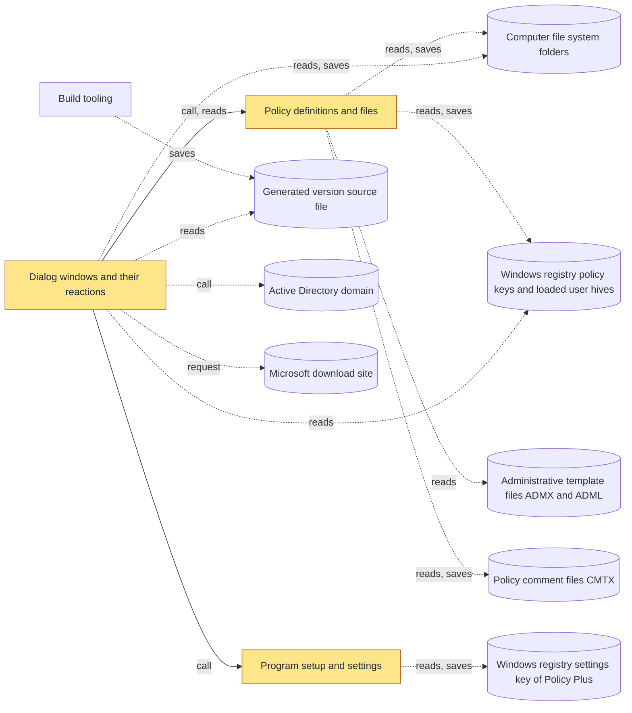
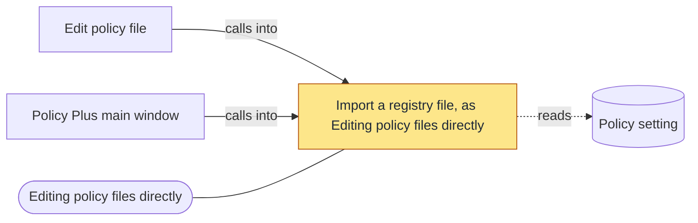
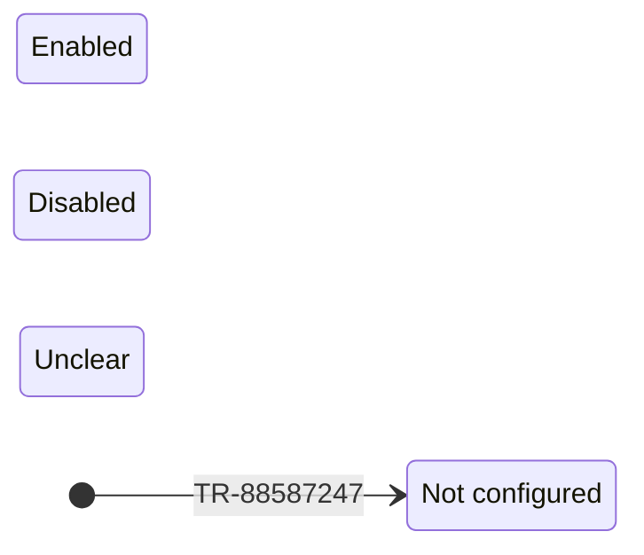

# Legacy reference: Import a registry file into a policy file

The typed header below maps each criterion of the work item to the rules of the existing system it backs. The reading of the existing code follows it.

## Header

```json
{
  "story": "story-da27877bf2de",
  "fingerprint": "280637421a2d33856d0f4655b9cf3df29c3a1ebf99ebbb84e7839ee4506bf978",
  "criteria": [
    {
      "ac": "AC-1",
      "rules": [
        {
          "says": "Import is refused with \"Please specify a REG file to import.\" when no file is named, and with \"Please specify the prefix used to fully qualify paths in the REG file.\" when no prefix is given.",
          "where": {
            "file": "PolicyPlus/ImportReg.vb",
            "firstLine": 29,
            "lastLine": 36
          },
          "doubt": ""
        }
      ]
    },
    {
      "ac": "AC-2",
      "rules": [
        {
          "says": "A REG file is refused when its first line is not 'Windows Registry Editor Version 5.00', with the message 'Incorrect REG signature'.",
          "where": {
            "file": "PolicyPlus/RegFile.vb",
            "firstLine": 47,
            "lastLine": 47
          },
          "doubt": ""
        }
      ]
    },
    {
      "ac": "AC-3",
      "rules": [
        {
          "says": "Blank lines and lines starting with a semicolon in a REG file are ignored.",
          "where": {
            "file": "PolicyPlus/RegFile.vb",
            "firstLine": 42,
            "lastLine": 42
          },
          "doubt": ""
        }
      ]
    },
    {
      "ac": "AC-4",
      "rules": [
        {
          "says": "A REG key header starting with a minus sign marks the whole key for removal. Otherwise it opens a key whose values follow.",
          "where": {
            "file": "PolicyPlus/RegFile.vb",
            "firstLine": 54,
            "lastLine": 59
          },
          "doubt": ""
        }
      ]
    },
    {
      "ac": "AC-5",
      "rules": [
        {
          "says": "A REG file value line starting with an at sign is the key's default value, with an empty name.",
          "where": {
            "file": "PolicyPlus/RegFile.vb",
            "firstLine": 65,
            "lastLine": 67
          },
          "doubt": ""
        }
      ]
    },
    {
      "ac": "AC-6",
      "rules": [
        {
          "says": "In a REG file, a value written as a bare minus sign is a value to delete. A quoted value is text, 'dword:' is a 32-bit number in hexadecimal, and 'hex' is bytes, typed by the number in brackets or binary if none. Data in none of these forms is kept as a value with no data and no type, with no error, and applying it writes an empty value or fails.",
          "where": {
            "file": "PolicyPlus/RegFile.vb",
            "firstLine": 65,
            "lastLine": 104
          },
          "doubt": ""
        }
      ]
    },
    {
      "ac": "AC-7",
      "rules": [
        {
          "says": "A REG key name is shortened by the prefix only when it starts with it, regardless of case. A prefix always ends in a backslash.",
          "where": {
            "file": "PolicyPlus/RegFile.vb",
            "firstLine": 187,
            "lastLine": 189
          },
          "doubt": ""
        }
      ]
    },
    {
      "ac": "AC-8",
      "rules": [
        {
          "says": "When a REG file is applied to a source, a key marked for removal is cleared, a value marked for deletion is deleted and any other value is saved. A key name starting with the prefix is applied without it. A key not starting with the prefix is applied with its full original name, so the registry source would create a key of that name. The source branch limit is not checked.",
          "where": {
            "file": "PolicyPlus/RegFile.vb",
            "firstLine": 260,
            "lastLine": 275
          },
          "doubt": ""
        }
      ]
    },
    {
      "ac": "AC-9",
      "rules": [
        {
          "says": "Import loads the REG file with the prefix and applies it straight to the chosen policy source; on any failure the person is told only \"Failed to import the REG file.\"",
          "where": {
            "file": "PolicyPlus/ImportReg.vb",
            "firstLine": 37,
            "lastLine": 43
          },
          "doubt": ""
        }
      ]
    }
  ],
  "reliesOn": [
    {
      "says": "When a policy file is clearing a key, all values and markers under the key are dropped and a single clear-all marker is stored.",
      "builtBy": "Set, delete and forget values and key clearances in a policy file"
    },
    {
      "says": "A value in a policy file counts as marked for deletion when a deletion marker names it, when the key has a clear-all marker, or when a delete-values list for the key names it, regardless of case. Entries are examined in sorted order, and a value whose name sorts after the marker is stored as present and cancels the deletion, whenever it was written and whichever marker kind came before.",
      "builtBy": "Read and list values in policy files and registry policy keys"
    },
    {
      "says": "Listing the values of a key in a policy file leaves out the marker entries unless the caller asks for them.",
      "builtBy": "Read and list values in policy files and registry policy keys"
    },
    {
      "says": "When a value is saved into a REG file, it is ignored if a source branch is set and its key lies outside that branch. When no branch is set, every key is accepted. Any value already stored under that name is replaced.",
      "builtBy": "Edit entries of a REG file within its source branch"
    },
    {
      "says": "When a value is deleted in a REG file, the request is ignored if a source branch is set and the key lies outside it, or if the key is already marked for removal. When no branch is set, every key is accepted. Otherwise the value is recorded as deleted.",
      "builtBy": "Edit entries of a REG file within its source branch"
    },
    {
      "says": "When a number is saved to the live registry, an unsigned 32-bit or 64-bit number is converted to the signed number the registry stores with the same bits, and the key is created if missing.",
      "builtBy": "Open policy sources from imported files and describe them"
    },
    {
      "says": "In the live registry, 'forgetting' a value deletes it, because the registry cannot remember a pending deletion.",
      "builtBy": "Replace live registry changes with the registry source model"
    },
    {
      "says": "When a value is forgotten in a policy file, both the value and its deletion marker are removed, so the policy reverts to not saying anything about it.",
      "builtBy": "Set, delete and forget values and key clearances in a policy file"
    },
    {
      "says": "Clearing a key in the live registry deletes every value in it but leaves the key and its subkeys. Forgetting a key's clearance does nothing.",
      "builtBy": "Replace live registry changes with the registry source model"
    },
    {
      "says": "A multiple-string value is stored as its strings each followed by an empty character, with one more empty character closing the list.",
      "builtBy": "Read and write the stored form of values in a policy file"
    },
    {
      "says": "A 64-bit number is stored in a policy file as 8 bytes, lowest byte first.",
      "builtBy": "Read and write the stored form of values in a policy file"
    },
    {
      "says": "When a key is cleared in a REG file, the request is ignored if a source branch is set and the key lies outside it. When no branch is set, every key is accepted. Otherwise the key's earlier entries are replaced by a key-removal entry.",
      "builtBy": "Edit entries of a REG file within its source branch"
    },
    {
      "says": "Text read from a policy file stops at its first empty character, and a multiple-string value ends at its first empty string.",
      "builtBy": "Read and write policy files with a byte-faithful round trip"
    },
    {
      "says": "A 32-bit number is stored in a policy file as 4 bytes, lowest byte first.",
      "builtBy": "Read and write the stored form of values in a policy file"
    },
    {
      "says": "When a value is marked for deletion in a policy file, any value or marker already held under that name is dropped first. A deletion marker holding the number 32, as Microsoft does, is added unless the value is already marked or its key is cleared.",
      "builtBy": "Set, delete and forget values and key clearances in a policy file"
    },
    {
      "says": "When a value is set in a policy file, it replaces any value already held under that name. A deletion marker for the name is not removed.",
      "builtBy": "Set, delete and forget values and key clearances in a policy file"
    },
    {
      "says": "A stored policy file value is read back as text for text and expandable text, a 32-bit or 64-bit number for numbers, a list of strings for multiple strings, and raw bytes for every other type.",
      "builtBy": "Read and write policy files with a byte-faithful round trip"
    },
    {
      "says": "Text stored in a policy file is written in two-byte characters followed by a closing empty character.",
      "builtBy": "Read and write the stored form of values in a policy file"
    },
    {
      "says": "When a value is deleted in the live registry and its key does not exist, nothing happens. A missing value is not an error.",
      "builtBy": "Replace live registry changes with the registry source model"
    },
    {
      "says": "A value written to a policy file is stored as text, expandable text, a 32-bit or 64-bit number or a multiple string by its stated type. Every other type is stored as raw bytes with that type.",
      "builtBy": "Read and write the stored form of values in a policy file"
    }
  ],
  "data": [
    {
      "kind": "Program preference",
      "access": "reads and saves"
    },
    {
      "kind": "Policy setting",
      "access": "reads and saves"
    }
  ],
  "transitions": [],
  "outsideSystems": [
    "Windows registry settings key of Policy Plus",
    "Computer file system folders",
    "Windows registry policy keys and loaded user hives"
  ],
  "cited": [
    {
      "file": "PolicyPlus/ImportReg.vb",
      "firstLine": 28,
      "lastLine": 44
    },
    {
      "file": "PolicyPlus/ImportReg.vb",
      "firstLine": 29,
      "lastLine": 36
    },
    {
      "file": "PolicyPlus/RegFile.vb",
      "firstLine": 47,
      "lastLine": 47
    },
    {
      "file": "PolicyPlus/RegFile.vb",
      "firstLine": 42,
      "lastLine": 42
    },
    {
      "file": "PolicyPlus/RegFile.vb",
      "firstLine": 54,
      "lastLine": 59
    },
    {
      "file": "PolicyPlus/RegFile.vb",
      "firstLine": 65,
      "lastLine": 67
    },
    {
      "file": "PolicyPlus/RegFile.vb",
      "firstLine": 65,
      "lastLine": 104
    },
    {
      "file": "PolicyPlus/RegFile.vb",
      "firstLine": 187,
      "lastLine": 189
    },
    {
      "file": "PolicyPlus/RegFile.vb",
      "firstLine": 276,
      "lastLine": 279
    },
    {
      "file": "PolicyPlus/RegFile.vb",
      "firstLine": 260,
      "lastLine": 275
    },
    {
      "file": "PolicyPlus/RegFile.vb",
      "firstLine": 187,
      "lastLine": 189
    },
    {
      "file": "PolicyPlus/ImportReg.vb",
      "firstLine": 37,
      "lastLine": 43
    }
  ]
}
```

## What each criterion must keep

### AC-1

- Import is refused with "Please specify a REG file to import." when no file is named, and with "Please specify the prefix used to fully qualify paths in the REG file." when no prefix is given. (PolicyPlus/ImportReg.vb:29-36)

### AC-2

- A REG file is refused when its first line is not 'Windows Registry Editor Version 5.00', with the message 'Incorrect REG signature'. (PolicyPlus/RegFile.vb:47-47)

### AC-3

- Blank lines and lines starting with a semicolon in a REG file are ignored. (PolicyPlus/RegFile.vb:42-42)

### AC-4

- A REG key header starting with a minus sign marks the whole key for removal. Otherwise it opens a key whose values follow. (PolicyPlus/RegFile.vb:54-59)

### AC-5

- A REG file value line starting with an at sign is the key's default value, with an empty name. (PolicyPlus/RegFile.vb:65-67)

### AC-6

- In a REG file, a value written as a bare minus sign is a value to delete. A quoted value is text, 'dword:' is a 32-bit number in hexadecimal, and 'hex' is bytes, typed by the number in brackets or binary if none. Data in none of these forms is kept as a value with no data and no type, with no error, and applying it writes an empty value or fails. (PolicyPlus/RegFile.vb:65-104)

### AC-7

- A REG key name is shortened by the prefix only when it starts with it, regardless of case. A prefix always ends in a backslash. (PolicyPlus/RegFile.vb:187-189)

### AC-8

- When a REG file is applied to a source, a key marked for removal is cleared, a value marked for deletion is deleted and any other value is saved. A key name starting with the prefix is applied without it. A key not starting with the prefix is applied with its full original name, so the registry source would create a key of that name. The source branch limit is not checked. (PolicyPlus/RegFile.vb:260-275)

### AC-9

- Import loads the REG file with the prefix and applies it straight to the chosen policy source; on any failure the person is told only "Failed to import the REG file." (PolicyPlus/ImportReg.vb:37-43)

## Relies on, built elsewhere

- When a policy file is clearing a key, all values and markers under the key are dropped and a single clear-all marker is stored. Built by: Set, delete and forget values and key clearances in a policy file.
- A value in a policy file counts as marked for deletion when a deletion marker names it, when the key has a clear-all marker, or when a delete-values list for the key names it, regardless of case. Entries are examined in sorted order, and a value whose name sorts after the marker is stored as present and cancels the deletion, whenever it was written and whichever marker kind came before. Built by: Read and list values in policy files and registry policy keys.
- Listing the values of a key in a policy file leaves out the marker entries unless the caller asks for them. Built by: Read and list values in policy files and registry policy keys.
- When a value is saved into a REG file, it is ignored if a source branch is set and its key lies outside that branch. When no branch is set, every key is accepted. Any value already stored under that name is replaced. Built by: Edit entries of a REG file within its source branch.
- When a value is deleted in a REG file, the request is ignored if a source branch is set and the key lies outside it, or if the key is already marked for removal. When no branch is set, every key is accepted. Otherwise the value is recorded as deleted. Built by: Edit entries of a REG file within its source branch.
- When a number is saved to the live registry, an unsigned 32-bit or 64-bit number is converted to the signed number the registry stores with the same bits, and the key is created if missing. Built by: Open policy sources from imported files and describe them.
- In the live registry, 'forgetting' a value deletes it, because the registry cannot remember a pending deletion. Built by: Replace live registry changes with the registry source model.
- When a value is forgotten in a policy file, both the value and its deletion marker are removed, so the policy reverts to not saying anything about it. Built by: Set, delete and forget values and key clearances in a policy file.
- Clearing a key in the live registry deletes every value in it but leaves the key and its subkeys. Forgetting a key's clearance does nothing. Built by: Replace live registry changes with the registry source model.
- A multiple-string value is stored as its strings each followed by an empty character, with one more empty character closing the list. Built by: Read and write the stored form of values in a policy file.
- A 64-bit number is stored in a policy file as 8 bytes, lowest byte first. Built by: Read and write the stored form of values in a policy file.
- When a key is cleared in a REG file, the request is ignored if a source branch is set and the key lies outside it. When no branch is set, every key is accepted. Otherwise the key's earlier entries are replaced by a key-removal entry. Built by: Edit entries of a REG file within its source branch.
- Text read from a policy file stops at its first empty character, and a multiple-string value ends at its first empty string. Built by: Read and write policy files with a byte-faithful round trip.
- A 32-bit number is stored in a policy file as 4 bytes, lowest byte first. Built by: Read and write the stored form of values in a policy file.
- When a value is marked for deletion in a policy file, any value or marker already held under that name is dropped first. A deletion marker holding the number 32, as Microsoft does, is added unless the value is already marked or its key is cleared. Built by: Set, delete and forget values and key clearances in a policy file.
- When a value is set in a policy file, it replaces any value already held under that name. A deletion marker for the name is not removed. Built by: Set, delete and forget values and key clearances in a policy file.
- A stored policy file value is read back as text for text and expandable text, a 32-bit or 64-bit number for numbers, a list of strings for multiple strings, and raw bytes for every other type. Built by: Read and write policy files with a byte-faithful round trip.
- Text stored in a policy file is written in two-byte characters followed by a closing empty character. Built by: Read and write the stored form of values in a policy file.
- When a value is deleted in the live registry and its key does not exist, nothing happens. A missing value is not an error. Built by: Replace live registry changes with the registry source model.
- A value written to a policy file is stored as text, expandable text, a 32-bit or 64-bit number or a multiple string by its stated type. Every other type is stored as raw bytes with that type. Built by: Read and write the stored form of values in a policy file.

## Reading of the existing code

# Screen: Import a registry file, as Editing policy files directly

At a glance: 6 owned rules, 11 relied on, 3 actions, 5 files (1 own, 2 relied on, 2 of neighbour screens, 0 generated), 0 disputed.

How to read it: paths are relative to the source root and `file:a-b` is an inclusive line range. `BR-` rules, `ACT-` actions, `TR-` changes of state and `RK-` risks have stable ids. A record marked disputed was challenged in review and kept; the reviewer's words are under Trust. All of it was read from the code; nothing was run.

## Product context
Policy Plus is a Windows desktop editor for Group Policy settings, used by administrators and power users. It reads Microsoft's policy definition files and edits policy files directly, so it works on any Windows edition, including Home, which lacks the built-in editor.
Built with: .NET Framework v4.5.2, Microsoft Windows, System.DirectoryServices, System.Xml, Visual Basic .NET, Windows Forms (Policy Plus desktop editor).
Runs: It runs on the user's own Windows computer as one desktop program on .NET Framework 4.5.2. It asks for elevated rights when available but starts without them; loading registry hives, refreshing policy and editing local Group Policy files need them. It can also reach the domain's shared policy folder.
Reaches outside itself: Computer file system folders; Windows registry policy keys and loaded user hives; Administrative template files (ADMX and ADML); Windows registry settings key of Policy Plus; Generated version source file; Policy comment files (CMTX); Active Directory domain; Microsoft download site.



## Where this sits
Part of: Editing policy files directly (Setting and storing policies).



## Boundary
- Called from **Edit policy file** (bundle: screen edit-policy-file), at `PolicyPlus/EditPol.vb:276-278`
- Called from **Policy Plus main window** (bundle: screen policy-plus-main-window), at `PolicyPlus/Main.vb:801-806`

## Contract: what it must do
### Import a registry file
Bring a .reg file into the policy source.
Controls (6): Button, Text = "Browse", TabIndex = 2: ButtonBrowse; Button, Text = "Import", TabIndex = 4: ButtonImport; Label, Text = "Prefix", TabIndex = 3: Label2; Label, Text = "REG file", TabIndex = 0: Label1; TextBox, TabIndex = 1: TextReg; TextBox, TabIndex = 3: TextRoot

Actions
- **ACT-98123777** Lets the person pick a REG file and guesses the key prefix from it. — `PolicyPlus/ImportReg.vb:9-24`; started by person
- **ACT-35897650** Closes the window as cancelled when Escape is pressed. — `PolicyPlus/ImportReg.vb:25-27`; started by person
- **ACT-97518185** Loads the chosen REG file with its prefix and applies it to the policy source. — `PolicyPlus/ImportReg.vb:28-44`; started by person

Rules
- **BR-75244455** When a REG file is chosen and the prefix is empty, the prefix is guessed from the file; if the file holds default values, the person is warned "This REG file contains data for default values, which cannot be applied to all policy sources." — `PolicyPlus/ImportReg.vb:9-24`
- **BR-85597112** Only files of type *.reg are offered by the file chooser when browsing for the REG file. — `PolicyPlus/ImportReg.vb:10-11`
- **BR-47776074** When the guess fails, the person is only warned "An error occurred while trying to guess the prefix." and the prefix stays empty. — `PolicyPlus/ImportReg.vb:19-21`
- **BR-14950967** Pressing Escape closes Import REG as cancelled. — `PolicyPlus/ImportReg.vb:25-27`
- **BR-10483497** Import is refused with "Please specify a REG file to import." when no file is named, and with "Please specify the prefix used to fully qualify paths in the REG file." when no prefix is given. — `PolicyPlus/ImportReg.vb:29-36`
- **BR-60194116** Import loads the REG file with the prefix and applies it straight to the chosen policy source; on any failure the person is told only "Failed to import the REG file." — `PolicyPlus/ImportReg.vb:37-43`


## Relied on: decided elsewhere
**Core code, run by 4 or more other capabilities**
- `PolicyPlus/PolicySource.vb`
  - **BR-77904356** Text read from a policy file stops at its first empty character, and a multiple-string value ends at its first empty string. — `PolicyPlus/PolicySource.vb:231-239`; also rests on `PolicyPlus/PolicySource.vb:281-295`
  - **BR-27765974** A stored policy file value is read back as text for text and expandable text, a 32-bit or 64-bit number for numbers, a list of strings for multiple strings, and raw bytes for every other type. — `PolicyPlus/PolicySource.vb:320-336`

**Code shared with a few capabilities**
- `PolicyPlus/RegFile.vb`
  - **BR-12010511** Blank lines and lines starting with a semicolon in a REG file are ignored. — `PolicyPlus/RegFile.vb:42`
  - **BR-88952070** A REG file is refused when its first line is not 'Windows Registry Editor Version 5.00', with the message 'Incorrect REG signature'. — `PolicyPlus/RegFile.vb:47`
  - **BR-61745927** A REG key header starting with a minus sign marks the whole key for removal. … — `PolicyPlus/RegFile.vb:54-59`
  - **BR-07693227** A REG file value line starting with an at sign is the key's default value, with an empty name. — `PolicyPlus/RegFile.vb:65-67`
  - **BR-28559733** In a REG file, a value written as a bare minus sign is a value to delete. … — `PolicyPlus/RegFile.vb:65-104`
  - **BR-57993299** A REG key name is shortened by the prefix only when it starts with it, regardless of case. … — `PolicyPlus/RegFile.vb:187-189`; also rests on `PolicyPlus/RegFile.vb:276-279`
  - **BR-24755037** When a REG file is applied to a source, a key marked for removal is cleared, a value marked for deletion is deleted and any other value is saved. … — `PolicyPlus/RegFile.vb:260-275`; also rests on `PolicyPlus/RegFile.vb:187-189`
  - **BR-30858390** The prefix of a REG file is guessed from its first key only. … — `PolicyPlus/RegFile.vb:284-297`
  - **BR-20510792** A REG file is reported as holding default values when any value has an empty name. — `PolicyPlus/RegFile.vb:298-300`


## Data and states
- Policy setting: reads; kept in Computer file system folders, Windows registry policy keys and loaded user hives

Life of Policy setting


| Change | From | To | Written at | In this code | Reading |
| --- | --- | --- | --- | --- | --- |
| TR-88587247 | created | Not configured | `PolicyPlus/PolicyLoader.vb:94-100` | no | corrected |

## Trust: what to doubt
**Risks**
- **RK-96299336** [medium] Importing a REG file applies it key by key to the live policy source with no rollback, and a REG source cannot read or forget values. A failure leaves earlier changes in place and the person sees only a general failure message. (Data can end up wrong, lost or inconsistent) — at `PolicyPlus/ImportReg.vb:37-43`, `PolicyPlus/RegFile.vb:260-275`
- **RK-78450586** [medium] Importing a REG file applies it to whichever source is open, live registry or policy file, with no check of the keys it names. The branch limit exists only when a REG file is the target, so an import can write, delete or clear keys outside the policy branches. (Someone can read or change what they should not) — at `PolicyPlus/RegFile.vb:260-275`
- **RK-32327045** [low] Reading a policy file trusts the length stored in each entry and the shape of the data. A damaged or hostile file can demand huge memory or fail unexplained, and REG files report no line number on error. (Input from outside is used without checks, so it can change what the code does) — at `PolicyPlus/RegFile.vb:53`, `PolicyPlus/RegFile.vb:80-95`


## Read order
| Tier | File | Lines | Why |
| --- | --- | --- | --- |
| own | `PolicyPlus/ImportReg.vb` | whole file | starts 3 actions; decides 6 owned rules |
| relied on | `PolicyPlus/PolicySource.vb` | 8-11, 225-227, 231-239, 252-254, 265-271, 281-295, 312-314, 320-336 | decides 2 relied-on rules; called code; used by 6 other capabilities |
| relied on | `PolicyPlus/RegFile.vb` | 21-116, 187-189, 260-279, 284-300 | decides 9 relied-on rules; called code |
| neighbour screen | `PolicyPlus/EditPol.vb` | 276-278 | calls into this screen: Edit policy file |
| neighbour screen | `PolicyPlus/Main.vb` | 801-806 | calls into this screen: Policy Plus main window |

## Source

### PolicyPlus/ImportReg.vb
```
1: Public Class ImportReg
2:     Dim PolicySource As IPolicySource
3:     Public Function PresentDialog(Target As IPolicySource) As DialogResult
4:         TextReg.Text = ""
5:         TextRoot.Text = ""
6:         PolicySource = Target
7:         Return ShowDialog()
8:     End Function
9:     Private Sub ButtonBrowse_Click(sender As Object, e As EventArgs) Handles ButtonBrowse.Click
10:         Using ofd As New OpenFileDialog
11:             ofd.Filter = "Registry scripts|*.reg"
12:             If ofd.ShowDialog() <> DialogResult.OK Then Exit Sub
13:             TextReg.Text = ofd.FileName
14:             If TextRoot.Text = "" Then
15:                 Try
16:                     Dim reg = RegFile.Load(ofd.FileName, "")
17:                     TextRoot.Text = reg.GuessPrefix()
18:                     If reg.HasDefaultValues Then MsgBox("This REG file contains data for default values, which cannot be applied to all policy sources.", MsgBoxStyle.Exclamation)
19:                 Catch ex As Exception
20:                     MsgBox("An error occurred while trying to guess the prefix.", MsgBoxStyle.Exclamation)
21:                 End Try
22:             End If
23:         End Using
24:     End Sub
25:     Private Sub ImportReg_KeyUp(sender As Object, e As KeyEventArgs) Handles Me.KeyUp
26:         If e.KeyCode = Keys.Escape Then DialogResult = DialogResult.Cancel
27:     End Sub
28:     Private Sub ButtonImport_Click(sender As Object, e As EventArgs) Handles ButtonImport.Click
29:         If TextReg.Text = "" Then
30:             MsgBox("Please specify a REG file to import.", MsgBoxStyle.Exclamation)
31:             Exit Sub
32:         End If
33:         If TextRoot.Text = "" Then
34:             MsgBox("Please specify the prefix used to fully qualify paths in the REG file.", MsgBoxStyle.Exclamation)
35:             Exit Sub
36:         End If
37:         Try
38:             Dim reg = RegFile.Load(TextReg.Text, TextRoot.Text)
39:             reg.Apply(PolicySource)
40:             DialogResult = DialogResult.OK
41:         Catch ex As Exception
42:             MsgBox("Failed to import the REG file.", MsgBoxStyle.Exclamation)
43:         End Try
44:     End Sub
45: End Class
```

### PolicyPlus/PolicySource.vb
```
8:     Sub SetValue(Key As String, Value As String, Data As Object, DataType As RegistryValueKind)
9:     Sub ForgetValue(Key As String, Value As String) ' Stop keeping track of a value
10:     Sub DeleteValue(Key As String, Value As String) ' Mark a value as queued for deletion
11:     Sub ClearKey(Key As String) ' Destroy all values in a key
```
```
225:     Public Shared Function BytesToObject(Data As Byte(), Kind As RegistryValueKind) As Object
226:         Return (New PolEntryData With {.Data = Data, .Kind = Kind}).AsArbitrary()
227:     End Function
```
```
231:         Public Function AsString() As String ' Get a UTF-16LE string
232:             Dim sb As New Text.StringBuilder
233:             For x = 0 To (Data.Length \ 2) - 1
234:                 Dim charCode = CInt(Data(x * 2)) + (Data((x * 2) + 1) << 8)
235:                 If charCode = 0 Then Exit For
236:                 sb.Append(ChrW(charCode))
237:             Next
238:             Return sb.ToString
239:         End Function
```
```
252:         Public Function AsDword() As UInteger
253:             Return Data(0) + (CUInt(Data(1)) << 8) + (CUInt(Data(2)) << 16) + (CUInt(Data(3)) << 24)
254:         End Function
```
```
265:         Public Function AsQword() As ULong
266:             Dim value As ULong = 0
267:             For n = 0 To 7
268:                 value += (CULng(Data(n)) << (n * 8))
269:             Next
270:             Return value
271:         End Function
```
```
281:         Public Function AsMultiString() As String()
282:             Dim strings As New List(Of String)
283:             Dim sb As New Text.StringBuilder
284:             For n = 0 To (Data.Length / 2) - 1
285:                 Dim charCode = Data(n * 2) + (Data((n * 2) + 1) << 8)
286:                 If charCode = 0 Then
287:                     If sb.Length = 0 Then Exit For
288:                     strings.Add(sb.ToString)
289:                     sb.Clear()
290:                 Else
291:                     sb.Append(ChrW(charCode))
292:                 End If
293:             Next
294:             Return strings.ToArray
295:         End Function
```
```
312:         Public Function AsBinary() As Byte()
313:             Return Data.Clone
314:         End Function
```
```
320:         Public Function AsArbitrary() As Object
321:             ' Get the data in the best .NET type for it
322:             Select Case Kind
323:                 Case RegistryValueKind.String
324:                     Return AsString()
325:                 Case RegistryValueKind.DWord
326:                     Return AsDword()
327:                 Case RegistryValueKind.ExpandString
328:                     Return AsString()
329:                 Case RegistryValueKind.QWord
330:                     Return AsQword()
331:                 Case RegistryValueKind.MultiString
332:                     Return AsMultiString()
333:                 Case Else
334:                     Return AsBinary()
335:             End Select
336:         End Function
```

### PolicyPlus/RegFile.vb
```
21:     Private Shared Function UnescapeValue(Text As String) As String
22:         ' The reverse of EscapeValue
23:         Dim sb As New Text.StringBuilder
24:         Dim escaping As Boolean = False
25:         For n = 0 To Text.Length - 1
26:             If escaping Then
27:                 sb.Append(Text(n))
28:                 escaping = False
29:             ElseIf Text(n) = "\"c Then
30:                 escaping = True
31:             Else
32:                 sb.Append(Text(n))
33:             End If
34:         Next
35:         Return sb.ToString
36:     End Function
37:     Private Shared Function ReadNonCommentingLine(Reader As StreamReader, Optional StopAt As Char? = Nothing) As String
38:         Do
39:             If Reader.EndOfStream Then Return Nothing
40:             If StopAt.HasValue AndAlso Reader.Peek = Asc(StopAt.Value) Then Return Nothing
41:             Dim line = Reader.ReadLine
42:             If String.IsNullOrWhiteSpace(line) OrElse Trim(line).StartsWith(";") Then Continue Do
43:             Return line
44:         Loop
45:     End Function
46:     Public Shared Function Load(Reader As StreamReader, Prefix As String) As RegFile
47:         If Reader.ReadLine() <> RegSignature Then Throw New InvalidDataException("Incorrect REG signature")
48:         Dim reg As New RegFile
49:         reg.SetPrefix(Prefix)
50:         Do ' Read all the keys
51:             Dim keyHeader = ReadNonCommentingLine(Reader)
52:             If keyHeader Is Nothing Then Exit Do
53:             Dim keyName = keyHeader.Substring(1, keyHeader.Length - 2) ' Remove the brackets
54:             If keyName.StartsWith("-") Then
55:                 ' It's a deleter
56:                 Dim deleterKey As New RegFileKey With {.Name = keyName.Substring(1), .IsDeleter = True}
57:                 reg.Keys.Add(deleterKey)
58:             Else
59:                 Dim key As New RegFileKey With {.Name = keyName}
60:                 Do ' Read all the values
61:                     Dim valueLine = ReadNonCommentingLine(Reader, "["c)
62:                     If valueLine Is Nothing Then Exit Do
63:                     Dim valueName As String = ""
64:                     Dim data As String
65:                     If valueLine.StartsWith("@") Then
66:                         data = valueLine.Substring(2)
67:                     Else
68:                         Dim parts = Split(valueLine, """=", 2)
69:                         valueName = UnescapeValue(parts(0).Substring(1))
70:                         data = parts(1)
71:                     End If
72:                     Dim value As New RegFileValue With {.Name = valueName}
73:                     If data = "-" Then
74:                         value.IsDeleter = True
75:                     ElseIf data.StartsWith("""") Then
76:                         value.Kind = RegistryValueKind.String
77:                         value.Data = UnescapeValue(data.Substring(1, data.Length - 2))
78:                     ElseIf data.StartsWith("dword:") Then
79:                         value.Kind = RegistryValueKind.DWord
80:                         value.Data = UInteger.Parse(data.Substring(6), Globalization.NumberStyles.HexNumber)
81:                     ElseIf data.StartsWith("hex") Then
82:                         Dim indexOfClosingParen = data.IndexOf(")"c)
83:                         Dim curHexLine As String
84:                         If indexOfClosingParen <> -1 Then
85:                             value.Kind = Integer.Parse(data.Substring(4, indexOfClosingParen - 4), Globalization.NumberStyles.HexNumber)
86:                             curHexLine = data.Substring(indexOfClosingParen + 2)
87:                         Else
88:                             value.Kind = RegistryValueKind.Binary
89:                             curHexLine = data.Substring(4)
90:                         End If
91:                         Dim allDehexedBytes As New List(Of Byte)
92:                         Do ' Read all the hex lines
93:                             Dim hexBytes = Split(Trim(curHexLine).TrimEnd("\"c, ","c), ",").Where(Function(s) s <> "")
94:                             For Each b In hexBytes
95:                                 allDehexedBytes.Add(Byte.Parse(b, Globalization.NumberStyles.HexNumber))
96:                             Next
97:                             If curHexLine.EndsWith("\") Then
98:                                 curHexLine = Reader.ReadLine
99:                             Else
100:                                 Exit Do
101:                             End If
102:                         Loop
103:                         value.Data = PolFile.BytesToObject(allDehexedBytes.ToArray, value.Kind)
104:                     End If
105:                     key.Values.Add(value)
106:                 Loop
107:                 reg.Keys.Add(key)
108:             End If
109:         Loop
110:         Return reg
111:     End Function
112:     Public Shared Function Load(File As String, Prefix As String) As RegFile
113:         Using reader As New StreamReader(File)
114:             Return Load(reader, Prefix)
115:         End Using
116:     End Function
```
```
187:     Private Function UnprefixKeyName(Name As String) As String
188:         If Name.StartsWith(Prefix, StringComparison.InvariantCultureIgnoreCase) Then Return Name.Substring(Prefix.Length) Else Return Name
189:     End Function
```
```
260:     Public Sub Apply(Target As IPolicySource)
261:         For Each key In Keys
262:             Dim unprefixedKeyName = UnprefixKeyName(key.Name)
263:             If key.IsDeleter Then
264:                 Target.ClearKey(unprefixedKeyName)
265:             Else
266:                 For Each value In key.Values
267:                     If value.IsDeleter Then
268:                         Target.DeleteValue(unprefixedKeyName, value.Name)
269:                     Else
270:                         Target.SetValue(unprefixedKeyName, value.Name, value.Data, value.Kind)
271:                     End If
272:                 Next
273:             End If
274:         Next
275:     End Sub
276:     Public Sub SetPrefix(Prefix As String)
277:         If Not Prefix.EndsWith("\") Then Prefix &= "\"
278:         Me.Prefix = Prefix
279:     End Sub
```
```
284:     Public Function GuessPrefix() As String
285:         ' Try to determine a reasonable prefix from the data present
286:         If Keys.Count = 0 Then Return "HKEY_LOCAL_MACHINE\" ' Can't do much without any data
287:         Dim firstKeyName = Keys(0).Name
288:         If firstKeyName.StartsWith("HKEY_USERS\") Then
289:             ' The user SID should be part of the prefix
290:             Dim secondSlashPos = firstKeyName.IndexOf("\", 11)
291:             Return firstKeyName.Substring(0, secondSlashPos + 1)
292:         Else
293:             ' Other hives should be just fine
294:             Dim firstSlashPos = firstKeyName.IndexOf("\")
295:             Return firstKeyName.Substring(0, firstSlashPos + 1)
296:         End If
297:     End Function
298:     Public Function HasDefaultValues() As Boolean
299:         Return Keys.Any(Function(k) k.Values.Any(Function(v) v.Name = ""))
300:     End Function
```

### PolicyPlus/EditPol.vb
```
276:     Private Sub ButtonImport_Click(sender As Object, e As EventArgs) Handles ButtonImport.Click
277:         If ImportReg.PresentDialog(EditingPol) = DialogResult.OK Then UpdateTree()
278:     End Sub
```

### PolicyPlus/Main.vb
```
801:     Private Sub ImportREGToolStripMenuItem_Click(sender As Object, e As EventArgs) Handles ImportREGToolStripMenuItem.Click
802:         If OpenSection.PresentDialog(True, True) = DialogResult.OK Then
803:             Dim source = If(OpenSection.SelectedSection = AdmxPolicySection.Machine, CompPolicySource, UserPolicySource)
804:             If ImportReg.PresentDialog(source) = DialogResult.OK Then MoveToVisibleCategoryAndReload()
805:         End If
806:     End Sub
```

