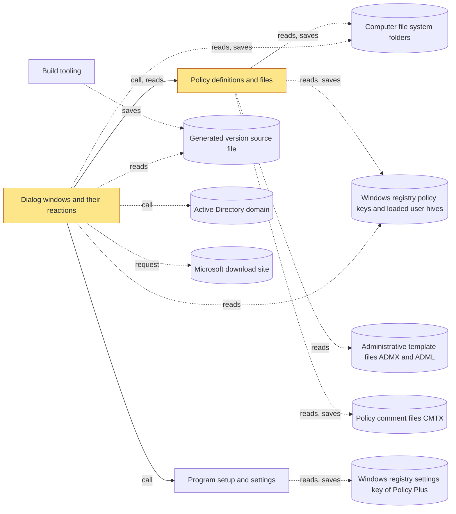
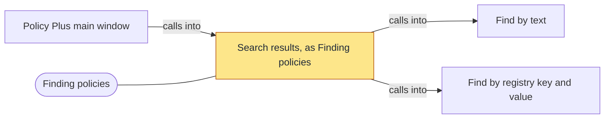

# Legacy reference: Search every policy and list the hits as they are found

The typed header below maps each criterion of the work item to the rules of the existing system it backs. The reading of the existing code follows it.

## Header

```json
{
  "story": "story-e2c2153c119c",
  "fingerprint": "280637421a2d33856d0f4655b9cf3df29c3a1ebf99ebbb84e7839ee4506bf978",
  "criteria": [
    {
      "ac": "AC-1",
      "rules": [
        {
          "says": "The search tests every policy in turn, and adds every hit to the list with its category name, in the order policies are held.",
          "where": {
            "file": "PolicyPlus/FindResults.vb",
            "firstLine": 63,
            "lastLine": 73
          },
          "doubt": ""
        }
      ]
    },
    {
      "ac": "AC-2",
      "rules": [
        {
          "says": "The list and progress are refreshed after every 20 policies: \"Searching: checked N policies so far, found M hits\".",
          "where": {
            "file": "PolicyPlus/FindResults.vb",
            "firstLine": 74,
            "lastLine": 80
          },
          "doubt": ""
        }
      ]
    },
    {
      "ac": "AC-3",
      "rules": []
    }
  ],
  "reliesOn": [
    {
      "says": "When a policy file is clearing a key, all values and markers under the key are dropped and a single clear-all marker is stored.",
      "builtBy": "Set, delete and forget values and key clearances in a policy file"
    },
    {
      "says": "A REG file cannot be used as a source for forgetting a value: the request fails with 'not implemented'. Applying a newer policy file over an older one to a REG file fails this way for any dropped value under a policy branch.",
      "builtBy": "Edit entries of a REG file within its source branch"
    },
    {
      "says": "When the results window is reopened, the previously selected result is selected again if it is still in the list.",
      "builtBy": "Choose a search result and reopen the results"
    },
    {
      "says": "Listing the values of a key in a policy file leaves out the marker entries unless the caller asks for them.",
      "builtBy": "Read and list values in policy files and registry policy keys"
    },
    {
      "says": "Search text is split at spaces into plain words, wildcard words (containing \"*\" or \"?\") and quoted phrases. Words are lowercased and trimmed and lose the characters . , ' \" ; / ! ( ) { } [ ].",
      "builtBy": "Find policies by title, description or comment text"
    },
    {
      "says": "A text is a hit only when it contains every plain word as a whole word, every wildcard matching some word, and every quoted phrase as whole words together.",
      "builtBy": "Find policies by title, description or comment text"
    },
    {
      "says": "A value-name term must match the whole value name; \"*\" and \"?\" act as wildcards, so without them the name must be equal.",
      "builtBy": "Find policies by registry key and value"
    },
    {
      "says": "When a policy is forgotten, the whole key of each of its list elements is cleared and every registry value it touches is dropped from the source, so it reads as Not configured.",
      "builtBy": "Forget a policy and list the registry values it touches"
    },
    {
      "says": "A key term containing a backslash but no wildcard matches policies whose key path starts with that text.",
      "builtBy": "Find policies by registry key and value"
    },
    {
      "says": "In the live registry, 'forgetting' a value deletes it, because the registry cannot remember a pending deletion.",
      "builtBy": "Replace live registry changes with the registry source model"
    },
    {
      "says": "When a value is forgotten in a policy file, both the value and its deletion marker are removed, so the policy reverts to not saying anything about it.",
      "builtBy": "Set, delete and forget values and key clearances in a policy file"
    },
    {
      "says": "Clearing a key in the live registry deletes every value in it but leaves the key and its subkeys. Forgetting a key's clearance does nothing.",
      "builtBy": "Replace live registry changes with the registry source model"
    },
    {
      "says": "When a key's clearance is forgotten in a REG file, the key-removal entry is dropped if it exists. The request is ignored if a source branch is set and the key lies outside it. When no branch is set, every key is accepted.",
      "builtBy": "Edit entries of a REG file within its source branch"
    },
    {
      "says": "A policy matches when the ticked attributes hit: its title, its description, or a comment on it from any supplied comment source (user or computer). Any one hit is enough.",
      "builtBy": "Find policies by title, description or comment text"
    },
    {
      "says": "The registry values a policy touches are its own value, those in its value lists, those of its elements (the whole key for list elements) and those of checkbox and choice sub-lists, each counted once.",
      "builtBy": "Forget a policy and list the registry values it touches"
    },
    {
      "says": "A key term containing \"*\" or \"?\" must match the whole key path as a wildcard pattern.",
      "builtBy": "Find policies by registry key and value"
    },
    {
      "says": "A policy matches a registry search when at least one registry value it reads or writes meets every term entered; matching ignores case.",
      "builtBy": "Find policies by registry key and value"
    },
    {
      "says": "When a search ends it reports \"Finished searching: checked N policies, found M hits\", or \"Search canceled: ...\" if stopped, and the Stop button is disabled.",
      "builtBy": "Report how a search ended and let the person stop it"
    },
    {
      "says": "When a key's clearance is forgotten in a policy file, every clear-all marker for that key is removed.",
      "builtBy": "Set, delete and forget values and key clearances in a policy file"
    },
    {
      "says": "A phrase opened with a double quote runs until a later word ending in a double quote; a phrase never closed is dropped without telling the person, which widens the search. A single quoted word such as \"abc\" does not close itself, so it also absorbs the following words.",
      "builtBy": "Find policies by title, description or comment text"
    },
    {
      "says": "When a key is cleared in a REG file, the request is ignored if a source branch is set and the key lies outside it. When no branch is set, every key is accepted. Otherwise the key's earlier entries are replaced by a key-removal entry.",
      "builtBy": "Edit entries of a REG file within its source branch"
    },
    {
      "says": "Text stored in a policy file is written in two-byte characters followed by a closing empty character.",
      "builtBy": "Read and write the stored form of values in a policy file"
    },
    {
      "says": "When a value is deleted in the live registry and its key does not exist, nothing happens. A missing value is not an error.",
      "builtBy": "Replace live registry changes with the registry source model"
    },
    {
      "says": "A key term with no backslash and no wildcard matches policies having a key path with a part equal to that text.",
      "builtBy": "Find policies by registry key and value"
    }
  ],
  "data": [
    {
      "kind": "Policy setting",
      "access": "reads and saves"
    }
  ],
  "transitions": [],
  "outsideSystems": [
    "Computer file system folders",
    "Windows registry policy keys and loaded user hives"
  ],
  "cited": [
    {
      "file": "PolicyPlus/FindResults.vb",
      "firstLine": 95,
      "lastLine": 105
    },
    {
      "file": "PolicyPlus/FindResults.vb",
      "firstLine": 109,
      "lastLine": 111
    },
    {
      "file": "PolicyPlus/FindResults.vb",
      "firstLine": 126,
      "lastLine": 130
    },
    {
      "file": "PolicyPlus/FindResults.vb",
      "firstLine": 63,
      "lastLine": 73
    },
    {
      "file": "PolicyPlus/FindResults.vb",
      "firstLine": 53,
      "lastLine": 62
    },
    {
      "file": "PolicyPlus/FindResults.vb",
      "firstLine": 74,
      "lastLine": 80
    }
  ]
}
```

## What each criterion must keep

### AC-1

- The search tests every policy in turn, and adds every hit to the list with its category name, in the order policies are held. (PolicyPlus/FindResults.vb:63-73)

### AC-2

- The list and progress are refreshed after every 20 policies: "Searching: checked N policies so far, found M hits". (PolicyPlus/FindResults.vb:74-80)

### AC-3

No single legacy rule: it describes the behaviour as a whole.


## Relies on, built elsewhere

- When a policy file is clearing a key, all values and markers under the key are dropped and a single clear-all marker is stored. Built by: Set, delete and forget values and key clearances in a policy file.
- A REG file cannot be used as a source for forgetting a value: the request fails with 'not implemented'. Applying a newer policy file over an older one to a REG file fails this way for any dropped value under a policy branch. Built by: Edit entries of a REG file within its source branch.
- When the results window is reopened, the previously selected result is selected again if it is still in the list. Built by: Choose a search result and reopen the results.
- Listing the values of a key in a policy file leaves out the marker entries unless the caller asks for them. Built by: Read and list values in policy files and registry policy keys.
- Search text is split at spaces into plain words, wildcard words (containing "*" or "?") and quoted phrases. Words are lowercased and trimmed and lose the characters . , ' " ; / ! ( ) { } [ ]. Built by: Find policies by title, description or comment text.
- A text is a hit only when it contains every plain word as a whole word, every wildcard matching some word, and every quoted phrase as whole words together. Built by: Find policies by title, description or comment text.
- A value-name term must match the whole value name; "*" and "?" act as wildcards, so without them the name must be equal. Built by: Find policies by registry key and value.
- When a policy is forgotten, the whole key of each of its list elements is cleared and every registry value it touches is dropped from the source, so it reads as Not configured. Built by: Forget a policy and list the registry values it touches.
- A key term containing a backslash but no wildcard matches policies whose key path starts with that text. Built by: Find policies by registry key and value.
- In the live registry, 'forgetting' a value deletes it, because the registry cannot remember a pending deletion. Built by: Replace live registry changes with the registry source model.
- When a value is forgotten in a policy file, both the value and its deletion marker are removed, so the policy reverts to not saying anything about it. Built by: Set, delete and forget values and key clearances in a policy file.
- Clearing a key in the live registry deletes every value in it but leaves the key and its subkeys. Forgetting a key's clearance does nothing. Built by: Replace live registry changes with the registry source model.
- When a key's clearance is forgotten in a REG file, the key-removal entry is dropped if it exists. The request is ignored if a source branch is set and the key lies outside it. When no branch is set, every key is accepted. Built by: Edit entries of a REG file within its source branch.
- A policy matches when the ticked attributes hit: its title, its description, or a comment on it from any supplied comment source (user or computer). Any one hit is enough. Built by: Find policies by title, description or comment text.
- The registry values a policy touches are its own value, those in its value lists, those of its elements (the whole key for list elements) and those of checkbox and choice sub-lists, each counted once. Built by: Forget a policy and list the registry values it touches.
- A key term containing "*" or "?" must match the whole key path as a wildcard pattern. Built by: Find policies by registry key and value.
- A policy matches a registry search when at least one registry value it reads or writes meets every term entered; matching ignores case. Built by: Find policies by registry key and value.
- When a search ends it reports "Finished searching: checked N policies, found M hits", or "Search canceled: ..." if stopped, and the Stop button is disabled. Built by: Report how a search ended and let the person stop it.
- When a key's clearance is forgotten in a policy file, every clear-all marker for that key is removed. Built by: Set, delete and forget values and key clearances in a policy file.
- A phrase opened with a double quote runs until a later word ending in a double quote; a phrase never closed is dropped without telling the person, which widens the search. A single quoted word such as "abc" does not close itself, so it also absorbs the following words. Built by: Find policies by title, description or comment text.
- When a key is cleared in a REG file, the request is ignored if a source branch is set and the key lies outside it. When no branch is set, every key is accepted. Otherwise the key's earlier entries are replaced by a key-removal entry. Built by: Edit entries of a REG file within its source branch.
- Text stored in a policy file is written in two-byte characters followed by a closing empty character. Built by: Read and write the stored form of values in a policy file.
- When a value is deleted in the live registry and its key does not exist, nothing happens. A missing value is not an error. Built by: Replace live registry changes with the registry source model.
- A key term with no backslash and no wildcard matches policies having a key path with a part equal to that text. Built by: Find policies by registry key and value.

## Reading of the existing code

# Screen: Search results, as Finding policies

At a glance: 6 owned rules, 0 relied on, 6 actions, 4 files (1 own, 0 relied on, 3 of neighbour screens, 0 generated), 1 disputed.

How to read it: paths are relative to the source root and `file:a-b` is an inclusive line range. `BR-` rules, `ACT-` actions, `TR-` changes of state and `RK-` risks have stable ids. A record marked disputed was challenged in review and kept; the reviewer's words are under Trust. All of it was read from the code; nothing was run.

## Product context
Policy Plus is a Windows desktop editor for Group Policy settings, used by administrators and power users. It reads Microsoft's policy definition files and edits policy files directly, so it works on any Windows edition, including Home, which lacks the built-in editor.
Built with: .NET Framework v4.5.2, Microsoft Windows, System.DirectoryServices, System.Xml, Visual Basic .NET, Windows Forms (Policy Plus desktop editor).
Runs: It runs on the user's own Windows computer as one desktop program on .NET Framework 4.5.2. It asks for elevated rights when available but starts without them; loading registry hives, refreshing policy and editing local Group Policy files need them. It can also reach the domain's shared policy folder.
Reaches outside itself: Computer file system folders; Windows registry policy keys and loaded user hives; Administrative template files (ADMX and ADML); Windows registry settings key of Policy Plus; Generated version source file; Policy comment files (CMTX); Active Directory domain; Microsoft download site.



## Where this sits
Part of: Finding policies (Reading policy definitions).



## Boundary
- Called from **Policy Plus main window** (bundle: screen policy-plus-main-window), at `PolicyPlus/Main.vb:375-388`
- Calls into **Find by text** (bundle: screen find-by-text), at `PolicyPlus/FindResults.vb:47-90`
- Calls into **Find by registry key and value** (bundle: screen find-by-registry-key-and-value), at `PolicyPlus/FindResults.vb:47-90`

## Contract: what it must do
### Search results
Watch a search run, stop it and pick a policy from the results.
Controls (8): Button, Text = "Go", TabIndex = 3: GoButton; Button, Text = "Stop", TabIndex = 0: StopButton; Cancel, TabIndex = 4: CloseButton; ColumnHeader, Text = "Category", Width = 99: ChCategory; ColumnHeader, Text = "Title", Width = 222: ChTitle; Label, Text = "Results: 0 (searching)", TabIndex = 2: ProgressLabel; ListView, TabIndex = 1: ResultsListview; ProgressBar, TabIndex = 0: SearchProgress

Actions
- **ACT-73341208** Starts the background search when one is waiting, otherwise restores the last selected result. — `PolicyPlus/FindResults.vb:95-105`; started by person
- **ACT-46850164** Asks the running search to stop. — `PolicyPlus/FindResults.vb:106-108`; started by person
- **ACT-26500839** Keeps the title column filling the width of the results list. — `PolicyPlus/FindResults.vb:109-111`; started by person
- **ACT-87346557** Stops the search when the results window is closed and settles the progress display. — `PolicyPlus/FindResults.vb:112-119`; started by person
- **ACT-28310343** Takes the selected search result as the chosen policy and closes the window with OK. — `PolicyPlus/FindResults.vb:120-125`; started by person
- **ACT-96190507** Turns on double-buffered drawing for the results list. — `PolicyPlus/FindResults.vb:126-130`; started by person

Rules
- **BR-48770219** The search tests every policy in turn, and adds every hit to the list with its category name, in the order policies are held. — `PolicyPlus/FindResults.vb:63-73`; also rests on `PolicyPlus/FindResults.vb:53-62`
- **BR-00502591** The list and progress are refreshed after every 20 policies: "Searching: checked N policies so far, found M hits". — `PolicyPlus/FindResults.vb:74-80`
- **BR-40708163** When a search ends it reports "Finished searching: checked N policies, found M hits", or "Search canceled: ..." if stopped, and the Stop button is disabled. — `PolicyPlus/FindResults.vb:82-89`
- **BR-22947109** Stop, or closing the results window, cancels the search; closing also leaves the label at "Search canceled" with the bar full if the search had not finished. — `PolicyPlus/FindResults.vb:91-94`; also rests on `PolicyPlus/FindResults.vb:106-119`
- **BR-80798684** When the results window is reopened, the previously selected result is selected again if it is still in the list. — `PolicyPlus/FindResults.vb:95-105`; **disputed**
- **BR-92938759** Go, or a double-click on a result, accepts only when a result is selected; the selected policy is passed back and its position remembered. — `PolicyPlus/FindResults.vb:120-125`


## Trust: what to doubt
**Challenged in review and kept**
- **BR-80798684** `PolicyPlus/FindResults.vb:95-105`: The code restores the remembered position when it is still inside the list (index below the count), not 'if the result is still in the list': nothing checks that the same policy is there. Reword to position, which is what a rebuilder must keep.

**Risks**
- **RK-55878738** [low] Several windows raise an unhandled error on ordinary input: double-clicking with no row selected, right-clicking with no category, an unnamed list entry, an unreadable import file, a malformed search wildcard, a removed product in a filter, or an inspector item with no match. No program-wide handler is set, so the framework's default error dialog appears. (Failures are hidden, lost or not retried) — at `PolicyPlus/FindResults.vb:63-73`, `PolicyPlus/FindResults.vb:97`


## Read order
| Tier | File | Lines | Why |
| --- | --- | --- | --- |
| own | `PolicyPlus/FindResults.vb` | whole file | starts 6 actions; decides 6 owned rules |
| neighbour screen | `PolicyPlus/FindByRegistry.vb` | 17-35 | called from this screen: Find by registry key and value |
| neighbour screen | `PolicyPlus/FindByText.vb` | 24-71 | called from this screen: Find by text |
| neighbour screen | `PolicyPlus/Main.vb` | 375-388 | calls into this screen: Policy Plus main window |

## Source

### PolicyPlus/FindResults.vb
```
1: Imports System.ComponentModel
2: Public Class FindResults
3:     Dim AdmxWorkspace As AdmxBundle
4:     Dim SearchFunc As Func(Of PolicyPlusPolicy, Boolean)
5:     Dim CancelingSearch As Boolean = False
6:     Dim CancelDueToFormClose As Boolean = False
7:     Dim SearchPending As Boolean = False
8:     Dim HasSearched As Boolean
9:     Dim LastSelectedIndex As Integer
10:     Public SelectedPolicy As PolicyPlusPolicy
11:     Public Function PresentDialogStartSearch(Workspace As AdmxBundle, Searcher As Func(Of PolicyPlusPolicy, Boolean)) As DialogResult
12:         ' Start running a search defined by one of the Find By windows
13:         AdmxWorkspace = Workspace
14:         SearchFunc = Searcher
15:         ResultsListview.Items.Clear()
16:         SearchProgress.Maximum = Workspace.Policies.Count
17:         SearchProgress.Value = 0
18:         StopButton.Enabled = True
19:         CancelingSearch = False
20:         CancelDueToFormClose = False
21:         ProgressLabel.Text = "Starting search"
22:         SearchPending = True
23:         HasSearched = True
24:         LastSelectedIndex = -1
25:         Return ShowDialog()
26:     End Function
27:     Public Function PresentDialog() As DialogResult
28:         ' Open the dialog normally, like from the main form
29:         If Not HasSearched Then
30:             MsgBox("No search has been run yet, so there are no results to display.", MsgBoxStyle.Information)
31:             Return DialogResult.Cancel
32:         End If
33:         CancelingSearch = False
34:         CancelDueToFormClose = False
35:         SearchPending = False
36:         Return ShowDialog()
37:     End Function
38:     Public Sub ClearSearch()
39:         HasSearched = False
40:         ResultsListview.Items.Clear()
41:     End Sub
42:     Public Function NextPolicy() As PolicyPlusPolicy
43:         If LastSelectedIndex >= ResultsListview.Items.Count - 1 Or Not HasSearched Then Return Nothing
44:         LastSelectedIndex += 1
45:         Return ResultsListview.Items(LastSelectedIndex).Tag
46:     End Function
47:     Sub SearchJob(Workspace As AdmxBundle, Searcher As Func(Of PolicyPlusPolicy, Boolean))
48:         ' The long-running task that searches all the policies
49:         Dim searchedSoFar As Integer = 0
50:         Dim results As Integer = 0
51:         Dim stoppedByCancel As Boolean = False
52:         Dim pendingInsertions As New List(Of PolicyPlusPolicy)
53:         Dim addPendingInsertions = Sub()
54:                                        ResultsListview.BeginUpdate()
55:                                        For Each insert In pendingInsertions
56:                                            Dim lsvi = ResultsListview.Items.Add(insert.DisplayName)
57:                                            lsvi.Tag = insert
58:                                            lsvi.SubItems.Add(insert.Category.DisplayName)
59:                                        Next
60:                                        ResultsListview.EndUpdate()
61:                                        pendingInsertions.Clear()
62:                                    End Sub
63:         For Each policy In Workspace.Policies
64:             If Threading.Thread.VolatileRead(CancelingSearch) Then
65:                 stoppedByCancel = True
66:                 Exit For
67:             End If
68:             searchedSoFar += 1
69:             Dim isHit = Searcher(policy.Value) ' The potentially expensive check
70:             If isHit Then
71:                 results += 1
72:                 pendingInsertions.Add(policy.Value)
73:             End If
74:             If searchedSoFar Mod 20 = 0 Then ' UI updating is costly
75:                 Invoke(Sub()
76:                            addPendingInsertions()
77:                            SearchProgress.Value = searchedSoFar
78:                            ProgressLabel.Text = "Searching: checked " & searchedSoFar & " policies so far, found " & results & " hits"
79:                        End Sub)
80:             End If
81:         Next
82:         If stoppedByCancel AndAlso CBool(Threading.Thread.VolatileRead(CancelDueToFormClose)) Then Exit Sub ' Avoid accessing a disposed object
83:         Invoke(Sub()
84:                    addPendingInsertions()
85:                    Dim status As String = If(stoppedByCancel, "Search canceled", "Finished searching")
86:                    ProgressLabel.Text = status & ": checked " & searchedSoFar & " policies, found " & results & " hits"
87:                    SearchProgress.Value = SearchProgress.Maximum
88:                    StopButton.Enabled = False
89:                End Sub)
90:     End Sub
91:     Sub StopSearch(Force As Boolean)
92:         Threading.Thread.VolatileWrite(CancelingSearch, True)
93:         Threading.Thread.VolatileWrite(CancelDueToFormClose, Force)
94:     End Sub
95:     Private Sub FindResults_Shown(sender As Object, e As EventArgs) Handles Me.Shown
96:         If SearchPending Then
97:             Task.Factory.StartNew(Sub() SearchJob(AdmxWorkspace, SearchFunc))
98:         ElseIf LastSelectedIndex >= 0 And LastSelectedIndex < ResultsListview.Items.Count Then
99:             ' Restore the last selection
100:             Dim lastSelected = ResultsListview.Items(LastSelectedIndex)
101:             lastSelected.Selected = True
102:             lastSelected.Focused = True
103:             lastSelected.EnsureVisible()
104:         End If
105:     End Sub
106:     Private Sub StopButton_Click(sender As Object, e As EventArgs) Handles StopButton.Click
107:         StopSearch(False)
108:     End Sub
109:     Private Sub ResultsListview_SizeChanged(sender As Object, e As EventArgs) Handles ResultsListview.SizeChanged
110:         ChTitle.Width = ResultsListview.ClientSize.Width - ChCategory.Width
111:     End Sub
112:     Private Sub FindResults_Closing(sender As Object, e As CancelEventArgs) Handles Me.Closing
113:         StopSearch(True)
114:         If SearchProgress.Value <> SearchProgress.Maximum Then
115:             ProgressLabel.Text = "Search canceled"
116:             SearchProgress.Maximum = 100
117:             SearchProgress.Value = SearchProgress.Maximum
118:         End If
119:     End Sub
120:     Private Sub GoClicked(sender As Object, e As EventArgs) Handles GoButton.Click, ResultsListview.DoubleClick
121:         If ResultsListview.SelectedItems.Count = 0 Then Exit Sub
122:         SelectedPolicy = ResultsListview.SelectedItems(0).Tag
123:         LastSelectedIndex = ResultsListview.SelectedIndices(0) ' Remember which item is selected
124:         DialogResult = DialogResult.OK
125:     End Sub
126:     Private Sub FindResults_Load(sender As Object, e As EventArgs) Handles MyBase.Load
127:         ' Enable double-buffering for the results view
128:         Dim doubleBufferProp = GetType(Control).GetProperty("DoubleBuffered", Reflection.BindingFlags.NonPublic Or Reflection.BindingFlags.Instance)
129:         doubleBufferProp.SetValue(ResultsListview, True)
130:     End Sub
131: End Class
```

### PolicyPlus/FindByRegistry.vb
```
17:         Searcher = Function(Policy As PolicyPlusPolicy) As Boolean
18:                        Dim affected = PolicyProcessing.GetReferencedRegistryValues(Policy)
19:                        For Each rkvp In affected
20:                            If valName <> "" Then
21:                                If Not rkvp.Value.ToLowerInvariant Like valName Then Continue For
22:                            End If
23:                            If keyName <> "" Then
24:                                If keyName.Contains("*") Or keyName.Contains("?") Then ' Wildcard path
25:                                    If Not rkvp.Key.ToLowerInvariant Like keyName Then Continue For
26:                                ElseIf keyName.Contains("\") Then ' Path root
27:                                    If Not rkvp.Key.StartsWith(keyName, StringComparison.InvariantCultureIgnoreCase) Then Continue For
28:                                Else ' One path component
29:                                    If Not Split(rkvp.Key, "\").Any(Function(part) part.Equals(keyName, StringComparison.InvariantCultureIgnoreCase)) Then Continue For
30:                                End If
31:                            End If
32:                            Return True
33:                        Next
34:                        Return False
35:                    End Function
```

### PolicyPlus/FindByText.vb
```
24:         Searcher = Function(Policy As PolicyPlusPolicy) As Boolean
25:                        Dim cleanupStr = Function(RawText As String) As String
26:                                             Return New String(Trim(RawText.ToLowerInvariant).Where(Function(c) Not ".,'"";/!(){}[]".Contains(c)).ToArray)
27:                                         End Function
28:                        ' Parse the query string for wildcards or quoted strings
29:                        Dim rawSplitted = Split(text)
30:                        Dim simpleWords As New List(Of String)
31:                        Dim wildcards As New List(Of String)
32:                        Dim quotedStrings As New List(Of String)
33:                        Dim partialQuotedString As String = ""
34:                        For n = 0 To rawSplitted.Length - 1
35:                            Dim curString = rawSplitted(n)
36:                            If partialQuotedString <> "" Then
37:                                partialQuotedString &= curString & " "
38:                                If curString.EndsWith("""") Then
39:                                    quotedStrings.Add(cleanupStr(partialQuotedString))
40:                                    partialQuotedString = ""
41:                                End If
42:                            ElseIf curString.StartsWith("""") Then
43:                                partialQuotedString = curString & " "
44:                            ElseIf curString.Contains("*") Or curString.Contains("?") Then
45:                                wildcards.Add(cleanupStr(curString))
46:                            Else
47:                                simpleWords.Add(cleanupStr(curString))
48:                            End If
49:                        Next
50:                        ' Do the searching
51:                        Dim isStringAHit = Function(SearchedText As String) As Boolean
52:                                               Dim cleanText = cleanupStr(SearchedText)
53:                                               Dim wordsInText = cleanText.Split(" "c, vbCr, vbLf)
54:                                               Return simpleWords.All(Function(w) wordsInText.Contains(w)) And ' Plain search terms
55:                                                 wildcards.All(Function(w) wordsInText.Any(Function(wit) wit Like w)) And ' Wildcards
56:                                                 quotedStrings.All(Function(w) cleanText.Contains(" " & w & " ") Or cleanText.StartsWith(w & " ") Or ' Quoted strings
57:                                                     cleanText.EndsWith(" " & w) Or cleanText = w)
58:                                           End Function
59:                        If checkTitle Then
60:                            If isStringAHit(Policy.DisplayName) Then Return True
61:                        End If
62:                        If checkDesc Then
63:                            If isStringAHit(Policy.DisplayExplanation) Then Return True
64:                        End If
65:                        If checkComment Then
66:                            If CommentSources.Any(Function(Source As Dictionary(Of String, String))
67:                                                      Return Source.ContainsKey(Policy.UniqueID) AndAlso isStringAHit(Source(Policy.UniqueID))
68:                                                  End Function) Then Return True
69:                        End If
70:                        Return False
71:                    End Function
```

### PolicyPlus/Main.vb
```
375:     Sub ShowSearchDialog(Searcher As Func(Of PolicyPlusPolicy, Boolean))
376:         ' Show the search dialog and make it start a search if appropriate
377:         Dim result As DialogResult
378:         If Searcher Is Nothing Then
379:             result = FindResults.PresentDialog()
380:         Else
381:             result = FindResults.PresentDialogStartSearch(AdmxWorkspace, Searcher)
382:         End If
383:         If result = DialogResult.OK Then
384:             Dim selPol = FindResults.SelectedPolicy
385:             ShowSettingEditor(selPol, ViewPolicyTypes)
386:             FocusPolicy(selPol)
387:         End If
388:     End Sub
```

