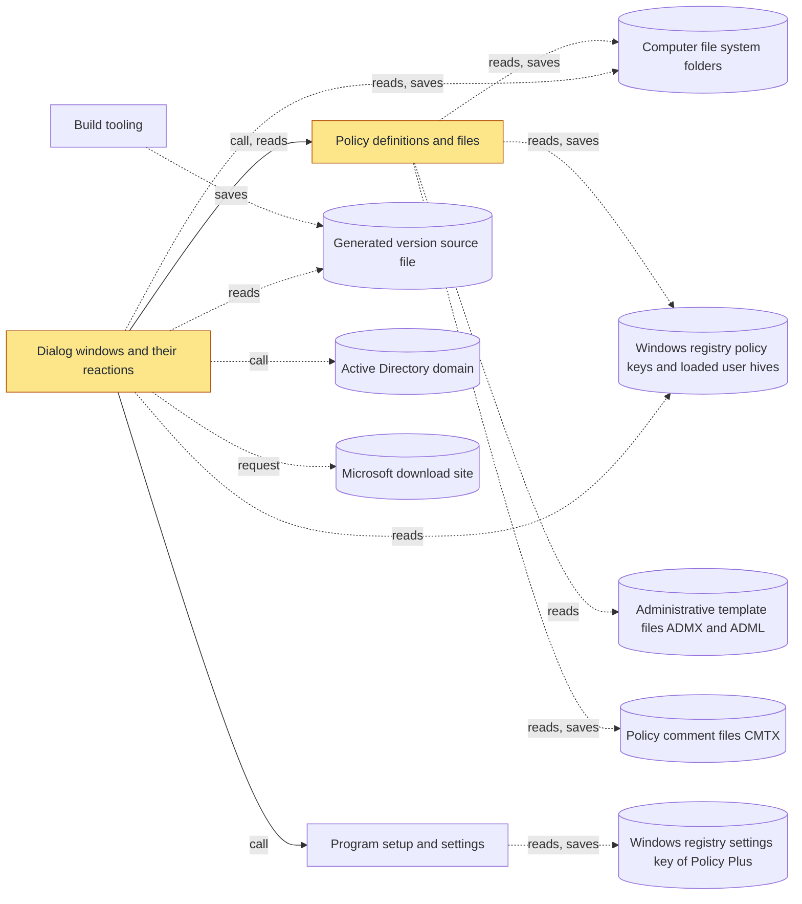
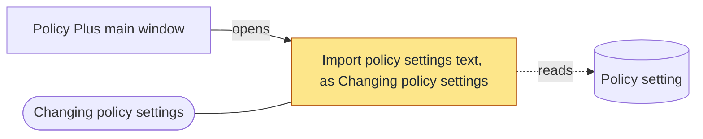
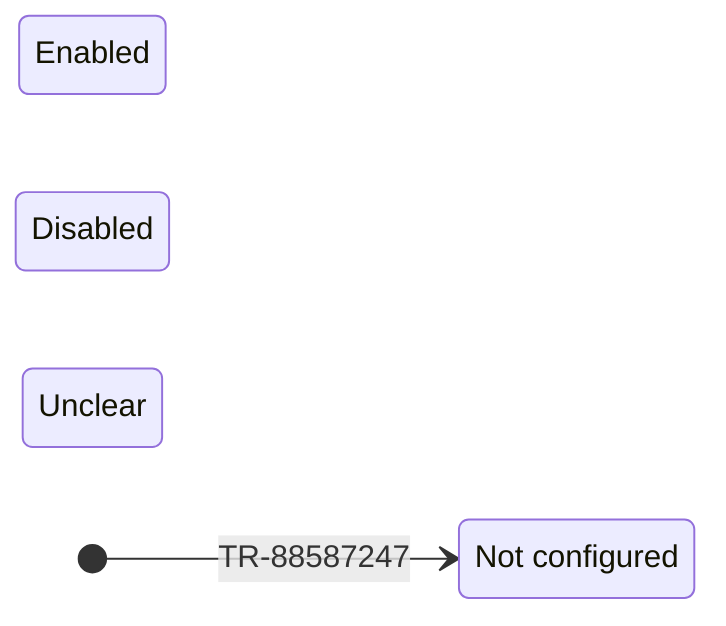

# Legacy reference: Bring in policy settings text and check it as i...: Semantic Text Reader

The typed header below maps each criterion of the work item to the rules of the existing system it backs. The reading of the existing code follows it.

## Header

```json
{
  "story": "story-edf918835552",
  "fingerprint": "280637421a2d33856d0f4655b9cf3df29c3a1ebf99ebbb84e7839ee4506bf978",
  "criteria": [
    {
      "ac": "AC-1",
      "rules": [
        {
          "says": "Verify reads the SPOL text and reports \"Validation successful, N policy settings found.\" or \"SPOL validation failed: \" followed by the reason; nothing is applied.",
          "where": {
            "file": "PolicyPlus/ImportSpol.vb",
            "firstLine": 11,
            "lastLine": 18
          },
          "doubt": ""
        }
      ]
    },
    {
      "ac": "AC-2",
      "rules": [
        {
          "says": "A semantic policy script is refused unless its first line is 'Policy Plus Semantic Policy', with the message 'Incorrect signature.'.",
          "where": {
            "file": "PolicyPlus/SpolFile.vb",
            "firstLine": 50,
            "lastLine": 50
          },
          "doubt": ""
        },
        {
          "says": "A semantic policy script is read in lines separated by carriage return and line feed. A script using line feeds alone is read as one line, so it is refused with the signature message.",
          "where": {
            "file": "PolicyPlus/SpolFile.vb",
            "firstLine": 15,
            "lastLine": 15
          },
          "doubt": ""
        }
      ]
    },
    {
      "ac": "AC-3",
      "rules": [
        {
          "says": "When a semantic policy script fails to load, the error gives the line it stopped at, in the form '(Error found on line N.)'.",
          "where": {
            "file": "PolicyPlus/SpolFile.vb",
            "firstLine": 6,
            "lastLine": 11
          },
          "doubt": ""
        }
      ]
    },
    {
      "ac": "AC-4",
      "rules": [
        {
          "says": "A policy header line in a semantic policy script is a user policy only when its first word is exactly 'U'. Any other first word, including lowercase 'u' or 'User', is a machine policy. The rest of the line is the policy's identifier. A header with no space after the first word fails with a general index error, with the line number but no reason.",
          "where": {
            "file": "PolicyPlus/SpolFile.vb",
            "firstLine": 53,
            "lastLine": 55
          },
          "doubt": ""
        }
      ]
    },
    {
      "ac": "AC-5",
      "rules": [
        {
          "says": "The state in a semantic policy script must be 'Not configured', 'Enabled' or 'Disabled', regardless of case. Anything else is refused with 'Unknown policy state.'.",
          "where": {
            "file": "PolicyPlus/SpolFile.vb",
            "firstLine": 78,
            "lastLine": 87
          },
          "doubt": ""
        }
      ]
    },
    {
      "ac": "AC-6",
      "rules": [
        {
          "says": "Settings are read only for a policy that is Enabled. Lines under Not configured or Disabled are not read as settings but as the next policy's header.",
          "where": {
            "file": "PolicyPlus/SpolFile.vb",
            "firstLine": 88,
            "lastLine": 123
          },
          "doubt": ""
        }
      ]
    },
    {
      "ac": "AC-7",
      "rules": [
        {
          "says": "A setting value in a semantic policy script is read in this order. Starting with # is a whole number, and a # value that is not a whole number fails with a conversion message. A plain non-negative number is an unsigned number. 'True' or 'False', in any letter case, is a yes/no value. Text in single quotes is text, and text in double quotes is a list of text. 'None' is an empty list. Anything else is refused with 'Unknown option data format.'.",
          "where": {
            "file": "PolicyPlus/SpolFile.vb",
            "firstLine": 93,
            "lastLine": 120
          },
          "doubt": ""
        }
      ]
    },
    {
      "ac": "AC-8",
      "rules": [
        {
          "says": "A bracketed setting in a semantic policy script holds one line per entry. Entries with one text are a list, entries with two texts are a table of name and value. With no entries the setting is stored with no value. For a list setting, the existing entries are then removed unless the definition keeps other entries, and nothing is written. For any other kind of setting the empty value makes the write fail.",
          "where": {
            "file": "PolicyPlus/SpolFile.vb",
            "firstLine": 105,
            "lastLine": 117
          },
          "doubt": "'For any other kind of setting the empty value makes the write fail' is not shown for every kind. The project is built with Option Strict Off (PolicyPlus.vbproj line 49), so the stored Nothing is converted loosely: a number setting not stored as text goes through CUInt(Nothing) (line 312) and writes 0; a checkbox takes Nothing as unticked (316), saving its off state; a dropdown indexes its items with Nothing (349), which converts to position 0 and picks the first item. Only text-type and multi-line settings visibly hand Nothing to the writer (310, 327, 353), and whether that fails is decided in the POL/registry writer, not here. State what the person ends up with per kind (list: entries cleared unless others are kept; number, checkbox, dropdown: a default value is written), or limit the claim to what the lines prove."
        }
      ]
    },
    {
      "ac": "AC-9",
      "rules": [
        {
          "says": "A comment line in a semantic policy script is recognised without regard to letter case. A backslash followed by another backslash is one backslash, and a backslash followed by 'n' is a line break.",
          "where": {
            "file": "PolicyPlus/SpolFile.vb",
            "firstLine": 56,
            "lastLine": 71
          },
          "doubt": ""
        },
        {
          "says": "A comment in a semantic policy script is refused when it ends with a lone backslash, with the message 'Escape sequence started at end of comment.'. A backslash followed by any other character is refused with 'Unknown comment escape sequence' naming it.",
          "where": {
            "file": "PolicyPlus/SpolFile.vb",
            "firstLine": 62,
            "lastLine": 70
          },
          "doubt": ""
        }
      ]
    }
  ],
  "reliesOn": [],
  "data": [
    {
      "kind": "Policy setting",
      "access": "reads and saves"
    }
  ],
  "transitions": [],
  "outsideSystems": [
    "Computer file system folders",
    "Windows registry policy keys and loaded user hives"
  ],
  "steps": [
    {
      "intent": "Bring in the text, from a file or entered.",
      "change": "merged",
      "reason": "Check happens by default instead of being asked for, saving a step."
    }
  ],
  "components": [
    {
      "name": "Semantic Text Reader",
      "module": "semantic-text-reader",
      "layer": "packages/ui"
    }
  ],
  "cited": [
    {
      "file": "PolicyPlus/ImportSpol.vb",
      "firstLine": 3,
      "lastLine": 10
    },
    {
      "file": "PolicyPlus/ImportSpol.vb",
      "firstLine": 11,
      "lastLine": 18
    },
    {
      "file": "PolicyPlus/ImportSpol.vb",
      "firstLine": 27,
      "lastLine": 29
    },
    {
      "file": "PolicyPlus/ImportSpol.vb",
      "firstLine": 36,
      "lastLine": 40
    },
    {
      "file": "PolicyPlus/ImportSpol.vb",
      "firstLine": 11,
      "lastLine": 18
    },
    {
      "file": "PolicyPlus/SpolFile.vb",
      "firstLine": 50,
      "lastLine": 50
    },
    {
      "file": "PolicyPlus/SpolFile.vb",
      "firstLine": 15,
      "lastLine": 15
    },
    {
      "file": "PolicyPlus/SpolFile.vb",
      "firstLine": 6,
      "lastLine": 11
    },
    {
      "file": "PolicyPlus/SpolFile.vb",
      "firstLine": 17,
      "lastLine": 21
    },
    {
      "file": "PolicyPlus/SpolFile.vb",
      "firstLine": 53,
      "lastLine": 55
    },
    {
      "file": "PolicyPlus/SpolFile.vb",
      "firstLine": 78,
      "lastLine": 87
    },
    {
      "file": "PolicyPlus/SpolFile.vb",
      "firstLine": 88,
      "lastLine": 123
    },
    {
      "file": "PolicyPlus/SpolFile.vb",
      "firstLine": 93,
      "lastLine": 120
    },
    {
      "file": "PolicyPlus/SpolFile.vb",
      "firstLine": 105,
      "lastLine": 117
    },
    {
      "file": "PolicyPlus/PolicyProcessing.vb",
      "firstLine": 301,
      "lastLine": 305
    },
    {
      "file": "PolicyPlus/PolicyProcessing.vb",
      "firstLine": 328,
      "lastLine": 331
    },
    {
      "file": "PolicyPlus/SpolFile.vb",
      "firstLine": 56,
      "lastLine": 71
    },
    {
      "file": "PolicyPlus/SpolFile.vb",
      "firstLine": 62,
      "lastLine": 70
    }
  ]
}
```

## What each criterion must keep

### AC-1

- Verify reads the SPOL text and reports "Validation successful, N policy settings found." or "SPOL validation failed: " followed by the reason; nothing is applied. (PolicyPlus/ImportSpol.vb:11-18)

### AC-2

- A semantic policy script is refused unless its first line is 'Policy Plus Semantic Policy', with the message 'Incorrect signature.'. (PolicyPlus/SpolFile.vb:50-50)
- A semantic policy script is read in lines separated by carriage return and line feed. A script using line feeds alone is read as one line, so it is refused with the signature message. (PolicyPlus/SpolFile.vb:15-15)

### AC-3

- When a semantic policy script fails to load, the error gives the line it stopped at, in the form '(Error found on line N.)'. (PolicyPlus/SpolFile.vb:6-11)

### AC-4

- A policy header line in a semantic policy script is a user policy only when its first word is exactly 'U'. Any other first word, including lowercase 'u' or 'User', is a machine policy. The rest of the line is the policy's identifier. A header with no space after the first word fails with a general index error, with the line number but no reason. (PolicyPlus/SpolFile.vb:53-55)

### AC-5

- The state in a semantic policy script must be 'Not configured', 'Enabled' or 'Disabled', regardless of case. Anything else is refused with 'Unknown policy state.'. (PolicyPlus/SpolFile.vb:78-87)

### AC-6

- Settings are read only for a policy that is Enabled. Lines under Not configured or Disabled are not read as settings but as the next policy's header. (PolicyPlus/SpolFile.vb:88-123)

### AC-7

- A setting value in a semantic policy script is read in this order. Starting with # is a whole number, and a # value that is not a whole number fails with a conversion message. A plain non-negative number is an unsigned number. 'True' or 'False', in any letter case, is a yes/no value. Text in single quotes is text, and text in double quotes is a list of text. 'None' is an empty list. Anything else is refused with 'Unknown option data format.'. (PolicyPlus/SpolFile.vb:93-120)

### AC-8

- A bracketed setting in a semantic policy script holds one line per entry. Entries with one text are a list, entries with two texts are a table of name and value. With no entries the setting is stored with no value. For a list setting, the existing entries are then removed unless the definition keeps other entries, and nothing is written. For any other kind of setting the empty value makes the write fail. (PolicyPlus/SpolFile.vb:105-117) Doubt: 'For any other kind of setting the empty value makes the write fail' is not shown for every kind. The project is built with Option Strict Off (PolicyPlus.vbproj line 49), so the stored Nothing is converted loosely: a number setting not stored as text goes through CUInt(Nothing) (line 312) and writes 0; a checkbox takes Nothing as unticked (316), saving its off state; a dropdown indexes its items with Nothing (349), which converts to position 0 and picks the first item. Only text-type and multi-line settings visibly hand Nothing to the writer (310, 327, 353), and whether that fails is decided in the POL/registry writer, not here. State what the person ends up with per kind (list: entries cleared unless others are kept; number, checkbox, dropdown: a default value is written), or limit the claim to what the lines prove.

### AC-9

- A comment line in a semantic policy script is recognised without regard to letter case. A backslash followed by another backslash is one backslash, and a backslash followed by 'n' is a line break. (PolicyPlus/SpolFile.vb:56-71)
- A comment in a semantic policy script is refused when it ends with a lone backslash, with the message 'Escape sequence started at end of comment.'. A backslash followed by any other character is refused with 'Unknown comment escape sequence' naming it. (PolicyPlus/SpolFile.vb:62-70)

## Reading of the existing code

# Screen: Import policy settings text, as Changing policy settings

At a glance: 5 owned rules, 10 relied on, 7 actions, 4 files (1 own, 2 relied on, 1 of neighbour screens, 0 generated), 2 disputed.

How to read it: paths are relative to the source root and `file:a-b` is an inclusive line range. `BR-` rules, `ACT-` actions, `TR-` changes of state and `RK-` risks have stable ids. A record marked disputed was challenged in review and kept; the reviewer's words are under Trust. All of it was read from the code; nothing was run.

## Product context
Policy Plus is a Windows desktop editor for Group Policy settings, used by administrators and power users. It reads Microsoft's policy definition files and edits policy files directly, so it works on any Windows edition, including Home, which lacks the built-in editor.
Built with: .NET Framework v4.5.2, Microsoft Windows, System.DirectoryServices, System.Xml, Visual Basic .NET, Windows Forms (Policy Plus desktop editor).
Runs: It runs on the user's own Windows computer as one desktop program on .NET Framework 4.5.2. It asks for elevated rights when available but starts without them; loading registry hives, refreshing policy and editing local Group Policy files need them. It can also reach the domain's shared policy folder.
Reaches outside itself: Computer file system folders; Windows registry policy keys and loaded user hives; Administrative template files (ADMX and ADML); Windows registry settings key of Policy Plus; Generated version source file; Policy comment files (CMTX); Active Directory domain; Microsoft download site.



## Where this sits
Part of: Changing policy settings (Setting and storing policies).



## Boundary
- Opened by **Policy Plus main window** (bundle: screen policy-plus-main-window), at `PolicyPlus/Main.vb:707-719`

## Contract: what it must do
### Import policy settings text
Load or paste SPOL text, check it and apply it.
Controls (6): Both, TabIndex = 2: TextSpol; Button, Text = "Apply", TabIndex = 4: ButtonApply; Button, Text = "Open File", TabIndex = 0: ButtonOpenFile; Button, Text = "Reset", TabIndex = 1: ButtonReset; Button, Text = "Verify", TabIndex = 3: ButtonVerify; Label, Text = "Semantic Policy (SPOL) text", TabIndex = 1: Label1

Actions
- **ACT-09856376** Lets the person pick a SPOL file and shows its text for editing. — `PolicyPlus/ImportSpol.vb:3-10`; started by person
- **ACT-19360952** Checks the SPOL text and reports how many policy settings it holds. — `PolicyPlus/ImportSpol.vb:11-18`; started by person
- **ACT-30091312** Parses the SPOL text and hands it back to the caller to apply, or reports it as invalid. — `PolicyPlus/ImportSpol.vb:19-26`; started by person
- **ACT-03600855** Clears any earlier SPOL result. — `PolicyPlus/ImportSpol.vb:27-29`; started by person
- **ACT-01467584** Closes the window as cancelled when Escape is pressed and no text is selected. — `PolicyPlus/ImportSpol.vb:30-32`; started by person
- **ACT-21641067** Selects all text in the box on Ctrl+A. — `PolicyPlus/ImportSpol.vb:33-35`; started by person
- **ACT-01531941** After confirmation, replaces the SPOL text with the empty header. — `PolicyPlus/ImportSpol.vb:36-40`; started by person

Rules
- **BR-99057081** Open File puts the whole chosen file into the text box, replacing what was typed without asking and without checking it; Reset, after a Yes to "Are you sure you want to reset the text box?", restores the header "Policy Plus Semantic Policy" and blank lines. — `PolicyPlus/ImportSpol.vb:3-10`; also rests on `PolicyPlus/ImportSpol.vb:36-40`; **disputed**
- **BR-29172869** Verify reads the SPOL text and reports "Validation successful, N policy settings found." or "SPOL validation failed: " followed by the reason; nothing is applied. — `PolicyPlus/ImportSpol.vb:11-18`
- **BR-27150580** Apply accepts only SPOL text that reads correctly; the parsed file is passed back to the main window. Invalid text is refused with "The SPOL text is invalid: " and the reason. — `PolicyPlus/ImportSpol.vb:19-26`
- **BR-38807522** Opening Import SPOL discards any previously parsed SPOL so a cancelled session passes nothing back. — `PolicyPlus/ImportSpol.vb:27-29`
- **BR-74126677** Pressing Escape closes Import SPOL as cancelled unless text in the box is selected; when it is, Escape closes nothing. — `PolicyPlus/ImportSpol.vb:30-32`


## Relied on: decided elsewhere
**Code shared with a few capabilities**
- `PolicyPlus/SpolFile.vb`
  - **BR-69713399** When a semantic policy script fails to load, the error gives the line it stopped at, in the form '(Error found on line N.)'. — `PolicyPlus/SpolFile.vb:6-11`; also rests on `PolicyPlus/SpolFile.vb:17-21`
  - **BR-45160893** A semantic policy script is read in lines separated by carriage return and line feed. … — `PolicyPlus/SpolFile.vb:15`
  - **BR-27114950** A semantic policy script is refused unless its first line is 'Policy Plus Semantic Policy', with the message 'Incorrect signature.'. — `PolicyPlus/SpolFile.vb:50`
  - **BR-66938318** A policy header line in a semantic policy script is a user policy only when its first word is exactly 'U'. … — `PolicyPlus/SpolFile.vb:53-55`
  - **BR-57610465** A comment line in a semantic policy script is recognised without regard to letter case. … — `PolicyPlus/SpolFile.vb:56-71`
  - **BR-72173436** A comment in a semantic policy script is refused when it ends with a lone backslash, with the message 'Escape sequence started at end of comment.'. … — `PolicyPlus/SpolFile.vb:62-70`
  - **BR-06118840** The state in a semantic policy script must be 'Not configured', 'Enabled' or 'Disabled', regardless of case. … — `PolicyPlus/SpolFile.vb:78-87`
  - **BR-77971913** Settings are read only for a policy that is Enabled. … — `PolicyPlus/SpolFile.vb:88-123`
  - **BR-65491468** A setting value in a semantic policy script is read in this order. … — `PolicyPlus/SpolFile.vb:93-120`
  - **BR-49767580** A bracketed setting in a semantic policy script holds one line per entry. … — `PolicyPlus/SpolFile.vb:105-117`; also rests on `PolicyPlus/PolicyProcessing.vb:301-305`, `PolicyPlus/PolicyProcessing.vb:328-331`; **disputed**


## Data and states
- Policy setting: reads; kept in Computer file system folders, Windows registry policy keys and loaded user hives

Life of Policy setting


| Change | From | To | Written at | In this code | Reading |
| --- | --- | --- | --- | --- | --- |
| TR-88587247 | created | Not configured | `PolicyPlus/PolicyLoader.vb:94-100` | no | corrected |

## Trust: what to doubt
**Challenged in review and kept**
- **BR-99057081** `PolicyPlus/ImportSpol.vb:3-10`: Two decisions in one rule, and the second is owned by the wrong block: Open File (3-10) and Reset (36-40, a block of its own, given here only as evidence). Split into a rule for Open File decided at 3-10 (whole file replaces typed text without asking) and a rule for Reset decided at 36-40 (needs a Yes to the question, then restores the header). 'Without checking it' is the weakness in fact-44356108302568422603; do not repeat it inside the rule.
- **BR-49767580** `PolicyPlus/SpolFile.vb:105-117`: 'For any other kind of setting the empty value makes the write fail' is not shown for every kind. The project is built with Option Strict Off (PolicyPlus.vbproj line 49), so the stored Nothing is converted loosely: a number setting not stored as text goes through CUInt(Nothing) (line 312) and writes 0; a checkbox takes Nothing as unticked (316), saving its off state; a dropdown indexes its items with Nothing (349), which converts to position 0 and picks the first item. Only text-type and multi-line settings visibly hand Nothing to the writer (310, 327, 353), and whether that fails is decided in the POL/registry writer, not here. State what the person ends up with per kind (list: entries cleared unless others are kept; number, checkbox, dropdown: a default value is written), or limit the claim to what the lines prove.

**Risks**
- **RK-55878738** [low] Several windows raise an unhandled error on ordinary input: double-clicking with no row selected, right-clicking with no category, an unnamed list entry, an unreadable import file, a malformed search wildcard, a removed product in a filter, or an inspector item with no match. No program-wide handler is set, so the framework's default error dialog appears. (Failures are hidden, lost or not retried) — at `PolicyPlus/ImportSpol.vb:3-10`


## Read order
| Tier | File | Lines | Why |
| --- | --- | --- | --- |
| own | `PolicyPlus/ImportSpol.vb` | whole file | starts 7 actions; decides 5 owned rules |
| relied on | `PolicyPlus/PolicyProcessing.vb` | 301-305, 328-331 | called code |
| relied on | `PolicyPlus/SpolFile.vb` | 4-126 | decides 10 relied-on rules; called code |
| neighbour screen | `PolicyPlus/Main.vb` | 707-719 | opens this screen: Policy Plus main window |

## Source

### PolicyPlus/ImportSpol.vb
```
1: Public Class ImportSpol
2:     Public Spol As SpolFile
3:     Private Sub ButtonOpenFile_Click(sender As Object, e As EventArgs) Handles ButtonOpenFile.Click
4:         Using ofd As New OpenFileDialog
5:             ofd.Filter = "Semantic Policy files|*.spol|All files|*.*"
6:             If ofd.ShowDialog = DialogResult.OK Then
7:                 TextSpol.Text = IO.File.ReadAllText(ofd.FileName)
8:             End If
9:         End Using
10:     End Sub
11:     Private Sub ButtonVerify_Click(sender As Object, e As EventArgs) Handles ButtonVerify.Click
12:         Try
13:             Dim spol = SpolFile.FromText(TextSpol.Text)
14:             MsgBox("Validation successful, " & spol.Policies.Count & " policy settings found.", MsgBoxStyle.Information)
15:         Catch ex As Exception
16:             MsgBox("SPOL validation failed: " & ex.Message, MsgBoxStyle.Exclamation)
17:         End Try
18:     End Sub
19:     Private Sub ButtonApply_Click(sender As Object, e As EventArgs) Handles ButtonApply.Click
20:         Try
21:             Spol = SpolFile.FromText(TextSpol.Text) ' Tell the main form that the SPOL is ready to be committed
22:             DialogResult = DialogResult.OK
23:         Catch ex As Exception
24:             MsgBox("The SPOL text is invalid: " & ex.Message, MsgBoxStyle.Exclamation)
25:         End Try
26:     End Sub
27:     Private Sub ImportSpol_Shown(sender As Object, e As EventArgs) Handles Me.Shown
28:         Spol = Nothing
29:     End Sub
30:     Private Sub ImportSpol_KeyUp(sender As Object, e As KeyEventArgs) Handles Me.KeyUp
31:         If e.KeyCode = Keys.Escape And Not (TextSpol.Focused And TextSpol.SelectionLength > 0) Then DialogResult = DialogResult.Cancel
32:     End Sub
33:     Private Sub TextSpol_KeyDown(sender As Object, e As KeyEventArgs) Handles TextSpol.KeyDown
34:         If e.KeyCode = Keys.A And e.Control Then TextSpol.SelectAll()
35:     End Sub
36:     Private Sub ButtonReset_Click(sender As Object, e As EventArgs) Handles ButtonReset.Click
37:         If MsgBox("Are you sure you want to reset the text box?", MsgBoxStyle.Question Or MsgBoxStyle.YesNo) = MsgBoxResult.Yes Then
38:             TextSpol.Text = "Policy Plus Semantic Policy" & vbCrLf & vbCrLf
39:         End If
40:     End Sub
41: End Class
```

### PolicyPlus/PolicyProcessing.vb
```
301:                 If rawpol.Elements IsNot Nothing Then ' Write the elements' states
302:                     For Each elem In rawpol.Elements
303:                         Dim elemKey = If(elem.RegistryKey = "", rawpol.RegistryKey, elem.RegistryKey)
304:                         If Not Options.ContainsKey(elem.ID) Then Continue For
305:                         Dim optionData = Options(elem.ID)
```
```
328:                             Case "list"
329:                                 Dim listElem As ListPolicyElement = elem
330:                                 If Not listElem.NoPurgeOthers Then PolicySource.ClearKey(elemKey)
331:                                 If optionData Is Nothing Then Continue For
```

### PolicyPlus/SpolFile.vb
```
4:     Public Shared Function FromText(Text As String) As SpolFile
5:         Dim spol As New SpolFile
6:         Try
7:             spol.LoadFromText(Text)
8:             Return spol
9:         Catch ex As Exception
10:             Throw New Exception(ex.Message & " (Error found on line " & spol.ParserLine & ".)")
11:         End Try
12:     End Function
13:     Private Sub LoadFromText(Text As String)
14:         ' Load a SPOL script into policy states
15:         Dim allLines = Split(Text, vbCrLf)
16:         Dim line As String = ""
17:         Dim nextLine = Function() As String
18:                            ParserLine += 1
19:                            line = allLines(ParserLine - 1) ' For human-readability in errors
20:                            Return line
21:                        End Function
22:         Dim atEnd = Function() As Boolean
23:                         Return ParserLine >= allLines.Length
24:                     End Function
25:         Dim peekLine = Function() As String
26:                            Return allLines(ParserLine) ' +1 for next, -1 for array
27:                        End Function
28:         Dim getAllStrings = Function(Splittable As String, Delimiter As Char) As List(Of String)
29:                                 Dim list As New List(Of String)
30:                                 Dim sb As Text.StringBuilder = Nothing
31:                                 For n = 0 To Splittable.Length - 1
32:                                     If Splittable(n) = Delimiter Then
33:                                         If sb Is Nothing Then
34:                                             sb = New Text.StringBuilder
35:                                         Else
36:                                             If n + 1 < Splittable.Length - 1 AndAlso Splittable(n + 1) = Delimiter Then
37:                                                 sb.Append(Delimiter)
38:                                                 n += 1
39:                                             Else
40:                                                 list.Add(sb.ToString)
41:                                                 sb = Nothing
42:                                             End If
43:                                         End If
44:                                     ElseIf sb IsNot Nothing Then
45:                                         sb.Append(Splittable(n))
46:                                     End If
47:                                 Next
48:                                 Return list
49:                             End Function
50:         If nextLine() <> "Policy Plus Semantic Policy" Then Throw New Exception("Incorrect signature.")
51:         Do Until atEnd()
52:             If Trim(nextLine()) = "" Then Continue Do
53:             Dim policyHeaderParts = Split(line, " ", 2) ' Section and policy ID
54:             Dim singlePolicy As New SpolPolicyState With {.UniqueID = policyHeaderParts(1)}
55:             singlePolicy.Section = If(policyHeaderParts(0) = "U", AdmxPolicySection.User, AdmxPolicySection.Machine)
56:             Const commentPrefix As String = "comment: "
57:             If LTrim(peekLine()).ToLowerInvariant().StartsWith(commentPrefix) Then
58:                 Dim escapedCommentText = LTrim(nextLine()).Substring(commentPrefix.Length)
59:                 Dim commentText As New Text.StringBuilder
60:                 For n = 0 To escapedCommentText.Length - 1
61:                     If escapedCommentText(n) = "\"c Then
62:                         If n = escapedCommentText.Length - 1 Then Throw New Exception("Escape sequence started at end of comment.")
63:                         Select Case escapedCommentText(n + 1)
64:                             Case "\"c
65:                                 commentText.Append("\"c)
66:                             Case "n"
67:                                 commentText.Append(vbCrLf)
68:                             Case Else
69:                                 Throw New Exception("Unknown comment escape sequence \" & escapedCommentText(n + 1) & ".")
70:                         End Select
71:                         n += 1
72:                     Else
73:                         commentText.Append(escapedCommentText(n))
74:                     End If
75:                 Next
76:                 singlePolicy.Comment = commentText.ToString
77:             End If
78:             Select Case Trim(nextLine()).ToLowerInvariant
79:                 Case "not configured"
80:                     singlePolicy.BasicState = PolicyState.NotConfigured
81:                 Case "enabled"
82:                     singlePolicy.BasicState = PolicyState.Enabled
83:                 Case "disabled"
84:                     singlePolicy.BasicState = PolicyState.Disabled
85:                 Case Else
86:                     Throw New Exception("Unknown policy state.")
87:             End Select
88:             If singlePolicy.BasicState = PolicyState.Enabled Then
89:                 Do Until atEnd() OrElse Trim(peekLine()) = ""
90:                     Dim optionParts = Split(Trim(nextLine()), ": ", 2) ' Name and value
91:                     Dim valueText = optionParts(1)
92:                     Dim newObj As Object
93:                     If valueText.StartsWith("#") Then
94:                         newObj = CInt(valueText.Substring(1))
95:                     ElseIf UInteger.TryParse(valueText, 0) Then
96:                         newObj = CUInt(valueText)
97:                     ElseIf Boolean.TryParse(valueText, False) Then
98:                         newObj = CBool(valueText)
99:                     ElseIf valueText.StartsWith("'") And valueText.EndsWith("'") Then
100:                         newObj = valueText.Substring(1, valueText.Length - 2)
101:                     ElseIf valueText.StartsWith("""") And valueText.EndsWith("""") Then
102:                         newObj = getAllStrings(valueText, """").ToArray
103:                     ElseIf valueText = "None" Then
104:                         newObj = Array.CreateInstance(GetType(String), 0)
105:                     ElseIf valueText = "[" Then
106:                         Dim entries As New List(Of List(Of String))
107:                         Do Until Trim(peekLine()) = "]"
108:                             entries.Add(getAllStrings(nextLine(), """"))
109:                         Loop
110:                         nextLine() ' Skip the closing bracket
111:                         If entries.Count = 0 Then
112:                             newObj = Nothing ' PolicyProcessing will ignore an empty list element
113:                         ElseIf entries(0).Count = 1 Then
114:                             newObj = entries.Select(Function(l) l(0)).ToList
115:                         Else
116:                             newObj = entries.ToDictionary(Function(l) l(0), Function(l) l(1))
117:                         End If
118:                     Else
119:                         Throw New Exception("Unknown option data format.")
120:                     End If
121:                     singlePolicy.ExtraOptions.Add(optionParts(0), newObj)
122:                 Loop
123:             End If
124:             Policies.Add(singlePolicy)
125:         Loop
126:     End Sub
```

### PolicyPlus/Main.vb
```
707:     Private Sub ImportSemanticPolicyToolStripMenuItem_Click(sender As Object, e As EventArgs) Handles ImportSemanticPolicyToolStripMenuItem.Click
708:         ' Open the SPOL import dialog and apply the data
709:         If ImportSpol.ShowDialog() = DialogResult.OK Then
710:             Dim spol = ImportSpol.Spol
711:             Dim fails = spol.ApplyAll(AdmxWorkspace, UserPolicySource, CompPolicySource, UserComments, CompComments)
712:             MoveToVisibleCategoryAndReload()
713:             If fails = 0 Then
714:                 MsgBox("Semantic Policy successfully applied.", MsgBoxStyle.Information)
715:             Else
716:                 MsgBox(fails & " out of " & spol.Policies.Count & " could not be applied.", MsgBoxStyle.Exclamation)
717:             End If
718:         End If
719:     End Sub
```

