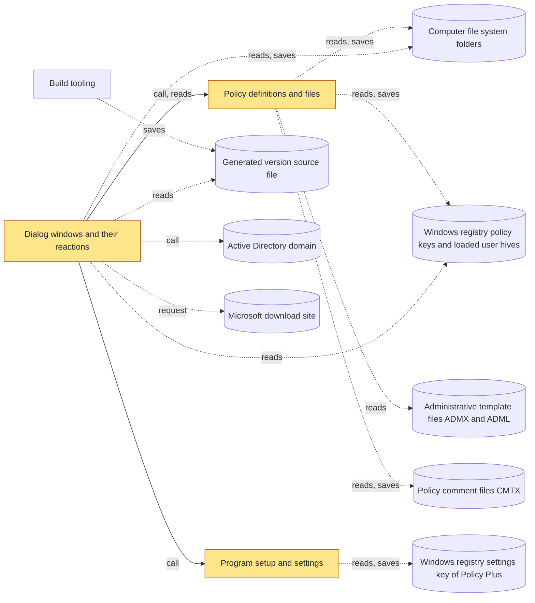
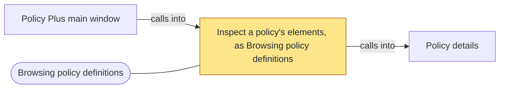

# Legacy reference: Inspect a policy's definition and its semantic policy text

The typed header below maps each criterion of the work item to the rules of the existing system it backs. The reading of the existing code follows it.

## Header

```json
{
  "story": "story-fbdd46b57e19",
  "fingerprint": "280637421a2d33856d0f4655b9cf3df29c3a1ebf99ebbb84e7839ee4506bf978",
  "criteria": [
    {
      "ac": "AC-1",
      "rules": [
        {
          "says": "The inspector copies the selected line to the clipboard only on Ctrl+C with a line selected.",
          "where": {
            "file": "PolicyPlus/InspectPolicyElements.vb",
            "firstLine": 188,
            "lastLine": 190
          },
          "doubt": ""
        }
      ]
    },
    {
      "ac": "AC-2",
      "rules": [
        {
          "says": "The policy inspector shows a \"Registry value\" line for the policy only when the policy names a registry value.",
          "where": {
            "file": "PolicyPlus/InspectPolicyElements.vb",
            "firstLine": 9,
            "lastLine": 9
          },
          "doubt": ""
        },
        {
          "says": "The policy inspector shows a \"Client extension\" line for the policy only when the policy names a client extension.",
          "where": {
            "file": "PolicyPlus/InspectPolicyElements.vb",
            "firstLine": 10,
            "lastLine": 10
          },
          "doubt": ""
        }
      ]
    },
    {
      "ac": "AC-3",
      "rules": [
        {
          "says": "Choice display names in the inspector are resolved through the definitions file that defines the policy, and choices are numbered from zero in file order.",
          "where": {
            "file": "PolicyPlus/InspectPolicyElements.vb",
            "firstLine": 157,
            "lastLine": 170
          },
          "doubt": ""
        }
      ]
    },
    {
      "ac": "AC-4",
      "rules": [
        {
          "says": "For a list element the inspector states how value names are formed: \"User provides value names\" when the person names them, a prefix when the element has one, otherwise \"No prefix (values named for their data)\".",
          "where": {
            "file": "PolicyPlus/InspectPolicyElements.vb",
            "firstLine": 143,
            "lastLine": 149
          },
          "doubt": ""
        }
      ]
    },
    {
      "ac": "AC-5",
      "rules": [
        {
          "says": "In the inspector, a group of affected registry settings with no on or off setting reads \"Left implicit\" when the policy names a registry value, and \"Left to elements\" when it names none. Inside a Yes/No element it always reads \"Left implicit\".",
          "where": {
            "file": "PolicyPlus/InspectPolicyElements.vb",
            "firstLine": 58,
            "lastLine": 58
          },
          "doubt": ""
        }
      ]
    },
    {
      "ac": "AC-6",
      "rules": [
        {
          "says": "The policy inspector lists presentation details for the policy whenever it has both a presentation and elements, whatever the elements hold. Each presentation item with an ID is matched to the policy element with the same ID; items without an ID show no element details. When no element has that ID, the inspector stops with an unhandled error.",
          "where": {
            "file": "PolicyPlus/InspectPolicyElements.vb",
            "firstLine": 63,
            "lastLine": 67
          },
          "doubt": ""
        }
      ]
    },
    {
      "ac": "AC-7",
      "rules": []
    },
    {
      "ac": "AC-8",
      "rules": [
        {
          "says": "The Semantic Policy fragment shows one section per area the policy applies to: the machine section reads the computer source and its comments, the user section reads the user source and its comments; an area the policy does not cover is left out.",
          "where": {
            "file": "PolicyPlus/InspectSpolFragment.vb",
            "firstLine": 7,
            "lastLine": 21
          },
          "doubt": ""
        }
      ]
    },
    {
      "ac": "AC-9",
      "rules": [
        {
          "says": "Within each section of the fragment, the policy comment is included only when one is stored for that policy, and the option values are included only when the policy is Enabled.",
          "where": {
            "file": "PolicyPlus/InspectSpolFragment.vb",
            "firstLine": 14,
            "lastLine": 16
          },
          "doubt": ""
        },
        {
          "says": "When a policy is written as semantic policy text, its settings are listed only if the policy is Enabled.",
          "where": {
            "file": "PolicyPlus/SpolFile.vb",
            "firstLine": 145,
            "lastLine": 183
          },
          "doubt": ""
        }
      ]
    },
    {
      "ac": "AC-10",
      "rules": [
        {
          "says": "A semantic policy text line shows 'C' for a machine policy and 'U' for a user policy, followed by the identifier.",
          "where": {
            "file": "PolicyPlus/SpolFile.vb",
            "firstLine": 130,
            "lastLine": 131
          },
          "doubt": ""
        }
      ]
    },
    {
      "ac": "AC-11",
      "rules": [
        {
          "says": "In semantic policy text, a whole number is written with a leading #, an unsigned number as digits, and a yes/no value as True or False. Text is written between single quotes with no escaping, so text holding a quote or line break cannot be read back. An empty list is written as 'None'. A list of text is written in brackets, one double-quoted item per line with quotes doubled. A table is written in brackets as double-quoted name: value lines.",
          "where": {
            "file": "PolicyPlus/SpolFile.vb",
            "firstLine": 150,
            "lastLine": 181
          },
          "doubt": "A list of text is written in two different ways and the rule names one. An array of texts is written on ONE line as double-quoted items joined by commas (line 164), and an empty array as 'None'. A list of texts (List) is written in brackets, one double-quoted item per line (165-171), and an empty List is written as an empty bracket pair, not 'None'. The rule's 'An empty list is written as None' and 'A list of text is written in brackets' each hold for only one of the two. Say which value shape gets which form."
        }
      ]
    },
    {
      "ac": "AC-12",
      "rules": [
        {
          "says": "When a policy is written as semantic policy text, backslashes in its comment are doubled and each carriage return plus line feed pair is written as '\\n'. A lone line feed or lone carriage return is written as it is, which splits the comment over two script lines and corrupts it when read back.",
          "where": {
            "file": "PolicyPlus/SpolFile.vb",
            "firstLine": 132,
            "lastLine": 135
          },
          "doubt": ""
        }
      ]
    }
  ],
  "reliesOn": [
    {
      "says": "When a policy sits in a category that exists, the category name is shown and the category-details button is enabled. A policy whose named category is unknown shows \"<orphaned from \" followed by that category code, and one with no category code shows \"<uncategorized>\"; the button is then disabled.",
      "builtBy": "Open details of a policy, category, product or support rule"
    },
    {
      "says": "When a policy names a support definition that exists, its name is shown and the support-details button is enabled. When it does not exist, the button is disabled and the text reads \"<missing: \" followed by the code the policy names; with no code the text is blank.",
      "builtBy": "Open details of a policy, category, product or support rule"
    },
    {
      "says": "The policy details window names the section a policy applies to: \"User or computer\" when it applies to both, \"Computer\" when machine-only, \"User\" when user-only.",
      "builtBy": "Open details of a policy, category, product or support rule"
    }
  ],
  "data": [
    {
      "kind": "Program preference",
      "access": "reads and saves"
    },
    {
      "kind": "Administrative template",
      "access": "reads"
    },
    {
      "kind": "Policy setting",
      "access": "reads"
    }
  ],
  "transitions": [],
  "outsideSystems": [
    "Windows registry settings key of Policy Plus",
    "Active Directory domain",
    "Administrative template files (ADMX and ADML)",
    "Computer file system folders",
    "Microsoft download site",
    "Windows registry policy keys and loaded user hives"
  ],
  "cited": [
    {
      "file": "PolicyPlus/InspectPolicyElements.vb",
      "firstLine": 187,
      "lastLine": 191
    },
    {
      "file": "PolicyPlus/InspectPolicyElements.vb",
      "firstLine": 192,
      "lastLine": 194
    },
    {
      "file": "PolicyPlus/InspectPolicyElements.vb",
      "firstLine": 188,
      "lastLine": 190
    },
    {
      "file": "PolicyPlus/InspectPolicyElements.vb",
      "firstLine": 9,
      "lastLine": 9
    },
    {
      "file": "PolicyPlus/InspectPolicyElements.vb",
      "firstLine": 10,
      "lastLine": 10
    },
    {
      "file": "PolicyPlus/InspectPolicyElements.vb",
      "firstLine": 157,
      "lastLine": 170
    },
    {
      "file": "PolicyPlus/InspectPolicyElements.vb",
      "firstLine": 143,
      "lastLine": 149
    },
    {
      "file": "PolicyPlus/InspectPolicyElements.vb",
      "firstLine": 58,
      "lastLine": 58
    },
    {
      "file": "PolicyPlus/InspectPolicyElements.vb",
      "firstLine": 61,
      "lastLine": 61
    },
    {
      "file": "PolicyPlus/InspectPolicyElements.vb",
      "firstLine": 134,
      "lastLine": 134
    },
    {
      "file": "PolicyPlus/InspectPolicyElements.vb",
      "firstLine": 63,
      "lastLine": 67
    },
    {
      "file": "PolicyPlus/InspectPolicyElements.vb",
      "firstLine": 117,
      "lastLine": 123
    },
    {
      "file": "PolicyPlus/InspectSpolFragment.vb",
      "firstLine": 7,
      "lastLine": 21
    },
    {
      "file": "PolicyPlus/InspectSpolFragment.vb",
      "firstLine": 14,
      "lastLine": 16
    },
    {
      "file": "PolicyPlus/SpolFile.vb",
      "firstLine": 145,
      "lastLine": 183
    },
    {
      "file": "PolicyPlus/SpolFile.vb",
      "firstLine": 130,
      "lastLine": 131
    },
    {
      "file": "PolicyPlus/SpolFile.vb",
      "firstLine": 150,
      "lastLine": 181
    },
    {
      "file": "PolicyPlus/SpolFile.vb",
      "firstLine": 144,
      "lastLine": 144
    },
    {
      "file": "PolicyPlus/SpolFile.vb",
      "firstLine": 132,
      "lastLine": 135
    }
  ]
}
```

## What each criterion must keep

### AC-1

- The inspector copies the selected line to the clipboard only on Ctrl+C with a line selected. (PolicyPlus/InspectPolicyElements.vb:188-190)

### AC-2

- The policy inspector shows a "Registry value" line for the policy only when the policy names a registry value. (PolicyPlus/InspectPolicyElements.vb:9-9)
- The policy inspector shows a "Client extension" line for the policy only when the policy names a client extension. (PolicyPlus/InspectPolicyElements.vb:10-10)

### AC-3

- Choice display names in the inspector are resolved through the definitions file that defines the policy, and choices are numbered from zero in file order. (PolicyPlus/InspectPolicyElements.vb:157-170)

### AC-4

- For a list element the inspector states how value names are formed: "User provides value names" when the person names them, a prefix when the element has one, otherwise "No prefix (values named for their data)". (PolicyPlus/InspectPolicyElements.vb:143-149)

### AC-5

- In the inspector, a group of affected registry settings with no on or off setting reads "Left implicit" when the policy names a registry value, and "Left to elements" when it names none. Inside a Yes/No element it always reads "Left implicit". (PolicyPlus/InspectPolicyElements.vb:58-58)

### AC-6

- The policy inspector lists presentation details for the policy whenever it has both a presentation and elements, whatever the elements hold. Each presentation item with an ID is matched to the policy element with the same ID; items without an ID show no element details. When no element has that ID, the inspector stops with an unhandled error. (PolicyPlus/InspectPolicyElements.vb:63-67)

### AC-7

No single legacy rule: it describes the behaviour as a whole.


### AC-8

- The Semantic Policy fragment shows one section per area the policy applies to: the machine section reads the computer source and its comments, the user section reads the user source and its comments; an area the policy does not cover is left out. (PolicyPlus/InspectSpolFragment.vb:7-21)

### AC-9

- Within each section of the fragment, the policy comment is included only when one is stored for that policy, and the option values are included only when the policy is Enabled. (PolicyPlus/InspectSpolFragment.vb:14-16)
- When a policy is written as semantic policy text, its settings are listed only if the policy is Enabled. (PolicyPlus/SpolFile.vb:145-183)

### AC-10

- A semantic policy text line shows 'C' for a machine policy and 'U' for a user policy, followed by the identifier. (PolicyPlus/SpolFile.vb:130-131)

### AC-11

- In semantic policy text, a whole number is written with a leading #, an unsigned number as digits, and a yes/no value as True or False. Text is written between single quotes with no escaping, so text holding a quote or line break cannot be read back. An empty list is written as 'None'. A list of text is written in brackets, one double-quoted item per line with quotes doubled. A table is written in brackets as double-quoted name: value lines. (PolicyPlus/SpolFile.vb:150-181) Doubt: A list of text is written in two different ways and the rule names one. An array of texts is written on ONE line as double-quoted items joined by commas (line 164), and an empty array as 'None'. A list of texts (List) is written in brackets, one double-quoted item per line (165-171), and an empty List is written as an empty bracket pair, not 'None'. The rule's 'An empty list is written as None' and 'A list of text is written in brackets' each hold for only one of the two. Say which value shape gets which form.

### AC-12

- When a policy is written as semantic policy text, backslashes in its comment are doubled and each carriage return plus line feed pair is written as '\n'. A lone line feed or lone carriage return is written as it is, which splits the comment over two script lines and corrupts it when read back. (PolicyPlus/SpolFile.vb:132-135)

## Relies on, built elsewhere

- When a policy sits in a category that exists, the category name is shown and the category-details button is enabled. A policy whose named category is unknown shows "<orphaned from " followed by that category code, and one with no category code shows "<uncategorized>"; the button is then disabled. Built by: Open details of a policy, category, product or support rule.
- When a policy names a support definition that exists, its name is shown and the support-details button is enabled. When it does not exist, the button is disabled and the text reads "<missing: " followed by the code the policy names; with no code the text is blank. Built by: Open details of a policy, category, product or support rule.
- The policy details window names the section a policy applies to: "User or computer" when it applies to both, "Computer" when machine-only, "User" when user-only. Built by: Open details of a policy, category, product or support rule.

## Reading of the existing code

# Screen: Inspect a policy's elements, as Browsing policy definitions

At a glance: 1 owned rule, 0 relied on, 2 actions, 3 files (1 own, 0 relied on, 2 of neighbour screens, 0 generated), 0 disputed.

How to read it: paths are relative to the source root and `file:a-b` is an inclusive line range. `BR-` rules, `ACT-` actions, `TR-` changes of state and `RK-` risks have stable ids. A record marked disputed was challenged in review and kept; the reviewer's words are under Trust. All of it was read from the code; nothing was run.

## Product context
Policy Plus is a Windows desktop editor for Group Policy settings, used by administrators and power users. It reads Microsoft's policy definition files and edits policy files directly, so it works on any Windows edition, including Home, which lacks the built-in editor.
Built with: .NET Framework v4.5.2, Microsoft Windows, System.DirectoryServices, System.Xml, Visual Basic .NET, Windows Forms (Policy Plus desktop editor).
Runs: It runs on the user's own Windows computer as one desktop program on .NET Framework 4.5.2. It asks for elevated rights when available but starts without them; loading registry hives, refreshing policy and editing local Group Policy files need them. It can also reach the domain's shared policy folder.
Reaches outside itself: Computer file system folders; Windows registry policy keys and loaded user hives; Administrative template files (ADMX and ADML); Windows registry settings key of Policy Plus; Generated version source file; Policy comment files (CMTX); Active Directory domain; Microsoft download site.



## Where this sits
Part of: Browsing policy definitions (Reading policy definitions).



## Boundary
- Called from **Policy Plus main window** (bundle: screen policy-plus-main-window), at `PolicyPlus/Main.vb:839-858`
- Calls into **Policy details** (bundle: screen policy-details), at `PolicyPlus/InspectPolicyElements.vb:192-194`

## Contract: what it must do
### Inspect a policy's elements
See the options of a policy as a tree and copy their text.
Controls (5): Button, Text = "Details", TabIndex = 1: PolicyDetailsButton; Cancel, TabIndex = 4: CloseButton; Label, Text = "Policy", TabIndex = 2: PolicyNameLabel; TextBox, ReadOnly = True, TabIndex = 0: PolicyNameTextbox; TreeView, TabIndex = 3: InfoTreeview

Actions
- **ACT-75013383** Copies the selected node text to the clipboard on Ctrl+C. — `PolicyPlus/InspectPolicyElements.vb:187-191`; started by person
- **ACT-63221145** Opens the policy details window for the inspected policy. — `PolicyPlus/InspectPolicyElements.vb:192-194`; started by person

Rules
- **BR-31502733** The inspector copies the selected line to the clipboard only on Ctrl+C with a line selected. — `PolicyPlus/InspectPolicyElements.vb:188-190`


## Trust: what to doubt
**Assumed, not confirmed**
- When the person's language has no exact language folder, the folder picked among those of the same primary language is the first one the operating system lists; which that is, is not stated in code. Why unsettled: The folder listing order is left to the file system, and the template folders present are out of scope. If wrong: A person could see a different regional variant of the policy text than expected when several variants are installed.


## Read order
| Tier | File | Lines | Why |
| --- | --- | --- | --- |
| own | `PolicyPlus/InspectPolicyElements.vb` | whole file | starts 2 actions; decides 1 owned rule |
| neighbour screen | `PolicyPlus/DetailPolicy.vb` | 3-36 | called from this screen: Policy details |
| neighbour screen | `PolicyPlus/Main.vb` | 839-858 | calls into this screen: Policy Plus main window |

## Source

### PolicyPlus/InspectPolicyElements.vb
```
1: Public Class InspectPolicyElements
2:     Dim SelectedPolicy As PolicyPlusPolicy
3:     Public Sub PresentDialog(Policy As PolicyPlusPolicy, Images As ImageList, AdmxWorkspace As AdmxBundle)
4:         SelectedPolicy = Policy
5:         PolicyNameTextbox.Text = Policy.DisplayName
6:         InfoTreeview.Nodes.Clear()
7:         InfoTreeview.ImageList = Images
8:         InfoTreeview.Nodes.Add("Registry key: " & Policy.RawPolicy.RegistryKey).ImageIndex = 0 ' Folder
9:         If Policy.RawPolicy.RegistryValue <> "" Then InfoTreeview.Nodes.Add("Registry value: " & Policy.RawPolicy.RegistryValue).ImageIndex = 13 ' Gear
10:         If Policy.RawPolicy.ClientExtension <> "" Then InfoTreeview.Nodes.Add("Client extension: " & Policy.RawPolicy.ClientExtension).ImageIndex = 19 ' DOS window
11:         ' Methods for adding info on a policy Registry information object
12:         Dim addValueData = Sub(RegVal As PolicyRegistryValue, Node As TreeNode)
13:                                Select Case RegVal.RegistryType
14:                                    Case PolicyRegistryValueType.Delete
15:                                        Node.Nodes.Add("Delete value").ImageIndex = 18 ' Delete
16:                                    Case PolicyRegistryValueType.Numeric
17:                                        Node.Nodes.Add("Numeric value: " & RegVal.NumberValue).ImageIndex = 15 ' Calculator
18:                                    Case PolicyRegistryValueType.Text
19:                                        Node.Nodes.Add("Text value: """ & RegVal.StringValue & """").ImageIndex = 14 ' Text
20:                                End Select
21:                            End Sub
22:         Dim addListEntry = Sub(RegVal As PolicyRegistryListEntry, Node As TreeNode)
23:                                Dim entryNode = Node.Nodes.Add("Set a value")
24:                                entryNode.ImageIndex = 16 ' Gear with pencil
25:                                If RegVal.RegistryKey <> "" Then entryNode.Nodes.Add("Registry key: " & RegVal.RegistryKey).ImageIndex = 0
26:                                entryNode.Nodes.Add("Registry value: " & RegVal.RegistryValue).ImageIndex = 13
27:                                addValueData(RegVal.Value, entryNode)
28:                            End Sub
29:         Dim addSingleListContents = Sub(SingleList As PolicyRegistrySingleList, Node As TreeNode)
30:                                         If SingleList.DefaultRegistryKey <> "" Then Node.Nodes.Add("Registry key: " & SingleList.DefaultRegistryKey).ImageIndex = 0
31:                                         For Each entry In SingleList.AffectedValues
32:                                             addListEntry(entry, Node)
33:                                         Next
34:                                     End Sub
35:         Dim addList = Sub(RegList As PolicyRegistryList, Nodes As TreeNodeCollection, HasValue As Boolean)
36:                           Dim listNode = Nodes.Add("Affected Registry settings")
37:                           listNode.ImageIndex = 12 ' Database
38:                           If RegList.OnValue IsNot Nothing Then
39:                               Dim onNode = listNode.Nodes.Add("Set when enabled")
40:                               onNode.ImageIndex = 17 ' Checkmark
41:                               addValueData(RegList.OnValue, onNode)
42:                           End If
43:                           If RegList.OnValueList IsNot Nothing Then
44:                               Dim onListNode = listNode.Nodes.Add("Set list when enabled")
45:                               onListNode.ImageIndex = 17
46:                               addSingleListContents(RegList.OnValueList, onListNode)
47:                           End If
48:                           If RegList.OffValue IsNot Nothing Then
49:                               Dim offNode = listNode.Nodes.Add("Set when disabled")
50:                               offNode.ImageIndex = 8 ' Minus
51:                               addValueData(RegList.OffValue, offNode)
52:                           End If
53:                           If RegList.OffValueList IsNot Nothing Then
54:                               Dim offListNode = listNode.Nodes.Add("Set list when disabled")
55:                               offListNode.ImageIndex = 8
56:                               addSingleListContents(RegList.OffValueList, offListNode)
57:                           End If
58:                           If listNode.Nodes.Count = 0 Then listNode.Nodes.Add(If(HasValue, "Left implicit", "Left to elements")).ImageIndex = 37
59:                       End Sub
60:         ' Add the policy's basic Registry info
61:         addList(Policy.RawPolicy.AffectedValues, InfoTreeview.Nodes, Policy.RawPolicy.RegistryValue <> "")
62:         ' Add all the info on the policy's elements
63:         If Policy.Presentation IsNot Nothing And Policy.RawPolicy.Elements IsNot Nothing Then
64:             Dim presNode = InfoTreeview.Nodes.Add("Presentation: " & Policy.Presentation.Name)
65:             presNode.ImageIndex = 20 ' Form
66:             For Each presElem In Policy.Presentation.Elements
67:                 Dim presPartNode = presNode.Nodes.Add("Presentation element (type: " & presElem.ElementType & ")" & If(presElem.ID <> "", ", ID: " & presElem.ID & "", ""))
68:                 Select Case presElem.ElementType
69:                     Case "text"
70:                         Dim labelPres As LabelPresentationElement = presElem
71:                         presPartNode.ImageIndex = 21 ' Text rows
72:                         presPartNode.Nodes.Add("Text: """ & labelPres.Text & """").ImageIndex = 14
73:                     Case "decimalTextBox"
74:                         Dim decTextPres As NumericBoxPresentationElement = presElem
75:                         presPartNode.ImageIndex = 22 ' Calculator with pencil
76:                         If decTextPres.Label <> "" Then presPartNode.Nodes.Add("Label: """ & decTextPres.Label & """").ImageIndex = 14
77:                         presPartNode.Nodes.Add("Default: " & decTextPres.DefaultValue).ImageIndex = 23 ' Wrench
78:                         presPartNode.Nodes.Add(If(decTextPres.HasSpinner, "Spinner increment: " & decTextPres.SpinnerIncrement, "No spinner")).ImageIndex = 6
79:                     Case "textBox"
80:                         Dim textPres As TextBoxPresentationElement = presElem
81:                         presPartNode.ImageIndex = 24 ' Text field
82:                         If textPres.Label <> "" Then presPartNode.Nodes.Add("Label: """ & textPres.Label & """").ImageIndex = 14
83:                         presPartNode.Nodes.Add("Default: """ & textPres.DefaultValue & """").ImageIndex = 23
84:                     Case "checkBox"
85:                         Dim checkPres As CheckBoxPresentationElement = presElem
86:                         presPartNode.ImageIndex = 25 ' Tickmark
87:                         presPartNode.Nodes.Add("Text: """ & checkPres.Text & """").ImageIndex = 14
88:                         presPartNode.Nodes.Add("Default: " & If(checkPres.DefaultState, "checked", "unchecked")).ImageIndex = 23
89:                     Case "comboBox"
90:                         Dim comboPres As ComboBoxPresentationElement = presElem
91:                         presPartNode.ImageIndex = 26 ' Bar with text
92:                         If comboPres.Label <> "" Then presPartNode.Nodes.Add("Label: """ & comboPres.Label & """").ImageIndex = 14
93:                         presPartNode.Nodes.Add("Default: """ & comboPres.DefaultText & """").ImageIndex = 23
94:                         presPartNode.Nodes.Add("Sorting: " & If(comboPres.NoSort, "from ADMX", "alphabetical")).ImageIndex = 28 ' Sorted table
95:                         If comboPres.Suggestions IsNot Nothing Then
96:                             Dim sugNode = presPartNode.Nodes.Add(comboPres.Suggestions.Count & " suggestions")
97:                             sugNode.ImageIndex = 29 ' Letter
98:                             For Each sug In comboPres.Suggestions
99:                                 sugNode.Nodes.Add("""" & sug & """").ImageIndex = 14
100:                             Next
101:                         End If
102:                     Case "dropdownList"
103:                         Dim dropdownPres As DropDownPresentationElement = presElem
104:                         presPartNode.ImageIndex = 30 ' List view
105:                         If dropdownPres.Label <> "" Then presPartNode.Nodes.Add("Label: """ & dropdownPres.Label & """").ImageIndex = 14
106:                         If dropdownPres.DefaultItemID.HasValue Then presPartNode.Nodes.Add("Default: #" & dropdownPres.DefaultItemID.Value).ImageIndex = 23
107:                         presPartNode.Nodes.Add("Sorting: " & If(dropdownPres.NoSort, "from ADMX", "alphabetical")).ImageIndex = 28
108:                     Case "listBox"
109:                         Dim listPres As ListPresentationElement = presElem
110:                         presPartNode.ImageIndex = 27 ' Table window
111:                         presPartNode.Nodes.Add("Label: """ & listPres.Label & """").ImageIndex = 14
112:                     Case "multiTextBox"
113:                         Dim multiTextPres As MultiTextPresentationElement = presElem
114:                         presPartNode.ImageIndex = 38 ' Cascading boxes
115:                         presPartNode.Nodes.Add("Label: """ & multiTextPres.Label & """").ImageIndex = 14
116:                 End Select
117:                 If presElem.ID = "" Then Continue For
118:                 Dim elem = Policy.RawPolicy.Elements.First(Function(e) e.ID = presElem.ID)
119:                 Dim elemNode = presPartNode.Nodes.Add("Policy element (type: " & elem.ElementType & ")")
120:                 elemNode.ImageIndex = 31 ' Brick
121:                 If elem.ClientExtension <> "" Then elemNode.Nodes.Add("Client extension: " & elem.ClientExtension).ImageIndex = 19
122:                 If elem.RegistryKey <> "" Then elemNode.Nodes.Add("Registry key: " & elem.RegistryKey).ImageIndex = 0
123:                 If elem.ElementType <> "list" Then elemNode.Nodes.Add("Registry value: " & elem.RegistryValue).ImageIndex = 13
124:                 Select Case elem.ElementType
125:                     Case "decimal"
126:                         Dim decimalElem As DecimalPolicyElement = elem
127:                         elemNode.Nodes.Add("Minimum: " & decimalElem.Minimum).ImageIndex = 35 ' Down arrow
128:                         elemNode.Nodes.Add("Maximum: " & decimalElem.Maximum).ImageIndex = 6
129:                         If decimalElem.StoreAsText Then elemNode.Nodes.Add("Stored as text").ImageIndex = 33 ' Letters
130:                         elemNode.Nodes.Add("Required: " & If(decimalElem.Required, "yes", "no")).ImageIndex = 32 ' Exclamation
131:                         If decimalElem.NoOverwrite Then elemNode.Nodes.Add("Soft").ImageIndex = 34 ' Soft speaker
132:                     Case "boolean"
133:                         Dim booleanElem As BooleanPolicyElement = elem
134:                         addList(booleanElem.AffectedRegistry, elemNode.Nodes, True)
135:                     Case "text"
136:                         Dim textElem As TextPolicyElement = elem
137:                         elemNode.Nodes.Add("Maximum length: " & textElem.MaxLength).ImageIndex = 6
138:                         If textElem.RegExpandSz Then elemNode.Nodes.Add("Stored as expandable string").ImageIndex = 36 ' Letters with arrow
139:                         elemNode.Nodes.Add("Required: " & If(textElem.Required, "yes", "no")).ImageIndex = 32
140:                         If textElem.NoOverwrite Then elemNode.Nodes.Add("Soft").ImageIndex = 34
141:                     Case "list"
142:                         Dim listElem As ListPolicyElement = elem
143:                         If listElem.UserProvidesNames Then
144:                             elemNode.Nodes.Add("User provides value names").ImageIndex = 13
145:                         ElseIf listElem.HasPrefix Then
146:                             elemNode.Nodes.Add("Value prefix: """ & listElem.RegistryValue & """").ImageIndex = 13
147:                         Else
148:                             elemNode.Nodes.Add("No prefix (values named for their data)").ImageIndex = 13
149:                         End If
150:                         If listElem.RegExpandSz Then elemNode.Nodes.Add("Stored as expandable strings").ImageIndex = 36
151:                         elemNode.Nodes.Add("Preserve existing values: " & If(listElem.NoPurgeOthers, "yes", "no")).ImageIndex = 34
152:                     Case "enum"
153:                         Dim enumElem As EnumPolicyElement = elem
154:                         elemNode.Nodes.Add("Required: " & If(enumElem.Required, "yes", "no")).ImageIndex = 32
155:                         Dim itemsNode = elemNode.Nodes.Add(enumElem.Items.Count & " choices")
156:                         itemsNode.ImageIndex = 26
157:                         Dim id As Integer = 0
158:                         For Each item In enumElem.Items
159:                             Dim itemNode = itemsNode.Nodes.Add("Choice #" & id)
160:                             itemNode.ImageIndex = 29
161:                             itemNode.Nodes.Add("Display code: " & item.DisplayCode).ImageIndex = 14
162:                             itemNode.Nodes.Add("Display name: """ & AdmxWorkspace.ResolveString(item.DisplayCode, Policy.RawPolicy.DefinedIn) & """").ImageIndex = 21
163:                             addValueData(item.Value, itemNode)
164:                             If item.ValueList IsNot Nothing Then
165:                                 Dim regNode = itemNode.Nodes.Add("Additional Registry settings modified")
166:                                 regNode.ImageIndex = 12
167:                                 addSingleListContents(item.ValueList, regNode)
168:                             End If
169:                             id += 1
170:                         Next
171:                     Case "multiText"
172:                         ' Has no special attributes
173:                 End Select
174:             Next
175:         End If
176:         ' Make SelectedImageIndex always be the same as ImageIndex
177:         Dim normalizeSelIndex As Action(Of TreeNodeCollection)
178:         normalizeSelIndex = Sub(Nodes As TreeNodeCollection)
179:                                 For Each node As TreeNode In Nodes
180:                                     node.SelectedImageIndex = node.ImageIndex
181:                                     normalizeSelIndex(node.Nodes)
182:                                 Next
183:                             End Sub
184:         normalizeSelIndex(InfoTreeview.Nodes)
185:         ShowDialog()
186:     End Sub
187:     Private Sub InfoTreeview_KeyDown(sender As Object, e As KeyEventArgs) Handles InfoTreeview.KeyDown
188:         If e.KeyCode = Keys.C And e.Modifiers = Keys.Control And InfoTreeview.SelectedNode IsNot Nothing Then
189:             My.Computer.Clipboard.SetText(InfoTreeview.SelectedNode.Text)
190:         End If
191:     End Sub
192:     Private Sub PolicyDetailsButton_Click(sender As Object, e As EventArgs) Handles PolicyDetailsButton.Click
193:         DetailPolicy.PresentDialog(SelectedPolicy)
194:     End Sub
195: End Class
```

### PolicyPlus/DetailPolicy.vb
```
3:     Public Sub PresentDialog(Policy As PolicyPlusPolicy)
4:         SelectedPolicy = Policy
5:         NameTextbox.Text = Policy.DisplayName
6:         IdTextbox.Text = Policy.UniqueID
7:         DefinedTextbox.Text = Policy.RawPolicy.DefinedIn.SourceFile
8:         DisplayCodeTextbox.Text = Policy.RawPolicy.DisplayCode
9:         InfoCodeTextbox.Text = Policy.RawPolicy.ExplainCode
10:         PresentCodeTextbox.Text = Policy.RawPolicy.PresentationID
11:         Select Case Policy.RawPolicy.Section
12:             Case AdmxPolicySection.Both
13:                 SectionTextbox.Text = "User or computer"
14:             Case AdmxPolicySection.Machine
15:                 SectionTextbox.Text = "Computer"
16:             Case AdmxPolicySection.User
17:                 SectionTextbox.Text = "User"
18:         End Select
19:         SupportButton.Enabled = Policy.SupportedOn IsNot Nothing
20:         If Policy.SupportedOn IsNot Nothing Then
21:             SupportTextbox.Text = Policy.SupportedOn.DisplayName
22:         ElseIf Policy.RawPolicy.SupportedCode <> "" Then
23:             SupportTextbox.Text = "<missing: " & Policy.RawPolicy.SupportedCode & ">"
24:         Else
25:             SupportTextbox.Text = ""
26:         End If
27:         CategoryButton.Enabled = Policy.Category IsNot Nothing
28:         If Policy.Category IsNot Nothing Then
29:             CategoryTextbox.Text = Policy.Category.DisplayName
30:         ElseIf Policy.RawPolicy.CategoryID <> "" Then
31:             CategoryTextbox.Text = "<orphaned from " & Policy.RawPolicy.CategoryID & ">"
32:         Else
33:             CategoryTextbox.Text = "<uncategorized>"
34:         End If
35:         ShowDialog()
36:     End Sub
```

### PolicyPlus/Main.vb
```
839:     Private Sub PolicyObjectContext_ItemClicked(sender As Object, e As ToolStripItemClickedEventArgs) Handles PolicyObjectContext.ItemClicked
840:         ' When the user clicks an item in the right-click menu
841:         Dim polObject = PolicyObjectContext.Tag ' The current policy object is in the Tag field
842:         If e.ClickedItem Is CmeCatOpen Then
843:             CurrentCategory = polObject
844:             UpdateCategoryListing()
845:         ElseIf e.ClickedItem Is CmePolEdit Then
846:             ShowSettingEditor(polObject, ViewPolicyTypes)
847:         ElseIf e.ClickedItem Is CmeAllDetails Then
848:             If TypeOf polObject Is PolicyPlusCategory Then
849:                 DetailCategory.PresentDialog(polObject)
850:             Else
851:                 DetailPolicy.PresentDialog(polObject)
852:             End If
853:         ElseIf e.ClickedItem Is CmePolInspectElements Then
854:             InspectPolicyElements.PresentDialog(polObject, PolicyIcons, AdmxWorkspace)
855:         ElseIf e.ClickedItem Is CmePolSpolFragment Then
856:             InspectSpolFragment.PresentDialog(polObject, AdmxWorkspace, CompPolicySource, UserPolicySource, CompComments, UserComments)
857:         End If
858:     End Sub
```

