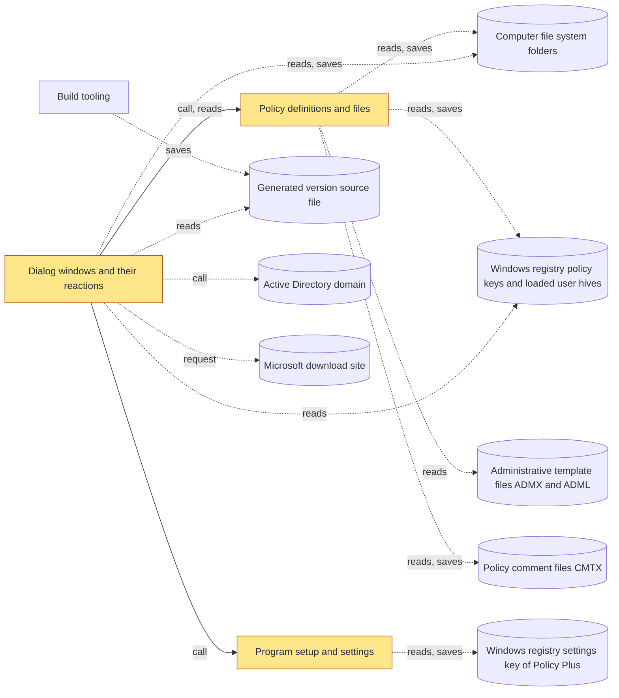
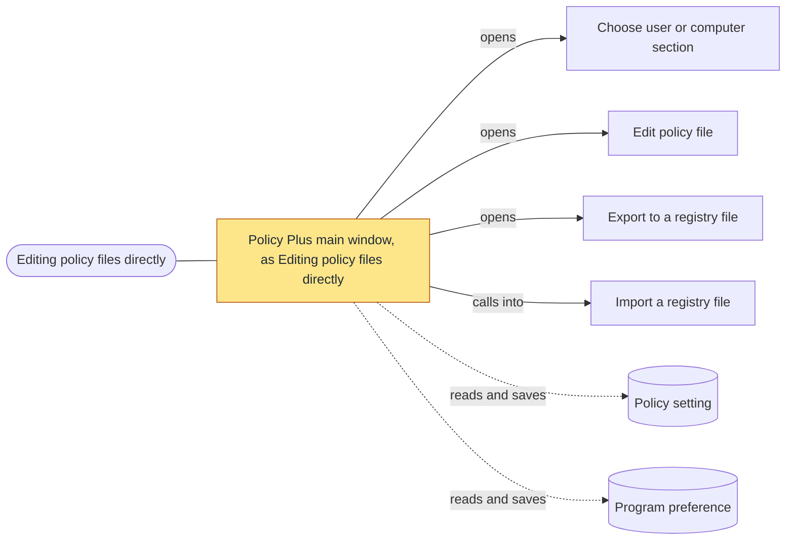
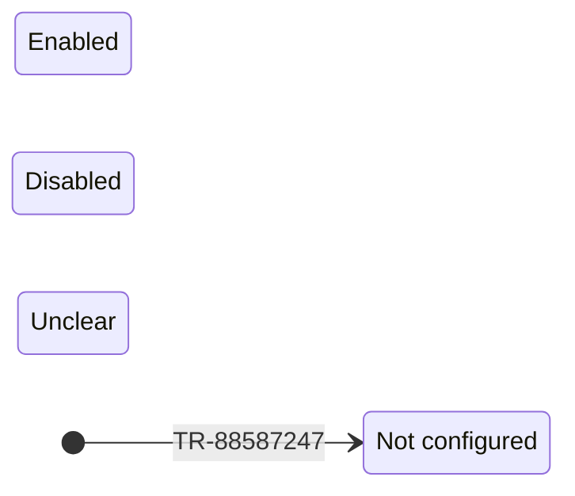
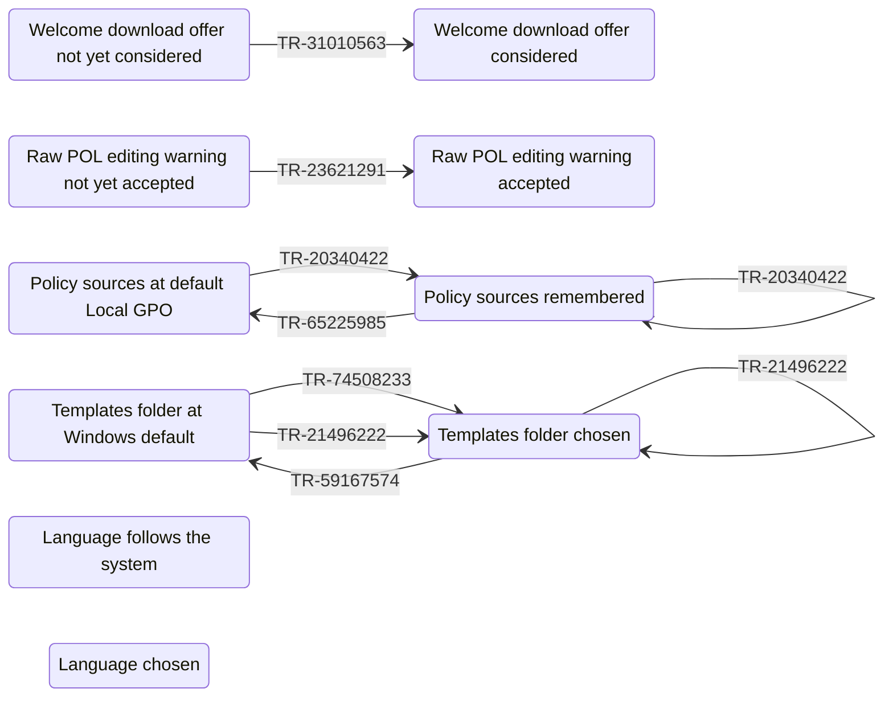

# Legacy reference: Import a POL file into the user or computer policies

The typed header below maps each criterion of the work item to the rules of the existing system it backs. The reading of the existing code follows it.

## Header

```json
{
  "story": "story-fd1304d766c8",
  "fingerprint": "280637421a2d33856d0f4655b9cf3df29c3a1ebf99ebbb84e7839ee4506bf978",
  "criteria": [
    {
      "ac": "AC-1",
      "rules": [
        {
          "says": "The section dialog lets a person choose only the sections the caller allows: User and Computer are each usable only when enabled by the caller.",
          "where": {
            "file": "PolicyPlus/OpenSection.vb",
            "firstLine": 17,
            "lastLine": 21
          },
          "doubt": ""
        }
      ]
    },
    {
      "ac": "AC-2",
      "rules": [
        {
          "says": "Importing a POL file applies it to the source the person chooses (user or computer). A file that cannot be read gives \"The POL file could not be loaded.\" and changes nothing; success gives \"POL import successful.\". Nothing reaches disk until the person saves.",
          "where": {
            "file": "PolicyPlus/Main.vb",
            "firstLine": 724,
            "lastLine": 738
          },
          "doubt": ""
        }
      ]
    }
  ],
  "reliesOn": [
    {
      "says": "A category is orphaned when it has no parent among the loaded definitions although its definition names one.",
      "builtBy": "Show the category tree and the list of a chosen category"
    },
    {
      "says": "A category's icon is chosen in this order: orphaned, then empty, then normal.",
      "builtBy": "Show the category tree and the list of a chosen category"
    },
    {
      "says": "When a policy file's changes are applied to another source, an entry is saved only if it has a non-empty value name that does not start with '**'. Other marker-style entries and entries with an empty value name are skipped without notice. A saved value keeps its original letter case and type.",
      "builtBy": "Apply one policy file's changes to another source"
    },
    {
      "says": "For a policy's list elements, a marked-for-deletion list counts as one deleted element, and a list that holds any values counts as a present element and cancels that deletion.",
      "builtBy": "Work out whether a policy is enabled or disabled from its values"
    },
    {
      "says": "A policy's lists of on-values and off-values count as enabled or disabled evidence for each value in them that is present, using the list's own key when it names one.",
      "builtBy": "Work out whether a policy is enabled or disabled from its values"
    },
    {
      "says": "When a policy file is clearing a key, all values and markers under the key are dropped and a single clear-all marker is stored.",
      "builtBy": "Set, delete and forget values and key clearances in a policy file"
    },
    {
      "says": "A category is visible when empty categories are switched on. Otherwise it is visible only if it has at least one visible policy or one visible subcategory.",
      "builtBy": "Show the category tree and the list of a chosen category"
    },
    {
      "says": "A policy is visible only if it applies to a chosen area (user, computer or both). With \"Only Filtered Policies\" on, it must also pass the filter for a chosen area it applies to; passing for either one is enough.",
      "builtBy": "Show the category tree and the list of a chosen category"
    },
    {
      "says": "With both areas shown, a policy that applies to both areas shows its common state followed by \"(2)\" when both match, the computer state followed by \"(C)\" when only the user is Not Configured, the user state followed by \"(U)\" when only the computer is Not Configured, and \"Mixed\" otherwise.",
      "builtBy": "Show a policy's state and comment per area"
    },
    {
      "says": "A filter on state keeps only policies whose state in the checked area is Configured (Enabled or Disabled), Not Configured, Disabled or Enabled, as chosen.",
      "builtBy": "Show a policy's state and comment per area"
    },
    {
      "says": "When nothing is selected, the title and support lines are hidden and the pane reads \"Select an item to see its description.\".",
      "builtBy": "Show the category tree and the list of a chosen category"
    },
    {
      "says": "A REG file cannot be used as a source for forgetting a value: the request fails with 'not implemented'. Applying a newer policy file over an older one to a REG file fails this way for any dropped value under a policy branch.",
      "builtBy": "Edit entries of a REG file within its source branch"
    },
    {
      "says": "A value in a policy file counts as marked for deletion when a deletion marker names it, when the key has a clear-all marker, or when a delete-values list for the key names it, regardless of case. Entries are examined in sorted order, and a value whose name sorts after the marker is stored as present and cancels the deletion, whenever it was written and whichever marker kind came before.",
      "builtBy": "Read and list values in policy files and registry policy keys"
    },
    {
      "says": "Listing the values of a key in a policy file leaves out the marker entries unless the caller asks for them.",
      "builtBy": "Read and list values in policy files and registry policy keys"
    },
    {
      "says": "When a value is saved into a REG file, it is ignored if a source branch is set and its key lies outside that branch. When no branch is set, every key is accepted. Any value already stored under that name is replaced.",
      "builtBy": "Edit entries of a REG file within its source branch"
    },
    {
      "says": "When a value is deleted in a REG file, the request is ignored if a source branch is set and the key lies outside it, or if the key is already marked for removal. When no branch is set, every key is accepted. Otherwise the value is recorded as deleted.",
      "builtBy": "Edit entries of a REG file within its source branch"
    },
    {
      "says": "For any other element (number, text, choice, multi-line text), a value marked for deletion counts as a deleted element and a value that is present counts as a present element.",
      "builtBy": "Work out whether a policy is enabled or disabled from its values"
    },
    {
      "says": "A registry key counts as a policy key when it is one of the three policy branches (software\\policies, software\\microsoft\\windows\\currentversion\\policies, system\\currentcontrolset\\policies) or lies below one, regardless of case.",
      "builtBy": "Read and list values in policy files and registry policy keys"
    },
    {
      "says": "When a policy file's changes are applied to another source, an entry starting '**deletekeys' clears each key named in its semicolon-separated list under the entry's key, using lower-case names. Clearing removes only that key's own values, not its subkeys.",
      "builtBy": "Apply one policy file's changes to another source"
    },
    {
      "says": "The live registry never reports a value as marked for deletion.",
      "builtBy": "Read and list values in policy files and registry policy keys"
    },
    {
      "says": "A policy with a registry value of its own counts as enabled evidence when that value holds its 'on' value, which is the number 1 when the template gives none, and as disabled evidence when it holds its 'off' value or is marked for deletion when the template gives none.",
      "builtBy": "Work out whether a policy is enabled or disabled from its values"
    },
    {
      "says": "Reading a value from a policy file gives nothing when the value is absent or marked for deletion.",
      "builtBy": "Read and list values in policy files and registry policy keys"
    },
    {
      "says": "A value in the live registry counts as present when its key exists and, unless the value name is empty, the key lists a value of that name, regardless of case. An empty name means the key itself.",
      "builtBy": "Read and list values in policy files and registry policy keys"
    },
    {
      "says": "A category appears in the tree only when it passes the visibility rule; each shown category gets an icon by its kind and carries its visible subcategories below it, and the tree is sorted.",
      "builtBy": "Show the category tree and the list of a chosen category"
    },
    {
      "says": "If any element is present, the elements add their count to the enabled evidence; only when none is present do deleted elements add to the disabled evidence.",
      "builtBy": "Work out whether a policy is enabled or disabled from its values"
    },
    {
      "says": "A support definition met a second time anywhere in one evaluation counts as not met, because the list of definitions seen is never emptied. Two entries that point at the same definition, with no cycle, make the second one not met.",
      "builtBy": "Decide whether a policy's support rules are met"
    },
    {
      "says": "When a number is saved to the live registry, an unsigned 32-bit or 64-bit number is converted to the signed number the registry stores with the same bits, and the key is created if missing.",
      "builtBy": "Open policy sources from imported files and describe them"
    },
    {
      "says": "With both areas shown, the comment column is empty when neither area has a comment, shows \"(multiple)\" when both have one, and otherwise shows the single comment.",
      "builtBy": "Show a policy's state and comment per area"
    },
    {
      "says": "A policy file is refused when its format version is not 1, with the message 'Unknown (newer) version of POL format'.",
      "builtBy": "Read and write policy files with a byte-faithful round trip"
    },
    {
      "says": "A policy's comment in one area is empty when that source has no comment file or holds no comment for the policy, and otherwise the saved text.",
      "builtBy": "Show a policy's state and comment per area"
    },
    {
      "says": "When a newer policy file is applied over an older one, values the old file held and the new one dropped are forgotten in the target, but only if they sit under the three policy branches of the registry.",
      "builtBy": "Apply one policy file's changes to another source"
    },
    {
      "says": "In the live registry, 'forgetting' a value deletes it, because the registry cannot remember a pending deletion.",
      "builtBy": "Replace live registry changes with the registry source model"
    },
    {
      "says": "When a value is forgotten in a policy file, both the value and its deletion marker are removed, so the policy reverts to not saying anything about it.",
      "builtBy": "Set, delete and forget values and key clearances in a policy file"
    },
    {
      "says": "A value in a policy file counts as present only if it is stored and not marked for deletion.",
      "builtBy": "Read and list values in policy files and registry policy keys"
    },
    {
      "says": "A policy's state in one area reads \"Enabled\", \"Disabled\", \"Not Configured\" or \"Unknown\"; the computer source is read for the computer area and the user source for any other.",
      "builtBy": "Show a policy's state and comment per area"
    },
    {
      "says": "Clearing a key in the live registry deletes every value in it but leaves the key and its subkeys. Forgetting a key's clearance does nothing.",
      "builtBy": "Replace live registry changes with the registry source model"
    },
    {
      "says": "A multiple-string value is stored as its strings each followed by an empty character, with one more empty character closing the list.",
      "builtBy": "Read and write the stored form of values in a policy file"
    },
    {
      "says": "A support entry for a product that has versions beneath it, whether a version range or a plain entry for a parent product that is not itself chosen, counts as met when any version in its range, or a sub-product directly beneath one, is chosen. The range runs from the entry's minimum (0 if none) to its maximum (the highest version if none). A range entry never matches on its own product, and a product with no versions beneath it never matches this way.",
      "builtBy": "Decide whether a policy's support rules are met"
    },
    {
      "says": "A 64-bit number is stored in a policy file as 8 bytes, lowest byte first.",
      "builtBy": "Read and write the stored form of values in a policy file"
    },
    {
      "says": "When a policy file is read and the same key and value name occur twice, the later entry wins. Key and value names are matched without regard to letter case, and the first spelling seen is kept for saving.",
      "builtBy": "Read and write policy files with a byte-faithful round trip"
    },
    {
      "says": "When the caller asks for 'any' matching, a support definition whose logic is all-of needs every entry met, and any other definition needs one entry met. When the caller does not ask for 'any', every definition, all-of included, is met by one entry. A definition with no entries, or none met, is met only when all are required. Plain product entries are checked before nested definitions.",
      "builtBy": "Decide whether a policy's support rules are met"
    },
    {
      "says": "The category tree selection follows the category shown in the right pane.",
      "builtBy": "Show the category tree and the list of a chosen category"
    },
    {
      "says": "The right pane lists the chosen category in this order: an \"Up: <parent name>\" row marked \"Parent\" when the category has a parent, then visible subcategories by name, then visible policies by name. Each policy row shows its state and its comment text.",
      "builtBy": "Show the category tree and the list of a chosen category"
    },
    {
      "says": "For a selected or highlighted category the pane shows its title, \"This category contains N policies and M subcategories.\" (\"The selected category\" when highlighted but not opened) and its explanation. The counts include every policy and subcategory, hidden or not.",
      "builtBy": "Show category and policy details and keep the list tidy"
    },
    {
      "says": "A value counts as present when: for a deletion marker, it is marked for deletion; for a number, it exists as a whole number and equals the expected number; for text, it exists as text and equals the expected text. A value of the wrong kind is not present.",
      "builtBy": "Decide whether a policy is enabled, disabled or unsupported"
    },
    {
      "says": "The text of a policy description is tidied for display: leading and trailing spaces are removed from every line and blank space at the end of the text is dropped.",
      "builtBy": "Show category and policy details and keep the list tidy"
    },
    {
      "says": "When a key is cleared in a REG file, the request is ignored if a source branch is set and the key lies outside it. When no branch is set, every key is accepted. Otherwise the key's earlier entries are replaced by a key-removal entry.",
      "builtBy": "Edit entries of a REG file within its source branch"
    },
    {
      "says": "A filter on managed policies hides preferences when managed policies are wanted, and hides managed policies when preferences are wanted.",
      "builtBy": "Filter policies and keep search results"
    },
    {
      "says": "A policy file is refused when it does not start with the 'PReg' signature, with the message 'Missing PReg signature'.",
      "builtBy": "Read and write policy files with a byte-faithful round trip"
    },
    {
      "says": "A REG file cannot be used as a source for checking whether a value will be deleted: the request fails with 'not implemented'. Applying a newer policy file over an older one to a REG file fails this way for any dropped value under a policy branch.",
      "builtBy": "Refuse operations a REG file source cannot support"
    },
    {
      "says": "When a policy file's changes are applied to another source, an entry named '**deletevalues' deletes each value in its semicolon-separated list, using lower-case names.",
      "builtBy": "Apply one policy file's changes to another source"
    },
    {
      "says": "When the list is rebuilt, the policy already selected is selected again and revealed only if it is still listed, that is, it sits in the category shown and passes the visibility rule; otherwise nothing is selected. Then, if the policy is in the same category and the list still has that many rows, the earlier top row is put back, so the policy is not guaranteed to stay in view.",
      "builtBy": "Show category and policy details and keep the list tidy"
    },
    {
      "says": "A policy passes the filter only when it passes every active part of it.",
      "builtBy": "Filter policies and keep search results"
    },
    {
      "says": "Text read from a policy file stops at its first empty character, and a multiple-string value ends at its first empty string.",
      "builtBy": "Read and write policy files with a byte-faithful round trip"
    },
    {
      "says": "A 32-bit number is stored in a policy file as 4 bytes, lowest byte first.",
      "builtBy": "Read and write the stored form of values in a policy file"
    },
    {
      "says": "For a checkbox element: a value marked for deletion counts as one deleted element. Otherwise, each present off value (or off-list value) counts a tenth of a deleted element, and each present on value (or on-list value) counts one present element. A checkbox whose template declares no on value or on list adds no present evidence, even if it holds 1.",
      "builtBy": "Decide whether a policy is enabled, disabled or unsupported"
    },
    {
      "says": "When a value is marked for deletion in a policy file, any value or marker already held under that name is dropped first. A deletion marker holding the number 32, as Microsoft does, is added unless the value is already marked or its key is cleared.",
      "builtBy": "Set, delete and forget values and key clearances in a policy file"
    },
    {
      "says": "When a policy file is read, an extra empty character after the value name, as Microsoft's documentation allows, is skipped.",
      "builtBy": "Read and write the stored form of values in a policy file"
    },
    {
      "says": "For a selected policy the information pane shows its title, \"(no requirements information)\" when it has no support rule or \"Requirements:\" plus the support name, and its explanation. A notice that the policy is a preference appears only for preferences.",
      "builtBy": "Show category and policy details and keep the list tidy"
    },
    {
      "says": "A policy's icon is chosen in this order: preference, then plain when it has no configurable elements, then \"extra configuration\" when it has some.",
      "builtBy": "Show category and policy details and keep the list tidy"
    },
    {
      "says": "A policy applies to an area when its definition declares that area; a policy declared for both applies to each.",
      "builtBy": "Read support rules, products, classes and list options from templates"
    },
    {
      "says": "A filter on comments keeps only policies that have a non-empty comment in the checked area, or only those that have none, as chosen.",
      "builtBy": "Filter policies and keep search results"
    },
    {
      "says": "When a policy lists no supported-on information, it counts as supported only if the caller allows unlisted policies. The same applies to a support entry that names no known product.",
      "builtBy": "Decide whether a policy is enabled, disabled or unsupported"
    },
    {
      "says": "When a view setting changes, the program moves up to the nearest visible category, drops the selected policy if the move happened or the policy is now hidden, then rebuilds the tree and list. A policy kept after the move appears in the information pane only: rebuilding the list reselects the category in the tree, which clears the selection, so its row is not highlighted.",
      "builtBy": "Keep the browser view consistent after view or edit changes"
    },
    {
      "says": "When a policy file's changes are applied to another source, an entry named '**del.' plus a value name deletes that value, using the lower-case key and value names.",
      "builtBy": "Apply one policy file's changes to another source"
    },
    {
      "says": "When a value is set in a policy file, it replaces any value already held under that name. A deletion marker for the name is not removed.",
      "builtBy": "Set, delete and forget values and key clearances in a policy file"
    },
    {
      "says": "A REG file cannot be used as a source for reading a value: the request fails with 'not implemented'. Applying a newer policy file over an older one to a REG file fails this way for any dropped value under a policy branch.",
      "builtBy": "Refuse operations a REG file source cannot support"
    },
    {
      "says": "A category is empty when it holds no subcategories and no policies at all, counting hidden ones.",
      "builtBy": "Show the category tree and the list of a chosen category"
    },
    {
      "says": "With both areas shown, a policy that applies to one area shows that area's state followed by \"(C)\" for computer or \"(U)\" for user. With a single area shown, only that area's state is shown, without a suffix.",
      "builtBy": "Show category and policy details and keep the list tidy"
    },
    {
      "says": "A stored policy file value is read back as text for text and expandable text, a 32-bit or 64-bit number for numbers, a list of strings for multiple strings, and raw bytes for every other type.",
      "builtBy": "Read and write policy files with a byte-faithful round trip"
    },
    {
      "says": "Text stored in a policy file is written in two-byte characters followed by a closing empty character.",
      "builtBy": "Read and write the stored form of values in a policy file"
    },
    {
      "says": "When a policy file's changes are applied to another source, an entry starting '**delvals' clears the whole key, using the lower-case key name. Entries are applied in sorted order, so clear-all entries come before values. Clearing a live registry key removes only that key's own values.",
      "builtBy": "Apply one policy file's changes to another source"
    },
    {
      "says": "A policy is Enabled when enabled evidence exceeds disabled evidence, Disabled when disabled exceeds enabled, Not configured when there is no evidence either way, and Unclear when both are equal and above zero.",
      "builtBy": "Decide whether a policy is enabled, disabled or unsupported"
    },
    {
      "says": "A policy is a preference, not a managed policy, when it names a registry key outside the three policy locations: software\\policies, software\\microsoft\\windows\\currentversion\\policies and system\\currentcontrolset\\policies.",
      "builtBy": "Decide whether a policy is enabled, disabled or unsupported"
    },
    {
      "says": "After the category tree is rebuilt from the loaded definitions, no category, policy or highlighted item is selected and the information pane shows the empty state.",
      "builtBy": "Show category and policy details and keep the list tidy"
    },
    {
      "says": "When a value is deleted in the live registry and its key does not exist, nothing happens. A missing value is not an error.",
      "builtBy": "Replace live registry changes with the registry source model"
    },
    {
      "says": "A REG file cannot be used as a source for listing a key's values: the request fails with 'not implemented'. Applying a newer policy file over an older one to a REG file fails this way for any dropped value under a policy branch.",
      "builtBy": "Refuse operations a REG file source cannot support"
    },
    {
      "says": "Reading a value from the live registry gives nothing when the key is missing. Signed numbers are returned as the unsigned numbers policies use, and environment variables in text are not expanded.",
      "builtBy": "Open policy sources from imported files and describe them"
    },
    {
      "says": "Applying a whole policy file to a source applies it as the difference from an empty file, so nothing is forgotten.",
      "builtBy": "Export a branch of a policy file as a registry file"
    },
    {
      "says": "A filter on products keeps only policies supported by the chosen products, honouring the options to match any product and to include policies with blank support.",
      "builtBy": "Filter policies and keep search results"
    },
    {
      "says": "A value written to a policy file is stored as text, expandable text, a 32-bit or 64-bit number or a multiple string by its stated type. Every other type is stored as raw bytes with that type.",
      "builtBy": "Read and write the stored form of values in a policy file"
    },
    {
      "says": "A REG file cannot be used as a source for asking whether a value is present: the request fails with 'not implemented'. Applying a newer policy file over an older one to a REG file fails this way for any dropped value under a policy branch.",
      "builtBy": "Refuse operations a REG file source cannot support"
    },
    {
      "says": "A support entry for a product counts as met in two cases. The entry is not a version range and that exact product is among the chosen products. Or the product has versions beneath it, and any of those versions or their sub-products is chosen, even when the product itself is not.",
      "builtBy": "Decide whether a policy is enabled, disabled or unsupported"
    }
  ],
  "data": [
    {
      "kind": "Program preference",
      "access": "reads and saves"
    },
    {
      "kind": "Policy setting",
      "access": "reads and saves"
    }
  ],
  "transitions": [],
  "outsideSystems": [
    "Windows registry settings key of Policy Plus",
    "Computer file system folders",
    "Windows registry policy keys and loaded user hives"
  ],
  "cited": [
    {
      "file": "PolicyPlus/Main.vb",
      "firstLine": 720,
      "lastLine": 740
    },
    {
      "file": "PolicyPlus/OpenSection.vb",
      "firstLine": 17,
      "lastLine": 21
    },
    {
      "file": "PolicyPlus/Main.vb",
      "firstLine": 724,
      "lastLine": 738
    }
  ]
}
```

## What each criterion must keep

### AC-1

- The section dialog lets a person choose only the sections the caller allows: User and Computer are each usable only when enabled by the caller. (PolicyPlus/OpenSection.vb:17-21)

### AC-2

- Importing a POL file applies it to the source the person chooses (user or computer). A file that cannot be read gives "The POL file could not be loaded." and changes nothing; success gives "POL import successful.". Nothing reaches disk until the person saves. (PolicyPlus/Main.vb:724-738)

## Relies on, built elsewhere

- A category is orphaned when it has no parent among the loaded definitions although its definition names one. Built by: Show the category tree and the list of a chosen category.
- A category's icon is chosen in this order: orphaned, then empty, then normal. Built by: Show the category tree and the list of a chosen category.
- When a policy file's changes are applied to another source, an entry is saved only if it has a non-empty value name that does not start with '**'. Other marker-style entries and entries with an empty value name are skipped without notice. A saved value keeps its original letter case and type. Built by: Apply one policy file's changes to another source.
- For a policy's list elements, a marked-for-deletion list counts as one deleted element, and a list that holds any values counts as a present element and cancels that deletion. Built by: Work out whether a policy is enabled or disabled from its values.
- A policy's lists of on-values and off-values count as enabled or disabled evidence for each value in them that is present, using the list's own key when it names one. Built by: Work out whether a policy is enabled or disabled from its values.
- When a policy file is clearing a key, all values and markers under the key are dropped and a single clear-all marker is stored. Built by: Set, delete and forget values and key clearances in a policy file.
- A category is visible when empty categories are switched on. Otherwise it is visible only if it has at least one visible policy or one visible subcategory. Built by: Show the category tree and the list of a chosen category.
- A policy is visible only if it applies to a chosen area (user, computer or both). With "Only Filtered Policies" on, it must also pass the filter for a chosen area it applies to; passing for either one is enough. Built by: Show the category tree and the list of a chosen category.
- With both areas shown, a policy that applies to both areas shows its common state followed by "(2)" when both match, the computer state followed by "(C)" when only the user is Not Configured, the user state followed by "(U)" when only the computer is Not Configured, and "Mixed" otherwise. Built by: Show a policy's state and comment per area.
- A filter on state keeps only policies whose state in the checked area is Configured (Enabled or Disabled), Not Configured, Disabled or Enabled, as chosen. Built by: Show a policy's state and comment per area.
- When nothing is selected, the title and support lines are hidden and the pane reads "Select an item to see its description.". Built by: Show the category tree and the list of a chosen category.
- A REG file cannot be used as a source for forgetting a value: the request fails with 'not implemented'. Applying a newer policy file over an older one to a REG file fails this way for any dropped value under a policy branch. Built by: Edit entries of a REG file within its source branch.
- A value in a policy file counts as marked for deletion when a deletion marker names it, when the key has a clear-all marker, or when a delete-values list for the key names it, regardless of case. Entries are examined in sorted order, and a value whose name sorts after the marker is stored as present and cancels the deletion, whenever it was written and whichever marker kind came before. Built by: Read and list values in policy files and registry policy keys.
- Listing the values of a key in a policy file leaves out the marker entries unless the caller asks for them. Built by: Read and list values in policy files and registry policy keys.
- When a value is saved into a REG file, it is ignored if a source branch is set and its key lies outside that branch. When no branch is set, every key is accepted. Any value already stored under that name is replaced. Built by: Edit entries of a REG file within its source branch.
- When a value is deleted in a REG file, the request is ignored if a source branch is set and the key lies outside it, or if the key is already marked for removal. When no branch is set, every key is accepted. Otherwise the value is recorded as deleted. Built by: Edit entries of a REG file within its source branch.
- For any other element (number, text, choice, multi-line text), a value marked for deletion counts as a deleted element and a value that is present counts as a present element. Built by: Work out whether a policy is enabled or disabled from its values.
- A registry key counts as a policy key when it is one of the three policy branches (software\policies, software\microsoft\windows\currentversion\policies, system\currentcontrolset\policies) or lies below one, regardless of case. Built by: Read and list values in policy files and registry policy keys.
- When a policy file's changes are applied to another source, an entry starting '**deletekeys' clears each key named in its semicolon-separated list under the entry's key, using lower-case names. Clearing removes only that key's own values, not its subkeys. Built by: Apply one policy file's changes to another source.
- The live registry never reports a value as marked for deletion. Built by: Read and list values in policy files and registry policy keys.
- A policy with a registry value of its own counts as enabled evidence when that value holds its 'on' value, which is the number 1 when the template gives none, and as disabled evidence when it holds its 'off' value or is marked for deletion when the template gives none. Built by: Work out whether a policy is enabled or disabled from its values.
- Reading a value from a policy file gives nothing when the value is absent or marked for deletion. Built by: Read and list values in policy files and registry policy keys.
- A value in the live registry counts as present when its key exists and, unless the value name is empty, the key lists a value of that name, regardless of case. An empty name means the key itself. Built by: Read and list values in policy files and registry policy keys.
- A category appears in the tree only when it passes the visibility rule; each shown category gets an icon by its kind and carries its visible subcategories below it, and the tree is sorted. Built by: Show the category tree and the list of a chosen category.
- If any element is present, the elements add their count to the enabled evidence; only when none is present do deleted elements add to the disabled evidence. Built by: Work out whether a policy is enabled or disabled from its values.
- A support definition met a second time anywhere in one evaluation counts as not met, because the list of definitions seen is never emptied. Two entries that point at the same definition, with no cycle, make the second one not met. Built by: Decide whether a policy's support rules are met.
- When a number is saved to the live registry, an unsigned 32-bit or 64-bit number is converted to the signed number the registry stores with the same bits, and the key is created if missing. Built by: Open policy sources from imported files and describe them.
- With both areas shown, the comment column is empty when neither area has a comment, shows "(multiple)" when both have one, and otherwise shows the single comment. Built by: Show a policy's state and comment per area.
- A policy file is refused when its format version is not 1, with the message 'Unknown (newer) version of POL format'. Built by: Read and write policy files with a byte-faithful round trip.
- A policy's comment in one area is empty when that source has no comment file or holds no comment for the policy, and otherwise the saved text. Built by: Show a policy's state and comment per area.
- When a newer policy file is applied over an older one, values the old file held and the new one dropped are forgotten in the target, but only if they sit under the three policy branches of the registry. Built by: Apply one policy file's changes to another source.
- In the live registry, 'forgetting' a value deletes it, because the registry cannot remember a pending deletion. Built by: Replace live registry changes with the registry source model.
- When a value is forgotten in a policy file, both the value and its deletion marker are removed, so the policy reverts to not saying anything about it. Built by: Set, delete and forget values and key clearances in a policy file.
- A value in a policy file counts as present only if it is stored and not marked for deletion. Built by: Read and list values in policy files and registry policy keys.
- A policy's state in one area reads "Enabled", "Disabled", "Not Configured" or "Unknown"; the computer source is read for the computer area and the user source for any other. Built by: Show a policy's state and comment per area.
- Clearing a key in the live registry deletes every value in it but leaves the key and its subkeys. Forgetting a key's clearance does nothing. Built by: Replace live registry changes with the registry source model.
- A multiple-string value is stored as its strings each followed by an empty character, with one more empty character closing the list. Built by: Read and write the stored form of values in a policy file.
- A support entry for a product that has versions beneath it, whether a version range or a plain entry for a parent product that is not itself chosen, counts as met when any version in its range, or a sub-product directly beneath one, is chosen. The range runs from the entry's minimum (0 if none) to its maximum (the highest version if none). A range entry never matches on its own product, and a product with no versions beneath it never matches this way. Built by: Decide whether a policy's support rules are met.
- A 64-bit number is stored in a policy file as 8 bytes, lowest byte first. Built by: Read and write the stored form of values in a policy file.
- When a policy file is read and the same key and value name occur twice, the later entry wins. Key and value names are matched without regard to letter case, and the first spelling seen is kept for saving. Built by: Read and write policy files with a byte-faithful round trip.
- When the caller asks for 'any' matching, a support definition whose logic is all-of needs every entry met, and any other definition needs one entry met. When the caller does not ask for 'any', every definition, all-of included, is met by one entry. A definition with no entries, or none met, is met only when all are required. Plain product entries are checked before nested definitions. Built by: Decide whether a policy's support rules are met.
- The category tree selection follows the category shown in the right pane. Built by: Show the category tree and the list of a chosen category.
- The right pane lists the chosen category in this order: an "Up: <parent name>" row marked "Parent" when the category has a parent, then visible subcategories by name, then visible policies by name. Each policy row shows its state and its comment text. Built by: Show the category tree and the list of a chosen category.
- For a selected or highlighted category the pane shows its title, "This category contains N policies and M subcategories." ("The selected category" when highlighted but not opened) and its explanation. The counts include every policy and subcategory, hidden or not. Built by: Show category and policy details and keep the list tidy.
- A value counts as present when: for a deletion marker, it is marked for deletion; for a number, it exists as a whole number and equals the expected number; for text, it exists as text and equals the expected text. A value of the wrong kind is not present. Built by: Decide whether a policy is enabled, disabled or unsupported.
- The text of a policy description is tidied for display: leading and trailing spaces are removed from every line and blank space at the end of the text is dropped. Built by: Show category and policy details and keep the list tidy.
- When a key is cleared in a REG file, the request is ignored if a source branch is set and the key lies outside it. When no branch is set, every key is accepted. Otherwise the key's earlier entries are replaced by a key-removal entry. Built by: Edit entries of a REG file within its source branch.
- A filter on managed policies hides preferences when managed policies are wanted, and hides managed policies when preferences are wanted. Built by: Filter policies and keep search results.
- A policy file is refused when it does not start with the 'PReg' signature, with the message 'Missing PReg signature'. Built by: Read and write policy files with a byte-faithful round trip.
- A REG file cannot be used as a source for checking whether a value will be deleted: the request fails with 'not implemented'. Applying a newer policy file over an older one to a REG file fails this way for any dropped value under a policy branch. Built by: Refuse operations a REG file source cannot support.
- When a policy file's changes are applied to another source, an entry named '**deletevalues' deletes each value in its semicolon-separated list, using lower-case names. Built by: Apply one policy file's changes to another source.
- When the list is rebuilt, the policy already selected is selected again and revealed only if it is still listed, that is, it sits in the category shown and passes the visibility rule; otherwise nothing is selected. Then, if the policy is in the same category and the list still has that many rows, the earlier top row is put back, so the policy is not guaranteed to stay in view. Built by: Show category and policy details and keep the list tidy.
- A policy passes the filter only when it passes every active part of it. Built by: Filter policies and keep search results.
- Text read from a policy file stops at its first empty character, and a multiple-string value ends at its first empty string. Built by: Read and write policy files with a byte-faithful round trip.
- A 32-bit number is stored in a policy file as 4 bytes, lowest byte first. Built by: Read and write the stored form of values in a policy file.
- For a checkbox element: a value marked for deletion counts as one deleted element. Otherwise, each present off value (or off-list value) counts a tenth of a deleted element, and each present on value (or on-list value) counts one present element. A checkbox whose template declares no on value or on list adds no present evidence, even if it holds 1. Built by: Decide whether a policy is enabled, disabled or unsupported.
- When a value is marked for deletion in a policy file, any value or marker already held under that name is dropped first. A deletion marker holding the number 32, as Microsoft does, is added unless the value is already marked or its key is cleared. Built by: Set, delete and forget values and key clearances in a policy file.
- When a policy file is read, an extra empty character after the value name, as Microsoft's documentation allows, is skipped. Built by: Read and write the stored form of values in a policy file.
- For a selected policy the information pane shows its title, "(no requirements information)" when it has no support rule or "Requirements:" plus the support name, and its explanation. A notice that the policy is a preference appears only for preferences. Built by: Show category and policy details and keep the list tidy.
- A policy's icon is chosen in this order: preference, then plain when it has no configurable elements, then "extra configuration" when it has some. Built by: Show category and policy details and keep the list tidy.
- A policy applies to an area when its definition declares that area; a policy declared for both applies to each. Built by: Read support rules, products, classes and list options from templates.
- A filter on comments keeps only policies that have a non-empty comment in the checked area, or only those that have none, as chosen. Built by: Filter policies and keep search results.
- When a policy lists no supported-on information, it counts as supported only if the caller allows unlisted policies. The same applies to a support entry that names no known product. Built by: Decide whether a policy is enabled, disabled or unsupported.
- When a view setting changes, the program moves up to the nearest visible category, drops the selected policy if the move happened or the policy is now hidden, then rebuilds the tree and list. A policy kept after the move appears in the information pane only: rebuilding the list reselects the category in the tree, which clears the selection, so its row is not highlighted. Built by: Keep the browser view consistent after view or edit changes.
- When a policy file's changes are applied to another source, an entry named '**del.' plus a value name deletes that value, using the lower-case key and value names. Built by: Apply one policy file's changes to another source.
- When a value is set in a policy file, it replaces any value already held under that name. A deletion marker for the name is not removed. Built by: Set, delete and forget values and key clearances in a policy file.
- A REG file cannot be used as a source for reading a value: the request fails with 'not implemented'. Applying a newer policy file over an older one to a REG file fails this way for any dropped value under a policy branch. Built by: Refuse operations a REG file source cannot support.
- A category is empty when it holds no subcategories and no policies at all, counting hidden ones. Built by: Show the category tree and the list of a chosen category.
- With both areas shown, a policy that applies to one area shows that area's state followed by "(C)" for computer or "(U)" for user. With a single area shown, only that area's state is shown, without a suffix. Built by: Show category and policy details and keep the list tidy.
- A stored policy file value is read back as text for text and expandable text, a 32-bit or 64-bit number for numbers, a list of strings for multiple strings, and raw bytes for every other type. Built by: Read and write policy files with a byte-faithful round trip.
- Text stored in a policy file is written in two-byte characters followed by a closing empty character. Built by: Read and write the stored form of values in a policy file.
- When a policy file's changes are applied to another source, an entry starting '**delvals' clears the whole key, using the lower-case key name. Entries are applied in sorted order, so clear-all entries come before values. Clearing a live registry key removes only that key's own values. Built by: Apply one policy file's changes to another source.
- A policy is Enabled when enabled evidence exceeds disabled evidence, Disabled when disabled exceeds enabled, Not configured when there is no evidence either way, and Unclear when both are equal and above zero. Built by: Decide whether a policy is enabled, disabled or unsupported.
- A policy is a preference, not a managed policy, when it names a registry key outside the three policy locations: software\policies, software\microsoft\windows\currentversion\policies and system\currentcontrolset\policies. Built by: Decide whether a policy is enabled, disabled or unsupported.
- After the category tree is rebuilt from the loaded definitions, no category, policy or highlighted item is selected and the information pane shows the empty state. Built by: Show category and policy details and keep the list tidy.
- When a value is deleted in the live registry and its key does not exist, nothing happens. A missing value is not an error. Built by: Replace live registry changes with the registry source model.
- A REG file cannot be used as a source for listing a key's values: the request fails with 'not implemented'. Applying a newer policy file over an older one to a REG file fails this way for any dropped value under a policy branch. Built by: Refuse operations a REG file source cannot support.
- Reading a value from the live registry gives nothing when the key is missing. Signed numbers are returned as the unsigned numbers policies use, and environment variables in text are not expanded. Built by: Open policy sources from imported files and describe them.
- Applying a whole policy file to a source applies it as the difference from an empty file, so nothing is forgotten. Built by: Export a branch of a policy file as a registry file.
- A filter on products keeps only policies supported by the chosen products, honouring the options to match any product and to include policies with blank support. Built by: Filter policies and keep search results.
- A value written to a policy file is stored as text, expandable text, a 32-bit or 64-bit number or a multiple string by its stated type. Every other type is stored as raw bytes with that type. Built by: Read and write the stored form of values in a policy file.
- A REG file cannot be used as a source for asking whether a value is present: the request fails with 'not implemented'. Applying a newer policy file over an older one to a REG file fails this way for any dropped value under a policy branch. Built by: Refuse operations a REG file source cannot support.
- A support entry for a product counts as met in two cases. The entry is not a version range and that exact product is among the chosen products. Or the product has versions beneath it, and any of those versions or their sub-products is chosen, even when the product itself is not. Built by: Decide whether a policy is enabled, disabled or unsupported.

## Reading of the existing code

# Screen: Policy Plus main window, as Editing policy files directly

At a glance: 38 owned rules, 34 relied on, 5 actions, 11 files (1 own, 5 relied on, 4 of neighbour screens, 1 generated), 1 disputed.

How to read it: paths are relative to the source root and `file:a-b` is an inclusive line range. `BR-` rules, `ACT-` actions, `TR-` changes of state and `RK-` risks have stable ids. A record marked disputed was challenged in review and kept; the reviewer's words are under Trust. All of it was read from the code; nothing was run.

## Product context
Policy Plus is a Windows desktop editor for Group Policy settings, used by administrators and power users. It reads Microsoft's policy definition files and edits policy files directly, so it works on any Windows edition, including Home, which lacks the built-in editor.
Built with: .NET Framework v4.5.2, Microsoft Windows, System.DirectoryServices, System.Xml, Visual Basic .NET, Windows Forms (Policy Plus desktop editor).
Runs: It runs on the user's own Windows computer as one desktop program on .NET Framework 4.5.2. It asks for elevated rights when available but starts without them; loading registry hives, refreshing policy and editing local Group Policy files need them. It can also reach the domain's shared policy folder.
Reaches outside itself: Computer file system folders; Windows registry policy keys and loaded user hives; Administrative template files (ADMX and ADML); Windows registry settings key of Policy Plus; Generated version source file; Policy comment files (CMTX); Active Directory domain; Microsoft download site.



## Where this sits
Part of: Editing policy files directly (Setting and storing policies).



## Boundary
- Opens **Choose user or computer section** (bundle: screen choose-user-or-computer-section), at `PolicyPlus/Main.vb:720-740`
- Opens **Edit policy file** (bundle: screen edit-policy-file), at `PolicyPlus/Main.vb:776-794`
- Opens **Export to a registry file** (bundle: screen export-to-a-registry-file), at `PolicyPlus/Main.vb:795-800`
- Calls into **Import a registry file** (bundle: screen import-a-registry-file), at `PolicyPlus/Main.vb:801-806`

## Contract: what it must do
### Policy Plus main window
Browse categories and policies, and reach every other action.
Controls (56): ": PolicyIsPrefLabel; Friend WithEvents AboutToolStripMenuItem As ToolStripMenuItem  [Text = "About"]: AboutToolStripMenuItem; Friend WithEvents AcquireADMXFilesToolStripMenuItem As ToolStripMenuItem  [Text = "Acquire ADMX Files"]: AcquireADMXFilesToolStripMenuItem; Friend WithEvents AllProductsToolStripMenuItem As ToolStripMenuItem  [Text = "All Products"]: AllProductsToolStripMenuItem; Friend WithEvents AllSupportDefinitionsToolStripMenuItem As ToolStripMenuItem  [Text = "All Support Definitions"]: AllSupportDefinitionsToolStripMenuItem; Friend WithEvents ByIDToolStripMenuItem As ToolStripMenuItem  [Text = "By ID": ByIDToolStripMenuItem; Friend WithEvents ByRegistryToolStripMenuItem As ToolStripMenuItem  [Text = "By Registry": ByRegistryToolStripMenuItem; Friend WithEvents ByTextToolStripMenuItem As ToolStripMenuItem  [Text = "By Text": ByTextToolStripMenuItem; Friend WithEvents CategoriesTree As TreeView  [TabIndex = 2]: CategoriesTree; Friend WithEvents ChSettingName As ColumnHeader  [Text = "Name": ChSettingName; Friend WithEvents CloseADMXWorkspaceToolStripMenuItem As ToolStripMenuItem  [Text = "Close ADMX Workspace"]: CloseADMXWorkspaceToolStripMenuItem; Friend WithEvents CmeAllDetails As ToolStripMenuItem  [Text = "Details"]: CmeAllDetails; Friend WithEvents CmeCatOpen As ToolStripMenuItem  [Text = "Open"]: CmeCatOpen; Friend WithEvents CmePolEdit As ToolStripMenuItem  [Text = "Edit"]: CmePolEdit; Friend WithEvents CmePolInspectElements As ToolStripMenuItem  [Text = "Element Inspector"]: CmePolInspectElements; Friend WithEvents CmePolSpolFragment As ToolStripMenuItem  [Text = "Semantic Policy Fragment"]: CmePolSpolFragment; Friend WithEvents ComboAppliesTo As ComboBox  [TabIndex = 1: ComboAppliesTo; Friend WithEvents ComputerSourceLabel As ToolStripStatusLabel  [Text = "Computer info"]: ComputerSourceLabel; Friend WithEvents DeduplicatePoliciesToolStripMenuItem As ToolStripMenuItem  [Text = "Deduplicate Policies": DeduplicatePoliciesToolStripMenuItem; Friend WithEvents EditRawPOLToolStripMenuItem As ToolStripMenuItem  [Text = "Edit Raw POL"]: EditRawPOLToolStripMenuItem; Friend WithEvents EmptyCategoriesToolStripMenuItem As ToolStripMenuItem  [Text = "Empty Categories"]: EmptyCategoriesToolStripMenuItem; Friend WithEvents ExitToolStripMenuItem As ToolStripMenuItem  [Text = "Exit"]: ExitToolStripMenuItem; Friend WithEvents ExportPOLToolStripMenuItem As ToolStripMenuItem  [Text = "Export POL"]: ExportPOLToolStripMenuItem; Friend WithEvents ExportREGToolStripMenuItem As ToolStripMenuItem  [Text = "Export REG"]: ExportREGToolStripMenuItem; Friend WithEvents FileToolStripMenuItem As ToolStripMenuItem  [Text = "File"]: FileToolStripMenuItem; Friend WithEvents FilterOptionsToolStripMenuItem As ToolStripMenuItem  [Text = "Filter Options"]: FilterOptionsToolStripMenuItem; Friend WithEvents FindNextToolStripMenuItem As ToolStripMenuItem  [Text = "Find Next": FindNextToolStripMenuItem; Friend WithEvents FindToolStripMenuItem As ToolStripMenuItem  [Text = "Find"]: FindToolStripMenuItem; Friend WithEvents HelpToolStripMenuItem As ToolStripMenuItem  [Text = "Help"]: HelpToolStripMenuItem; Friend WithEvents ImportPOLToolStripMenuItem As ToolStripMenuItem  [Text = "Import POL"]: ImportPOLToolStripMenuItem; Friend WithEvents ImportREGToolStripMenuItem As ToolStripMenuItem  [Text = "Import REG"]: ImportREGToolStripMenuItem; Friend WithEvents ImportSemanticPolicyToolStripMenuItem As ToolStripMenuItem  [Text = "Import Semantic Policy"]: ImportSemanticPolicyToolStripMenuItem; Friend WithEvents InfoStrip As StatusStrip  [Text = "StatusStrip1": InfoStrip; Friend WithEvents LoadedADMXFilesToolStripMenuItem As ToolStripMenuItem  [Text = "Loaded ADMX Files"]: LoadedADMXFilesToolStripMenuItem; Friend WithEvents MainMenu As MenuStrip  [Text = "MenuStrip1": MainMenu; Friend WithEvents OnlyFilteredObjectsToolStripMenuItem As ToolStripMenuItem  [Text = "Only Filtered Policies"]: OnlyFilteredObjectsToolStripMenuItem; Friend WithEvents OpenADMXFileToolStripMenuItem As ToolStripMenuItem  [Text = "Open ADMX File"]: OpenADMXFileToolStripMenuItem; Friend WithEvents OpenADMXFolderToolStripMenuItem As ToolStripMenuItem  [Text = "Open ADMX Folder"]: OpenADMXFolderToolStripMenuItem; Friend WithEvents OpenPolicyResourcesToolStripMenuItem As ToolStripMenuItem  [Text = "Open Policy Resources": OpenPolicyResourcesToolStripMenuItem; Friend WithEvents PictureBox1 As PictureBox  [TabIndex = 0: PictureBox1; Friend WithEvents PoliciesList As ListView  [TabIndex = 3: PoliciesList; Friend WithEvents PolicyDescLabel As Label  [Text = "Policy description": PolicyDescLabel; Friend WithEvents PolicyIcons As ImageList: PolicyIcons; Friend WithEvents PolicyInfoTable As TableLayoutPanel  [TabIndex = 0]: PolicyInfoTable; Friend WithEvents PolicyIsPrefTable As TableLayoutPanel  [TabIndex = 4]: PolicyIsPrefTable; Friend WithEvents PolicyObjectContext As ContextMenuStrip: PolicyObjectContext; Friend WithEvents PolicySupportedLabel As Label  [Text = "Requirements": PolicySupportedLabel; Friend WithEvents PolicyTitleLabel As Label  [Text = "Policy title": PolicyTitleLabel; Friend WithEvents SavePoliciesToolStripMenuItem As ToolStripMenuItem  [Text = "Save Policies": SavePoliciesToolStripMenuItem; Friend WithEvents SearchResultsToolStripMenuItem As ToolStripMenuItem  [Text = "Search Results": SearchResultsToolStripMenuItem; Friend WithEvents SetADMLLanguageToolStripMenuItem As ToolStripMenuItem  [Text = "Set ADML Language"]: SetADMLLanguageToolStripMenuItem; Friend WithEvents SettingInfoPanel As Panel  [TabIndex = 0]: SettingInfoPanel; Friend WithEvents ShareToolStripMenuItem As ToolStripMenuItem  [Text = "Share"]: ShareToolStripMenuItem; Friend WithEvents SplitContainer As SplitContainer  [TabIndex = 1: SplitContainer; Friend WithEvents UserSourceLabel As ToolStripStatusLabel  [Text = "User info"]: UserSourceLabel; Friend WithEvents ViewToolStripMenuItem As ToolStripMenuItem  [Text = "View"]: ViewToolStripMenuItem

Actions
- **ACT-34604011** Reads a chosen POL file and applies it to the user or computer policy source. — `PolicyPlus/Main.vb:720-740`; started by person
- **ACT-86060440** Writes a policy source out as a POL file. — `PolicyPlus/Main.vb:741-755`; started by person
- **ACT-33276543** After a warning, opens the raw editor on a POL-backed policy source. — `PolicyPlus/Main.vb:776-794`; started by person
- **ACT-09103956** Exports a policy source as a registry export (REG) file. — `PolicyPlus/Main.vb:795-800`; started by person
- **ACT-36240425** Imports a registry export (REG) file into a policy source. — `PolicyPlus/Main.vb:801-806`; started by person

Rules
- **BR-22463982** A category appears in the tree only when it passes the visibility rule; each shown category gets an icon by its kind and carries its visible subcategories below it, and the tree is sorted. — `PolicyPlus/Main.vb:90-95`; also rests on `PolicyPlus/Main.vb:98-99`
- **BR-11308115** After the category tree is rebuilt from the loaded definitions, no category, policy or highlighted item is selected and the information pane shows the empty state. — `PolicyPlus/Main.vb:100-103`
- **BR-74199547** When the list is rebuilt, the policy already selected is selected again and revealed only if it is still listed, that is, it sits in the category shown and passes the visibility rule; otherwise nothing is selected. Then, if the policy is in the same category and the list still has that many rows, the earlier top row is put back, so the policy is not guaranteed to stay in view. — `PolicyPlus/Main.vb:109-112`; also rests on `PolicyPlus/Main.vb:130-138`
- **BR-49856909** The right pane lists the chosen category in this order: an "Up: <parent name>" row marked "Parent" when the category has a parent, then visible subcategories by name, then visible policies by name. Each policy row shows its state and its comment text. — `PolicyPlus/Main.vb:113-129`; also rests on `PolicyPlus/Main.vb:116-117`
- **BR-64147870** The category tree selection follows the category shown in the right pane. — `PolicyPlus/Main.vb:139-141`
- **BR-99672368** When nothing is selected, the title and support lines are hidden and the pane reads "Select an item to see its description.". — `PolicyPlus/Main.vb:146-148`; also rests on `PolicyPlus/Main.vb:164-167`
- **BR-21119593** For a selected policy the information pane shows its title, "(no requirements information)" when it has no support rule or "Requirements:" plus the support name, and its explanation. A notice that the policy is a preference appears only for preferences. — `PolicyPlus/Main.vb:149-157`; also rests on `PolicyPlus/Main.Designer.vb:669-670`
- **BR-25403263** For a selected or highlighted category the pane shows its title, "This category contains N policies and M subcategories." ("The selected category" when highlighted but not opened) and its explanation. The counts include every policy and subcategory, hidden or not. — `PolicyPlus/Main.vb:158-163`
- **BR-80796596** A category is orphaned when it has no parent among the loaded definitions although its definition names one. — `PolicyPlus/Main.vb:171`
- **BR-01098949** A category is empty when it holds no subcategories and no policies at all, counting hidden ones. — `PolicyPlus/Main.vb:174`
- **BR-68396159** A category's icon is chosen in this order: orphaned, then empty, then normal. — `PolicyPlus/Main.vb:177-183`
- **BR-57678995** A policy's icon is chosen in this order: preference, then plain when it has no configurable elements, then "extra configuration" when it has some. — `PolicyPlus/Main.vb:186-192`
- **BR-47152124** A category is visible when empty categories are switched on. Otherwise it is visible only if it has at least one visible policy or one visible subcategory. — `PolicyPlus/Main.vb:196-200`
- **BR-86583005** A policy is visible only if it applies to a chosen area (user, computer or both). With "Only Filtered Policies" on, it must also pass the filter for a chosen area it applies to; passing for either one is enough. — `PolicyPlus/Main.vb:204-215`; also rests on `PolicyPlus/Main.vb:436-439`
- **BR-14109370** When a view setting changes, the program moves up to the nearest visible category, drops the selected policy if the move happened or the policy is now hidden, then rebuilds the tree and list. A policy kept after the move appears in the information pane only: rebuilding the list reselects the category in the tree, which clears the selection, so its row is not highlighted. — `PolicyPlus/Main.vb:221-230`; also rests on `PolicyPlus/Main.vb:139-141`, `PolicyPlus/Main.vb:480-486`
- **BR-70802702** With both areas shown, a policy that applies to both areas shows its common state followed by "(2)" when both match, the computer state followed by "(C)" when only the user is Not Configured, the user state followed by "(U)" when only the computer is Not Configured, and "Mixed" otherwise. — `PolicyPlus/Main.vb:234-247`
- **BR-75647919** With both areas shown, a policy that applies to one area shows that area's state followed by "(C)" for computer or "(U)" for user. With a single area shown, only that area's state is shown, without a suffix. — `PolicyPlus/Main.vb:248-252`
- **BR-27401870** A policy's state in one area reads "Enabled", "Disabled", "Not Configured" or "Unknown"; the computer source is read for the computer area and the user source for any other. — `PolicyPlus/Main.vb:257-266`
- **BR-65013329** With both areas shown, the comment column is empty when neither area has a comment, shows "(multiple)" when both have one, and otherwise shows the single comment. — `PolicyPlus/Main.vb:270-281`; also rests on `PolicyPlus/Main.vb:283`
- **BR-11436933** A policy's comment in one area is empty when that source has no comment file or holds no comment for the policy, and otherwise the saved text. — `PolicyPlus/Main.vb:288-293`
- **BR-04807958** A policy is a preference, not a managed policy, when it names a registry key outside the three policy locations: software\policies, software\microsoft\windows\currentversion\policies and system\currentcontrolset\policies. — `PolicyPlus/Main.vb:296`
- **BR-01595450** A filter on managed policies hides preferences when managed policies are wanted, and hides managed policies when preferences are wanted. — `PolicyPlus/Main.vb:411-413`
- **BR-23822249** A policy passes the filter only when it passes every active part of it. — `PolicyPlus/Main.vb:411-434`
- **BR-95943001** A filter on state keeps only policies whose state in the checked area is Configured (Enabled or Disabled), Not Configured, Disabled or Enabled, as chosen. — `PolicyPlus/Main.vb:414-426`
- **BR-30112593** A filter on comments keeps only policies that have a non-empty comment in the checked area, or only those that have none, as chosen. — `PolicyPlus/Main.vb:427-430`
- **BR-57225531** A filter on products keeps only policies supported by the chosen products, honouring the options to match any product and to include policies with blank support. — `PolicyPlus/Main.vb:431-433`
- **BR-78263418** A policy applies to an area when its definition declares that area; a policy declared for both applies to each. — `PolicyPlus/Main.vb:438`
- **BR-19197563** Exporting uses a source backed by a POL file as is. A registry-backed source (a chosen registry key or a loaded user hive file) is rebuilt as a new POL from the three policy locations: software\policies, software\microsoft\windows\currentversion\policies and system\currentcontrolset\policies. Any other source type is rejected, which no known source type reaches. — `PolicyPlus/Main.vb:441-468`; also rests on `PolicyPlus/PolicyLoader.vb:35-85`
- **BR-33369013** When a POL is built from a registry-backed source, every value and every sub-key under each of the three policy locations is copied with its own data type, with environment variables left unexpanded. A location missing from the registry stops the copy with an unhandled error. — `PolicyPlus/Main.vb:450-458`
- **BR-36444400** Selecting a category in the tree makes it the current category and clears any selected policy. — `PolicyPlus/Main.vb:482-485`
- **BR-60984241** Highlighting a policy makes it the selected policy and clears any highlighted category; highlighting a category does the reverse; highlighting nothing clears both. — `PolicyPlus/Main.vb:493-504`
- **BR-41181167** Importing a POL file applies it to the source the person chooses (user or computer). A file that cannot be read gives "The POL file could not be loaded." and changes nothing; success gives "POL import successful.". Nothing reaches disk until the person saves. — `PolicyPlus/Main.vb:724-738`
- **BR-84189207** Exporting a POL file writes the chosen area's policy source as a POL file; the person sees "POL exported successfully." or "The POL file could not be saved.". — `PolicyPlus/Main.vb:745-753`
- **BR-79008895** Raw POL editing is available only when the user or computer source is backed by a POL file, otherwise the person is told "Neither loaded source is backed by a POL file."; the area chosen is limited to POL-backed sources. — `PolicyPlus/Main.vb:777-782`; also rests on `PolicyPlus/Main.vb:789-792`
- **BR-16370626** The first time raw POL editing is used, the person must accept "Caution! This tool is for very advanced users. Improper modifications may result in inconsistencies in policies' states." (Yes continues and records the acceptance; No cancels and asks again next time). — `PolicyPlus/Main.vb:783-788`; gates TR-23621291
- **BR-06090110** Exporting to a registry file (REG) hands the policy source of the area the person chooses, as a POL, to the export dialog. An unsupported source raises an unhandled error, unlike Export POL, which tells the person. — `PolicyPlus/Main.vb:796-798`; also rests on `PolicyPlus/Main.vb:440-469`
- **BR-85241820** Importing a registry file (REG) applies it to the policy source of the area the person chooses and refreshes the view. — `PolicyPlus/Main.vb:802-804`
- **BR-56579605** The text of a policy description is tidied for display: leading and trailing spaces are removed from every line and blank space at the end of the text is dropped. — `PolicyPlus/Main.vb:863-870`


## Relied on: decided elsewhere
**Core code, run by 4 or more other capabilities**
- `PolicyPlus/PolicyProcessing.vb`
  - **BR-59240838** A policy's lists of on-values and off-values count as enabled or disabled evidence for each value in them that is present, using the list's own key when it names one. — `PolicyPlus/PolicyProcessing.vb:11-18`; also rests on `PolicyPlus/PolicyProcessing.vb:32-33`
  - **BR-16213931** A policy with a registry value of its own counts as enabled evidence when that value holds its 'on' value, which is the number 1 when the template gives none, and as disabled evidence when it holds its 'off' value or is marked for deletion when the template gives none. — `PolicyPlus/PolicyProcessing.vb:20-31`; also rests on `PolicyPlus/PolicyProcessing.vb:87-105`
  - **BR-43129633** For a policy's list elements, a marked-for-deletion list counts as one deleted element, and a list that holds any values counts as a present element and cancels that deletion. — `PolicyPlus/PolicyProcessing.vb:40-49`
  - **BR-29429916** For a checkbox element: a value marked for deletion counts as one deleted element. … — `PolicyPlus/PolicyProcessing.vb:50-61`; also rests on `PolicyPlus/PolicyProcessing.vb:11-18`, `PolicyPlus/PolicyProcessing.vb:87-105`
  - **BR-73157702** For any other element (number, text, choice, multi-line text), a value marked for deletion counts as a deleted element and a value that is present counts as a present element. — `PolicyPlus/PolicyProcessing.vb:62-68`
  - **BR-84295212** If any element is present, the elements add their count to the enabled evidence; only when none is present do deleted elements add to the disabled evidence. — `PolicyPlus/PolicyProcessing.vb:70-74`
  - **BR-02220135** A policy is Enabled when enabled evidence exceeds disabled evidence, Disabled when disabled exceeds enabled, Not configured when there is no evidence either way, and Unclear when both are equal and above zero. — `PolicyPlus/PolicyProcessing.vb:77-85`
  - **BR-26486738** A value counts as present when: for a deletion marker, it is marked for deletion; for a number, it exists as a whole number and equals the expected number; for text, it exists as text and equals the expected text. … — `PolicyPlus/PolicyProcessing.vb:87-105`
  - **BR-24272603** When a policy lists no supported-on information, it counts as supported only if the caller allows unlisted policies. … — `PolicyPlus/PolicyProcessing.vb:382-384`
  - **BR-60691407** A support entry for a product counts as met in two cases. … — `PolicyPlus/PolicyProcessing.vb:385`; also rests on `PolicyPlus/PolicyProcessing.vb:386-395`
  - **BR-00666232** A support entry for a product that has versions beneath it, whether a version range or a plain entry for a parent product that is not itself chosen, counts as met when any version in its range, or a sub-product directly beneath one, is chosen. … — `PolicyPlus/PolicyProcessing.vb:386-396`; also rests on `PolicyPlus/PolicyProcessing.vb:385`
  - **BR-83901255** A support definition met a second time anywhere in one evaluation counts as not met, because the list of definitions seen is never emptied. … — `PolicyPlus/PolicyProcessing.vb:401-402`; also rests on `PolicyPlus/PolicyProcessing.vb:413-420`
  - **BR-22807804** When the caller asks for 'any' matching, a support definition whose logic is all-of needs every entry met, and any other definition needs one entry met. … — `PolicyPlus/PolicyProcessing.vb:403-421`; **disputed**
- `PolicyPlus/PolicySource.vb`
  - **BR-77904356** Text read from a policy file stops at its first empty character, and a multiple-string value ends at its first empty string. — `PolicyPlus/PolicySource.vb:231-239`; also rests on `PolicyPlus/PolicySource.vb:281-295`
  - **BR-27765974** A stored policy file value is read back as text for text and expandable text, a 32-bit or 64-bit number for numbers, a list of strings for multiple strings, and raw bytes for every other type. — `PolicyPlus/PolicySource.vb:320-336`
  - **BR-49391310** A registry key counts as a policy key when it is one of the three policy branches (software\policies, software\microsoft\windows\currentversion\policies, system\currentcontrolset\policies) or lies below one, regardless of case. — `PolicyPlus/PolicySource.vb:412-415`; also rests on `PolicyPlus/PolicySource.vb:429-434`

**Code shared with a few capabilities**
- `PolicyPlus/PolicySource.vb`
  - **BR-21980743** A policy file is refused when it does not start with the 'PReg' signature, with the message 'Missing PReg signature'. — `PolicyPlus/PolicySource.vb:33` (also used by Using the product, Choosing and saving policy sources)
  - **BR-85451423** A policy file is refused when its format version is not 1, with the message 'Unknown (newer) version of POL format'. — `PolicyPlus/PolicySource.vb:34` (also used by Using the product, Choosing and saving policy sources)
  - **BR-97783570** When a policy file is read, an extra empty character after the value name, as Microsoft's documentation allows, is skipped. — `PolicyPlus/PolicySource.vb:50` (also used by Using the product, Choosing and saving policy sources)
  - **BR-57630746** When a policy file is read and the same key and value name occur twice, the later entry wins. … — `PolicyPlus/PolicySource.vb:59`; also rests on `PolicyPlus/PolicySource.vb:20-25`, `PolicyPlus/PolicySource.vb:79-82` (also used by Using the product, Choosing and saving policy sources)
  - **BR-97144286** When a policy file is saved, entries are written in alphabetical order, so a key-clearing marker is always written before the values it clears. — `PolicyPlus/PolicySource.vb:77-90`; also rests on `PolicyPlus/PolicySource.vb:16-18` (also used by Using the product, Choosing and saving policy sources)
  - **BR-53999219** When a value is set in a policy file, it replaces any value already held under that name. … — `PolicyPlus/PolicySource.vb:105-109` (also used by Changing policy settings, Choosing and saving policy sources)
  - **BR-19740495** When a policy file's changes are applied to another source, an entry named '**del.' plus a value name deletes that value, using the lower-case key and value names. — `PolicyPlus/PolicySource.vb:157-158` (also used by Choosing and saving policy sources)
  - **BR-33368557** When a policy file's changes are applied to another source, an entry starting '**delvals' clears the whole key, using the lower-case key name. … — `PolicyPlus/PolicySource.vb:159-160`; also rests on `PolicyPlus/PolicySource.vb:416-420`, `PolicyPlus/PolicySource.vb:183-189` (also used by Choosing and saving policy sources)
  - **BR-60869033** When a policy file's changes are applied to another source, an entry named '**deletevalues' deletes each value in its semicolon-separated list, using lower-case names. — `PolicyPlus/PolicySource.vb:161-164` (also used by Choosing and saving policy sources)
  - **BR-44159866** When a policy file's changes are applied to another source, an entry starting '**deletekeys' clears each key named in its semicolon-separated list under the entry's key, using lower-case names. … — `PolicyPlus/PolicySource.vb:165-168`; also rests on `PolicyPlus/PolicySource.vb:416-420` (also used by Choosing and saving policy sources)
  - **BR-11046306** When a policy file's changes are applied to another source, an entry is saved only if it has a non-empty value name that does not start with '**'. … — `PolicyPlus/PolicySource.vb:169-172` (also used by Choosing and saving policy sources)
  - **BR-47756519** When a newer policy file is applied over an older one, values the old file held and the new one dropped are forgotten in the target, but only if they sit under the three policy branches of the registry. — `PolicyPlus/PolicySource.vb:174-177`; also rests on `PolicyPlus/PolicySource.vb:152-153`, `PolicyPlus/PolicySource.vb:429-434` (also used by Choosing and saving policy sources)
  - **BR-70392601** Applying a whole policy file to a source applies it as the difference from an empty file, so nothing is forgotten. — `PolicyPlus/PolicySource.vb:179-182`
  - **BR-59953686** Text stored in a policy file is written in two-byte characters followed by a closing empty character. — `PolicyPlus/PolicySource.vb:240-251` (also used by Changing policy settings, Choosing and saving policy sources, Finding policies)
  - **BR-40008855** A 32-bit number is stored in a policy file as 4 bytes, lowest byte first. — `PolicyPlus/PolicySource.vb:255-264` (also used by Changing policy settings, Choosing and saving policy sources)
  - **BR-02170720** A 64-bit number is stored in a policy file as 8 bytes, lowest byte first. — `PolicyPlus/PolicySource.vb:272-280` (also used by Changing policy settings, Choosing and saving policy sources)
  - **BR-09128566** A multiple-string value is stored as its strings each followed by an empty character, with one more empty character closing the list. — `PolicyPlus/PolicySource.vb:296-311` (also used by Changing policy settings, Choosing and saving policy sources)
  - **BR-70994041** A value written to a policy file is stored as text, expandable text, a 32-bit or 64-bit number or a multiple string by its stated type. … — `PolicyPlus/PolicySource.vb:337-353` (also used by Changing policy settings, Choosing and saving policy sources)


## Data and states
- Policy setting: reads and saves; kept in Computer file system folders, Windows registry policy keys and loaded user hives
- Program preference: reads and saves; kept in Windows registry settings key of Policy Plus

Life of Policy setting


| Change | From | To | Written at | In this code | Reading |
| --- | --- | --- | --- | --- | --- |
| TR-88587247 | created | Not configured | `PolicyPlus/PolicyLoader.vb:94-100` | no | corrected |

Life of Program preference


| Change | From | To | Written at | In this code | Reading |
| --- | --- | --- | --- | --- | --- |
| TR-31010563 | Welcome download offer not yet considered | Welcome download offer considered | `PolicyPlus/Main.vb:49` | no | reviewed |
| TR-23621291 | Raw POL editing warning not yet accepted | Raw POL editing warning accepted | `PolicyPlus/Main.vb:787` | yes | corrected |
| TR-65225985 | Policy sources remembered | Policy sources at default (Local GPO) | `PolicyPlus/Main.vb:33-34` | no | corrected |
| TR-20340422 | Policy sources at default (Local GPO) or Policy sources remembered | Policy sources remembered | `PolicyPlus/Main.vb:630-633` | no | corrected |
| TR-59167574 | Templates folder chosen | Templates folder at Windows default | `PolicyPlus/Main.vb:71` | no | corrected |
| TR-74508233 | Templates folder at Windows default or Templates folder chosen | Templates folder chosen | `PolicyPlus/Main.vb:517` | no | corrected |
| TR-21496222 | Templates folder at Windows default or Templates folder chosen | Templates folder chosen | `PolicyPlus/Main.vb:762` | no | corrected |

## Trust: what to doubt
**Challenged in review and kept**
- **BR-22807804** `PolicyPlus/PolicyProcessing.vb:403-421`: 'A definition with no entries, or none met, is met only when all are required' is false for 'none met'. When all are required (requireAll) the first unmet entry returns False at 408 or 416, so a definition with entries and none met is never met; when not required, no entry met falls to line 421 and returns False. Only a definition with NO entries is met, and only when all are required (421 returns the flag). Correct the clause to the empty case alone.

**Risks**
- **RK-74899486** [medium] A failed load of policy templates leaves the workspace inconsistent. Staged items survive and make later loads fail, partly filled lists make retries fail on duplicate names, and a download reloads after clearing the workspace, so a failure leaves it empty. Several actions reset it; others do not. (Data can end up wrong, lost or inconsistent) — at `PolicyPlus/Main.vb:755-763`
- **RK-55763020** [medium] Applying a policy file's held changes to the live registry writes, deletes or clears whatever keys the file names. Only forgetting old values is limited to policy branches, so a crafted policy file, a different route from a REG import, can change other registry keys. (Input from outside is used without checks, so it can change what the code does) — at `PolicyPlus/PolicySource.vb:150-172`, `PolicyPlus/PolicySource.vb:174-177`
- **RK-46585729** [medium] Comment loading and saving failures are hidden. An unreadable comment file silently disables comments for that source, a failed save is dropped so typed comments are lost, and turning on the comment filter then fails with an unhandled error. (Failures are hidden, lost or not retried) — at `PolicyPlus/Main.vb:426-430`
- **RK-96299336** [medium] Importing a REG file applies it key by key to the live policy source with no rollback, and a REG source cannot read or forget values. A failure leaves earlier changes in place and the person sees only a general failure message. (Data can end up wrong, lost or inconsistent) — at `PolicyPlus/PolicySource.vb:174-177`
- **RK-90398632** [medium] Policy files and REG files are saved by overwriting in place. A failure partway leaves a truncated or damaged file, with no copy of the old one. (Data can end up wrong, lost or inconsistent) — at `PolicyPlus/PolicySource.vb:63-67`
- **RK-27440237** [medium] Saving a local or per-user policy writes the policy file first and the version file second. A failure on the second step, or a malformed version line that truncates the version file, leaves new settings with an old or damaged version, which Group Policy clients use to detect change. (Data can end up wrong, lost or inconsistent) — at `PolicyPlus/PolicySource.vb:63-67`
- **RK-46703143** [low] Changing or loading policy sources has no error handling. Sources are replaced one by one, so a failure leaves a mix or an empty workspace with an unhandled error. A start-up fallback still presets the failed sources, and a missing registry location stops a POL export. (Failures are hidden, lost or not retried) — at `PolicyPlus/Main.vb:460-464`
- **RK-41787445** [low] Escape in the raw policy editor looks like a cancel, but every edit has already changed the loaded policy source and the caller ignores the answer. Changes cannot be discarded except by not saving afterwards. (Data can end up wrong, lost or inconsistent) — at `PolicyPlus/Main.vb:789-793`
- **RK-44305136** [low] If the program cannot create its settings key it carries on silently, so sources, folder, language and prompts revert each run. Remembered-source values are also written one by one, so a failure can leave a mismatched pair. (Failures are hidden, lost or not retried) — at `PolicyPlus/ConfigurationStorage.vb:14-16`
- **RK-32327045** [low] Reading a policy file trusts the length stored in each entry and the shape of the data. A damaged or hostile file can demand huge memory or fail unexplained, and REG files report no line number on error. (Input from outside is used without checks, so it can change what the code does) — at `PolicyPlus/PolicySource.vb:53-57`

**Assumed, not confirmed**
- The main window is a hub: it shows the policy template tree, but also the computer and user policy sources, the policy state filter, comments and saved preferences. We tie it to the template only because the tree is its main content. Why unsettled: The window holds several kinds of data at once, so no single kind of data fits it and no file says which one it is for. Confirm with: a decision If wrong: If the window belongs with policy settings instead, the template page loses one screen and the policy setting page gains it.


## Read order
| Tier | File | Lines | Why |
| --- | --- | --- | --- |
| own | `PolicyPlus/Main.vb` | whole file | starts 5 actions; decides 38 owned rules; used by 6 other capabilities |
| relied on | `PolicyPlus/ConfigurationStorage.vb` | 11-16 | called code; used by 4 other capabilities |
| relied on | `PolicyPlus/PInvoke.vb` | 3 | called code; used by 1 other capability |
| relied on | `PolicyPlus/PolicyLoader.vb` | 35-85 | called code |
| relied on | `PolicyPlus/PolicyProcessing.vb` | 2-105, 380-424 | decides 13 relied-on rules; called code; used by 6 other capabilities |
| relied on | `PolicyPlus/PolicySource.vb` | 4-11, 16-91, 105-109, 150-189, 231-353, 412-420, 424-434 | decides 21 relied-on rules; called code; used by 6 other capabilities |
| neighbour screen | `PolicyPlus/EditPol.vb` | 75-83 | opened from this screen: Edit policy file |
| neighbour screen | `PolicyPlus/ExportReg.vb` | 3-9 | opened from this screen: Export to a registry file |
| neighbour screen | `PolicyPlus/ImportReg.vb` | 3-8 | called from this screen: Import a registry file |
| neighbour screen | `PolicyPlus/OpenSection.vb` | 17-21 | opened from this screen: Choose user or computer section |
| generated | `PolicyPlus/Main.Designer.vb` | 669-670 | generated layout; rules cite these lines, the controls table replaces the rest |

## Source

### PolicyPlus/Main.vb
```
1: Imports System.ComponentModel
2: Imports System.Text
3: Imports Microsoft.Win32
4: Public Class Main
5:     Dim Configuration As ConfigurationStorage
6:     Dim AdmxWorkspace As New AdmxBundle
7:     Dim UserPolicySource, CompPolicySource As IPolicySource
8:     Dim UserPolicyLoader, CompPolicyLoader As PolicyLoader
9:     Dim UserComments, CompComments As Dictionary(Of String, String)
10:     Dim CurrentCategory As PolicyPlusCategory
11:     Dim CurrentSetting As PolicyPlusPolicy
12:     Dim CurrentFilter As New FilterConfiguration
13:     Dim HighlightCategory As PolicyPlusCategory
14:     Dim CategoryNodes As New Dictionary(Of PolicyPlusCategory, TreeNode)
15:     Dim ViewEmptyCategories As Boolean = False
16:     Dim ViewPolicyTypes As AdmxPolicySection = AdmxPolicySection.Both
17:     Dim ViewFilteredOnly As Boolean = False
18:     Private Sub Main_Load(sender As Object, e As EventArgs) Handles MyBase.Load
19:         ' Enable the newest TLS versions supported by this Framework version (keeping Tls for Vista compatibility)
20:         Net.ServicePointManager.SecurityProtocol = Net.SecurityProtocolType.Tls Or Net.SecurityProtocolType.Tls11 Or Net.SecurityProtocolType.Tls12
21:         ' Create the configuration manager (for the Registry)
22:         Configuration = New ConfigurationStorage(RegistryHive.CurrentUser, "Software\Policy Plus")
23:         ' Restore the last ADMX source and policy loaders
24:         OpenLastAdmxSource()
25:         Dim compLoaderType As PolicyLoaderSource = Configuration.GetValue("CompSourceType", 0)
26:         Dim compLoaderData = Configuration.GetValue("CompSourceData", "")
27:         Dim userLoaderType As PolicyLoaderSource = Configuration.GetValue("UserSourceType", 0)
28:         Dim userLoaderData = Configuration.GetValue("UserSourceData", "")
29:         Try
30:             OpenPolicyLoaders(New PolicyLoader(userLoaderType, userLoaderData, True), New PolicyLoader(compLoaderType, compLoaderData, False), True)
31:         Catch ex As Exception
32:             MsgBox("The previous policy sources are not accessible. The defaults will be loaded.", MsgBoxStyle.Exclamation)
33:             Configuration.SetValue("CompSourceType", CInt(PolicyLoaderSource.LocalGpo))
34:             Configuration.SetValue("UserSourceType", CInt(PolicyLoaderSource.LocalGpo))
35:             OpenPolicyLoaders(New PolicyLoader(PolicyLoaderSource.LocalGpo, "", True), New PolicyLoader(PolicyLoaderSource.LocalGpo, "", False), True)
36:         End Try
37:         OpenPol.SetLastSources(compLoaderType, compLoaderData, userLoaderType, userLoaderData)
38:         ' Set up the UI
39:         ComboAppliesTo.Text = ComboAppliesTo.Items(0)
40:         CategoriesTree.Height -= InfoStrip.ClientSize.Height
41:         SettingInfoPanel.Height -= InfoStrip.ClientSize.Height
42:         PoliciesList.Height -= InfoStrip.ClientSize.Height
43:         InfoStrip.Items.Insert(2, New ToolStripSeparator)
44:         PopulateAdmxUi()
45:     End Sub
46:     Private Sub Main_Shown(sender As Object, e As EventArgs) Handles Me.Shown
47:         ' Check whether ADMX files probably need to be downloaded
48:         If CInt(Configuration.GetValue("CheckedPolicyDefinitions", 0)) = 0 Then
49:             Configuration.SetValue("CheckedPolicyDefinitions", 1)
50:             If (Not HasGroupPolicyInfrastructure()) AndAlso AdmxWorkspace.Categories.Values.Where(Function(c) IsOrphanCategory(c) And Not IsEmptyCategory(c)).Count() > 2 Then
51:                 If MsgBox($"Welcome to Policy Plus!{vbCrLf}{vbCrLf}Home editions do not come with the full set of policy definitions. Would you like to download them now? " +
52:                        "This can also be done later with Help | Acquire ADMX Files.", MsgBoxStyle.Information Or MsgBoxStyle.YesNo) = MsgBoxResult.Yes Then
53:                     AcquireADMXFilesToolStripMenuItem_Click(Nothing, Nothing)
54:                 End If
55:             End If
56:         End If
57:     End Sub
58:     Sub OpenLastAdmxSource()
59:         Dim defaultAdmxSource = Environment.ExpandEnvironmentVariables("%windir%\PolicyDefinitions")
60:         Dim admxSource As String = Configuration.GetValue("AdmxSource", defaultAdmxSource)
61:         Try
62:             Dim fails = AdmxWorkspace.LoadFolder(admxSource, GetPreferredLanguageCode())
63:             If DisplayAdmxLoadErrorReport(fails, True) = MsgBoxResult.No Then Throw New Exception("You decided to not use the problematic ADMX bundle.")
64:         Catch ex As Exception
65:             AdmxWorkspace = New AdmxBundle
66:             Dim loadFailReason As String = ""
67:             If admxSource <> defaultAdmxSource Then
68:                 If MsgBox("Policy definitions could not be loaded from """ & admxSource & """: " & ex.Message & vbCrLf & vbCrLf &
69:                           "Load from the default location?", MsgBoxStyle.YesNo Or MsgBoxStyle.Question) = MsgBoxResult.Yes Then
70:                     Try
71:                         Configuration.SetValue("AdmxSource", defaultAdmxSource)
72:                         AdmxWorkspace = New AdmxBundle
73:                         DisplayAdmxLoadErrorReport(AdmxWorkspace.LoadFolder(defaultAdmxSource, GetPreferredLanguageCode()))
74:                     Catch ex2 As Exception
75:                         loadFailReason = ex2.Message
76:                     End Try
77:                 End If
78:             Else
79:                 loadFailReason = ex.Message
80:             End If
81:             If loadFailReason <> "" Then MsgBox("Policy definitions could not be loaded: " & loadFailReason, MsgBoxStyle.Exclamation)
82:         End Try
83:     End Sub
84:     Sub PopulateAdmxUi()
85:         ' Populate the left categories tree
86:         CategoriesTree.Nodes.Clear()
87:         CategoryNodes.Clear()
88:         Dim addCategory As Action(Of IEnumerable(Of PolicyPlusCategory), TreeNodeCollection)
89:         addCategory = Sub(CategoryList, ParentNode)
90:                           For Each category In CategoryList.Where(AddressOf ShouldShowCategory)
91:                               Dim newNode = ParentNode.Add(category.UniqueID, category.DisplayName, GetImageIndexForCategory(category))
92:                               newNode.SelectedImageIndex = 3 ' "Go" arrow
93:                               newNode.Tag = category
94:                               CategoryNodes.Add(category, newNode)
95:                               addCategory(category.Children, newNode.Nodes)
96:                           Next
97:                       End Sub
98:         addCategory(AdmxWorkspace.Categories.Values, CategoriesTree.Nodes)
99:         CategoriesTree.Sort()
100:         CurrentCategory = Nothing
101:         UpdateCategoryListing()
102:         ClearSelections()
103:         UpdatePolicyInfo()
104:     End Sub
105:     Sub UpdateCategoryListing()
106:         ' Update the right pane to include the current category's children
107:         Dim topItemIndex As Integer?
108:         If PoliciesList.TopItem IsNot Nothing Then topItemIndex = PoliciesList.TopItem.Index
109:         Dim inSameCategory As Boolean = False
110:         PoliciesList.Items.Clear()
111:         If CurrentCategory IsNot Nothing Then
112:             If CurrentSetting IsNot Nothing AndAlso CurrentSetting.Category Is CurrentCategory Then inSameCategory = True
113:             If CurrentCategory.Parent IsNot Nothing Then ' Add the parent
114:                 Dim listItem = PoliciesList.Items.Add("Up: " & CurrentCategory.Parent.DisplayName)
115:                 listItem.Tag = CurrentCategory.Parent
116:                 listItem.ImageIndex = 6 ' Up arrow
117:                 listItem.SubItems.Add("Parent")
118:             End If
119:             For Each category In CurrentCategory.Children.Where(AddressOf ShouldShowCategory).OrderBy(Function(c) c.DisplayName) ' Add subcategories
120:                 Dim listItem = PoliciesList.Items.Add(category.DisplayName)
121:                 listItem.Tag = category
122:                 listItem.ImageIndex = GetImageIndexForCategory(category)
123:             Next
124:             For Each policy In CurrentCategory.Policies.Where(AddressOf ShouldShowPolicy).OrderBy(Function(p) p.DisplayName) ' Add policies
125:                 Dim listItem = PoliciesList.Items.Add(policy.DisplayName)
126:                 listItem.Tag = policy
127:                 listItem.ImageIndex = GetImageIndexForSetting(policy)
128:                 listItem.SubItems.Add(GetPolicyState(policy))
129:                 listItem.SubItems.Add(GetPolicyCommentText(policy))
130:                 If policy Is CurrentSetting Then ' Keep the current policy selected
131:                     listItem.Selected = True
132:                     listItem.Focused = True
133:                     listItem.EnsureVisible()
134:                 End If
135:             Next
136:             If topItemIndex.HasValue And inSameCategory Then ' Minimize the list view's jumping around when refreshing
137:                 If PoliciesList.Items.Count > topItemIndex.Value Then PoliciesList.TopItem = PoliciesList.Items(topItemIndex.Value)
138:             End If
139:             If CategoriesTree.SelectedNode Is Nothing OrElse CategoriesTree.SelectedNode.Tag IsNot CurrentCategory Then ' Update the tree view
140:                 CategoriesTree.SelectedNode = CategoryNodes(CurrentCategory)
141:             End If
142:         End If
143:     End Sub
144:     Sub UpdatePolicyInfo()
145:         ' Update the middle pane with the selected object's information
146:         Dim hasCurrentSetting = (CurrentSetting IsNot Nothing) Or (HighlightCategory IsNot Nothing) Or (CurrentCategory IsNot Nothing)
147:         PolicyTitleLabel.Visible = hasCurrentSetting
148:         PolicySupportedLabel.Visible = hasCurrentSetting
149:         If CurrentSetting IsNot Nothing Then
150:             PolicyTitleLabel.Text = CurrentSetting.DisplayName
151:             If CurrentSetting.SupportedOn Is Nothing Then
152:                 PolicySupportedLabel.Text = "(no requirements information)"
153:             Else
154:                 PolicySupportedLabel.Text = "Requirements:" & vbCrLf & CurrentSetting.SupportedOn.DisplayName
155:             End If
156:             PolicyDescLabel.Text = PrettifyDescription(CurrentSetting.DisplayExplanation)
157:             PolicyIsPrefTable.Visible = IsPreference(CurrentSetting)
158:         ElseIf HighlightCategory IsNot Nothing Or CurrentCategory IsNot Nothing Then
159:             Dim shownCategory = If(HighlightCategory, CurrentCategory)
160:             PolicyTitleLabel.Text = shownCategory.DisplayName
161:             PolicySupportedLabel.Text = If(HighlightCategory Is Nothing, "This", "The selected") & " category contains " & shownCategory.Policies.Count & " policies and " & shownCategory.Children.Count & " subcategories."
162:             PolicyDescLabel.Text = PrettifyDescription(shownCategory.DisplayExplanation)
163:             PolicyIsPrefTable.Visible = False
164:         Else
165:             PolicyDescLabel.Text = "Select an item to see its description."
166:             PolicyIsPrefTable.Visible = False
167:         End If
168:         SettingInfoPanel_ClientSizeChanged(Nothing, Nothing)
169:     End Sub
170:     Function IsOrphanCategory(Category As PolicyPlusCategory) As Boolean
171:         Return Category.Parent Is Nothing And Category.RawCategory.ParentID <> ""
172:     End Function
173:     Function IsEmptyCategory(Category As PolicyPlusCategory) As Boolean
174:         Return Category.Children.Count = 0 And Category.Policies.Count = 0
175:     End Function
176:     Function GetImageIndexForCategory(Category As PolicyPlusCategory) As Integer
177:         If IsOrphanCategory(Category) Then
178:             Return 1 ' Orphaned
179:         ElseIf IsEmptyCategory(Category) Then
180:             Return 2 ' Empty
181:         Else
182:             Return 0 ' Normal
183:         End If
184:     End Function
185:     Function GetImageIndexForSetting(Setting As PolicyPlusPolicy) As Integer
186:         If IsPreference(Setting) Then
187:             Return 7 ' Preference, not policy (exclamation mark)
188:         ElseIf Setting.RawPolicy.Elements Is Nothing OrElse Setting.RawPolicy.Elements.Count = 0 Then
189:             Return 4 ' Normal
190:         Else
191:             Return 5 ' Extra configuration
192:         End If
193:     End Function
194:     Function ShouldShowCategory(Category As PolicyPlusCategory) As Boolean
195:         ' Should this category be shown considering the current filter?
196:         If ViewEmptyCategories Then
197:             Return True
198:         Else ' Only if it has visible children
199:             Return Category.Policies.Any(AddressOf ShouldShowPolicy) OrElse Category.Children.Any(AddressOf ShouldShowCategory)
200:         End If
201:     End Function
202:     Function ShouldShowPolicy(Policy As PolicyPlusPolicy) As Boolean
203:         ' Should this policy be shown considering the current filter and active sections?
204:         If Not PolicyVisibleInSection(Policy, ViewPolicyTypes) Then Return False
205:         If ViewFilteredOnly Then
206:             If (ViewPolicyTypes And AdmxPolicySection.Machine) > 0 And PolicyVisibleInSection(Policy, AdmxPolicySection.Machine) Then
207:                 If IsPolicyVisibleAfterFilter(Policy, False) Then Return True
208:             End If
209:             If (ViewPolicyTypes And AdmxPolicySection.User) > 0 And PolicyVisibleInSection(Policy, AdmxPolicySection.User) Then
210:                 If IsPolicyVisibleAfterFilter(Policy, True) Then Return True
211:             End If
212:             Return False
213:         Else
214:             Return True
215:         End If
216:     End Function
217:     Sub MoveToVisibleCategoryAndReload()
218:         ' Move up in the categories tree until a visible one is found
219:         Dim newFocusCategory = CurrentCategory
220:         Dim newFocusPolicy = CurrentSetting
221:         Do Until newFocusCategory Is Nothing OrElse ShouldShowCategory(newFocusCategory)
222:             newFocusCategory = newFocusCategory.Parent
223:             newFocusPolicy = Nothing
224:         Loop
225:         If newFocusPolicy IsNot Nothing AndAlso Not ShouldShowPolicy(newFocusPolicy) Then newFocusPolicy = Nothing
226:         PopulateAdmxUi()
227:         CurrentCategory = newFocusCategory
228:         UpdateCategoryListing()
229:         CurrentSetting = newFocusPolicy
230:         UpdatePolicyInfo()
231:     End Sub
232:     Function GetPolicyState(Policy As PolicyPlusPolicy) As String
233:         ' Get a human-readable string describing the status of a policy, considering all active sections
234:         If ViewPolicyTypes = AdmxPolicySection.Both Then
235:             Dim userState = GetPolicyState(Policy, AdmxPolicySection.User)
236:             Dim machState = GetPolicyState(Policy, AdmxPolicySection.Machine)
237:             Dim section = Policy.RawPolicy.Section
238:             If section = AdmxPolicySection.Both Then
239:                 If userState = machState Then
240:                     Return userState & " (2)"
241:                 ElseIf userState = "Not Configured" Then
242:                     Return machState & " (C)"
243:                 ElseIf machState = "Not Configured" Then
244:                     Return userState & " (U)"
245:                 Else
246:                     Return "Mixed"
247:                 End If
248:             Else
249:                 If section = AdmxPolicySection.Machine Then Return machState & " (C)" Else Return userState & " (U)"
250:             End If
251:         Else
252:             Return GetPolicyState(Policy, ViewPolicyTypes)
253:         End If
254:     End Function
255:     Function GetPolicyState(Policy As PolicyPlusPolicy, Section As AdmxPolicySection) As String
256:         ' Get the human-readable status of a policy considering only one section
257:         Select Case PolicyProcessing.GetPolicyState(If(Section = AdmxPolicySection.Machine, CompPolicySource, UserPolicySource), Policy)
258:             Case PolicyState.Disabled
259:                 Return "Disabled"
260:             Case PolicyState.Enabled
261:                 Return "Enabled"
262:             Case PolicyState.NotConfigured
263:                 Return "Not Configured"
264:             Case Else
265:                 Return "Unknown"
266:         End Select
267:     End Function
268:     Function GetPolicyCommentText(Policy As PolicyPlusPolicy) As String
269:         ' Get the comment text to show in the Comment column, considering all active sections
270:         If ViewPolicyTypes = AdmxPolicySection.Both Then
271:             Dim userComment = GetPolicyComment(Policy, AdmxPolicySection.User)
272:             Dim compComment = GetPolicyComment(Policy, AdmxPolicySection.Machine)
273:             If userComment = "" And compComment = "" Then
274:                 Return ""
275:             ElseIf userComment <> "" And compComment <> "" Then
276:                 Return "(multiple)"
277:             ElseIf userComment <> "" Then
278:                 Return userComment
279:             Else
280:                 Return compComment
281:             End If
282:         Else
283:             Return GetPolicyComment(Policy, ViewPolicyTypes)
284:         End If
285:     End Function
286:     Function GetPolicyComment(Policy As PolicyPlusPolicy, Section As AdmxPolicySection) As String
287:         ' Get a policy's comment in one section
288:         Dim commentSource As Dictionary(Of String, String) = If(Section = AdmxPolicySection.Machine, CompComments, UserComments)
289:         If commentSource Is Nothing Then
290:             Return ""
291:         Else
292:             If commentSource.ContainsKey(Policy.UniqueID) Then Return commentSource(Policy.UniqueID) Else Return ""
293:         End If
294:     End Function
295:     Function IsPreference(Policy As PolicyPlusPolicy) As Boolean
296:         Return Policy.RawPolicy.RegistryKey <> "" And Not RegistryPolicyProxy.IsPolicyKey(Policy.RawPolicy.RegistryKey)
297:     End Function
298:     Sub ShowSettingEditor(Policy As PolicyPlusPolicy, Section As AdmxPolicySection)
299:         ' Show the Edit Policy Setting dialog for a policy and reload if changes were made
300:         If EditSetting.PresentDialog(Policy, Section, AdmxWorkspace, CompPolicySource, UserPolicySource, CompPolicyLoader, UserPolicyLoader, CompComments, UserComments) = DialogResult.OK Then
301:             ' Keep the selection where it is if possible
302:             If CurrentCategory Is Nothing OrElse ShouldShowCategory(CurrentCategory) Then UpdateCategoryListing() Else MoveToVisibleCategoryAndReload()
303:         End If
304:     End Sub
305:     Sub ClearSelections()
306:         CurrentSetting = Nothing
307:         HighlightCategory = Nothing
308:     End Sub
309:     Sub OpenPolicyLoaders(User As PolicyLoader, Computer As PolicyLoader, Quiet As Boolean)
310:         ' Create policy sources from the given loaders
311:         If CompPolicyLoader IsNot Nothing Or UserPolicyLoader IsNot Nothing Then ClosePolicySources()
312:         UserPolicyLoader = User
313:         UserPolicySource = User.OpenSource
314:         CompPolicyLoader = Computer
315:         CompPolicySource = Computer.OpenSource
316:         Dim allOk As Boolean = True
317:         Dim policyStatus = Function(Loader As PolicyLoader) As String
318:                                Select Case Loader.GetWritability
319:                                    Case PolicySourceWritability.Writable
320:                                        Return "is fully writable"
321:                                    Case PolicySourceWritability.NoCommit
322:                                        allOk = False
323:                                        Return "cannot be saved"
324:                                    Case Else ' No writing
325:                                        allOk = False
326:                                        Return "cannot be modified"
327:                                End Select
328:                            End Function
329:         Dim loadComments = Function(Loader As PolicyLoader) As Dictionary(Of String, String)
330:                                Dim cmtxPath = Loader.GetCmtxPath
331:                                If cmtxPath = "" Then
332:                                    Return Nothing
333:                                Else
334:                                    Try
335:                                        IO.Directory.CreateDirectory(IO.Path.GetDirectoryName(cmtxPath))
336:                                        If IO.File.Exists(cmtxPath) Then
337:                                            Return CmtxFile.Load(cmtxPath).ToCommentTable
338:                                        Else
339:                                            Return New Dictionary(Of String, String)
340:                                        End If
341:                                    Catch ex As Exception
342:                                        Return Nothing
343:                                    End Try
344:                                End If
345:                            End Function
346:         Dim userStatus = policyStatus(User)
347:         Dim compStatus = policyStatus(Computer)
348:         UserComments = loadComments(User)
349:         CompComments = loadComments(Computer)
350:         UserSourceLabel.Text = UserPolicyLoader.GetDisplayInfo
351:         ComputerSourceLabel.Text = CompPolicyLoader.GetDisplayInfo
352:         If allOk Then
353:             If Not Quiet Then
354:                 MsgBox("Both the user and computer policy sources are loaded and writable.", MsgBoxStyle.Information)
355:             End If
356:         Else
357:             Dim msgText = "Not all policy sources are fully writable." & vbCrLf & vbCrLf &
358:                 "The user source " & userStatus & "." & vbCrLf & vbCrLf & "The computer source " & compStatus & "."
359:             MsgBox(msgText, MsgBoxStyle.Exclamation)
360:         End If
361:     End Sub
362:     Sub ClosePolicySources()
363:         ' Clean up the policy sources
364:         Dim allOk As Boolean = True
365:         If UserPolicyLoader IsNot Nothing Then
366:             If Not UserPolicyLoader.Close() Then allOk = False
367:         End If
368:         If CompPolicyLoader IsNot Nothing Then
369:             If Not CompPolicyLoader.Close() Then allOk = False
370:         End If
371:         If Not allOk Then
372:             MsgBox("Cleanup did not complete fully because the loaded resources are open in other programs.", MsgBoxStyle.Exclamation)
373:         End If
374:     End Sub
375:     Sub ShowSearchDialog(Searcher As Func(Of PolicyPlusPolicy, Boolean))
376:         ' Show the search dialog and make it start a search if appropriate
377:         Dim result As DialogResult
378:         If Searcher Is Nothing Then
379:             result = FindResults.PresentDialog()
380:         Else
381:             result = FindResults.PresentDialogStartSearch(AdmxWorkspace, Searcher)
382:         End If
383:         If result = DialogResult.OK Then
384:             Dim selPol = FindResults.SelectedPolicy
385:             ShowSettingEditor(selPol, ViewPolicyTypes)
386:             FocusPolicy(selPol)
387:         End If
388:     End Sub
389:     Sub ClearAdmxWorkspace()
390:         ' Clear out all the per-workspace bookkeeping
391:         AdmxWorkspace = New AdmxBundle
392:         FindResults.ClearSearch()
393:     End Sub
394:     Sub FocusPolicy(Policy As PolicyPlusPolicy)
395:         ' Try to automatically select a policy in the list view
396:         If CategoryNodes.ContainsKey(Policy.Category) Then
397:             CurrentCategory = Policy.Category
398:             UpdateCategoryListing()
399:             For Each entry As ListViewItem In PoliciesList.Items
400:                 If entry.Tag Is Policy Then
401:                     entry.Selected = True
402:                     entry.Focused = True
403:                     entry.EnsureVisible()
404:                     Exit For
405:                 End If
406:             Next
407:         End If
408:     End Sub
409:     Function IsPolicyVisibleAfterFilter(Policy As PolicyPlusPolicy, IsUser As Boolean) As Boolean
410:         ' Calculate whether a policy is visible with the current filter
411:         If CurrentFilter.ManagedPolicy.HasValue Then
412:             If IsPreference(Policy) = CurrentFilter.ManagedPolicy.Value Then Return False
413:         End If
414:         If CurrentFilter.PolicyState.HasValue Then
415:             Dim policyState = PolicyProcessing.GetPolicyState(If(IsUser, UserPolicySource, CompPolicySource), Policy)
416:             Select Case CurrentFilter.PolicyState.Value
417:                 Case FilterPolicyState.Configured
418:                     If policyState = PolicyState.NotConfigured Then Return False
419:                 Case FilterPolicyState.NotConfigured
420:                     If policyState <> PolicyState.NotConfigured Then Return False
421:                 Case FilterPolicyState.Disabled
422:                     If policyState <> PolicyState.Disabled Then Return False
423:                 Case FilterPolicyState.Enabled
424:                     If policyState <> PolicyState.Enabled Then Return False
425:             End Select
426:         End If
427:         If CurrentFilter.Commented.HasValue Then
428:             Dim commentDict = If(IsUser, UserComments, CompComments)
429:             If (commentDict.ContainsKey(Policy.UniqueID) AndAlso commentDict(Policy.UniqueID) <> "") <> CurrentFilter.Commented.Value Then Return False
430:         End If
431:         If CurrentFilter.AllowedProducts IsNot Nothing Then
432:             If Not PolicyProcessing.IsPolicySupported(Policy, CurrentFilter.AllowedProducts, CurrentFilter.AlwaysMatchAny, CurrentFilter.MatchBlankSupport) Then Return False
433:         End If
434:         Return True
435:     End Function
436:     Function PolicyVisibleInSection(Policy As PolicyPlusPolicy, Section As AdmxPolicySection) As Boolean
437:         ' Does this policy apply to the given section?
438:         Return (Policy.RawPolicy.Section And Section) > 0
439:     End Function
440:     Function GetOrCreatePolFromPolicySource(Source As IPolicySource) As PolFile
441:         If TypeOf Source Is PolFile Then
442:             ' If it's already a POL, just save it
443:             Return Source
444:         ElseIf TypeOf Source Is RegistryPolicyProxy Then
445:             ' Recurse through the Registry branch and create a POL
446:             Dim regRoot = CType(Source, RegistryPolicyProxy).EncapsulatedRegistry
447:             Dim pol As New PolFile
448:             Dim addSubtree As Action(Of String, RegistryKey)
449:             addSubtree = Sub(PathRoot As String, Key As RegistryKey)
450:                              For Each valName In Key.GetValueNames
451:                                  Dim valData = Key.GetValue(valName, Nothing, RegistryValueOptions.DoNotExpandEnvironmentNames)
452:                                  pol.SetValue(PathRoot, valName, valData, Key.GetValueKind(valName))
453:                              Next
454:                              For Each subkeyName In Key.GetSubKeyNames
455:                                  Using subkey = Key.OpenSubKey(subkeyName, False)
456:                                      addSubtree(PathRoot & "\" & subkeyName, subkey)
457:                                  End Using
458:                              Next
459:                          End Sub
460:             For Each policyPath In RegistryPolicyProxy.PolicyKeys
461:                 Using policyKey = regRoot.OpenSubKey(policyPath, False)
462:                     addSubtree(policyPath, policyKey)
463:                 End Using
464:             Next
465:             Return pol
466:         Else
467:             Throw New InvalidOperationException("Policy source type not supported")
468:         End If
469:     End Function
470:     Function DisplayAdmxLoadErrorReport(Failures As IEnumerable(Of AdmxLoadFailure), Optional AskContinue As Boolean = False) As MsgBoxResult
471:         If Failures.Count = 0 Then Return MsgBoxResult.Ok
472:         Dim boxStyle = If(AskContinue, MsgBoxStyle.Exclamation Or MsgBoxStyle.YesNo, MsgBoxStyle.Exclamation)
473:         Dim header = "Errors were encountered while adding administrative templates to the workspace."
474:         Return MsgBox(header & If(AskContinue, " Continue trying to use this workspace?", "") & vbCrLf & vbCrLf &
475:                String.Join(vbCrLf & vbCrLf, Failures.Select(Function(f) f.ToString)), boxStyle)
476:     End Function
477:     Function GetPreferredLanguageCode() As String
478:         Return Configuration.GetValue("LanguageCode", Globalization.CultureInfo.CurrentCulture.Name)
479:     End Function
480:     Private Sub CategoriesTree_AfterSelect(sender As Object, e As TreeViewEventArgs) Handles CategoriesTree.AfterSelect
481:         ' When the user selects a new category in the left pane
482:         CurrentCategory = e.Node.Tag
483:         UpdateCategoryListing()
484:         ClearSelections()
485:         UpdatePolicyInfo()
486:     End Sub
487:     Private Sub ResizePolicyNameColumn(sender As Object, e As EventArgs) Handles Me.SizeChanged, PoliciesList.SizeChanged
488:         ' Fit the policy name column to the window size
489:         If IsHandleCreated Then BeginInvoke(Sub() PoliciesList.Columns(0).Width = PoliciesList.ClientSize.Width - (PoliciesList.Columns(1).Width + PoliciesList.Columns(2).Width))
490:     End Sub
491:     Private Sub PoliciesList_SelectedIndexChanged(sender As Object, e As EventArgs) Handles PoliciesList.SelectedIndexChanged
492:         ' When the user highlights an item in the right pane
493:         If PoliciesList.SelectedItems.Count > 0 Then
494:             Dim selObject = PoliciesList.SelectedItems(0).Tag
495:             If TypeOf selObject Is PolicyPlusPolicy Then
496:                 CurrentSetting = selObject
497:                 HighlightCategory = Nothing
498:             ElseIf TypeOf selObject Is PolicyPlusCategory Then
499:                 HighlightCategory = selObject
500:                 CurrentSetting = Nothing
501:             End If
502:         Else
503:             ClearSelections()
504:         End If
505:         UpdatePolicyInfo()
506:     End Sub
507:     Private Sub ExitToolStripMenuItem_Click(sender As Object, e As EventArgs) Handles ExitToolStripMenuItem.Click
508:         Close()
509:     End Sub
510:     Private Sub OpenADMXFolderToolStripMenuItem_Click(sender As Object, e As EventArgs) Handles OpenADMXFolderToolStripMenuItem.Click
511:         ' Show the Open ADMX Folder dialog and load the policy definitions
512:         If OpenAdmxFolder.ShowDialog = DialogResult.OK Then
513:             Try
514:                 If OpenAdmxFolder.ClearWorkspace Then ClearAdmxWorkspace()
515:                 DisplayAdmxLoadErrorReport(AdmxWorkspace.LoadFolder(OpenAdmxFolder.SelectedFolder, GetPreferredLanguageCode()))
516:                 ' Only update the last source when successfully opening a complete source
517:                 If OpenAdmxFolder.ClearWorkspace Then Configuration.SetValue("AdmxSource", OpenAdmxFolder.SelectedFolder)
518:             Catch ex As Exception
519:                 MsgBox("The folder could not be fully added to the workspace. " & ex.Message, MsgBoxStyle.Exclamation)
520:             End Try
521:             PopulateAdmxUi()
522:         End If
523:     End Sub
524:     Private Sub OpenADMXFileToolStripMenuItem_Click(sender As Object, e As EventArgs) Handles OpenADMXFileToolStripMenuItem.Click
525:         ' Open a single ADMX file
526:         Using ofd As New OpenFileDialog
527:             ofd.Filter = "Policy definitions files|*.admx"
528:             ofd.Title = "Open ADMX file"
529:             If ofd.ShowDialog <> DialogResult.OK Then Exit Sub
530:             Try
531:                 DisplayAdmxLoadErrorReport(AdmxWorkspace.LoadFile(ofd.FileName, GetPreferredLanguageCode()))
532:             Catch ex As Exception
533:                 MsgBox("The ADMX file could not be added to the workspace. " & ex.Message, MsgBoxStyle.Exclamation)
534:             End Try
535:             PopulateAdmxUi()
536:         End Using
537:     End Sub
538:     Private Sub CloseADMXWorkspaceToolStripMenuItem_Click(sender As Object, e As EventArgs) Handles CloseADMXWorkspaceToolStripMenuItem.Click
539:         ' Close all policy definitions and clear the workspace
540:         ClearAdmxWorkspace()
541:         PopulateAdmxUi()
542:     End Sub
543:     Private Sub EmptyCategoriesToolStripMenuItem_Click(sender As Object, e As EventArgs) Handles EmptyCategoriesToolStripMenuItem.Click
544:         ' Toggle whether empty categories are visible
545:         ViewEmptyCategories = Not ViewEmptyCategories
546:         EmptyCategoriesToolStripMenuItem.Checked = ViewEmptyCategories
547:         MoveToVisibleCategoryAndReload()
548:     End Sub
549:     Private Sub ComboAppliesTo_SelectedIndexChanged(sender As Object, e As EventArgs) Handles ComboAppliesTo.SelectedIndexChanged
550:         ' When the user chooses a different section to work with
551:         Select Case ComboAppliesTo.Text
552:             Case "User"
553:                 ViewPolicyTypes = AdmxPolicySection.User
554:             Case "Computer"
555:                 ViewPolicyTypes = AdmxPolicySection.Machine
556:             Case Else
557:                 ViewPolicyTypes = AdmxPolicySection.Both
558:         End Select
559:         MoveToVisibleCategoryAndReload()
560:     End Sub
561:     Private Sub PoliciesList_DoubleClick(sender As Object, e As EventArgs) Handles PoliciesList.DoubleClick
562:         ' When the user opens a policy object in the right pane
563:         If PoliciesList.SelectedItems.Count = 0 Then Exit Sub
564:         Dim policyItem = PoliciesList.SelectedItems(0).Tag
565:         If TypeOf policyItem Is PolicyPlusCategory Then
566:             CurrentCategory = policyItem
567:             UpdateCategoryListing()
568:         ElseIf TypeOf policyItem Is PolicyPlusPolicy Then
569:             ShowSettingEditor(policyItem, ViewPolicyTypes)
570:         End If
571:     End Sub
572:     Private Sub DeduplicatePoliciesToolStripMenuItem_Click(sender As Object, e As EventArgs) Handles DeduplicatePoliciesToolStripMenuItem.Click
573:         ' Make otherwise-identical pairs of user and computer policies into single dual-section policies
574:         ClearSelections()
575:         Dim deduped = PolicyProcessing.DeduplicatePolicies(AdmxWorkspace)
576:         MsgBox("Deduplicated " & deduped & " policies.", MsgBoxStyle.Information)
577:         UpdateCategoryListing()
578:         UpdatePolicyInfo()
579:     End Sub
580:     Private Sub FindByIDToolStripMenuItem_Click(sender As Object, e As EventArgs) Handles ByIDToolStripMenuItem.Click
581:         ' Show the Find By ID window and try to move to the selected object
582:         FindById.AdmxWorkspace = AdmxWorkspace
583:         If FindById.ShowDialog() = DialogResult.OK Then
584:             Dim selCat = FindById.SelectedCategory
585:             Dim selPol = FindById.SelectedPolicy
586:             Dim selPro = FindById.SelectedProduct
587:             Dim selSup = FindById.SelectedSupport
588:             If selCat IsNot Nothing Then
589:                 If CategoryNodes.ContainsKey(selCat) Then
590:                     CurrentCategory = selCat
591:                     UpdateCategoryListing()
592:                 Else
593:                     MsgBox("The category is not currently visible. Change the view settings and try again.", MsgBoxStyle.Exclamation)
594:                 End If
595:             ElseIf selPol IsNot Nothing Then
596:                 ShowSettingEditor(selPol, Math.Min(ViewPolicyTypes, FindById.SelectedSection))
597:                 FocusPolicy(selPol)
598:             ElseIf selPro IsNot Nothing Then
599:                 DetailProduct.PresentDialog(selPro)
600:             ElseIf selSup IsNot Nothing Then
601:                 DetailSupport.PresentDialog(selSup)
602:             Else
603:                 MsgBox("That object could not be found.", MsgBoxStyle.Exclamation)
604:             End If
605:         End If
606:     End Sub
607:     Private Sub OpenPolicyResourcesToolStripMenuItem_Click(sender As Object, e As EventArgs) Handles OpenPolicyResourcesToolStripMenuItem.Click
608:         ' Show the Open Policy Resources dialog and open its loaders
609:         If OpenPol.ShowDialog = DialogResult.OK Then
610:             OpenPolicyLoaders(OpenPol.SelectedUser, OpenPol.SelectedComputer, False)
611:             MoveToVisibleCategoryAndReload()
612:         End If
613:     End Sub
614:     Private Sub SavePoliciesToolStripMenuItem_Click(sender As Object, e As EventArgs) Handles SavePoliciesToolStripMenuItem.Click
615:         ' Save policy state and comments to disk
616:         Dim saveComments = Sub(Comments As Dictionary(Of String, String), Loader As PolicyLoader)
617:                                Try
618:                                    If Comments IsNot Nothing Then CmtxFile.FromCommentTable(Comments).Save(Loader.GetCmtxPath)
619:                                Catch ex As Exception
620:                                    ' Doesn't matter, it's just comments
621:                                End Try
622:                            End Sub
623:         saveComments(UserComments, UserPolicyLoader)
624:         saveComments(CompComments, CompPolicyLoader)
625:         Try
626:             Dim compStatus = "not writable"
627:             Dim userStatus = "not writable"
628:             If CompPolicyLoader.GetWritability = PolicySourceWritability.Writable Then compStatus = CompPolicyLoader.Save
629:             If UserPolicyLoader.GetWritability = PolicySourceWritability.Writable Then userStatus = UserPolicyLoader.Save
630:             Configuration.SetValue("CompSourceType", CInt(CompPolicyLoader.Source))
631:             Configuration.SetValue("UserSourceType", CInt(UserPolicyLoader.Source))
632:             Configuration.SetValue("CompSourceData", If(CompPolicyLoader.LoaderData, ""))
633:             Configuration.SetValue("UserSourceData", If(UserPolicyLoader.LoaderData, ""))
634:             MsgBox("Success." & vbCrLf & vbCrLf & "User policies: " & userStatus & "." & vbCrLf & vbCrLf & "Computer policies: " & compStatus & ".", MsgBoxStyle.Information)
635:         Catch ex As Exception
636:             MsgBox("Saving failed!" & vbCrLf & vbCrLf & ex.Message, MsgBoxStyle.Exclamation)
637:         End Try
638:     End Sub
639:     Private Sub AboutToolStripMenuItem_Click(sender As Object, e As EventArgs) Handles AboutToolStripMenuItem.Click
640:         ' Show author and version information if it was compiled into the program
641:         Dim about = $"Policy Plus by Ben Nordick.{vbCrLf}{vbCrLf}Available on GitHub: Fleex255/PolicyPlus."
642:         If Version.Trim() <> "" Then about &= $" Version: {Version.Trim()}."
643:         MsgBox(about, MsgBoxStyle.Information)
644:     End Sub
645:     Private Sub ByTextToolStripMenuItem_Click(sender As Object, e As EventArgs) Handles ByTextToolStripMenuItem.Click
646:         ' Show the Find By Text window and start the search
647:         If FindByText.PresentDialog(UserComments, CompComments) = DialogResult.OK Then
648:             ShowSearchDialog(FindByText.Searcher)
649:         End If
650:     End Sub
651:     Private Sub SearchResultsToolStripMenuItem_Click(sender As Object, e As EventArgs) Handles SearchResultsToolStripMenuItem.Click
652:         ' Show the search results window but don't start a search
653:         ShowSearchDialog(Nothing)
654:     End Sub
655:     Private Sub FindNextToolStripMenuItem_Click(sender As Object, e As EventArgs) Handles FindNextToolStripMenuItem.Click
656:         ' Move to the next policy in the search results
657:         Do
658:             Dim nextPol = FindResults.NextPolicy
659:             If nextPol Is Nothing Then
660:                 MsgBox("There are no more results that match the filter.", MsgBoxStyle.Information)
661:                 Exit Do
662:             ElseIf ShouldShowPolicy(nextPol) Then
663:                 FocusPolicy(nextPol)
664:                 Exit Do
665:             End If
666:         Loop
667:     End Sub
668:     Private Sub ByRegistryToolStripMenuItem_Click(sender As Object, e As EventArgs) Handles ByRegistryToolStripMenuItem.Click
669:         ' Show the Find By Registry window and start the search
670:         If FindByRegistry.ShowDialog = DialogResult.OK Then ShowSearchDialog(FindByRegistry.Searcher)
671:     End Sub
672:     Private Sub SettingInfoPanel_ClientSizeChanged(sender As Object, e As EventArgs) Handles SettingInfoPanel.ClientSizeChanged, SettingInfoPanel.SizeChanged
673:         ' Finagle the middle pane's UI elements
674:         SettingInfoPanel.AutoScrollMinSize = SettingInfoPanel.Size
675:         PolicyTitleLabel.MaximumSize = New Size(PolicyInfoTable.Width, 0)
676:         PolicySupportedLabel.MaximumSize = New Size(PolicyInfoTable.Width, 0)
677:         PolicyDescLabel.MaximumSize = New Size(PolicyInfoTable.Width, 0)
678:         PolicyIsPrefLabel.MaximumSize = New Size(PolicyInfoTable.Width - 22, 0) ' Leave room for the exclamation icon
679:         PolicyInfoTable.MaximumSize = New Size(SettingInfoPanel.Width - If(SettingInfoPanel.VerticalScroll.Visible, SystemInformation.VerticalScrollBarWidth, 0), 0)
680:         PolicyInfoTable.Width = PolicyInfoTable.MaximumSize.Width
681:         If PolicyInfoTable.ColumnCount > 0 Then PolicyInfoTable.ColumnStyles(0).Width = PolicyInfoTable.ClientSize.Width ' Only once everything is initialized
682:         PolicyInfoTable.PerformLayout() ' Force the table to take up its full desired size
683:         PInvoke.ShowScrollBar(SettingInfoPanel.Handle, 0, False) ' 0 means horizontal
684:     End Sub
685:     Private Sub Main_Closed(sender As Object, e As EventArgs) Handles Me.Closed
686:         ClosePolicySources() ' Make sure everything is cleaned up before quitting
687:     End Sub
688:     Private Sub PoliciesList_KeyDown(sender As Object, e As KeyEventArgs) Handles PoliciesList.KeyDown
689:         ' Activate a right pane item if the user presses Enter on it
690:         If e.KeyCode = Keys.Enter And PoliciesList.SelectedItems.Count > 0 Then PoliciesList_DoubleClick(sender, e)
691:     End Sub
692:     Private Sub FilterOptionsToolStripMenuItem_Click(sender As Object, e As EventArgs) Handles FilterOptionsToolStripMenuItem.Click
693:         ' Show the Filter Options dialog and refresh if the filter changes
694:         If FilterOptions.PresentDialog(CurrentFilter, AdmxWorkspace) = DialogResult.OK Then
695:             CurrentFilter = FilterOptions.CurrentFilter
696:             ViewFilteredOnly = True
697:             OnlyFilteredObjectsToolStripMenuItem.Checked = True
698:             MoveToVisibleCategoryAndReload()
699:         End If
700:     End Sub
701:     Private Sub OnlyFilteredObjectsToolStripMenuItem_Click(sender As Object, e As EventArgs) Handles OnlyFilteredObjectsToolStripMenuItem.Click
702:         ' Toggle whether the filter is used
703:         ViewFilteredOnly = Not ViewFilteredOnly
704:         OnlyFilteredObjectsToolStripMenuItem.Checked = ViewFilteredOnly
705:         MoveToVisibleCategoryAndReload()
706:     End Sub
707:     Private Sub ImportSemanticPolicyToolStripMenuItem_Click(sender As Object, e As EventArgs) Handles ImportSemanticPolicyToolStripMenuItem.Click
708:         ' Open the SPOL import dialog and apply the data
709:         If ImportSpol.ShowDialog() = DialogResult.OK Then
710:             Dim spol = ImportSpol.Spol
711:             Dim fails = spol.ApplyAll(AdmxWorkspace, UserPolicySource, CompPolicySource, UserComments, CompComments)
712:             MoveToVisibleCategoryAndReload()
713:             If fails = 0 Then
714:                 MsgBox("Semantic Policy successfully applied.", MsgBoxStyle.Information)
715:             Else
716:                 MsgBox(fails & " out of " & spol.Policies.Count & " could not be applied.", MsgBoxStyle.Exclamation)
717:             End If
718:         End If
719:     End Sub
720:     Private Sub ImportPOLToolStripMenuItem_Click(sender As Object, e As EventArgs) Handles ImportPOLToolStripMenuItem.Click
721:         ' Open a POL file and write it to a policy source
722:         Using ofd As New OpenFileDialog
723:             ofd.Filter = "POL files|*.pol"
724:             If ofd.ShowDialog = DialogResult.OK Then
725:                 Dim pol As PolFile = Nothing
726:                 Try
727:                     pol = PolFile.Load(ofd.FileName)
728:                 Catch ex As Exception
729:                     MsgBox("The POL file could not be loaded.", MsgBoxStyle.Exclamation)
730:                     Exit Sub
731:                 End Try
732:                 If OpenSection.PresentDialog(True, True) = DialogResult.OK Then
733:                     Dim section = If(OpenSection.SelectedSection = AdmxPolicySection.User, UserPolicySource, CompPolicySource)
734:                     pol.Apply(section)
735:                     MoveToVisibleCategoryAndReload()
736:                     MsgBox("POL import successful.", MsgBoxStyle.Information)
737:                 End If
738:             End If
739:         End Using
740:     End Sub
741:     Private Sub ExportPOLToolStripMenuItem_Click(sender As Object, e As EventArgs) Handles ExportPOLToolStripMenuItem.Click
742:         ' Create a POL file from a current policy source
743:         Using sfd As New SaveFileDialog
744:             sfd.Filter = "POL files|*.pol"
745:             If sfd.ShowDialog = DialogResult.OK AndAlso OpenSection.PresentDialog(True, True) = DialogResult.OK Then
746:                 Dim section = If(OpenSection.SelectedSection = AdmxPolicySection.Machine, CompPolicySource, UserPolicySource)
747:                 Try
748:                     GetOrCreatePolFromPolicySource(section).Save(sfd.FileName)
749:                     MsgBox("POL exported successfully.", MsgBoxStyle.Information)
750:                 Catch ex As Exception
751:                     MsgBox("The POL file could not be saved.", MsgBoxStyle.Exclamation)
752:                 End Try
753:             End If
754:         End Using
755:     End Sub
756:     Private Sub AcquireADMXFilesToolStripMenuItem_Click(sender As Object, e As EventArgs) Handles AcquireADMXFilesToolStripMenuItem.Click
757:         ' Show the Acquire ADMX Files dialog and load the new ADMX files
758:         If DownloadAdmx.ShowDialog = DialogResult.OK Then
759:             If DownloadAdmx.NewPolicySourceFolder <> "" Then
760:                 ClearAdmxWorkspace()
761:                 DisplayAdmxLoadErrorReport(AdmxWorkspace.LoadFolder(DownloadAdmx.NewPolicySourceFolder, GetPreferredLanguageCode()))
762:                 Configuration.SetValue("AdmxSource", DownloadAdmx.NewPolicySourceFolder)
763:                 PopulateAdmxUi()
764:             End If
765:         End If
766:     End Sub
767:     Private Sub LoadedADMXFilesToolStripMenuItem_Click(sender As Object, e As EventArgs) Handles LoadedADMXFilesToolStripMenuItem.Click
768:         LoadedAdmx.PresentDialog(AdmxWorkspace)
769:     End Sub
770:     Private Sub AllSupportDefinitionsToolStripMenuItem_Click(sender As Object, e As EventArgs) Handles AllSupportDefinitionsToolStripMenuItem.Click
771:         LoadedSupportDefinitions.PresentDialog(AdmxWorkspace)
772:     End Sub
773:     Private Sub AllProductsToolStripMenuItem_Click(sender As Object, e As EventArgs) Handles AllProductsToolStripMenuItem.Click
774:         LoadedProducts.PresentDialog(AdmxWorkspace)
775:     End Sub
776:     Private Sub EditRawPOLToolStripMenuItem_Click(sender As Object, e As EventArgs) Handles EditRawPOLToolStripMenuItem.Click
777:         Dim userIsPol = TypeOf UserPolicySource Is PolFile
778:         Dim compIsPol = TypeOf CompPolicySource Is PolFile
779:         If Not (userIsPol Or compIsPol) Then
780:             MsgBox("Neither loaded source is backed by a POL file.", MsgBoxStyle.Exclamation)
781:             Exit Sub
782:         End If
783:         If CInt(Configuration.GetValue("EditPolDangerAcknowledged", 0)) = 0 Then
784:             If MsgBox("Caution! This tool is for very advanced users. Improper modifications may result in inconsistencies in policies' states." & vbCrLf & vbCrLf &
785:                       "Changes operate directly on the policy source, though they will not be committed to disk until you save. Are you sure you want to continue?",
786:                       MsgBoxStyle.Exclamation Or MsgBoxStyle.YesNo) = MsgBoxResult.No Then Exit Sub
787:             Configuration.SetValue("EditPolDangerAcknowledged", 1)
788:         End If
789:         If OpenSection.PresentDialog(userIsPol, compIsPol) = DialogResult.OK Then
790:             EditPol.PresentDialog(PolicyIcons, If(OpenSection.SelectedSection = AdmxPolicySection.Machine, CompPolicySource, UserPolicySource),
791:                                   OpenSection.SelectedSection = AdmxPolicySection.User)
792:         End If
793:         MoveToVisibleCategoryAndReload()
794:     End Sub
795:     Private Sub ExportREGToolStripMenuItem_Click(sender As Object, e As EventArgs) Handles ExportREGToolStripMenuItem.Click
796:         If OpenSection.PresentDialog(True, True) = DialogResult.OK Then
797:             Dim source = If(OpenSection.SelectedSection = AdmxPolicySection.Machine, CompPolicySource, UserPolicySource)
798:             ExportReg.PresentDialog("", GetOrCreatePolFromPolicySource(source), OpenSection.SelectedSection = AdmxPolicySection.User)
799:         End If
800:     End Sub
801:     Private Sub ImportREGToolStripMenuItem_Click(sender As Object, e As EventArgs) Handles ImportREGToolStripMenuItem.Click
802:         If OpenSection.PresentDialog(True, True) = DialogResult.OK Then
803:             Dim source = If(OpenSection.SelectedSection = AdmxPolicySection.Machine, CompPolicySource, UserPolicySource)
804:             If ImportReg.PresentDialog(source) = DialogResult.OK Then MoveToVisibleCategoryAndReload()
805:         End If
806:     End Sub
807:     Private Sub SetADMLLanguageToolStripMenuItem_Click(sender As Object, e As EventArgs) Handles SetADMLLanguageToolStripMenuItem.Click
808:         If LanguageOptions.PresentDialog(GetPreferredLanguageCode()) = DialogResult.OK Then
809:             Configuration.SetValue("LanguageCode", LanguageOptions.NewLanguage)
810:             If MsgBox("Language changes will take effect when ADML files are next loaded. Would you like to reload the workspace now?", MsgBoxStyle.YesNo Or MsgBoxStyle.Question) = MsgBoxResult.Yes Then
811:                 ClearAdmxWorkspace()
812:                 OpenLastAdmxSource()
813:                 PopulateAdmxUi()
814:             End If
815:         End If
816:     End Sub
817:     Private Sub PolicyObjectContext_Opening(sender As Object, e As CancelEventArgs) Handles PolicyObjectContext.Opening
818:         ' When the right-click menu is opened
819:         Dim showingForCategory As Boolean
820:         If PolicyObjectContext.SourceControl Is CategoriesTree Then
821:             showingForCategory = True
822:             PolicyObjectContext.Tag = CategoriesTree.SelectedNode.Tag
823:         ElseIf PoliciesList.SelectedItems.Count > 0 Then ' Shown from the main view
824:             Dim selEntryTag = PoliciesList.SelectedItems(0).Tag
825:             showingForCategory = (TypeOf selEntryTag Is PolicyPlusCategory)
826:             PolicyObjectContext.Tag = selEntryTag
827:         Else
828:             e.Cancel = True
829:             Exit Sub
830:         End If
831:         ' Items are tagged in the designer for the objects they apply to
832:         For Each item In PolicyObjectContext.Items.OfType(Of ToolStripMenuItem)
833:             Dim ok As Boolean = True
834:             If CStr(item.Tag) = "P" And showingForCategory Then ok = False
835:             If CStr(item.Tag) = "C" And Not showingForCategory Then ok = False
836:             item.Visible = ok
837:         Next
838:     End Sub
839:     Private Sub PolicyObjectContext_ItemClicked(sender As Object, e As ToolStripItemClickedEventArgs) Handles PolicyObjectContext.ItemClicked
840:         ' When the user clicks an item in the right-click menu
841:         Dim polObject = PolicyObjectContext.Tag ' The current policy object is in the Tag field
842:         If e.ClickedItem Is CmeCatOpen Then
843:             CurrentCategory = polObject
844:             UpdateCategoryListing()
845:         ElseIf e.ClickedItem Is CmePolEdit Then
846:             ShowSettingEditor(polObject, ViewPolicyTypes)
847:         ElseIf e.ClickedItem Is CmeAllDetails Then
848:             If TypeOf polObject Is PolicyPlusCategory Then
849:                 DetailCategory.PresentDialog(polObject)
850:             Else
851:                 DetailPolicy.PresentDialog(polObject)
852:             End If
853:         ElseIf e.ClickedItem Is CmePolInspectElements Then
854:             InspectPolicyElements.PresentDialog(polObject, PolicyIcons, AdmxWorkspace)
855:         ElseIf e.ClickedItem Is CmePolSpolFragment Then
856:             InspectSpolFragment.PresentDialog(polObject, AdmxWorkspace, CompPolicySource, UserPolicySource, CompComments, UserComments)
857:         End If
858:     End Sub
859:     Private Sub CategoriesTree_NodeMouseClick(sender As Object, e As TreeNodeMouseClickEventArgs) Handles CategoriesTree.NodeMouseClick
860:         ' Right-clicking doesn't actually select the node by default
861:         If e.Button = MouseButtons.Right Then CategoriesTree.SelectedNode = e.Node
862:     End Sub
863:     Shared Function PrettifyDescription(Description As String) As String
864:         ' Remove extra indentation from paragraphs
865:         Dim sb As New StringBuilder
866:         For Each line In Description.Split(vbCrLf)
867:             sb.AppendLine(line.Trim())
868:         Next
869:         Return sb.ToString().TrimEnd()
870:     End Function
871: End Class
```

### PolicyPlus/ConfigurationStorage.vb
```
11:     Public Function GetValue(ValueName As String, DefaultValue As Object) As Object
12:         If ConfigKey IsNot Nothing Then Return ConfigKey.GetValue(ValueName, DefaultValue) Else Return DefaultValue
13:     End Function
14:     Public Sub SetValue(ValueName As String, Data As Object)
15:         If ConfigKey IsNot Nothing Then ConfigKey.SetValue(ValueName, Data)
16:     End Sub
```

### PolicyPlus/PInvoke.vb
```
3:     Declare Function ShowScrollBar Lib "user32.dll" (Handle As IntPtr, Scrollbar As Integer, Show As Boolean) As Boolean
```

### PolicyPlus/PolicyLoader.vb
```
35:                 Else
36:                     MainSourceRegKey = baseKey
37:                 End If
38:             Case PolicyLoaderSource.PolFile
39:                 MainSourcePath = Argument
40:             Case PolicyLoaderSource.SidGpo
41:                 MainSourcePath = Environment.ExpandEnvironmentVariables("%SYSTEMROOT%\System32\GroupPolicyUsers\" & Argument & "\User\Registry.pol")
42:                 GptIniPath = Environment.ExpandEnvironmentVariables("%SYSTEMROOT%\System32\GroupPolicyUsers\" & Argument & "\gpt.ini")
43:             Case PolicyLoaderSource.NtUserDat
44:                 MainSourcePath = Argument
45:             Case PolicyLoaderSource.Null
46:                 MainSourcePath = ""
47:         End Select
48:     End Sub
49:     Public Function OpenSource() As IPolicySource
50:         ' Create an IPolicySource so PolicyProcessing can work
51:         Select Case SourceType
52:             Case PolicyLoaderSource.LocalRegistry
53:                 Dim regPol = RegistryPolicyProxy.EncapsulateKey(MainSourceRegKey)
54:                 Try
55:                     regPol.SetValue("Software\Policies", "_PolicyPlusSecCheck", "Testing to see whether Policy Plus can write to policy keys", RegistryValueKind.String)
56:                     regPol.DeleteValue("Software\Policies", "_PolicyPlusSecCheck")
57:                     Writable = True
58:                 Catch ex As Exception
59:                     Writable = False
60:                 End Try
61:                 SourceObject = regPol
62:             Case PolicyLoaderSource.NtUserDat
63:                 ' Turn on the backup and restore privileges to allow the use of RegLoadKey
64:                 Privilege.EnablePrivilege("SeBackupPrivilege")
65:                 Privilege.EnablePrivilege("SeRestorePrivilege")
66:                 ' Load the hive
67:                 Using machHive = RegistryKey.OpenBaseKey(RegistryHive.LocalMachine, RegistryView.Default)
68:                     Dim subkeyName = "PolicyPlusMount:" & Guid.NewGuid().ToString
69:                     PInvoke.RegLoadKeyW(New IntPtr(&H80000002), subkeyName, MainSourcePath) ' HKEY_LOCAL_MACHINE
70:                     MainSourceRegKey = machHive.OpenSubKey(subkeyName, True)
71:                     If MainSourceRegKey Is Nothing Then
72:                         Writable = False
73:                         SourceObject = New PolFile
74:                         Return SourceObject
75:                     Else
76:                         Writable = True
77:                     End If
78:                 End Using
79:                 SourceObject = RegistryPolicyProxy.EncapsulateKey(MainSourceRegKey)
80:             Case PolicyLoaderSource.Null
81:                 SourceObject = New PolFile
82:             Case Else
83:                 If IO.File.Exists(MainSourcePath) Then
84:                     ' Open a POL file
85:                     Try
```

### PolicyPlus/PolicyProcessing.vb
```
2:     Public Shared Function GetPolicyState(PolicySource As IPolicySource, Policy As PolicyPlusPolicy) As PolicyState
3:         ' Determine the basic state of a policy
4:         Dim enabledEvidence As Decimal = 0
5:         Dim disabledEvidence As Decimal = 0
6:         Dim rawpol = Policy.RawPolicy
7:         Dim checkOneVal = Sub(Value As PolicyRegistryValue, Key As String, ValueName As String, ByRef EvidenceVar As Decimal)
8:                               If Value Is Nothing Then Exit Sub
9:                               If ValuePresent(Value, PolicySource, Key, ValueName) Then EvidenceVar += 1
10:                           End Sub
11:         Dim checkValList = Sub(ValList As PolicyRegistrySingleList, DefaultKey As String, ByRef EvidenceVar As Decimal)
12:                                If ValList Is Nothing Then Exit Sub
13:                                Dim listKey = If(ValList.DefaultRegistryKey = "", DefaultKey, ValList.DefaultRegistryKey)
14:                                For Each regVal In ValList.AffectedValues
15:                                    Dim entryKey = If(regVal.RegistryKey = "", listKey, regVal.RegistryKey)
16:                                    checkOneVal(regVal.Value, entryKey, regVal.RegistryValue, EvidenceVar)
17:                                Next
18:                            End Sub
19:         ' Check the policy's standard Registry values
20:         If rawpol.RegistryValue <> "" Then
21:             If rawpol.AffectedValues.OnValue Is Nothing Then
22:                 checkOneVal(New PolicyRegistryValue With {.NumberValue = 1UI, .RegistryType = PolicyRegistryValueType.Numeric}, rawpol.RegistryKey, rawpol.RegistryValue, enabledEvidence)
23:             Else
24:                 checkOneVal(rawpol.AffectedValues.OnValue, rawpol.RegistryKey, rawpol.RegistryValue, enabledEvidence)
25:             End If
26:             If rawpol.AffectedValues.OffValue Is Nothing Then
27:                 checkOneVal(New PolicyRegistryValue With {.RegistryType = PolicyRegistryValueType.Delete}, rawpol.RegistryKey, rawpol.RegistryValue, disabledEvidence)
28:             Else
29:                 checkOneVal(rawpol.AffectedValues.OffValue, rawpol.RegistryKey, rawpol.RegistryValue, disabledEvidence)
30:             End If
31:         End If
32:         checkValList(rawpol.AffectedValues.OnValueList, rawpol.RegistryKey, enabledEvidence)
33:         checkValList(rawpol.AffectedValues.OffValueList, rawpol.RegistryKey, disabledEvidence)
34:         ' Check the policy's elements
35:         If rawpol.Elements IsNot Nothing Then
36:             Dim deletedElements As Decimal = 0
37:             Dim presentElements As Decimal = 0
38:             For Each elem In rawpol.Elements
39:                 Dim elemKey = If(elem.RegistryKey = "", rawpol.RegistryKey, elem.RegistryKey)
40:                 If elem.ElementType = "list" Then
41:                     Dim neededValues = 0
42:                     If PolicySource.WillDeleteValue(elemKey, "") Then
43:                         deletedElements += 1
44:                         neededValues = 1
45:                     End If
46:                     If PolicySource.GetValueNames(elemKey).Count > 0 Then
47:                         deletedElements -= neededValues
48:                         presentElements += 1
49:                     End If
50:                 ElseIf elem.ElementType = "boolean" Then
51:                     Dim booleanElem As BooleanPolicyElement = elem
52:                     If PolicySource.WillDeleteValue(elemKey, elem.RegistryValue) Then
53:                         deletedElements += 1 ' Implicit checkboxes are deleted when the policy is disabled
54:                     Else
55:                         Dim checkboxDisabled As Decimal = 0
56:                         checkOneVal(booleanElem.AffectedRegistry.OffValue, elemKey, elem.RegistryValue, checkboxDisabled)
57:                         checkValList(booleanElem.AffectedRegistry.OffValueList, elemKey, checkboxDisabled)
58:                         deletedElements += checkboxDisabled * 0.1D ' Checkboxes in the off state are weak evidence for the policy being disabled
59:                         checkOneVal(booleanElem.AffectedRegistry.OnValue, elemKey, elem.RegistryValue, presentElements)
60:                         checkValList(booleanElem.AffectedRegistry.OnValueList, elemKey, presentElements)
61:                     End If
62:                 Else
63:                     If PolicySource.WillDeleteValue(elemKey, elem.RegistryValue) Then
64:                         deletedElements += 1
65:                     ElseIf PolicySource.ContainsValue(elemKey, elem.RegistryValue) Then
66:                         presentElements += 1
67:                     End If
68:                 End If
69:             Next
70:             If presentElements > 0 Then
71:                 enabledEvidence += presentElements
72:             ElseIf deletedElements > 0 Then
73:                 disabledEvidence += deletedElements
74:             End If
75:         End If
76:         ' Judge the evidence collected
77:         If enabledEvidence > disabledEvidence Then
78:             Return PolicyState.Enabled
79:         ElseIf disabledEvidence > enabledEvidence Then
80:             Return PolicyState.Disabled
81:         ElseIf enabledEvidence = 0 Then ' No evidence for either side
82:             Return PolicyState.NotConfigured
83:         Else
84:             Return PolicyState.Unknown
85:         End If
86:     End Function
87:     Private Shared Function ValuePresent(Value As PolicyRegistryValue, Source As IPolicySource, Key As String, ValueName As String) As Boolean
88:         ' Determine whether the given value is found in the Registry
89:         Select Case Value.RegistryType
90:             Case PolicyRegistryValueType.Delete
91:                 Return Source.WillDeleteValue(Key, ValueName)
92:             Case PolicyRegistryValueType.Numeric
93:                 If Not Source.ContainsValue(Key, ValueName) Then Return False
94:                 Dim sourceVal = Source.GetValue(Key, ValueName)
95:                 If TypeOf sourceVal IsNot UInteger And TypeOf sourceVal IsNot Integer Then Return False
96:                 Return CLng(sourceVal) = Value.NumberValue
97:             Case PolicyRegistryValueType.Text
98:                 If Not Source.ContainsValue(Key, ValueName) Then Return False
99:                 Dim sourceVal = Source.GetValue(Key, ValueName)
100:                 If TypeOf sourceVal IsNot String Then Return False
101:                 Return CStr(sourceVal) = Value.StringValue
102:             Case Else
103:                 Throw New InvalidOperationException("Illegal value type")
104:         End Select
105:     End Function
```
```
380:     Public Shared Function IsPolicySupported(Policy As PolicyPlusPolicy, Products As List(Of PolicyPlusProduct), AlwaysUseAny As Boolean, ApproveLiterals As Boolean) As Boolean
381:         ' Whether a policy is supported on a computer with the given products
382:         If Policy.SupportedOn Is Nothing OrElse Policy.SupportedOn.RawSupport.Logic = AdmxSupportLogicType.Blank Then Return ApproveLiterals
383:         Dim supEntryMet = Function(SupportEntry As PolicyPlusSupportEntry) As Boolean ' Only for products (not support definitions)
384:                               If SupportEntry.Product Is Nothing Then Return ApproveLiterals
385:                               If Products.Contains(SupportEntry.Product) And Not SupportEntry.RawSupportEntry.IsRange Then Return True
386:                               If SupportEntry.Product.Children Is Nothing OrElse SupportEntry.Product.Children.Count = 0 Then Return False ' Ranges only apply to parent products
387:                               Dim rangeMin = If(SupportEntry.RawSupportEntry.MinVersion, 0)
388:                               Dim rangeMax = If(SupportEntry.RawSupportEntry.MaxVersion, SupportEntry.Product.Children.Max(Function(p) p.RawProduct.Version))
389:                               For v = rangeMin To rangeMax
390:                                   Dim version = v ' To suppress compiler warnings about iteration variable in lambdas
391:                                   Dim subproduct = SupportEntry.Product.Children.FirstOrDefault(Function(p) p.RawProduct.Version = version)
392:                                   If subproduct Is Nothing Then Continue For
393:                                   If Products.Contains(subproduct) Then Return True
394:                                   If subproduct.Children IsNot Nothing AndAlso subproduct.Children.Any(Function(p) Products.Contains(p)) Then Return True
395:                               Next
396:                               Return False
397:                           End Function
398:         Dim entriesSeen As New List(Of PolicyPlusSupport)
399:         Dim supDefMet As Func(Of PolicyPlusSupport, Boolean)
400:         supDefMet = Function(Support As PolicyPlusSupport) As Boolean
401:                         If entriesSeen.Contains(Support) Then Return False ' Cyclic dependencies
402:                         entriesSeen.Add(Support)
403:                         Dim requireAll = If(AlwaysUseAny, Support.RawSupport.Logic = AdmxSupportLogicType.AllOf, False)
404:                         ' It's much faster to check for plain products, so do that first
405:                         For Each supElem In Support.Elements.Where(Function(e) e.SupportDefinition Is Nothing)
406:                             Dim isMet = supEntryMet(supElem)
407:                             If requireAll Then
408:                                 If Not isMet Then Return False
409:                             Else
410:                                 If isMet Then Return True
411:                             End If
412:                         Next
413:                         For Each subDef In Support.Elements.Where(Function(e) e.SupportDefinition IsNot Nothing)
414:                             Dim isMet = supDefMet(subDef.SupportDefinition)
415:                             If requireAll Then
416:                                 If Not isMet Then Return False
417:                             Else
418:                                 If isMet Then Return True
419:                             End If
420:                         Next
421:                         Return requireAll ' If all were required and this function hasn't exited yet, all are matched
422:                     End Function
423:         Return supDefMet(Policy.SupportedOn)
424:     End Function
```

### PolicyPlus/PolicySource.vb
```
4:     Function ContainsValue(Key As String, Value As String) As Boolean
5:     Function GetValue(Key As String, Value As String) As Object
6:     Function WillDeleteValue(Key As String, Value As String) As Boolean
7:     Function GetValueNames(Key As String) As List(Of String)
8:     Sub SetValue(Key As String, Value As String, Data As Object, DataType As RegistryValueKind)
9:     Sub ForgetValue(Key As String, Value As String) ' Stop keeping track of a value
10:     Sub DeleteValue(Key As String, Value As String) ' Mark a value as queued for deletion
11:     Sub ClearKey(Key As String) ' Destroy all values in a key
```
```
16:     ' The sortedness is important because key clearances need to be processed before the addition of their values
17:     ' Fortunately, clearing entries start with **, which sorts before normal values
18:     Private ReadOnly Entries As New SortedDictionary(Of String, PolEntryData) ' Keys are lowercase Registry keys and values, separated by "\\"
19:     Private ReadOnly CasePreservation As New Dictionary(Of String, String) ' Keep track of the original cases
20:     Private Function GetDictKey(Key As String, Value As String) As String
21:         Dim origCase = Key & "\\" & Value
22:         Dim lowerCase = origCase.ToLowerInvariant
23:         If Not CasePreservation.ContainsKey(lowerCase) Then CasePreservation.Add(lowerCase, origCase)
24:         Return lowerCase
25:     End Function
26:     Public Shared Function Load(File As String) As PolFile
27:         Using fPol As New FileStream(File, FileMode.Open, FileAccess.Read), binary As New BinaryReader(fPol)
28:             Return Load(binary)
29:         End Using
30:     End Function
31:     Public Shared Function Load(Stream As BinaryReader) As PolFile
32:         Dim pol As New PolFile
33:         If Stream.ReadUInt32() <> &H67655250 Then Throw New InvalidDataException("Missing PReg signature")
34:         If Stream.ReadUInt32() <> 1 Then Throw New InvalidDataException("Unknown (newer) version of POL format")
35:         Dim readSz = Function() As String ' Read a null-terminated UTF-16LE string
36:                          Dim sb As New Text.StringBuilder
37:                          Do
38:                              Dim charCode As Integer = Stream.ReadUInt16
39:                              If charCode = 0 Then Exit Do
40:                              sb.Append(ChrW(charCode))
41:                          Loop
42:                          Return sb.ToString
43:                      End Function
44:         Do Until Stream.BaseStream.Position = Stream.BaseStream.Length
45:             Dim ped As New PolEntryData
46:             Stream.BaseStream.Position += 2 ' Skip the "[" character
47:             Dim key = readSz()
48:             Stream.BaseStream.Position += 2 ' Skip ";"
49:             Dim value = readSz()
50:             If Stream.ReadUInt16 <> Asc(";"c) Then Stream.BaseStream.Position += 2 ' MS documentation indicates there might be an extra null before the ";" after the value name
51:             ped.Kind = Stream.ReadInt32
52:             Stream.BaseStream.Position += 2 ' ";"
53:             Dim length = Stream.ReadUInt32
54:             Stream.BaseStream.Position += 2 ' ";"
55:             Dim data(length - 1) As Byte
56:             Stream.Read(data, 0, length)
57:             ped.Data = data
58:             Stream.BaseStream.Position += 2 ' "]"
59:             pol.Entries(pol.GetDictKey(key, value)) = ped
60:         Loop
61:         Return pol
62:     End Function
63:     Public Sub Save(File As String)
64:         Using fPol As New FileStream(File, FileMode.Create), binary As New BinaryWriter(fPol, Text.Encoding.Unicode)
65:             Save(binary)
66:         End Using
67:     End Sub
68:     Public Sub Save(Writer As BinaryWriter)
69:         Dim writeSz = Sub(Text As String)
70:                           For Each c In Text
71:                               Writer.Write(c)
72:                           Next
73:                           Writer.Write(0S)
74:                       End Sub
75:         Writer.Write(&H67655250UI)
76:         Writer.Write(1)
77:         For Each kv In Entries
78:             Writer.Write("["c)
79:             Dim pathparts = Split(CasePreservation(kv.Key), "\\", 2)
80:             writeSz(pathparts(0)) ' Key name
81:             Writer.Write(";"c)
82:             writeSz(pathparts(1)) ' Value name
83:             Writer.Write(";"c)
84:             Writer.Write(kv.Value.Kind)
85:             Writer.Write(";"c)
86:             Writer.Write(kv.Value.Data.Length)
87:             Writer.Write(";"c)
88:             Writer.Write(kv.Value.Data)
89:             Writer.Write("]"c)
90:         Next
91:     End Sub
```
```
105:     Public Sub SetValue(Key As String, Value As String, Data As Object, DataType As RegistryValueKind) Implements IPolicySource.SetValue
106:         Dim dictKey = GetDictKey(Key, Value)
107:         If Entries.ContainsKey(dictKey) Then Entries.Remove(dictKey)
108:         Entries.Add(dictKey, PolEntryData.FromArbitrary(Data, DataType))
109:     End Sub
```
```
150:     Public Sub ApplyDifference(OldVersion As PolFile, Target As IPolicySource)
151:         ' Figure out which values have changed and commit only the changes
152:         If OldVersion Is Nothing Then OldVersion = New PolFile
153:         Dim oldEntries = OldVersion.Entries.Keys.Where(Function(k) Not k.Contains("\\**")).ToList
154:         For Each kv In Entries
155:             Dim parts = Split(kv.Key, "\\", 2) ' Key, value
156:             Dim casedParts = Split(CasePreservation(kv.Key), "\\", 2)
157:             If parts(1).StartsWith("**del.") Then
158:                 Target.DeleteValue(parts(0), Split(parts(1), ".", 2)(1))
159:             ElseIf parts(1).StartsWith("**delvals") Then
160:                 Target.ClearKey(parts(0))
161:             ElseIf parts(1) = "**deletevalues" Then
162:                 For Each entry In Split(kv.Value.AsString, ";")
163:                     Target.DeleteValue(parts(0), entry)
164:                 Next
165:             ElseIf parts(1).StartsWith("**deletekeys") Then
166:                 For Each entry In Split(kv.Value.AsString, ";")
167:                     Target.ClearKey(parts(0) & "\" & entry)
168:                 Next
169:             ElseIf parts(1) <> "" And Not parts(1).StartsWith("**") Then
170:                 Target.SetValue(casedParts(0), casedParts(1), kv.Value.AsArbitrary(), kv.Value.Kind)
171:                 If oldEntries.Contains(kv.Key) Then oldEntries.Remove(kv.Key) ' It's not forgotten
172:             End If
173:         Next
174:         For Each e In oldEntries.Where(AddressOf RegistryPolicyProxy.IsPolicyKey) ' Remove the forgotten entries from the Registry
175:             Dim parts = Split(e, "\\", 2)
176:             Target.ForgetValue(parts(0), parts(1))
177:         Next
178:     End Sub
179:     Public Sub Apply(Target As IPolicySource)
180:         ' Apply all the values to the policy source
181:         ApplyDifference(Nothing, Target)
182:     End Sub
183:     Public Sub ClearKey(Key As String) Implements IPolicySource.ClearKey
184:         For Each value In GetValueNames(Key, False)
185:             ForgetValue(Key, value)
186:         Next
187:         Dim ped = PolEntryData.FromString(" ")
188:         Entries.Add(GetDictKey(Key, "**delvals."), ped)
189:     End Sub
```
```
231:         Public Function AsString() As String ' Get a UTF-16LE string
232:             Dim sb As New Text.StringBuilder
233:             For x = 0 To (Data.Length \ 2) - 1
234:                 Dim charCode = CInt(Data(x * 2)) + (Data((x * 2) + 1) << 8)
235:                 If charCode = 0 Then Exit For
236:                 sb.Append(ChrW(charCode))
237:             Next
238:             Return sb.ToString
239:         End Function
240:         Public Shared Function FromString(Text As String, Optional Expand As Boolean = False) As PolEntryData ' Save a UTF-16LE string
241:             Dim ped As New PolEntryData With {.Kind = RegistryValueKind.String}
242:             If Expand Then ped.Kind = RegistryValueKind.ExpandString
243:             Dim data((Text.Length * 2) + 1) As Byte
244:             For x = 0 To Text.Length - 1
245:                 Dim charCode = AscW(Text(x))
246:                 data(x * 2) = charCode And &HFF
247:                 data((x * 2) + 1) = charCode >> 8
248:             Next
249:             ped.Data = data
250:             Return ped
251:         End Function
252:         Public Function AsDword() As UInteger
253:             Return Data(0) + (CUInt(Data(1)) << 8) + (CUInt(Data(2)) << 16) + (CUInt(Data(3)) << 24)
254:         End Function
255:         Public Shared Function FromDword(Dword As UInteger) As PolEntryData
256:             Dim ped As New PolEntryData With {.Kind = RegistryValueKind.DWord}
257:             Dim data(3) As Byte
258:             data(0) = Dword And &HFFUI
259:             data(1) = (Dword >> 8) And &HFFUI
260:             data(2) = (Dword >> 16) And &HFFUI
261:             data(3) = Dword >> 24
262:             ped.Data = data
263:             Return ped
264:         End Function
265:         Public Function AsQword() As ULong
266:             Dim value As ULong = 0
267:             For n = 0 To 7
268:                 value += (CULng(Data(n)) << (n * 8))
269:             Next
270:             Return value
271:         End Function
272:         Public Shared Function FromQword(Qword As ULong) As PolEntryData
273:             Dim ped As New PolEntryData With {.Kind = RegistryValueKind.QWord}
274:             Dim data(7) As Byte
275:             For n = 0 To 7
276:                 data(n) = (Qword >> (n * 8)) And &HFFUL
277:             Next
278:             ped.Data = data
279:             Return ped
280:         End Function
281:         Public Function AsMultiString() As String()
282:             Dim strings As New List(Of String)
283:             Dim sb As New Text.StringBuilder
284:             For n = 0 To (Data.Length / 2) - 1
285:                 Dim charCode = Data(n * 2) + (Data((n * 2) + 1) << 8)
286:                 If charCode = 0 Then
287:                     If sb.Length = 0 Then Exit For
288:                     strings.Add(sb.ToString)
289:                     sb.Clear()
290:                 Else
291:                     sb.Append(ChrW(charCode))
292:                 End If
293:             Next
294:             Return strings.ToArray
295:         End Function
296:         Public Shared Function FromMultiString(Strings As String()) As PolEntryData
297:             Dim ped As New PolEntryData With {.Kind = RegistryValueKind.MultiString}
298:             Dim data((Strings.Sum(Function(s) s.Length + 1) + 1) * 2 - 1) As Byte
299:             Dim n As Integer = 0
300:             For Each s In Strings
301:                 For Each c In s
302:                     Dim charCode = AscW(c)
303:                     data(n) = charCode And &HFF
304:                     data(n + 1) = charCode >> 8
305:                     n += 2
306:                 Next
307:                 n += 2 ' Leave two null bytes after each string
308:             Next
309:             ped.Data = data
310:             Return ped
311:         End Function
312:         Public Function AsBinary() As Byte()
313:             Return Data.Clone
314:         End Function
315:         Public Shared Function FromBinary(Binary As Byte(), Optional Kind As RegistryValueKind = RegistryValueKind.Binary) As PolEntryData
316:             Dim ped As New PolEntryData With {.Kind = Kind}
317:             ped.Data = Binary.Clone
318:             Return ped
319:         End Function
320:         Public Function AsArbitrary() As Object
321:             ' Get the data in the best .NET type for it
322:             Select Case Kind
323:                 Case RegistryValueKind.String
324:                     Return AsString()
325:                 Case RegistryValueKind.DWord
326:                     Return AsDword()
327:                 Case RegistryValueKind.ExpandString
328:                     Return AsString()
329:                 Case RegistryValueKind.QWord
330:                     Return AsQword()
331:                 Case RegistryValueKind.MultiString
332:                     Return AsMultiString()
333:                 Case Else
334:                     Return AsBinary()
335:             End Select
336:         End Function
337:         Public Shared Function FromArbitrary(Data As Object, Kind As RegistryValueKind) As PolEntryData
338:             ' Take an arbitrary .NET object and turn it into bytes
339:             Select Case Kind
340:                 Case RegistryValueKind.String
341:                     Return FromString(Data)
342:                 Case RegistryValueKind.DWord
343:                     Return FromDword(Data)
344:                 Case RegistryValueKind.ExpandString
345:                     Return FromString(Data, True)
346:                 Case RegistryValueKind.QWord
347:                     Return FromQword(Data)
348:                 Case RegistryValueKind.MultiString
349:                     Return FromMultiString(Data)
350:                 Case Else
351:                     Return FromBinary(Data, Kind)
352:             End Select
353:         End Function
```
```
412:     Public Shared Function IsPolicyKey(KeyPath As String) As Boolean
413:         Return PolicyKeys.Any(Function(pk) KeyPath.StartsWith(pk & "\", StringComparison.InvariantCultureIgnoreCase) Or
414:                                   KeyPath.Equals(pk, StringComparison.InvariantCultureIgnoreCase))
415:     End Function
416:     Public Sub ClearKey(Key As String) Implements IPolicySource.ClearKey
417:         For Each value In GetValueNames(Key)
418:             ForgetValue(Key, value)
419:         Next
420:     End Sub
```
```
424:     Public ReadOnly Property EncapsulatedRegistry As RegistryKey
425:         Get
426:             Return RootKey
427:         End Get
428:     End Property
429:     Public Shared ReadOnly Property PolicyKeys As IEnumerable(Of String)
430:         Get
431:             ' Values outside these branches are not tracked by PolFile.ApplyDifference
432:             Return {"software\policies", "software\microsoft\windows\currentversion\policies", "system\currentcontrolset\policies"}
433:         End Get
434:     End Property
```

### PolicyPlus/EditPol.vb
```
75:     Public Sub PresentDialog(Images As ImageList, Pol As PolFile, IsUser As Boolean)
76:         LsvPol.SmallImageList = Images
77:         EditingPol = Pol
78:         EditingUserSource = IsUser
79:         UpdateTree()
80:         ChItem.Width = LsvPol.ClientSize.Width - ChValue.Width - SystemInformation.VerticalScrollBarWidth
81:         LsvPol_SelectedIndexChanged(Nothing, Nothing)
82:         ShowDialog()
83:     End Sub
```

### PolicyPlus/ExportReg.vb
```
3:     Public Function PresentDialog(Branch As String, Pol As PolFile, IsUser As Boolean) As DialogResult
4:         Source = Pol
5:         TextBranch.Text = Branch
6:         TextRoot.Text = If(IsUser, "HKEY_CURRENT_USER\", "HKEY_LOCAL_MACHINE\")
7:         TextReg.Text = ""
8:         Return ShowDialog()
9:     End Function
```

### PolicyPlus/ImportReg.vb
```
3:     Public Function PresentDialog(Target As IPolicySource) As DialogResult
4:         TextReg.Text = ""
5:         TextRoot.Text = ""
6:         PolicySource = Target
7:         Return ShowDialog()
8:     End Function
```

### PolicyPlus/OpenSection.vb
```
17:     Public Function PresentDialog(UserEnabled As Boolean, CompEnabled As Boolean) As DialogResult
18:         OptUser.Enabled = UserEnabled
19:         OptComputer.Enabled = CompEnabled
20:         Return ShowDialog()
21:     End Function
```

